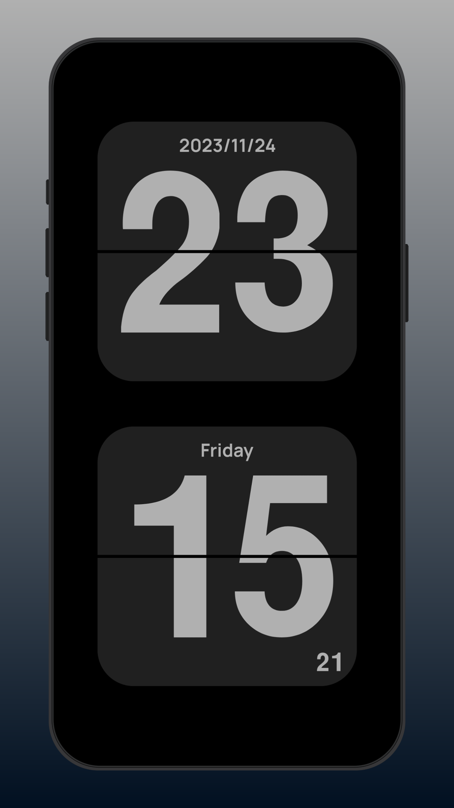
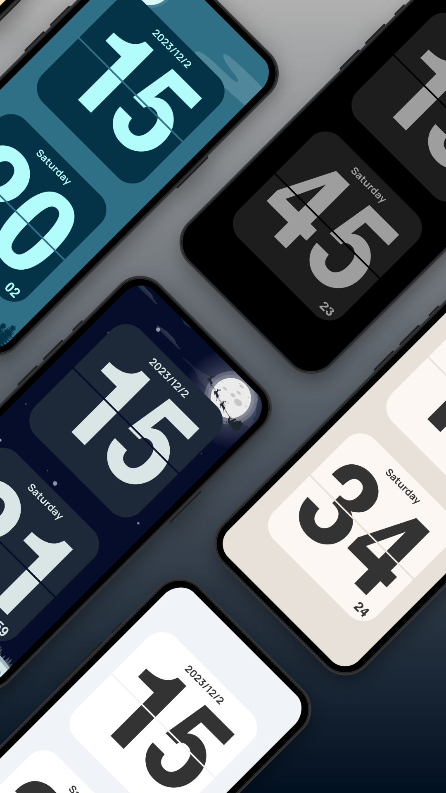

Sebuah aplikasi **[jam flip](/id/glossary/what-is-a-flip-clock/)** mengubah ponsel atau tablet apa pun menjadi jam retro yang menenangkan. **Only Clock** adalah **jam flip layar penuh** dengan animasi flip mulus, tema, mode melayang, white noise, dan pengatur fokus. Di bawah ini kami membandingkannya dengan **Flip Clock** gratis yang populer dan keunggulan masing-masing. Daftar pendek yang sama sering dicari sebagai **jam flip dengan pengatur fokus** atau **jam flip dengan white noise**, jadi kami juga membandingkan ekstra selain animasi.

## Yang harus dilakukan aplikasi jam flip

Aplikasi jam flip yang layak dipasang memenuhi enam hal: animasi kartu yang mulus, angka besar layar penuh yang terbaca dari seberang ruangan, pilihan tema, widget di layar utama, white noise, dan mode melayang. Only Clock mencakup keenamnya untuk Android dan iOS lewat animasi flip 3D, pustaka tema retro hingga foto, widget, suara ambient, dan overlay di atas aplikasi lain. Flip Clock gratis menyisakan bagian dari kriteria itu karena tidak menyediakan white noise, mode melayang, atau widget kaya. Enam kriteria di bawah dipakai untuk menguji keduanya dari sudut pandang pemakaian nyata.

- **Animasi flip mulus** — kartu flip harus terasa fisik, tidak patah-patah.
- **Layar penuh, terbaca** — angka besar yang bisa dilihat dari seberang ruangan.
- **Tema** — retro, kucing, minimal, atau berbasis foto untuk menyesuaikan ruangan.
- **Widget** — jam di layar utama, bukan hanya di dalam aplikasi.
- **White noise** — suara samping tempat tidur atau fokus tanpa aplikasi kedua.
- **Mode melayang** — jam di atas video atau saat Anda bekerja.

## Cara kami memilih aplikasi jam flip terbaik untuk Android

Menilai aplikasi jam flip terbaik untuk Android berarti mengujinya dari seberang ruangan, bukan dari daftar fitur, melalui empat pemeriksaan: ketangguhan animasi di ponsel lama, nilai ekstra seperti white noise dan widget, tersedianya mode layar penuh pada tingkat gratis, dan keamanan untuk sesi panjang dengan peredupan serta penanganan burn-in. Only Clock mencetak angka pada tiga pemeriksaan pertama berkat tema, suara, dan pengatur, sementara Flip Clock gratis menang ketika yang diinginkan hanya angka. Kerangka ini mencegah perbandingan terjebak pada janji visual semata.

1. **Animasi tetap tangguh** — kartu flip yang terasa fisik, tanpa lag di ponsel lama. **Jam flip retro** dan **jam flip minimalis** adalah dua ujung skala yang sama: dekorasi versus restraint.
2. **Ekstra yang layak** — **jam flip dengan white noise** dan **jam flip dengan pengatur fokus** mengubah tampilan menjadi alat belajar. **Widget jam flip** menjaga waktu di layar utama saat Anda tak ingin pengambil-alih layar penuh.
3. **Tingkat gratis dapat digunakan** — daftar pendek **aplikasi jam flip terbaik untuk Android** sebaiknya tak menaruh mode layar penuh dasar di balik paywall atau menyelinginya dengan iklan.
4. **Selamat dalam sesi panjang** — setup **jam flip untuk meja** atau **gunakan ponsel lama sebagai jam** berjalan berjam-jam di perangkat tetap-tercolok, jadi peredupan dan penanganan burn-in penting.

Only Clock mencetak angka 1–3 dengan tema, suara, dan pengatur; Flip Clock gratis menang jika Anda hanya ingin angkanya.

## Para pesaing sekilas

Tiga pilihan pada perbandingan harga 2026 ini — Only Clock, Flip Clock, dan widget jam minimal — terbagi antara paket serba ada dan jam telanjang: Only Clock memakai inti gratis plus VIP opsional dengan tema kaya, white noise, mode melayang, dan widget, Flip Clock gratis tanpa iklan dengan tema minimal, sedangkan widget jam minimal hanya mengurus layar utama. Perbedaan paling tajam terletak pada ketersediaan suara dan overlay. Tabel berikut merangkum harga, tema, white noise, melayang, widget, dan kekuatan masing-masing.

| App | Harga (2026) | Tema | White noise | Melayang | Widget | Terbaik untuk |
|---|---|---|---|---|---|---|
| **Only Clock** | Inti gratis + VIP opsional | ✅ kaya (kucing, retro, foto) | ✅ | ✅ | ✅ | Berbagai tema, serba ada |
| **Flip Clock** | Gratis (tanpa iklan) | ⚠️ minimal | ❌ | ❌ | ⚠️ dasar | Sederhana, gratis |
| **Widget jam minimal** | Gratis | ❌ | ❌ | ❌ | ✅ | Hanya layar utama |

## Only Clock, secara mendalam

Only Clock adalah jam flip layar penuh untuk Android dan iOS dengan animasi flip 3D dan pustaka tema yang mencakup retro, adegan kucing, minimal, dan latar foto. Di luar tampilan, aplikasi ini menyediakan white noise untuk tidur dan fokus, overlay melayang di atas video atau aplikasi lain, serta widget bergaya datar dan terpisah dengan tanggal opsional — semuanya membuat satu instalasi bisa dipakai di meja, samping tempat tidur, dan ponsel cadangan. Kekurangannya, tema dan suara terbaik berada di balik buka kunci VIP dan animasi menghabiskan sedikit baterai lebih banyak daripada jam statis.

{: width="180" .normal }
{: width="180" .normal }
{: width="180" .normal }
{: width="180" .normal }
{: width="180" .normal }

Only Clock adalah **jam flip layar penuh** untuk Android dan iOS dengan animasi flip 3D dan pustaka tema luas.

**Keunggulan**
- **Tema kaya** — retro, adegan kucing lucu, minimal, dan latar foto; jam menyesuaikan suasana atau ruangan Anda.
- **Animasi mulus** — transisi flip mengalir di perangkat modern.
- **White noise** — suara ambient bawaan untuk tidur dan fokus.
- **Overlay melayang** — jaga jam di atas video atau aplikasi lain.
- **Widget** — gaya datar dan terpisah dengan tanggal opsional.
- **Lintas platform** — Android dan iOS, termasuk ponsel cadangan sebagai tampilan jam.

**Kelemahan**
- **VIP untuk tema/suara terbaik** — tema dan suara puncak berada di balik buka kunci.
- **Lebih berat dari aplikasi minimal** — animasi dan tema menghabiskan sedikit baterai vs jam statis.

**Terbaik untuk:** orang yang menginginkan jam flip berkepribadian, bersuara, dan mode melayang.

- [Google Play — Only Clock](https://play.google.com/store/apps/details?id=com.glgjing.only.flip.clock)
- [App Store — Only Clock](https://apps.apple.com/app/id1566706513)

## Flip Clock, secara mendalam

Flip Clock (paket `com.wssc.simpleclock`) adalah aplikasi jam flip gratis tanpa iklan yang mengandalkan animasi layar penuh bersih, kontrol kecerahan dan selalu-menyala, serta tanggal. Kekuatannya ada pada kesederhanaan: tidak ada biaya, tidak ada iklan, dan konsumsi baterai serta penyimpanan minimal. Namun pilihan temanya terbatas pada jalur klasik, tidak ada white noise, tidak ada mode melayang, dan widgetnya hanya dasar sehingga waktu tetap terkurung di dalam aplikasi. Ini pilihan untuk pengguna yang menginginkan jam retro gratis tanpa tambahan apa pun.

{: width="180" .normal }
{: width="180" .normal }
{: width="180" .normal }
{: width="180" .normal }
{: width="180" .normal }

Flip Clock (paket `com.wssc.simpleclock`) adalah **aplikasi jam flip gratis** yang populer — animasi flip layar penuh yang bersih, kontrol kecerahan dan selalu-menyala, serta tanggal, tanpa iklan.

**Keunggulan**
- **Gratis dan bersih** — tampilan flip retro tanpa repot, tanpa harga, tanpa iklan.
- **Kontrol sederhana** — kecerahan dan selalu-menyala mudah dijangkau.
- **Ringan** — baterai dan penyimpanan minimal.

**Kelemahan**
- **Tema terbatas** — tetap di jalur klasik dengan sedikit variasi.
- **Tanpa white noise** — jam sunyi.
- **Tanpa mode melayang atau widget kaya** — waktu hanya ada di dalam aplikasi.

**Terbaik untuk:** siapa pun yang menginginkan jam flip retro gratis dan sederhana tanpa tambahan apa pun.

- [Google Play — Flip Clock](https://play.google.com/store/apps/details?id=com.wssc.simpleclock)

## Mana yang harus Anda pilih?

Keputusan antara Only Clock dan Flip Clock bergantung pada apakah Anda membutuhkan lebih dari sekadar angka yang berputar. Only Clock menyatukan tema retro hingga foto, white noise, mode melayang, dan widget untuk Android dan iOS dengan inti gratis plus VIP opsional, sementara Flip Clock gratis tanpa iklan menyisakan animasi flip bersih, kecerahan, dan tanggal. Jika ruangan, fokus, dan layar utama semuanya perlu dijaga dalam satu aplikasi, pilih Only Clock; jika Anda hanya ingin jam flip retro telanjang, Flip Clock sudah cukup.

- Ingin **tema + white noise + melayang + widget** → **Only Clock**.
- Ingin **jam flip retro telanjang gratis** → **Flip Clock**.

[Dapatkan Only Clock](/id/apps/only-clock/) — tersedia di Android dan iOS.

## Skenario umum

Empat skenario memakai Only Clock menunjukkan ruang gerak jam flip layar penuh di Android dan iOS: tema kucing atau retro membuat jam meja terasa hidup, mode melayang menjaga waktu tetap terlihat di atas video atau dokumen, white noise bawaan menenangkan samping tempat tidur tanpa aplikasi kedua, dan widget dengan tanggal membuat waktu tinggal sekilas dari layar utama. Karena mode melayang, suara, dan widget hadir dalam satu instalasi, keempat kebutuhan itu tidak perlu dipecah ke beberapa aplikasi. Berikut gambaran pemakaiannya.

- **Jam meja bergaya** — pilih tema kucing atau retro agar jam cocok dengan setup Anda; animasi flip membuat waktu terasa hidup.
- **Fokus sambil menonton** — aktifkan mode melayang dan jaga jam di atas video atau dokumen tanpa keluar aplikasi.
- **Samping tempat tidur bersuara** — padukan jam flip dengan white noise bawaan agar ruangan tetap tenang di malam hari; tak perlu aplikasi kedua.
- **Layar utama sekilas** — taruh widget jam (dengan tanggal) agar waktu hanya sejauh satu pandangan, bukan hanya di dalam aplikasi.

## FAQ

**Apakah Only Clock gratis?**
{:.faq-q}

Ya. Jam flip inti, widget, dan white noise berfungsi gratis; VIP sekali bayar membuka tema dan paket suara terkaya.

**Apakah Only Clock punya jam melayang?**
{:.faq-q}

Ya. Mode overlay melayang menjaga jam di atas aplikasi lain atau video saat Anda bekerja.

**Only Clock atau Flip Clock — mana yang harus saya pilih?**
{:.faq-q}

Ingin tema, white noise, mode melayang, dan widget → Only Clock; ingin jam flip retro telanjang gratis tanpa ekstra → Flip Clock.

## Istilah terkait

- [Apa Itu Jam Flip?](/id/glossary/what-is-a-flip-clock/)
- [Apa Itu Jam Meja Samping Tempat Tidur?](/id/glossary/what-is-a-nightstand-clock/)
