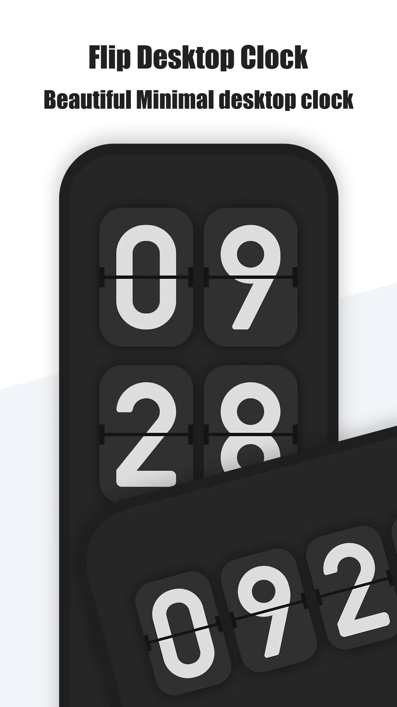
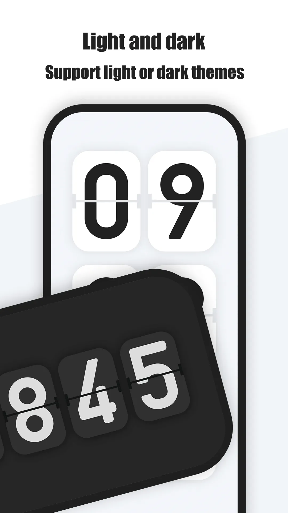
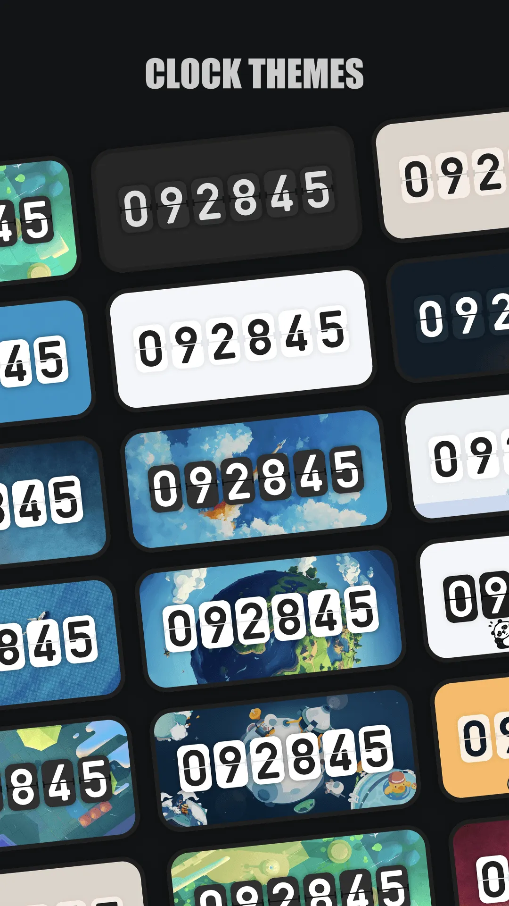
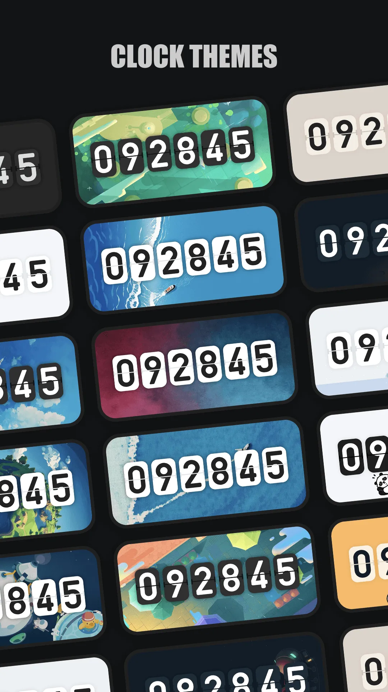
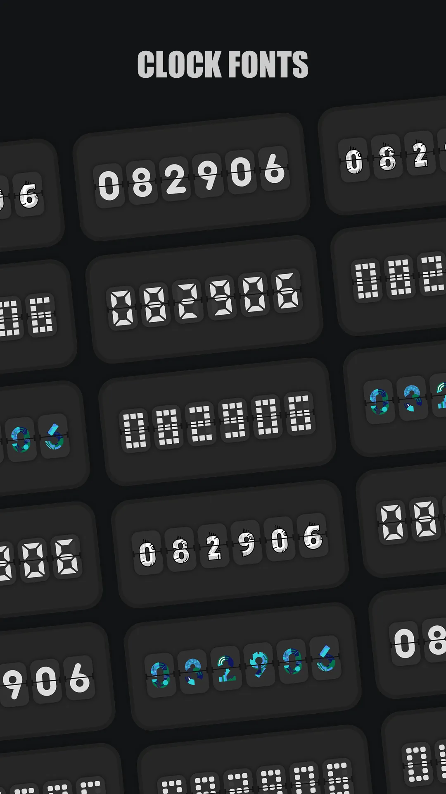
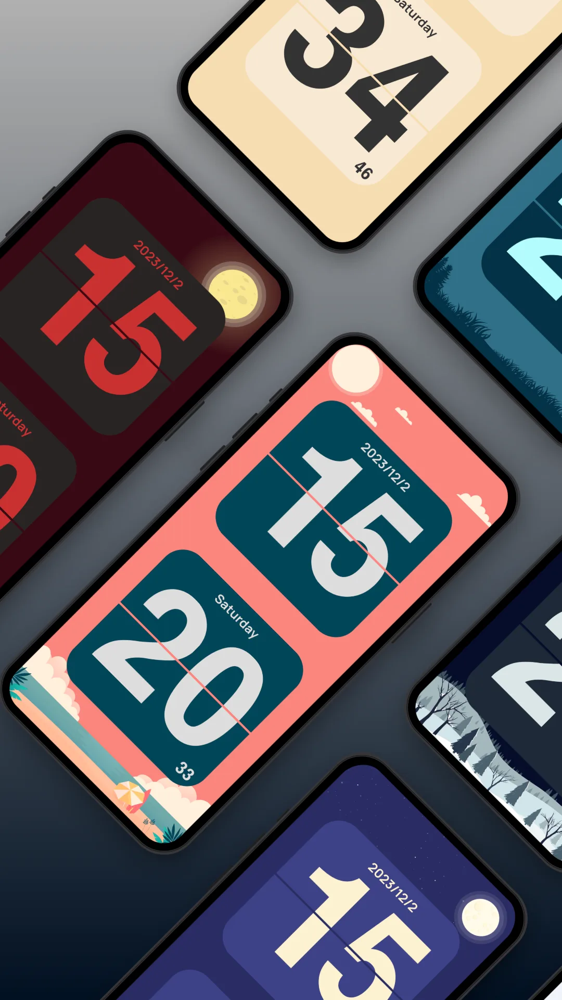
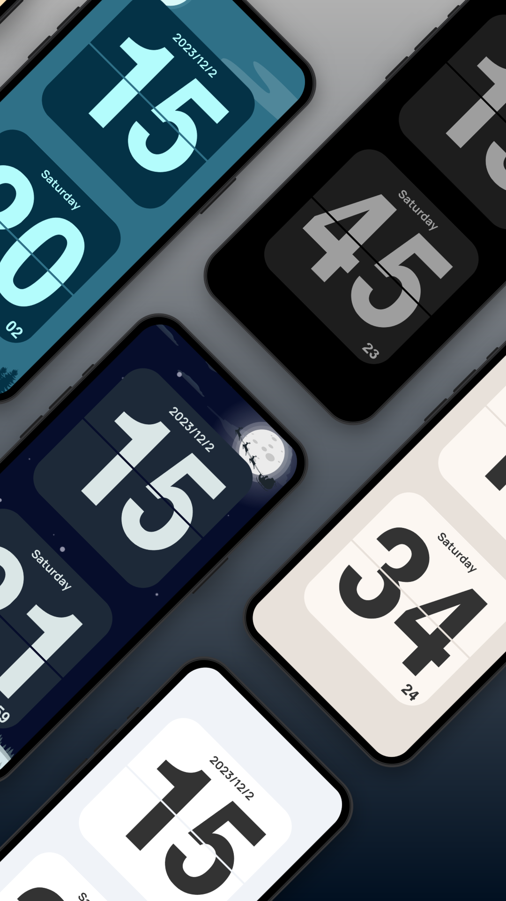
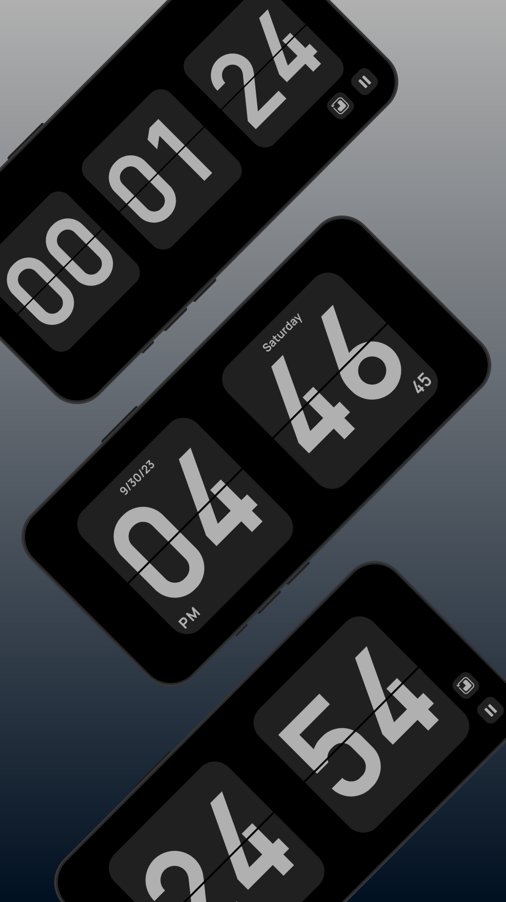

Ponsel atau tablet cadangan menjadi **[jam samping tempat tidur](/id/glossary/what-is-a-nightstand-clock/)** yang sempurna. **Aplikasi jam samping tempat tidur terbaik** harus redup, terbaca, dan tenang — dan idealnya memutar suara yang menutupi dengkuran pasangan. **Only Clock** adalah **jam flip layar penuh** yang pas di samping tempat tidur. Berikut cara ia dibandingkan dengan **Flip Clock** gratis untuk pemakaian samping tempat tidur, plus setup dan tips burn-in. Orang juga datang ke sini dari pencarian **gunakan ponsel lama sebagai jam** atau **aplikasi jam samping tempat tidur** — keduanya pertanyaan setup yang sama.

## Yang dibutuhkan jam samping tempat tidur

- **Tema redup, gelap** — nyaman di mata mengantuk.
- **Ramah selalu-menyala** — tetap menyala saat dicolok.
- **White noise** — menutupi suara lingkungan tiba-tiba.
- **Penjaga burn-in** — layar OLED butuh pergeseran atau peredupan agar tak ghosting.
- **Colok-dan-lupa** — perangkat cadangan yang melakukan satu tugas.

## Yang benar-benar dibutuhkan setup samping tempat tidur

Sebuah **aplikasi jam samping tempat tidur** dinilai pukul 2 dini hari. Empat detail praktis menentukan apakah ponsel cadangan tetap di meja:

- **Tanpa interupsi** — **jam samping tempat tidur tanpa iklan** adalah filter pertama; iklan layar penuh di waktu tidur menggagalkan seluruh ide. Tema redup dan gelap sama pentingnya dengan angkanya sendiri.
- **Keamanan layar** — OLED selalu-menyala butuh tampilan redup atau bergeser. **Aplikasi jam samping tempat tidur** yang hanya menawarkan satu wajah putih terang adalah pendamping semalam yang buruk.
- **Suara tanpa aplikasi kedua** — **jam flip dengan white noise** menutupi dengkuran pasangan atau kebisingan jalanan, sementara **jam flip dengan pengatur fokus** lebih berguna di perangkat yang sama saat siang.
- **Kehidupan kedua untuk perangkat lama** — **gunakan ponsel lama sebagai jam** adalah peningkatan meja atau **jam flip untuk meja** termurah; periksa bahwa aplikasi masih berjalan di Android versi lama sebelum mendedikasikan perangkat.

Only Clock mencakup tema redup, suara, dan pengatur dalam satu instalasi; Flip Clock menjaga tampilan polos dan gratis.

## Para pesaing sekilas

| App | Harga (2026) | Tema redup | White noise | Penjaga burn-in | Terbaik untuk samping tempat tidur |
|---|---|---|---|---|---|
| **Only Clock** | Inti gratis + VIP | ✅ | ✅ | ✅ (geser/redup) | Serba ada samping tempat tidur |
| **Flip Clock** | Gratis (tanpa iklan) | ⚠️ dasar | ❌ | ❌ | Jam telanjang |
| **Widget jam minimal** | Gratis | ❌ | ❌ | ❌ | Sekili layar utama |

## Only Clock, secara mendalam

{: width="180" .normal }
{: width="180" .normal }
{: width="180" .normal }
{: width="180" .normal }
{: width="180" .normal }

Only Clock adalah **jam flip layar penuh** untuk Android dan iOS dengan tema gelap, white noise, dan opsi anti-burn-in.

**Keunggulan untuk samping tempat tidur**
- **Tema gelap, bisa diredupkan** — tampilan kucing dan retro yang tetap lembut di malam hari.
- **White noise** — hujan, perapian, dan lainnya untuk tidur.
- **Keamanan burn-in** — opsi pergeseran jam / redup melindungi panel OLED.
- **Selalu-menyala saat mengisi daya** — ponsel cadangan menjadi jam permanen.
- **Widget** — jam di layar kunci atau layar utama juga.

**Kelemahan untuk samping tempat tidur**
- **VIP untuk suara/tema terbaik** — suara premium dan tema berada di balik buka kunci.
- **Animasi memakai lebih banyak daya** daripada jam statis (tak masalah saat dicolok).

**Terbaik untuk:** perangkat cadangan yang harus melakukan lebih dari sekadar menunjukkan waktu.

- [Google Play — Only Clock](https://play.google.com/store/apps/details?id=com.glgjing.only.flip.clock)
- [App Store — Only Clock](https://apps.apple.com/app/id1566706513)

## Flip Clock, secara mendalam

{: width="180" .normal }
{: width="180" .normal }
{: width="180" .normal }
{: width="180" .normal }
{: width="180" .normal }

Flip Clock (paket `com.wssc.simpleclock`) adalah **aplikasi jam flip** gratis tanpa iklan dengan kontrol kecerahan dan selalu-menyala.

**Keunggulan untuk samping tempat tidur**
- **Gratis dan bersih** — wajah flip retro sederhana, tanpa biaya, tanpa iklan.
- **Kecerahan + selalu-menyala** — mudah diredupkan dan tetap menyala.

**Kelemahan untuk samping tempat tidur**
- **Tanpa white noise** — Anda butuh aplikasi suara tidur terpisah.
- **Tanpa pergeseran burn-in** — wajah OLED statis berisiko ghosting semalaman.
- **Tanpa tema** — hanya tampilan klasik.

**Terbaik untuk:** jam samping tempat tidur telanjang gratis di setup non-OLED atau yang dikelola hati-hati.

- [Google Play — Flip Clock](https://play.google.com/store/apps/details?id=com.wssc.simpleclock)

## Tips setup dan burn-in

- Simpan ponsel **tercolok** dan **kecerahan rendah**.
- Aktifkan opsi **anti-burn-in / pergeseran jam** yang ditawarkan aplikasi.
- Gunakan **white noise** untuk menutupi suara lingkungan.

## Mana yang harus Anda pilih?

- Ingin **pendamping samping tempat tidur yang tenang dan bersuara** → **Only Clock**.
- Ingin **jam telanjang gratis** dan akan mengelola kecerahan sendiri → **Flip Clock**.

[Dapatkan Only Clock](/id/apps/only-clock/) — tersedia di Android dan iOS.

## Skenario umum

- **Ponsel cadangan sebagai jam samping tempat tidur** — colok ponsel lama di samping tempat tidur, buka Only Clock, dan wajah flip redup menampilkan waktu tanpa menerangi ruangan.
- **Tutupi pasangan yang mendengkur** — padukan jam flip dengan white noise bawaan (hujan, perapian) agar Anda tertidur meski berisik.
- **OLED tanpa ghosting** — pergeseran/redup anti-burn-in menjaga panel OLED aman sepanjang malam.
- **Kamar anak atau tamu** — perangkat cadangan murah menjadi jam selalu-menyala yang tenang tanpa akun dan tanpa ribet.

## FAQ

**Apakah Only Clock gratis untuk samping tempat tidur?**
{:.faq-q}

Ya. Jam inti, tema redup, dan white noise berfungsi gratis; VIP sekali bayar membuka tema dan paket suara terkaya.

**Apakah Only Clock melindungi OLED dari burn-in?**
{:.faq-q}

Ya. Menawarkan opsi pergeseran jam anti-burn-in dan redup agar panel OLED tak ghosting saat dibiarkan selalu-menyala semalaman.

**Only Clock atau Flip Clock untuk samping tempat tidur?**
{:.faq-q}

Ingin jam samping tempat tidur redup bersuara dengan keamanan burn-in → Only Clock; ingin jam telanjang gratis dan akan mengelola kecerahan sendiri → Flip Clock.

## Istilah terkait

- [Apa Itu Jam Flip?](/id/glossary/what-is-a-flip-clock/)
- [Apa Itu Jam Meja Samping Tempat Tidur?](/id/glossary/what-is-a-nightstand-clock/)
