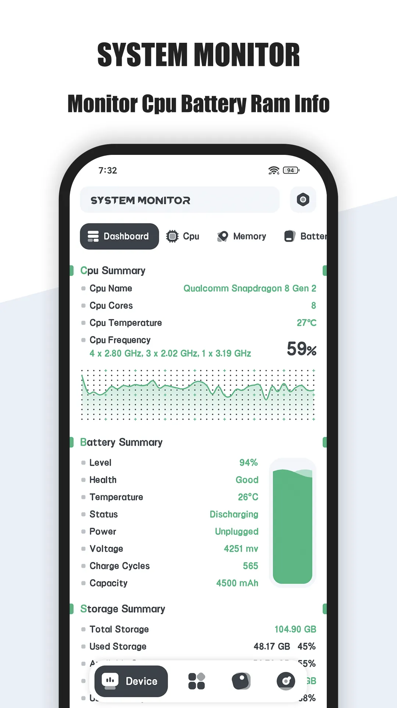
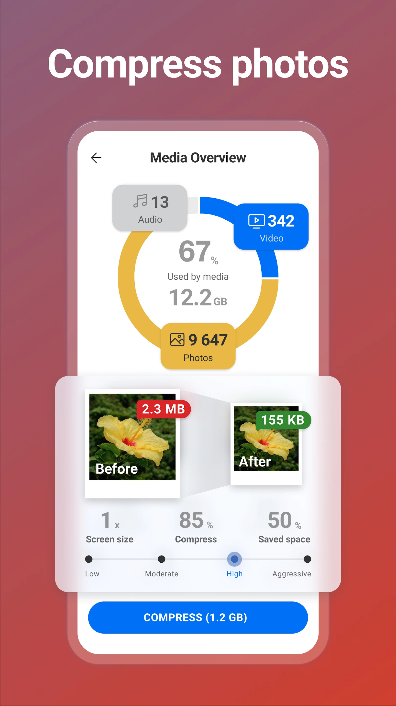

Saat ponsel terasa lemot, Anda ingin tahu **alasannya** — core mana yang menempel, sisa RAM berapa, apa yang memakan storage. Sebuah [system monitor](/id/glossary/what-is-a-system-monitor/) menampilkan statis perangkat langsung tanpa mencoba "memperbaiki" apa pun. **System Monitor** adalah **aplikasi info-perangkat berbayar satu kali untuk Android** yang mendeteksi CPU, memori, storage, dan detail baterai secara mendalam. Di bawah ini kami membandingkannya dengan **CCleaner**, merek pembersih, untuk memahami ponsel Anda. Daftar pendek yang sama sering dicari sebagai **aplikasi pembersih ponsel terbaik android** atau **system monitor android dengan cleaner dan booster** — dua pekerjaan yang halaman ini pisahkan.

## Apa yang dibutuhkan system monitor

Sebuah system monitor yang berguna menampilkan lima hal tanpa mengubah apa pun: angka CPU, memori, dan storage langsung, bacaan baterai serta suhu, daftar proses yang berjalan, overhead ringan, dan pembacaan lokal tanpa akun. System Monitor menyediakan kelimanya untuk Android lewat dasbor statis waktu nyata dan deteksi hardware mendalam dengan harga unduh satu kali, sementara CCleaner justru berfokus pada penghapusan file dan tidak kuat di pelaporan. Karena pemantauan sebaiknya tidak menambah beban yang diukurnya, kelima syarat ini menjadi ukuran dalam perbandingan berikut.

- **CPU, memori, storage langsung** — angka yang menjelaskan kelambatan.
- **Baterai dan suhu** — kesehatan dan panas sekilas.
- **Daftar proses** — lihat apa yang berjalan dan memakai sumber daya.
- **Ringan** — pemantauan sebaiknya tak menambah beban.
- **Privat** — baca lokal, tanpa akun, tanpa unggah.

## Bagaimana kami memilih aplikasi system monitor terbaik

Memeringkat aplikasi system monitor terbaik berarti memisahkan dua pekerjaan yang sering dicampur: melaporkan apa yang dilakukan ponsel dan mengubah isi penyimpanannya. Empat pemeriksaan dipakai — akurasi bacaan read-only, ketersediaan CPU, RAM, storage, dan baterai dalam satu layar, overlay yang tetap ringan saat gaming, serta tidak adanya klaim kecepatan satu ketuk. System Monitor menang pada tiga pemeriksaan pertama untuk memahami perangkat, sedangkan CCleaner menang ketika tugasnya mengosongkan ruang. Pemisahan ini penting karena mematikan proses latar di Android modern sering justru menguras baterai.

1. **Akurasi read-only** — sebuah **aplikasi cleaner android** menghapus file; daftar pendek **system monitor cpu ram baterai cleaner** sebaiknya dahulu membuktikan angka adalah bacaan sensor dan sistem nyata, bukan perkiraan.
2. **Satu layar, semua angka** — pencarian **system monitor android dengan cleaner dan booster** biasanya berarti seseorang ingin CPU, RAM, storage, dan baterai bersama. System Monitor menutupi separuh pelaporan; CCleaner menutupi separuh pembersihan, dan tak satu pun jujur melakukan keduanya.
3. **Overlay yang tetap ringan** — bacaan **system monitor dengan jendela melayang** atau **system monitor jendela melayang android** berguna hanya bila ia tak sendiri menambah beban saat Anda gaming.
4. **Tanpa klaim kecepatan palsu** — sebuah **alat all-in-one android** yang menjanjikan perbaikan satu ketuk sedang membuat klaim yang sebaiknya tak diklaim monitor read-only. Mematikan aplikasi latar di Android modern sering justru memakan baterai lebih banyak daripada menghematnya.

System Monitor menang di 1–3 untuk memahami ponsel; CCleaner menang bila tugas sebenarnya adalah mengosongkan ruang.

## Para pesaing sekilas

Tiga aplikasi dalam tabel harga 2026 ini — System Monitor, CCleaner, dan DevCheck — mewakili tiga sudut pandang yang berbeda: System Monitor berbayar satu kali menyajikan statis langsung CPU, RAM, storage, dan baterai secara read-only, CCleaner gratis dengan langganan Pro mengutamakan aksi bersih dan boost, sementara DevCheck gratis plus IAP menawarkan bacaan spesifikasi paling mendalam. Hanya satu yang benar-benar mengubah isi ponsel, dan itulah garis pemisah utama. Tabel berikut merangkum harga, statis langsung, daftar proses, aksi, dan kekuatan masing-masing.

| App | Harga (2026) | Statis langsung | Daftar proses | Aksi (bersih/boost) | Terbaik untuk |
|---|---|---|---|---|---|
| **System Monitor** | Berbayar (satu kali) | ✅ CPU/RAM/storage/baterai | ✅ | ❌ hanya info | Melihat yang terjadi |
| **CCleaner** | Gratis + langganan Pro | ⚠️ sebagian | ⚠️ terbatas | ✅ | Membersihkan & mengoptimalkan |
| **DevCheck** | Gratis + IAP | ✅ mendalam | ✅ | ❌ | Selami spesifikasi |

## System Monitor, lebih dalam

System Monitor adalah aplikasi info-perangkat Android berbayar sekali yang melaporkan detail hardware dan statis langsung tanpa mengoptimasi apa pun. Dasbornya menampilkan model CPU dan frekuensi per-core, pemakaian memori, rincian storage, serta kesehatan dan suhu baterai, lengkap dengan daftar proses aplikasi berjalan. Semua bacaan diproses lokal di perangkat tanpa akun atau cloud, dan tidak ada dinding VIP setelah pembelian. Kekurangannya, aplikasi ini hanya menyajikan informasi — tidak mengosongkan memori, membersihkan file, atau membunuh tugas — dan sebagian datanya sudah tersedia di pengaturan Android sendiri.

{: width="180" .normal }
{: width="180" .normal }
{: width="180" .normal }
{: width="180" .normal }
{: width="180" .normal }

System Monitor adalah **alat info-perangkat Android berbayar**. Dengan harga unduh satu kali ia melaporkan detail hardware dan statis langsung: model CPU dan frekuensi per-core, pemakaian memori, rincian storage, dan kesehatan/suhu baterai — deteksi read-only, bukan optimasi.

**Keunggulan untuk pemantauan**
- **Deteksi hardware detail** — model/arsitektur CPU, frekuensi per-core, total dan pemakaian memori, rincian storage, bacaan sensor.
- **CPU/RAM/storage/baterai langsung** — dasbor jelas tentang yang terjadi kini.
- **Daftar proses** — lihat aplikasi berjalan dan pemakaian sumber dayanya.
- **Bacaan suhu** — tangkap panas bersama beban.
- **Ringan dan lokal** — berjalan di perangkat, tanpa akun, tanpa cloud.
- **Berbayar, tanpa upsell** — set fitur penuh dengan harga satu kali; tanpa dinding VIP.

**Kelemahan untuk pemantauan**
- **Hanya info** — ia melaporkan spesifikasi dan statis; tak mengosongkan memori, membersihkan file, atau membunuh tugas.
- **Tumpang tindih alat OS** — pengaturan Android sendiri sudah menampilkan sebagian ini.
- **Berbayar di awal** — tak ada tier gratis untuk coba dulu.

**Terbaik untuk:** orang yang ingin pandangan hardware mendalam dan statis langsung read-only dari ponselnya.

- [Google Play — System Monitor](https://play.google.com/store/apps/details?id=com.glgjing.marvel)

## CCleaner, lebih dalam

CCleaner (paket `com.piriform.ccleaner`, dari Gen Digital) membawa nama pembersih desktop ke Android lewat penghapusan junk dan cache, pencari file duplikat, serta pembersihan jejak privasi. Kekuatannya ada pada aksi satu ketuk yang langsung mengosongkan ruang, didukung merek lintas platform yang sudah familier. Namun statis langsungnya lemah karena tidak ada dasbor waktu nyata yang kaya, hasilnya sedikit pada Android modern yang sudah mengelola memori dan cache otomatis, fitur Pro memerlukan langganan, dan merek ini pernah menghadapi pengawasan atas praktik data.

{: width="180" .normal }
{: width="180" .normal }
{: width="180" .normal }
{: width="180" .normal }
{: width="180" .normal }

CCleaner (paket `com.piriform.ccleaner`, dari Gen Digital) terkenal untuk pembersihan PC dan membawa merek itu ke Android dengan pembersihan junk dan alat performa.

**Keunggulan untuk pemantauan/pembersihan**
- **Pembersihan junk & cache** — mengosongkan storage dari file temp.
- **Pencari file duplikat** — mengambil kembali ruang dari pengulangan.
- **Pembersihan privasi** — menghapus jejak penjelajahan.
- **Merek lintas platform** — familier dari desktop.

**Kelemahan untuk pemantauan**
- **Statis langsung lemah** — ia lebih membersihkan daripada memantau; tak ada dasbor waktu nyata kaya.
- **Terbatas di Android** — Android modern sudah mengelola memori dan cache otomatis, jadi hasilnya sedikit.
- **Berlangganan** — fitur Pro butuh paket berbayar.
- **Riwayat privasi** — merek pernah menghadapi pengawasan atas praktik data.

**Terbaik untuk:** pengguna yang ingin pembersih satu ketuk dan menerima berlangganan.

- [Google Play — CCleaner](https://play.google.com/store/apps/details?id=com.piriform.ccleaner)

## Bagaimana yang lain membandingkan

Perbandingan dengan aplikasi lain menempatkan DevCheck sebagai rekan pemantauan System Monitor, bukan pengganti fungsi pembersih. DevCheck menawarkan bacaan spesifikasi paling mendalam dan daftar proses gratis dengan pembelian dalam aplikasi, sehingga cocok untuk Anda yang ingin menyelami detail hardware. System Monitor tetap berada di jalur yang sama dengan penekanan pada statis langsung dan harga unduh satu kali tanpa upsell, sementara CCleaner mengambil jalur berbeda dengan menghapus file. Posisi ini menjelaskan mengapa ketiganya tidak saling menggantikan secara penuh.

- **DevCheck** menawarkan bacaan spesifikasi paling mendalam dan daftar proses gratis dengan IAP; rekan pemantauan System Monitor bukan pembersih.

## Mana yang harus dipilih?

Pilihan antara System Monitor dan CCleaner bergantung pada apakah Anda ingin memahami ponsel atau mengubah isinya. System Monitor dengan harga unduh satu kali memberi pandangan read-only atas CPU, memori, storage, baterai, dan daftar proses tanpa akun maupun cloud, sementara CCleaner gratis dengan langganan Pro menyediakan pembersihan cache dan storage satu ketuk. Untuk mencari penyebab lemot dan mengawasi suhu serta proses, System Monitor adalah jawabannya; untuk mengosongkan ruang penyimpanan, CCleaner lebih tepat.

- Ingin **info hardware & statis langsung read-only mendalam** → **System Monitor**.
- Ingin **pembersih cache/storage satu ketuk** → **CCleaner**.

[Dapatkan System Monitor](/id/apps/system-monitor/) — tersedia di Android.

## Skenario khas

Lima skenario memakai System Monitor menunjukkan kegunaan bacaan read-only di Android: membuka dasbor untuk melihat core yang menempel, sisa RAM, dan pemakan storage alih-alih menebak; memantau kurva suhu, kesehatan, dan tegangan untuk menangkap keausan baterai lebih awal; mengawasi daftar proses yang menghisap CPU atau memori; menjaga privasi karena semua bacaan lokal tanpa akun maupun unggah cloud; dan memutuskan sendiri apakah pembersihan diperlukan berdasarkan fakta, bukan tombol otomatis. Berikut contoh-contohnya.

- **Temukan penyebab lemot** — buka dasbor untuk melihat core mana yang menempel, sisa RAM berapa, dan apa yang memakan storage, alih-alih menebak.
- **Lacak keausan baterai** — periksa kurva suhu, kesehatan, dan tegangan untuk menangkap penurunan kapasitas sejak awal.
- **Awasi proses** — daftar proses menunjukkan aplikasi mana yang menghisap CPU atau memori kini.
- **Intip tanpa privasi** — semua bacaan lokal, tanpa akun dan tanpa unggah cloud, sehingga data perangkat tetap di perangkat.
- **Tanpa kejutan pembersih** — fakta read-only membiarkan Anda memutuskan apakah pembersihan diperlukan.

## FAQ

**Apakah System Monitor gratis?**
{:.faq-q}

Tidak. Ini unduh berbayar satu kali — tanpa berlangganan dan tanpa dinding upgrade.

**System Monitor atau CCleaner — mana yang harus saya pilih?**
{:.faq-q}

Ingin pandangan read-only mendalam CPU, memori, storage, dan baterai → System Monitor; ingin pembersih cache/storage satu ketuk dan menerima berlangganan → CCleaner.

**Apakah System Monitor menampilkan daftar proses?**
{:.faq-q}

Ya. Ia menampilkan aplikasi berjalan dan pemakaian sumber dayanya, sehingga Anda bisa melihat apa yang mengonsumsi CPU atau memori.

**Apakah System Monitor membersihkan junk atau mengosongkan RAM?**
{:.faq-q}

Tidak. System Monitor read-only; ia melaporkan fakta dan tak pernah membersihkan cache atau mengosongkan memori. Untuk pembersihan, lihat panduan [alternatif CCleaner](/id/posts/alternatives-to-ccleaner/).

## Istilah terkait

- [Apa Itu Monitor Suhu CPU?](/id/glossary/what-is-a-cpu-temperature-monitor/)
- [Apa Itu System Monitor?](/id/glossary/what-is-a-system-monitor/)
- [Apa Itu RAM Booster?](/id/glossary/what-is-a-ram-booster/)
