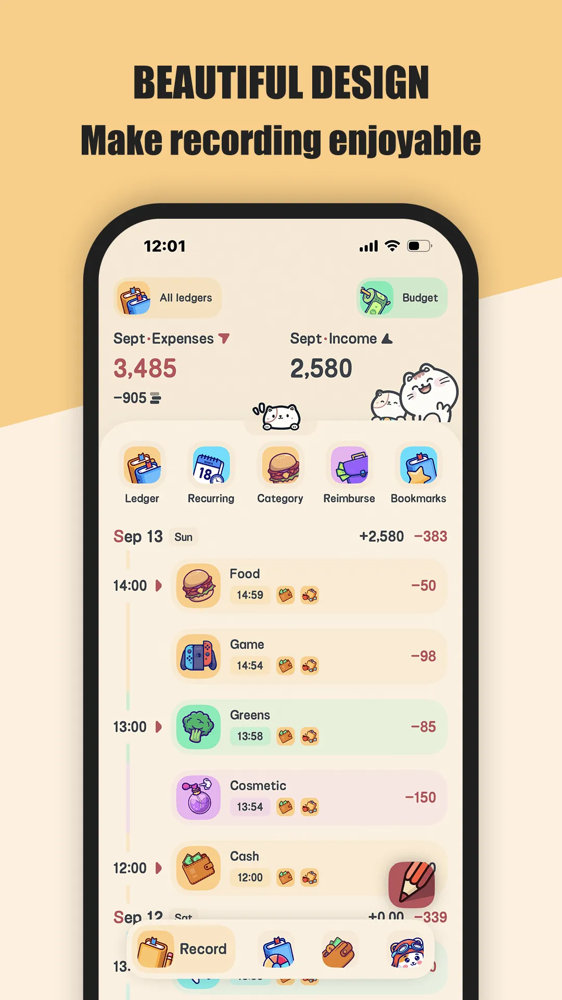
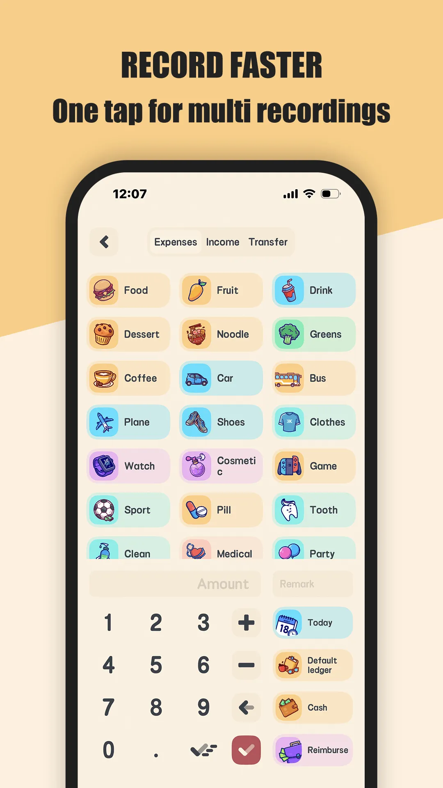

Jika Anda memakai Android dan ingin mengendalikan pengeluaran, pilihan **aplikasi catatan keuangan 2026** makin banyak — dan makin bising. Panduan ini memangkas kebisingan itu: apa yang sebenarnya dilakukan **pencatat pengeluaran** yang baik di Android, fitur mana yang menentukan, dan bagaimana aplikasi yang paling banyak dipasang saling berhadapan. Kami membahas tuntas **Meow Money Manager** (aplikasi kami) dan membandingkannya dengan **YNAB**, **PocketGuard** serta lainnya, lalu menunjuk ke perbandingan dan tutorial yang lebih spesifik.

## Mengapa aplikasi anggaran di Android berbeda

Memilih **[aplikasi anggaran](/id/glossary/what-is-an-expense-tracker/)** di Android berbeda dari iOS karena Anda memberi akses ke data finansial dalam ekosistem yang terbuka, sehingga privasi dan penyimpanan lokal menjadi pertimbangan utama. Sebagian pengguna menginginkan sinkronisasi bank otomatis, tetapi banyak yang hanya ingin mencatat pengeluaran dalam sepuluh detik tanpa daftar akun cloud baru. Keunggulan Android — aksi satu ketuk lewat widget layar utama — membuat widget catat cepat lebih penting di sini. Meow Money Manager menjawabnya dengan pencatatan lokal di balik sidik jari dan entri di bawah sepuluh detik tanpa akun.

## Apa yang perlu dicari pada aplikasi anggaran / catatan keuangan

Fitur yang paling menentukan saat memilih aplikasi anggaran bulanan atau aplikasi budget per kategori di Android ada tujuh: model akun dan privasi, dukungan 50+ simbol mata uang termasuk Rupiah, pencatatan offline tanpa sinyal, widget catat cepat di bawah sepuluh detik, ekspor CSV serta backup Google Drive atau WebDAV, model harga inti gratis dengan unlock sekali bayar, dan ketersediaan di Android serta iOS. Meow Money Manager memenuhi ketujuhnya dengan data tersimpan lokal di perangkat dan kunci sidik jari, sementara kebanyakan pesaing mengharuskan akun cloud dan langganan. Berikut rincian tiap kriteria.

- **Privasi & model akun** — apakah memaksa akun cloud, atau menyimpan data di perangkat di balik sidik jari? Model *tanpa akun, lokal terlebih dahulu* berarti **data tersimpan lokal di perangkat** dan tidak ada yang keluar kecuali Anda membuat backup.
- **Multi mata uang** — penting jika Anda bepergian, bekerja lepas, atau berbagi biaya lintas negara (50+ simbol mata uang, termasuk Rupiah, jadi patokan).
- **Pencatatan offline** — **catat pengeluaran & pemasukan** di MRT atau pesawat tanpa sinyal, **offline tanpa internet**.
- **Widget catat cepat di layar utama** — catat pengeluaran di bawah sepuluh detik tanpa membuka aplikasi.
- **Ekspor & backup** — **ekspor CSV** untuk pajak atau reimburse, plus Google Drive atau WebDAV pilihan Anda.
- **Model harga** — *fitur inti gratis + unlock opsional* dan *unduhan berbayar* lebih disukai banyak pengguna daripada langganan tanpa akhir; ketahui apa yang Anda bayar.
- **Platform** — Android + iOS jika Anda berganti perangkat atau berbagi dengan pasangan pengguna iPhone.

## Sekilas para pesaing

Tabel perbandingan 2026 ini menempatkan empat aplikasi anggaran dengan harga dan model privasi yang berbeda: Meow Money Manager gratis untuk mulai dengan VIP sekali bayar opsional, tanpa akun dan lokal; YNAB berlangganan $14,99 per bulan atau $109 per tahun dengan uji coba 34 hari dan sinkron bank; PocketGuard gratis dengan Plus sekitar $74,99 per tahun; dan EveryDollar gratis manual dengan Premium sekitar $79,99 per tahun. Perbedaan terbesar ada pada kepemilikan data dan dukungan multi mata uang. Tabel berikut merangkum akun, lokasi data, mata uang, widget Android, dan kekuatan masing-masing.

| Aplikasi | Harga (2026) | Akun | Lokal/privat | Multi mata uang | Widget Android | Paling cocok untuk |
|---|---|---|---|---|---|---|
| **Meow Money Manager** | Unduh gratis, inti gratis + VIP sekali bayar opsional | **Tidak** (di perangkat + sidik jari) | ✅ lokal | ✅ 50+ mata uang | ✅ catat cepat | Privat, multi mata uang, lucu |
| **YNAB** | $14,99/bln atau $109/thn (uji coba 34 hari) | Ya (cloud) | ❌ sinkron cloud | Terbatas (kebanyakan USD) | ⚠️ dasar | Pembinaan zero-based + sinkron bank |
| **PocketGuard** | Gratis + Plus ~$74,99/thn | Ya (untuk sinkron) | ❌ cloud | Sebagian | ⚠️ dasar | Kesederhanaan "safe to spend" |
| **EveryDollar** | Gratis (manual) + Premium ~$79,99/thn | Opsional | ❌ cloud | Tidak | ⚠️ dasar | Metode zero-based Ramsey |

> **Catatan:** Mint dihentikan oleh Intuit pada Maret 2024. Jika Anda mantan pengguna Mint, kami membandingkan tujuh pengganti secara head-to-head di [Alternatif Mint Terbaik 2026](/id/posts/alternatives-to-mint/).

## Meow Money Manager, secara mendalam

Meow Money Manager adalah aplikasi catatan keuangan dan anggaran bertema kucing untuk Android dan iOS yang menyimpan semua data di perangkat di balik kunci sidik jari, tanpa daftar akun maupun login bank. Antarmukanya tersedia dalam lima bahasa — Tionghoa, Inggris, Indonesia, Thai, dan Portugis — dan mendukung 50+ simbol mata uang termasuk Rupiah dengan buku kas terpisah. Pencatatan offline, widget catat cepat di bawah sepuluh detik, transaksi berulang, pelacakan reimburse, ekspor CSV, 400+ ikon, dan backup Google Drive atau WebDAV melengkapi fiturnya. Data hanya keluar dari ponsel jika Anda membuat backup.

{: width="180" .normal }
{: width="180" .normal }
{: width="180" .normal }
{: width="180" .normal }
{: width="180" .normal }

Meow Money Manager adalah **[aplikasi catatan keuangan bertema kucing](/id/glossary/what-is-an-expense-tracker/)** dan **[aplikasi anggaran](/id/glossary/what-is-budget-management/)** untuk Android dan iOS yang menyimpan semuanya **di perangkat Anda** di balik kunci sidik jari — **tanpa daftar akun**, tanpa login bank, dengan **data tersimpan lokal di perangkat** yang tidak pernah meninggalkan ponsel kecuali Anda membuat backup ke Google Drive atau WebDAV. Antarmukanya bertema kucing dan menyediakan UI multi-bahasa — Tionghoa, Inggris, Indonesia, Thai, dan Portugis.

- **Tanpa daftar akun** — buka aplikasi dan langsung mencatat; tidak ada yang diunggah ke server.
- **Mode offline penuh** — pencatatan tetap jalan tanpa sinyal, cocok untuk perjalanan, penerbangan, dan **offline tanpa internet**.
- **Simbol multi mata uang** — 50+ simbol termasuk Rupiah, pilih mata uang per transaksi, dengan buku kas terpisah untuk rumah, perjalanan, dan usaha.
- **Widget catat cepat** — catat pengeluaran dari layar utama di bawah sepuluh detik.
- **Transaksi berulang** — kos, gaji, dan langganan dibuat otomatis agar tidak perlu diketik ulang.
- **Pelacakan reimburse** — tandai pengeluaran bisa diganti (penuh atau sebagian), berguna untuk perjalanan dinas.
- **Ekspor CSV** plus backup Google Drive atau WebDAV, dan **400+ ikon lucu** dengan mode gelap.

**Skenario umum:** saat perjalanan tanpa sinyal, catat pengeluaran lewat widget layar utama dalam sepuluh detik — data tetap lokal, tidak ada yang diunggah; saat perjalanan dinas, pakai **pelacakan reimburse** untuk menandai biaya taksi dan makan, lalu **ekspor CSV** dan cocokkan dengan kantor dalam satu ketukan; untuk hidup lintas negara, pakai 50+ simbol mata uang dalam satu buku kas untuk memantau **catatan keuangan harian** rumah dan valas. Karena **tidak perlu akun dan menyimpan data hanya di perangkat**, aplikasi ini cocok untuk pengguna Android yang menjaga privasi dan tidak ingin tagihannya diserahkan ke akun cloud.

**Paling cocok untuk:** pengguna Android yang mengutamakan privasi, rumah tangga multi mata uang, pelancong, dan siapa pun yang menginginkan **aplikasi anggaran gratis** **tanpa daftar akun**.

Bacaan lanjutan:
- [Meow Money Manager untuk Android — ulasan lengkap](/id/posts/best-meow-money-manager-android/)
- [Aplikasi anggaran terbaik untuk mahasiswa](/id/posts/best-meow-money-manager-students/)
- [Halaman aplikasi Meow Money Manager](/id/apps/meow-money-manager/)

## Bagaimana Meow Money dibandingkan para pesaing

Perbandingan Meow Money Manager dengan para pesaing menonjolkan garis pemisah antara penyimpanan lokal dan cloud. Melawan YNAB, aplikasi ini mengutamakan data privat, multi mata uang, dan offline alih-alih pembinaan zero-based serta sinkron bank berlangganan; bagi mantan pengguna Mint yang ditutup pada Maret 2024, tersedia perbandingan tujuh pengganti; sementara PocketGuard dan EveryDollar masing-masing kuat pada kesederhanaan safe-to-spend dan metode Ramsey, tetapi lebih ringan pada multi mata uang dan privasi lokal. Tautan perbandingan lengkap tercantum di bawah.

- **vs YNAB** — lokal, privat, multi mata uang, dan offline berhadapan dengan pembinaan zero-based plus sinkron bank dan langganan. Rincian lengkap di [Meow Money Manager vs YNAB](/id/posts/vs-meow-money-and-ynab/).
- **Mantan pengguna Mint** — Mint sudah tutup; lihat [Alternatif Mint Terbaik 2026](/id/posts/alternatives-to-mint/) untuk tujuh pengganti head-to-head.
- **PocketGuard / EveryDollar** — masing-masing kuat pada kesederhanaan "safe to spend" dan metode Ramsey, tetapi lebih ringan pada multi mata uang dan privasi lokal (lihat tabel di atas).

## Memulai

Baru memakai Meow Money Manager? Satu panduan resmi sudah cukup untuk memulai: panduan pengguna resmi Meow Money Manager menuntun dari pencatatan pertama hingga pengaturan widget catat cepat, buku kas, dan ekspor CSV. Dengan data tersimpan lokal di balik sidik jari dan dukungan 50+ mata uang, Anda bisa langsung mencatat pengeluaran dalam sepuluh detik tanpa membuat akun. Tautan panduan berikut adalah langkah awal yang disarankan.
- [Panduan Pengguna Resmi Meow Money Manager](/id/posts/tutorial-meow-money/)

## Mana yang sebaiknya Anda pilih?

Lima pilihan di bawah memetakan kebutuhan pengguna Android 2026 ke aplikasi yang tepat: Meow Money Manager untuk kombinasi gratis, privat, multi mata uang, dan offline dengan 50+ simbol; YNAB untuk sinkron bank dan metode zero-based dengan biaya $14,99 per bulan; PocketGuard untuk jawaban safe-to-spend yang sederhana; EveryDollar untuk rencana zero-based Ramsey; dan panduan alternatif Mint bagi pengguna lama yang ingin berpindah. Pilih berdasarkan prioritas Anda terhadap privasi, cloud, atau pembinaan.

- Ingin **gratis + privat + multi mata uang + offline** → **[Meow Money Manager](/id/apps/meow-money-manager/)**.
- Ingin **sinkron bank + metode teruji** dan menerima langganan/cloud → **YNAB**.
- Ingin **safe-to-spend yang sangat sederhana** → **PocketGuard**.
- Ingin **rencana zero-based Ramsey** dengan budget ketat → **EveryDollar**.
- **Pindah dari Mint** → mulai dari [panduan alternatif Mint](/id/posts/alternatives-to-mint/).

## Kesimpulan

Bagi pengguna Android yang mengutamakan privasi, pencatatan tanpa akun, 50+ mata uang, dan entri offline dalam sepuluh detik, Meow Money Manager adalah aplikasi catatan keuangan terbaik untuk memulai. Aplikasi ini gratis untuk mulai, menyimpan data di perangkat di balik sidik jari, dan menyediakan ekspor CSV plus backup Google Drive atau WebDAV; VIP sekali bayar bersifat opsional. Dibandingkan YNAB, PocketGuard, dan EveryDollar yang mengandalkan cloud serta langganan, Meow Money Manager memberi jalan yang langsung ke catatan keuangan harian yang privat. Unduh dan mulai dalam kurang dari satu menit:

- [Google Play — Meow Money Manager](https://play.google.com/store/apps/details?id=com.glgjing.money.manager.bookkeeping.meow)
- [App Store — Meow Money Manager](https://apps.apple.com/app/id1528852284)

Atau baca [ulasan Android lengkap](/id/posts/best-meow-money-manager-android/) untuk melihatnya berdampingan dengan YNAB dan PocketGuard secara rinci.

## FAQ

**Apa aplikasi anggaran terbaik untuk Android di 2026?**
{:.faq-q}

Tergantung prioritas: mengutamakan privasi, multi mata uang, entri offline, dan tanpa akun cloud → Meow Money Manager; menginginkan sinkron bank otomatis dan metode teruji → YNAB; hanya ingin jawaban cepat "safe to spend" → PocketGuard.

**Apakah Meow Money Manager memerlukan akun?**
{:.faq-q}

Tidak. **Data tersimpan lokal di perangkat** di balik kunci sidik jari, dan hanya keluar saat Anda membuat backup ke Google Drive atau WebDAV.

**Apakah mendukung banyak mata uang?**
{:.faq-q}

Ya — tersedia **50+ simbol mata uang** termasuk Rupiah, dan Anda bisa membuat buku kas terpisah untuk perjalanan, kerja, dan keluarga, cocok untuk kehidupan lintas negara.

**Alternatif Mint mana yang sebaiknya saya pakai?**
{:.faq-q}

Lihat [panduan Alternatif Mint Terbaik 2026](/id/posts/alternatives-to-mint/); jika privasi dan multi mata uang paling penting, Meow Money Manager adalah pilihan utama.

**Apa yang perlu dicek dulu pada aplikasi anggaran tanpa akun?**
{:.faq-q}

Periksa jalan keluarnya: **pencatat keuangan** dengan **ekspor CSV** memungkinkan Anda pindah tanpa kehilangan data, dan **aplikasi catatan keuangan** dengan kunci sidik jari menjaga buku kas tetap privat di ponsel bersama. Meow Money Manager punya keduanya, plus backup Google Drive / WebDAV opsional.

**Apakah saya perlu aplikasi pelacak reimburse terpisah untuk perjalanan dinas?**
{:.faq-q}

Biasanya tidak. **Aplikasi catatan keuangan** multi mata uang yang bisa menandai entri sebagai reimburse dan mengganti simbol mata uang mencakup sebagian besar klaim perjalanan dinas tanpa langganan kedua.

## Istilah terkait

- [Aplikasi Catatan Keuangan: Catat Pemasukan dan Pengeluaran](/id/glossary/what-is-an-expense-tracker/)
- [Pengelolaan Anggaran: Atur Budget Harian dan per Kategori](/id/glossary/what-is-budget-management/)
- [Pengelolaan Reimburse: Cara Catat dan Lacak Uang Kembali](/id/glossary/what-is-reimbursement-management/)
- [Anggaran Kategori: Cara Atur Pengeluaran per Kategori](/id/glossary/what-is-a-category-budget/)
- [Zero-Based Budgeting: Cara Alokasi Setiap Rupiah](/id/glossary/what-is-zero-based-budgeting/)
- [Envelope Budgeting: Cara Bagi Uang per Amplop](/id/glossary/what-is-envelope-budgeting/)
- [Budget Rollover: Cara Bawa Sisa Uang ke Bulan Berikutnya](/id/glossary/what-is-budget-rollover/)
- [Sinking Fund: Cara Menabung untuk Biaya Besar](/id/glossary/what-is-a-sinking-fund/)
