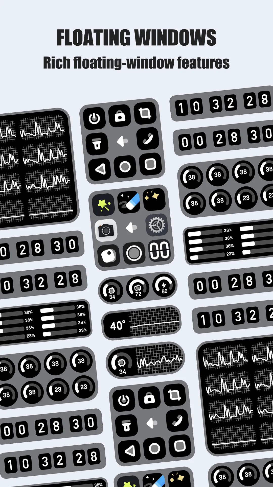
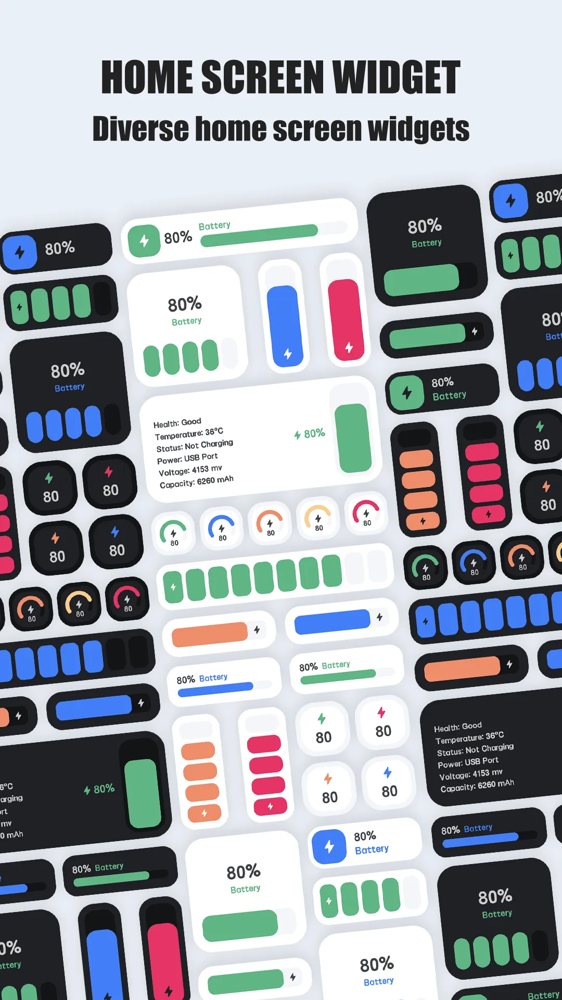
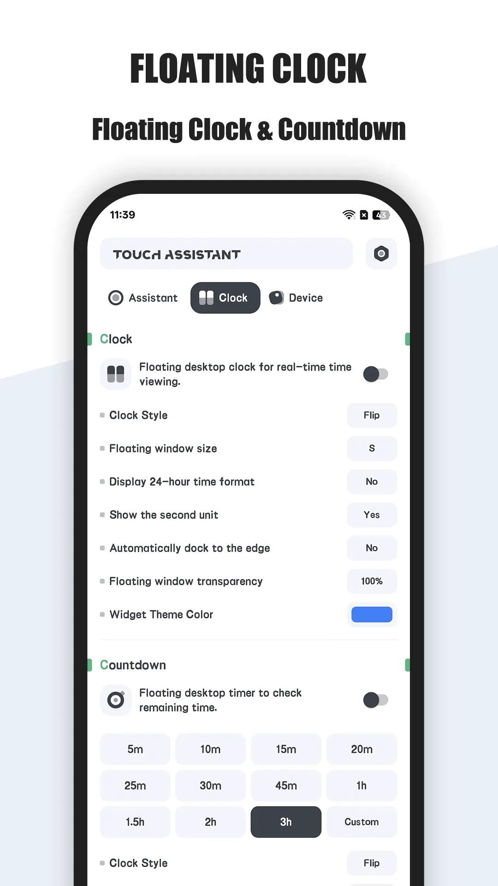

Sebuah [bola melayang](/id/glossary/what-is-a-floating-window/) menaruh aksi paling sering dipakai seketuk jauh dan membuat ponsel besar bisa dioperasikan satu tangan. Panduan 2026 ini mencakup apa yang dicari di aplikasi assistive touch dan bagaimana Floating Assistant membandingkannya dengan alternatif. Alat yang sama dicari sebagai **asisten melayang android**, **tombol melayang untuk satu tangan**, atau **bola melayang bisa dikustomisasi android** — semua daftar pendek di bawah ini.

## Apa yang orang sebut

Satu bola kecil dikenal dengan lima nama yang menandakan tugas berbeda: asisten melayang android atau tombol melayang untuk overlay itu sendiri, assistive touch untuk menu melayang berisi aksi sistem, bola melayang tepi untuk bola yang parkir di tepi dan melebar saat disapu, pembantu satu tangan untuk alasan pemasangannya, dan bola melayang bisa dikustomisasi android untuk pintasan serta toggle sendiri. Yang memisahkan aplikasi bukan namanya, melainkan apakah bola tetap di atas aplikasi tanpa root, apakah gestur bisa ditugaskan ke aksi nyata, dan apakah ia ringan di latar.

- **Asisten melayang** / **asisten melayang android** / **bola melayang** / **tombol melayang** — overlay itu sendiri. Daftar **bola melayang android terbaik** biasanya soal tampilan dan di mana ia bertambat.
- **Assistive touch** / **aplikasi assistive touch android terbaik** — pinjaman dari tombol home di layar iPhone; di Android orang biasanya maksudnya menu melayang berisi aksi sistem.
- **Bola melayang tepi** — bola yang parkir di tepi layar dan melebar saat disapu, dari situlah **bola melayang tepi dengan gestur** berasal.
- **Pembantu satu tangan** — alasan orang memasangnya: **tombol melayang untuk satu tangan** membuat ponsel jangkung terjangkau tanpa mengubah genggaman.
- **Bola melayang bisa dikustomisasi android** — permintaan akan pintasan, kontak, dan toggle sendiri alih-alih menu tetap.

Yang memisahkan aplikasi di bawah bukan namanya, melainkan tiga hal: apakah bola tetap di atas aplikasi tanpa root, apakah tahan lama dan sapuan bisa ditugaskan ke aksi nyata, dan apakah ia tetap ringan di latar. Floating Assistant menutupinya dengan bola bertempel di tepi; Assistive Touch adalah titik rujukan minimal.

## Mengapa aplikasi asisten melayang penting di Android

Aplikasi asisten melayang penting di Android karena overlay bekerja di atas aplikasi apa pun tanpa root, membuat ponsel layar lebar tetap terjangkau dan toggle favorit selalu seketuk jauh. Floating Assistant menaruh bola bertempel di tepi dengan pintasan aplikasi, kontak, dan aksi sistem yang bisa dikustom, sementara jejak baterai dan memorinya tetap minimal. Kemenangan satu tangan inilah yang membuat kategori ini hampir sepenuhnya ada di Android, bukan iOS.

## Apa yang dicari di aplikasi asisten melayang

Enam kriteria menentukan aplikasi asisten melayang yang berguna: bola yang tetap di atas lintas aplikasi alih-alih terkubur di laci, pintasan kustom untuk aplikasi serta kontak dan toggle sistem, operasi satu tangan pada layar besar, gestur ketuk atau sapu untuk aksi berbeda, perilaku stabil dengan pemakaian baterai dan memori minimal, serta kejelasan izin aksesibilitas yang dibutuhkan overlay. Floating Assistant memenuhi keenamnya dengan bola bertempel di tepi, sementara Assistive Touch dan Easy Touch mengandalkan model iklan.

- **Bola melayang / overlay** — tetap di atas lintas aplikasi, tak terkubur di laci.
- **Pintasan kustom** — luncurkan aplikasi, kontak, dan toggle sistem dengan cepat.
- **Operasi satu tangan** — jangkau kontrol di layar besar tanpa mengubah genggaman.
- **Gestur** — sapu atau ketuk bola untuk aksi berbeda.
- **Ringan dan stabil** — tanpa crash serta pemakaian baterai dan memori minimal.
- **Privasi** — pahami apa yang boleh dan tak boleh diakses overlay di perangkat Anda.

## Lapangan sekilas

Tiga aplikasi pada tabel 2026 ini — Floating Assistant, Assistive Touch (easytools), dan Easy Touch — semuanya hanya untuk Android tetapi berbeda pada model pendanaan: Floating Assistant gratis dengan inti gratis dan buka kunci opsional, sementara dua aplikasi lainnya gratis dengan iklan. Dari sisi fungsi, ketiganya menyediakan bola sentuh melayang, dan Easy Touch menambahkan gestur. Tabel berikut merangkum harga, platform, dan kekuatan masing-masing.

| App | Harga (2026) | Platform | Terbaik untuk / catatan |
|---|---|---|---|
| **Floating Assistant** | Unduh gratis, inti gratis + buka kunci opsional | Hanya Android | Bola melayang, pintasan aplikasi/kontak, pembantu satu tangan |
| **Assistive Touch (easytools)** | Gratis + iklan | Hanya Android | Bola sentuh melayang populer, tapi beriklan |
| **Easy Touch** | Gratis + iklan | Hanya Android | Bola sentuh melayang dengan gestur, model iklan serupa |

## Floating Assistant, lebih dalam

Floating Assistant menambahkan bola melayang yang bisa dikustomisasi ke Android untuk peluncuran aplikasi cepat, toggle sistem, dan kendali satu tangan. Bola bertempel di tepi layar, tetap berada di atas aplikasi lain tanpa root, dan bisa dipindahkan ke mana saja; ketuk atau sapu memicu aksi berbeda menurut pengaturan Anda. Aplikasi, kontak, dan toggle sistem masuk ke menu pintasan, sementara jejak baterai serta memorinya tetap minimal. Inti asisten melayang gratis dan ekstra bersifat opsional.

{: width="180" .normal }
{: width="180" .normal }
{: width="180" .normal }
{: width="180" .normal }
{: width="180" .normal }

Floating Assistant menambahkan bola melayang bisa dikustomisasi ke Android untuk peluncuran aplikasi cepat, toggle sistem, dan kendali satu tangan.

- **Bola melayang** — overlay persisten di atas aplikasi apa pun, bisa dipindah ke mana saja.
- **Pintasan kustom** — aplikasi, kontak, dan toggle sistem seketuk jauh.
- **Pembantu satu tangan** — jangkau aksi di ponsel besar tanpa mengatur ulang genggaman.
- **Dukungan gestur** — ketuk atau sapu bola untuk aksi berbeda.
- **Ringan** — jejak baterai dan memori minimal, stabil di latar.
- **Gratis untuk memulai** — inti asisten melayang gratis; ekstra opsional.

**Terbaik untuk:** pengguna ponsel besar yang ingin akses satu tangan, seketuk ke aksi.

Selami lebih dalam:
- [Aplikasi asisten melayang terbaik](/id/posts/best-floating-assistant-general/)
- [Assistive touch terbaik untuk satu tangan](/id/posts/best-floating-assistant-accessibility/)
- [Halaman aplikasi Floating Assistant](/id/apps/floating-assistant/)
- [Panduan Pengguna Resmi Floating Assistant](/id/posts/tutorial-floating-assistant/)

## Bagaimana Floating Assistant membandingkan dengan kompetisi

Perbandingan Floating Assistant dengan kompetisi menempatkan Assistive Touch (easytools) sebagai bola beriklan populer, sementara Floating Assistant menawarkan kendali melayang yang sama dengan model buka kunci opsional alih-alih iklan terus-menerus. Easy Touch adalah bola beriklan lain yang menyediakan gestur; bila Anda menginginkan lebih sedikit iklan dengan pembukaan gaya sekali bayar, Floating Assistant menjadi pilihan yang lebih ringan. Karena ketiganya berjalan sebagai overlay tanpa root, perbedaan utamanya ada pada pengalaman iklan dan kedalaman kustomisasi. Tautan perbandingan lengkap tersedia di bawah.

- **vs Assistive Touch (easytools)** — Assistive Touch (easytools) adalah bola beriklan populer; Floating Assistant memberi kendali melayang sama dengan model buka kunci opsional lebih bersih alih-alih iklan terus-menerus. Rincian lengkap di [Floating Assistant vs Assistive Touch](/id/posts/vs-floating-assistant-and-assistive-touch/).
- **vs Easy Touch** — Easy Touch adalah bola beriklan lain dengan gestur; bila Anda ingin iklan lebih sedikit dan buka kunci gaya sekali bayar, Floating Assistant pilihan lebih ringan.
- **Opsi lain** — lihat [Alternatif Assistive Touch Terbaik di 2026](/id/posts/alternatives-to-assistive-touch/) untuk lapangan lengkap.

## Mana yang harus dipilih?

Pilihan cepat pada 2026 bergantung pada prioritas: Floating Assistant untuk jangkauan satu tangan di ponsel besar dan iklan minimal, Assistive Touch bila Anda tidak keberatan iklan dan ingin bola yang paling banyak dipasang, Easy Touch bila menginginkan gestur dengan bola gratis, dan Floating Assistant lagi bila yang dicari adalah buka kunci opsional tanpa dinding iklan. Keempatnya berjalan sebagai overlay Android tanpa root.

- Ponsel besar, ingin jangkauan satu tangan → Floating Assistant.
- Tak masalah iklan, ingin bola paling banyak dipasang → Assistive Touch.
- Ingin gestur dan bola gratis → Easy Touch.
- Ingin iklan minimal dan buka kunci opsional → Floating Assistant.

## Skenario khas

Lima skenario memakai Floating Assistant memperlihatkan manfaat bola melayang di tepi layar: letakkan di tepi bawah agar back, home, recent, dan tangkapan layar terjangkau tanpa mengubah genggaman; petakan ketuk atau gestur ke kunci layar untuk menghemat tombol daya; taruh aplikasi paling sering dibuka di menu bola agar tidak perlu mencari di layar utama; jangkau Wi-Fi, kecerahan, atau volume dalam satu ketuk; dan nikmati bola inti gratis dengan buka kunci opsional alih-alih iklan terus-menerus.

- **Ponsel besar, satu tangan** — letakkan bola melayang di tepi bawah agar back/home/recent dan tangkapan layar terjangkau tanpa mengubah genggaman.
- **Layar kunci tanpa tombol** — petakan ketuk atau gestur ke kunci layar dan hemat tombol daya.
- **Lompat aplikasi cepat** — taruh aplikasi paling sering dibuka di menu bola untuk lewati perburuan layar utama.
- **Jangkau toggle sistem** — seketuk ke Wi-Fi, kecerahan, atau volume daripada dua sapuan.
- **Kendali bebas iklan** — bola inti gratis dengan buka kunci opsional, sehingga Anda lewati dinding iklan terus-menerus bola lain.

## FAQ

**Apakah Floating Assistant gratis?**
{:.faq-q}

Ya. Inti bola melayang, aksi, dan gestur gratis; buka kunci VIP opsional menambah tema dan opsi lebih dalam.

**Floating Assistant atau Assistive Touch — mana yang harus saya pilih?**
{:.faq-q}

Ingin bola melayang bisa dikustomisasi, hampir bebas iklan, dengan aksi dan gestur mendalam → Floating Assistant; tak masalah bola beriklan populer → Assistive Touch (easytools).

**Apakah Floating Assistant bisa di iOS?**
{:.faq-q}

Tidak. Floating Assistant hanya untuk Android; iOS sudah punya AssistiveTouch bawaan di setelan aksesibilitas.

**Apakah Floating Assistant butuh root?**
{:.faq-q}

Tidak. Berjalan sebagai layanan aksesibilitas dan overlay tanpa root.

## Kesimpulan

Floating Assistant adalah pilihan fleksibel bagi pengguna ponsel besar yang ingin akses satu tangan dan aksi seketuk lewat bola melayang di tepi layar. Aplikasi ini menyediakan pintasan aplikasi dan kontak, toggle sistem, gestur ketuk serta sapu, dan berjalan sebagai overlay tanpa root dengan jejak baterai serta memori minimal. Intinya gratis dengan buka kunci opsional, sementara Assistive Touch dan Easy Touch mengandalkan iklan. Unduh dari Google Play:

- [Google Play — Floating Assistant](https://play.google.com/store/apps/details?id=com.glgjing.floating.apps.assistive.touch.pro)

Atau baca [Aplikasi asisten melayang terbaik](/id/posts/best-floating-assistant-general/) untuk rincian lengkap.

## Istilah terkait

- [Assistive Touch Android: Cara Guna Tombol Mengambang](/id/glossary/what-is-assistive-touch/)
- [Jendela Mengambang Android: Cara Kerja, Izin, dan Aplikasinya](/id/glossary/what-is-a-floating-window/)
