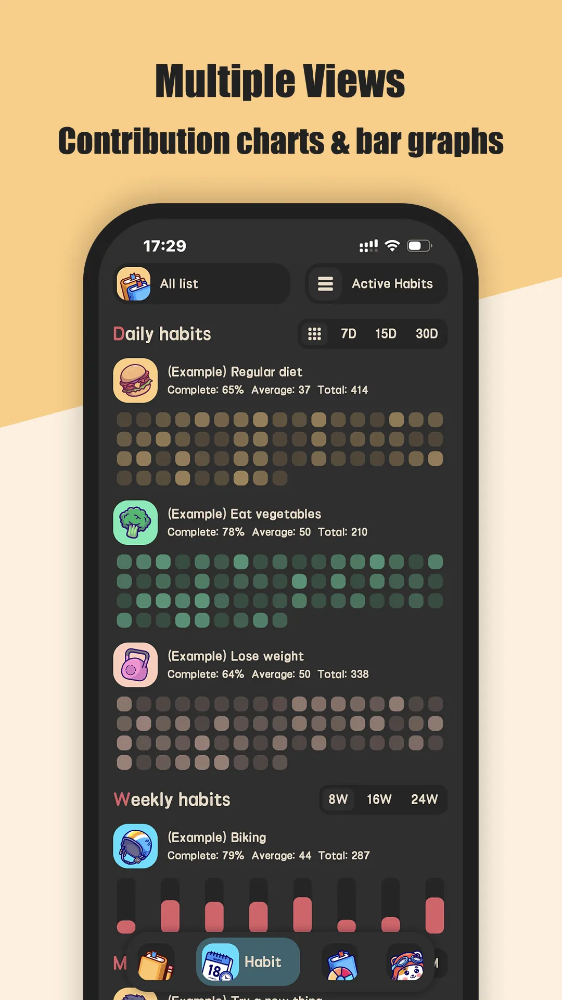

Membangun **kebiasaan harian** terutama soal muncul konsisten setiap hari, dan **aplikasi pelacak kebiasaan** yang tepat membuatnya memuaskan alih-alih jadi beban. Panduan 2026 ini mengulas apa yang dilakukan **aplikasi habit tracker** Android yang baik dan bagaimana Meow Habits dibandingkan dengan para pemimpin kategori.

## Mengapa aplikasi habit tracker penting di Android

Di Android, aplikasi habit tracker penting karena widget layar utama dan pencatatan satu ketukan memungkinkan Anda mencentang kebiasaan dari layar kunci tanpa membuka aplikasi — sangat berarti bagi streak harian. Meow Habits menyediakan 500+ ikon lucu, siklus harian, mingguan, bulanan, dan custom, serta grafik dan kalender untuk melihat penyelesaian. Penyimpanan offline dengan kunci sidik jari menjaga rutinitas tetap privat di perangkat bersama, sementara ekspor CSV dan backup WebDav atau Google Drive menjaga riwayat tetap aman.

## Apa saja sebutan orang untuknya

Aplikasi yang sama dicari sebagai aplikasi habit tracker, aplikasi pelacak kebiasaan, aplikasi kebiasaan harian, atau aplikasi streak harian — semuanya menggambarkan putaran yang sama: catat satu aksi kecil hari ini, lihat rantainya bertambah, dan jangan putuskan. Pertanyaan yang tersembunyi di baliknya biasanya lebih sempit: bisakah mulai tanpa akun atau langganan, dan apakah data tetap milik saya? Meow Habits menjawab keduanya dengan catatan kebiasaan offline tanpa akun, ekspor CSV, dan backup WebDav. Daftar pemeriksaan di bawah berlaku untuk semua sebutan itu.

## Apa yang perlu dicari pada [aplikasi habit tracker](/id/glossary/what-is-a-habit-tracker/)

Enam kriteria menentukan aplikasi habit tracker yang layak dipakai di Android: streak harian beserta tingkat penyelesaian, siklus fleksibel harian hingga custom, pengingat kebiasaan yang terjadwal, pencatatan offline tanpa akun dengan kunci sidik jari, ekspor CSV serta backup cloud/WebDav, dan desain bersahabat dengan ikon lucu. Meow Habits memenuhi keenamnya dengan 500+ ikon dan widget satu ketukan, sementara Streaks hanya untuk iOS dan Habitica menambah lapisan gamifikasi berlangganan. Berikut rincian tiap kriteria.

- **Streak harian dan tingkat penyelesaian** — visual streak serta angka penyelesaian yang membuat satu hari terlewat terasa nyata.
- **Siklus fleksibel** — rutinitas harian, mingguan, bulanan, atau custom, bukan cuma 'setiap hari'.
- **Pengingat kebiasaan** — sentilan lembut terjadwal untuk menjaga rantai tetap hidup.
- **Offline + privasi** — catat di mana saja tanpa akun, lalu kunci dengan sidik jari.
- **Ekspor dan backup** — ekspor CSV untuk meninjau tren, plus backup cloud/WebDav agar data tetap aman setelah reset pabrik.
- **Desain bersahabat** — ikon lucu dan visual jelas yang membuat pencatatan menyenangkan, bukan kaku.

## Gambaran pilihan yang ada

Tiga pilihan pada tabel 2026 ini — Meow Habits, Streaks, dan Habitica — mewakili tiga pendekatan: Meow Habits gratis dengan inti gratis dan unlock opsional membawa 500+ ikon, streak harian, catatan offline, dan ekspor CSV di Android maupun iOS; Streaks berbayar sekitar $4,99 hanya untuk iOS dengan desain penghargaan Apple; dan Habitica gratis plus langganan mengubah kebiasaan menjadi RPG. Perbedaan terbesar ada pada platform dan seberapa berat lapisan gamifikasinya. Tabel berikut merangkum harga dan kekuatan masing-masing.

| Aplikasi | Harga (2026) | Platform | Cocok untuk / catatan |
|---|---|---|---|
| **Meow Habits** | Unduh gratis, inti gratis + unlock opsional | Android + iOS | 500+ ikon lucu, streak harian, catatan kebiasaan offline, ekspor CSV |
| **Streaks** | Berbayar ~$4,99 (khusus iOS) | iOS | Aplikasi habit tracker peraih penghargaan desain Apple, tapi tanpa versi Android |
| **Habitica** | Gratis + langganan | Android + iOS | Pelacakan bergaya RPG dengan gamifikasi; seru tapi lebih berat dan lebih terasa game daripada pelacak |

## Meow Habits secara mendalam

Meow Habits adalah aplikasi habit tracker dan pembangun rutinitas untuk Android dan iOS dengan 500+ ikon kartun, streak harian, grafik batang, pai, dan kalender. Siklus harian, mingguan, bulanan, maupun custom didukung, dan pencatatan satu ketukan bisa dilakukan langsung dari widget tanpa membuka aplikasi. Data tetap di perangkat tanpa akun di balik kunci sidik jari, sementara ekspor CSV serta backup Google Drive atau WebDav menjaga riwayat tetap aman setelah reset pabrik. Fitur inti gratis; beberapa fitur lanjutan berada di balik unlock sekali bayar opsional.

{: width="180" .normal }
{: width="180" .normal }
{: width="180" .normal }
{: width="180" .normal }
{: width="180" .normal }

Meow Habits adalah [aplikasi habit tracker](/id/glossary/what-is-a-habit-tracker/) dan pembangun rutinitas dengan 500+ ikon lucu, streak harian, grafik, dan tampilan kalender untuk menjaga konsistensi Anda.

- **500+ ikon kartun lucu** — cocok untuk kebiasaan dari 'minum air' sampai 'baca 20 halaman' tanpa perlu mencari clip-art.
- **Pelacakan multi kebiasaan** — siklus harian/mingguan/bulanan/custom, pencatatan satu ketukan dari widget.
- **Streak harian dan grafik** — tampilan batang, pai, dan kalender untuk penyelesaian serta tren, sehingga penurunan terlihat sebelum terlambat.
- **Offline + kunci sidik jari** — catat di mana saja, tanpa akun, dan data tetap privat di perangkat.
- **Ekspor CSV** — pindahkan riwayat ke spreadsheet untuk menganalisis kebiasaan yang benar-benar bertahan.
- **Backup Google Drive / WebDav** — aman lintas perangkat dan setelah reset pabrik.

**Paling cocok untuk:** siapa pun yang ingin aplikasi habit tracker bersahabat, privat, dan offline.

Baca lebih dalam:
- [Aplikasi habit tracker terbaik](/id/posts/best-meow-habits-general/)
- [Aplikasi pelacak kebiasaan untuk pemula](/id/posts/best-meow-habits-beginners/)
- [Halaman aplikasi Meow Habits](/id/apps/meow-habits/)
- [Panduan Pengguna Resmi Meow Habits](/id/posts/tutorial-meow-habits/)

## Bagaimana Meow Habits dibandingkan kompetitor

Kebanyakan perbandingan di sini bermuara pada apa yang membuat Anda terus kembali. Streaks sangat minimalis tetapi khusus iOS dan berbayar di awal, sementara Habitica mengubah kebiasaan menjadi RPG yang menyenangkan sebagian orang dan terlalu ramai bagi rutinitas pagi lainnya. Meow Habits berada di antaranya dengan 500+ ikon, widget satu ketukan, tampilan kalender, dan inti gratis yang dipakai offline. Trade-off untuk alternatif Habitify atau Fabulous serupa — aplikasi berbasis pembinaan memandu Anda, sedangkan pelacak kebiasaan mencatat dengan jujur.

- **vs Streaks** — Streaks adalah pelacak kebiasaan yang dibuat indah dan meraih penghargaan — tapi khusus iOS dan tidak menjangkau banyak pengguna Android. Meow Habits mencakup Android dan iOS dengan 500+ ikon serta catatan kebiasaan offline. Rincian lengkap di [Meow Habits vs Streaks](/id/posts/vs-meow-habits-and-streaks/).
- **vs Habitica** — Habitica mengubah kebiasaan jadi RPG, yang disukai sebagian orang, tapi lapisan game menambah hambatan dan langganan; Meow Habits tetap pelacak yang cepat dan fokus.
- **Opsi lain** — lihat [Alternatif Streaks Terbaik 2026](/id/posts/alternatives-to-streaks/) untuk gambaran lengkap.

## Mana yang sebaiknya Anda pilih?

Pilihan cepat pada 2026 bergantung pada perangkat dan prioritas: Meow Habits untuk pencatatan lucu dan cepat di Android sekaligus perlu offline, privat, dan ekspor CSV; Streaks bagi pengguna iPhone yang menginginkan UI rapi; Habitica bila Anda suka gamifikasi dan menerima langganan. Karena Meow Habits muncul dua kali, jawabannya jelas bila Anda memakai Android dan ingin data tetap di perangkat tanpa akun.

- Pengguna Android yang ingin pencatatan lucu dan cepat → Meow Habits.
- Khusus iPhone dan ingin UI paling rapi → Streaks.
- Suka gamifikasi dan tidak keberatan dengan langganan → Habitica.
- Butuh offline + privat + ekspor CSV → Meow Habits.

## Skenario umum

Empat skenario memakai Meow Habits menunjukkan bagaimana widget, grafik, dan penyimpanan offline menjaga rantai kebiasaan tetap hidup. Rutinitas pagi seperti minum air, regang badan, dan baca 20 halaman bisa dicentang langsung dari layar kunci; catatan tanpa akun tetap privat di balik sidik jari pada ponsel keluarga bersama; grafik batang, pai, dan kalender memperlihatkan penurunan tingkat penyelesaian sebelum berubah menjadi streak putus; dan pencatatan di pesawat atau kereta bawah tanah tetap jalan dengan ekspor CSV serta backup WebDav atau Google Drive.

- **Rutinitas pagi** — taruh 'minum air', 'regang badan', dan 'baca 20 halaman' di widget layar utama, lalu centang langsung dari layar kunci, agar rantai tidak putus hanya karena aplikasinya tertimbun.
- **Privasi tanpa akun** — catat kebiasaan tanpa perlu daftar akun; rutinitas tetap di perangkat di balik kunci sidik jari, aman di ponsel keluarga bersama.
- **Melihat penurunan** — grafik batang, pai, dan kalender menampilkan tingkat penyelesaian yang turun sebelum berubah jadi streak harian yang putus, sehingga Anda bisa menyesuaikan.
- **Offline di mana saja** — catat di pesawat atau area tanpa sinyal di kereta bawah tanah; ekspor CSV dan backup WebDav/Google Drive menjaga riwayat tetap aman lintas perangkat.

## FAQ

**Apakah Meow Habits gratis?**
{:.faq-q}

Fitur inti — pelacakan, streak harian, grafik, pengingat kebiasaan, dan ekspor CSV — gratis untuk mulai; beberapa fitur lanjutan ada di balik unlock sekali bayar opsional.

**Apakah Meow Habits bisa dipakai offline?**
{:.faq-q}

Ya. Anda bisa mencatat kebiasaan tanpa internet dan tanpa akun; data tetap di perangkat dan baru dibackup ke WebDav atau Google Drive saat Anda memilihnya.

**Bisakah saya melihat perkembangan dari waktu ke waktu?**
{:.faq-q}

Ya — tampilan batang, pai, dan kalender menunjukkan tingkat penyelesaian serta tren, dan ekspor CSV memungkinkan Anda menganalisis semuanya di spreadsheet.

**Meow Habits atau Streaks — mana yang sebaiknya saya pilih?**
{:.faq-q}

Ingin aplikasi kebiasaan gratis yang lucu, offline, dan ramah Android → Meow Habits; ingin UI khusus iOS paling rapi dan sudah hidup di ekosistem Apple → Streaks.

## Kesimpulan

Meow Habits adalah pilihan yang mudah didekati bagi sebagian besar pengguna Android yang ingin aplikasi habit tracker lucu, privat, dan offline. Aplikasi ini menyediakan 500+ ikon, streak harian, grafik serta kalender, pengingat, pencatatan widget satu ketukan, ekspor CSV, dan kunci sidik jari tanpa perlu akun, dengan inti gratis dan unlock opsional. Dibandingkan Streaks yang hanya iOS dan Habitica yang menambahkan langganan gamifikasi, Meow Habits menjaga pencatatan tetap sederhana. Unduh dari Google Play atau App Store:

- [Google Play — Meow Habits](https://play.google.com/store/apps/details?id=com.glgjing.meow.habit.goal)
- [App Store — Meow Habits](https://apps.apple.com/app/id6758230559)

Atau baca [Aplikasi habit tracker terbaik](/id/posts/best-meow-habits-general/) untuk rincian lengkapnya.

## Istilah terkait

- [Pelacak Kebiasaan: Cara Catat Rutinitas Harian](/id/glossary/what-is-a-habit-tracker/)
