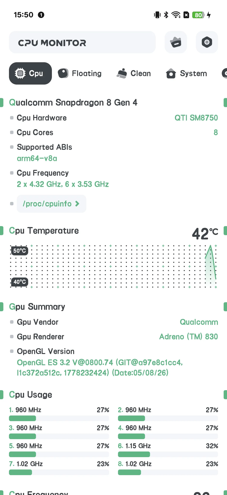
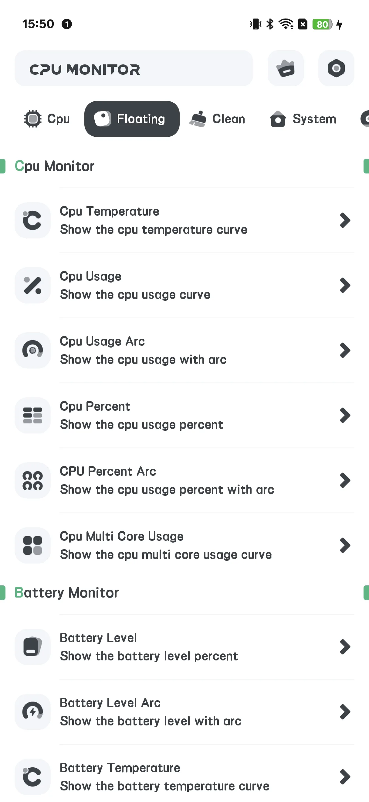
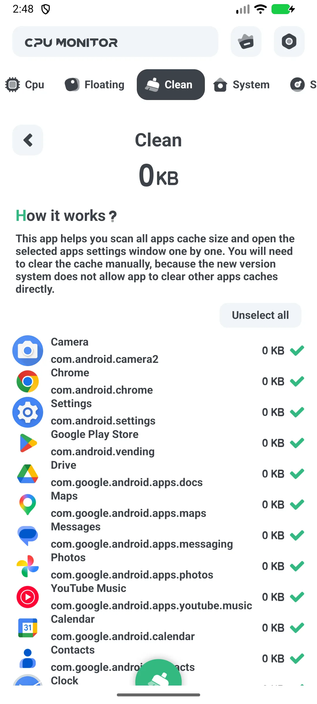
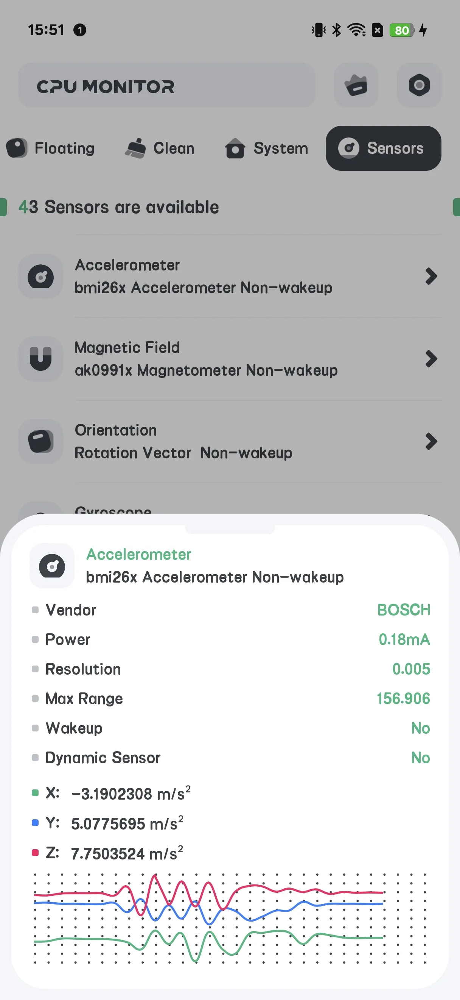
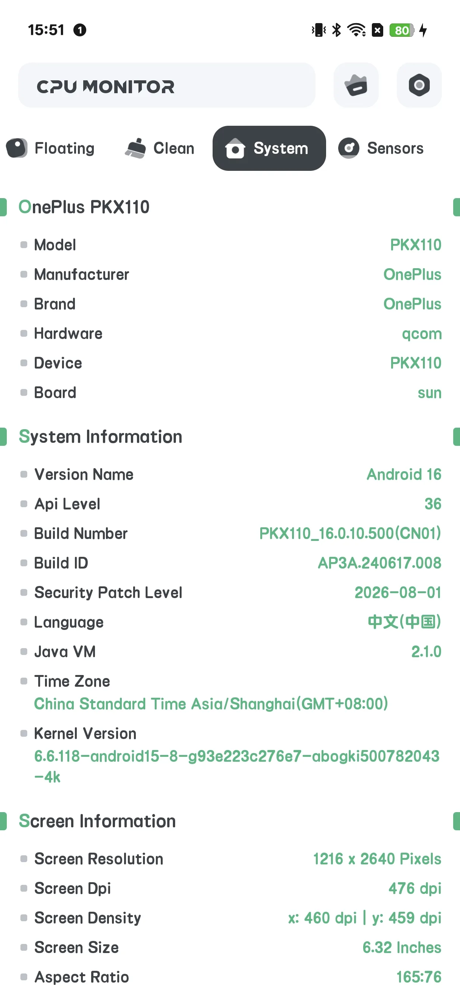

## Daftar Isi

- [Pengenalan Aplikasi](#pengenalan-aplikasi)
- [Penggunaan Pertama](#penggunaan-pertama)
- [CPU Waktu Nyata](#cpu-waktu-nyata)
- [Jendela Melayang](#jendela-melayang)
- [Widget Layar Utama](#widget-layar-utama)
- [Alarm Overheat](#alarm-overheat)
- [Kurva Riwayat](#kurva-riwayat)
- [Upgrade ke Pro](#upgrade-ke-pro)
- [Pengaturan](#pengaturan)
- [Skenario Khas](#skenario-khas)
- [FAQ](#faq)

## Pengenalan Aplikasi

CPU Monitor menampilkan **suhu [CPU](/id/glossary/what-is-a-cpu-temperature-monitor/) dan frekuensi waktu nyata, RAM, baterai, dan penyimpanan** di Android dalam empat tab — CPU, SYSTEM, FLOATING, dan SENSOR — lengkap dengan jendela melayang, widget, alarm overheat, dan kurva riwayat. Alat ini read-only: ia membaca sensor thermal dan penghitung sistem tanpa root dan tidak mengubah data game maupun pengaturan sistem. Versi gratis menampilkan iklan, sementara Pro menghapusnya dan membuka toolset 'Powerful System Monitor'. Panduan ini menjelaskan arti tiap angka, bukan menjanjikan penurunan suhu.

**📈 Pemantauan Langsung**
- Suhu & frekuensi CPU, penggunaan per-core
- Statis RAM, baterai, dan penyimpanan di satu tempat

**🧹 Bersih**
- Layar **CLEAN** menampilkan cache/junk aplikasi dan membiarkan Anda membersihkannya

**🌡 Alarm Overheat**
- Memperingatkan sebelum panas merusak performa atau baterai

**📉 Riwayat**
- Kurva suhu / frekuensi untuk menemukan apa yang melonjakkan panas Anda

**💲 Gratis + Pro**
- Versi gratis **didukung iklan**
- **Pro** menghapus iklan dan membuka toolset "Powerful System Monitor"

## Penggunaan Pertama

Layar utama CPU Monitor punya empat tab — **CPU / SYSTEM / FLOATING / SENSOR** — dengan tombol **Upgrade** di atasnya, sehingga Anda bisa memilih antara bacaan waktu nyata, statis perangkat, overlay melayang, dan data sensor dalam satu pandangan. Versi gratis menampilkan iklan banner pada tab tertentu, sementara tombol Upgrade membuka toolset Pro tanpa iklan. Berikut tampilan awal yang akan Anda lihat setelah meluncurkan aplikasi.

{: width="180" .normal }
{: width="180" .normal }
{: width="180" .normal }
{: width="180" .normal }
{: width="180" .normal }

## CPU Waktu Nyata

Tab **CPU** menampilkan tiga bacaan utama secara langsung — suhu CPU, frekuensi, dan beban per-core — sehingga Anda bisa melihat apakah satu core sedang menempel saat bermain game. Pemantauan ini read-only dan tidak memerlukan root; versi gratis menampilkan iklan banner di layar ini, sementara pembukaan Pro menghilangkannya. Langkah berikut menunjukkan cara membaca ketiga angka itu.

1. Buka tab **CPU**
2. Baca suhu CPU, frekuensi, dan beban per-core waktu nyata
3. Versi gratis menampilkan iklan banner di sini

## Jendela Melayang

Jendela melayang CPU Monitor menampilkan statis langsung di atas aplikasi apa pun setelah izin overlay diberikan, dengan pilihan monitor suhu CPU, penggunaan atau arc, baterai, FPS, RAM, dan System Monitor. Kemampuan ini membuat suhu tetap terlihat saat gaming atau mengisi daya tanpa harus keluar aplikasi. Ikuti langkah berikut untuk mengaktifkannya.

1. Buka tab **FLOATING**
2. Alihkan monitor (suhu CPU/penggunaan/arc, baterai, FPS, RAM, System Monitor)
3. Berikan izin overlay saat diminta
4. Statis langsung melayang di atas aplikasi apa pun

## Widget Layar Utama

Widget layar utama CPU Monitor menaruh bacaan suhu atau penggunaan CPU langsung di layar utama, sehingga statis perangkat terlihat sekilas tanpa membuka aplikasi. Widget tersedia melalui **Pengaturan → Galeri widget** setelah CPU Monitor ditetapkan sebagai sumbernya, dan bisa dipasang bersama widget RAM atau baterai sesuai kebutuhan. Ini pelengkap jendela melayang ketika Anda ingin angka tetap terlihat di layar utama.

1. Buka **Pengaturan → Galeri widget** (set CPU-only)
2. Taruh widget suhu / penggunaan CPU di layar utama

## Alarm Overheat

Alarm overheat CPU Monitor memberi peringatan sebelum panas merusak performa atau baterai, dengan ambang yang bisa diatur terpisah untuk CPU dan baterai. Fitur ini membaca sensor suhu secara langsung dan berjalan di latar, sehingga Anda bisa jeda sesi gaming atau mencabut pengisi daya lebih awal. Pengaturannya berada di **Pengaturan → Alarm overheat**.

1. Buka **Pengaturan → Alarm overheat**
2. Alihkan alarm CPU dan/atau baterai dan tetapkan ambang
3. Anda akan diperingatkan sebelum keadaan merusak

## Kurva Riwayat

CPU Monitor menampilkan **kurva suhu dan frekuensi** di tampilan melayang atau riwayat dari waktu ke waktu, sehingga Anda bisa menemukan game atau aplikasi mana yang melonjakkan panas. Grafik ini melengkapi bacaan waktu nyata dengan konteks: lonjakan mendadak biasanya berhubungan dengan sesi tertentu, dan perbandingan sebelum serta sesudahnya membantu memutuskan kapan harus menurunkan beban. Riwayat tetap bersifat read-only.

## Upgrade ke Pro

Ketuk **Upgrade** untuk membuka layar Pro, tempat toolset 'Powerful System Monitor' tersedia tanpa iklan. Versi gratis CPU Monitor didukung iklan banner dan interstisial, sementara Pro menghapus semuanya sekaligus membuka fitur tambahan bagi pengguna yang ingin memantau lebih dalam. Pembelian bersifat sekali bayar, sehingga tidak ada langganan bulanan yang perlu dikhawatirkan.

## Pengaturan

Pengaturan CPU Monitor mencakup Upgrade, tema, alarm overheat, unit suhu, tingkat penyegaran, dan galeri widget. Dari sini Anda dapat mengganti satuan bacaan, mengatur seberapa sering angka diperbarui, menetapkan ambang peringatan panas, serta mengambil widget untuk layar utama. Rangkaian opsi ini membuat aplikasi bisa disesuaikan dengan perangkat dan cara pemakaian harian Anda.

## Skenario Khas

Lima skenario memakai CPU Monitor memanfaatkan kombinasi overlay, widget, alarm, kurva, dan layar CLEAN: buka tab FLOATING dan berikan izin agar suhu CPU serta baterai melayang di atas game; taruh widget CPU di layar utama dan setel alarm overheat untuk menangkap hotspot saat mengisi daya; periksa kurva riwayat setelah sesi panas guna menemukan aplikasi pemicunya; gunakan layar CLEAN untuk menghapus cache saat ponsel terasa lemot; dan ketuk Upgrade bila ingin menghapus iklan.

- **Awasi panas saat gaming** — buka tab FLOATING, berikan overlay, dan suhu CPU/baterai melayang di atas game agar Anda jeda sebelum throttling.
- **Tangkap hotspot pengisian** — taruh widget CPU layar utama dan setel alarm overheat, maka Anda diperingatkan bila baterai memanas.
- **Temukan penyebab** — buka kurva riwayat setelah sesi panas untuk melihat aplikasi mana yang melonjakkan suhu.
- **Bersih cepat** — gunakan layar CLEAN untuk menghapus cache/junk aplikasi saat ponsel terasa lemot.
- **Senyapkan iklan** — ketuk Upgrade untuk menghapus iklan dan membuka toolset Powerful System Monitor penuh.

## FAQ

### Apakah CPU Monitor sama dengan System Monitor?
{:.faq-q}
Mereka berbagi kode, tapi CPU Monitor menambah layar **CLEAN** (cache) dan upgrade Pro; System Monitor read-only tanpa pembersihan.

### Mengapa saya melihat iklan?
{:.faq-q}
Versi gratis didukung iklan. Upgrade ke Pro untuk menghapusnya.

## Ringkasan

CPU Monitor adalah toolkit pemantauan langsung praktis — suhu waktu nyata, alarm overheat, statis melayang, widget, dan kurva riwayat — dengan pembersih cache sebagai bonus.

## Istilah terkait

- [Apa Itu Monitor Suhu CPU?](/id/glossary/what-is-a-cpu-temperature-monitor/)
- [Apa Itu System Monitor?](/id/glossary/what-is-a-system-monitor/)
