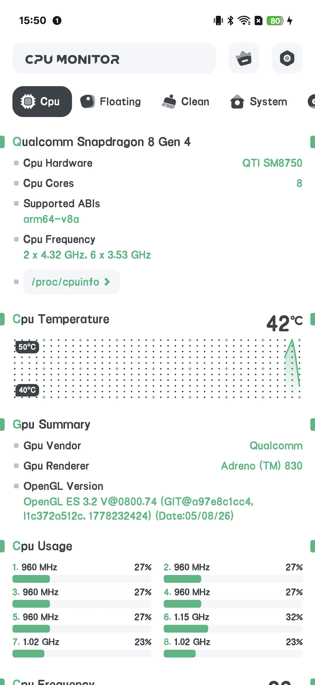
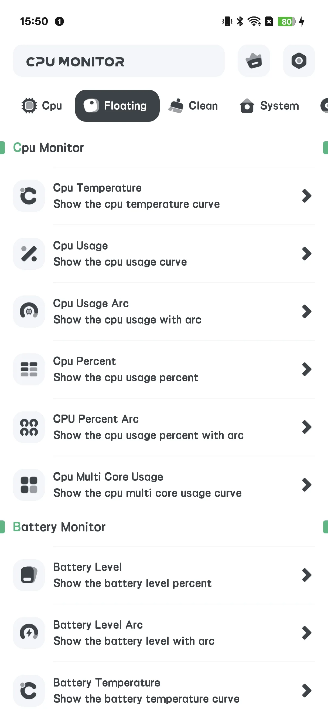
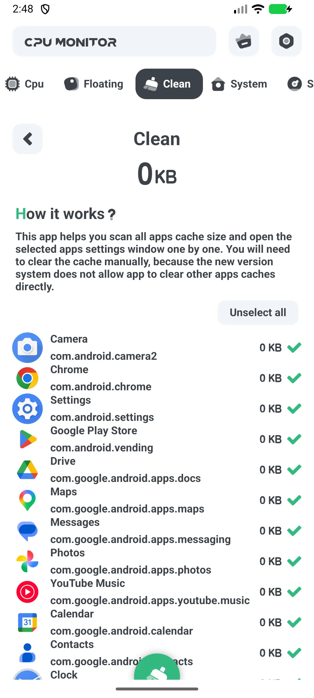
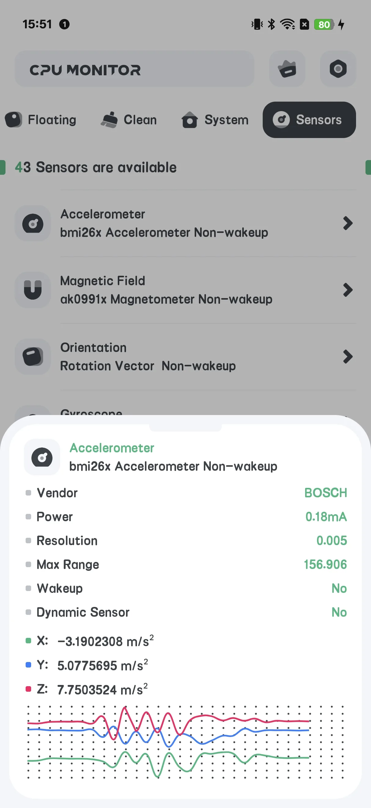
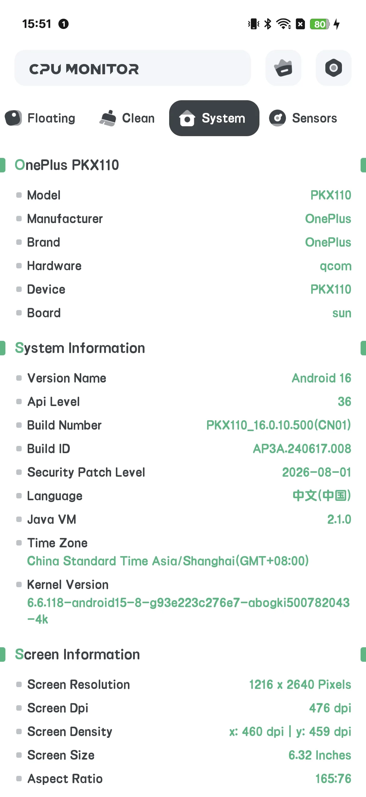

## Daftar Isi

- [Pengenalan Aplikasi](#pengenalan-aplikasi)
- [Penggunaan Pertama](#penggunaan-pertama)
- [CPU Waktu Nyata](#cpu-waktu-nyata)
- [Jendela Melayang](#jendela-melayang)
- [Widget Layar Utama](#widget-layar-utama)
- [Alarm Overheat](#alarm-overheat)
- [Kurva Riwayat](#kurva-riwayat)
- [Upgrade ke Pro](#upgrade-ke-pro)
- [Pengaturan](#pengaturan)
- [Skenario Khas](#skenario-khas)
- [FAQ](#faq)

## Pengenalan Aplikasi

CPU Monitor menampilkan **suhu [CPU](/id/glossary/what-is-a-cpu-temperature-monitor/) dan frekuensi waktu nyata, RAM, baterai, dan penyimpanan** di Android, lengkap dengan jendela melayang, widget, alarm overheat, dan kurva riwayat. Ini adalah alat **read-only**: ia membaca sensor thermal dan penghitung sistem tanpa root, dan tidak mengubah data game atau pengaturan sistem. Panduan ini berjalan dari peluncuran pertama melalui jendela melayang, ambang **aplikasi alarm overheat CPU**, kurva **monitor riwayat frekuensi CPU**, tata letak layar utama **widget cpu ram baterai android**, dan layar bersih cache — menjelaskan arti angka daripada menjanjikan penurunan suhu.

**📈 Pemantauan Langsung**
- Suhu & frekuensi CPU, penggunaan per-core
- Statis RAM, baterai, dan penyimpanan di satu tempat

**🧹 Bersih**
- Layar **CLEAN** menampilkan cache/junk aplikasi dan membiarkan Anda membersihkannya

**🌡 Alarm Overheat**
- Memperingatkan sebelum panas merusak performa atau baterai

**📉 Riwayat**
- Kurva suhu / frekuensi untuk menemukan apa yang melonjakkan panas Anda

**💲 Gratis + Pro**
- Versi gratis **didukung iklan**
- **Pro** menghapus iklan dan membuka toolset "Powerful System Monitor"

## Penggunaan Pertama

Layar utama punya tab: **CPU / SYSTEM / FLOATING / SENSOR**, dengan tombol **Upgrade** di atas.

{: width="180" .normal }
{: width="180" .normal }
{: width="180" .normal }
{: width="180" .normal }
{: width="180" .normal }

## CPU Waktu Nyata

1. Buka tab **CPU**
2. Baca suhu CPU, frekuensi, dan beban per-core waktu nyata
3. Versi gratis menampilkan iklan banner di sini

## Jendela Melayang

1. Buka tab **FLOATING**
2. Alihkan monitor (suhu CPU/penggunaan/arc, baterai, FPS, RAM, System Monitor)
3. Berikan izin overlay saat diminta
4. Statis langsung melayang di atas aplikasi apa pun

## Widget Layar Utama

1. Buka **Pengaturan → Galeri widget** (set CPU-only)
2. Taruh widget suhu / penggunaan CPU di layar utama

## Alarm Overheat

1. Buka **Pengaturan → Alarm overheat**
2. Alihkan alarm CPU dan/atau baterai dan tetapkan ambang
3. Anda akan diperingatkan sebelum keadaan merusak

## Kurva Riwayat

Di tampilan melayang/riwayat Anda bisa melihat **kurva suhu dan frekuensi** dari waktu ke waktu — berguna untuk menemukan game atau aplikasi mana yang melonjakkan panas.

## Upgrade ke Pro

Ketuk **Upgrade** untuk membuka layar Pro: "Powerful System Monitor" menghapus semua iklan dan membuka semua fitur.

## Pengaturan

Pengaturan mencakup Upgrade, tema, alarm overheat, unit suhu, tingkat penyegaran, dan galeri widget.

## Skenario Khas

- **Awasi panas saat gaming** — buka tab FLOATING, berikan overlay, dan suhu CPU/baterai melayang di atas game agar Anda jeda sebelum throttling.
- **Tangkap hotspot pengisian** — taruh widget CPU layar utama dan setel alarm overheat, maka Anda diperingatkan bila baterai memanas.
- **Temukan penyebab** — buka kurva riwayat setelah sesi panas untuk melihat aplikasi mana yang melonjakkan suhu.
- **Bersih cepat** — gunakan layar CLEAN untuk menghapus cache/junk aplikasi saat ponsel terasa lemot.
- **Senyapkan iklan** — ketuk Upgrade untuk menghapus iklan dan membuka toolset Powerful System Monitor penuh.

## FAQ

### Apakah CPU Monitor sama dengan System Monitor?
{:.faq-q}
Mereka berbagi kode, tapi CPU Monitor menambah layar **CLEAN** (cache) dan upgrade Pro; System Monitor read-only tanpa pembersihan.

### Mengapa saya melihat iklan?
{:.faq-q}
Versi gratis didukung iklan. Upgrade ke Pro untuk menghapusnya.

## Ringkasan

CPU Monitor adalah toolkit pemantauan langsung praktis — suhu waktu nyata, alarm overheat, statis melayang, widget, dan kurva riwayat — dengan pembersih cache sebagai bonus.

## Istilah terkait

- [Apa Itu Monitor Suhu CPU?](/id/glossary/what-is-a-cpu-temperature-monitor/)
- [Apa Itu System Monitor?](/id/glossary/what-is-a-system-monitor/)
