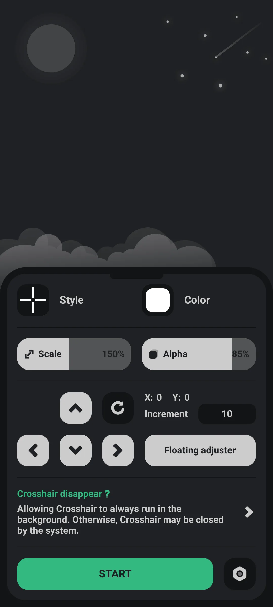
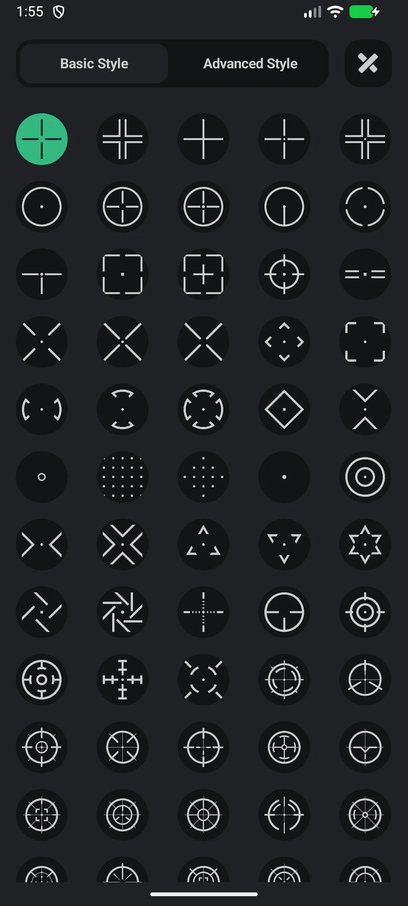
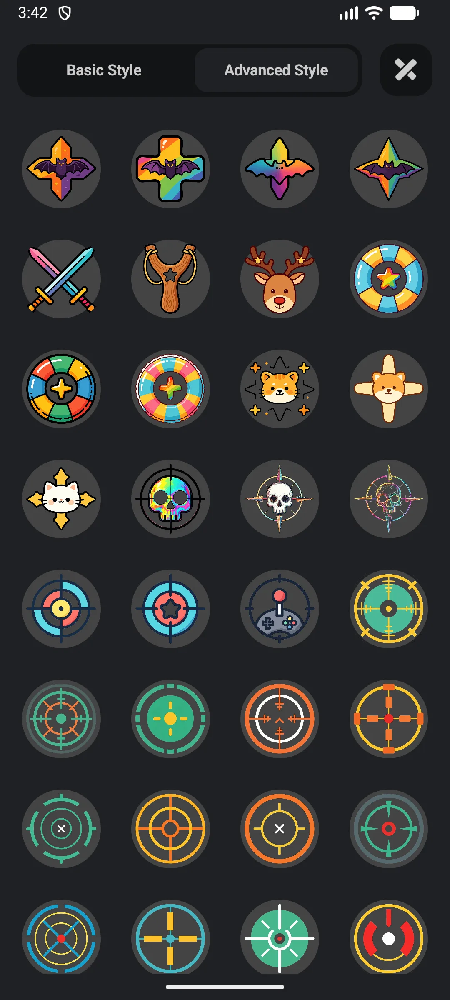
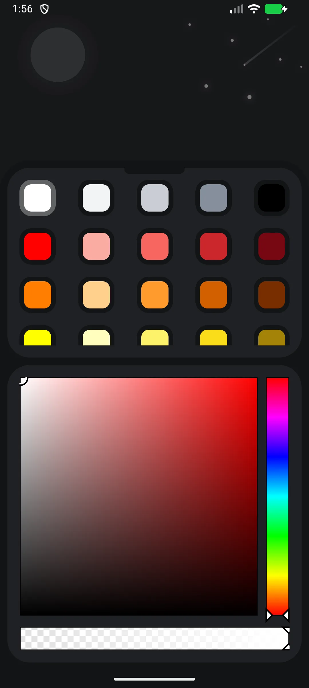
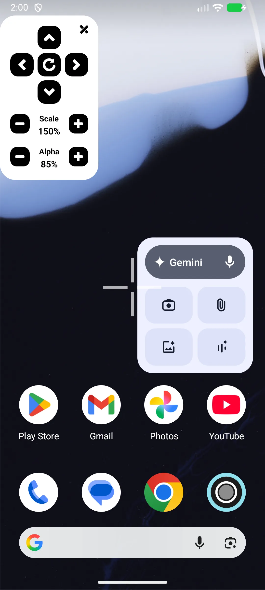

## Daftar Isi

- [Pendahuluan Aplikasi](#pendahuluan-aplikasi)
- [Penggunaan Pertama](#penggunaan-pertama)
- [Beri Izin Overlay](#beri-izin-overlay)
- [Pilih Gaya Bidik Silang](#pilih-gaya-bidik-silang)
- [Kustomisasi Ukuran, Warna, Posisi](#kustomisasi-ukuran-warna-posisi)
- [Gunakan di Game](#gunakan-di-game)
- [Buka Lebih Banyak Gaya](#buka-lebih-banyak-gaya)
- [FAQ](#faq)

## Pendahuluan Aplikasi

Crosshair (Crosshair Aim) menambahkan **[overlay bidik silang kustom](/id/glossary/what-is-a-crosshair/)** ke game FPS di Android, dengan **80+ desain** untuk memperbaiki aim Anda — alat **custom crosshair Android** gratis yang berjalan tanpa root.

**🎯 80+ Gaya**
- **84 Dasar** (datar) bawaan
- **63 Pro** (lanjutan) gaya
- Pengguna gratis menyimpan ~30 gaya permanen; sisanya dibuka via iklan reward 24 jam atau aplikasi Pro

**🛠 Kustomisasi**
- **Scale** 50%–300%
- **Alpha** 30%–100%
- **Warna**: 60 warna + pemilih
- **Posisi**: seret dengan tombol panah (tidak ada slider ketebalan — ketebalan sudah tertanam di tiap gaya)

**🔓 Tanpa Root, Tanpa Aksesibilitas**
- Hanya izin **"Gambar di atas aplikasi lain"** (overlay) yang diperlukan

> Catatan: tidak ada **preset per game** — aplikasi menyimpan satu konfigurasi bidik silang global.

## Penggunaan Pertama

Buka aplikasi ke konsol utama.

- Tombol **START/STOP** menampilkan/menyembunyikan bidik silang
- Ketuk area **gaya** untuk memilih desain, **warna** untuk warna, dan gunakan slider **scale/alpha**
- Roda pengaturan membuka bahasa, nilai, bagikan, dan upgrade

{: width="180" .normal }

## Beri Izin Overlay

1. Ketuk switch bidik silang / START
2. Jika diminta, beri izin **"tampilkan jendela pop-up"** (Gambar di atas aplikasi lain)
3. Aplikasi membuka Setelan sistem → "Gambar di atas aplikasi lain"; aktifkan untuk Crosshair
4. Kembali ke aplikasi

Izin ini (bukan Aksesibilitas, bukan root) adalah yang memungkinkan bidik silang duduk di atas game.

## Pilih Gaya Bidik Silang

1. Ketuk area **gaya** → layar **Gaya**
2. Beralih tab **Dasar** (grid 5 kolom) / **Lanjutan** (grid 4 kolom)
3. Ketuk thumbnail untuk menerapkannya
4. Gaya Pro terkunci meminta iklan reward atau upgrade

{: width="180" .normal }
{: width="180" .normal }

## Kustomisasi Ukuran, Warna, Posisi

- **Scale**: seret slider scale (50%–300%)
- **Alpha**: seret slider alpha (30%–100%)
- **Warna**: buka **Warna** → pilih dari 60 warna atau gunakan pemilih
- **Posisi**: gunakan tombol panah untuk menggeser; atur langkah (1–50, bawaan 10) via input langkah; atau seret panel kontrol di layar saat bermain

Tidak ada **slider ketebalan independen** — setiap gaya pra-render sudah punya ketebalannya sendiri.

{: width="180" .normal }

## Gunakan di Game

1. Aktifkan bidik silang (START)
2. Luncurkan game FPS Anda
3. Bidik silang melayang di atas game dan **tidak** mencegat sentuhan (jadi ketukan Anda tetap mengenai game)
4. Ketuk bidik silang untuk membuka panel kontrol melayang: ukuran +/−, alpha +/−, panah, reset, tutup

{: width="180" .normal }

## Buka Lebih Banyak Gaya

- **Gratis**: ~30 gaya permanen + tonton iklan reward untuk membuka gaya terkunci selama **24 jam**
- **Pro** (aplikasi terpisah): tanpa iklan dan semua 147 gaya permanen

## FAQ

### Apakah saya butuh root atau Aksesibilitas?
{:.faq-q}
Tidak. Hanya izin overlay (Gambar di atas aplikasi lain).

### Bisakah saya menyimpan bidik silang berbeda per game?
{:.faq-q}
Tidak — aplikasi menyimpan satu konfigurasi global. Anda mengubahnya manual saat beralih game.

### Bisakah saya mengubah ketebalan?
{:.faq-q}
Tidak terpisah. Ketebalan adalah bagian dari desain tiap gaya.

## Ringkasan

Crosshair adalah cara paling ringan menambahkan retikel presisi dan bisa dikustom ke shooter Android mana pun — tanpa root, tanpa Aksesibilitas, dengan 80+ gaya dan tier gratis untuk memulai.

## Istilah terkait

- [Apa Itu Bidik Silang?](/id/glossary/what-is-a-crosshair/)
