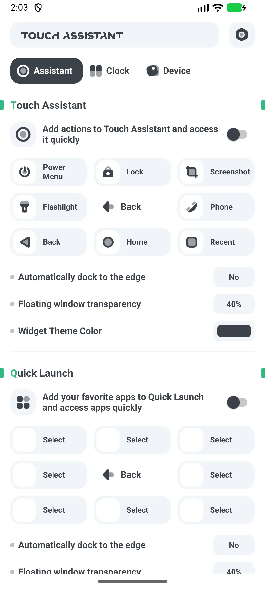
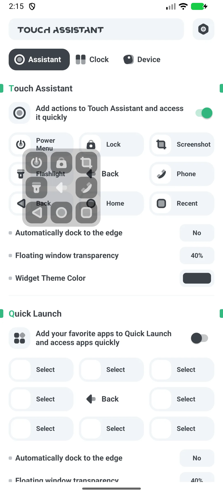
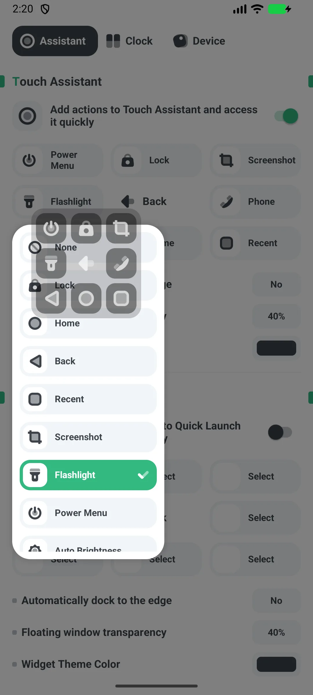

## Daftar Isi

- [Pengenalan Aplikasi](#pengenalan-aplikasi)
- [Penggunaan Pertama](#penggunaan-pertama)
- [Berikan Overlay dan Aksesibilitas](#berikan-overlay-dan-aksesibilitas)
- [Aktifkan dan Pindahkan Bola](#aktifkan-dan-pindahkan-bola)
- [Aksi Bola](#aksi-bola)
- [Pintasan Aplikasi](#pintasan-aplikasi)
- [Widget Toggle Sistem](#widget-toggle-sistem)
- [Ukuran, Warna, Dock](#ukuran-warna-dock)
- [Penggunaan Satu Tangan](#penggunaan-satu-tangan)
- [Gratis vs Pro](#gratis-vs-pro)
- [Skenario Khas](#skenario-khas)
- [FAQ](#faq)

## Pengenalan Aplikasi

Floating Assistant menambahkan sebuah [bola melayang](/id/glossary/what-is-a-floating-window/) ke Android untuk peluncuran aplikasi cepat, toggle sistem, dan kendali satu tangan pada ponsel besar. Ia bekerja sebagai **aplikasi tombol melayang untuk satu tangan android**: bola bertambat di salah satu tepi, setiap slot bisa dipetakan ulang, dan pintasan mencakup aplikasi, kontak, dan toggle sistem. Panduan ini berjalan dari peluncuran pertama melalui pemberian izin overlay dan aksesibilitas, memindahkan dan mengubah ukuran bola, menugaskan **bola melayang dengan pintasan kustom**, serta pembagian gratis/Pro — dengan penjelasan apa yang izin tersebut perbolehkan dan tidak.

**🫳 Bola Melayang**
- Bola yang bisa diseret dan tetap di atas aplikasi apa pun (tanpa root)
- Menggantikan tombol keras lewat layanan Aksesibilitas

**⚡ 8 Slot Aksi**
- 15 aksi mungkin: menu daya, kunci, tangkapan layar, senter, telepon, back, home, recent, kecerahan otomatis, rotasi otomatis, volume +/−/mute, dan lainnya

**📱 Pintasan Aplikasi**
- 8 slot meluncurkan aplikasi terpasang Anda (aksi telepon atau pemanggil tersedia; **tidak ada pintasan kontak**)

**🔧 Widget Toggle Sistem**
- 11 widget layar utama: Bluetooth, data seluler, Wi-Fi, senter, rotasi, pesawat, hotspot, DND, lokasi, getar, mode gelap

**💲 Gratis + Pro**
- Gratis menampilkan iklan; **Pro** adalah aplikasi terpisah tanpa iklan

## Penggunaan Pertama

Buka aplikasi ke layar utama dengan promo peningkatan di atas dan sakelar **"Home entry"**.

- Nyalakan **Home entry** untuk menampilkan bola
- Roda setelan membuka bahasa, nilai, bagikan, dan peningkatan

{: width="180" .normal }

## Berikan Overlay dan Aksesibilitas

1. Nyalakan **Home entry**
2. Berikan **"Gambar di atas aplikasi lain"** saat diminta (Setelan sistem)
3. Terima **Aksesibilitas** saat diminta — aksi tombol bola (home/back/recent/kunci/tangkapan layar) membutuhkannya
4. Izinkan **mengabaikan pengoptimalan baterai** agar bola tak dihentikan

Izin overlay membiarkan bola menggambar di atas aplikasi; Aksesibilitas membiarkan melakukan aksi global.

## Aktifkan dan Pindahkan Bola

1. Aktifkan **Home entry**
2. Bola muncul; **seret** untuk memindahkan — ia otomatis menempel ke tepi kiri atau kanan
3. Posisinya disimpan sebagai persentase layar

{: width="180" .normal }

## Aksi Bola

1. Ketuk bola untuk **memperluas** menjadi 8 slot
2. Tiap slot memicu aksinya yang dipetakan (menu daya, kunci, tangkapan layar, senter, telepon, back, home, recent, …)
3. Ketuk bola lagi untuk menciutkan

Bawaan: 1=menu daya, 2=kunci, 3=tangkapan layar, 4=senter, 6=telepon, 7=back, 8=home, 9=recent.

## Pintasan Aplikasi

1. Atur bola atau widget **peluncur aplikasi** dengan hingga 8 slot
2. Di tiap slot, pilih aplikasi terpasang
3. Ketuk untuk meluncurkannya (atau Google Play bila belum ada)

## Widget Toggle Sistem

1. Tambahkan **widget toggle** dari pemilih widget (11 tipe)
2. Contoh:
   - **Senter** benar-benar mengalihkan senter
   - **Wi-Fi / Bluetooth / DND** membuka layar setelan sistemnya
   - **Rotasi** menulis setelan rotasi otomatis
3. Gunakan widget **Gabung** untuk mengelompokkan beberapa toggle

{: width="180" .normal }

## Ukuran, Warna, Dock

- **Ukuran**: 5 langkah S/M/L/XL/XXL
- **Alpha**: bisa diatur (bawaan ~40%)
- **Warna**: hitam / putih / hijau / biru / kuning / ungu (bawaan hitam)
- **Dock**: nyala atau mati mengontrol menempel otomatis ke tepi

## Penggunaan Satu Tangan

Dengan bola Anda bisa melakukan HOME / BACK / RECENTS / POWER-DIALOG / LOCK / TANGKAPAN LAYAR lewat layanan Aksesibilitas, plus senter, volume, dan rotasi di atas bola — sehingga mengontrol ponsel dengan ibu jari tanpa menjangkau tombol fisik.

## Gratis vs Pro

- **Gratis** menampilkan iklan (banner + interstisial)
- **Pro** adalah aplikasi terpisah **tanpa iklan**; peningkatan dalam aplikasi hanya membuka Google Play untuknya

## Skenario Khas

- **Penyiapan pertama** — nyalakan Home entry, berikan Gambar di atas aplikasi lain dan Aksesibilitas sekali, lalu bola tetap di atas setiap aplikasi.
- **Satu tangan di ponsel besar** — seret bola ke tepi bawah agar back, home, recent, dan tangkapan layar mendarat di bawah ibu jari.
- **Kunci tanpa tombol daya** — petakan slot ke kunci layar dan hemat tombol keras.
- **Lompat aplikasi cepat** — isi 8 slot aplikasi dengan aplikasi harian agar lewati perburuan layar utama.
- **Toggle tanpa menggali** — letakkan 11 widget toggle sistem (Wi-Fi, senter, DND…) di layar utama untuk kendali seketuk.

## FAQ

### Apakah ada pintasan kontak?
{:.faq-q}
Tidak. Satu-satunya aksi terkait orang adalah pintasan **telepon atau pemanggil**. Tidak ada pintasan kontak.

### Bisakah saya menyapu bola?
{:.faq-q}
Gestur hanya **ketuk untuk melebar, ketuk slot, dan seret untuk pindah atau dock**. Tidak ada pemetaan sapu kiri atau kanan.

### Mengapa Aksesibilitas?
{:.faq-q}
Aksi tombol global (home/back/recent/kunci/tangkapan layar) dilakukan lewat layanan Aksesibilitas Android.

## Ringkasan

Floating Assistant membuat ponsel besar bisa dioperasikan satu tangan: bola melayang untuk peluncuran dan aksi sistem, plus widget toggle — gratis untuk memulai, dengan aplikasi Pro tanpa iklan.

## Istilah terkait

- [Apa Itu Assistive Touch?](/id/glossary/what-is-assistive-touch/)
- [Apa Itu Jendela Melayang?](/id/glossary/what-is-a-floating-window/)
