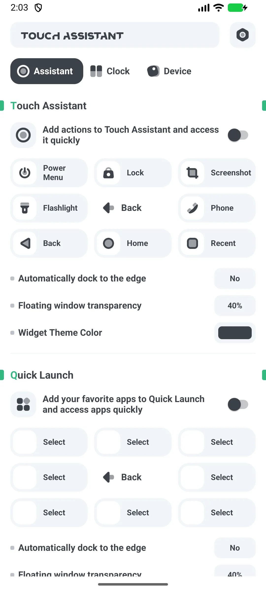
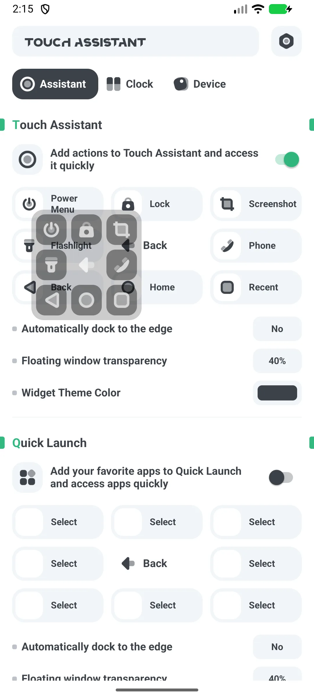
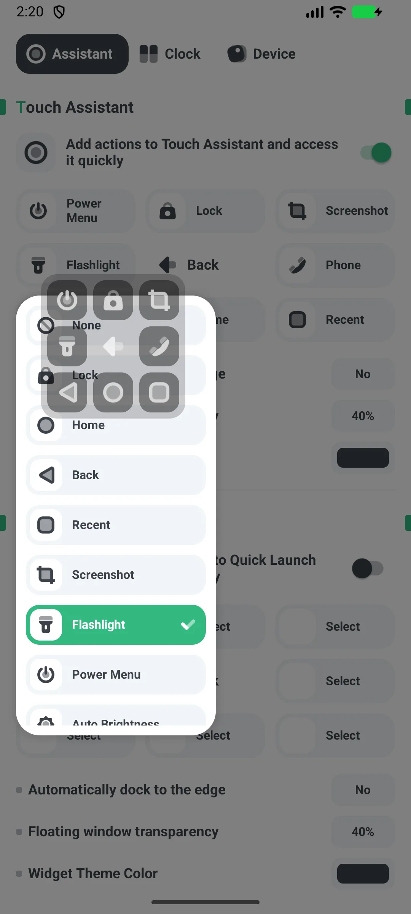

## Daftar Isi

- [Pengenalan Aplikasi](#pengenalan-aplikasi)
- [Penggunaan Pertama](#penggunaan-pertama)
- [Berikan Overlay dan Aksesibilitas](#berikan-overlay-dan-aksesibilitas)
- [Aktifkan dan Pindahkan Bola](#aktifkan-dan-pindahkan-bola)
- [Aksi Bola](#aksi-bola)
- [Pintasan Aplikasi](#pintasan-aplikasi)
- [Widget Toggle Sistem](#widget-toggle-sistem)
- [Ukuran, Warna, Dock](#ukuran-warna-dock)
- [Penggunaan Satu Tangan](#penggunaan-satu-tangan)
- [Gratis vs Pro](#gratis-vs-pro)
- [Skenario Khas](#skenario-khas)
- [FAQ](#faq)

## Pengenalan Aplikasi

Floating Assistant menambahkan **[bola melayang](/id/glossary/what-is-a-floating-window/)** ke Android untuk peluncuran aplikasi cepat, toggle sistem, dan kendali satu tangan pada ponsel besar. Bola bertambat di tepi kiri atau kanan, setiap slot bisa dipetakan ulang, dan pintasan mencakup aplikasi serta aksi sistem — meski tidak ada pintasan kontak. Panduan ini berjalan dari peluncuran pertama melalui izin overlay dan Aksesibilitas, delapan slot aksi, sebelas widget toggle, hingga pembagian gratis dan Pro, dengan penjelasan apa yang boleh dan tidak boleh dilakukan izin tersebut.

**🫳 Bola Melayang**
- Bola yang bisa diseret dan tetap di atas aplikasi apa pun (tanpa root)
- Menggantikan tombol keras lewat layanan Aksesibilitas

**⚡ 8 Slot Aksi**
- 15 aksi mungkin: menu daya, kunci, tangkapan layar, senter, telepon, back, home, recent, kecerahan otomatis, rotasi otomatis, volume +/−/mute, dan lainnya

**📱 Pintasan Aplikasi**
- 8 slot meluncurkan aplikasi terpasang Anda (aksi telepon atau pemanggil tersedia; **tidak ada pintasan kontak**)

**🔧 Widget Toggle Sistem**
- 11 widget layar utama: Bluetooth, data seluler, Wi-Fi, senter, rotasi, pesawat, hotspot, DND, lokasi, getar, mode gelap

**💲 Gratis + Pro**
- Gratis menampilkan iklan; **Pro** adalah aplikasi terpisah tanpa iklan

## Penggunaan Pertama

Buka aplikasi ke layar utama yang menampilkan promo peningkatan di atas dan sakelar **Home entry**, lalu nyalakan sakelar tersebut agar bola muncul. Roda setelan di layar yang sama membuka bahasa, nilai, bagikan, dan peningkatan. Dari sini Anda juga akan diminta dua izin penting — overlay dan Aksesibilitas — sebelum bola bisa mengambang di atas aplikasi lain dan menjalankan aksi tombol global.

- Nyalakan **Home entry** untuk menampilkan bola
- Roda setelan membuka bahasa, nilai, bagikan, dan peningkatan

{: width="180" .normal }

## Berikan Overlay dan Aksesibilitas

Empat izin dan langkah menyiapkan Floating Assistant harus dipenuhi sekali di awal: nyalakan **Home entry**, setujui **'Gambar di atas aplikasi lain'** saat diminta, terima **Aksesibilitas** karena aksi home, back, recent, kunci, dan tangkapan layar memerlukannya, lalu izinkan pengabaian pengoptimalan baterai agar bola tidak dihentikan sistem. Izin overlay membiarkan bola menggambar di atas aplikasi, sementara Aksesibilitas memungkinkan aksi global.

1. Nyalakan **Home entry**
2. Berikan **"Gambar di atas aplikasi lain"** saat diminta (Setelan sistem)
3. Terima **Aksesibilitas** saat diminta — aksi tombol bola (home/back/recent/kunci/tangkapan layar) membutuhkannya
4. Izinkan **mengabaikan pengoptimalan baterai** agar bola tak dihentikan

Izin overlay membiarkan bola menggambar di atas aplikasi; Aksesibilitas membiarkan melakukan aksi global.

## Aktifkan dan Pindahkan Bola

Mengaktifkan **Home entry** membuat bola muncul dan langsung bisa diseret ke posisi mana pun; ia otomatis menempel ke tepi kiri atau kanan layar. Posisinya disimpan sebagai persentase layar, sehingga tetap relevan saat Anda berpindah perangkat atau mengubah orientasi. Kemampuan menempel dan memindahkan ini menjadi dasar kendali satu tangan yang dibahas di bagian berikutnya.

1. Aktifkan **Home entry**
2. Bola muncul; **seret** untuk memindahkan — ia otomatis menempel ke tepi kiri atau kanan
3. Posisinya disimpan sebagai persentase layar

{: width="180" .normal }

## Aksi Bola

Mengetuk bola memperluasnya menjadi **delapan slot aksi**, masing-masing memicu aksi yang dipetakan seperti menu daya, kunci layar, tangkapan layar, senter, telepon, back, home, atau recent; ketuk lagi untuk menciutkannya. Bawaan pabrik memetakan 1=menu daya, 2=kunci, 3=tangkapan layar, 4=senter, 6=telepon, 7=back, 8=home, dan 9=recent. Dari 15 aksi yang mungkin, Anda bisa menyusun ulang slot sesuai kebutuhan.

1. Ketuk bola untuk **memperluas** menjadi 8 slot
2. Tiap slot memicu aksinya yang dipetakan (menu daya, kunci, tangkapan layar, senter, telepon, back, home, recent, …)
3. Ketuk bola lagi untuk menciutkan

Bawaan: 1=menu daya, 2=kunci, 3=tangkapan layar, 4=senter, 6=telepon, 7=back, 8=home, 9=recent.

## Pintasan Aplikasi

Pintasan aplikasi Floating Assistant menyediakan hingga **delapan slot** yang masing-masing bisa diisi aplikasi terpasang, lalu ketuk untuk meluncurkannya — atau membuka Google Play bila aplikasi belum ada. Berbeda dengan aksi bola, pintasan ini hanya mencakup aplikasi; aksi telepon atau pemanggil tersedia, tetapi tidak ada pintasan kontak. Pengaturannya dimulai dari bola atau widget peluncur aplikasi.

1. Atur bola atau widget **peluncur aplikasi** dengan hingga 8 slot
2. Di tiap slot, pilih aplikasi terpasang
3. Ketuk untuk meluncurkannya (atau Google Play bila belum ada)

## Widget Toggle Sistem

Widget toggle sistem tersedia dalam **11 tipe** — Bluetooth, data seluler, Wi-Fi, senter, rotasi, pesawat, hotspot, DND, lokasi, getar, dan mode gelap — yang bisa ditaruh di layar utama atau di dalam menu bola. Perilakunya berbeda: senter benar-benar mengalihkan senter, sementara Wi-Fi, Bluetooth, dan DND membuka layar setelan sistemnya, dan rotasi menulis setelan rotasi otomatis. Gunakan widget **Gabung** untuk mengelompokkan beberapa toggle.

1. Tambahkan **widget toggle** dari pemilih widget (11 tipe)
2. Contoh:
   - **Senter** benar-benar mengalihkan senter
   - **Wi-Fi / Bluetooth / DND** membuka layar setelan sistemnya
   - **Rotasi** menulis setelan rotasi otomatis
3. Gunakan widget **Gabung** untuk mengelompokkan beberapa toggle

{: width="180" .normal }

## Ukuran, Warna, Dock

Ukuran bola bisa diatur dalam **lima langkah** S/M/L/XL/XXL, alpha dapat diubah dengan bawaan sekitar 40%, dan warna tersedia dalam enam pilihan — hitam, putih, hijau, biru, kuning, dan ungu — dengan hitam sebagai bawaan. Sakelar **Dock** mengontrol apakah bola otomatis menempel ke tepi layar. Kombinasi ini membuat bola tetap terlihat tanpa menghalangi konten.

- **Ukuran**: 5 langkah S/M/L/XL/XXL
- **Alpha**: bisa diatur (bawaan ~40%)
- **Warna**: hitam / putih / hijau / biru / kuning / ungu (bawaan hitam)
- **Dock**: nyala atau mati mengontrol menempel otomatis ke tepi

## Penggunaan Satu Tangan

Dengan bola Anda bisa melakukan HOME / BACK / RECENTS / POWER-DIALOG / LOCK / TANGKAPAN LAYAR lewat layanan Aksesibilitas, plus senter, volume, dan rotasi di atas bola — sehingga ponsel besar tetap dikendalikan dengan ibu jari tanpa menjangkau tombol fisik. Delapan slot aksi dan sebelas widget toggle memperluas jangkauan itu ke aplikasi serta pengaturan sistem harian.

## Gratis vs Pro

Model pendanaannya sederhana: versi **Gratis** menampilkan iklan banner dan interstisial, sementara **Pro** adalah aplikasi terpisah tanpa iklan. Tombol peningkatan di dalam aplikasi hanya membuka halaman Google Play untuk versi Pro, bukan mengubah versi yang sedang dipakai. Karena bola, aksi, dan gestur inti sudah tersedia di versi gratis, perpindahan ke Pro terutama soal kenyamanan tanpa iklan.

- **Gratis** menampilkan iklan (banner + interstisial)
- **Pro** adalah aplikasi terpisah **tanpa iklan**; peningkatan dalam aplikasi hanya membuka Google Play untuknya

## Skenario Khas

Lima skenario memakai Floating Assistant memanfaatkan bola bertempel di tepi dan izin yang diberikan sekali itu: nyalakan Home entry serta kedua izin saat penyiapan pertama agar bola tetap di atas setiap aplikasi; seret bola ke tepi bawah pada ponsel besar supaya back, home, recent, dan tangkapan layar berada di bawah ibu jari; petakan satu slot ke kunci layar untuk menghemat tombol daya; isi delapan slot dengan aplikasi harian agar tidak perlu mencari di layar utama; dan pasang sebelas widget toggle di layar utama untuk kendali seketuk.

- **Penyiapan pertama** — nyalakan Home entry, berikan Gambar di atas aplikasi lain dan Aksesibilitas sekali, lalu bola tetap di atas setiap aplikasi.
- **Satu tangan di ponsel besar** — seret bola ke tepi bawah agar back, home, recent, dan tangkapan layar mendarat di bawah ibu jari.
- **Kunci tanpa tombol daya** — petakan slot ke kunci layar dan hemat tombol keras.
- **Lompat aplikasi cepat** — isi 8 slot aplikasi dengan aplikasi harian agar lewati perburuan layar utama.
- **Toggle tanpa menggali** — letakkan 11 widget toggle sistem (Wi-Fi, senter, DND…) di layar utama untuk kendali seketuk.

## FAQ

### Apakah ada pintasan kontak?
{:.faq-q}
Tidak. Satu-satunya aksi terkait orang adalah pintasan **telepon atau pemanggil**. Tidak ada pintasan kontak.

### Bisakah saya menyapu bola?
{:.faq-q}
Gestur hanya **ketuk untuk melebar, ketuk slot, dan seret untuk pindah atau dock**. Tidak ada pemetaan sapu kiri atau kanan.

### Mengapa Aksesibilitas?
{:.faq-q}
Aksi tombol global (home/back/recent/kunci/tangkapan layar) dilakukan lewat layanan Aksesibilitas Android.

## Ringkasan

Floating Assistant membuat ponsel besar bisa dioperasikan satu tangan: bola melayang untuk peluncuran dan aksi sistem, plus widget toggle — gratis untuk memulai, dengan aplikasi Pro tanpa iklan.

## Istilah terkait

- [Apa Itu Assistive Touch?](/id/glossary/what-is-assistive-touch/)
- [Apa Itu Jendela Melayang?](/id/glossary/what-is-a-floating-window/)
