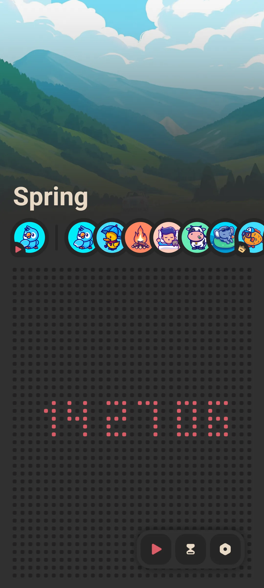
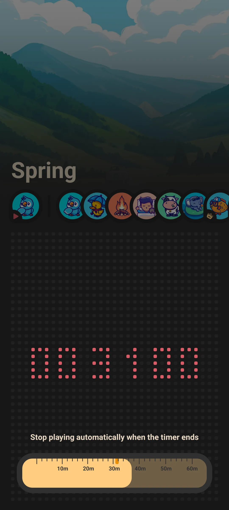
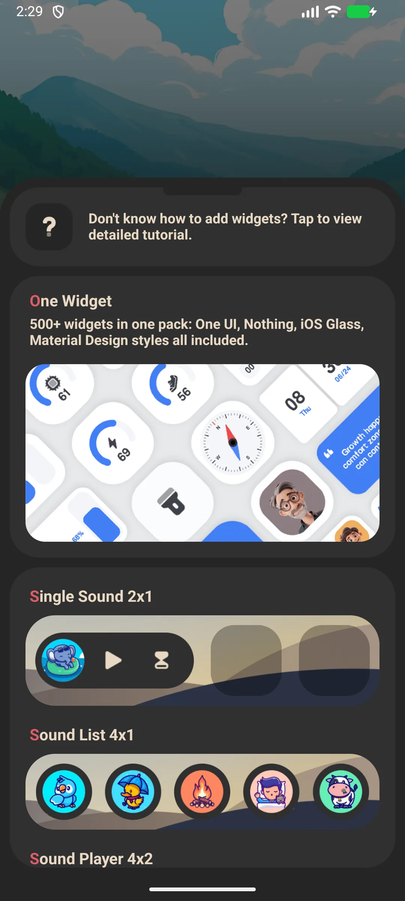

## Daftar Isi

- [Pendahuluan Aplikasi](#pendahuluan-aplikasi)
- [Penggunaan Pertama](#penggunaan-pertama)
- [Memutar Suara Ambient](#memutar-suara-ambient)
- [Pengatur Waktu Tidur](#pengatur-waktu-tidur)
- [Putar Latar dan Layar Mati](#putar-latar-dan-layar-mati)
- [Tema](#tema)
- [Widget Layar Utama](#widget-layar-utama)
- [Suara Gratis vs Premium](#suara-gratis-vs-premium)
- [Pengaturan](#pengaturan)
- [Skenario Umum](#skenario-umum)
- [FAQ](#faq)

## Pendahuluan Aplikasi

Meow FM adalah aplikasi [white-noise](/id/glossary/what-is-white-noise/) bertema kucing untuk tidur, relaksasi, dan fokus dengan pustaka lebih dari 15 suara ambient seperti hujan, badai petir, hutan, dan perapian. Pemutar ini sepenuhnya offline: setiap suara tersimpan di perangkat sehingga tetap bekerja di pesawat maupun saat layar terkunci. Pengatur waktu tidur 0–60 menit menghentikan pemutaran otomatis sebelum pagi, sementara widget layar utama memulai adegan dalam satu ketuk. Panduan ini menelusuri putaran pertama hingga tema dan opsi premium, tanpa memerlukan akun.

**🌧 Suara Ambient**
- A library of **15+ sounds**: rain, thunderstorm, forest, fireplace, wind, seaside, summer night, and more
- Browse the horizontal sound list and tap to play

**⏲ Pengatur Waktu Tidur**
- A timer slider from **0 to 60 minutes**; playback auto-stops when it ends so it never runs till morning

**🔇 Offline**
- Every sound plays with no network connection — great on planes, commutes and patchy hotel Wi-Fi

**🎨 Sederhana**
- Light / dark theme
- Free to start; a one-time unlock opens the premium sound scenes

> Catatan: Meow FM memutar **satu suara dalam satu waktu** (tidak ada layer/mixer untuk menggabungkan beberapa suara). Pilih adegan yang sesuai momen.

## Penggunaan Pertama

Layar beranda Meow FM adalah satu halaman yang menampilkan chip suara terpilih plus daftar gulir berisi semua suara, sehingga Anda bisa langsung menekan putar tanpa melalui menu bertingkat. Ketuk sebuah suara untuk memutarnya, ketuk lagi untuk berhenti, atau geser penggeser waktu untuk menjadwalkan penghentian otomatis. Semua kendali penting berada di halaman ini.

- Tap a sound to play it
- Tap again to stop
- Use the timer slider to schedule auto-stop

{: width="180" .normal }

## Memutar Suara Ambient

Memutar suara ambient di Meow FM cukup satu ketuk dari daftar gulir di layar beranda, dengan lebih dari 15 pilihan seperti Hujan dan Badai Petir. Chip di atas layar diperbarui mengikuti suara yang aktif, dan ketukan pada suara yang sama menghentikan pemutaran sementara ketukan pada suara lain langsung beralih. Pemutaran tetap berlanjut saat Anda memakai aplikasi lain atau mengunci layar.

1. Di layar beranda, gulir daftar suara
2. Ketuk suara (mis. **Hujan** atau **Badai Petir**)
3. Mulai diputar segera dan chip diperbarui
4. Ketuk suara yang sama lagi untuk berhenti, atau ketuk lainnya untuk beralih

Pemutaran berlanjut saat Anda menggunakan aplikasi lain atau mengunci layar.

## Pengatur Waktu Tidur

Pengatur waktu tidur Meow FM memakai penggeser 0 hingga 60 menit dan menghentikan pemutaran otomatis saat waktu habis, sehingga suara tidak berjalan terus sampai pagi. Atur penggeser sebelum Anda terlelap agar transisi ke tidur tidak terputus oleh notifikasi untuk mematikan audio. Pengatur waktu ini menjadi pembeda utama aplikasi ini untuk pemakaian samping tempat tidur.

1. Seret **penggeser pengatur waktu** dari 0 hingga 60 menit
2. Pemutaran berhenti otomatis saat pengatur waktu mencapai nol
3. Atur sebelum Anda terlelap agar suara tak jalan sepanjang malam

{: width="180" .normal }

## Putar Latar dan Layar Mati

Meow FM menggunakan layanan pemutaran latar depan, sehingga suara tetap berjalan layar mati dan tak bergantung pada server. Ini fitur kunci untuk tidur dan fokus — generator white noise tidak berhenti saat Anda mengunci perangkat atau berpindah aplikasi, dan seluruh pustaka ada di perangkat sehingga tidak perlu sinyal.

## Tema

Buka **Pengaturan** dan beralih antara mode **terang** dan **gelap**, dengan mode gelap aktif secara bawaan agar layar tetap tenang di malam hari. Pilihan tema ini mengubah tampilan daftar suara dan chip pemutar tanpa memengaruhi kualitas audio atau pemutaran offline.

## Widget Layar Utama

Meow FM menyediakan tiga jenis widget yang bisa Anda taruh di layar utama — **Suara Tunggal** untuk memutar satu suara pilihan dalam satu ketuk, **Daftar Suara** untuk akses cepat ke beberapa suara, dan **Pemutar Suara / sampul** sebagai widget pemutar. Tambahkan dari pemilih widget, lalu konfigurasi suara pada menu pengaturan widget.

- **Suara Tunggal** — putar satu ketuk suara pilihan
- **Daftar Suara** — akses cepat ke beberapa suara
- **Pemutar Suara / sampul** — widget pemutar

Tambahkan dari pemilih widget, lalu konfigurasi suara di konfigurasi widget.

{: width="180" .normal }

## Suara Gratis vs Premium

Model harga Meow FM terdiri dari dua tingkat: satu set suara bisa diputar gratis, sementara adegan premium tambahan dibuka lewat pembelian sekali bayar tanpa langganan. Pemutaran offline, pengatur waktu tidur, dan widget sudah tersedia di tingkat gratis, sehingga Anda bisa memakai aplikasi ini untuk tidur dan fokus tanpa membayar. Pembelian hanya menambah variasi adegan.

- A set of sounds is **free** to play
- Additional **premium scenes** unlock via a **one-time purchase** (no subscription)

## Pengaturan

Pengaturan Meow FM mencakup tema terang atau gelap, promosi silang keluarga Meow, dan opsi tagihan atau pulihkan pembelian. Dari sini Anda juga mengelola pengaturan terkait versi premium bila memutuskan membuka adegan tambahan, sementara pemutaran dan daftar suara tetap berjalan seperti biasa.

## Skenario Umum

Empat skenario memakai Meow FM memanfaatkan suara offline dan penghentian otomatis: ketuk adegan hujan atau badai dan atur pengatur waktu 60 menit agar suara menutupi pasangan yang mendengkur lalu mematikan diri; putar perapian atau tepi laut dengan layar mati selama blok kerja; andalkan bundelan suara saat penerbangan atau Wi-Fi hotel yang buruk; dan mulai adegan dari widget Suara Tunggal tanpa membuka aplikasi.

- **Tidur di malam berisik** — ketuk adegan hujan atau badai, atur pengatur waktu 60 menit, dan suara menutupi pasangan yang mendengkur sebelum mematikan diri.
- **Fokus di meja** — putar perapian atau tepi laut dan biarkan layar mati; layanan latar depan berjalan sepanjang blok kerja.
- **Bepergian tanpa sinyal** — setiap suara dibundel, sehingga pesawat atau Wi-Fi hotel buruk tak pernah mengganggu masa tenang.
- **Satu ketuk dari widget** — taruh widget Suara Tunggal di layar utama dan mulai adegan tanpa membuka aplikasi.

## FAQ

### Bisakah saya mencampur hujan + guntur bersama?
{:.faq-q}
Tidak di aplikasi saat ini — ia memutar satu suara dalam satu waktu. Pilih satu adegan yang paling pas (mis. Badai Petir sudah menggabung hujan dan guntur).

### Apakah butuh internet?
{:.faq-q}
Tidak. Semua suara dibundel dan diputar sepenuhnya offline.

### Bagaimana cara menghentikannya otomatis?
{:.faq-q}
Gunakan pengatur waktu tidur (0–60 menit); pemutaran berhenti di nol.

## Ringkasan

Meow FM adalah cara paling sederhana menambah suara ambient menenangkan ke tidur atau fokus — gratis untuk memulai, sepenuhnya offline, dengan pengatur waktu tidur yang mematikan diri.

[Halaman aplikasi Meow FM](/id/apps/meow-fm/) — tersedia di Android dan iOS.

## Istilah terkait

- [Apa Itu White Noise?](/id/glossary/what-is-white-noise/)
