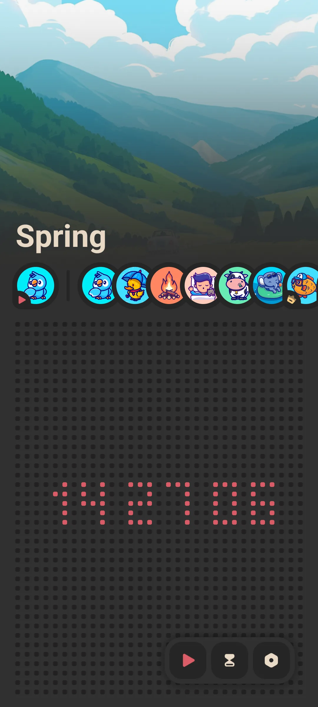
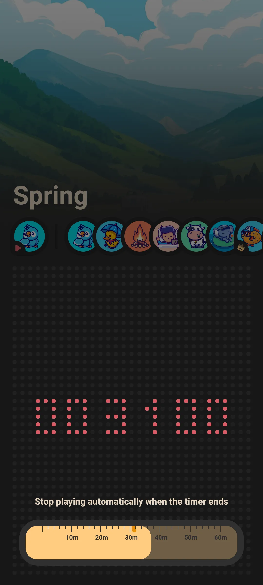
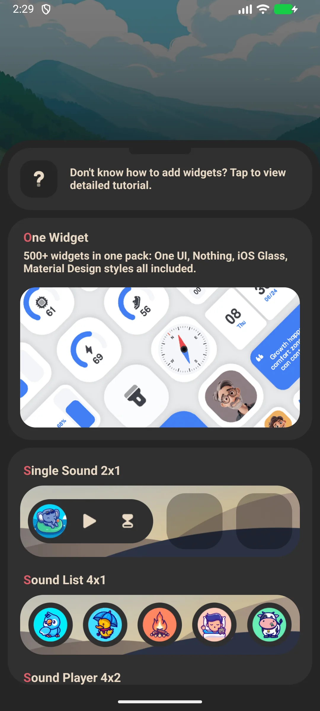

## Daftar Isi

- [Pendahuluan Aplikasi](#pendahuluan-aplikasi)
- [Penggunaan Pertama](#penggunaan-pertama)
- [Memutar Suara Ambient](#memutar-suara-ambient)
- [Pengatur Waktu Tidur](#pengatur-waktu-tidur)
- [Putar Latar dan Layar Mati](#putar-latar-dan-layar-mati)
- [Tema](#tema)
- [Widget Layar Utama](#widget-layar-utama)
- [Suara Gratis vs Premium](#suara-gratis-vs-premium)
- [Pengaturan](#pengaturan)
- [Skenario Umum](#skenario-umum)
- [FAQ](#faq)

## Pendahuluan Aplikasi

Meow FM adalah aplikasi [white-noise](/id/glossary/what-is-white-noise/) bertema kucing untuk tidur, relaksasi, dan fokus. Putar suara ambient menenangkan untuk terlelap lebih cepat, fokus lebih lama, atau meredam ruangan berisik. Ini pemutar **white noise offline**: pustaka suara ada di perangkat, sehingga **white noise untuk memblokir noise** tetap bekerja di pesawat atau layar terkunci. Panduan ini berjalan dari putaran pertama Anda melalui **white noise dengan pengatur waktu**, menumpuk trek ala **aplikasi suara hujan** di bawah gumaman rendah **aplikasi brown noise**, dan widget layar utama — semua dari **aplikasi white noise kucing** yang tak perlu akun.

**🌧 Suara Ambient**
- A library of **15+ sounds**: rain, thunderstorm, forest, fireplace, wind, seaside, summer night, and more
- Browse the horizontal sound list and tap to play

**⏲ Pengatur Waktu Tidur**
- A timer slider from **0 to 60 minutes**; playback auto-stops when it ends so it never runs till morning

**🔇 Offline**
- Every sound plays with no network connection — great on planes, commutes and patchy hotel Wi-Fi

**🎨 Sederhana**
- Light / dark theme
- Free to start; a one-time unlock opens the premium sound scenes

> Catatan: Meow FM memutar **satu suara dalam satu waktu** (tidak ada layer/mixer untuk menggabungkan beberapa suara). Pilih adegan yang sesuai momen.

## Penggunaan Pertama

Layar beranda adalah satu halaman: chip suara terpilih plus daftar gulir semua suara.

- Tap a sound to play it
- Tap again to stop
- Use the timer slider to schedule auto-stop

{: width="180" .normal }

## Memutar Suara Ambient

1. Di layar beranda, gulir daftar suara
2. Ketuk suara (mis. **Hujan** atau **Badai Petir**)
3. Mulai diputar segera dan chip diperbarui
4. Ketuk suara yang sama lagi untuk berhenti, atau ketuk lainnya untuk beralih

Pemutaran berlanjut saat Anda menggunakan aplikasi lain atau mengunci layar.

## Pengatur Waktu Tidur

1. Seret **penggeser pengatur waktu** dari 0 hingga 60 menit
2. Pemutaran berhenti otomatis saat pengatur waktu mencapai nol
3. Atur sebelum Anda terlelap agar suara tak jalan sepanjang malam

{: width="180" .normal }

## Putar Latar dan Layar Mati

Meow FM menggunakan layanan pemutaran latar depan, sehingga suara tetap berjalan layar mati dan tak bergantung pada server. Ini fitur kunci untuk tidur dan fokus.

## Tema

Buka **Pengaturan** dan beralih antara mode **terang** dan **gelap** (mode gelap aktif secara bawaan).

## Widget Layar Utama

Meow FM menyediakan tiga jenis widget yang bisa Anda taruh di layar utama:

- **Suara Tunggal** — putar satu ketuk suara pilihan
- **Daftar Suara** — akses cepat ke beberapa suara
- **Pemutar Suara / sampul** — widget pemutar

Tambahkan dari pemilih widget, lalu konfigurasi suara di konfigurasi widget.

{: width="180" .normal }

## Suara Gratis vs Premium

- A set of sounds is **free** to play
- Additional **premium scenes** unlock via a **one-time purchase** (no subscription)

## Pengaturan

Pengaturan mencakup tema (terang/gelap), promosi silang keluarga Meow, dan opsi tagihan / pulihkan.

## Skenario Umum

- **Tidur di malam berisik** — ketuk adegan hujan atau badai, atur pengatur waktu 60 menit, dan suara menutupi pasangan yang mendengkur sebelum mematikan diri.
- **Fokus di meja** — putar perapian atau tepi laut dan biarkan layar mati; layanan latar depan berjalan sepanjang blok kerja.
- **Bepergian tanpa sinyal** — setiap suara dibundel, sehingga pesawat atau Wi-Fi hotel buruk tak pernah mengganggu masa tenang.
- **Satu ketuk dari widget** — taruh widget Suara Tunggal di layar utama dan mulai adegan tanpa membuka aplikasi.

## FAQ

### Bisakah saya mencampur hujan + guntur bersama?
{:.faq-q}
Tidak di aplikasi saat ini — ia memutar satu suara dalam satu waktu. Pilih satu adegan yang paling pas (mis. Badai Petir sudah menggabung hujan dan guntur).

### Apakah butuh internet?
{:.faq-q}
Tidak. Semua suara dibundel dan diputar sepenuhnya offline.

### Bagaimana cara menghentikannya otomatis?
{:.faq-q}
Gunakan pengatur waktu tidur (0–60 menit); pemutaran berhenti di nol.

## Ringkasan

Meow FM adalah cara paling sederhana menambah suara ambient menenangkan ke tidur atau fokus — gratis untuk memulai, sepenuhnya offline, dengan pengatur waktu tidur yang mematikan diri.

[Halaman aplikasi Meow FM](/id/apps/meow-fm/) — tersedia di Android dan iOS.

## Istilah terkait

- [Apa Itu White Noise?](/id/glossary/what-is-white-noise/)
