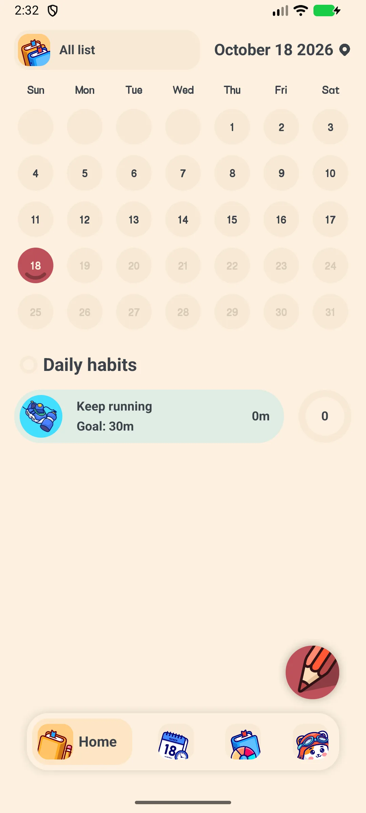
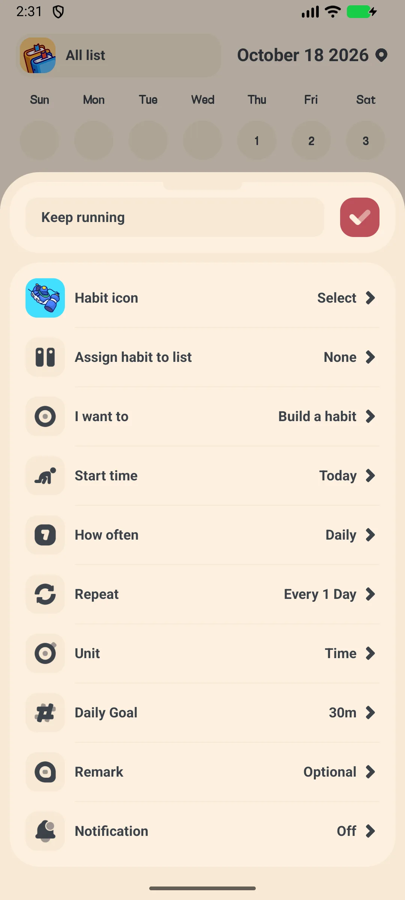
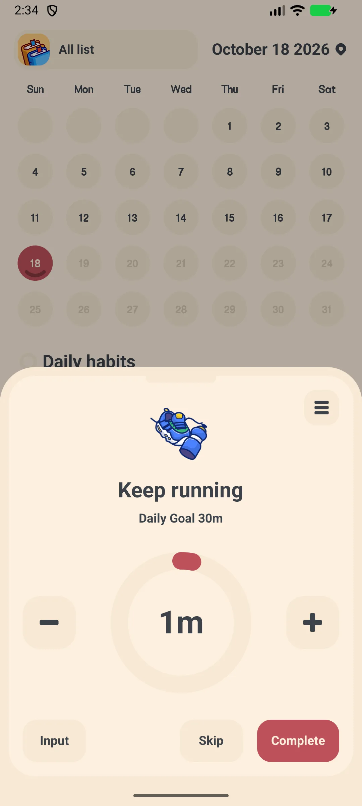
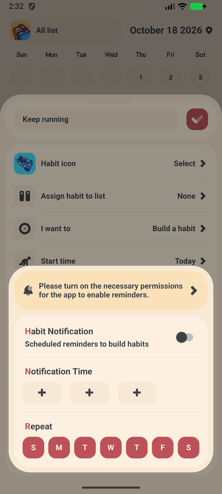
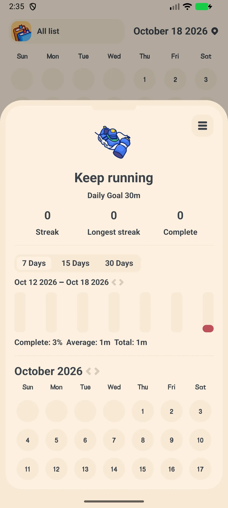

## Daftar Isi

- [Pengenalan Aplikasi](#pengenalan-aplikasi)
- [Penggunaan Pertama](#penggunaan-pertama)
- [Menambahkan Kebiasaan](#menambahkan-kebiasaan)
- [Check-in Harian](#check-in-harian)
- [Pengingat](#pengingat)
- [Streak dan Tren](#streak-dan-tren)
- [Edit, Arsip, atau Hapus](#edit-arsip-atau-hapus)
- [Cadangan dan Ekspor](#cadangan-dan-ekspor)
- [Pengaturan](#pengaturan)
- [Skenario Umum](#skenario-umum)
- [FAQ](#faq)

## Pengenalan Aplikasi

Meow Habits adalah **[aplikasi habit tracker](/id/glossary/what-is-a-habit-tracker/)** imut sekaligus pembangun rutinitas untuk Android dan iOS. Bangun kebiasaan baik dan hentikan kebiasaan buruk dengan streak, grafik, dan peta panas kalender. Aplikasi ini bekerja sebagai **habit tracker tanpa akun** dan **aplikasi habit tracker offline**: pencatatan tidak butuh pendaftaran maupun sinyal, dan **habit tracker dengan ekspor CSV** serta **habit tracker dengan cadangan WebDav** menjaga riwayat tetap milik Anda. Panduan cara pakai aplikasi habit tracker ini memandu dari pembukaan pertama, lewat **habit tracker dengan widget** dan **habit tracker dengan pengingat**, hingga membaca tren Anda sendiri.

**🐱 500+ Ikon Lucu**
- Pemilih ikon dengan sekitar **590 ikon** dalam **14 kategori**
- Pilih ikon dan warna untuk setiap kebiasaan

**🔥 Streak dan Grafik**
- Streak dan tingkat penyelesaian per kebiasaan
- Tampilan batang, pai, dan kalender (peta panas) untuk progres Anda

**🔁 Siklus Fleksibel**
- Harian, Mingguan, Bulanan, atau Hari Tertentu (mis. Sen/Rab/Jum)
- Aturan kustom "Setiap N hari/minggu"

**☁️ Privat**
- Offline secara default; cadangan Google Drive / WebDav opsional
- Ekspor CSV (VIP)

## Penggunaan Pertama

Aplikasi terbuka di tab **Beranda** yang menampilkan kebiasaan hari ini serta kalender bulanan.

- Tab bawah: **Beranda**, **Kebiasaan**, **Tren**, **Pengaturan**
- Ketuk **+** untuk menambah kebiasaan pertama (versi gratis hingga **5 kebiasaan**; VIP membuka tanpa batas)

{: width="180" .normal }

## Menambahkan Kebiasaan

1. Ketuk **+** di tab Beranda
2. Pilih **template** atau mulai kosong → membuka **Tambah Kebiasaan**
3. Masukkan **nama**
4. Ketuk **ikon** untuk membuka pemilih ikon (≈590 ikon, 14 kategori)
5. Pilih **Buku (daftar)** dan **jenis**
6. Tetapkan **target** (mis. jumlah atau durasi)
7. Atur **siklus**: Harian / Mingguan / Bulanan / Hari Tertentu, serta interval "Setiap N" jika perlu
8. Tetapkan **tanggal mulai**
9. Ketuk **Konfirmasi**

{: width="180" .normal }

## Check-in Harian

1. Di tab Beranda atau Kebiasaan, ketuk sebuah kebiasaan untuk membuka layar **check-in**
2. Cincin progres besar menampilkan target hari ini
3. Pakai **+ / −** untuk mengubah jumlah, **Input** untuk mengetik nilai, **Lewati** untuk melewati, atau **Selesai** untuk menuntaskan
4. Menu 3 titik menyediakan Tren / Notifikasi / Catatan / Edit / Arsip / Hapus

{: width="180" .normal }

## Pengingat

1. Buka sebuah kebiasaan dan ketuk opsi pengingat (lonceng)
2. Aktifkan pengingat harian
3. Pilih salah satu dari **3 chip waktu** dan tentukan hari (Min–Sab) yang berlaku
4. Aplikasi mengingatkan Anda untuk check-in

{: width="180" .normal }

## Streak dan Tren

1. Buka kebiasaan → **Detail** untuk melihat angka streak, batang riwayat, dan peta panas kalender
2. Beralih ke tab **Tren** untuk grafik dan pencapaian

{: width="180" .normal }

## Edit, Arsip, atau Hapus

Dari menu 3 titik di layar check-in Anda bisa **Edit**, **Arsip** (riwayat tetap tersimpan tapi disembunyikan), atau **Hapus** sebuah kebiasaan.

## Cadangan dan Ekspor

- **Pengaturan → Google Drive / WebDav** untuk mencadangkan dan memulihkan
- **Pengaturan → Ekspor** memungkinkan Anda memilih kebiasaan, menentukan rentang tanggal, dan membagikan **CSV**

## Pengaturan

Pengaturan mencakup banner VIP, **mode gelap**, **bahasa**, **hari awal pekan**, **kunci aplikasi** (VIP), suara, notifikasi, **widget**, Daftar, Kebiasaan, **Ekspor** (VIP), Google Drive, WebDav, dan bagian keluarga Meow.

## Skenario Umum

- **Rutinitas pagi** — setelah disiapkan, sematkan 'Minum air' dan 'Peregangan' ke widget layar utama dan check-in dari layar kunci agar streak harian tak pernah putus.
- **Hentikan kebiasaan buruk** — buat kebiasaan 'Berhenti scroll' dengan pengingat harian; peta panas kalender membuat satu kelalaian terlihat sebelum berubah jadi streak yang putus.
- **Tinjau bulan Anda** — buka tab Tren untuk melihat tingkat penyelesaian dan pencapaian, lalu pakai Pengaturan → Ekspor (VIP) untuk menarik CSV demi analisis lebih dalam.
- **Tetap privat offline** — semuanya berjalan tanpa akun; aktifkan Google Drive atau WebDav hanya saat ingin cadangan lintas perangkat.

## FAQ

### Apa yang memutus streak?
{:.faq-q}
Streak berlanjut selama Anda check-in pada hari yang dijadwalkan. Melewatkan satu hari terjadwal mengatur ulang streak saat ini untuk kebiasaan itu.

### Apakah ada batas versi gratis?
{:.faq-q}
Ya — versi gratis mengizinkan hingga **5 kebiasaan**. VIP membuka kebiasaan tanpa batas, daftar tanpa batas, mode gelap, kunci aplikasi, dan ekspor CSV.

### Di mana data saya disimpan?
{:.faq-q}
Secara default di perangkat Anda. Pakai cadangan Google Drive atau WebDav untuk memindahkannya antarperangkat.

## Ringkasan

Meow Habits mengubah cara membuat kebiasaan menjadi ritual harian yang tenang dengan ikon lucu, streak harian, dan tren yang jelas — dan bekerja sepenuhnya offline.

[Halaman aplikasi Meow Habits](/id/apps/meow-habits/) — tersedia di Android dan iOS.

## Istilah Terkait

- [Apa Itu Aplikasi Pelacak Kebiasaan (Habit Tracker)?](/id/glossary/what-is-a-habit-tracker/)
