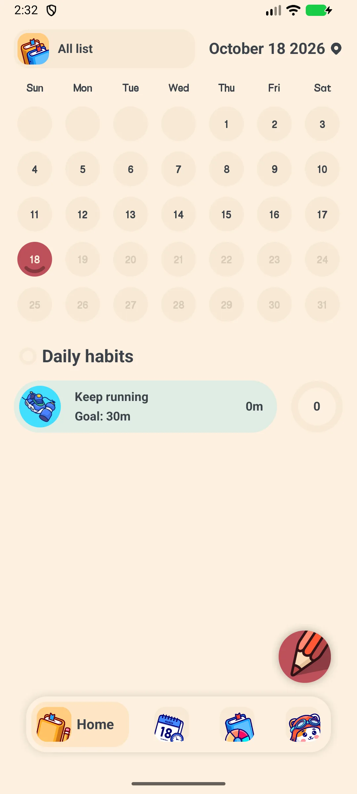
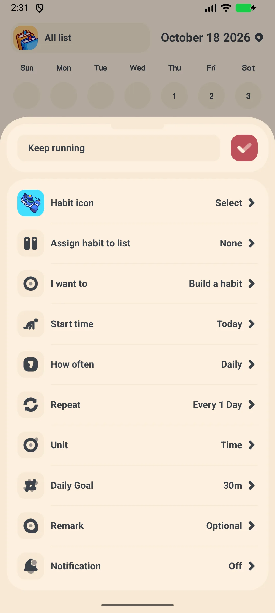
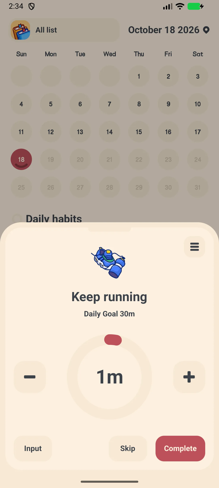
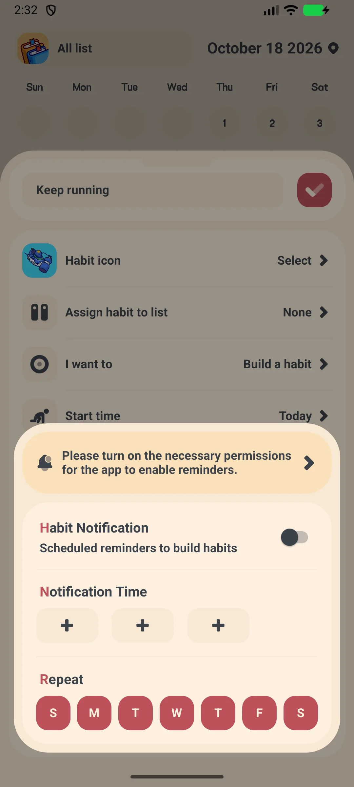
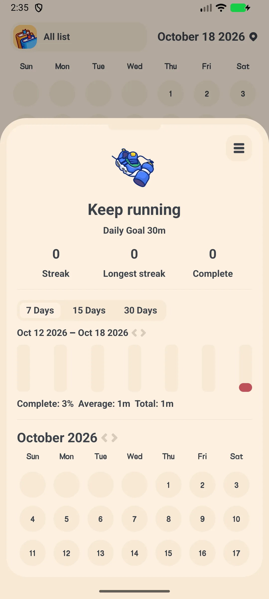

## Daftar Isi

- [Pengenalan Aplikasi](#pengenalan-aplikasi)
- [Penggunaan Pertama](#penggunaan-pertama)
- [Menambahkan Kebiasaan](#menambahkan-kebiasaan)
- [Check-in Harian](#check-in-harian)
- [Pengingat](#pengingat)
- [Streak dan Tren](#streak-dan-tren)
- [Edit, Arsip, atau Hapus](#edit-arsip-atau-hapus)
- [Cadangan dan Ekspor](#cadangan-dan-ekspor)
- [Pengaturan](#pengaturan)
- [Skenario Umum](#skenario-umum)
- [FAQ](#faq)

## Pengenalan Aplikasi

Meow Habits adalah **[aplikasi habit tracker](/id/glossary/what-is-a-habit-tracker/)** bergaya imut sekaligus pembangun rutinitas untuk Android dan iOS, dengan 500+ ikon, streak, grafik, dan peta panas kalender untuk membangun kebiasaan baik maupun menghentikan yang buruk. Aplikasi ini bekerja tanpa akun dan sepenuhnya offline, sementara ekspor CSV dan cadangan WebDav menjaga riwayat tetap milik Anda. Versi gratis memuat hingga 5 kebiasaan; VIP membuka jumlah tanpa batas, mode gelap, kunci aplikasi, dan ekspor CSV.

**🐱 500+ Ikon Lucu**
- Pemilih ikon dengan sekitar **590 ikon** dalam **14 kategori**
- Pilih ikon dan warna untuk setiap kebiasaan

**🔥 Streak dan Grafik**
- Streak dan tingkat penyelesaian per kebiasaan
- Tampilan batang, pai, dan kalender (peta panas) untuk progres Anda

**🔁 Siklus Fleksibel**
- Harian, Mingguan, Bulanan, atau Hari Tertentu (mis. Sen/Rab/Jum)
- Aturan kustom "Setiap N hari/minggu"

**☁️ Privat**
- Offline secara default; cadangan Google Drive / WebDav opsional
- Ekspor CSV (VIP)

## Penggunaan Pertama

Aplikasi terbuka di tab **Beranda** yang menampilkan kebiasaan hari ini dan kalender bulanan, dengan empat tab bawah — Beranda, Kebiasaan, Tren, dan Pengaturan. Ketuk **+** untuk menambah kebiasaan pertama; versi gratis membatasi hingga 5 kebiasaan sementara VIP membuka tanpa batas. Dari layar ini Anda juga bisa langsung menuju widget, pengingat, dan tren.

- Tab bawah: **Beranda**, **Kebiasaan**, **Tren**, **Pengaturan**
- Ketuk **+** untuk menambah kebiasaan pertama (versi gratis hingga **5 kebiasaan**; VIP membuka tanpa batas)

{: width="180" .normal }

## Menambahkan Kebiasaan

Menambah kebiasaan di Meow Habits dimulai dengan tombol **+** di tab Beranda, lalu memilih template atau mulai kosong. Anda memasukkan nama, memilih ikon dari pemilih berisi sekitar 590 ikon dalam 14 kategori, menentukan buku atau daftar, jenis, target, siklus harian hingga kustom, serta tanggal mulai sebelum menekan Konfirmasi. Alur ini membuat satu kebiasaan baru siap dalam beberapa langkah.

1. Ketuk **+** di tab Beranda
2. Pilih **template** atau mulai kosong → membuka **Tambah Kebiasaan**
3. Masukkan **nama**
4. Ketuk **ikon** untuk membuka pemilih ikon (≈590 ikon, 14 kategori)
5. Pilih **Buku (daftar)** dan **jenis**
6. Tetapkan **target** (mis. jumlah atau durasi)
7. Atur **siklus**: Harian / Mingguan / Bulanan / Hari Tertentu, serta interval "Setiap N" jika perlu
8. Tetapkan **tanggal mulai**
9. Ketuk **Konfirmasi**

{: width="180" .normal }

## Check-in Harian

Layar check-in Meow Habits menampilkan cincin progres besar untuk target hari ini, dengan tombol **+ / −**, **Input** untuk mengetik nilai, **Lewati**, dan **Selesai**. Menu tiga titik menyediakan Tren, Notifikasi, Catatan, Edit, Arsip, dan Hapus, sehingga seluruh pengelolaan kebiasaan berada dalam satu layar. Ketuk kebiasaan di tab Beranda atau Kebiasaan untuk membukanya.

1. Di tab Beranda atau Kebiasaan, ketuk sebuah kebiasaan untuk membuka layar **check-in**
2. Cincin progres besar menampilkan target hari ini
3. Pakai **+ / −** untuk mengubah jumlah, **Input** untuk mengetik nilai, **Lewati** untuk melewati, atau **Selesai** untuk menuntaskan
4. Menu 3 titik menyediakan Tren / Notifikasi / Catatan / Edit / Arsip / Hapus

{: width="180" .normal }

## Pengingat

Pengingat Meow Habits membantu menjaga streak dengan tiga chip waktu yang bisa dipilih untuk hari Min–Sab. Buka sebuah kebiasaan, ketuk opsi lonceng, aktifkan pengingat harian, lalu pilih salah satu chip waktu dan hari berlakunya. Aplikasi kemudian mengingatkan Anda untuk check-in sesuai jadwal yang ditentukan.

1. Buka sebuah kebiasaan dan ketuk opsi pengingat (lonceng)
2. Aktifkan pengingat harian
3. Pilih salah satu dari **3 chip waktu** dan tentukan hari (Min–Sab) yang berlaku
4. Aplikasi mengingatkan Anda untuk check-in

{: width="180" .normal }

## Streak dan Tren

Streak dan tren di Meow Habits menampilkan angka streak, batang riwayat, dan peta panas kalender pada halaman Detail kebiasaan, sementara tab **Tren** memuat grafik serta pencapaian. Kombinasi ini membuat penurunan terlihat lebih awal, sebelum satu hari yang terlewat berubah menjadi streak putus. Buka kebiasaan lalu pilih Detail untuk memulai.

1. Buka kebiasaan → **Detail** untuk melihat angka streak, batang riwayat, dan peta panas kalender
2. Beralih ke tab **Tren** untuk grafik dan pencapaian

{: width="180" .normal }

## Edit, Arsip, atau Hapus

Dari menu tiga titik di layar check-in, Meow Habits menyediakan tiga tindakan pengelolaan: **Edit** untuk mengubah kebiasaan, **Arsip** untuk menyembunyikannya sementara riwayat tetap tersimpan, dan **Hapus** untuk menghapusnya. Pilihan Arsip berguna bila Anda ingin menghentikan kebiasaan tanpa kehilangan data lama.

## Cadangan dan Ekspor

Cadangan dan ekspor Meow Habits memakai dua jalur: **Pengaturan → Google Drive / WebDav** untuk mencadangkan dan memulihkan data, serta **Pengaturan → Ekspor** untuk memilih kebiasaan, menentukan rentang tanggal, dan membagikan berkas CSV. Ekspor CSV merupakan fitur VIP, sementara penyimpanan default tetap lokal di perangkat tanpa akun.

- **Pengaturan → Google Drive / WebDav** untuk mencadangkan dan memulihkan
- **Pengaturan → Ekspor** memungkinkan Anda memilih kebiasaan, menentukan rentang tanggal, dan membagikan **CSV**

## Pengaturan

Pengaturan Meow Habits mencakup banner VIP, mode gelap, bahasa, hari awal pekan, kunci aplikasi VIP, suara, notifikasi, widget, Daftar, Kebiasaan, ekspor VIP, Google Drive, dan WebDav. Dari sini Anda mengatur tampilan serta perilaku pencatatan, termasuk kapan cadangan cloud dilakukan bila diinginkan.

## Skenario Umum

Empat skenario memakai Meow Habits menunjukkan peran widget, pengingat, peta panas, dan penyimpanan lokal. Rutinitas pagi seperti minum air dan peregangan bisa disematkan ke widget layar utama dan dicentang dari layar kunci agar streak tidak putus; kebiasaan buruk seperti scroll berlebih dipantau lewat pengingat harian dan peta panas; tab Tren dipakai untuk meninjau tingkat penyelesaian bulanan sebelum menarik CSV; dan semua data tetap offline tanpa akun.

- **Rutinitas pagi** — setelah disiapkan, sematkan 'Minum air' dan 'Peregangan' ke widget layar utama dan check-in dari layar kunci agar streak harian tak pernah putus.
- **Hentikan kebiasaan buruk** — buat kebiasaan 'Berhenti scroll' dengan pengingat harian; peta panas kalender membuat satu kelalaian terlihat sebelum berubah jadi streak yang putus.
- **Tinjau bulan Anda** — buka tab Tren untuk melihat tingkat penyelesaian dan pencapaian, lalu pakai Pengaturan → Ekspor (VIP) untuk menarik CSV demi analisis lebih dalam.
- **Tetap privat offline** — semuanya berjalan tanpa akun; aktifkan Google Drive atau WebDav hanya saat ingin cadangan lintas perangkat.

## FAQ

### Apa yang memutus streak?
{:.faq-q}
Streak berlanjut selama Anda check-in pada hari yang dijadwalkan. Melewatkan satu hari terjadwal mengatur ulang streak saat ini untuk kebiasaan itu.

### Apakah ada batas versi gratis?
{:.faq-q}
Ya — versi gratis mengizinkan hingga **5 kebiasaan**. VIP membuka kebiasaan tanpa batas, daftar tanpa batas, mode gelap, kunci aplikasi, dan ekspor CSV.

### Di mana data saya disimpan?
{:.faq-q}
Secara default di perangkat Anda. Pakai cadangan Google Drive atau WebDav untuk memindahkannya antarperangkat.

## Ringkasan

Meow Habits mengubah cara membuat kebiasaan menjadi ritual harian yang tenang dengan ikon lucu, streak harian, dan tren yang jelas — dan bekerja sepenuhnya offline.

[Halaman aplikasi Meow Habits](/id/apps/meow-habits/) — tersedia di Android dan iOS.

## Istilah Terkait

- [Apa Itu Aplikasi Pelacak Kebiasaan (Habit Tracker)?](/id/glossary/what-is-a-habit-tracker/)
