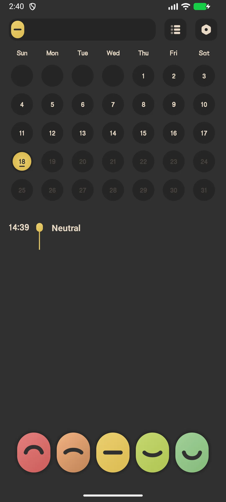
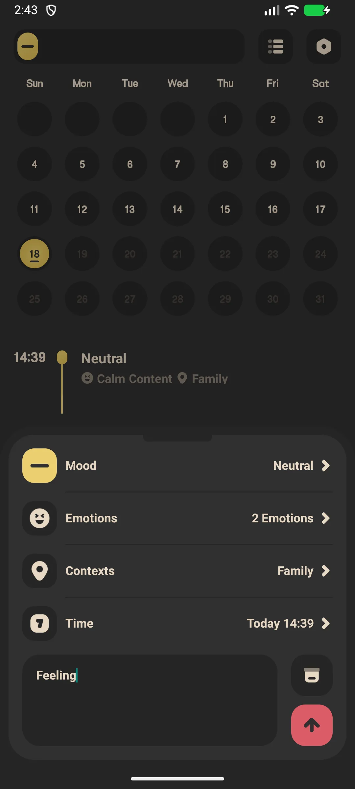
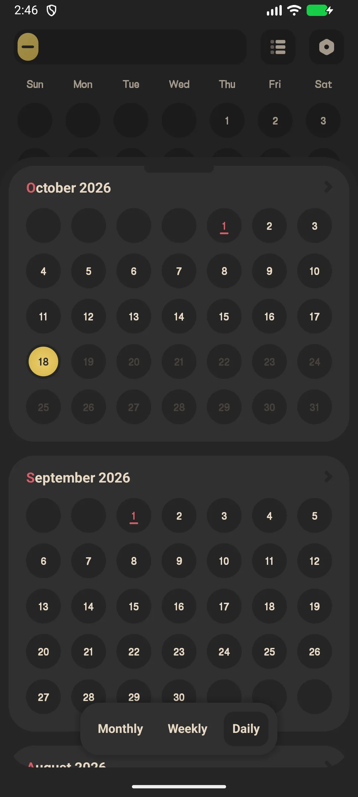
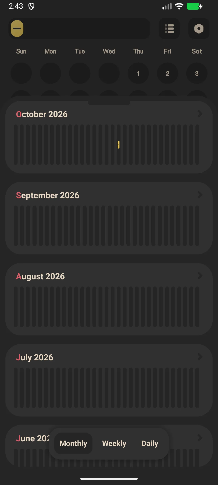

## Daftar Isi

- [Pengenalan Aplikasi](#pengenalan-aplikasi)
- [Penggunaan Pertama](#penggunaan-pertama)
- [Catat Mood (Satu Ketuk)](#catat-mood-satu-ketuk)
- [Entri Mood Lengkap](#entri-mood-lengkap)
- [Kalender Riwayat](#kalender-riwayat)
- [Statistik dan Tren](#statistik-dan-tren)
- [Pengingat Harian](#pengingat-harian)
- [Kunci Aplikasi (VIP)](#kunci-aplikasi-vip)
- [Cadangan](#cadangan)
- [Pengaturan](#pengaturan)
- [Skenario Umum](#skenario-umum)
- [FAQ](#faq)

## Pengenalan Aplikasi

Meow Mood Diary adalah [buku harian mood](/id/glossary/what-is-a-mood-tracker/) dan aplikasi jurnal yang aman serta privat, dengan antarmuka bertema kucing yang menenangkan. Ia bekerja sebagai **aplikasi mood tracker offline** dan **aplikasi check-in harian**: satu ketuk mencatat mood, ketuk kedua menambahkan aktivitas dan catatan, dan bagian lain panduan ini membahas kalender, grafik, kunci aplikasi opsional, pengingat, serta cara mengeluarkan riwayat dari **aplikasi buku harian mood** yang tidak pernah meminta Anda mendaftar.

**😺 Pencatatan Satu Ketuk**
- Lima "kapsul" tingkat mood di layar beranda
- Ketuk kapsul untuk langsung mencatat, atau buka untuk entri lebih lengkap

**📊 Wawasan**
- Kalender bulanan yang diwarnai sesuai mood
- Statistik: distribusi tingkat (pai), histogram bulanan, frekuensi emosi, frekuensi konteks

**🔒 Privat Secara Bawaan**
- Data disimpan **hanya secara lokal** — tidak ada yang diunggah ke server
- Cadangan Google Drive / WebDav opsional (Anda yang mengendalikan cloud)
- Kunci aplikasi (sidik jari / kode sandi) adalah fitur **VIP**

**🎨 Pilihan Kaya**
- **48 emosi bawaan** (24 tidak menyenangkan + 6 netral + 18 menyenangkan) dikelompokkan ke 5 tingkat mood
- **18 tag konteks** (di mana / dengan siapa)
- Gratis vs VIP: lebih banyak ikon, lebih banyak warna tema, kunci aplikasi, dan ekspor PDF

## Penggunaan Pertama

Layar beranda menampilkan lima kapsul mood, kalender bulanan, dan daftar mood hari ini.

- Ketuk **menu statistik** (atas) untuk melihat statistik
- Ketuk **menu pengaturan** (atas) untuk membuka setelan

{: width="180" .normal }

## Catat Mood (Satu Ketuk)

1. Di layar beranda, ketuk **kapsul mood** (mis. "Senang")
2. Kapsul mengembang — ketuk **konfirmasi** untuk menyimpan seketika, atau ketuk ikon **setelan (roda gerigi)** untuk menambah rincian

Catatan satu ketuk menyimpan tingkat mood tanpa catatan maupun tag.

## Entri Mood Lengkap

1. Ketuk roda gerigi pada kapsul → **Tambah Mood**
2. Pilih **tingkat mood** (1–5)
3. Pilih **tag emosi** (pilih ganda dari 48 emosi)
4. Pilih **tag konteks** (pilih ganda dari 18 konteks)
5. Atur **waktu** (tidak boleh di masa depan)
6. Tulis **catatan** opsional
7. Ketuk **Simpan**

{: width="180" .normal }

## Kalender Riwayat

- Geser kalender beranda bulan demi bulan
- Tiap hari berupa busur berwarna yang mencerminkan **rata-rata tingkat mood** hari itu (hari mendatang tampak keabuan)
- Ketuk satu hari untuk melihat entri hari itu

{: width="180" .normal }

## Statistik dan Tren

1. Ketuk ikon statistik (kanan atas)
2. Beralih tab **Bulan / Minggu / Hari**
3. Tinjau:
   - **Distribusi tingkat** grafik pai
   - **Histogram bulanan**
   - **Frekuensi emosi** dan **frekuensi konteks**

{: width="180" .normal }

## Pengingat Harian

1. Pengaturan → **Pengingat**
2. Aktifkan pengingat harian dan atur waktunya
3. Anda menerima notifikasi lembut "Apa kabar hari ini?" / "Saatnya mencatat mood!"

## Kunci Aplikasi (VIP)

1. Pengaturan → **Kunci aplikasi**
2. Bila belum VIP, Anda akan diminta meningkatkan paket
3. Pengguna VIP bisa mengaktifkan kunci sidik jari atau kode sandi

## Cadangan

Pengaturan → **Google Drive** (masuk, cadangkan / pulihkan / otomatis) dan **WebDav**. Entri tetap di perangkat kecuali Anda mencadangkannya.

## Pengaturan

Pengaturan mencakup bahasa, hari awal pekan, kunci aplikasi (VIP), widget, ikon mood (VIP), warna tema (VIP), tag emosi/konteks, ekspor (VIP), pengingat, serta Google Drive / WebDav.

## Skenario Umum

- **Catatan cepat saat hari buruk** — pada malam yang berat, ketuk satu emosi dan beberapa tag; tanpa paragraf, sehingga buku harian tetap bertahan di hari yang biasanya Anda lewatkan.
- **Privat secara bawaan** — entri tetap di perangkat di balik kunci sidik jari (VIP); pada ponsel keluarga bersama, pikiran Anda tak pernah tersinkron ke cloud vendor kecuali Anda memilih Google Drive.
- **Menemukan pola** — kalender dan grafik memunculkan 'rasa muram hari Minggu' atau lonjakan setelah kopi, mengubah perasaan samar jadi sesuatu yang bisa ditindaklanjuti.
- **Offline di mana saja** — catat di pesawat atau di area kereta bawah tanah tanpa sinyal; tidak ada yang butuh Wi-Fi untuk merekam momen.

## FAQ

### Apakah buku harian saya diunggah ke server?
{:.faq-q}
Tidak. Semua entri tersimpan dalam basis data lokal di perangkat Anda. Hanya Anda yang bisa mencadangkannya ke Google Drive atau WebDav milik sendiri.

### Bagaimana warna kalender ditentukan?
{:.faq-q}
Warna tiap hari adalah rata-rata tingkat mood dari entri hari itu, dipetakan ke palet 5 warna tema aktif. Hari tanpa entri dibiarkan polos.

### Bisakah saya mengekspor buku harian?
{:.faq-q}
Ya — ekspor PDF adalah fitur VIP.

## Ringkasan

Meow Mood Diary membuat pelacakan mood harian terasa mudah dan privat, dengan kalender yang jelas serta grafik tren untuk memahami emosi Anda dari waktu ke waktu.

[Halaman aplikasi Meow Mood Diary](/id/apps/meow-mood-diary/) — tersedia di Android dan iOS.

## Istilah Terkait

- [Apa Itu Pelacak Suasana Hati?](/id/glossary/what-is-a-mood-tracker/)
