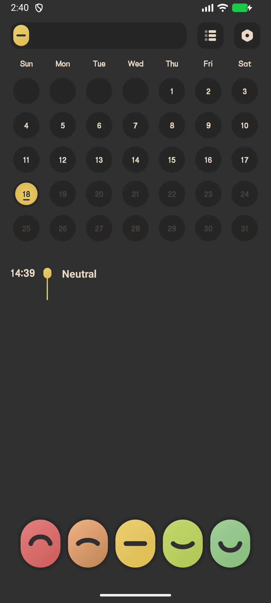
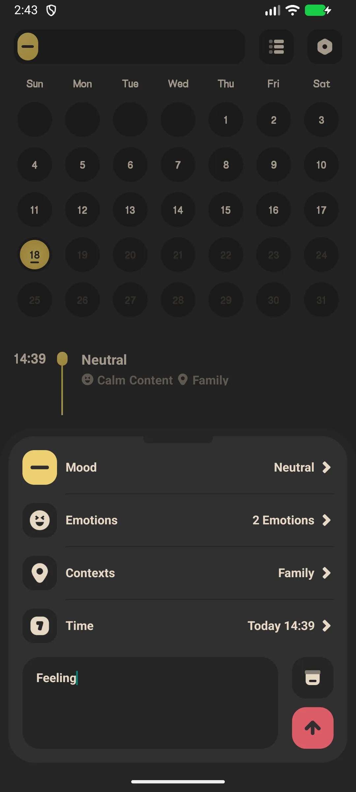
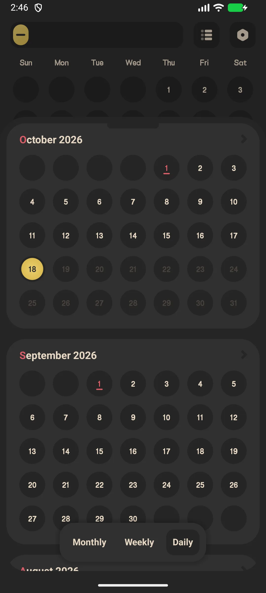
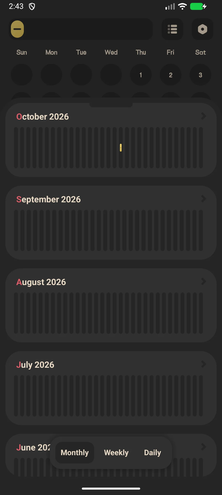

## Daftar Isi

- [Pengenalan Aplikasi](#pengenalan-aplikasi)
- [Penggunaan Pertama](#penggunaan-pertama)
- [Catat Mood (Satu Ketuk)](#catat-mood-satu-ketuk)
- [Entri Mood Lengkap](#entri-mood-lengkap)
- [Kalender Riwayat](#kalender-riwayat)
- [Statistik dan Tren](#statistik-dan-tren)
- [Pengingat Harian](#pengingat-harian)
- [Kunci Aplikasi (VIP)](#kunci-aplikasi-vip)
- [Cadangan](#cadangan)
- [Pengaturan](#pengaturan)
- [Skenario Umum](#skenario-umum)
- [FAQ](#faq)

## Pengenalan Aplikasi

Meow Mood Diary adalah [buku harian mood](/id/glossary/what-is-a-mood-tracker/) dan aplikasi jurnal privat untuk Android dan iOS dengan lima kapsul mood di layar beranda, 48 emosi bawaan, dan 18 tag konteks. Satu ketuk mencatat mood, ketuk kedua menambah aktivitas dan catatan, sementara kalender berwarna, grafik pai, histogram bulanan, serta frekuensi emosi dan konteks membantu menemukan pola. Semua entri tersimpan hanya di perangkat tanpa akun; kunci aplikasi dan ekspor PDF adalah fitur VIP.

**😺 Pencatatan Satu Ketuk**
- Lima "kapsul" tingkat mood di layar beranda
- Ketuk kapsul untuk langsung mencatat, atau buka untuk entri lebih lengkap

**📊 Wawasan**
- Kalender bulanan yang diwarnai sesuai mood
- Statistik: distribusi tingkat (pai), histogram bulanan, frekuensi emosi, frekuensi konteks

**🔒 Privat Secara Bawaan**
- Data disimpan **hanya secara lokal** — tidak ada yang diunggah ke server
- Cadangan Google Drive / WebDav opsional (Anda yang mengendalikan cloud)
- Kunci aplikasi (sidik jari / kode sandi) adalah fitur **VIP**

**🎨 Pilihan Kaya**
- **48 emosi bawaan** (24 tidak menyenangkan + 6 netral + 18 menyenangkan) dikelompokkan ke 5 tingkat mood
- **18 tag konteks** (di mana / dengan siapa)
- Gratis vs VIP: lebih banyak ikon, lebih banyak warna tema, kunci aplikasi, dan ekspor PDF

## Penggunaan Pertama

Layar beranda Meow Mood Diary menampilkan lima kapsul mood, kalender bulanan, dan daftar mood hari ini dalam satu pandangan. Menu statistik di kanan atas membuka grafik dan tren, sementara menu pengaturan di sampingnya mengarah ke kunci aplikasi, pengingat, dan cadangan. Dari layar inilah pencatatan harian dimulai.

- Ketuk **menu statistik** (atas) untuk melihat statistik
- Ketuk **menu pengaturan** (atas) untuk membuka setelan

{: width="180" .normal }

## Catat Mood (Satu Ketuk)

Catatan mood satu ketuk di Meow Mood Diary memakai lima kapsul tingkat mood di layar beranda. Ketuk sebuah kapsul, misalnya Senang, lalu ketuk konfirmasi untuk menyimpan seketika tanpa catatan maupun tag; bila ingin rincian, ketuk ikon roda gerigi terlebih dahulu. Alur ini membuat check-in harian tetap ringan.

1. Di layar beranda, ketuk **kapsul mood** (mis. "Senang")
2. Kapsul mengembang — ketuk **konfirmasi** untuk menyimpan seketika, atau ketuk ikon **setelan (roda gerigi)** untuk menambah rincian

Catatan satu ketuk menyimpan tingkat mood tanpa catatan maupun tag.

## Entri Mood Lengkap

Entri mood lengkap Meow Mood Diary dimulai dari roda gerigi pada kapsul lalu Tambah Mood, dengan pilihan tingkat mood 1–5, tag emosi ganda dari 48 emosi, dan tag konteks ganda dari 18 konteks. Waktu tidak boleh di masa depan, catatan bersifat opsional, dan Simpan menyelesaikan entri.

1. Ketuk roda gerigi pada kapsul → **Tambah Mood**
2. Pilih **tingkat mood** (1–5)
3. Pilih **tag emosi** (pilih ganda dari 48 emosi)
4. Pilih **tag konteks** (pilih ganda dari 18 konteks)
5. Atur **waktu** (tidak boleh di masa depan)
6. Tulis **catatan** opsional
7. Ketuk **Simpan**

{: width="180" .normal }

## Kalender Riwayat

Kalender riwayat Meow Mood Diary bisa digeser bulan demi bulan, dengan setiap hari berupa busur berwarna yang mencerminkan rata-rata tingkat mood hari itu; hari mendatang tampak keabuan. Ketuk satu hari untuk melihat entri yang dibuat pada tanggal tersebut.

- Geser kalender beranda bulan demi bulan
- Tiap hari berupa busur berwarna yang mencerminkan **rata-rata tingkat mood** hari itu (hari mendatang tampak keabuan)
- Ketuk satu hari untuk melihat entri hari itu

{: width="180" .normal }

## Statistik dan Tren

Statistik dan tren Meow Mood Diary diakses lewat ikon di kanan atas, dengan tab Bulan, Minggu, dan Hari. Tampilannya mencakup distribusi tingkat berupa grafik pai, histogram bulanan, serta frekuensi emosi dan frekuensi konteks untuk melihat pola dari waktu ke waktu.

1. Ketuk ikon statistik (kanan atas)
2. Beralih tab **Bulan / Minggu / Hari**
3. Tinjau:
   - **Distribusi tingkat** grafik pai
   - **Histogram bulanan**
   - **Frekuensi emosi** dan **frekuensi konteks**

{: width="180" .normal }

## Pengingat Harian

Pengingat harian Meow Mood Diary diatur lewat Pengaturan → Pengingat: aktifkan pengingat, tentukan waktunya, lalu terima notifikasi lembut "Apa kabar hari ini?" atau "Saatnya mencatat mood!". Pengingat ini membantu membangun kebiasaan check-in tanpa memaksa Anda membuka aplikasi lebih sering.

1. Pengaturan → **Pengingat**
2. Aktifkan pengingat harian dan atur waktunya
3. Anda menerima notifikasi lembut "Apa kabar hari ini?" / "Saatnya mencatat mood!"

## Kunci Aplikasi (VIP)

Kunci aplikasi Meow Mood Diary adalah fitur VIP yang diaktifkan lewat Pengaturan → Kunci aplikasi; bila belum VIP, Anda akan diminta meningkatkan paket. Pengguna VIP bisa memilih kunci sidik jari atau kode sandi agar entri tetap privat di perangkat bersama.

1. Pengaturan → **Kunci aplikasi**
2. Bila belum VIP, Anda akan diminta meningkatkan paket
3. Pengguna VIP bisa mengaktifkan kunci sidik jari atau kode sandi

## Cadangan

Cadangan Meow Mood Diary tersedia lewat Pengaturan → Google Drive untuk masuk, cadangkan, pulihkan, atau mengatur cadangan otomatis, serta lewat WebDav. Entri tetap berada di perangkat kecuali Anda memilih mencadangkannya sendiri, sehingga cloud sepenuhnya berada di bawah kendali Anda.

## Pengaturan

Pengaturan Meow Mood Diary mencakup bahasa, hari awal pekan, kunci aplikasi VIP, widget, ikon mood VIP, warna tema VIP, tag emosi dan konteks, ekspor VIP, pengingat, serta Google Drive dan WebDav. Dari sini Anda menyesuaikan cara pencatatan sekaligus mengelola opsi privasi dan cadangan.

## Skenario Umum

Empat skenario memakai Meow Mood Diary memanfaatkan pencatatan satu ketuk dan penyimpanan lokal: pada malam yang berat, satu emosi dan beberapa tag sudah cukup agar buku harian tetap bertahan; entri disimpan di perangkat di balik kunci sidik jari VIP sehingga tidak tersinkron ke cloud vendor; kalender dan grafik memunculkan rasa muram hari Minggu atau lonjakan setelah kopi; dan pencatatan di pesawat atau area tanpa sinyal tetap jalan.

- **Catatan cepat saat hari buruk** — pada malam yang berat, ketuk satu emosi dan beberapa tag; tanpa paragraf, sehingga buku harian tetap bertahan di hari yang biasanya Anda lewatkan.
- **Privat secara bawaan** — entri tetap di perangkat di balik kunci sidik jari (VIP); pada ponsel keluarga bersama, pikiran Anda tak pernah tersinkron ke cloud vendor kecuali Anda memilih Google Drive.
- **Menemukan pola** — kalender dan grafik memunculkan 'rasa muram hari Minggu' atau lonjakan setelah kopi, mengubah perasaan samar jadi sesuatu yang bisa ditindaklanjuti.
- **Offline di mana saja** — catat di pesawat atau di area kereta bawah tanah tanpa sinyal; tidak ada yang butuh Wi-Fi untuk merekam momen.

## FAQ

### Apakah buku harian saya diunggah ke server?
{:.faq-q}
Tidak. Semua entri tersimpan dalam basis data lokal di perangkat Anda. Hanya Anda yang bisa mencadangkannya ke Google Drive atau WebDav milik sendiri.

### Bagaimana warna kalender ditentukan?
{:.faq-q}
Warna tiap hari adalah rata-rata tingkat mood dari entri hari itu, dipetakan ke palet 5 warna tema aktif. Hari tanpa entri dibiarkan polos.

### Bisakah saya mengekspor buku harian?
{:.faq-q}
Ya — ekspor PDF adalah fitur VIP.

## Ringkasan

Meow Mood Diary membuat pelacakan mood harian terasa mudah dan privat, dengan kalender yang jelas serta grafik tren untuk memahami emosi Anda dari waktu ke waktu.

[Halaman aplikasi Meow Mood Diary](/id/apps/meow-mood-diary/) — tersedia di Android dan iOS.

## Istilah Terkait

- [Apa Itu Pelacak Suasana Hati?](/id/glossary/what-is-a-mood-tracker/)
