## Daftar Isi

- [Pengenalan Aplikasi](#pengenalan-aplikasi)
- [Penggunaan Pertama](#penggunaan-pertama)
- [Menambahkan Tugas](#menambahkan-tugas)
- [Subtugas](#subtugas)
- [Pengingat](#pengingat)
- [Tampilan Kalender](#tampilan-kalender)
- [Statistik](#statistik)
- [Daftar dan Tag](#daftar-dan-tag)
- [Cadangan dan Sinkronisasi](#cadangan-dan-sinkronisasi)
- [Ekspor CSV (VIP)](#ekspor-csv-vip)
- [Pengaturan](#pengaturan)
- [FAQ](#faq)

## Pengenalan Aplikasi

Meow Todo List adalah pengelola tugas bergaya kartun lucu sekaligus **[aplikasi to-do list](/id/glossary/what-is-a-to-do-list/)** untuk Android dan iOS. Ia membantu Anda mencatat tugas dengan cepat dan meninjaunya per hari, minggu, bulan, atau daftar. Aplikasi ini juga berfungsi sebagai **aplikasi tugas harian offline sederhana**: daftar tugas tanpa akun tersimpan di ponsel, dan inti **aplikasi pengelola tugas gratis** mencakup daftar, pengingat, serta **aplikasi kalender tugas**. Panduan ini memandu tiap layar, dari pembukaan pertama hingga **sinkronisasi Google Drive** dan ekspor CSV.

**📝 Pencatatan Cepat**

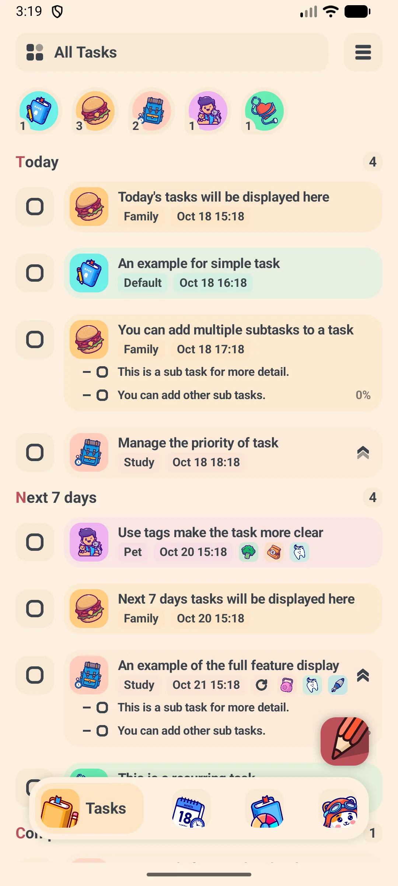{: width="180" .normal }
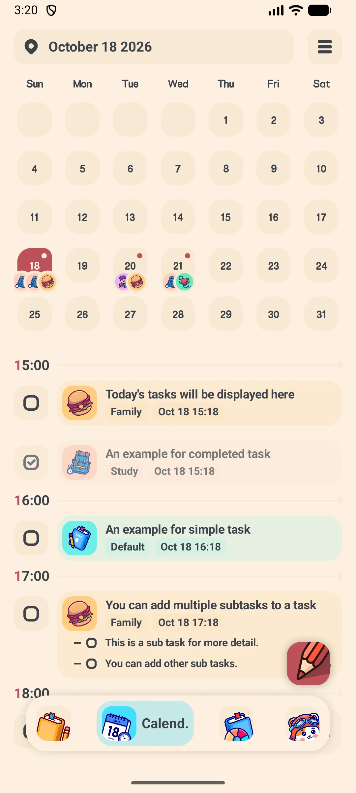{: width="180" .normal }
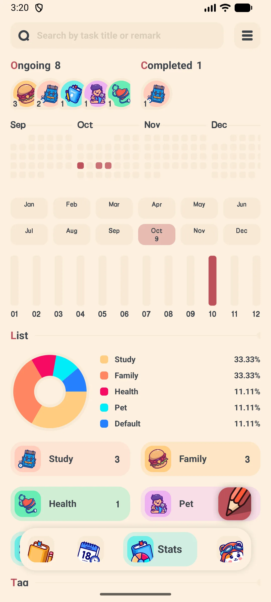{: width="180" .normal }
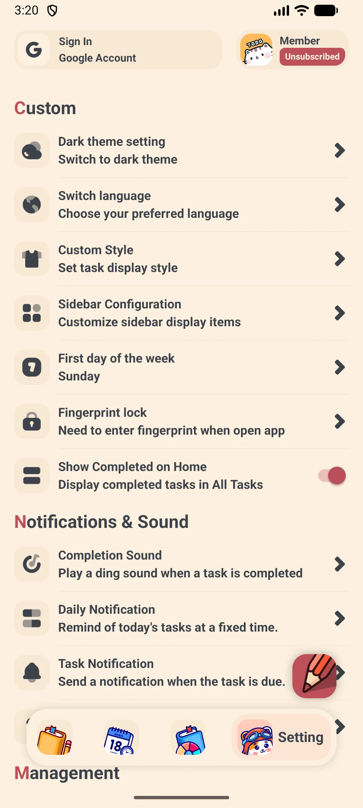{: width="180" .normal }

- Empat tab bawah: **Tugas**, **Kalender**, **Statistik**, **Pengaturan**
- Tombol mengambang **+** menambah tugas dari mana saja
- Filter laci samping: Semua / Hari Ini / Besok / 7 hari / Selesai, plus Buku (daftar) dan Tag Anda

**🗓 Perencanaan**
- Tetapkan tanggal **dan waktu** pada setiap tugas
- Tugas berulang: harian, mingguan, bulanan, tahunan, atau aturan kustom "setiap N hari/minggu"
- Tampilan kalender dengan pilihan Hari / Minggu / Bulan

**📊 Wawasan**
- Peta panas kontribusi dan diagram pai yang dikelompokkan per Buku/Tag
- Ringkasan mingguan / bulanan / tahunan

**☁️ Aman dan Privat**
- Penyimpanan lokal (basis data Room); cadangan Google Drive / WebDAV opsional
- VIP membuka mode gelap, kunci aplikasi, ekspor CSV, dan batas lebih tinggi

## Penggunaan Pertama

Saat pertama kali membuka Meow Todo List, Anda langsung masuk ke tab **Tugas**.

- Tombol **+** (kanan bawah) membuat tugas
- **Laci** kiri berpindah antara Hari Ini / Besok / 7 hari / Selesai serta Buku dan Tag kustom Anda
- Bilah bawah berpindah antara Tugas / Kalender / Statistik / Pengaturan

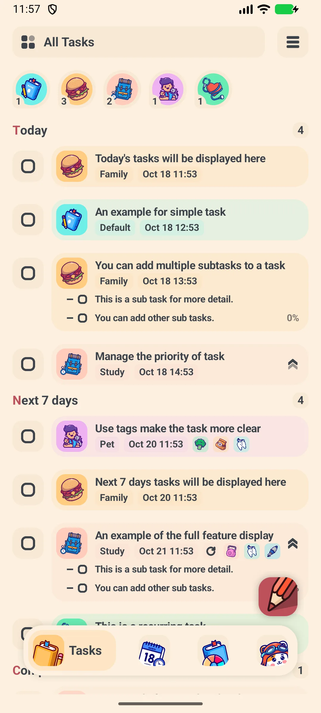{: width="180" .normal }

## Menambahkan Tugas

1. Ketuk tombol **+**
2. Ketik **judul** tugas
3. Ketuk baris **tanggal** untuk membuka pop-up kalender; aktifkan **jam** untuk menetapkan waktu tertentu, atau matikan untuk tugas sepanjang hari
4. Pilih **Buku** (daftar) — mis. Kerja, Hidup, Belajar
5. Pilih satu atau lebih **Tag** untuk memfilter
6. Tetapkan **prioritas** jika perlu
7. Ketuk **Konfirmasi** untuk menyimpan

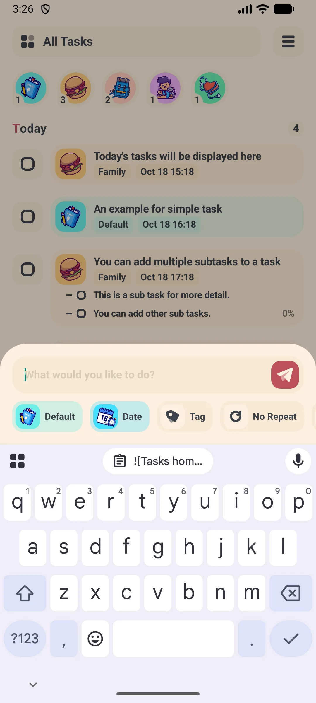{: width="180" .normal }
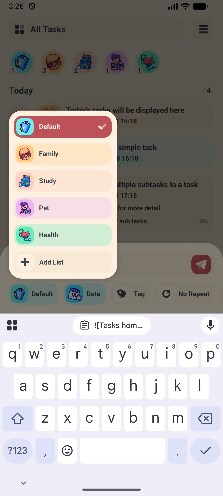{: width="180" .normal }
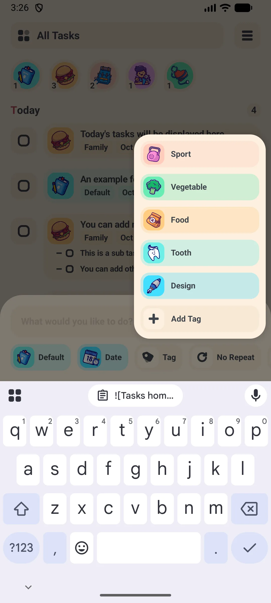{: width="180" .normal }
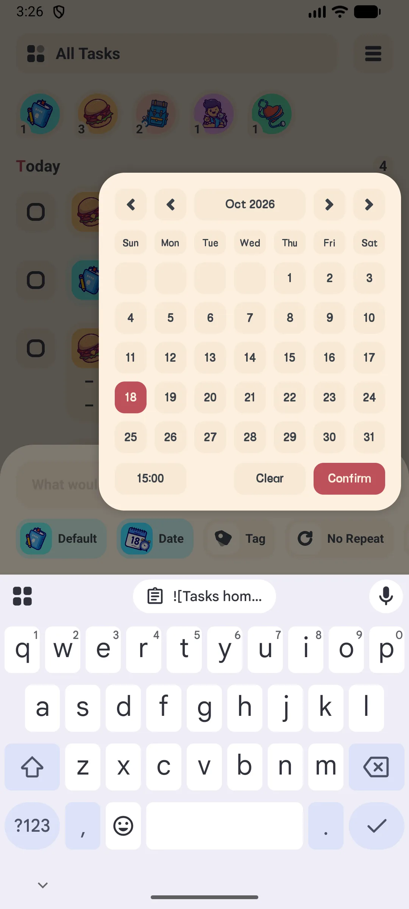{: width="180" .normal }
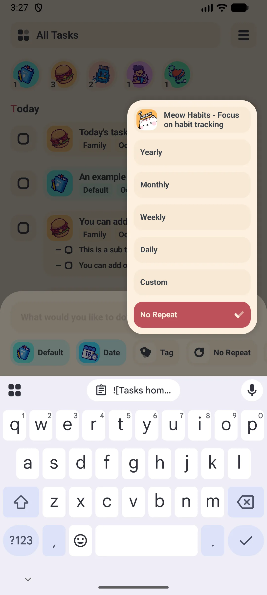{: width="180" .normal }

## Subtugas

Buka sebuah tugas, lalu gunakan kolom **Tambah subtugas** di bagian bawah halaman detail.

- Ketik subtugas dan item langsung masuk ke daftar
- Akun gratis bisa menambah hingga **15 subtugas** per tugas; VIP menghapus batas **aplikasi subtask gratis** ini
- Centang item saat selesai dikerjakan

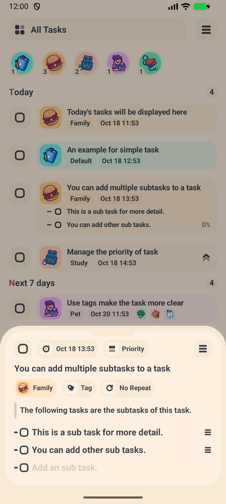{: width="180" .normal }
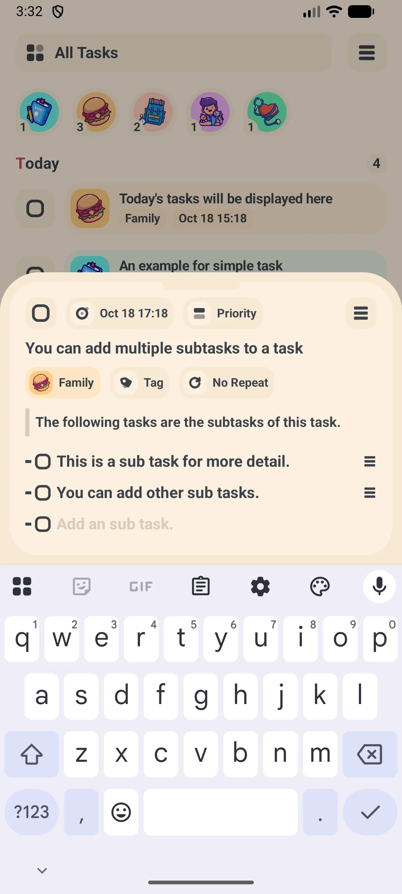{: width="180" .normal }

## Pengingat

Pengingat dijadwalkan dengan **WorkManager**, sehingga **aplikasi pengingat tugas** ini tetap berbunyi meski Anda tidak membuka aplikasi.

1. Saat mengedit tugas, tetapkan tanggal/waktu (pengingat memakai waktu tersebut)
2. Pastikan notifikasi diizinkan untuk aplikasi
3. Aplikasi menjadwalkan ulang pengingat otomatis saat tugas diedit

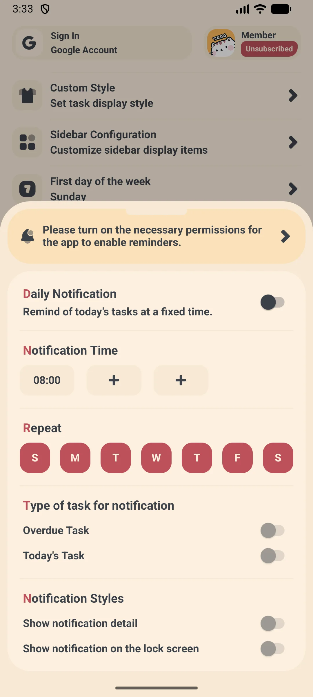{: width="180" .normal }
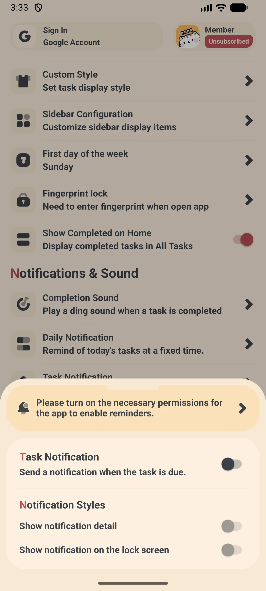{: width="180" .normal }
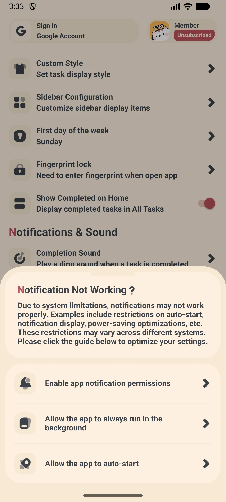{: width="180" .normal }

Jika pengingat tidak muncul, buka tugas dan pastikan tanggal/waktunya di masa depan, lalu izinkan notifikasi di pengaturan sistem.

## Tampilan Kalender

1. Beralih ke tab **Kalender**
2. Pakai pilihan **Hari / Minggu / Bulan** di kanan atas
3. Hari yang punya tugas ditandai titik kecil
4. Ketuk sebuah hari untuk melihat tugas hari itu

{: width="180" .normal }
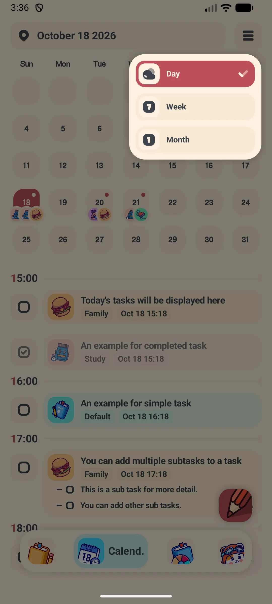{: width="180" .normal }
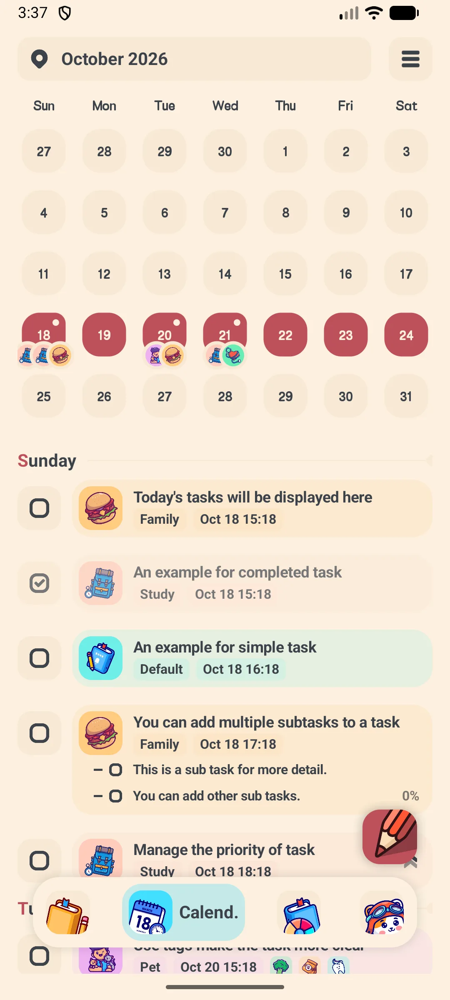{: width="180" .normal }
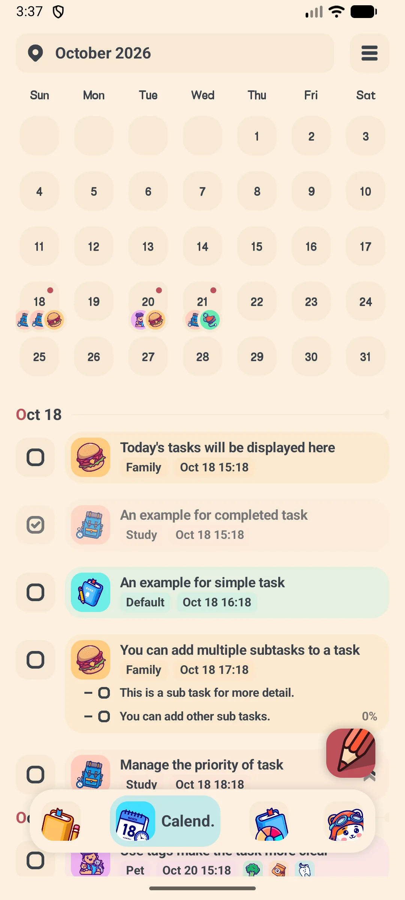{: width="180" .normal }

## Statistik

1. Buka tab **Statistik**
2. Lihat peta panas kontribusi dan diagram pai
3. Ganti rentang (minggu / bulan / tahun) untuk melihat tren per Buku dan Tag

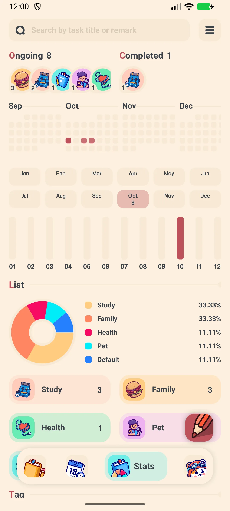{: width="180" .normal }
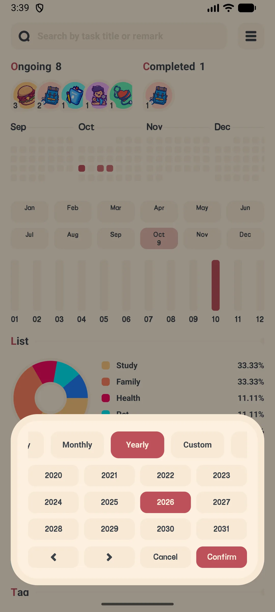{: width="180" .normal }

## Daftar dan Tag

- **Buku (daftar)** mengelompokkan tugas — mis. Kerja, Travel. Akun gratis bisa membuat hingga **10 Buku**
- **Tag** memudahkan filter lintas daftar — akun gratis bisa membuat hingga **10 Tag**
- Buat keduanya dari laci atau layar Pengaturan → Pengelolaan

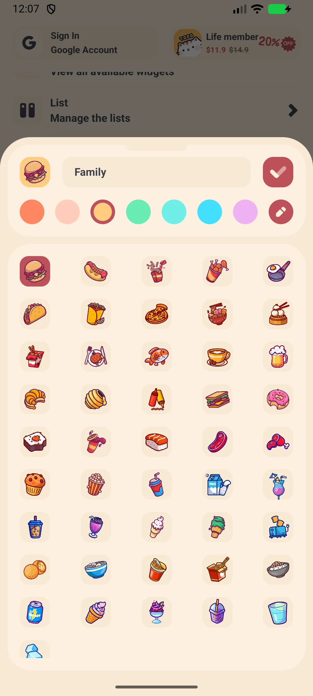{: width="180" .normal }

## Cadangan dan Sinkronisasi

1. Buka **Pengaturan → Pengelolaan → Google Drive** (atau **WebDAV**)
2. Masuk / isi server, akun, dan kata sandi
3. Ketuk **Cadangkan** untuk mengunggah, **Pulihkan** untuk mengunduh
4. Aktifkan **Cadangan otomatis** untuk mencadangkan berkala

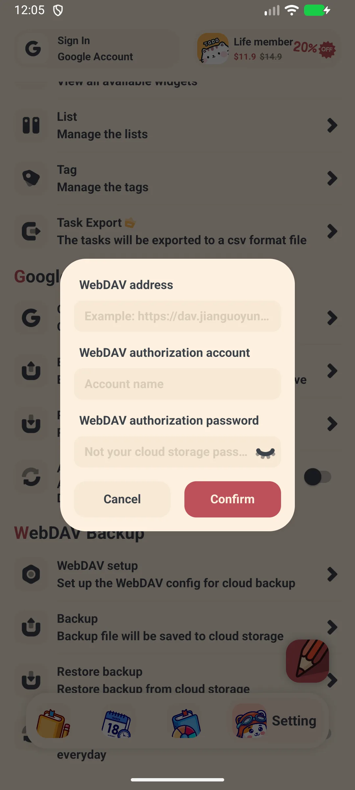{: width="180" .normal }

## Ekspor CSV (VIP)

1. Buka **Pengaturan → Pengelolaan → Ekspor**
2. Filter berdasarkan Buku / Tag / prioritas / rentang tanggal
3. Ketuk **Ekspor**, lalu bagikan berkas `.csv` (buka di Excel atau Sheets)

**Ekspor CSV** adalah fitur **VIP**.

## Pengaturan

Pengaturan mencakup:

- **Mode gelap** (VIP)
- **Kunci aplikasi** — sidik jari atau kata sandi (VIP)
- **Hari awal pekan** dan **bahasa**
- Tampilan **tugas selesai** (10 terakhir secara default, dengan "tampilkan semua")
- **Google Drive / WebDAV** dan **Widget**

## Skenario Umum

- **Musim ujian** — pakai tampilan kalender dan pengingat harian agar tenggat tiap mata kuliah tetap terlihat, jadi tidak ada yang selip antarpekan.
- **Proyek kelompok** — buat satu Buku (daftar) per proyek dan Tag per anggota, lalu pecah kerja jadi subtugas dan ekspor CSV untuk membagikan rencana.
- **Pencatatan offline** — saat perjalanan tanpa sinyal, tambah tugas langsung; data tetap di perangkat dan baru tersinkron ke Google Drive atau WebDav ketika Anda kembali daring.
- **Privasi utama** — penyimpanan Room lokal plus kunci aplikasi sidik jari opsional menjaga daftar tugas tanpa akun tetap di ponsel, bukan di akun cloud lain.

## FAQ

### Bagaimana cara mengedit atau menghapus tugas?
{:.faq-q}
Buka tugas, ubah kolomnya, lalu ketuk konfirmasi untuk menyimpan. Pakai menu 3 titik (atau tekan lama) untuk menghapus.

### Bagaimana cara kerja tugas berulang?
{:.faq-q}
Saat Anda menyelesaikan tugas berulang, aplikasi otomatis membuat kemunculan berikutnya (hari +1, minggu +7, bulan +1, tahun +1, atau interval kustom) dan menghentikan yang lama.

### Apakah ada batasan pada versi gratis?
{:.faq-q}
Total tugas tidak dibatasi, tetapi Buku maksimal 10, Tag 10, dan subtugas 15 pada versi gratis. Versi gratis juga menampilkan iklan.

## Ringkasan

Meow Todo List adalah pengelola tugas yang ramah dan lucu, mencakup pencatatan cepat, tugas berulang, tampilan kalender, dan statistik — dengan cadangan Drive/WebDav untuk menjaga daftar tugas tetap aman.

## Istilah Terkait

- [Apa Itu Aplikasi To-Do List?](/id/glossary/what-is-a-to-do-list/)
- [Apa Itu Subtugas?](/id/glossary/what-is-a-subtask/)
