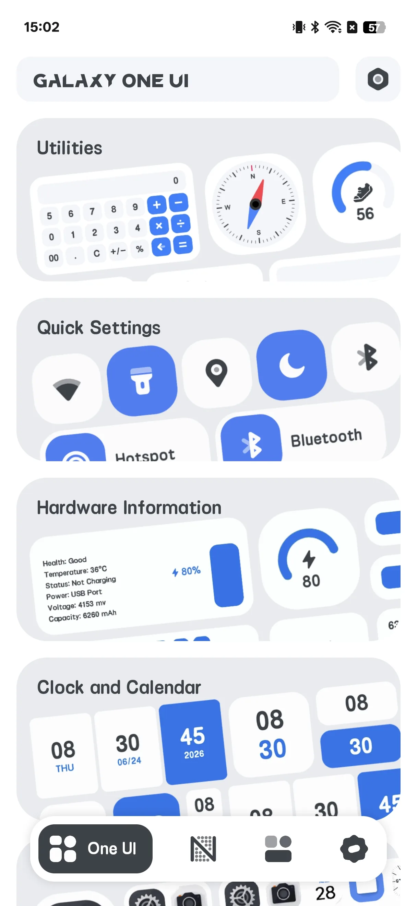
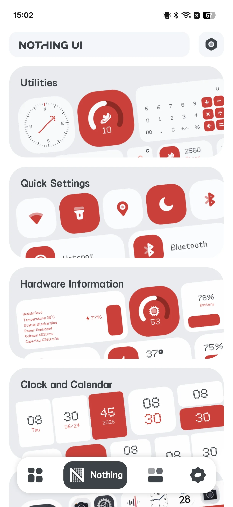
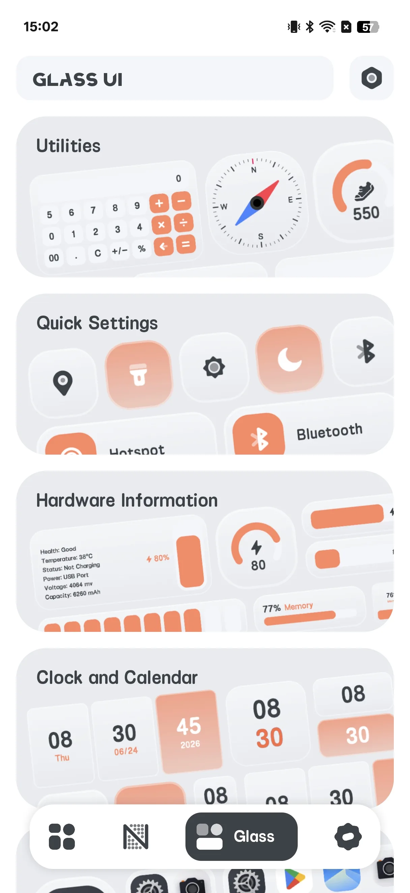
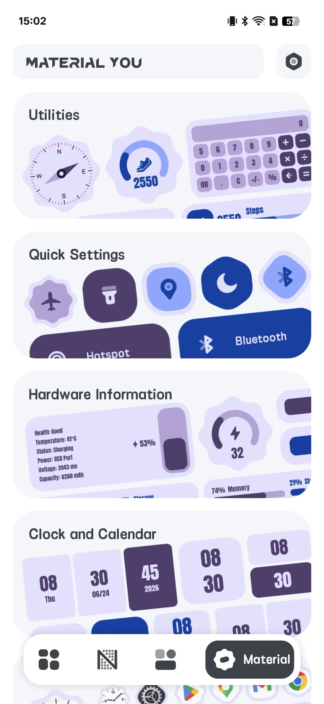
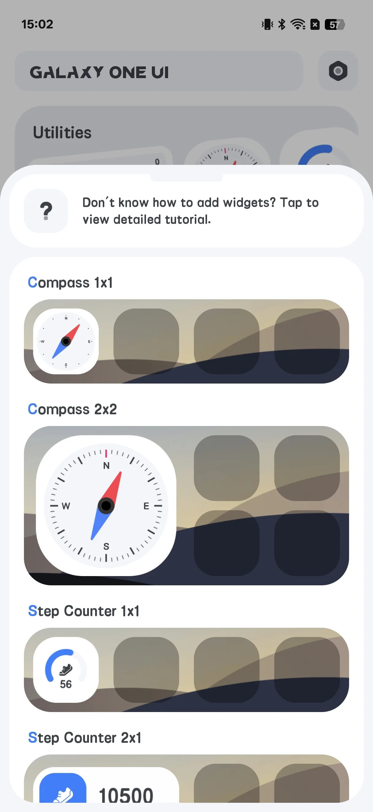
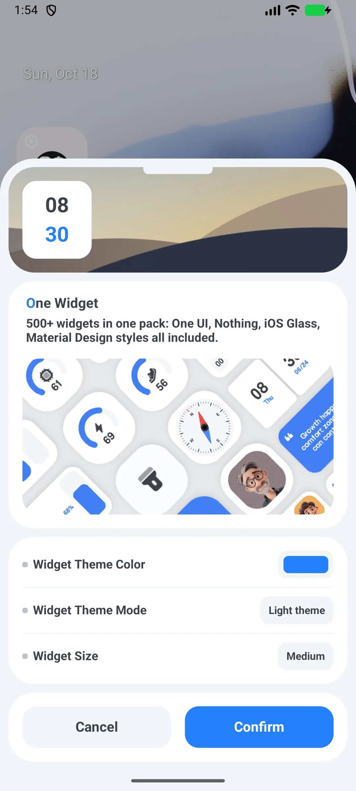

## Daftar Isi

- [Pendahuluan Aplikasi](#pendahuluan-aplikasi)
- [Penggunaan Pertama](#penggunaan-pertama)
- [Jelajahi 4 Gaya](#jelajahi-4-gaya)
- [Menambahkan Widget](#menambahkan-widget)
- [Mengonfigurasi Widget](#mengonfigurasi-widget)
- [Quick Toggle](#quick-toggle)
- [Shortcut Aplikasi](#shortcut-aplikasi)
- [Widget Info Langsung](#widget-info-langsung)
- [Pengaturan](#pengaturan)
- [Skenario Umum](#skenario-umum)
- [FAQ](#faq)

## Pendahuluan Aplikasi

One Widget memuat **500+ widget layar utama Android yang dapat disesuaikan [widget layar utama](/id/glossary/what-is-a-home-screen-widget/)** dalam empat gaya — One UI, Nothing, Glass, dan Material You — plus shortcut aplikasi dan 11 quick toggle. Aplikasi ini bisa dipakai tanpa akun: jelajahi pustaka gaya, taruh preset, lalu ubah ukuran, warna latar, dan radius sudutnya. Tersedia dua build: aplikasi lite gratis dengan gaya One UI dan aplikasi full berbayar yang membuka keempat gaya tanpa pembelian dalam aplikasi.

**🎨 Empat Gaya**
- **One UI** (default; satu-satunya gaya yang ada di aplikasi "lite" gratis)
- **Nothing**
- **Glass**
- **Material You**

> "Material You" di sini adalah *nama gaya* yang menggunakan palet hari-malam biru/ungu tetap — bukan warna dinamis berbasis wallpaper Android 12.

**⚡ Quick Toggle**
- 11 toggle: Bluetooth, data seluler, Wi-Fi, senter, rotasi, pesawat, hotspot, jangan-ganggu, lokasi, getar, mode gelap

**📱 Shortcut & Kontak Aplikasi**
- Peluncur satu ketuk untuk aplikasi Anda dan telepon/pengeras suara

**📊 Info Langsung**
- Widget jam, kalender, baterai, dan RAM yang memperbarui di tempat

**💲 Dua Aplikasi, Bukan Satu**
- Sebuah **aplikasi "lite" gratis** (hanya gaya One UI) dan sebuah **aplikasi "full" berbayar** (keempat gaya). Tidak ada pembelian dalam aplikasi — pasang aplikasi full dari Google Play untuk membuka semuanya.

## Penggunaan Pertama

Buka One Widget ke galeri empat tab — **One UI / Nothing / Glass / Material You** — yang masing-masing mencantumkan kategori seperti Tools, Entry, Hardware, Clock, Launcher, Combo, Note, dan Contact. Ketuk sebuah kategori untuk melihat pratinjau widget sebelum memutuskan mana yang akan dipasang. Gaya One UI tersedia di aplikasi lite gratis; tiga gaya lain memerlukan aplikasi full.

- Setiap halaman gaya mencantumkan kategori: Tools, Entry, Hardware, Clock, Launcher, Combo, Note, Contact
- Ketuk sebuah kategori untuk melihat pratinjau widget

{: width="180" .normal }
{: width="180" .normal }
{: width="180" .normal }
{: width="180" .normal }

## Jelajahi 4 Gaya

Geser tab atas untuk melihat pratinjau keempat gaya One Widget: One UI sebagai default di aplikasi lite gratis, serta Nothing, Glass, dan Material You yang membutuhkan aplikasi full berbayar. Perpindahan antar tab tidak mengubah data atau pengaturan widget yang sudah dipasang, sehingga Anda bisa membandingkan tampilan dengan aman.

## Menambahkan Widget

Menambahkan widget One Widget dimulai dengan menekan lama layar utama dan memilih **Widget**, lalu mencari One Widget dalam daftar dan memilih varian yang diinginkan. Sistem kemudian membuka layar **konfigurasi** tempat Anda mengatur opsi sebelum menekan Konfirmasi untuk menaruhnya. Alur ini berlaku untuk semua gaya dan kategori widget.

1. Tekan lama layar utama Anda → **Widget**
2. Temukan **One Widget** dalam daftar dan pilih sebuah varian
3. Sistem membuka layar **konfigurasi** One Widget
4. Atur opsi Anda dan ketuk **Konfirmasi** untuk menaruhnya

{: width="180" .normal }

## Mengonfigurasi Widget

Sebagian besar widget One Widget berbagi opsi umum: warna tema dari palet pop-up, mode Gelap atau terang, bentuk lingkaran atau persegi panjang membulat, serta ukuran grid dari 1x1 hingga 6x2. Warna latar ikon dan radius sudut diturunkan dari bentuk — lingkaran memakai ukuran dibagi dua, membulat ukuran dibagi tiga.

- **Warna tema** (palet pop-up)
- Mode **Gelap / terang**
- **Bentuk** — lingkaran atau persegi panjang membulat
- **Ukuran** — opsi grid seperti 1x1, 2x1, 4x1, 5x1, 6x1, 2x2, 4x2, 5x2, 6x2 (hingga **6x2**)

Warna latar ikon dan radius sudut diturunkan dari bentuk (lingkaran = ukuran/2, membulat = ukuran/3).

{: width="180" .normal }

## Quick Toggle

Quick toggle One Widget mencakup 11 tipe — Bluetooth, data seluler, Wi-Fi, senter, rotasi, pesawat, hotspot, jangan-ganggu, lokasi, getar, dan mode gelap. Anda bisa menaruh toggle tunggal atau memakai widget **Combine 4x1** untuk hingga lima toggle dalam satu bilah dengan bawaan Bluetooth, Wi-Fi, data seluler, senter, dan rotasi. Senter benar-benar mengalihkan senter, sementara Wi-Fi, Bluetooth, dan DND membuka layar pengaturan sistem.

1. Dari widget toggle, pilih tipe toggle (Wi-Fi, Bluetooth, senter, rotasi, DND, …)
2. Taruh toggle tunggal, atau gunakan widget **Combine 4x1** untuk menaruh hingga 5 toggle dalam satu bilah (default: Bluetooth / Wi-Fi / data seluler / senter / rotasi)
3. Ketuk sebuah toggle untuk beraksi:
   - **Senter** benar-benar mengalihkan senter (`CameraManager`)
   - **Wi-Fi / Bluetooth / DND** membuka layar pengaturan sistem yang relevan
   - **Rotasi** menulis pengaturan auto-rotate sistem

## Shortcut Aplikasi

Widget **Shortcut Aplikasi** One Widget menyediakan peluncur satu ketuk: konfigurasikan widget, pilih aplikasi terpasang dari daftar peluncur di tiap slot, lalu ketuk widget untuk membukanya — atau Google Play bila belum terpasang. Bersama aksi telepon dan pengeras suara, ini menggantikan beberapa ikon di layar utama dengan satu widget.

1. Konfigurasikan widget **Shortcut Aplikasi**
2. Di tiap slot, pilih aplikasi terpasang dari daftar peluncur
3. Ketuk widget untuk meluncurkan aplikasi tersebut (atau Google Play jika belum terpasang)

## Widget Info Langsung

Widget info langsung One Widget mencakup jam, kalender, baterai, dan RAM yang memperbarui di tempat. Widget Jam menggambar ulang pada siklus pembaruan sistem tiap 30 menit dan saat ukuran berubah, widget Baterai dan RAM menanyakan statistik kira-kira tiap 60 detik, sementara baterai juga memperbarui instan dari siaran perubahan baterai.

- Widget **Jam** menggambar ulang pada siklus pembaruan widget sistem (tiap 30 mnt) dan saat ukuran berubah
- Widget **Baterai / RAM** menanya statistik perangkat kira-kira tiap **60 detik**; baterai juga memperbarui instan dari siaran perubahan baterai
- Widget kalender / catatan statis atau menyegarkan pada siklus 30-menit

## Pengaturan

Pengaturan One Widget mencakup mode gelap, bahasa, satuan suhu, nilai, bagikan, umpan balik, privasi, dan versi. Dari sini Anda mengubah tampilan aplikasi serta mengakses informasi versi, sementara konfigurasi tiap widget tetap diatur langsung lewat layar konfigurasi widget bersangkutan.

## Skenario Umum

Lima skenario memakai One Widget memanfaatkan 500+ preset dalam empat gaya dan 11 quick toggle: layar utama bisa segar dalam lima menit dari galeri empat tab tanpa editor; warna tema dan bentuk lingkaran atau membulat membuat widget menyatu dengan wallpaper; Wi-Fi, Bluetooth, dan senter masuk bilah 4x1 untuk akses satu ketuk; Chrome, Maps, atau kontak favorit diluncurkan dari satu widget; dan Galaxy, Pixel, serta Nothing semuanya didukung lewat build lite atau full.

- **Layar utama segar dalam 5 menit** — buka galeri 4-tab, ketuk sebuah gaya, pilih widget jam atau cuaca, lalu taruh; tanpa editor, tanpa Kode.
- **Cocokkan dengan wallpaper** — atur warna tema dan gelap/terang, pilih bentuk lingkaran atau membulat, dan widget menyatu dengan peluncur Anda.
- **Quick toggle satu ketuk** — taruh Wi-Fi, Bluetooth, dan senter dalam bilah 4x1 agar Anda berhenti menggali pengaturan.
- **Shortcut aplikasi & kontak** — luncurkan Chrome, Maps, atau kontak favorit dari satu widget.
- **Semua perangkat Android** — Galaxy, Pixel, dan Nothing semua didukung; aplikasi lite gratis mencakup gaya One UI, aplikasi full membuka keempatnya.

## FAQ

### Mengapa saya tidak bisa menggunakan Nothing / Glass / Material You di aplikasi gratis?
{:.faq-q}
Aplikasi gratis adalah build "lite" yang hanya menyertakan gaya One UI. Pasang aplikasi full berbayar untuk membuka tiga gaya lainnya.

### Apakah "Material You" benar-benar temanya dinamis?
{:.faq-q}
Ini adalah gaya yang menggunakan palet hari-malam biru/ungu tetap. Bukan warna dinamis berbasis wallpaper.

### Apakah toggle butuh root?
{:.faq-q}
Tidak. Mereka menggunakan API dan pengaturan sistem standar; senter menggunakan API senter kamera.

## Ringkasan

One Widget adalah cara tercepat memberi layar utama Android Anda toolkit widget serba ada yang bergaya — ratusan widget dalam empat tampilan, dengan quick toggle dan shortcut aplikasi.

## Istilah terkait

- [Apa Itu Widget Layar Utama?](/id/glossary/what-is-a-home-screen-widget/)
- [Apa Itu Material You?](/id/glossary/what-is-material-you/)
- [Apa Itu Nothing UI?](/id/glossary/what-is-nothing-ui/)
- [Apa Itu Galaxy One UI?](/id/glossary/what-is-galaxy-one-ui/)
- [Apa Itu iOS Glass?](/id/glossary/what-is-ios-glass/)
