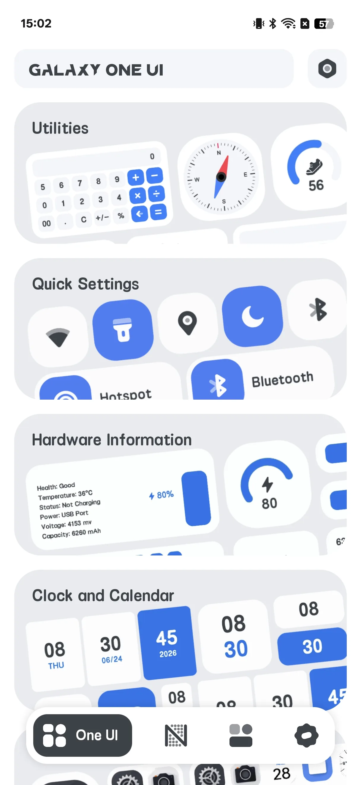
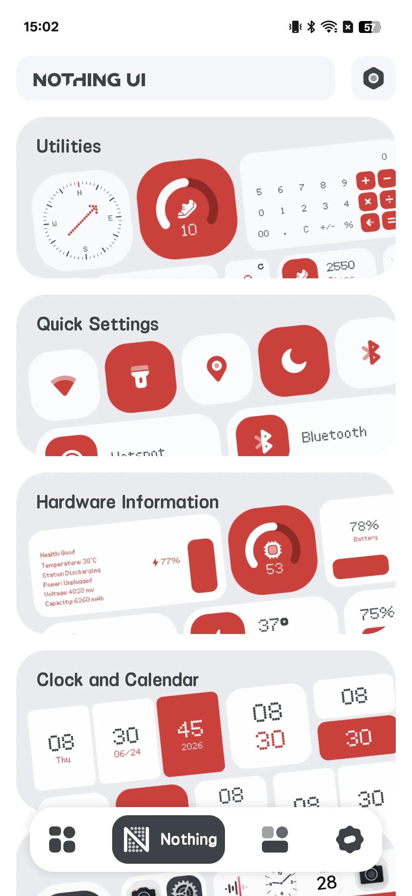
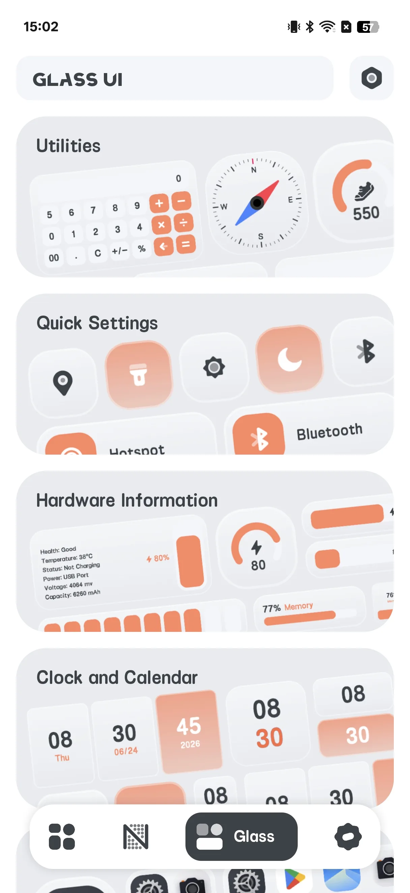
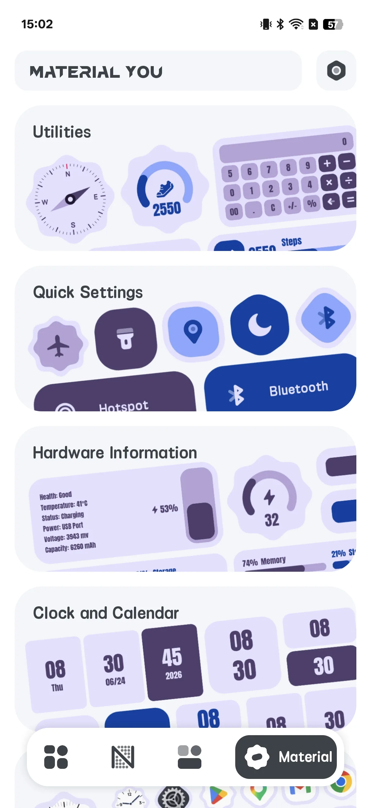
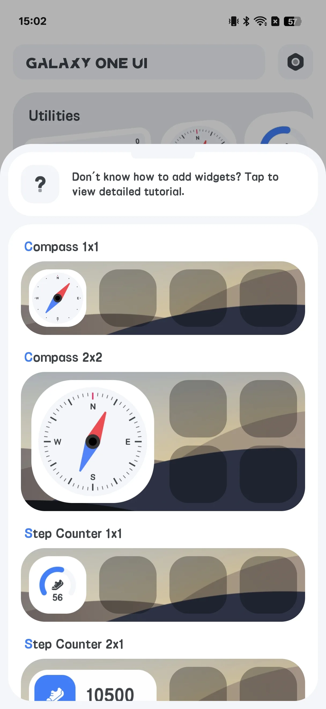
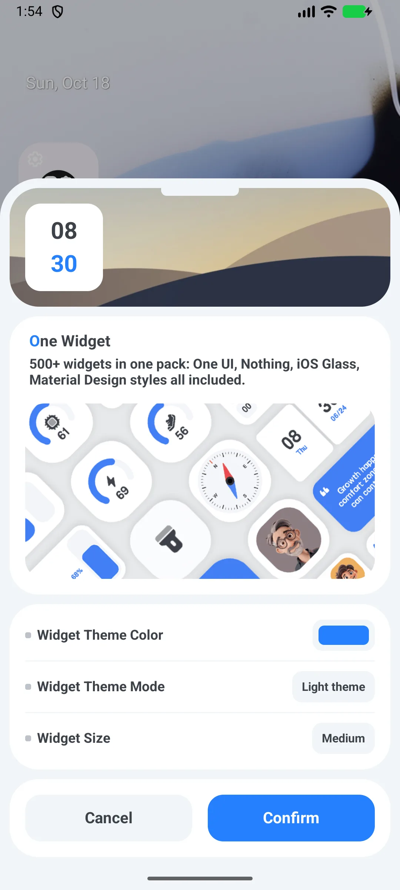

## Daftar Isi

- [Pendahuluan Aplikasi](#pendahuluan-aplikasi)
- [Penggunaan Pertama](#penggunaan-pertama)
- [Jelajahi 4 Gaya](#jelajahi-4-gaya)
- [Menambahkan Widget](#menambahkan-widget)
- [Mengonfigurasi Widget](#mengonfigurasi-widget)
- [Quick Toggle](#quick-toggle)
- [Shortcut Aplikasi](#shortcut-aplikasi)
- [Widget Info Langsung](#widget-info-langsung)
- [Pengaturan](#pengaturan)
- [Skenario Umum](#skenario-umum)
- [FAQ](#faq)

## Pendahuluan Aplikasi

One Widget memuat **500+ widget layar utama Android yang dapat disesuaikan [widget layar utama](/id/glossary/what-is-a-home-screen-widget/)** dalam empat gaya tren, plus shortcut aplikasi dan quick toggle. Ini adalah **aplikasi widget** yang bisa Anda pakai tanpa akun: jelajahi empat pustaka gaya, taruh sebuah preset, lalu ubah ukuran dan ganti latar serta radius sudutnya. Panduan ini menelusuri siklus penuh dari peluncuran pertama melalui gaya, menambah dan mengonfigurasi widget, toggle **widget shortcut aplikasi Android**, serta info jam, kalender, dan baterai langsung.

**🎨 Empat Gaya**
- **One UI** (default; satu-satunya gaya yang ada di aplikasi "lite" gratis)
- **Nothing**
- **Glass**
- **Material You**

> "Material You" di sini adalah *nama gaya* yang menggunakan palet hari-malam biru/ungu tetap — bukan warna dinamis berbasis wallpaper Android 12.

**⚡ Quick Toggle**
- 11 toggle: Bluetooth, data seluler, Wi-Fi, senter, rotasi, pesawat, hotspot, jangan-ganggu, lokasi, getar, mode gelap

**📱 Shortcut & Kontak Aplikasi**
- Peluncur satu ketuk untuk aplikasi Anda dan telepon/pengeras suara

**📊 Info Langsung**
- Widget jam, kalender, baterai, dan RAM yang memperbarui di tempat

**💲 Dua Aplikasi, Bukan Satu**
- Sebuah **aplikasi "lite" gratis** (hanya gaya One UI) dan sebuah **aplikasi "full" berbayar** (keempat gaya). Tidak ada pembelian dalam aplikasi — pasang aplikasi full dari Google Play untuk membuka semuanya.

## Penggunaan Pertama

Buka One Widget ke galeri 4-tab: **One UI / Nothing / Glass / Material You**.

- Setiap halaman gaya mencantumkan kategori: Tools, Entry, Hardware, Clock, Launcher, Combo, Note, Contact
- Ketuk sebuah kategori untuk melihat pratinjau widget

{: width="180" .normal }
{: width="180" .normal }
{: width="180" .normal }
{: width="180" .normal }

## Jelajahi 4 Gaya

Geser tab atas untuk melihat pratinjau tiap gaya. **One UI** adalah default dan tersedia di aplikasi lite gratis; Nothing / Glass / Material You membutuhkan aplikasi full berbayar.

## Menambahkan Widget

1. Tekan lama layar utama Anda → **Widget**
2. Temukan **One Widget** dalam daftar dan pilih sebuah varian
3. Sistem membuka layar **konfigurasi** One Widget
4. Atur opsi Anda dan ketuk **Konfirmasi** untuk menaruhnya

{: width="180" .normal }

## Mengonfigurasi Widget

Sebagian besar widget berbagi opsi umum:

- **Warna tema** (palet pop-up)
- Mode **Gelap / terang**
- **Bentuk** — lingkaran atau persegi panjang membulat
- **Ukuran** — opsi grid seperti 1x1, 2x1, 4x1, 5x1, 6x1, 2x2, 4x2, 5x2, 6x2 (hingga **6x2**)

Warna latar ikon dan radius sudut diturunkan dari bentuk (lingkaran = ukuran/2, membulat = ukuran/3).

{: width="180" .normal }

## Quick Toggle

1. Dari widget toggle, pilih tipe toggle (Wi-Fi, Bluetooth, senter, rotasi, DND, …)
2. Taruh toggle tunggal, atau gunakan widget **Combine 4x1** untuk menaruh hingga 5 toggle dalam satu bilah (default: Bluetooth / Wi-Fi / data seluler / senter / rotasi)
3. Ketuk sebuah toggle untuk beraksi:
   - **Senter** benar-benar mengalihkan senter (`CameraManager`)
   - **Wi-Fi / Bluetooth / DND** membuka layar pengaturan sistem yang relevan
   - **Rotasi** menulis pengaturan auto-rotate sistem

## Shortcut Aplikasi

1. Konfigurasikan widget **Shortcut Aplikasi**
2. Di tiap slot, pilih aplikasi terpasang dari daftar peluncur
3. Ketuk widget untuk meluncurkan aplikasi tersebut (atau Google Play jika belum terpasang)

## Widget Info Langsung

- Widget **Jam** menggambar ulang pada siklus pembaruan widget sistem (tiap 30 mnt) dan saat ukuran berubah
- Widget **Baterai / RAM** menanya statistik perangkat kira-kira tiap **60 detik**; baterai juga memperbarui instan dari siaran perubahan baterai
- Widget kalender / catatan statis atau menyegarkan pada siklus 30-menit

## Pengaturan

Pengaturan mencakup mode gelap, bahasa, satuan suhu, nilai, bagikan, umpan balik, privasi, dan versi.

## Skenario Umum

- **Layar utama segar dalam 5 menit** — buka galeri 4-tab, ketuk sebuah gaya, pilih widget jam atau cuaca, lalu taruh; tanpa editor, tanpa Kode.
- **Cocokkan dengan wallpaper** — atur warna tema dan gelap/terang, pilih bentuk lingkaran atau membulat, dan widget menyatu dengan peluncur Anda.
- **Quick toggle satu ketuk** — taruh Wi-Fi, Bluetooth, dan senter dalam bilah 4x1 agar Anda berhenti menggali pengaturan.
- **Shortcut aplikasi & kontak** — luncurkan Chrome, Maps, atau kontak favorit dari satu widget.
- **Semua perangkat Android** — Galaxy, Pixel, dan Nothing semua didukung; aplikasi lite gratis mencakup gaya One UI, aplikasi full membuka keempatnya.

## FAQ

### Mengapa saya tidak bisa menggunakan Nothing / Glass / Material You di aplikasi gratis?
{:.faq-q}
Aplikasi gratis adalah build "lite" yang hanya menyertakan gaya One UI. Pasang aplikasi full berbayar untuk membuka tiga gaya lainnya.

### Apakah "Material You" benar-benar temanya dinamis?
{:.faq-q}
Ini adalah gaya yang menggunakan palet hari-malam biru/ungu tetap. Bukan warna dinamis berbasis wallpaper.

### Apakah toggle butuh root?
{:.faq-q}
Tidak. Mereka menggunakan API dan pengaturan sistem standar; senter menggunakan API senter kamera.

## Ringkasan

One Widget adalah cara tercepat memberi layar utama Android Anda toolkit widget serba ada yang bergaya — ratusan widget dalam empat tampilan, dengan quick toggle dan shortcut aplikasi.

## Istilah terkait

- [Apa Itu Widget Layar Utama?](/id/glossary/what-is-a-home-screen-widget/)
- [Apa Itu Material You?](/id/glossary/what-is-material-you/)
- [Apa Itu Nothing UI?](/id/glossary/what-is-nothing-ui/)
- [Apa Itu Galaxy One UI?](/id/glossary/what-is-galaxy-one-ui/)
- [Apa Itu iOS Glass?](/id/glossary/what-is-ios-glass/)
