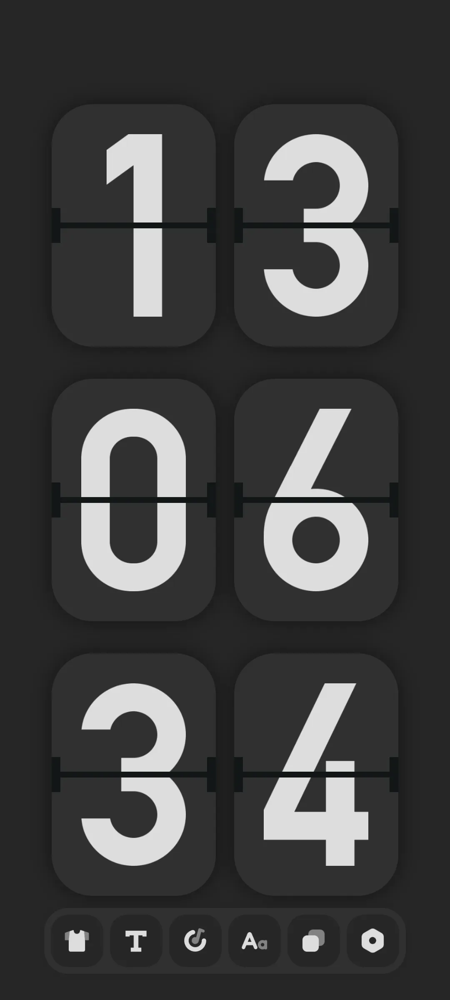
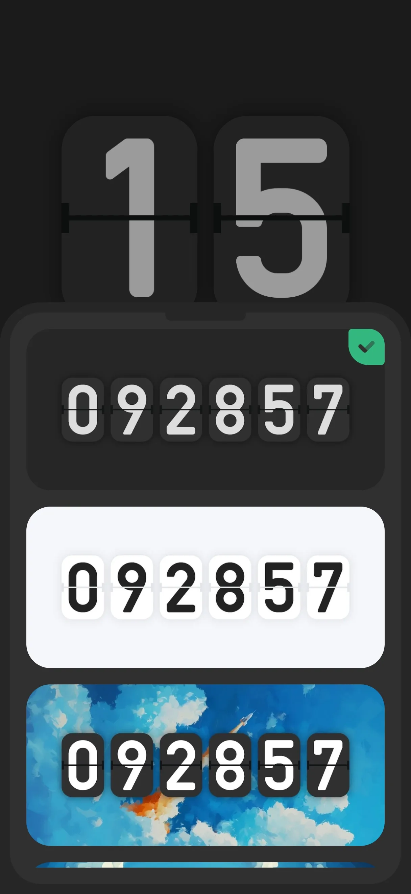
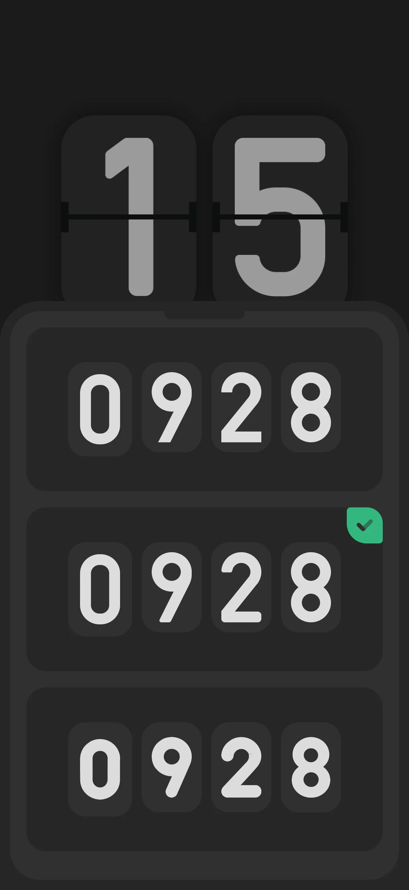
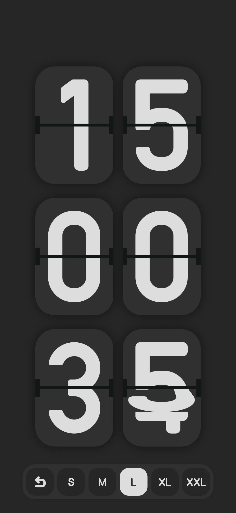
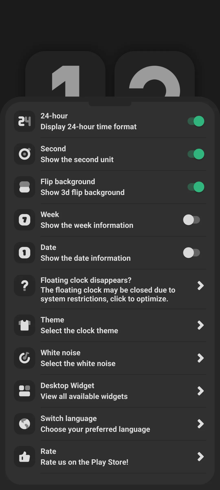
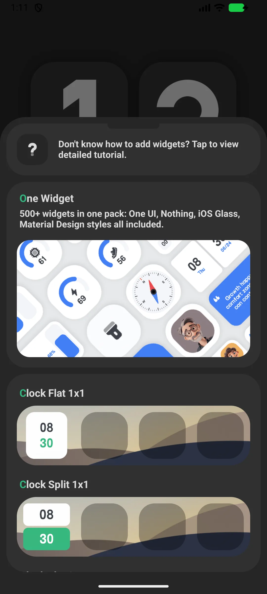
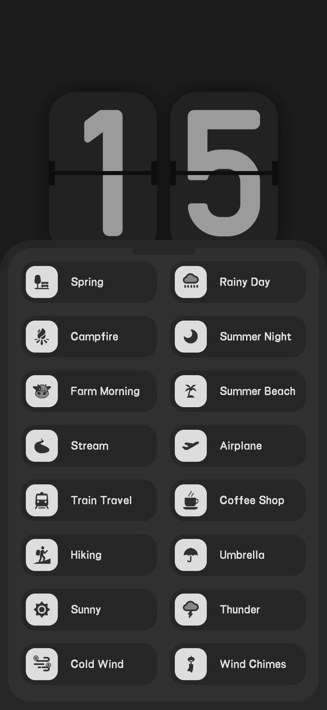
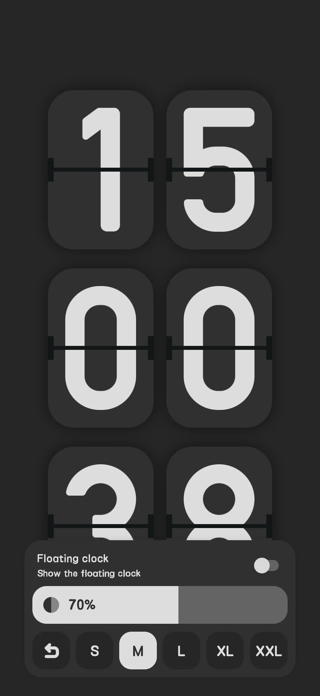

## Daftar Isi

- [Pendahuluan Aplikasi](#pendahuluan-aplikasi)
- [Penggunaan Pertama](#penggunaan-pertama)
- [Tampilan Jam Flip](#tampilan-jam-flip)
- [12/24-jam, Detik, Tanggal](#1224-jam-detik-tanggal)
- [Widget Jam](#widget-jam)
- [White Noise](#white-noise)
- [Floating Clock](#floating-clock)
- [Ponsel Cadangan sebagai Jam](#ponsel-cadangan-sebagai-jam)
- [Free vs Pro](#free-vs-pro)
- [Skenario Umum](#skenario-umum)
- [FAQ](#faq)

## Pendahuluan Aplikasi

Only Clock adalah **jam flip layar penuh [flip clock](/id/glossary/what-is-a-flip-clock/)** untuk Android dan iOS yang mengubah ponsel atau tablet menjadi jam meja atau samping tempat tidur, dengan 18 widget jam bertema, widget grid 1x1 hingga 4x2, animasi flip sekitar 600 ms per digit, dan white noise. Satu instalasi sekaligus mencakup meja, samping tempat tidur, dan layar utama tanpa aplikasi terpisah. Panduan ini menelusuri peluncuran pertama melalui pengaturan 12/24 jam, tema dan ukuran digit, widget, suara, serta mode melayang — termasuk cara memakai ponsel lama sebagai jam tanpa membiarkan layar terang penuh.

**🕐 Animasi Flip**
- Transisi page-flip yang mulus saat digit berubah (sekitar 600 ms per digit)
- Berbagai tema (mis. Hitam, Putih, Langit)

**🪟 Widget**
- 18 widget jam bertema plus widget grid jam (1x1, 2x1, 2x2, 4x1, 4x2, datar/terpisah)

**🔊 White Noise**
- Suara ambient bawaan (mesin sama dengan aplikasi white-noise mandiri) untuk membantu fokus atau tidur

**📅 Tampilan Fleksibel**
- Alih 12/24-jam, detik, minggu, dan tanggal

> Catatan: Only Clock sendiri **tidak punya pengatur/pomodoro fokus** — itu ada di aplikasi saudara terpisah. White noise jam hanya membantu Anda berkonsentrasi.

## Penggunaan Pertama

Membuka Only Clock langsung menampilkan **jam flip layar penuh** tanpa akun, login, atau wizard pengaturan, dan layar tetap terjaga saat jam ditampilkan agar waktu tetap terbaca sepanjang malam. Empat kontrol berada di bilah alat atas — pengaturan, tema, suara, dan ukuran — sehingga aplikasi bisa dipakai sebagai jam samping tempat tidur tanpa ketukan tambahan.

- Bilah alat (atas) memberi akses cepat ke pengaturan, tema, suara, dan ukuran
- Layar tetap terjaga saat jam ditampilkan

{: width="180" .normal }

## Tampilan Jam Flip

Only Clock menampilkan waktu dengan animasi bergaya flip, dengan setiap digit berputar sekitar 600 ms, dan tiga kontrol tampilan di bilah alat — Clock Theme, Clock Font, dan Clock Size. Pilih tema terlebih dahulu, lalu font, lalu ukuran digit agar jam tetap pas di layar, baik untuk samping tempat tidur yang gelap maupun meja yang terang.

{: width="180" .normal }
{: width="180" .normal }
{: width="180" .normal }

## 12/24-jam, Detik, Tanggal

Only Clock mempertahankan **format 24 jam dan detik dalam keadaan aktif secara bawaan**, sementara minggu dan tanggal dimatikan agar wajah flip tetap bersih; kelima sakelar tampilan berada di **Pengaturan**, sehingga format bisa diubah dalam beberapa ketukan tanpa keluar aplikasi. Berikut nilai bawaan dan lokasi tiap pengalihnya.

1. Buka **Pengaturan**
2. Alihkan:
   - **24-jam** (default aktif)
   - **Detik** (default aktif)
   - **Minggu** (default mati)
   - **Tanggal** (default mati)
   - **Latar belakang flip** mask (default aktif)

{: width="180" .normal }

## Widget Jam

Widget Only Clock tersedia dalam **26 gaya** di galeri **Pengaturan → Widget**, termasuk widget flip 4x2 yang memiliki konfigurasi tersendiri untuk detik, mask, minggu, dan tanggal. Untuk memasangnya, pilih gaya, ikuti panduan 'tekan lama beranda untuk menambah', lalu pilih Only Clock dari panel widget peluncur.

1. Buka **Pengaturan → Widget**
2. Telusuri **galeri** 26 gaya
3. Ketuk sebuah gaya → aplikasi menampilkan panduan "tekan lama beranda untuk menambah"
4. Tekan lama layar utama/layar kunci → Widget → pilih Only Clock → taruh
5. Widget flip 4x2 punya konfigurasi sendiri (detik / mask / minggu / tanggal)

{: width="180" .normal }

## White Noise

Fitur white noise Only Clock memakai mesin suara yang sama dengan aplikasi white-noise mandiri, dengan pilihan suara dalam grid dua kolom — sebagian bersifat premium. Buka **Pengaturan → White noise**, pilih suara, lalu ketuk untuk memutar atau menghentikan; suara ini membantu fokus atau tidur tanpa aplikasi kedua.

1. Buka **Pengaturan → White noise**
2. Pilih suara dari grid dua kolom (beberapa premium)
3. Ketuk untuk memutar/berhenti

Jam berbagi mesin suara sama dengan aplikasi white-noise mandiri.

{: width="180" .normal }

## Floating Clock

Mode jam melayang Only Clock menampilkan overlay jam di atas aplikasi lain setelah sakelar di bilah alat beranda diaktifkan dan izin overlay diberikan. Fitur ini membuat waktu tetap terlihat saat menonton video atau bekerja tanpa harus keluar aplikasi yang sedang dipakai.

1. Aktifkan sakelar jam melayang di bilah alat beranda
2. Berikan izin overlay jika diminta
3. Overlay jam muncul di atas aplikasi lain

{: width="180" .normal }

## Ponsel Cadangan sebagai Jam

Karena layar tetap terjaga (`FLAG_KEEP_SCREEN_ON`) dan widget bisa dipasang, ponsel atau tablet lama bekerja sangat baik sebagai jam meja atau samping tempat tidur khusus di Only Clock. Izinkan pengoptimalan baterai diabaikan agar aplikasi tidak dimatikan sistem saat perangkat dibiarkan terhubung terus.

## Free vs Pro

Model harga Only Clock membagi fitur menjadi dua tingkat: versi **Gratis** menampilkan iklan dan mengunci sebagian tema, font, serta suara di balik iklan hadiah atau pembelian, sementara **Pro** menghapus iklan dan membuka semuanya. Jam flip inti, widget, dan white noise tetap dapat dipakai tanpa membayar.

- **Gratis** menampilkan iklan dan mengunci beberapa tema/font/suara di balik iklan hadiah atau pembelian
- **Pro** menghapus iklan dan membuka semua

## Skenario Umum

Empat skenario memakai Only Clock menunjukkan keluasan jam flip layar penuh: jadikan ponsel cadangan jam samping tempat tidur yang tetap terbaca tanpa menerangi ruangan; jalankan jam layar penuh dengan white noise sebagai jangkar fokus sementara mode melayang menjaga waktu di atas catatan; pasang widget flip 4x2 dengan detik, minggu, dan tanggal untuk sekilas di layar utama; dan ganti tema Hitam, Putih, atau Langit serta font dan ukuran agar jam sesuai ruangan.

- **Jam samping tempat tidur dari ponsel cadangan** — buka Only Clock, colok ponsel di samping tempat tidur, dan wajah flip redup menampilkan waktu sepanjang malam dengan layar tetap terjaga.
- **Jangkar fokus di meja** — jalankan jam layar penuh dengan white noise saat blok belajar; mode melayang menjaga waktu di atas catatan atau video.
- **Layar utama sekilas** — tambahkan widget flip 4x2 dengan detik, minggu, dan tanggal agar waktu hanya sejauh satu pandangan.
- **Cocokkan dengan ruangan** — alih tema Hitam/Putih/Langit dan font/ukuran agar jam pas dengan setup Anda.

## FAQ

### Apakah ada pengatur/pomodoro fokus di Only Clock?
{:.faq-q}
Tidak. Pengatur fokus ada di aplikasi terpisah. Only Clock menyediakan jam flip, widget, dan white noise.

### Apakah layar tetap menyala?
{:.faq-q}
Ya — jam menggunakan flag keep-screen-on saat ditampilkan; untuk pemakaian samping tempat tidur, abaikan juga optimasi baterai.

## Ringkasan

Only Clock mengubah perangkat apa pun menjadi tampilan jam flip yang memukau dengan widget dan white noise yang menenangkan — gratis untuk memulai, dengan upgrade Pro untuk menghapus iklan dan membuka semua tema.

## Istilah terkait

- [Apa Itu Jam Flip?](/id/glossary/what-is-a-flip-clock/)
- [Apa Itu Jam Meja Samping Tempat Tidur?](/id/glossary/what-is-a-nightstand-clock/)
