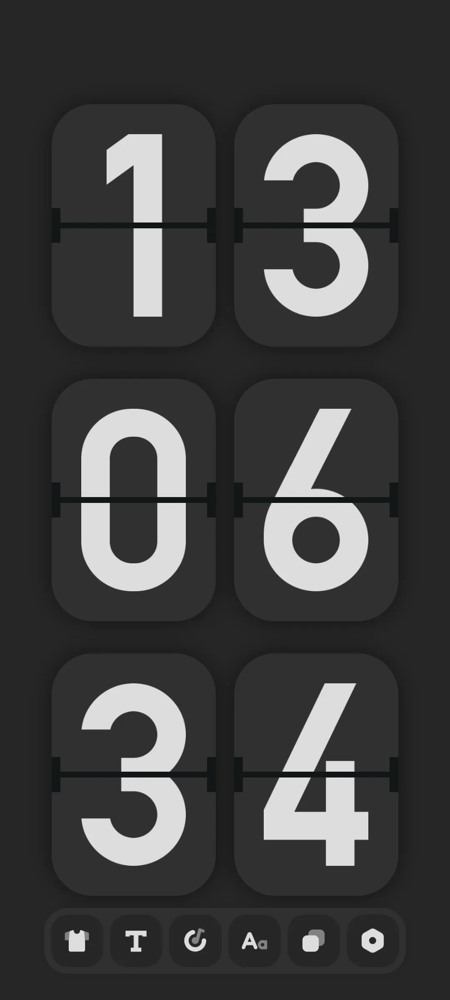
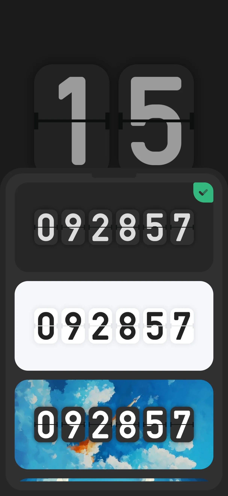
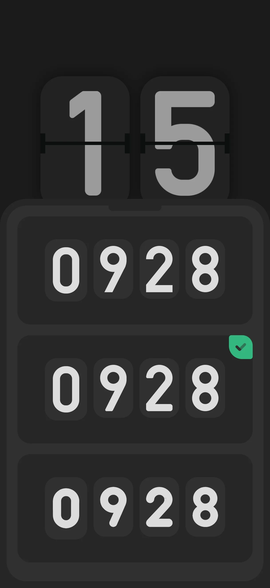
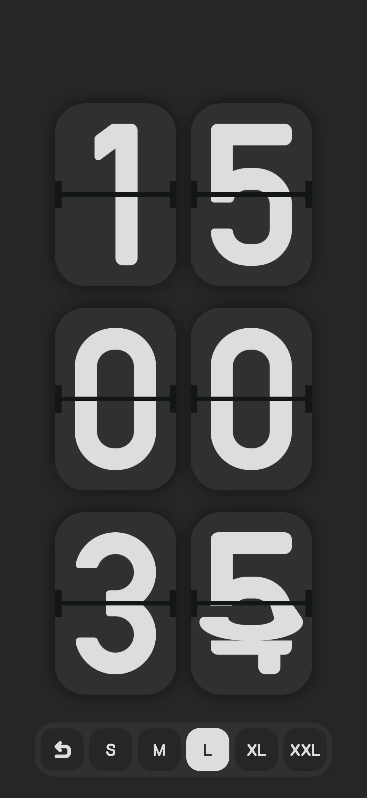
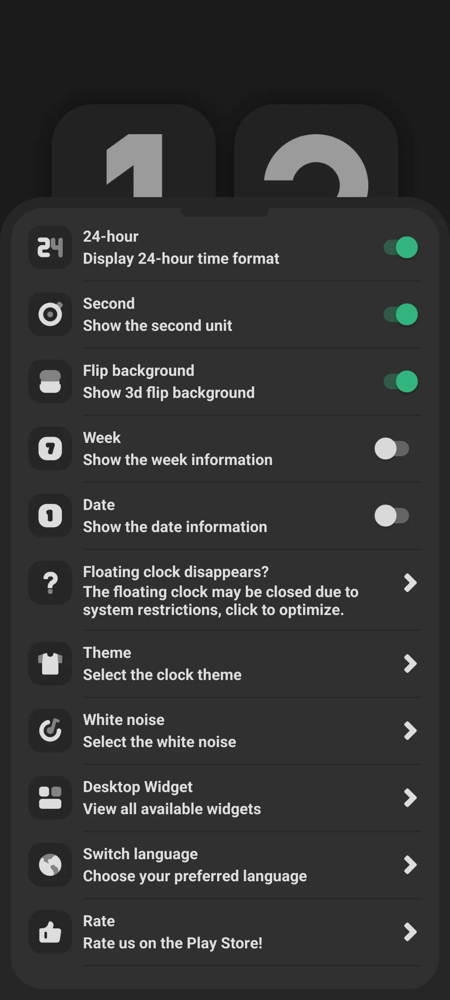
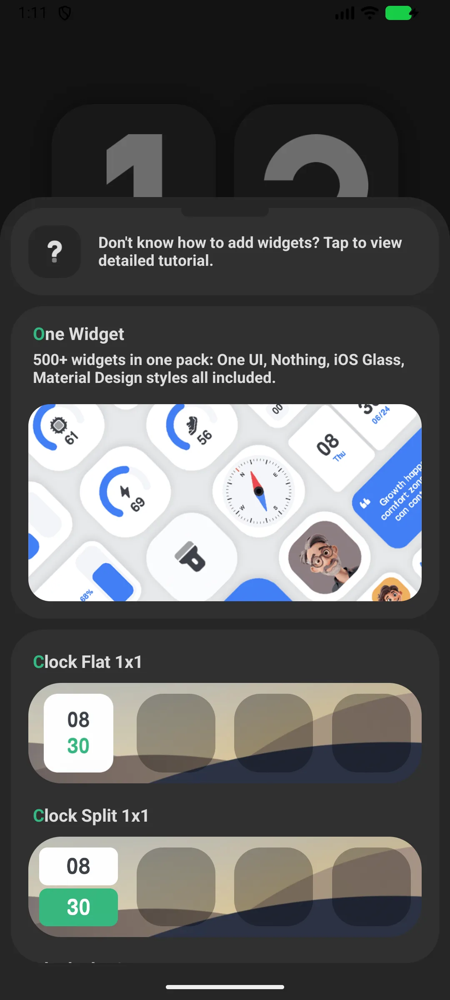
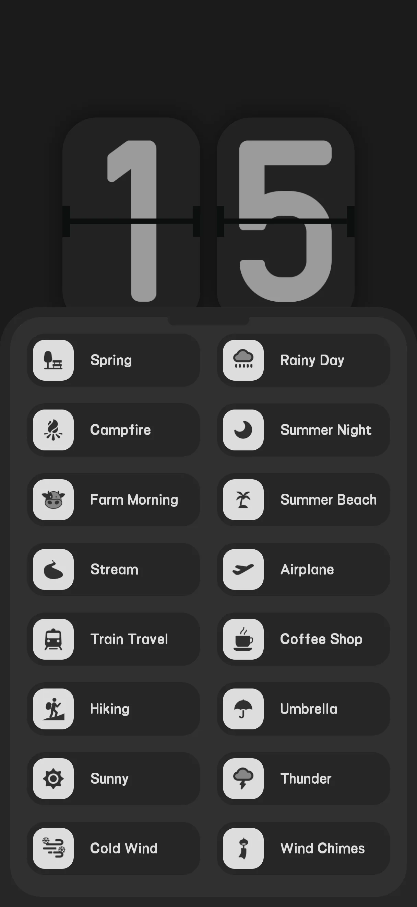
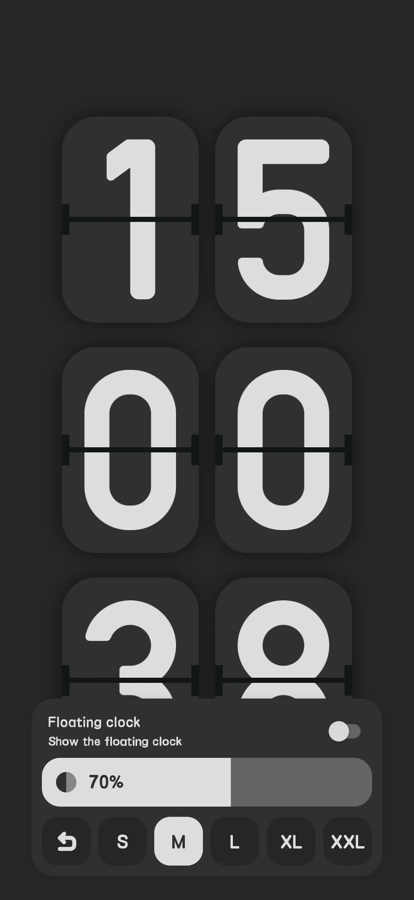

## Daftar Isi

- [Pendahuluan Aplikasi](#pendahuluan-aplikasi)
- [Penggunaan Pertama](#penggunaan-pertama)
- [Tampilan Jam Flip](#tampilan-jam-flip)
- [12/24-jam, Detik, Tanggal](#1224-jam-detik-tanggal)
- [Widget Jam](#widget-jam)
- [White Noise](#white-noise)
- [Floating Clock](#floating-clock)
- [Ponsel Cadangan sebagai Jam](#ponsel-cadangan-sebagai-jam)
- [Free vs Pro](#free-vs-pro)
- [Skenario Umum](#skenario-umum)
- [FAQ](#faq)

## Pendahuluan Aplikasi

Only Clock adalah **jam flip layar penuh [flip clock](/id/glossary/what-is-a-flip-clock/)** yang indah untuk Android dan iOS — ubah ponsel atau tablet apa pun menjadi jam meja atau samping tempat tidur. Ia berfungsi sebagai sumber **jam flip dengan pengatur fokus**, **jam flip dengan white noise**, dan **widget jam flip**, sehingga satu instalasi mencakup meja, samping tempat tidur, dan layar utama. Panduan ini menelusuri dari peluncuran pertama melalui tampilan 12/24-jam, tema, dan ukuran digit, lalu ke widget, suara, dan mode melayang — termasuk cara **gunakan ponsel lama sebagai jam** tanpa membiarkan layar terang penuh.

**🕐 Animasi Flip**
- Transisi page-flip yang mulus saat digit berubah (sekitar 600 ms per digit)
- Berbagai tema (mis. Hitam, Putih, Langit)

**🪟 Widget**
- 18 widget jam bertema plus widget grid jam (1x1, 2x1, 2x2, 4x1, 4x2, datar/terpisah)

**🔊 White Noise**
- Suara ambient bawaan (mesin sama dengan aplikasi white-noise mandiri) untuk membantu fokus atau tidur

**📅 Tampilan Fleksibel**
- Alih 12/24-jam, detik, minggu, dan tanggal

> Catatan: Only Clock sendiri **tidak punya pengatur/pomodoro fokus** — itu ada di aplikasi saudara terpisah. White noise jam hanya membantu Anda berkonsentrasi.

## Penggunaan Pertama

Buka aplikasi ke **jam flip layar penuh**.

- Bilah alat (atas) memberi akses cepat ke pengaturan, tema, suara, dan ukuran
- Layar tetap terjaga saat jam ditampilkan

{: width="180" .normal }

## Tampilan Jam Flip

Jam menampilkan waktu bergaya flip. Ketuk bilah alat untuk mengubah **tema** (Clock Theme), **font** (Clock Font), dan **ukuran** (Clock Size).

{: width="180" .normal }
{: width="180" .normal }
{: width="180" .normal }

## 12/24-jam, Detik, Tanggal

1. Buka **Pengaturan**
2. Alihkan:
   - **24-jam** (default aktif)
   - **Detik** (default aktif)
   - **Minggu** (default mati)
   - **Tanggal** (default mati)
   - **Latar belakang flip** mask (default aktif)

{: width="180" .normal }

## Widget Jam

1. Buka **Pengaturan → Widget**
2. Telusuri **galeri** 26 gaya
3. Ketuk sebuah gaya → aplikasi menampilkan panduan "tekan lama beranda untuk menambah"
4. Tekan lama layar utama/layar kunci → Widget → pilih Only Clock → taruh
5. Widget flip 4x2 punya konfigurasi sendiri (detik / mask / minggu / tanggal)

{: width="180" .normal }

## White Noise

1. Buka **Pengaturan → White noise**
2. Pilih suara dari grid dua kolom (beberapa premium)
3. Ketuk untuk memutar/berhenti

Jam berbagi mesin suara sama dengan aplikasi white-noise mandiri.

{: width="180" .normal }

## Floating Clock

1. Aktifkan sakelar jam melayang di bilah alat beranda
2. Berikan izin overlay jika diminta
3. Overlay jam muncul di atas aplikasi lain

{: width="180" .normal }

## Ponsel Cadangan sebagai Jam

Karena layar tetap terjaga (`FLAG_KEEP_SCREEN_ON`) dan Anda bisa menaruh widget, ponsel atau tablet lama bekerja sangat baik sebagai jam meja/samping tempat tidur khusus. Izinkan optimasi baterai diabaikan agar tak dimatikan.

## Free vs Pro

- **Gratis** menampilkan iklan dan mengunci beberapa tema/font/suara di balik iklan hadiah atau pembelian
- **Pro** menghapus iklan dan membuka semua

## Skenario Umum

- **Jam samping tempat tidur dari ponsel cadangan** — buka Only Clock, colok ponsel di samping tempat tidur, dan wajah flip redup menampilkan waktu sepanjang malam dengan layar tetap terjaga.
- **Jangkar fokus di meja** — jalankan jam layar penuh dengan white noise saat blok belajar; mode melayang menjaga waktu di atas catatan atau video.
- **Layar utama sekilas** — tambahkan widget flip 4x2 dengan detik, minggu, dan tanggal agar waktu hanya sejauh satu pandangan.
- **Cocokkan dengan ruangan** — alih tema Hitam/Putih/Langit dan font/ukuran agar jam pas dengan setup Anda.

## FAQ

### Apakah ada pengatur/pomodoro fokus di Only Clock?
{:.faq-q}
Tidak. Pengatur fokus ada di aplikasi terpisah. Only Clock menyediakan jam flip, widget, dan white noise.

### Apakah layar tetap menyala?
{:.faq-q}
Ya — jam menggunakan flag keep-screen-on saat ditampilkan; untuk pemakaian samping tempat tidur, abaikan juga optimasi baterai.

## Ringkasan

Only Clock mengubah perangkat apa pun menjadi tampilan jam flip yang memukau dengan widget dan white noise yang menenangkan — gratis untuk memulai, dengan upgrade Pro untuk menghapus iklan dan membuka semua tema.

## Istilah terkait

- [Apa Itu Jam Flip?](/id/glossary/what-is-a-flip-clock/)
- [Apa Itu Jam Meja Samping Tempat Tidur?](/id/glossary/what-is-a-nightstand-clock/)
