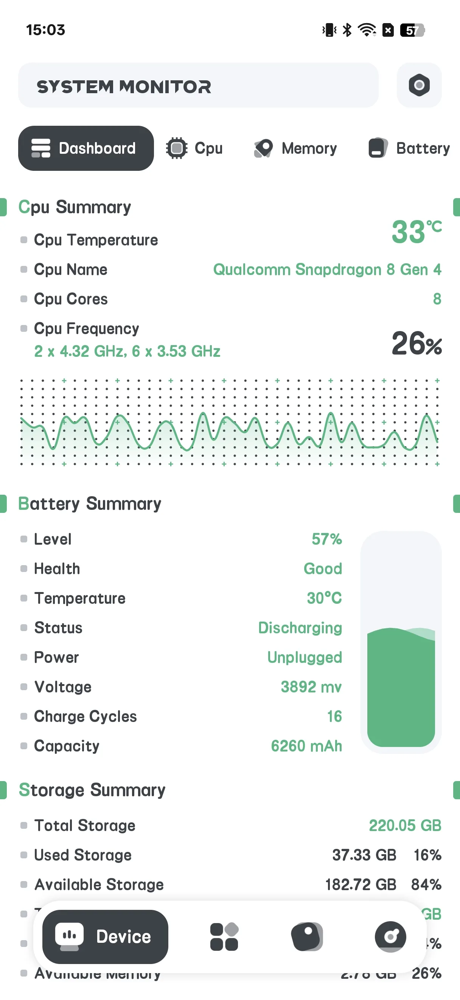
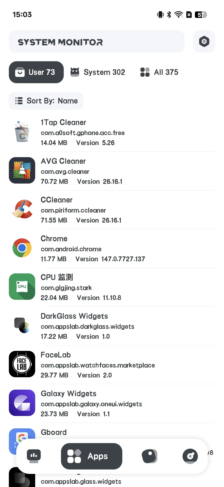
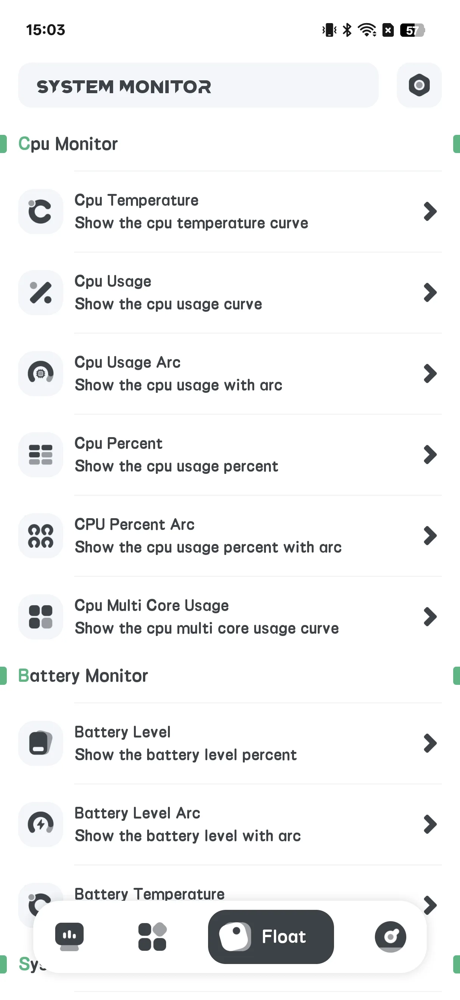
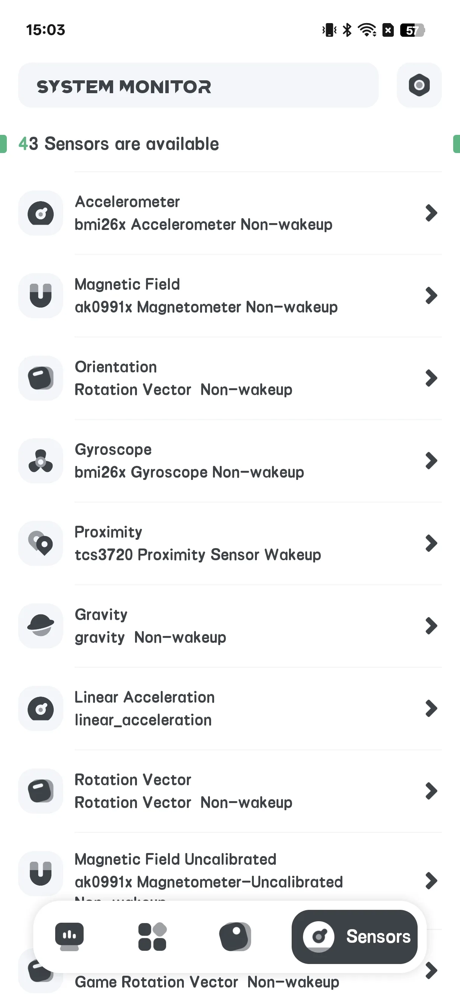
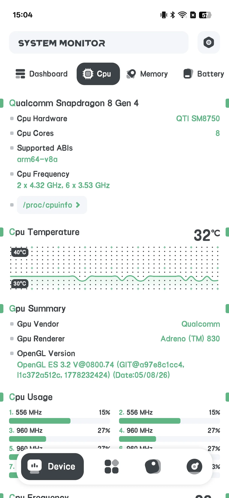
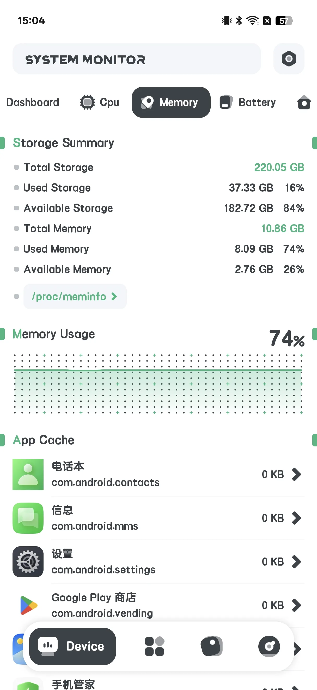
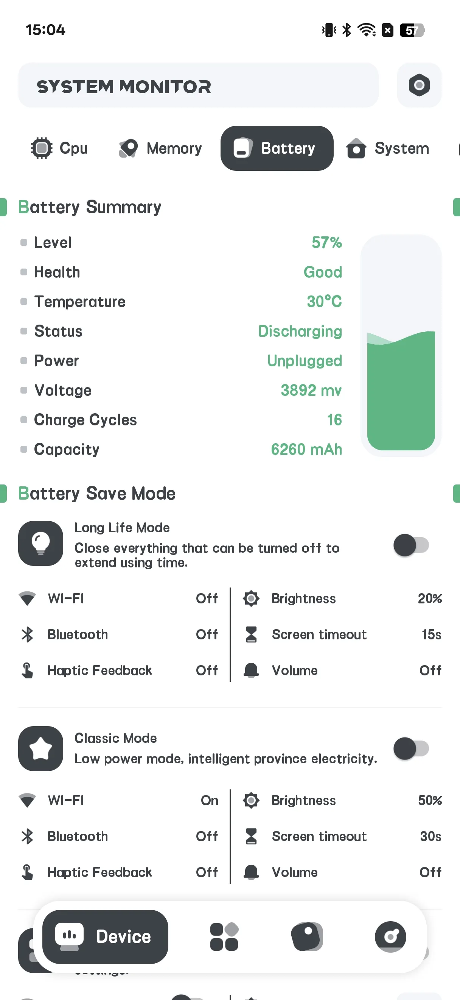
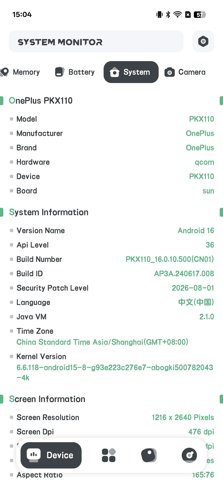
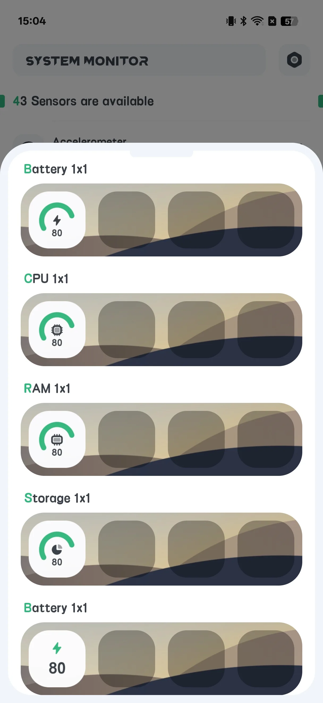

## Daftar Isi

- [Pengenalan Aplikasi](#pengenalan-aplikasi)
- [Penggunaan Pertama](#penggunaan-pertama)
- [Lihat Info Hardware](#lihat-info-hardware)
- [Kesehatan Baterai](#kesehatan-baterai)
- [Alarm Overheat](#alarm-overheat)
- [Jendela Melayang](#jendela-melayang)
- [Widget Layar Utama](#widget-layar-utama)
- [Pengaturan](#pengaturan)
- [Skenario Khas](#skenario-khas)
- [FAQ](#faq)

## Pengenalan Aplikasi

System Monitor adalah alat Android **berbayar satu kali** untuk [deteksi info hardware read-only](/id/glossary/what-is-a-system-monitor/). Ia melaporkan apa yang terjadi di dalam ponsel Anda — ia **tidak** membersihkan junk atau boost RAM. Karena hanya membaca penghitung sistem, pencarian **system monitor android dengan cleaner dan booster** yang membawa Anda ke sini biasanya ingin dua hal: angka terpercaya dan cara menjadikannya tetap terlihat. Panduan ini berjalan dari peluncuran pertama melalui info hardware, kesehatan baterai, alarm overheat, overlay **system monitor dengan jendela melayang** dan widget layar utama — semua read-only, tanpa akun dan tanpa klaim pembersihan junk.

**🔍 Apa yang Dibacanya (read-only)**
- **CPU** suhu dan frekuensi, penggunaan per-core
- **Storage** penggunaan
- **Memori (RAM)** penggunaan
- **Baterai** kesehatan: suhu, status kesehatan, tegangan, dan level
- **Kamera** kemampuan

**🌡 Perlindungan Overheat**
- Alarm yang memperingatkan saat CPU atau baterai panas

**🪟 Jendela Melayang & Widget**
- Overlay melayang menampilkan statis langsung
- Widget layar utama: CPU / Baterai / RAM / ROM / Combine

> Penting: System Monitor **tidak memiliki app lock / fingerprint lock** dan **tidak melakukan pembersihan atau boosting**. Baris "Fingerprint: supported?" yang mungkin Anda lihat hanyalah bacaan kapabilitas perangkat, bukan fitur kunci.

## Penggunaan Pertama

Layar utama punya empat tab: **Hardware**, **App**, **Floating**, **Sensor**.

- **Hardware** adalah layar info utama
- **Floating** mengonfigurasi overlay
- **Sensor** menampilkan daftar sensor perangkat

{: width="180" .normal }
{: width="180" .normal }
{: width="180" .normal }
{: width="180" .normal }

## Lihat Info Hardware

1. Buka tab **Hardware**
2. Alihkan sub-tab: **Dashboard / CPU / RAM / BAT / SYSTEM / CAMERA**
3. Baca nilai langsung:
   - **CPU**: suhu, frekuensi, beban per-core
   - **RAM**: memori terpakai / total
   - **BAT**: suhu baterai, kesehatan, tegangan, level
   - **SYSTEM**: storage dan info perangkat

{: width="180" .normal }
{: width="180" .normal }
{: width="180" .normal }
{: width="180" .normal }

## Kesehatan Baterai

Di sub-tab **BAT** Anda bisa melihat **suhu, status kesehatan, tegangan, dan level** baterai dengan kurva — berguna untuk mengawasi keausan dari waktu ke waktu.

{: width="180" .normal }

## Alarm Overheat

1. Buka **Settings → Alarm overheat** (atau **Temperature Alert**)
2. Alihkan alarm **CPU** dan/atau **Baterai** aktif
3. Tetapkan suhu **ambang**
4. Aplikasi memperingatkan Anda saat nilai terlampaui agar Anda mendinginkan ponsel

## Jendela Melayang

1. Buka tab **Floating**
2. Alihkan monitor yang diinginkan (suhu/usage/kurva CPU, baterai, RAM, System Monitor, FPS)
3. Berikan izin **"Draw over other apps"** saat diminta
4. Statis melayang muncul di atas aplikasi apa pun

{: width="180" .normal }

## Widget Layar Utama

1. Buka **Settings → Galeri widget**
2. Pilih widget: CPU / Baterai / RAM / ROM / Combine
3. Taruh dari pemilih widget

{: width="180" .normal }

## Pengaturan

Pengaturan mencakup tema, alarm overheat, satuan suhu, tingkat penyegaran, galeri widget, dan pemulihan otomatis floating.

## Skenario Khas

- **Baca suhu CPU saat gaming** — buka tab Hardware (sub-tab CPU) dan awasi suhu serta beban per-core untuk menangkap throttling sebelum frame jatuh.
- **Lindungi baterai** — periksa kurva suhu, kesehatan, tegangan, dan level sub-tab BAT untuk mengawasi keausan berkembang selama bulan.
- **Pandang tanpa membuka** — aktifkan overlay Floating atau taruh widget Combine di layar utama untuk CPU/baterai/RAM langsung sekilas.
- **Pasang penjaga panas** — nyalakan alarm overheat dengan ambang agar Anda diperingatkan sebelum ponsel panas merusak.
- **Tahu apa yang bukan** — ingat ini read-only: tak membersihkan junk atau mengosongkan RAM, jadi tutup aplikasi berat sendiri.

## FAQ

### Apakah ini membersihkan memori atau storage?
{:.faq-q}
Tidak. System Monitor strictly read-only — melaporkan fakta dan tak pernah menghapus file atau "boost" RAM.

### Apakah ada app lock?
{:.faq-q}
Tidak. Tidak ada kunci fingerprint atau password di aplikasi ini.

### Dari mana data berasal?
{:.faq-q}
Dari API Android standar (mis. BatteryManager dan file sistem). Tidak ada yang diubah.

## Ringkasan

System Monitor adalah pilihan jujur ketika Anda hanya ingin *melihat* isi ponsel — suhu CPU, kesehatan baterai, dan statis langsung — tanpa pembersih atau booster. Unduh berbayar satu kali.

## Istilah terkait

- [Apa Itu Monitor Suhu CPU?](/id/glossary/what-is-a-cpu-temperature-monitor/)
- [Apa Itu System Monitor?](/id/glossary/what-is-a-system-monitor/)
- [Apa Itu RAM Booster?](/id/glossary/what-is-a-ram-booster/)
