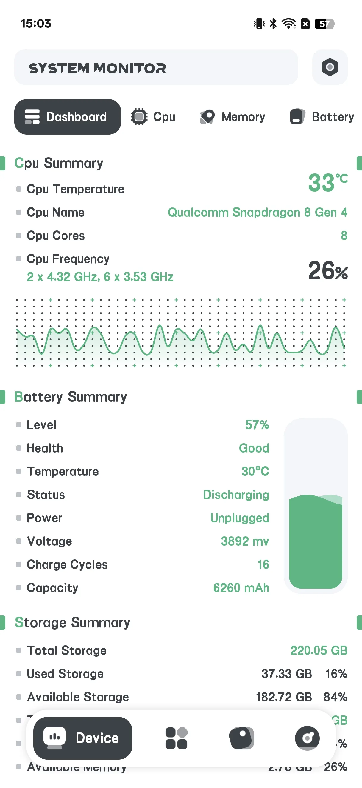
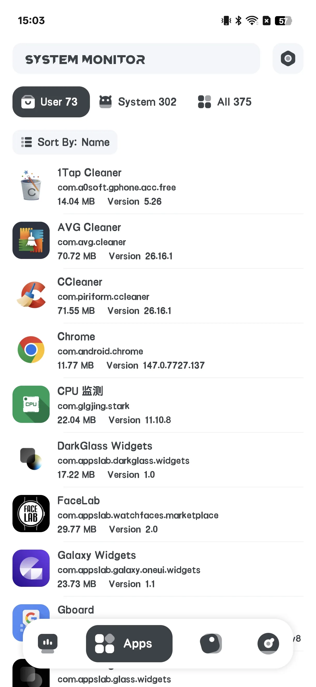
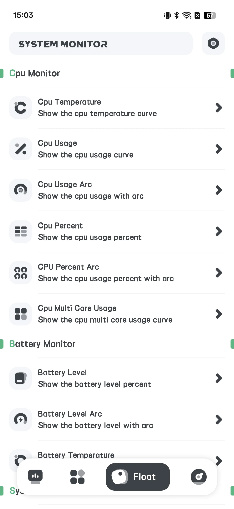
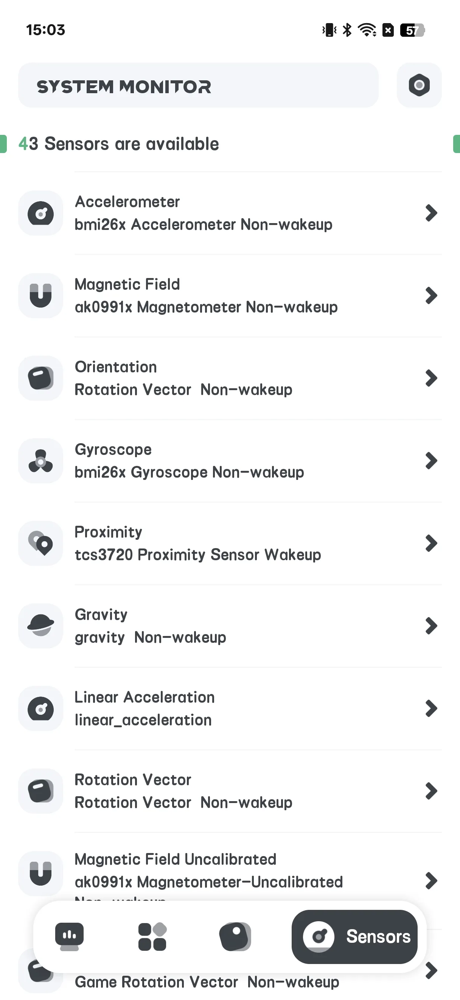
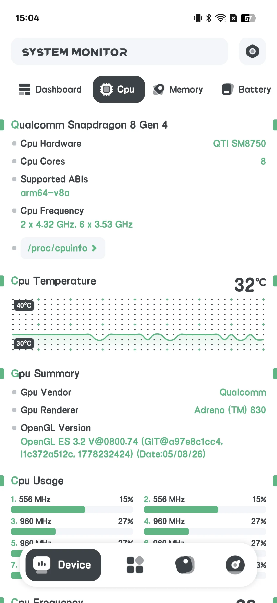
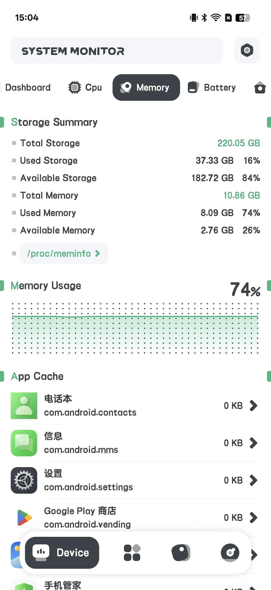
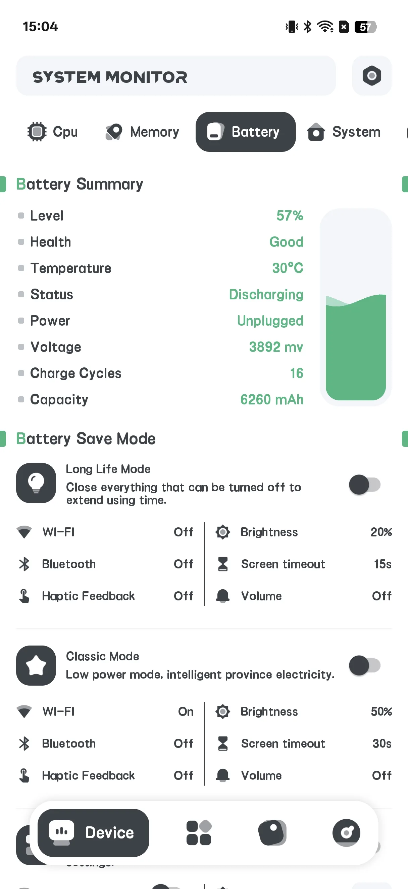
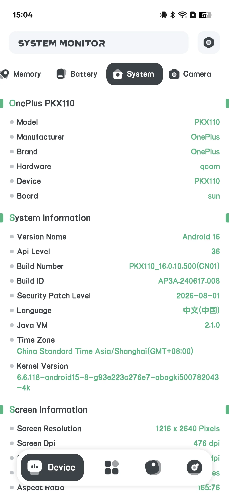
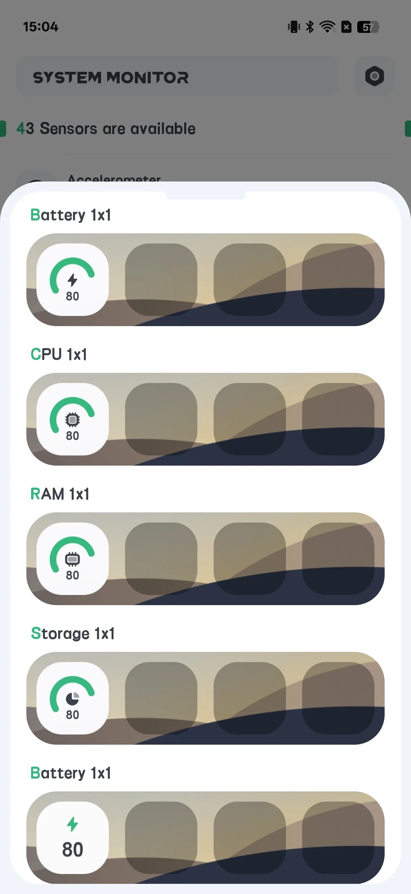

## Daftar Isi

- [Pengenalan Aplikasi](#pengenalan-aplikasi)
- [Penggunaan Pertama](#penggunaan-pertama)
- [Lihat Info Hardware](#lihat-info-hardware)
- [Kesehatan Baterai](#kesehatan-baterai)
- [Alarm Overheat](#alarm-overheat)
- [Jendela Melayang](#jendela-melayang)
- [Widget Layar Utama](#widget-layar-utama)
- [Pengaturan](#pengaturan)
- [Skenario Khas](#skenario-khas)
- [FAQ](#faq)

## Pengenalan Aplikasi

System Monitor adalah alat Android **berbayar satu kali** untuk [deteksi info hardware read-only](/id/glossary/what-is-a-system-monitor/) yang melaporkan suhu dan frekuensi CPU, penggunaan RAM dan storage, kesehatan baterai, serta kemampuan kamera — tanpa pernah membersihkan junk atau menambah RAM. Karena hanya membaca penghitung sistem, pencarian **system monitor android dengan cleaner dan booster** yang membawa Anda ke sini biasanya ingin dua hal: angka terpercaya dan cara menjadikannya tetap terlihat. Panduan ini berjalan dari peluncuran pertama melalui info hardware, kesehatan baterai, alarm overheat, overlay **system monitor dengan jendela melayang** dan widget layar utama — semua read-only, tanpa akun dan tanpa klaim pembersihan junk.

**🔍 Apa yang Dibacanya (read-only)**
- **CPU** suhu dan frekuensi, penggunaan per-core
- **Storage** penggunaan
- **Memori (RAM)** penggunaan
- **Baterai** kesehatan: suhu, status kesehatan, tegangan, dan level
- **Kamera** kemampuan

**🌡 Perlindungan Overheat**
- Alarm yang memperingatkan saat CPU atau baterai panas

**🪟 Jendela Melayang & Widget**
- Overlay melayang menampilkan statis langsung
- Widget layar utama: CPU / Baterai / RAM / ROM / Combine

> Penting: System Monitor **tidak memiliki app lock / fingerprint lock** dan **tidak melakukan pembersihan atau boosting**. Baris "Fingerprint: supported?" yang mungkin Anda lihat hanyalah bacaan kapabilitas perangkat, bukan fitur kunci.

## Penggunaan Pertama

System Monitor membuka layar utama dengan **empat tab — Hardware, App, Floating, dan Sensor** — sehingga bacaan CPU, daftar proses, overlay, dan sensor perangkat terjangkau dalam satu ketukan tanpa akun atau wizard. Tab **Hardware** adalah layar info utama berisi sub-tab Dashboard, CPU, RAM, BAT, SYSTEM, dan CAMERA; tab **Floating** mengonfigurasi overlay; tab **Sensor** menampilkan daftar sensor perangkat. Keempat tab ini membuat pemantauan read-only langsung terlihat sejak peluncuran pertama, sebelum Anda menyentuh pengaturan alarm overheat atau widget layar utama. Semua angka berasal dari API Android standar dan tidak mengubah apa pun di perangkat.

- **Hardware** adalah layar info utama
- **Floating** mengonfigurasi overlay
- **Sensor** menampilkan daftar sensor perangkat

{: width="180" .normal }
{: width="180" .normal }
{: width="180" .normal }
{: width="180" .normal }

## Lihat Info Hardware

System Monitor menampilkan info hardware Android melalui **enam sub-tab di tab Hardware — Dashboard, CPU, RAM, BAT, SYSTEM, dan CAMERA** — yang semuanya bersifat read-only: suhu dan frekuensi per-core, memori terpakai terhadap total, kesehatan baterai, storage, dan kemampuan kamera. Baca langsung dari sub-tab CPU untuk suhu, frekuensi, dan beban per-core; sub-tab RAM untuk memori terpakai/total; sub-tab BAT untuk suhu, kesehatan, tegangan, dan level baterai; serta sub-tab SYSTEM untuk storage dan info perangkat. Tidak ada tombol hapus atau boost di sini — angkanya hanya dilaporkan, jadi Anda yang memutuskan kapan harus menutup aplikasi berat atau membiarkan ponsel mendingin.

1. Buka tab **Hardware**
2. Alihkan sub-tab: **Dashboard / CPU / RAM / BAT / SYSTEM / CAMERA**
3. Baca nilai langsung:
   - **CPU**: suhu, frekuensi, beban per-core
   - **RAM**: memori terpakai / total
   - **BAT**: suhu baterai, kesehatan, tegangan, level
   - **SYSTEM**: storage dan info perangkat

{: width="180" .normal }
{: width="180" .normal }
{: width="180" .normal }
{: width="180" .normal }

## Kesehatan Baterai

System Monitor melaporkan **empat bacaan baterai — suhu, status kesehatan, tegangan, dan level** — di sub-tab **BAT** dengan kurva yang memperlihatkan perubahan dari waktu ke waktu. Kurva ini berguna untuk mengawasi keausan baterai secara bertahap, bukan sekadar melihat angka sesaat: tegangan dan suhu yang naik selama pengisian cepat dapat dikaitkan dengan kebiasaan harian Anda. Karena aplikasi bersifat read-only, System Monitor tidak mengubah pengisian daya atau membersihkan proses; ia hanya menyajikan data dari BatteryManager dan file sistem agar Anda bisa mengambil keputusan sendiri.

{: width="180" .normal }

## Alarm Overheat

System Monitor menyediakan alarm overheat yang dapat diaktifkan untuk **CPU dan/atau baterai** di **Settings → Alarm overheat** (juga disebut Temperature Alert), dengan ambang suhu yang Anda tentukan sendiri. Begitu bacaan melewati ambang, aplikasi memberi peringatan agar Anda menutup aplikasi berat dan membiarkan ponsel mendingin sebelum performa menurun. Alur empat langkah di bawah menunjukkan cara mengaktifkan kedua alarm, menetapkan nilai ambang, dan memahami peringatan yang muncul — semuanya tetap read-only: alarm hanya memberi tahu, tidak menurunkan suhu atau memaksa aplikasi berhenti.

1. Buka **Settings → Alarm overheat** (atau **Temperature Alert**)
2. Alihkan alarm **CPU** dan/atau **Baterai** aktif
3. Tetapkan suhu **ambang**
4. Aplikasi memperingatkan Anda saat nilai terlampaui agar Anda mendinginkan ponsel

## Jendela Melayang

System Monitor menghadirkan **tujuh monitor melayang — suhu, usage, dan kurva CPU, baterai, RAM, System Monitor, serta FPS** — di atas aplikasi lain lewat tab **Floating**, setelah izin **Draw over other apps** diberikan. Overlay ini membuat statis tetap terlihat saat Anda bermain game atau menjalankan aplikasi lain tanpa harus membuka dasbor berulang kali. Empat langkah di bawah memandu pengaktifan monitor yang diinginkan dan pemberian izin overlay; setelah itu angka CPU, baterai, dan RAM terus mengambang di layar sebagai pandangan sekilas yang read-only.

1. Buka tab **Floating**
2. Alihkan monitor yang diinginkan (suhu/usage/kurva CPU, baterai, RAM, System Monitor, FPS)
3. Berikan izin **"Draw over other apps"** saat diminta
4. Statis melayang muncul di atas aplikasi apa pun

{: width="180" .normal }

## Widget Layar Utama

System Monitor menyediakan **lima pilihan widget layar utama — CPU, Baterai, RAM, ROM, dan Combine** — yang diambil dari **Settings → Galeri widget** lalu ditempatkan lewat pemilih widget. Widget Combine menggabungkan beberapa statis dalam satu tempat, cocok untuk pandangan sekilas tanpa membuka aplikasi. Karena aplikasi hanya membaca penghitung sistem, widget ini menampilkan angka langsung dan tidak menghapus berkas atau membebaskan RAM. Ikuti tiga langkah di bawah untuk memilih widget dan memasangnya di home screen; angkanya tetap read-only seperti di dasbor.

1. Buka **Settings → Galeri widget**
2. Pilih widget: CPU / Baterai / RAM / ROM / Combine
3. Taruh dari pemilih widget

{: width="180" .normal }

## Pengaturan

Pengaturan System Monitor mencakup **enam kelompok — tema, alarm overheat, satuan suhu, tingkat penyegaran, galeri widget, dan pemulihan otomatis floating** — yang semuanya mengontrol tampilan dan peringatan, bukan mengubah data perangkat. Dari sini Anda mengatur ambang alarm CPU atau baterai, memilih satuan suhu, menentukan seberapa sering angka diperbarui, mengambil widget, dan mengaktifkan kembali overlay setelah layar mati. Satu kunci untuk seluruh pengaturan: System Monitor tetap read-only, jadi tidak ada sakelar untuk membersihkan junk atau menambah RAM.

## Skenario Khas

System Monitor mendukung **lima skenario khas** yang semuanya bertumpu pada data read-only: membaca suhu CPU saat gaming lewat sub-tab CPU, mengawasi keausan baterai lewat kurva sub-tab BAT, memasang overlay Floating atau widget Combine untuk pandangan sekilas, menyalakan alarm overheat sebagai penjaga panas, dan mengingat bahwa aplikasi tidak membersihkan junk atau mengosongkan RAM. Karena ia hanya melaporkan fakta dari sensor dan API Android standar, keputusan menutup aplikasi berat atau mengubah kebiasaan pengisian tetap ada di tangan Anda.

- **Baca suhu CPU saat gaming** — buka tab Hardware (sub-tab CPU) dan awasi suhu serta beban per-core untuk menangkap throttling sebelum frame jatuh.
- **Lindungi baterai** — periksa kurva suhu, kesehatan, tegangan, dan level sub-tab BAT untuk mengawasi keausan berkembang selama bulan.
- **Pandang tanpa membuka** — aktifkan overlay Floating atau taruh widget Combine di layar utama untuk CPU/baterai/RAM langsung sekilas.
- **Pasang penjaga panas** — nyalakan alarm overheat dengan ambang agar Anda diperingatkan sebelum ponsel panas merusak.
- **Tahu apa yang bukan** — ingat ini read-only: tak membersihkan junk atau mengosongkan RAM, jadi tutup aplikasi berat sendiri.

## FAQ

### Apakah ini membersihkan memori atau storage?
{:.faq-q}
Tidak. System Monitor strictly read-only — melaporkan fakta dan tak pernah menghapus file atau "boost" RAM.

### Apakah ada app lock?
{:.faq-q}
Tidak. Tidak ada kunci fingerprint atau password di aplikasi ini.

### Dari mana data berasal?
{:.faq-q}
Dari API Android standar (mis. BatteryManager dan file sistem). Tidak ada yang diubah.

## Ringkasan

System Monitor adalah pilihan jujur ketika Anda hanya ingin *melihat* isi ponsel — suhu CPU, kesehatan baterai, dan statis langsung — tanpa pembersih atau booster. Unduh berbayar satu kali.

## Istilah terkait

- [Apa Itu Monitor Suhu CPU?](/id/glossary/what-is-a-cpu-temperature-monitor/)
- [Apa Itu System Monitor?](/id/glossary/what-is-a-system-monitor/)
- [Apa Itu RAM Booster?](/id/glossary/what-is-a-ram-booster/)
