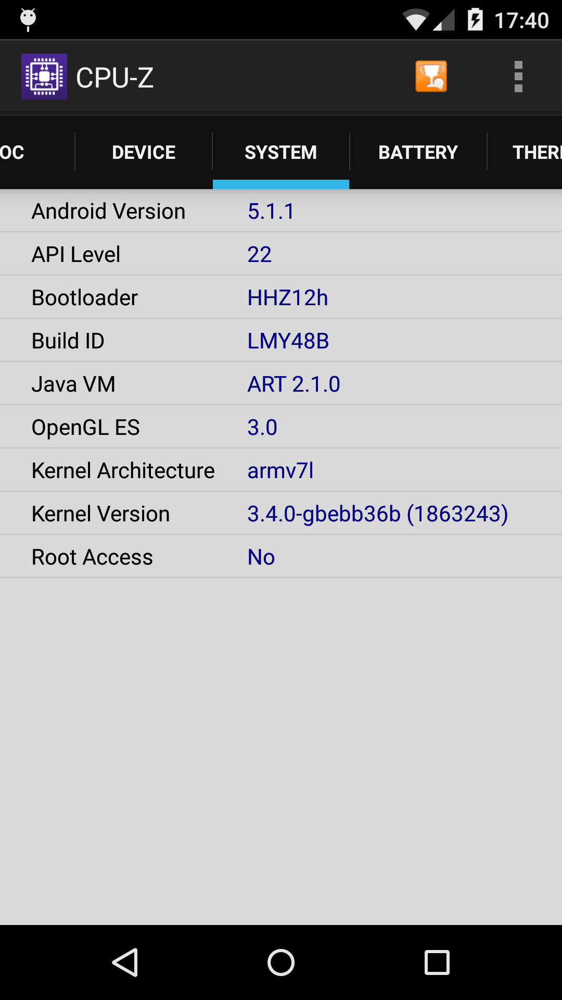

Keduanya membaca isi ponsel Anda, tapi menjawab pertanyaan berbeda. **CPU Monitor** dibuat untuk *mengawasi* perangkat waktu nyata — suhu, frekuensi, RAM, dan baterai saat Anda gaming atau mengisi daya. **CPU-Z** dibuat untuk *mengidentifikasi* perangkat sekali waktu — lembar spesifikasi bersih dari SoC, GPU, memori, dan sensor. Perbandingan **CPU Monitor vs CPU-Z** ini membantu Anda memilih **aplikasi hardware Android** yang tepat di 2026. Jika Anda datang mencari **alternatif CPU-Z** yang terus mengawasi setelah ketukan pertama, baris pemantauan di bawah menyelesaikannya.

## Sekilas

Perbandingan CPU Monitor dan CPU-Z terletak pada dua pekerjaan yang berbeda: CPU Monitor mengawasi ponsel secara langsung, sementara CPU-Z membaca spesifikasinya sekali waktu. CPU Monitor adalah pemantau Android waktu nyata untuk suhu CPU, frekuensi per-core, RAM, dan baterai, lengkap dengan alarm overheat, jendela melayang, widget layar utama, serta boost satu ketuk. CPU-Z adalah pembaca lembar spesifikasi gratis yang mencantumkan SoC, GPU, memori, penyimpanan, dan sensor, tetapi hanya menampilkan cuplikan tanpa peringatan maupun widget. Keduanya gratis di Android dan tidak tersedia di iOS, jadi keputusan bergantung pada apakah Anda ingin mengawasi panas saat gaming dan pengisian cepat atau sekadar mengetahui isi perangkat. Untuk identifikasi sekali waktu, CPU-Z lebih dalam; untuk kesadaran thermal harian, CPU Monitor adalah satu-satunya dari keduanya yang terus memperbarui angka.

| | CPU Monitor | CPU-Z |
|---|---|---|
| **Tujuan inti** | Monitor waktu nyata (suhu, frekuensi, RAM, baterai) | Pembaca lembar spesifikasi perangkat |
| **Platform** | Android | Android (tanpa iOS) |
| **Harga** | Inti gratis + buka kunci opsional | Gratis, tanpa langganan |
| **Suhu CPU langsung** | **Ya, waktu nyata + alarm overheat** | Bacaan sensor statis |
| **Frekuensi / per-core CPU** | **Ya, langsung** | Tertera di spesifikasi |
| **Pemantauan RAM** | **Ya, langsung** | Ditampilkan sekali |
| **Kesehatan / suhu baterai** | **Ya, dengan kurva** | Bacaan dasar |
| **Jendela melayang** | **Ya** | Tidak |
| **Widget layar utama** | CPU, RAM, baterai | Tidak |
| **Boost satu ketuk** | **Ya** | Tidak |
| **Tema** | Multi | Tidak ada (UI utilitas) |
| **Riwayat / tren** | Ya (grafik penggunaan) | Tidak |
| **Terbaik untuk** | Mengawasi panas langsung saat gaming/isi daya | Identifikasi perangkat sekali waktu |

---

## CPU Monitor, secara detail

CPU Monitor mengubah status-bar dan layar utama Android menjadi dasbor langsung untuk **suhu CPU, frekuensi per-core, RAM, dan baterai**, dengan alarm overheat yang memperingatkan sebelum thermal throttling selama game panjang atau pengisian cepat. Ini monitor waktu nyata, bukan pembaca spesifikasi sekali waktu: ia memetakan suhu sebagai kurva, menunjukkan core mana yang naik, dan menyimpan riwayat penggunaan. Inti gratis mencakup jendela melayang, widget CPU/RAM/baterai, dan boost satu ketuk, sementara tema serta riwayat ekstra berada di balik buka kunci opsional. CPU Monitor hanya tersedia di Android dan akurasi bacaan bergantung pada sensor tiap perangkat.

{: width="180" .normal }
{: width="180" .normal }
{: width="180" .normal }
{: width="180" .normal }
{: width="180" .normal }

CPU Monitor mengubah status-bar dan layar utama Anda menjadi dasbor langsung. Fitur utamanya adalah **suhu [CPU](/id/glossary/what-is-a-cpu-temperature-monitor/) dan frekuensi waktu nyata** dengan alarm overheat, sehingga Anda diperingatkan sebelum thermal throttling aktif selama game panjang atau pengisian cepat.

### Keunggulan
- **Suhu langsung dengan alarm overheat** — satu fitur yang tak bisa ditandingi CPU-Z; ia memperingatkan Anda menutup aplikasi berat dan mendinginkan.
- **Pemantauan frekuensi per-core** — lihat persis core mana yang berputar, bukan sekadar rata-rata.
- **Jendela melayang dan widget** — overlay status-bar plus widget CPU/RAM/baterai menjaga angka terlihat tanpa membuka aplikasi.
- **Boost satu ketuk** — dengan cepat membebaskan RAM saat ponsel terasa lemot.
- **Dokter baterai** — kurva kesehatan, tegangan, dan suhu baterai.
- **Ringan dan gratis di inti**, dengan multi-tema.

### Kelemahan
- **Hanya Android** — tidak ada versi iPhone atau iPad.
- **Akurasi bergantung sensor** — tak setiap perangkat membuka sensor suhu nyata, jadi sebagian bacaan perkiraan.
- **Kurang dalam soal spesifikasi statis** — menampilkan angka langsung tapi bukan inventaris komponen penuh (mis. model GPU persis, panel layar).
- **Tema/riwayat ekstra** berada di balik buka kunci opsional.
- **Tanpa ekspor** laporan spesifikasi.

### Terbaik untuk
Gamer, penggemar emulasi, dan siapa saja yang ingin *mengawasi* panas dan beban waktu nyata daripada membaca daftar spesifikasi sekali waktu.

**Unduh CPU Monitor**
- [Google Play](https://play.google.com/store/apps/details?id=com.glgjing.stark)

---

## CPU-Z, secara detail

CPU-Z adalah port Android dari utilitas PC terkenal oleh CPUID yang membuka **lembar spesifikasi perangkat** berisi nama SoC dan arsitektur, GPU, memori dan penyimpanan, baterai, sensor, serta detail layar dalam tab bersih. Ia pembaca statis, bukan monitor: menangkap keadaan saat Anda membukanya dan menyajikannya sebagai laporan rapi, tanpa melacak suhu dari waktu ke waktu, tanpa jendela melayang, widget, atau alarm overheat. CPU-Z sepenuhnya gratis tanpa langganan atau akun dan hanya tersedia di Android dengan antarmuka utilitas tanpa tema; cocok untuk mengidentifikasi ponsel sekali waktu atau memverifikasi ponsel bekas.

{: width="180" .normal }
{: width="180" .normal }
{: width="180" .normal }
{: width="180" .normal }
{: width="180" .normal }

CPU-Z adalah port Android dari utilitas PC terkenal oleh CPUID. Ia membuka lembar spesifikasi bertab bersih: nama SoC dan arsitektur, GPU, memori dan penyimpanan, baterai, sensor, dan bahkan detail layar. Ini aplikasi yang Anda ambil saat perlu *tahu isi di dalamnya*.

### Keunggulan
- **Lembar spesifikasi berwibawa dan detail** — SoC, GPU, jenis memori, penyimpanan, kapasitas desain baterai, dan daftar sensor panjang.
- **Merek terpercaya** dengan antarmuka utilitas tanpa basa-basi, minim iklan.
- **Sepenuhnya gratis**, tanpa langganan, tanpa akun.
- **Cocok untuk identifikasi** — selesaikan "chip ini apa?" atau "ini benar UFS 3.1?" dalam detik.
- **Tab sensor** membuka nilai langsung (termasuk suhu) untuk cek sekali waktu.

### Kelemahan
- **Statis, bukan monitor** — menampilkan cuplikan; tidak melacak suhu dari waktu ke waktu atau memperingatkan saat panas.
- **Tanpa jendela melayang, widget, atau alarm overheat** — Anda harus membuka aplikasi untuk melihat apa pun.
- **Tanpa boost satu ketuk atau manajemen RAM.**
- **Hanya Android**, dan UI murni utilitas (tanpa tema).
- **Tanpa tren atau riwayat** — Anda tak bisa melihat bagaimana suhu berubah selama game.

### Terbaik untuk
Pengembang, pembeli yang memverifikasi ponsel bekas, dan siapa saja yang butuh bacaan hardware terpercaya sekali waktu.

**Unduh CPU-Z**
- [Google Play](https://play.google.com/store/apps/details?id=com.cpuid.cpu_z)

---

## Bagaimana mereka membandingkan di mana itu penting

### Pemantauan langsung vs lembar spesifikasi
Perbandingan CPU Monitor dan CPU-Z intinya adalah monitor waktu nyata versus pembaca spesifikasi statis. CPU Monitor memberi Anda **suhu CPU dan baterai, frekuensi per-core, RAM, serta alarm overheat** yang terus diperbarui, juga lewat jendela melayang dan widget, sehingga pertanyaan "apakah ponsel saya overheat?" terjawab setiap saat. CPU-Z mengambil satu cuplikan saat dibuka lalu menyajikannya sebagai laporan rapi tentang SoC, GPU, memori, dan sensor tanpa pelacakan tren. Bila yang Anda butuhkan adalah pengawasan panas selama gaming atau pengisian cepat, CPU Monitor satu-satunya yang menjawabnya terus-menerus; untuk identifikasi perangkat sekali waktu, CPU-Z lebih dalam.

### Overlay dan widget
CPU Monitor memberi Anda overlay status-bar, jendela melayang desktop, dan widget layar utama untuk CPU/RAM/baterai — visibilitas persisten. CPU-Z tidak menampilkan apa pun kecuali Anda meluncurkannya. Untuk yang ingin dasbor sekilas, itu menentukan.

### Perlindungan panas gaming
Saat bermain, alarm overheat CPU Monitor dan grafik frekuensi langsung memberi tahu kapan harus mundur. CPU-Z bisa menampilkan suhu sekali, tapi tak bisa mengawasi sesi. Untuk gaming atau emulasi berat, CPU Monitor adalah pilihan praktis.

### Kedalaman detail hardware
Untuk identifikasi mentah, CPU-Z menang. Ia mencantumkan model SoC, GPU, standar memori, jenis penyimpanan, dan inventaris sensor lebih penuh. CPU Monitor lebih ringan di detail statis dan lebih kuat di perilaku langsung.

### Harga dan platform
Keduanya gratis di Android; CPU Monitor menambah buka kunci opsional untuk tema/riwayat ekstra, sementara CPU-Z gratis tanpa upsell. Tak satu pun ada di iOS.

## Mana yang harus dipilih

Keputusan memilih CPU Monitor atau CPU-Z bergantung pada satu pertanyaan: Anda ingin **mengawasi** perangkat secara berkelanjutan atau **mengidentifikasi**-nya sekali waktu. Pilih CPU Monitor bila Anda memantau suhu, frekuensi, dan RAM langsung, menginginkan alarm overheat saat gaming atau pengisian cepat, serta menyimpan widget dan jendela melayang di layar utama; inti gratisnya mencakup semua itu. Pilih CPU-Z bila yang dibutuhkan adalah lembar spesifikasi terperinci — chip, GPU, memori, sensor — tanpa pelacakan tren, gratis tanpa upsell. Banyak pengguna mahir menyimpan keduanya: satu untuk kesadaran thermal harian, satu untuk cek "apa isi ponsel ini?" sesekali.

- **Pilih CPU Monitor** jika Anda ingin mengawasi suhu, frekuensi, dan RAM langsung, mendapat peringatan overheat saat gaming, atau menyimpan widget melayang di layar utama.
- **Pilih CPU-Z** jika Anda butuh lembar spesifikasi perangkat terpercaya dan detail — chip, GPU, memori, sensor — dan tak peduli pelacakan langsung.
- **Pengguna mahir sering menyimpan keduanya**: CPU-Z untuk cek "apa isi ponsel ini?" sesekali, dan CPU Monitor untuk kesadaran thermal dan beban sehari-hari.

## Aplikasi hardware dan suhu lain yang patut dipertimbangkan

Pencarian **alternatif CPU-Z** tidak berhenti pada dua aplikasi ini, karena pengganti tepat bergantung pada apakah Anda ingin lembar spesifikasi, dasbor langsung, atau peringatan panas. **DevCheck** dan **AIDA64** adalah inventaris hardware paling mendalam — SoC, GPU, layar, sensor, dan detail build — sehingga lebih dekat ke CPU-Z daripada monitor langsung. **3C Toolbox** menawarkan toolkit sistem lengkap dengan pemantauan, penyesuaian, dan statistik baterai dalam satu instalasi yang lebih berat. **Simple System Monitor** cocok untuk grafik CPU, RAM, dan jaringan read-only tanpa klaim ekstra, sementara **AccuBattery** fokus pada kesehatan dan siklus charge baterai; pasangkan dengan daftar **alternatif CPU-Z terbaik android** bila suhu pengisian menjadi perhatian.

- Sebuah **alternatif DevCheck** atau **alternatif AIDA64** untuk inventaris hardware paling mendalam — SoC, GPU, layar, sensor, dan detail build sistem. Keduanya lebih dekat ke CPU-Z daripada ke monitor langsung.
- Sebuah **alternatif 3C Toolbox** adalah pencarian saat Anda ingin toolkit sistem lengkap dengan pemantauan, penyesuaian, dan statistik baterai dalam satu tempat; itu instalasi lebih berat daripada aplikasi suhu sederhana.
- Sebuah **alternatif Simple System Monitor** cocok untuk grafik CPU, RAM, dan jaringan read-only bersih tanpa klaim ekstra.
- Sebuah **alternatif AccuBattery** tentang kesehatan baterai dan siklus charge daripada suhu CPU — patut dipasangkan dengan daftar pendek **alternatif CPU-Z terbaik android** jika suhu pengisian jadi perhatian.

Untuk daftar pendek **alternatif CPU-Z terbaik android**, pertanyaan penentu sederhana: apakah Anda perlu mengidentifikasi ponsel sekali waktu, atau mengawasinya setiap kali panas? Lapangan lengkap dibandingkan di [Alternatif CPU-Z Terbaik di 2026](/id/posts/alternatives-to-cpu-z/).

## Skenario khas

CPU Monitor dan CPU-Z melayani **empat skenario khas** yang memperlihatkan perbedaan monitor waktu nyata dan pembaca spesifikasi: awasi panas gaming dengan jendela melayang dan alarm overheat CPU Monitor, identifikasi perangkat sekali waktu memakai lembar spesifikasi CPU-Z saat membeli ponsel bekas, pasang alarm overheat baterai untuk pengisian cepat yang panas, atau simpan keduanya agar cek identifikasi sesekali dan kesadaran thermal harian tidak saling menggantikan. Keduanya gratis di Android; CPU Monitor menambah buka kunci opsional untuk tema dan riwayat, sementara CPU-Z tetap tanpa upsell.

- **Awasi panas gaming** — biarkan jendela melayang CPU Monitor di atas game; alarm overheat memberi tahu Anda jeda sebelum thermal throttling menjatuhkan frame.
- **Identifikasi perangkat sekali waktu** — saat Anda hanya perlu memastikan SoC, GPU, atau jenis penyimpanan (mis. membeli bekas), lembar spesifikasi CPU-Z menjawab dalam detik.
- **Pengaman pengisian** — setel alarm overheat baterai agar pengisian cepat yang panas memperingatkan Anda mencabut.
- **Simpan keduanya** — banyak pengguna Android menjalankan CPU-Z untuk identifikasi sesekali dan CPU Monitor untuk kesadaran thermal sehari-hari.

## FAQ

**CPU Monitor atau CPU-Z — mana yang harus saya pilih?**
{:.faq-q}

Ingin suhu, frekuensi, RAM langsung, dan alarm overheat saat gaming → CPU Monitor; ingin lembar spesifikasi perangkat gratis dan berwibawa → CPU-Z.

**Apakah CPU Monitor menampilkan suhu langsung dari waktu ke waktu?**
{:.faq-q}

Ya. Ia memetakan suhu CPU dan baterai sebagai kurva, sehingga Anda bisa meninjau seluruh sesi, bukan sekadar cuplikan.

**Apakah CPU-Z punya jendela melayang atau alarm overheat?**
{:.faq-q}

Tidak. CPU-Z adalah pembaca statis — buka untuk melihat nilai saat ini, tapi ia tak melacak tren atau memperingatkan Anda.

**Apakah CPU Monitor gratis?**
{:.faq-q}

Ya. Monitor inti, widget, jendela melayang, dan alarm overheat gratis; buka kunci opsional menambah tema dan riwayat lebih dalam.

## Istilah terkait

- [Apa Itu Monitor Suhu CPU?](/id/glossary/what-is-a-cpu-temperature-monitor/)
- [Apa Itu System Monitor?](/id/glossary/what-is-a-system-monitor/)
