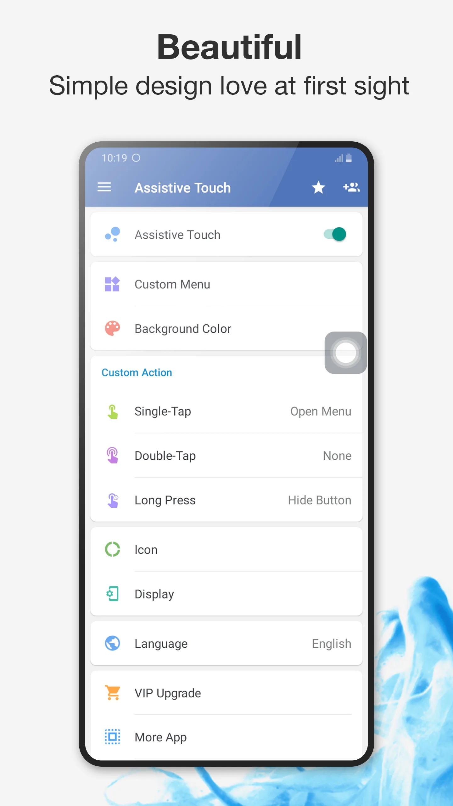

Keduanya menaruh kontrol di atas layar Anda, tapi menyelesaikan masalah berbeda. **Floating Assistant** adalah overlay 3-in-1 — assistive touch, jam melayang, dan monitor sistem langsung. **Assistive Touch** (Easy Touch) adalah bola navigasi melayang klasik. Perbandingan **Floating Assistant vs Assistive Touch** ini membantu Anda memilih aplikasi [widget melayang](/id/glossary/what-is-a-floating-window/) di 2026. Jika Anda datang mencari **alternatif Assistive Touch** dengan lebih dari sekadar bola navigasi, baris overlay di bawah menyelesaikannya.

## Sekilas

Perbandingan Floating Assistant dan Assistive Touch terlihat dari cakupan overlay: Floating Assistant menggabungkan tiga alat dalam satu lapisan, sementara Assistive Touch hanya bola navigasi melayang. Floating Assistant adalah overlay Android 3-in-1 yang menyatukan assistive touch untuk navigasi, jam melayang dengan hitung mundur, dan monitor sistem langsung menampilkan suhu CPU, penggunaan, RAM, serta baterai dengan boost satu ketuk; inti gratisnya dapat diperluas dengan tema dan modul opsional. Assistive Touch (Easy Touch) adalah bola gaya iOS untuk tombol virtual home, back, recent, dan volume plus gestur kustom, gratis tetapi didukung iklan dan tanpa jam maupun monitor sistem. Keduanya berjalan di Android. Floating Assistant memakai Aksesibilitas hanya untuk kontrol dan tidak mengumpulkan data pribadi, sehingga lebih aman bagi pengguna yang peduli privasi; bola polos lebih ringan bila hanya butuh pengganti tombol keras.

| | Floating Assistant | Assistive Touch (Easy Touch) |
|---|---|---|
| **Inti** | 3-in-1: touch + jam melayang + monitor | Bola navigasi melayang |
| **Platform** | Android | Android |
| **Tombol assistive touch** | **Ya** | **Ya** |
| **Jam melayang** | **Ya** | Biasanya tidak |
| **Monitor melayang (CPU/RAM/baterai)** | **Ya, langsung** | Tidak |
| **Boost satu ketuk** | **Ya** | Bervariasi |
| **Tangkapan layar / senter** | **Ya** | Ya |
| **Kustomisasi** | Bola + modul, tema | Ukuran, warna, gestur |
| **Privasi** | Aksesibilitas hanya untuk kontrol; tanpa data pribadi | Didukung iklan |
| **Harga** | Inti gratis + buka kunci opsional | Gratis (didukung iklan) |
| **Terbaik untuk** | Kontrol + pemantauan all-in-one | Bola nav sederhana |

---

## Floating Assistant, secara detail

Floating Assistant membundel **tiga alat dalam satu overlay melayang** — assistive touch untuk navigasi, jam dengan hitung mundur, dan monitor sistem yang menampilkan suhu CPU, penggunaan, RAM, serta baterai secara langsung. Ketiganya tetap tampil di atas aplikasi lain, sehingga berguna saat layar penuh atau bermain game; tombol virtual home/back/recent/volume dilengkapi one-tap boost, kunci layar, tangkapan layar, senter, dan pintasan aplikasi sekaligus mengurangi keausan tombol fisik. Inti gratis tersedia, sementara tema dan modul ekstra berada di balik buka kunci opsional. Layanan aksesibilitas hanya dipakai untuk kontrol tersebut dan aplikasi tidak mengumpulkan data pribadi.

{: width="180" .normal }
{: width="180" .normal }
{: width="180" .normal }
{: width="180" .normal }
{: width="180" .normal }

Floating Assistant membundel tiga alat ke satu overlay: bola assistive touch untuk navigasi, jam melayang yang bisa dipertahankan di atas aplikasi lain, dan monitor sistem melayang menampilkan suhu CPU, penggunaan, RAM, dan baterai dengan boost satu ketuk.

### Keunggulan
- **Tiga alat dalam satu overlay** — Anda tak perlu aplikasi terpisah untuk tombol, jam, dan monitor.
- **Jam melayang** — waktu tetap terlihat di atas aplikasi atau game apa pun.
- **Monitor langsung** — suhu CPU, penggunaan, RAM, dan baterai langsung, ideal saat gaming atau mengisi daya.
- **Boost satu ketuk** — bebaskan RAM cepat saat ponsel stutter.
- **Tangkapan layar, senter, dan akses aplikasi cepat** dari bola.
- **Postur privasi** — menggunakan Aksesibilitas hanya untuk kontrol terdaftar dan tak mengumpulkan data pribadi atau sensitif.
- **Melindungi tombol fisik** di ponsel layar lebar.

### Kelemahan
- **Hanya Android** — tak ada versi iOS.
- **Overlay memakan sedikit ruang layar** bila jam + monitor menyala.
- **Tema/modul ekstra** berada di balik buka kunci opsional.
- Fitur lebih banyak berarti penyiapan sedikit lebih ramai daripada bola polos.

### Terbaik untuk
Pengguna mahir dan gamer yang ingin tombol *dan* jam *dan* statis sistem langsung dari satu lapisan melayang.

**Unduh Floating Assistant**
- [Google Play](https://play.google.com/store/apps/details?id=com.glgjing.floating.apps.assistive.touch.pro)

---

## Assistive Touch (Easy Touch), secara detail

Assistive Touch (Easy Touch) adalah **bola navigasi melayang** gaya iOS untuk Android yang menyediakan tombol virtual home, back, recent, dan volume, plus kunci layar, tangkapan layar, senter, pengalih Wi-Fi/Bluetooth/kecerahan, dan gestur kustom. Aplikasi ini mengganti atau melengkapi tombol fisik yang aus dan bisa disembunyikan kapan saja, tetapi tidak menyertakan jam melayang maupun monitor CPU/RAM/baterai serta tanpa boost satu ketuk di pengalaman inti. Gratis digunakan namun didukung iklan, dengan tema untuk mempersonalisasi bola; izinnya biasanya lebih luas daripada alat monitor-saja, jadi pertimbangkan bila privasi menjadi prioritas.

{: width="180" .normal }
{: width="180" .normal }
{: width="180" .normal }
{: width="180" .normal }
{: width="180" .normal }

Assistive Touch adalah bola melayang gaya iOS familiar untuk Android: tombol virtual home, back, recent, dan volume, plus kunci, tangkapan layar, senter, dan gestur kustom — cara paling sederhana mengganti tombol keras aus.

### Keunggulan
- **Bola melayang familiar** dengan kontrol virtual home/back/recent/volume.
- **Pengalih cepat** — Wi-Fi, Bluetooth, senter, kecerahan, dan mode suara.
- **Gestur kustom** (ketuk dua kali, tahan lama) untuk memicu aksi.
- **Tema** untuk mempersonalisasi tampilan bola.
- **Gratis digunakan**, mudah diaktifkan dan disembunyikan.
- Bagus untuk **melindungi tombol fisik** atau jangkauan satu tangan.

### Kelemahan
- **Didukung iklan**, yang bisa mengganggu.
- **Tanpa jam melayang** — hanya navigasi.
- **Tanpa monitor langsung** — tak ada bacaan CPU/RAM/baterai, tak ada kesadaran overheat.
- **Tanpa boost satu ketuk atau manajemen RAM** di pengalaman inti.
- **Caveat privasi** — aplikasi beriklan biasanya meminta izin lebih luas daripada alat monitor-saja.

### Terbaik untuk
Pengguna yang hanya ingin bola navigasi gaya iOS sederhana untuk mengganti atau melengkapi tombol keras.

**Unduh Assistive Touch (Easy Touch)**
- [Google Play](https://play.google.com/store/apps/details?id=com.easytouch.assistivetouch)

---

## Bagaimana mereka membandingkan di mana itu penting

### Cakupan overlay
Perbandingan Floating Assistant dan Assistive Touch terlihat jelas dari **cakupan overlay**: Floating Assistant menggabungkan tiga alat — assistive touch, jam melayang, dan monitor CPU/RAM/baterai langsung dengan boost satu ketuk — dalam satu lapisan, sedangkan Assistive Touch hanya bola navigasi dengan tombol virtual dan gestur. Jika yang Anda butuhkan hanya pengganti tombol fisik, bola polos lebih ringan dan didukung iklan; jika ingin statis sistem tetap terlihat saat gaming, Floating Assistant mencakup lebih banyak tanpa memasang tiga aplikasi. Yang terakhir juga memakai Aksesibilitas hanya untuk kontrol dan tidak mengumpulkan data pribadi.

### Pemantauan saat gaming
Ini jurang paling jelas. Monitor CPU/RAM/baterai langsung dan boost satu ketuk Floating Assistant membantu selama sesi panjang; Assistive Touch tak menawarkan visibilitas sistem sama sekali.

### Jam dan pandangan sekilas
Floating Assistant mempertahankan jam di atas aplikasi lain — praktis sebagai pendamping samping tempat tidur atau meja. Assistive Touch fokus pada kontrol dan menghilangkan jam.

### Privasi dan iklan
Floating Assistant memposisikan diri tak mengumpulkan data pribadi, dengan inti bebas iklan. Assistive Touch gratis tapi didukung iklan, yang patut dipertimbangkan bila Anda peduli privasi.

## Mana yang harus dipilih

Keputusan Floating Assistant atau Assistive Touch bergantung pada apakah Anda hanya ingin bola navigasi atau satu overlay yang melakukan lebih banyak. Floating Assistant menggabungkan **assistive touch, jam melayang, dan pemantauan sistem langsung** sehingga berguna untuk gaming serta ponsel tua dengan tombol aus; inti gratisnya dapat diperluas dengan tema dan modul opsional. Assistive Touch (Easy Touch) adalah bola navigasi gratis berbasis iklan yang cukup untuk mengganti tombol home/back/recent tanpa tambahan statis. Untuk pengemudi harian all-in-one, Floating Assistant mencakup lebih banyak pekerjaan tanpa memaksa Anda memasang dan membuka beberapa aplikasi terpisah.

- **Pilih Floating Assistant** bila Anda ingin satu overlay yang menangani navigasi, jam melayang, dan pemantauan sistem langsung (bagus untuk gaming dan ponsel tua).
- **Pilih Assistive Touch (Easy Touch)** bila hanya butuh bola navigasi melayang gratis sederhana untuk mengganti tombol keras.
- **Untuk pengemudi harian all-in-one**, Floating Assistant mencakup lebih banyak tanah tanpa memaksa Anda ke banyak aplikasi.

## Aplikasi tombol melayang lain yang patut dipertimbangkan

Pencarian **alternatif Assistive Touch** bergantung pada apa yang ingin dilakukan bola melayang tersebut. **Easy Touch** adalah padanan terdekat — bola navigasi gratis dengan menu tetap — dan Floating Assistant membangun di atasnya dengan dock tepi, slot remap, serta overlay jam dan monitor. **Floatify** berfokus pada gelembung notifikasi dan balasan cepat, bukan tombol sistem, sehingga menyelesaikan masalah yang berbeda dari jangkauan satu tangan. **Button Mapper** cocok bila yang ingin Anda petakan ulang adalah tombol volume atau daya fisik tanpa bola di layar; **Simple Control** menawarkan panel pengalih ringkas yang sudah tercakup widget pengalih sistem Floating Assistant dalam bola yang sama.

- Sebuah **alternatif Easy Touch** biasanya padanan terdekat dengan aplikasi di sini: bola navigasi gratis dengan menu tetap. Floating Assistant mempertahankan basis itu dan menambah dock tepi, slot remap, dan overlay ekstra.
- Sebuah **alternatif Floatify** tentang gelembung notifikasi dan balasan cepat bukan tombol sistem; menyelesaikan masalah berbeda dari jangkauan satu tangan.
- Sebuah **alternatif Button Mapper** cocok bagi yang ingin tombol volume atau daya fisik dipetakan ulang, bukan bola di layar sama sekali.
- Sebuah **alternatif Simple Control** menunjuk ke panel kontrol ringkas berisi pengalih; widget pengalih sistem Floating Assistant menutupinya dalam bola yang sama.

Untuk daftar pendek **alternatif Assistive Touch android terbaik**, pertanyaan penentu adalah: dapatkah setiap slot dipetakan ulang, apakah bola berlabuh di tepi mana pun, dan apakah izin overlay serta aksesibilitas dijelaskan jelas? Lapangan lengkap dibandingkan di [Alternatif Assistive Touch Terbaik di 2026](/id/posts/alternatives-to-assistive-touch/).

## Skenario khas

Lima skenario khas membedakan Floating Assistant dari Assistive Touch: navigasi tanpa tombol keras lewat bola assistive touch yang mengembalikan home/back/recent/kunci/tangkapan layar, waktu tetap terlihat lewat jam melayang di atas aplikasi apa pun, awasi panas gaming dengan monitor CPU/RAM/baterai langsung dan boost satu ketuk, satukan tiga alat dalam satu overlay alih-alih juggling aplikasi terpisah, dan jaga privasi karena Aksesibilitas hanya dipakai untuk kontrol terdaftar tanpa mengumpulkan data pribadi. Assistive Touch tetap lebih sederhana bila hanya bola navigasi yang Anda butuhkan, tetapi ia tidak menampilkan statis sistem sama sekali.

- **Navigasi tanpa tombol keras** — bola assistive touch Floating Assistant mengembalikan home/back/recent/kunci/tangkapan layar dalam jangkauan ibu jari, menyelamatkan tombol aus.
- **Waktu tetap terlihat** — jam melayangnya bertahan di atas aplikasi atau game apa pun, praktis sebagai pendamping samping tempat tidur atau meja.
- **Awasi panas saat gaming** — monitor CPU/RAM/baterai langsung dan boost satu ketuk membantu sesi panjang; Assistive Touch tak menampilkan apa pun.
- **Satu overlay, bukan tiga aplikasi** — touch, jam, dan monitor dalam satu lapisan melayang alih-alih juggling alat terpisah.
- **Privasi-utama** — Aksesibilitas hanya untuk kontrol terdaftar dan tak mengumpulkan data pribadi, berbeda dari bola beriklan.

## FAQ

**Floating Assistant atau Assistive Touch — mana yang harus saya pilih?**
{:.faq-q}

Ingin satu overlay berisi assistive touch + jam melayang + pemantauan sistem langsung → Floating Assistant; ingin bola navigasi gratis sederhana → Assistive Touch (Easy Touch).

**Apakah Floating Assistant menyertakan jam melayang?**
{:.faq-q}

Ya. Berbeda dari Assistive Touch, ia mempertahankan jam di atas aplikasi lain — berguna sebagai pandangan samping tempat tidur atau meja.

**Apakah Floating Assistant memantau CPU/RAM/baterai?**
{:.faq-q}

Ya, langsung. Ia menampilkan suhu/penggunaan CPU, RAM, dan baterai serta menawarkan boost satu ketuk; Assistive Touch tak punya monitor sistem.

**Apakah Floating Assistant gratis?**
{:.faq-q}

Ya. Overlay inti gratis; buka kunci opsional menambah tema dan modul lebih dalam.

## Istilah terkait

- [Apa Itu Assistive Touch?](/id/glossary/what-is-assistive-touch/)
- [Apa Itu Jendela Melayang?](/id/glossary/what-is-a-floating-window/)
