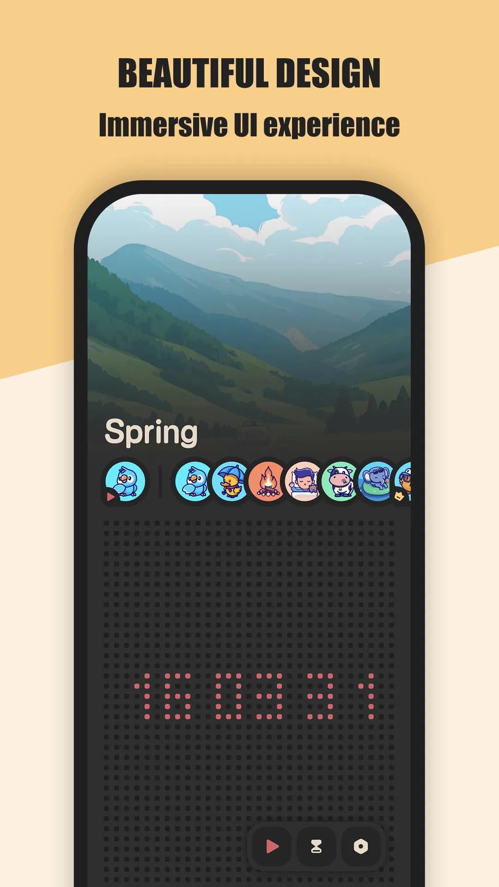

Keduanya membantu Anda tidur, tetapi alat berbeda. **Meow FM** adalah pemutar white-noise sederhana dan imut — hujan, laut, perapian, dan lainnya, dengan sleep timer. **Calm** adalah langganan kesejahteraan penuh dengan meditasi terpandu, cerita tidur, dan musik. Perbandingan **Meow FM vs Calm** ini membantu Anda memilih **aplikasi suara tidur** yang tepat di 2026, dengan harga nyata. Jika yang Anda inginkan sebenarnya adalah **alternatif Calm** atau **alternatif Headspace** tanpa langganan, baris harga di bawah yang menentukan sebagian besarnya.

## Sekilas pandang

Perbandingan Meow FM dan Calm terletak pada dua model yang berbeda: Meow FM adalah pemutar white-noise sederhana, sementara Calm adalah langganan kesejahteraan penuh. Meow FM adalah aplikasi white noise gratis untuk Android dan iOS dengan adegan hujan, badai petir, hutan, tepi laut, dan perapian, sleep timer auto-stop, jam meja, tanpa akun, dan pemutaran offline; suara tambahan dibuka sekali bayar tanpa langganan. Calm menyediakan meditasi terpandu, cerita tidur yang diceritakan selebritas, musik, dan program terstruktur lintas Android, iOS, dan web, dengan biaya sekitar $69,99 per tahun serta akun wajib. Keduanya mencakup Android dan iOS, tetapi Calm menambah web. Untuk tidur atau fokus dengan suara ambient, Meow FM sudah cukup dan lebih murah; Calm hanya perlu dipilih bila Anda benar-benar menginginkan konten terpandu dan bersedia membayar langganan tahunan.

| | Meow FM | Calm |
|---|---|---|
| **Core** | White noise and ambient sounds | Meditation, sleep stories, music |
| **Platforms** | Android, iOS | Android, iOS, web |
| **Price** | Free core + optional unlock | ~$69.99/yr subscription |
| **Sound library** | Curated ambient (rain, sea, fireplace…) | Large (ambient + music + stories) |
| **Sound mixing** | Curated scenes | Mixing in premium tiers |
| **Sleep timer** | **Yes (auto-stop)** | Yes |
| **Guided meditation** | No | **Yes (large library)** |
| **Sleep stories** | No | **Yes (celebrity-narrated)** |
| **Focus / work mode** | Yes (clock) | Yes |
| **Account needed** | **No** | Yes (subscription) |
| **Style** | Cute cat theme | Calm, premium |
| **Best for** | Simple soundscapes to sleep/focus | Guided programs + stories |

---

## Meow FM, secara rinci

Meow FM adalah **aplikasi [white noise](/id/glossary/what-is-white-noise/) untuk tidur, relaksasi, dan fokus** di Android dan iOS dengan adegan hujan, badai petir, angin, hutan, tepi laut, dan perapian yang bisa dipadukan dengan sleep timer auto-stop. Antarmukanya bertema kucing dengan jam meja, mode gelap dan terang, serta sampul khusus tiap suara, sehingga berfungsi ganda sebagai pendamping samping tempat tidur. Tanpa akun dan bisa diputar offline; inti gratis dengan pembelian sekali bayar untuk suara premium, tanpa langganan. Pustakanya lebih kecil daripada layanan berlangganan dan tidak menyediakan meditasi terpandu maupun cerita tidur.

{: width="180" .normal }
{: width="180" .normal }
{: width="180" .normal }
{: width="180" .normal }
{: width="180" .normal }

Meow FM adalah **aplikasi [white noise](/id/glossary/what-is-white-noise/) untuk tidur, relaksasi, dan fokus**. Pilih adegan — hujan, badai petir, hutan, tepi laut, perapian — tambahkan sleep timer, dan biarkan diputar. Antarmukanya nyaman dan bertema kucing, dengan jam desktop sehingga berfungsi ganda sebagai pendamping samping tempat tidur.

### Keunggulan
- **Curated ambient sounds** for sleep, relax and focus — rain, thunderstorm, wind, forest, seaside, fireplace and more.
- **Sleep timer with auto-stop** so sound cuts off after you drift off.
- **Desktop clock** to stay efficient while you work or study.
- **No account required** — open it and play; nothing is uploaded.
- **Cute, calming Meow-styled design** that feels comforting rather than clinical.
- **Free core** with a one-time sound unlock (no subscription pressure).
- **Dark and light mode** with beautiful covers for each sound.

### Kelemahan
- **Smaller library** than a subscription service like Calm.
- **No guided meditation or sleep stories** — pure ambient only.
- **Premium sounds** require a purchase (no subscription, but not all-free).
- **No web player** — phone/tablet only.
- Less "structured program" if you want a daily wellness routine.

### Paling cocok untuk
Orang yang menginginkan suara ambient cantik dan sederhana untuk terlelap atau fokus — tanpa pelajaran, tanpa akun, tanpa tagihan bulanan.

**Unduh Meow FM**
- [Google Play](https://play.google.com/store/apps/details?id=com.glgjing.whitenoise.relax.night.sleep.meow)
- [App Store](https://apps.apple.com/us/app/meow-fm-white-noise/id1606715188)

---

## Calm, secara rinci

Calm adalah platform kesejahteraan terkemuka di Android, iOS, dan web dengan **meditasi terpandu, cerita tidur yang diceritakan selebritas, latihan pernapasan, serta pustaka musik dan suara besar**, disinkronkan lintas perangkat. Berbeda dengan pemutar noise lokal, Calm menjual konten dan program terstruktur untuk tidur, stres, dan fokus, lengkap dengan prompt dan pencarian. Aksen utamanya adalah langganan **sekitar $69,99/tahun** dan akun wajib karena layanan berbasis cloud; sebagian besar konten terbaik berada di balik bayar. Calm cocok untuk rutinitas kesejahteraan harian, bukan untuk sekadar memutar suara hujan saat tertidur.

{: width="180" .normal }
{: width="180" .normal }
{: width="180" .normal }
{: width="180" .normal }

Calm adalah salah satu aplikasi mindfulness paling dikenal: meditasi terpandu, cerita tidur yang diceritakan selebritas, latihan pernapasan, dan pustaka musik serta suara besar. Ini platform kesejahteraan, bukan sekadar pemutar noise.

### Keunggulan
- **Huge guided-meditation library** for sleep, stress, focus and anxiety.
- **Celebrity-narrated sleep stories** — a signature feature many love.
- **Breathing and relaxation exercises** with a polished, premium feel.
- **Music and soundscapes** alongside meditations.
- **Cross-platform** — Android, iOS and web, with progress synced.
- **Structured programs** if you want a daily habit, not just background noise.

### Kelemahan
- **Expensive subscription** (~$69.99/year) for the full library.
- **Account required** — it's a cloud service, not local playback.
- **Overwhelming** if you only wanted rain noise to sleep.
- **Less about pure ambient mixing** — the strength is content, not sound design.
- **Best content is paywalled**, so free users see limited scope.

### Paling cocok untuk
Pengguna yang menginginkan meditasi terpandu, cerita tidur, dan rutinitas kesejahteraan terstruktur — serta nyaman dengan langganan berbayar.

**Unduh Calm**
- [Google Play](https://play.google.com/store/apps/details?id=com.calm.android)
- [App Store](https://apps.apple.com/us/app/calm-sleep-meditation/id571800810)

---

## Bagaimana mereka dibandingkan di hal penting

### Model konten
Perbandingan Meow FM dan Calm pada model konten membedakan **pemutar suara** dari **platform program**: Meow FM memutar adegan ambient dengan sleep timer tanpa akun maupun biaya bulanan, sementara Calm menyediakan meditasi terpandu, cerita tidur, musik, dan program terstruktur dengan langganan **~$69,99/tahun**. Jika yang Anda cari adalah *panduan*, Calm jauh lebih luas; jika yang Anda butuhkan hanya *noise* untuk menutup kebisingan, Meow FM sudah cukup dan bisa dipakai offline. Meow FM unggul pada friksi rendah dan pembayaran sekali untuk suara ekstra; Calm unggul pada kedalaman konten, dengan konsekuensi akun cloud dan komitmen berulang.

### Harga dan komitmen
Meow FM gratis untuk memulai dengan buka suara sekali bayar dan tanpa langganan. Calm adalah komitmen berulang ~$69,99/tahun. Untuk bantuan tidur ambient murni, Meow FM adalah pilihan lebih murah dan berfriksi rendah.

### Kesederhanaan vs kedalaman
Meow FM langsung membuka ke suara — tanpa akun, tanpa onboarding. Calm meminta Anda memilih tujuan dan masuk. Itu fitur bagi sebagian, friksi bagi lainnya.

### Platform
Keduanya mencakup Android dan iOS. Calm menambah web; Meow FM tetap di mobile. Kekuatan keduanya bukan pemutaran desktop.

## Mana yang harus Anda pilih

Keputusan Meow FM atau Calm bergantung pada apakah Anda ingin suara ambient sederhana atau program kesejahteraan lengkap. Pilih Meow FM bila ingin tidur atau fokus dengan hujan, laut, atau perapian, tanpa akun, tanpa langganan, dan dengan pengatur waktu yang mati otomatis; inti gratisnya langsung bisa diputar secara offline. Pilih Calm bila Anda menginginkan meditasi terpandu, cerita tidur, dan rutinitas terstruktur serta bersedia membayar **~$69,99/tahun** dan masuk akun. Banyak orang memadukan keduanya — Meow FM untuk noise setiap malam, Calm untuk meditasi sesekali — tetapi bila anggaran terbatas, Meow FM sudah menutup kebutuhan suara tidur.

- **Choose Meow FM** if you just want calming ambient sound to fall asleep or focus, prefer no account and no subscription, and like a cute, simple interface.
- **Choose Calm** if you want guided meditations, sleep stories and a structured wellness program and will use a paid subscription.
- **Best of both**: many people use Meow FM nightly for pure noise and keep Calm for the occasional meditation — but if budget matters, Meow FM covers the sleep-sound job on its own.

## Aplikasi suara lain yang patut dipertimbangkan

Pencarian **alternatif Calm** tidak hanya berhenti pada Meow FM, karena pengganti yang tepat bergantung pada apa yang sebenarnya Anda bayar. **Alternatif Headspace** biasanya soal konten terpandu — meditasi, latihan napas, dan cerita tidur; pemutar suara polos akan terasa kurang bila itulah yang Anda pakai. **Alternatif Noisli** atau **alternatif myNoise** adalah noise yang bisa dicampur dan dikode warna, menumpuk hujan, angin, dan brown noise; Meow FM menutup bagian pencampuran dengan lapisan di perangkat. **Alternatif Brain.fm** menjanjikan suara yang dirancang untuk kondisi kognitif tertentu, klaim yang berbeda dari sekadar menutup kebisingan lalu lintas. **Alternatif BetterSleep** muncul bila Anda ingin penyusun rutinitas tidur dengan pelacakan, bukan sekadar timer.

- A **Headspace alternative** is usually about guided content — meditations, breathing exercises, sleep stories. If that is the part you use, a plain sound player will feel like a downgrade.
- A **Noisli alternative** or **myNoise alternative** is about mixable, colour-coded noise: stacking rain, wind and brown noise, or dialing in a specific frequency. Meow FM covers the mixing part with on-device layers.
- A **Brain.fm alternative** fits people who want sound designed for a cognitive state rather than a natural soundscape; that is a different claim from masking traffic.
- A **BetterSleep alternative** is the search when you want a bedtime routine builder with sounds plus tracking, not just a timer.

The full field is compared in [Best Calm Alternatives in 2026](/id/posts/alternatives-to-calm/).

## Skenario umum

Empat skenario umum memperlihatkan kapan Meow FM lebih praktis dan kapan Calm dibutuhkan: tidur di malam bising memakai hujan atau badai Meow FM plus timer **60 menit** yang mati sendiri, menutup kebisingan kantor dengan perapian atau tepi laut yang diputar offline di belakang jam meja, menghindari akun dan tagihan bulanan karena Meow FM langsung membuka suara, atau menambah meditasi terpandu bila Anda memang menginginkan cerita tidur dan program. Calm lebih luas untuk konten dan kenangan, tetapi Meow FM lebih ringan untuk pemakaian noise harian.

- **Fall asleep on a noisy night** — Meow FM's rain or storm plus a 60-minute timer masks a snoring partner and switches off on its own; Calm needs a subscription just to run its sleep stories.
- **Block office noise for focus** — Meow FM's fireplace or seaside runs offline behind a desktop clock; Calm's focus music costs the annual plan.
- **No account, no monthly bill** — Meow FM opens straight to sound; Calm asks you to sign in and pay before most content unlocks.
- **Want guided meditation too** — if you also want sleep stories and programs, Calm is broader; many keep Meow FM just for nightly noise.

## FAQ

**Meow FM atau Calm — mana yang harus saya pilih?**
{:.faq-q}

Ingin noise ambient gratis, offline, tanpa akun dengan pengatur waktu mandiri-berhenti → Meow FM; ingin meditasi terpandu, cerita tidur, dan program terstruktur → Calm (terima langganan ~$69,99/tahun).

**Apakah Meow FM gratis?**
{:.faq-q}

Ya. Adegan ambient inti gratis; adegan ekstra dibuka via pembelian sekali bayar, tanpa langganan.

**Apakah Meow FM bekerja offline?**
{:.faq-q}

Ya. Setiap suara diputar tanpa internet, sehingga Anda bisa tidur atau fokus di pesawat, tenda, atau mana pun Wi-Fi putus.

**Apakah Meow FM benar-benar privat?**
{:.faq-q}

Ya — tanpa akun diperlukan dan tak ada yang diunggah; Anda cukup menekan putar.

## Istilah terkait

- [Apa Itu White Noise?](/id/glossary/what-is-white-noise/)
