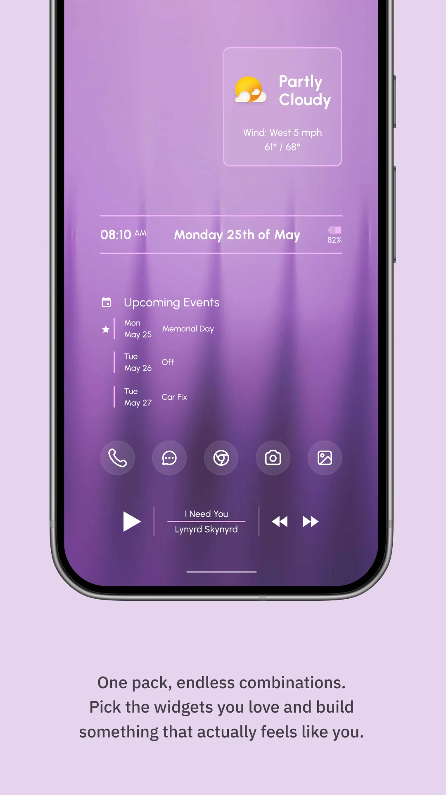

Keduanya mengustomisasi layar utama Anda, tapi dengan cara berbeda. **One Widget** menyediakan 500+ widget jadi yang lagi tren, tinggal ubah ukuran dan taruh. **KWGT** (Kustom Widget Maker) adalah editor dari nol tempat Anda membangun widget apa pun yang bisa dibayangkan. Perbandingan **One Widget vs KWGT** ini membantu Anda memilih **[aplikasi widget Android](/id/glossary/what-is-a-home-screen-widget/)** yang tepat di 2026. Jika Anda datang mencari **alternatif KWGT** yang menghindari editor, baris setelan di bawah adalah keputusan utuhnya.

## Sekilas

Perbandingan One Widget dan KWGT adalah soal kecepatan versus kendali: One Widget memakai 500+ widget jadi, sementara KWGT adalah editor dari nol. One Widget adalah toolkit layar utama Android dengan 500+ preset dalam empat gaya — One UI, Nothing, Glass, dan Material You — yang bisa diubah ukurannya dari 1x1 hingga 2x6, lengkap dengan quick toggle Wi-Fi, Bluetooth, senter, dan shortcut aplikasi; set One UI gratis, tiga gaya lain dibuka sekali bayar. KWGT adalah pembangun widget paling powerful di Android yang membiarkan Anda mengikat teks, bentuk, dan data langsung seperti cuaca serta metadata musik ke formula sendiri, gratis untuk dibangun dengan Pro key sekitar $4,99 untuk ekspor penuh. Keduanya hanya Android dan tanpa langganan berat. Pilih One Widget bila menghargai waktu, KWGT bila menginginkan keunikan dan bersedia belajar.

| | One Widget | KWGT (Kustom) |
|---|---|---|
| **Pendekatan** | 500+ widget jadi | Editor dari nol |
| **Gaya** | One UI, Nothing, Glass, Material You | Apa pun (Anda rancang) |
| **Kurva belajar** | **Rendah** | **Tinggi** |
| **Ikatan data langsung** | Widget preset | **Penuh (cuaca, musik, formula)** |
| **Kustomisasi** | Ukuran, warna, radius sudut | Total (setiap elemen) |
| **Ekspor / bagikan** | Terbatas | **Penuh (dengan Pro)** |
| **Quick toggle / shortcut** | **Ya (Wi-Fi, BT, senter, aplikasi)** | Mungkin (dengan setelan) |
| **Harga** | One UI gratis + buka kunci sekali bayar | Gratis + Pro key (~$4,99) |
| **Platform** | Android | Android |
| **Terbaik untuk** | Tema cepat & kohesif | Desain kustom unik |

---

## One Widget, secara rinci

One Widget adalah **toolkit layar utama Android serba ada** yang memuat lebih dari **500 widget jadi** dalam **empat gaya populer** — Glass iOS, Material You, Galaxy One UI, dan Nothing minimalis — dengan **8 kategori fungsional** mulai dari pintasan aplikasi dan sakelar cepat hingga jam, info hardware, dan alat mini. Ukuran bisa diatur dari **1x1 hingga 2x6**, termasuk warna latar ikon dan radius sudut, tanpa kurva belajar berat. Set One UI gratis; tiga keluarga gaya lain dibuka dengan pembelian sekali bayar. Widgetnya dikurasi, jadi kustomisasi terjadi di dalam preset, bukan pada kanvas kosong.

{: width="180" .normal }
{: width="180" .normal }
{: width="180" .normal }
{: width="180" .normal }
{: width="180" .normal }

One Widget adalah **toolkit layar utama Android serba ada** yang memuat 500+ widget premium dalam empat gaya tren: Glass iOS, Material You, Galaxy One UI, dan Nothing minimalis. Anda pilih widget jadi, ubah ukurannya, dan selesai.

### Keunggulan
- **500+ widget jadi** — tanpa editor, tanpa keahlian desain; ketuk dan taruh.
- **Empat gaya populer** — Glass, Material You, Galaxy One UI, Nothing — mencakup sebagian besar selera estetika.
- **8 kategori fungsional**: shortcut aplikasi, quick toggle sistem (Wi-Fi, Bluetooth, senter…), info hardware perangkat (baterai, RAM, storage), jam/kalender, catatan/kutipan, kontak, peluncur aplikasi agregat (Google/AI/sosial), dan mini alat (kompas, pedometer, kalkulator).
- **Kustomisasi ukuran penuh** (1x1 hingga 2x6), warna latar ikon, dan radius sudut agar cocok dengan tema Anda.
- **Quick toggle dan shortcut aplikasi** sebagai widget layar utama — sungguh berguna, bukan sekadar dekoratif.
- **Kurva belajar rendah** — ideal untuk non-desainer yang ingin desktop rapi dengan cepat.
- **Set One UI gratis**; gaya lain dibuka dengan pembelian sekali bayar.

### Kelemahan
- **Hanya Android** — tidak ada versi iOS.
- **Terikat preset** — Anda kustomisasi dalam desain jadi, bukan kanvas kosong.
- **Kedalaman data langsung terbatas** — widget dikurasi; Anda tidak bisa mengikat formula arbitrer atau sumber data eksotis.
- **Ekspor/berbagi terbatas** dibanding builder sejati.
- Keluarga gaya lain butuh pembelian (One UI gratis).

### Terbaik untuk
Pengguna yang ingin layar utama kohesif dan cantik dengan cepat tanpa mempelajari alat desain.

**Unduh One Widget**
- [Google Play](https://play.google.com/store/apps/details?id=com.glgjing.galaxy.nothing.glass.material.widget)

---

## KWGT, secara rinci

KWGT (Kustom Widget Maker) adalah **pembangun widget paling powerful di Android** yang membiarkan Anda menaruh teks, bentuk, gambar, dan titik data lalu mengikatnya ke sumber langsung — cuaca, musik, baterai, atau formula sendiri — untuk membuat widget sepenuhnya orisinal. Setiap elemen, mulai posisi, ukuran, font, warna, hingga layer, bisa Anda tentukan, dengan dukungan komunitas besar berisi preset dan tutorial. KWGT gratis untuk membangun dan menguji; **Pro key sekitar $4,99** menghapus watermark serta membuka ekspor dan berbagi penuh. Kurva belajarnya tinggi dan hasilnya bergantung pada waktu serta keahlian Anda.

{: width="180" .normal }
{: width="180" .normal }
{: width="180" .normal }
{: width="180" .normal }
{: width="180" .normal }

KWGT (Kustom Widget Maker) adalah pembangun widget paling powerful di Android. Anda menaruh teks, bentuk, gambar, dan titik data, lalu mengikatnya ke sumber langsung — cuaca, musik, baterai, atau formula Anda sendiri — untuk membuat widget yang sepenuhnya orisinal.

### Keunggulan
- **Kustomisasi tak terbatas** — setiap elemen (posisi, ukuran, font, warna, layer) bisa Anda tentukan.
- **Ikatan data langsung penuh** — cuaca, musik, statistik sistem, dan formula kustom via bahasa ekspresi Kustom.
- **Tata letak kustom** — rekreasi tampilan apa pun (atau ciptakan sendiri) hingga piksel.
- **Komunitas besar** dengan preset dan tutorial dibagikan.
- **Pro key (~$4,99)** menghapus watermark dan membuka ekspor/berbagi penuh.
- **Gratis digunakan** di inti untuk membangun dan menguji.

### Kelemahan
- **Kurva belajar tinggi** — menaruh dan mengikat elemen butuh upaya nyata; bukan untuk pengguna kasual.
- **Investasi waktu** — widget hebat bisa memakan jam, bandingkan detiknya One Widget.
- **Hanya Android**, tidak ada iOS.
- **Watermark dan ekspor terbatas** hingga Anda membeli Pro key.
- Bisa terasa membebani jika Anda "hanya ingin widget jam yang bagus".

### Terbaik untuk
Desainer dan pengutak-atik yang ingin layar utama sekehendak hati dan suka membangunnya sendiri.

**Unduh KWGT**
- [Google Play](https://play.google.com/store/apps/details?id=org.kustom.widget)

---

## Bagaimana keduanya membandingkan di hal yang penting

### Kecepatan vs kendali
Perbandingan One Widget dan KWGT pada kecepatan versus kendali sederhana: One Widget menang pada waktu-menuju-rapi — pilih salah satu dari **500+ widget jadi**, ubah ukuran, selesai dalam hitungan menit — sedangkan KWGT menang pada kendali karena kanvas kosong memungkinkan Anda mendikte setiap piksel dan sumber data. Widget One Widget dikurasi dalam empat gaya sehingga hasilnya kohesif, sementara hasil KWGT bergantung sepenuhnya pada keahlian perancangnya. Harganya ringan di kedua sisi: One Widget gratis untuk One UI dengan buka kunci sekali bayar, KWGT gratis untuk dibangun dengan **Pro key ~$4,99**. Pilih yang pertama bila menghargai waktu, yang kedua bila menginginkan keunikan.

### Data langsung
Keduanya bisa menampilkan info langsung, tapi kedalamannya berbeda. Widget One Widget dikurasi (jam, baterai, RAM, toggle). KWGT membiarkan Anda mengikat *data apa pun* — formula cuaca, metadata musik yang sedang diputar, perhitungan kustom — ke dalam tata letak kustom. Untuk data eksotis, KWGT tak tertandingi.

### Estetika
One Widget menjamin tampilan kohesif dan tren (Glass/One UI/Nothing/Material You) karena profesional yang merancang preset-nya. Hasil KWGT sepenuhnya bergantung pada keahlian Anda — luar biasa atau amatir.

### Harga
One Widget gratis untuk One UI dengan buka kunci sekali bayar untuk keluarga lain. KWGT gratis untuk dibangun, dengan Pro key ~$4,99 untuk penghapusan watermark dan ekspor. Keduanya wajar; tak ada yang berat langganan.

## Mana yang harus Anda pilih

Keputusan One Widget atau KWGT bergantung pada apakah Anda ingin layar utama rapi dengan cepat atau bersedia membangun widget sendiri. Pilih One Widget jika menginginkan hasil kohesif dalam menit dari **500+ preset** dalam empat gaya, tanpa alat desain, dengan ukuran **1x1 hingga 2x6** yang bisa disesuaikan. Pilih KWGT jika menginginkan kendali kreatif penuh, ikatan data langsung berupa formula cuaca dan metadata musik, serta tidak keberatan belajar dan meluangkan waktu; **Pro key ~$4,99** membuka ekspor penuh. Banyak pengguna Android menyimpan keduanya: One Widget untuk widget sehari-hari, KWGT untuk desain benar-benar kustom.

- **Pilih One Widget** jika Anda ingin layar utama rapi dan kohesif dalam menit serta lebih suka gaya kurasi daripada alat desain.
- **Pilih KWGT** jika Anda ingin kendali kreatif penuh, formula data langsung, dan tak keberatan belajar (serta meluangkan waktu) membangun widget unik.
- **Banyak pengguna Android menyimpan keduanya**: One Widget untuk widget sehari-hari yang cepat, dan KWGT saat mereka ingin sesuatu yang benar-benar kustom.

## Pembuat widget lain yang layak dipertimbangkan

Pembuat widget lain yang layak dipertimbangkan bergantung pada apa yang ingin Anda bangun. **Alternatif Kustom Widget Maker** biasanya ditujukan orang yang menyukai kekuatan KWGT tetapi bukan editornya: preset jadi yang diubah ukurannya, bukan layer yang digambar sendiri — One Widget adalah jalan pintas di sini. **Alternatif Chronus** umumnya soal widget jam, kalender, dan berita andal dengan banyak opsi tipografi; bila itu saja yang dibutuhkan, paket serbaguna bisa berlebihan. **Alternatif Widgetopia** atau **alternatif Zooper Widget** muncul saat Anda menginginkan pustaka preset besar daripada alat scripting, alasan yang sama mengapa daftar **alternatif KWGT terbaik Android** cenderung memasukkan paket jadi. **Alternatif Widgetsmith** cocok untuk tata letak gaya iOS; preset Glass One Widget menutupnya di Android. Bidang lengkap di [Alternatif WidgetSmith Terbaik di 2026](/id/posts/alternatives-to-widgetsmith/).

- Sebuah **alternatif Kustom Widget Maker** untuk orang yang menyukai kekuatan KWGT tapi tidak editornya: preset jadi yang Anda ubah ukuran, bukan layer yang Anda gambar. One Widget adalah jalan pintas di sini.
- Sebuah **alternatif Chronus** biasanya soal widget jam/kalender/berita yang andal dengan banyak opsi tipografi; jika itu semua yang Anda butuhkan, paket serbaguna mungkin lebih dari yang Anda mau.
- Sebuah **alternatif Widgetopia** atau **alternatif Zooper Widget** adalah pencarian saat Anda menginginkan pustaka preset besar daripada alat scripting — alasan sama mengapa daftar pendek **alternatif KWGT terbaik Android** cenderung menyertakan paket jadi.
- Sebuah **alternatif Widgetsmith** cocok untuk tata letak gaya iOS; di Android, preset Glass One Widget menutupi tampilan itu tanpa aplikasi khusus iPhone.

Bidang lengkap dibandingkan di [Alternatif WidgetSmith Terbaik di 2026](/id/posts/alternatives-to-widgetsmith/).

## Skenario umum

Lima skenario umum memperlihatkan kapan tiap pendekatan paling pas: layar utama rapi malam ini memakai **500+ widget jadi** One Widget yang tinggal dipilih dan diubah ukurannya; membangun dari nol lewat editor dan Kode KWGT untuk mengikat cuaca serta formula kustom; kebutuhan sekadar sakelar cepat Wi-Fi/Bluetooth/senter dan pintasan aplikasi tanpa scripting lewat One Widget; data langsung eksotis seperti now-playing dan statistik kustom lewat ikatan penuh KWGT; atau menyimpan keduanya agar widget harian tetap cepat sementara desain kustom tetap mungkin.

- **Anda ingin layar utama rapi malam ini** — 500+ widget jadi One Widget berarti pilih, ubah ukuran, selesai; KWGT butuh sesi membangun dulu.
- **Anda suka membangun dari nol** — editor dan Kode KWGT membiarkan Anda mengikat cuaca, musik, dan formula kustom ke widget sekehendak hati.
- **Anda hanya butuh quick toggle** — One Widget menyediakan Wi-Fi/Bluetooth/senter dan shortcut aplikasi sebagai widget; tanpa scripting.
- **Anda ingin data langsung eksotis** — ikatan data penuh KWGT tak tertandingi untuk now-playing, formula cuaca, dan statistik kustom.
- **Simpan keduanya** — banyak pengguna Android menjalankan One Widget untuk widget sehari-hari dan KWGT saat mereka ingin sesuatu yang benar-benar kustom.

## FAQ

**One Widget atau KWGT — mana yang harus saya pilih?**
{:.faq-q}

Ingin layar utama kohesif dan rapi dalam menit, tanpa editor → One Widget; ingin kendali kreatif penuh dengan formula data langsung dan tak keberatan kurva belajar → KWGT.

**Apakah One Widget gratis?**
{:.faq-q}

Set gaya One UI gratis; tiga gaya lain dibuka dengan pembelian sekali bayar (tanpa langganan).

**Apakah One Widget bekerja di iOS?**
{:.faq-q}

Tidak. One Widget hanya Android; KWGT juga hanya Android. Untuk iOS, lihat WidgetSmith.

**Apakah KWGT bebas langganan?**
{:.faq-q}

KWGT gratis untuk dibangun dan diuji; Pro key sekali bayar ~$4,99 menghapus watermark dan membuka ekspor penuh. Tanpa langganan.

## Istilah terkait

- [Apa Itu Widget Layar Utama?](/id/glossary/what-is-a-home-screen-widget/)
- [Apa Itu Material You?](/id/glossary/what-is-material-you/)
- [Apa Itu Nothing UI?](/id/glossary/what-is-nothing-ui/)
- [Apa Itu Galaxy One UI?](/id/glossary/what-is-galaxy-one-ui/)
- [Apa Itu iOS Glass?](/id/glossary/what-is-ios-glass/)
