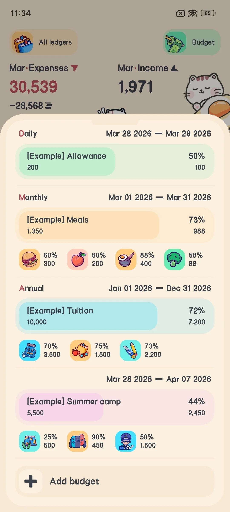
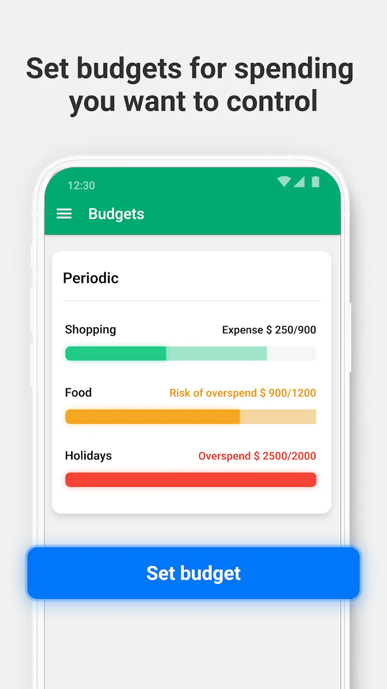
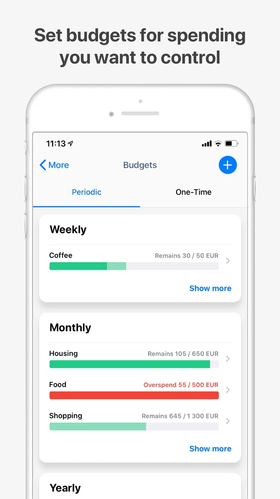

Kebanyakan artikel "perbandingan fitur anggaran" berhenti di level "ada anggaran kategori, ada grafik, ada pengingat". Padahal yang sebenarnya menentukan apakah sebuah **aplikasi catatan keuangan** enak dipakai adalah tiga pertanyaan lebih mendasar: **objek anggarannya apa**, **di mana batas periodenya dipotong**, dan **ke mana uang yang tak terpakai pergi**. Ambil "anggaran makan Rp2.000.000": di YNAB itu saldo kategori yang terus menumpuk; di Goodbudget itu saldo amplop yang jalan terus; di Meow Money Manager itu jendela waktu yang bergeser mengikuti tanggal — dan ketiganya mendefinisikan "overbudget" secara sangat berbeda.

Artikel ini hanya membahas fitur anggaran. Kami bedah mekanisme anggaran **7 aplikasi populer**: **YNAB**, **Monarch Money**, **Goodbudget**, **EveryDollar**, **PocketGuard**, **Wallet by BudgetBakers**, dan **Meow Money Manager**.

> Cakupan bacaan: artikel ini murni analisis mendalam fitur **anggaran**. Fitur lain aplikasi pencatat keuangan (sinkron bank, laporan, manajemen tagihan, multi mata uang, dll.) tidak dibandingkan di sini.

Kalau tertarik juga dengan perbandingan fitur secara keseluruhan, baca: [Meow Money Manager vs YNAB: Mana Aplikasi Anggaran yang Cocok untuk Anda?](/id/posts/vs-meow-money-and-ynab/), [Alternatif Mint Terbaik 2026](/id/posts/alternatives-to-mint/), dan [Aplikasi Budget & Expense Tracker Terbaik untuk Android (2026)](/id/posts/pillar-budget-expense-tracker-apps-android/).

## Sekilas: cek cepat mekanisme anggaran 7 aplikasi

| Aplikasi | Objek anggaran | Model periode | Rollover | Pengeluaran non-bulanan | Rumus inti |
|---|---|---|---|---|---|
| **Meow Money Manager** | Satu anggaran (total, atau per kategori) | Hari / minggu / bulan / tahun / kustom, **jendela bergulir** | Tidak ada, jendela dihitung ulang tiap hari | Tanggal mulai–selesai kustom | Budget harian = sisa ÷ sisa hari (0 bila overbudget) |
| **YNAB** | Kategori + Target | Bulan kalender | Saldo positif rollover; negatif di-nol-kan & ditangani terpisah | Yearly / Weekly / Custom Target | Pendapatan − dialokasikan = Ready to Assign |
| **Monarch Money** | Anggaran kategori atau bucket Fixed / Non-monthly / Flex | Bulan kalender | Surplus dan defisit **sama-sama rollover** | Bucket Non-monthly: target + frekuensi | Rollover lalu + rencana ini − realisasi ini = rollover berikut |
| **Goodbudget** | Amplop (Regular / Annual / Goal) | Minggu / setengah bulan / bulan dst. | Saldo berjalan, ditentukan cara isi | Amplop Annual / Goal + tanggal jatuh tempo | (Target − diisi) ÷ periode sebelum jatuh tempo |
| **EveryDollar** | Kategori & line item | Bulan kalender, dibangun ulang tiap bulan | Tanpa rollover, mulai dari nol tiap bulan | Sinking funds | Pendapatan − pengeluaran = 0 |
| **PocketGuard** | Anggaran kategori | Bulan kalender | Sisa ditambah ke bulan depan, defisit dikurangi | Target & rencana pelunasan utang | In My Pocket = pendapatan − tagihan − kebutuhan − target |
| **Wallet** | Anggaran per kategori / akun / tag | Minggu / bulan / tahun / kustom; berulang atau sekali pakai | Jumlah tak terpakai rollover | Anggaran berulang + pembayaran terjadwal | Sisa = anggaran − terpakai; plus prediksi pengeluaran |

Pembagian paling jelas: **YNAB, EveryDollar, Goodbudget adalah anggaran tipe "alokasi"** (masukkan uang ke kotak, lalu belanja); **Monarch, PocketGuard, Wallet adalah anggaran tipe "rencana"** (tetapkan batas atas, lalu bandingkan dengan realisasi); **Meow Money Manager adalah anggaran tipe "batas"** (beri jendela waktu dan pagu, terus laporkan sisa dan berapa yang bisa dibelanjakan per hari). Tak ada yang lebih baik — masing-masing cocok untuk situasi beda.

---

## Bangun dulu kerangka evaluasinya: enam perbedaan teknis fitur anggaran

### 1. Objek anggaran: saldo akun atau batas pengeluaran

YNAB dan Monarch secara eksplisit memposisikan diri sebagai **anggaran arus kas**, bukan anggaran saldo akun. Dokumentasi bantuan Monarch terang-terangan: anggaran dibangun dari pendapatan bulan ini yang diharapkan, di mana pendapatan dikurangi pengeluaran dan tabungan membentuk persamaan `pendapatan = pengeluaran + tabungan`; saldo akun dipakai untuk tujuan jangka panjang, bukan keputusan belanja harian. YNAB menempatkan **Ready to Assign** di puncak rencana, dan total Available tiap kategori harus bisa dijelaskan oleh uang itu.

Meow Money Manager mengambil jalan sebaliknya: tak ada aksi "alokasi" dan tak perlu memasukkan pendapatan yang diharapkan. Satu anggaran adalah "dalam jendela waktu ini, grup pengeluaran ini paling banyak boleh habis segini" — anggaran total memberi satu pagu, anggaran kategori memberi pagu tiap kategori, dan jumlah terpakai diperbarui live saat Anda mencatat. Artinya ia **tak mewajibkan Anda merencanakan pendapatan dulu**, tapi juga tak bisa menjawab "berapa yang masih bisa dialokasikan ke tabungan bulan ini."

### 2. Batas periode: bulan kalender, periode anggaran, atau jendela bergulir

Mayoritas aplikasi pakai **bulan kalender** sebagai periode anggaran karena selaras dengan gajian, sewa, tagihan. EveryDollar membangun [zero-based budgeting](/id/glossary/what-is-zero-based-budgeting/) tiap bulan; YNAB dan Monarch menjalankan rollover tiap bulan; anggaran kategori PocketGuard di-reset bulanan (kecuali rollover aktif).

Goodbudget lebih fleksibel: Anda memilih "periode anggaran utama" (bulan, setengah bulan, minggu, dll.), dan saran isi bulanan amplop Annual adalah "anggaran tahunan ÷ jumlah periode anggaran dalam setahun" — periode bulan berarti dibagi 12, setengah bulan berarti dibagi 24, contoh resmi bahkan menunjukkan pembagian 8 untuk periode setengah bulan.

**Jendela bergulir** tak memedulikan bulan kalender: bukan satu anggaran untuk November dan satu lagi untuk Desember, melainkan satu anggaran bulan yang otomatis menentukan awal–akhir bulan ini berdasar tanggal hari ini, dan otomatis lanjut ke periode berikut saat jatuh tempo. Untungnya tanpa perawatan dan auto-lanjut; ruginya tak ada rekam jejak pagu bulan lalu, juga tak bisa melihat "bulan lalu saya pasang berapa."

### 3. Semantik rollover: satu tempat yang paling mudah salah

Istilah sama — [budget rollover](/id/glossary/what-is-budget-rollover/) — berperilaku sangat beda di empat produk:

- **YNAB**: Available positif di akhir bulan tetap utuh; Available negatif **tidak** dibawa sebagai negatif ke bulan depan, melainkan tampil abu-abu 0. Overspending kas (merah) dipotong dari Ready to Assign bulan depan; overspending kredit (kuning) berubah jadi utang di kategori pelunasan kartu kredit yang harus Anda danai langsung. FAQ resmi bahkan menjawab "bisakah reimbursement membuat overspending rollover ke bulan depan? Tidak."
- **Monarch**: positif dan negatif sama-sama rollover, dengan rumus eksplisit `rollover lalu + rencana ini − realisasi ini = rollover berikut`. Contoh resmi: overspend −25 bulan lalu, rencana 100, realisasi 50 → rollover berikut 25. Rollover **hanya berlaku untuk kategori pengeluaran, bukan kategori pendapatan**.
- **PocketGuard**: sisa yang tak terpakai ditambahkan ke pagu kategori sama bulan depan; overspend dipotong dari pagu bulan depan.
- **Goodbudget**: amplop adalah saldo jalan terus, tak di-nol-kan bulanan; apakah di-nol-kan tergantung Anda pilih isi "Add" atau "Set" (diurai bawah).
- **EveryDollar, Meow Money Manager**: tak ada konsep rollover, dihitung ulang tiap periode / bulan.

### 4. Pengeluaran non-bulanan: bagaimana membagi iuran tahunan, asuransi, hadiah Lebaran

Ini garis batas antara "cukup" dan "enak dipakai."

- YNAB pakai **Yearly Target**: menyebar jumlah tahunan jadi prompt alokasi bulanan; perilaku `Set aside another` membuat uang menumpuk bulan demi bulan.
- Monarch pakai **bucket Non-monthly**: tetapkan target dan frekuensi untuk kategori, sistem otomatis hitung setoran bulanan. Contoh resmi: asuransi $600 dibayar tiap 6 bulan → sistem hitung $100/bulan dan rollover jadi 200, 300, 400, 500, 600, lalu nol saat dibayar dan mulai lagi. Frekuensi `variable` tak dihitung otomatis; Anda yang tentukan berapa per bulan.
- Goodbudget pakai **amplop Annual / Goal + tanggal jatuh tempo**, rumus di bawah.
- EveryDollar pakai [sinking fund](/id/glossary/what-is-a-sinking-fund/): saran resmi "bagi total biaya dengan jumlah bulan sebelum jatuh tempo, simpan sedikit tiap bulan."
- Wallet pakai anggaran berulang dengan pembayaran terjadwal dan prediksi pengeluaran.
- Meow Money Manager pakai **tanggal mulai–selesai kustom**: Anda bisa buat anggaran 1–7 Oktober untuk liburan, tapi ia tak otomatis menyebar target tahunan ke tiap bulan.

### 5. "Sisa berapa" sebenarnya dihitung bagaimana

Angka yang ditampilkan aplikasi berbeda mirip tapi artinya jauh beda:

- **Sisa**: Meow Money Manager `anggaran − terpakai`; Wallet `anggaran − terpakai`; Monarch tampilkan `Remaining` dan bisa menyertakan saldo bulan lalu bila rollover aktif.
- **Uang aman dibelanjakan**: In My Pocket PocketGuard adalah "pendapatan dikurangi tagihan, kebutuhan, tujuan tabungan," punya dimensi waktu (tak mengorbankan anggaran besok).
- **Arti progres**: bilah Meow Money Manager menunjukkan **persentase sisa** (sisa ÷ total), bukan persentase terpakai; Monarch pakai hijau/kuning/merah plus tanda "hari ke-berapa bulan ini," kuning berarti di ritme sekarang Anda akan overbudget akhir bulan; Spending Pace PocketGuard memberi tiga status On Pace / Under Pace / Over Pace; Target YNAB hijau berarti tercapai, kuning berarti perlu dilengkapi.
- **Per hitungan harian**: "budget harian" membagi sisa dengan sisa hari; YNAB dan EveryDollar tak melakukannya — mereka mengandalkan "setiap rupiah punya tugas" untuk mengatur ritme.

### 6. Sumber data: sinkron otomatis atau manual lokal

YNAB, Monarch, PocketGuard, Wallet semuanya menjadikan sinkron bank otomatis sebagai sumber utama (PocketGuard eksplisit menulis pakai Plaid, Finicity, Salt Edge, mencakup AS, Kanada, Inggris; Wallet mengklaim bisa hubungkan 15.000+ bank). EveryDollar versi gratis sepenuhnya manual, impor otomatis baru ada di Premium. Goodbudget bisa impor transaksi dari bank, tapi intinya tetap kelola amplop manual. Meow Money Manager **sengaja tak menyambung ke rekening bank** — semua entri manual atau dibuat otomatis per periode, data tetap di perangkat.

Ini langsung menentukan "real-time" anggaran vs "biaya privasi": anggaran sinkron otomatis nyaris tanpa perawatan, tapi harus serahkan izin baca akun; anggaran manual lokal butuh belasan detik tiap hari mencatat, tapi tak ada buku besar di cloud.

---

## Bedah 7 aplikasi satu per satu

### Meow Money Manager: periode bergulir dan budget harian

Anggarannya tak mewajibkan rencana pendapatan dulu, dan tak ada langkah "alokasikan uang ke kategori": Anda beri jendela waktu dan pagu, ia terus laporkan sisa dan berapa yang bisa dibelanjakan per hari. Kami bedah per fitur.

<!-- Meow screenshot 1/3: reuses in-site budget_manage.webp; swap for a newer UI shot by replacing the same file -->
{: width="180" .normal }
{: width="180" .normal }
<!-- Meow screenshot 3/3: reuses in-site budget_add_category.webp; swap for a newer UI shot by replacing the same file -->
{: width="180" .normal }

#### Dua bentuk anggaran: total dan kategori

Satu anggaran bisa berupa **anggaran total**: satu pagu untuk seluruh jendela yang mencakup semua pengeluaran di dalamnya; atau **[anggaran kategori](/id/glossary/what-is-a-category-budget/)**: pilih beberapa kategori pengeluaran, tiap kategori dapat pagu sendiri, totalnya adalah jumlah pagu kategori. Ia tak mendukung struktur dua level "sub-anggaran di bawah total," dan **jumlah kategori yang dipilih tak dibatasi**.

Anggaran kategori mendukung kategori induk–anak: memilih induk "Makanan" otomatis menjumlahkan anaknya ("Sarapan", "Pesan antar") tanpa centang satu-satu. Jumlah terpakai dihitung per jendela waktu saat ini, angka berubah saat jendela bergeser.

#### Lima periode dan jendela bergulir

Periode ada **hari, minggu, bulan, tahun, kustom**. Periode kustom bisa tentukan tanggal mulai–selesai (mulai tak boleh lewat dari selesai); hari mulai minggu dan bulan pun bisa diatur, sehingga "gajian tiap tanggal 25, hitung sebulan dari 25 ke 24 bulan depan" bisa langsung dipasang.

Ia memakai **jendela bergulir**: awal–akhir periode ini otomatis ditentukan oleh tanggal hari ini; satu anggaran bulan otomatis lanjut ke bulan berikut tanpa dibangun ulang dan tanpa membuat anggaran baru untuk periode berikut. Tanpa perawatan; ruginya tak ada rekam jejak pagu bulan lalu, tak bisa lihat "bulan lalu saya pasang berapa."

#### Sisa hari dan budget harian

Sisa hari dihitung per periode: anggaran harian = 1 hari, anggaran minggu = sisa hari minggu ini, anggaran bulan = sisa hari bulan ini (dipengaruhi hari mulai bulan kustom), anggaran tahun = sisa hari tahun ini, periode kustom = sisa hari di interval, dan tak pernah negatif.

Di atas itu ada **budget harian**: sisa dibagi sisa hari, simpan 4 desimal, dibulatkan. Bila sudah overbudget, dihitung 0 — tak pernah "masih bisa belanja −Rp12.500/hari"; di hari terakhir atau saat periode lewat, langsung tampilkan sisa tanpa pembagian.

Bilah progres menunjukkan **rasio sisa**, bukan rasio terpakai: bilah makin pendek berarti sisa makin sedikit, dan saat overbudget bilah kosong — berlawanan dengan kebanyakan aplikasi, jadi jangan baca "bilah pendek" sebagai "baru mulai belanja."

#### Cara menghitung jumlah terpakai

Anggaran total menjumlahkan semua pengeluaran di jendela; selisih reimbursement dan biaya transfer juga masuk hitungan ini, bukan sekadar "total pengeluaran."

Anggaran kategori mengelompokkan per kategori, dan ada dua detail yang gampang terlewat tapi langsung memengaruhi akurasi angka:

1. **Penjumlahan otomatis induk–anak**: pilih induk untuk mencakup semua anak, tak perlu centang masing-masing.
2. **Reimbursement dihitung sebesar net belum dibayar**: pengeluaran dinas yang sudah lunas reimbursenya tak lagi memakan pagu; bila sebagian saja, yang dihitung hanya bagian belum dibayar.

Untuk yang sering bayar dulu untuk dinas, poin 2 jauh lebih akurat daripada "anggap reimbursement sebagai pemasukan," dan ini pendekatan langka di antara 7 aplikasi ini. Cakupan hitungan selalu selaras dengan jendela periode saat ini.

#### Aturan pembuatan, kuota gratis, dan widget beranda

Membuat anggaran butuh pilih periode, isi nama, beri nominal: nominal anggaran total harus > 0, tiap pagu kategori di anggaran kategori harus > 0; periode kustom juga butuh tanggal mulai–selesai. Anggaran kategori saat ini **hanya mencakup kategori pengeluaran**, kategori pendapatan tak bisa dapat anggaran sendiri.

Versi gratis paling banyak **3 anggaran**, ke-4 butuh buka VIP; tapi satu anggaran bisa memuat berapa pun kategori pengeluaran. Kategori bisa diurutkan dengan seret, urutan tersimpan bersama anggaran. Usai tambah, edit, atau hapus anggaran, widget beranda ikut menyegarkan, tiap anggaran tampilkan total dan sisa sendiri.

#### Batas kemampuan yang jelas

Ia tak punya rollover lintas periode, tak membuat multi-periode otomatis per periode, tak ada multi-mata-uang level anggaran (multi-mata-uang adalah simbol global dan kemampuan multi-buku, bukan dimensi anggaran), tak ada notifikasi push overbudget, tak ada berbagi anggaran, tak ada grafik tren historis, tak ada anggaran kategori pendapatan, juga tak ada templat anggaran atau penyebaran target otomatis. Perannya adalah **papan batas** yang offline, ringan, dan bertitik berat jelas, bukan sebuah metodologi anggaran.

### YNAB: target-driven dengan overspend dual-track kas & kredit

{: width="180" .normal }
{: width="180" .normal }

Unit anggaran YNAB adalah **kategori + Target**. Target punya dua dimensi:

- **Tipe** menentukan frekuensi: `Monthly` (tiap bulan kalender), `Yearly` (sebar jumlah tahunan jadi prompt tabungan bulanan), `Weekly` (berulang dalam bulan), `Custom` (pengeluaran di luar ritme standar).
- **Perilaku** menentukan apa yang diprompt saat reset: `Set aside another` tiap periode menuntut target penuh even bila ada sisa bulan lalu — cocok untuk tabungan dan pengeluaran non-bulanan yang harus menumpuk; `Refill up to` hanya minta menambal ke target, sisa bulan lalu bisa mengurangi — cocok untuk kategori "paling banyak sekian per bulan."

Progres pakai hijau (tercapai) dan kuning (perlu dilengkapi). Usai pasang Target, YNAB memprompt Anda mengalokasikan uang ke kategori itu tiap gajian, dan bisa membuat sebagian Target otomatis dari riwayat belanja.

Rollover akhir bulan adalah bagian YNAB paling presisi sekaligus paling salah paham. Resmi "When the Month Rolls Over" memberi empat aturan:

1. Available positif **tetap**, utuh di bulan baru;
2. Available negatif di bulan baru tampil **abu-abu 0**, tak lagi ada sebagai negatif;
3. Kolom Assigned **reset ke 0** (kecuali Anda sudah alokasikan uang ke bulan depan);
4. Overspending kas (merah negatif) dipotong dari Ready to Assign bulan baru; overspending kredit (kuning negatif) berubah jadi prompt Underfunded di kategori pelunasan kartu kredit yang harus Anda andai langsung untuk melunasi utang.

Bila Ready to Assign masih punya saldo akhir bulan tanpa overspend kas, ia rollover utuh ke bulan baru; bila ada overspend kas, dikompensasi dulu, sisa baru rollover. "Overspending in YNAB" menambah: bila kas dan kredit campur di satu kategori, YNAB mencatat kas duluan, sehingga negatif tampil merah.

**Cocok untuk**: yang bersedia belajar metodologi, ingin merencanakan tiap rupiah secara aktif, dan menerima biaya langganan. **Tak cocok**: yang cuma mau lihat "sisa bulan ini berapa."

### Monarch Money: dua sistem anggaran dengan rollover berumus

{: width="180" .normal }
{: width="180" .normal }

Monarch menyediakan mode **Category** (anggaran kategori tradisional, tiap kategori pengeluaran satu pagu) dan **Flex** (default) sekaligus, bisa dialihkan kapan saja dengan setelan masing-masing tetap tersimpan.

Flex membagi pengeluaran ke tiga bucket atas:

- **Fixed**: sewa, listrik, langganan, premi bulanan — pengeluaran stabil tiap bulan yang sulit dipangkas, total bucket tiap bulan sama;
- **Non-monthly**: pengeluaran yang terjadi minimal setahun sekali, bisa diprediksi tapi tak tiap bulan (langganan tahunan, perawatan mobil, hadiah Lebaran) — **harus aktifkan rollover dan tetapkan target serta frekuensi** agar bekerja;
- **Flex**: makan di luar, hiburan, belanja — paling berfluktuasi dan paling gampang dipangkas, hanya dibandingkan dengan satu angka total.

Saat pertama buat anggaran, Monarch auto-isi dari rata-rata pengeluaran tiap kategori **6 bulan terakhir**, atau kapan saja lewat `Recalculate default budgets`. Sistem kategori tiga level: Type (Income / Expenses / Transfers, tak bisa ubah) → Group → Category, bawaan sekitar 60 kategori, bisa dikustom, dinonaktifkan, atau dikecualikan dari anggaran (tetap dihitung dalam arus kas dan total).

Aturan rollover diberi rumus resmi:

> **Rollover lalu + rencana ini − realisasi ini = rollover berikut**

Contoh resmi: overspend −25 bulan lalu, rencana 100, realisasi 50 → rollover berikut 25. Anda bisa set `Starting Balance` dan `Starting Month` per kategori untuk mencatat tabungan historis. Tiga batas penting: rollover **hanya untuk kategori pengeluaran, bukan pendapatan**; di bucket Fixed dan Non-monthly, rollover kategori memengaruhi baik kategori maupun Remaining bucket, sementara **di bucket Flex, rollover kategori hanya memengaruhi level kategori, bukan total bucket Flex**; angka bucket Flex memang tak sama dengan jumlah anggaran kategori di bawahnya karena banyak kategori tak punya pagu sendiri.

Penyebaran Non-monthly otomatis: "target ÷ frekuensi" → $600 tiap 6 bulan = $100/bulan, rollover ke 600 lalu nol. Frekuensi `variable` tak dihitung otomatis.

Tampilan: web menunjukkan kolom Planned / Actual / Remaining, mobile dua kolom (tekan lama angka untuk ganti); bilah pakai hijau (dalam anggaran), kuning (di ritme sekarang akan overbudget, hanya di bar Flex), merah (sudah overbudget) plus tanda "hari ke-berapa bulan ini." Anda bisa pindahkan uang dari kategori surplus ke kategori overbudget (Flex hanya di level bucket), ekspor CSV (web saja, bulan berjalan), widget anggaran iOS, tampilan kalender anggaran, dan notifikasi.

**Cocok untuk**: pengguna yang ingin kendali kategori tapi tak mau rawat pagu per kategori. **Tak cocok**: pendapatan sangat berfluktuasi atau pengikut zero-based murni.

### Goodbudget: saldo amplop berjalan dengan dua semantik isi

{: width="180" .normal }
{: width="180" .normal }

Goodbudget memakai [metode anggaran amplop](/id/glossary/what-is-envelope-budgeting/): anggaran diwujudkan sebagai **saldo amplop**, dan **saldo berjalan**. Dokumentasi resmi terang: saldo amplop tak dibatasi satu bulan — transaksi kapan pun, dulu atau sekarang, memengaruhi saldo hari ini. Ini perbedaan mendasar dari YNAB dan Monarch: bukan "satu lembar per bulan," melainkan "terus masukkan, terus keluarkan."

Tiga tipe amplop:

- **Regular Envelope**: pengeluaran harian diisi per periode anggaran utama (bulan / setengah bulan / minggu);
- **Annual Envelope**: pengeluaran besar tahunan (pajak properti, hadiah Lebaran), dengan anggaran tahunan dan tanggal jatuh tempo;
- **Goal Envelope**: target sekali pakai (nikah, beli mobil), dengan target dan tanggal jatuh tempo, selesai saat tercapai.

Saat periode baru Anda jalankan "Fill," dan dua metode berbeda presisi. Contoh resmi: amplop beranggar 50,00, akhir sisa 5,00 —

- `Add budgeted amount`: **rollover 5,00 lalu tambah 50,00**, periode baru mulai dari **55,00**;
- `Set to budget amount`: **hanya menambal ke 50,00**, artinya tambah 45,00, periode baru mulai dari **50,00**.

Jadi "apakah overspend dibawa ke bulan depan" di Goodbudget bukan setelan produk, melainkan pilihan Anda tiap isi. Anda juga bisa jadwalkan isi berulang tiap tanggal 1 untuk otomatis. Bila ingin amplop tiap bulan mulai dari anggaran tanpa sisa menumpuk, dokumentasi punya cara "auto-reset saldo amplop bulanan."

Amplop Annual / Goal punya rumus isi tersarankan eksplisit (halaman bantuan resmi):

- Annual tanpa tanggal jatuh tempo: anggaran tahunan ÷ jumlah periode anggaran dalam setahun (periode bulan → ÷12);
- Goal tanpa tanggal jatuh tempo: **selalu 0**;
- Annual atau Goal dengan tanggal jatuh tempo: `(anggaran/target − jumlah sudah Fill atau Transfer masuk) ÷ periode anggaran sebelum jatuh tempo`. Contoh resmi: target 1200, jatuh tempo 4 bulan lagi, belum pernah isi, periode bulan → `(1200 − 0) / 4 = 400`; ganti setengah bulan dan sudah isi 50 → `(1200 − 50) / 8 = 143,75`.

Detail kontra-intuitif tapi penting: **rumus tak memedulikan saldo saat ini**. Meski uang yang sudah Anda tabung sebagian sudah habis dibelanjakan, jumlah yang pernah diisi tetap dihitung "tabungan selesai."

Kuota gratis (halaman Billing resmi): **10 amplop Regular + 10 amplop Annual/Goal + 1 akun + 2 perangkat + 1 tahun riwayat**, bisa dipakai tanpa batas waktu; Premium **$10/bulan atau $80/tahun** untuk amplop tak terbatas, dll. Dokumentasi juga menyarankan satu amplop per pengeluaran non-bulanan dan bagi total dengan bulan sebelum jatuh tempo.

**Cocok untuk**: penganut metode amplop, bersedia isi beberapa menit tiap bulan, dan kategori tak banyak. **Tak cocok**: lebih dari 20 kategori, atau yang tak mau rawat saldo manual.

### EveryDollar: anggaran zero-based bulanan yang ketat

{: width="180" .normal }
{: width="180" .normal }

Model EveryDollar sederhana hingga cukup satu kalimat: **pendapatan − pengeluaran = 0**. Anda masukkan seluruh pendapatan awal bulan, lalu sebutkan donasi, tabungan, pengeluaran sampai selisih nol; dokumentasi bilang centang hijau dan "It's an EveryDollar budget!" muncul di atas. Contoh resmi: pendapatan bulanan 3000 → donasi 300, tabungan 300, rumah & utilitas 1300, makan 450, transport 400, lainnya 250, persis 3000.

Ia membangun lembar **per bulan**, awal baru tiap bulan — "setiap bulan adalah kesempatan baru" ada dalam saran pemula. Artinya ia bukan bertipe rollover; overspend dan surplus tak otomatis masuk hitungan bulan depan. Bila rencana berubah di tengah bulan, dokumentasi menyarankan pindahkan uang antar line item, dan setelah pindah tetap harus "setiap rupiah punya tugas."

**Versi gratis** (artikel Ramsey resmi, diperbarui 2026-11-05) mencakup: buat anggaran bulanan, akses web/mobile/tablet, transaksi manual, kategori dan line item kustom, **kategori dan line item tak terbatas**, pengaturan dan pelacakan target, sinking funds, pecah transaksi ke banyak item, tanggal jatuh tempo tagihan, dukungan manusia. **Premium $79,99/tahun** menambah: hubungkan banyak akun finansial, transaksi mengalir otomatis dan seret ke line item, perencanaan gajian (paycheck planning), saran kategorisasi sekali klik, pengingat jatuh tempo tagihan, laporan khusus, ekspor CSV, kursus pelatih langsung, net worth saat ini dan prediksi, peta jalan finansial.

Untuk pengeluaran non-bulanan, saran resmi adalah **sebar manual**: buat satu sinking fund per pengeluaran tahunan/insidental, bagi total dengan bulan sebelum jatuh tempo, simpan sedikit tiap bulan. Ini menyelesaikan masalah sama dengan Yearly Target YNAB atau bucket Non-monthly Monarch, tapi tanpa hitung otomatis dan rollover otomatis. Anda bisa berbagi satu akun dengan pasangan untuk anggaran bersama.

**Cocok untuk**: yang ingin praktik zero-based ketat dan suka "sederhana tanpa aturan tersembunyi." **Tak cocok**: yang butuh akumulasi tabungan lintas bulan, atau ingin sistem hitung penyebaran tahunan untuknya.

### PocketGuard: anggaran dibalik dari "uang aman dibelanjakan"

{: width="180" .normal }
{: width="180" .normal }

Anggaran PocketGuard tak mulai dari "kategori" tapi dari **satu angka**: In My Pocket (juga disebut Leftover / Safe-to-spend) — uang yang aman dibelanjakan hari ini setelah tagihan, kebutuhan, tujuan tabungan, dan utang. Deskripsi Google Play membaginya tiga lapis: saldo anggaran real-time setelah pendapatan dan pengeluaran, jumlah aman dibelanjakan setelah potong tagihan/tujuan/kebutuhan, dan jatah harian yang "takkan merusak anggaran besok."

**Category Budget** memesan di atas angka itu: halaman bantuan bilang saat buat anggaran kategori PocketGuard **memesan dana untuk kategori itu dan memotong dari In My Pocket**; alokasikan pendapatan ke tiap kategori, Anda bangun lembar zero-based. Halaman fitur juga mencantumkan gaya zero-based, kategori, amplop, dan 50/30/20.

**Rollover** berlaku per kategori: yang tak terpakai ditambah ke pagu kategori sama bulan depan; yang overbudget dipotong dari pagu bulan depan. Maka ia simpan surplus dan defisit sekaligus, berlawanan tajam dengan "hanya rollover saldo positif" YNAB.

**Spending Pace** adalah mekanisme anggaran paling dikenali: sistem menggabung tagihan dan kebiasaan, sebelum akhir bulan sudah menilai apakah Anda akan overbudget, memberi tiga status `On Pace` (sesuai rencana bulan), `Under Pace` (di bawah rencana), `Over Pace` (pengeluaran makin cepat, mungkin lewat anggaran). Juga ada aturan transaksi auto-kategorisasi, `Don't count` untuk kecualikan transaksi dari anggaran, perbandingan kinerja bulanan dan analisis tren, pengenalan tagihan dan langganan, rencana pelunasan utang.

Harga (FAQ Google Play resmi, diperbarui 2026-10-28): fitur inti gratis tapi jumlah anggaran dibatasi; **PocketGuard Plus uji coba 7 hari lalu $12,99/bulan atau $74,99/tahun**, membuka anggaran tak terbatas, aturan transaksi, rencana pelunasan utang, dll. Sambungan bank mencakup AS, Kanada, Inggris; Anda juga bisa **tak sambung bank sama sekali, entri manual**.

> Catatan: situs dan pusat bantuan PocketGuard di beberapa wilayah menampilkan halaman pembatasan regional; aturan rollover dan kategori di sini disilang-teliti dari ringkasan bantuan resmi, teks fitur resmi, dan deskripsi Google Play.

**Cocok untuk**: yang paling peduli "apakah hari ini masih bisa beli ini," dan yang enggan dengan lembar kategori. **Tak cocok**: butuh manajemen target rumit dan multi-mata-uang.

### Wallet by BudgetBakers: anggaran per kategori, akun, atau tag

{: width="180" .normal }
{: width="180" .normal }

Anggaran Wallet **tak diorganisasi "satu per kategori" tapi "per kondisi filter."** Halaman bantuan memberi tiga cara: pilih kategori tertentu (saran resmi), pilih akun tertentu, atau pilih tag kustom. Tiap catatan yang cocok kondisi itu masuk ke anggaran ini, sehingga dokumentasi khususnya mengingatkan **hindari tumpang tindih anggaran** (misal satu kategori ada di dua anggaran), atau statistik jadi sulit dibaca.

Soal periode dan bentuk, halaman fitur mencantumkan: **anggaran berulang (recurring) dan sekali pakai (one-time)**, pelacakan per kategori, **jumlah tak terpakai rollover**; halaman anggaran menambah anggaran periode bulan / minggu / kustom, peringatan mendekati batas, analisis tren historis. Kartu anggaran menampilkan Spent (terpakai), Remaining (anggaran − terpakai, dalam mata uang default) dan Forecast spending (prediksi pengeluaran saat periode berakhir). Di antara 7 produk ini, hanya Wallet yang menjadikan "prediksi pengeluaran akhir periode dari lintasan saat ini" sebagai info utama kartu anggaran.

Multi-mata-uang adalah keunggulan jelas Wallet: halaman fitur mencantumkan **170+ mata uang, kurs live**; pusat bantuan bilang tiap mata uang butuh akun sendiri, kurs diperbarui tiap malam (atau matikan auto-update dan atur manual). Berbagi keluarga mendukung akun bersama, bagi pengeluaran, dan kendali privasi. Halaman fitur juga mencantumkan sinkron 15.000+ bank, laporan CSV/PDF, lintas platform iOS / Android / Web.

Tiga batas perlu dicatat: **fitur anggaran belum ada di versi Web**, hanya Android (menu samping utama) dan iOS (tab "Plan" di bawah); versi gratis mostly manual, sinkron bank dan berbagi keluarga di balik Premium; harga Premium tak dipublikasikan di situs, lihat di aplikasi.

**Cocok untuk**: akun multi-mata-uang, anggaran berbagi keluarga, atau yang ingin memotong anggaran per akun/tag bukan kategori. **Tak cocok**: yang cuma mau kelola anggaran di web.

---

## Perbandingan mendalam antar dimensi kunci

### Semantik rollover dibandingkan: satu kata, empat perilaku

| Aplikasi | Saldo positif (surplus) | Saldo negatif (overbudget) | Bisa dimatikan | Berlaku untuk kategori pendapatan |
|---|---|---|---|---|
| Meow Money Manager | Tanpa rollover; jendela dihitung ulang saat periode berakhir | Tanpa rollover | Tak ada konsep | Anggaran pendapatan tak didukung |
| YNAB | Tetap utuh di Available bulan depan | Di-nol-kan jadi abu-abu 0; overspend kas potong Ready to Assign bulan depan; overspend kredit jadi utang kartu | Tak bisa dimatikan | Tidak berlaku |
| Monarch | Masuk ke rollover bulan depan | Dihitung negatif ke rollover bulan depan | Bisa toggle per kategori | **Tidak**, dilarang eksplisit |
| Goodbudget | Tergantung isi Add / Set | Tergantung isi Add / Set | Ditentukan tiap isi | Tidak berlaku (amplop = pengeluaran) |
| EveryDollar | Tanpa rollover, dibangun ulang bulanan | Tanpa rollover | Tak ada konsep | Pendapatan adalah input anggaran |
| PocketGuard | Ditambah ke pagu kategori sama bulan depan | Dipotong dari pagu bulan depan | Bisa toggle per anggaran | Tidak berlaku |
| Wallet | Jumlah tak terpakai rollover | Penanganan overbudget tak dijelaskan resmi | Tidak dijelaskan | Anggaran berpusat pengeluaran |

**Cara baca tabel ini**: bila Anda menabung untuk pembayaran 6 bulan lagi, "saldo positif harus rollover" adalah syarat mutlak — Meow Money Manager dan EveryDollar langsung gugur, Goodbudget butuh Anda pilih isi `Add`, YNAB butuh `Set aside another` atau Yearly Target, Monarch butuh nyalakan rollover dan set target frekuensi, PocketGuard dan Wallet dukung native. Sebaliknya, bila Anda ingin tiap bulan lembar bersih dan tak mau overspend bulan lalu mencemari bulan ini, semantik "zeroing" YNAB dan EveryDollar justru lebih tenang; pendekatan dihitung ulang per jendela pun serupa, overbudget satu periode tak menekan pagu periode berikut, buku pun lebih gampang dicocokkan.

### Penyebaran pengeluaran non-bulanan: hitung otomatis vs perkiraan manual

| Aplikasi | Mekanisme | Hitung otomatis per periode | Akumulasi otomatis ke target |
|---|---|---|---|
| Meow Money Manager | Anggaran dengan tanggal mulai–selesai kustom | Tidak | Tidak |
| YNAB | Yearly / Weekly / Custom Target + `Set aside another` | Ya (target tahunan → prompt bulanan) | Ya (saldo terus menumpuk) |
| Monarch | Bucket Non-monthly: target + frekuensi | **Ya** (600 ÷ 6 = 100/bulan) | **Ya** (rollover ke 600 lalu nol) |
| Goodbudget | Amplop Annual / Goal + tanggal jatuh tempo | **Ya** ((target − diisi) ÷ periode sebelum jatuh tempo) | Ya (saldo amplop) |
| EveryDollar | Sinking funds | Tidak (saran resmi: bagi dengan bulan manual) | Ya (saldo fund) |
| PocketGuard | Target + rollover | Penyebaran otomatis tak jelas | Ya (rollover kategori) |
| Wallet | Anggaran berulang + pembayaran terjadwal + prediksi | Penyebaran otomatis tak jelas | Ya (jumlah tak terpakai rollover) |

Monarch dan Goodbudget adalah dua paling lengkap di sini: keduanya memberi **rumus yang bisa dihitung ulang**, mempertimbangkan tanggal jatuh tempo, menangani "sudah tabung sebagian." Bedanya rumus Goodbudget **tak mengurangi saldo saat ini** (membelanjakan uang yang sudah ditabung tak menaikkan saran isi), sementara Monarch pakai pengeluaran aktual langsung dalam rollover, semantik lebih dekat ke akuntansi. Sebaliknya, bila pengeluaran terpusat di jendela pendek jelas — satu liburan, satu renovasi — cukup pasang satu anggaran untuk jendela itu daripada sebar jumlah tahunan ke tiap bulan.

### Perbandingan perhitungan: apa yang sebenarnya dikatakan bilah progres

| Aplikasi | Angka utama | Progres / status | Per hitungan harian | Prediksi akhir periode |
|---|---|---|---|---|
| Meow Money Manager | Sisa, sisa hari, **budget harian** | Persentase sisa (0 bila overbudget) | **Ada** | Tidak |
| YNAB | Available, Ready to Assign | Target hijau / kuning | Tidak | Tidak |
| Monarch | Planned / Actual / Remaining | Hijau / kuning / merah + tanda hari bulan | Tidak | Ya (Forecast, halaman fitur) |
| Goodbudget | Saldo berjalan amplop | Saldo amplop itu sendiri | Tidak | Tidak |
| EveryDollar | Sisa line item | Tanpa bilah (centang zero-based) | Tidak | Ya (prediksi net worth, Premium) |
| PocketGuard | In My Pocket | Tiga status Spending Pace | Tidak | Ya (tren Pace) |
| Wallet | Spent / Remaining / Forecast spending | Peringatan mendekati batas | Tidak | **Ya** |

"Budget harian" mengikat sisa dengan sisa waktu, langsung menjawab "hari ini bisa belanja berapa," sisa periode dan jatah harian sekaligus terlihat, tanpa rencanakan pendapatan dulu atau membagi sendiri. Tapi ada efek samping — **budget harian loncat saat sisa hari berubah**. Misal anggaran bulan di hari ke-1 sisa Rp3.000.000, sisa 30 hari → Rp100.000/hari; pertengahan bulan sisa Rp1.500.000, sisa 15 hari → tetap Rp100.000/hari (stabil bila linear); tapi sekali belanja besar sehari, budget harian langsung turun dan tak akan rebound kemudian. Ini sifat bawaan anggaran tipe batas, bukan cacat, tapi pembaca harus paham ini **bukan prediksi**, hanya rata-rata aritmatika saldo saat ini.

### Hirarki kategori, cakupan, dan batas data

| Aplikasi | Hirarki kategori | Dimensi tag / akun | Kecualikan transaksi | Cakupan reimbursement | Multi-mata-uang |
|---|---|---|---|---|---|
| Meow Money Manager | Induk / anak, anak auto-jumlah ke induk | Buku (multi-buku, bukan dimensi anggaran) | Biaya transfer masuk total | **Net belum dibayar dihitung** | 50+ simbol, multi-buku (global) |
| YNAB | Grup kategori / kategori | Tidak | Bisa sembunyikan kategori | Praktik reimbursement terpisah (tak ubah rollover) | Terbatas |
| Monarch | Type / Group / Category tiga level | Tidak | **Bisa kecualikan kategori dari anggaran** (tetap di arus kas) | Tak ada cakupan khusus | Terbatas |
| Goodbudget | Amplop / grup amplop | Akun (Account) | Tidak | Tidak | Terbatas |
| EveryDollar | Kategori / line item | Tidak | Tidak | Tidak | Terbatas |
| PocketGuard | Kategori kustom | Aturan transaksi | **`Don't count` kecualikan dari anggaran** | Tidak | Terbatas |
| Wallet | Kategori | **Kategori / akun / tag, pilih satu** | Bisa hindari lewat aturan | Tidak | **170+ mata uang, kurs live** |

Menghitung **sebesar net belum dibayar reimbursement** adalah pendekatan langka di antara 7 ini: pengeluaran dinas lunas reimbursenya tak lagi memakan pagu; bila sebagian, hanya bagian belum dibayar yang dihitung. Untuk yang sering bayar dulu untuk dinas, ini jauh lebih akurat daripada "anggap reimbursement sebagai pemasukan." Sementara "kecualikan dari anggaran tapi tetap di arus kas" Monarch, `Don't count` PocketGuard, dan dimensi tag Wallet mewakili fleksibilitas lain: **menentukan transaksi mana yang sama sekali tak ikut anggaran**.

### Privasi, harga, dan berbagi

| Aplikasi | Akun & data | Sinkron bank | Berbagi anggaran | Kuota gratis | Harga berbayar (resmi) |
|---|---|---|---|---|---|
| Meow Money Manager | Tanpa akun, di perangkat, cadangan ke cloud sendiri | Tidak (sengaja) | Tidak | Paling banyak 3 anggaran | VIP sekali bayar |
| YNAB | Akun cloud | Otomatis | Berbagi rencana dengan pasangan | Tak ada versi gratis | $109/tahun (tabel Ramsey) |
| Monarch | Akun cloud | Otomatis | Didukung | Tak ada versi gratis | Core $99,99 / Plus $199,99 per tahun (tabel Ramsey) |
| Goodbudget | Akun household | Bisa impor | Berbagi satu anggaran di 2 perangkat | 10 + 10 amplop, 1 akun, 2 perangkat, 1 tahun riwayat | $10/bulan, atau $80/tahun |
| EveryDollar | Akun cloud | Hanya Premium | Berbagi satu anggaran dengan pasangan | Kategori tak terbatas + sinking funds | $79,99/tahun |
| PocketGuard | Akun cloud | Otomatis (atau manual penuh) | Tak ditekankan sebagai fitur anggaran | Inti gratis, jumlah anggaran dibatasi | $12,99/bulan, atau $74,99/tahun |
| Wallet | Akun cloud | Otomatis (Premium) | Anggaran berbagi keluarga | Pencatatan manual | Tak dipublikasikan, lihat di aplikasi |

Di baris ini, tanpa akun, tanpa sambungan bank, tanpa berbagi adalah pertukaran sadar yang menggantikan data tak keluar perangkat dan pembayaran sekali bayar; 6 lainnya default ke akun cloud dan sinkron otomatis, menyerahkan buku besar dan izin baca bank ke vendor. **Bila privasi jadi perhatian, langsung pilih Meow Money Manager**: dari 7 ini, hanya ia yang tak butuh akun, tak mengizinkan baca bank, dan tak unggah buku besar ke cloud — catatan tetap di perangkat, cadangan masuk ke cloud Anda sendiri, paparan data terkecil, paling aman soal privasi. Membandingkannya dengan YNAB soal "siapa lebih worth it" kurang tepat — keduanya menjual dua hal beda: sebuah metodologi yang mengubah perilaku, dan sebuah buku besar lokal yang tak mengganggu Anda.

---

## Aplikasi mana yang harus dipilih

- **Cuma mau jawab "hari ini masih bisa belanja berapa"**: pilih **Meow Money Manager**. Budget harian, sisa hari, dan widget beranda langsung menjawab; tak perlu rencanakan pendapatan dulu, tak perlu akun atau sambung bank, dan hari mulai minggu/bulan bisa ikut gajian. Syaratnya terima pencatatan manual dan "tak ada rollover."
- **Bersedia tukar metodologi dengan kendali**: pilih **YNAB**. Dua perilaku Target, overspend dual-track kas/kredit, dan Ready to Assign ketat membentuk model alokasi lengkap. Ini juga pintu masuk ke **alternatif YNAB** bila Anda cari gaya serupa dengan catatan lokal.
- **Mau kategori tapi tak mau rawat per kategori**: pilih **Monarch Money**. Tiga bucket Flex memisahkan "perlu dikelola ketat" dari "cuma lihat total," dan frekuensi Non-monthly adalah penyebaran paling otomatis di sini.
- **Penganut amplop dengan kategori tak banyak**: pilih **Goodbudget**. Saldo berjalan plus isi Add/Set menyerahkan kendali rollover sepenuhnya; tapi pastikan 10 + 10 amplop cukup.
- **Zero-based ketat, makin sederhana makin baik**: pilih **EveryDollar**. Gratis sudah beri kategori tak terbatas dan sinking funds, ruginya non-bulanan harus dihitung sendiri dan anggaran dibangun ulang tiap bulan.
- **Paling takut overbudget, mau lihat "uang aman dibelanjakan"**: pilih **PocketGuard**. In My Pocket plus Spending Pace tiga status memperingatkan sebelum akhir bulan, bukan sesudahnya.
- **Multi-mata-uang, berbagi keluarga, anggaran per tag**: pilih **Wallet by BudgetBakers**. 170+ mata uang dengan definisi kategori/akun/tag adalah kombinasi langka di antara 7 ini, tapi anggaran baru ada di ponsel.
- **Sering bayar dulu untuk dinas**: cek apakah anggaran menghitung net belum dibayar reimbursement. Pengeluaran lunas reimbursenya tak memakan pagu; aplikasi lain mostly anggap reimbursement sebagai pemasukan atau alur terpisah.

**Kombinasi pragmatis**: pakai alat tipe batas untuk catat harian dan reimbursement dinas, alat tipe alokasi untuk penyebaran pengeluaran tahunan dan perencanaan bersama, masing-masing pegang sepotong. Bila harian cuma peduli sisa periode ini dan tak menabung terpisah untuk pengeluaran tahunan, yang pertama sudah cukup; tak perlu tumpuk alur alokasi di atasnya. Bila jalan berdua, jangan coba cocokkan "sisa" — cakupannya memang beda.

> Di Indonesia, selain 7 aplikasi di atas, banyak **alternatif lokal** yang layak dipertimbangkan untuk pencatatan ringan: **DuitKu**, **DompetKu**, **Monefy**, **Spendee**, **Catatku** — sebagian fokus ke catatan keuangan sederhana dan multi-buku, cocok bila Anda tak butuh metodologi anggaran lengkap. (Catatan: ini bukan perbandingan head-to-head; sebutkan sebagai opsi lain di ekosistem lokal.)

### Tautan unduhan resmi

Ketujuh aplikasi tersedia di Android dan iOS. Halaman toko resmi masing-masing di bawah.

| Aplikasi | Android | iOS |
|---|---|---|
| Meow Money Manager | [Google Play](https://play.google.com/store/apps/details?id=com.glgjing.money.manager.bookkeeping.meow) | [App Store](https://apps.apple.com/us/app/meow-money-manager/id1528852284) |
| YNAB | [Google Play](https://play.google.com/store/apps/details?id=com.youneedabudget.evergreen.app) | [App Store](https://apps.apple.com/us/app/ynab/id1010865877) |
| Monarch Money | [Google Play](https://play.google.com/store/apps/details?id=com.monarchmoney.mobile) | [App Store](https://apps.apple.com/us/app/monarch-budget-track-money/id1459319842) |
| Goodbudget | [Google Play](https://play.google.com/store/apps/details?id=com.dayspringtech.envelopes) | [App Store](https://apps.apple.com/us/app/goodbudget-budget-planner/id471112395) |
| EveryDollar | [Google Play](https://play.google.com/store/apps/details?id=com.everydollar.android) | [App Store](https://apps.apple.com/us/app/everydollar-budget-management/id942571931) |
| PocketGuard | [Google Play](https://play.google.com/store/apps/details?id=com.pocketguard.android.app) | [App Store](https://apps.apple.com/us/app/pocketguard-budget-app/id949414211) |
| Wallet by BudgetBakers | [Google Play](https://play.google.com/store/apps/details?id=com.droid4you.application.wallet) | [App Store](https://apps.apple.com/us/app/wallet-daily-budget-profit/id1032467659) |

## FAQ

**YNAB dan Monarch sama-sama "rollover", bedanya di mana sebenarnya?**
{:.faq-q}

YNAB hanya rollover saldo positif; Available negatif di bulan baru tampil abu-abu 0, overspend kas dipotong dari Ready to Assign dan overspend kredit jadi utang di kategori pelunasan. Monarch menulis positif dan negatif ke satu rumus `rollover lalu + rencana ini − realisasi ini = rollover berikut`, sehingga overspend langsung menekan pagu bulan depan. Yang pertama melindungi "lembar bersih tiap bulan"; yang kedua membuat utang tak bisa disembunyikan di angka.

**Bagaimana "budget harian" dihitung?**
{:.faq-q}

Sisa dibagi sisa hari, simpan 4 desimal, dibulatkan; bila sudah overbudget dihitung 0. Sisa hari dihitung per periode: anggaran harian tetap 1, anggaran minggu = sisa hari minggu ini, anggaran bulan = sisa hari bulan ini (dipengaruhi hari mulai bulan kustom), anggaran tahun = sisa hari tahun ini, periode kustom = sisa hari di interval dan tak kurang dari 0. Saat sisa hari 0, tak dibagi — langsung tampilkan sisa.

**Mengapa ada bilah progres yang tunjukkan sisa, ada yang tunjukkan terpakai?**
{:.faq-q}

Ia menunjukkan **rasio sisa** (sisa ÷ total anggaran); bilah makin pendek berarti sisa makin sedikit, dan saat overbudget bilah kosong. Kebanyakan aplikasi menunjukkan rasio terpakai dan merah saat overbudget. Keduanya cuma arah angka yang berbeda — jangan baca "bilah pendek" sebagai "baru mulai belanja."

**Aplikasi mana yang otomatis menyebar iuran tahunan ke tiap bulan?**
{:.faq-q}

Monarch dan Goodbudget sama-sama memberi rumus yang bisa dihitung ulang. Bucket Non-monthly Monarch menghitung setoran bulanan sebagai "target ÷ frekuensi" ($600 / 6 bulan = $100/bulan) dan rollover; amplop Annual/Goal Goodbudget menghitung saran isi sebagai "(target − sudah diisi) ÷ periode sebelum jatuh tempo". YNAB pakai Yearly Target dengan `Set aside another` untuk efek serupa, EveryDollar menyarankan bagi total dengan jumlah bulan manual.

**Bisa buat anggaran untuk kategori pendapatan?**
{:.faq-q}

Dokumentasi Monarch secara eksplisit bilang "rollover hanya untuk kategori pengeluaran, bukan pendapatan" — pendapatan adalah input anggaran, bukan objek batas. Anggaran kategori Meow Money Manager juga **hanya mencakup kategori pengeluaran**; kategori pendapatan tak bisa dapat anggaran sendiri.

**Tanpa sambung rekening bank, apakah anggarannya tetap akurat?**
{:.faq-q}

Akurat atau tidak tergantung catatan lengkap, bukan dari mana data datang. FAQ PocketGuard secara eksplisit mendukung entri manual penuh; versi gratis EveryDollar memang manual; Meow Money Manager sengaja tak sambung bank. Sinkron otomatis menghemat tenaga catat, tapi kategorisasi tetap perlu koreksi manual (YNAB, Monarch, PocketGuard semua memberi aturan atau saran). Kedisiplinan kunci untuk manual adalah "catat hari yang sama" — lewat beberapa entri, sisa akan terlihat terlalu optimis.

**Berapa banyak anggaran yang bisa dibuat di versi gratis Meow Money Manager?**
{:.faq-q}

Paling banyak **3 anggaran**; ke-4 memprompt buka VIP. Tapi satu anggaran bisa memuat berapa pun kategori pengeluaran — taruh sesuka Anda banyak kategori dalam satu anggaran kategori.

## Istilah terkait

- [Apa itu pengelolaan anggaran?](/id/glossary/what-is-budget-management/)
- [Apa itu anggaran kategori (Category Budget)?](/id/glossary/what-is-a-category-budget/)
- [Apa itu zero-based budgeting?](/id/glossary/what-is-zero-based-budgeting/)
- [Apa itu envelope budgeting?](/id/glossary/what-is-envelope-budgeting/)
- [Apa itu budget rollover?](/id/glossary/what-is-budget-rollover/)
- [Apa itu sinking fund?](/id/glossary/what-is-a-sinking-fund/)
- [Apa itu aplikasi catatan keuangan (Expense Tracker)?](/id/glossary/what-is-an-expense-tracker/)
- [Apa itu manajemen reimbursement?](/id/glossary/what-is-reimbursement-management/)
