Kebanyakan perbandingan aplikasi kebiasaan berhenti di ada centang, ada grafik, bisa mengingatkan. Padahal yang menentukan enak tidaknya sebuah aplikasi adalah tiga pertanyaan yang lebih mendasar: **satu catatan itu mewakili apa**, **di mana batas periodenya dipotong**, dan **bagaimana angka berubah setelah satu hari terlewat**. Untuk olahraga tiga kali seminggu, ada aplikasi yang meminta Anda menentukan Senin/Rabu/Jumat, ada yang menerima tiga hari apa pun dalam seminggu, ada pula yang menganggapnya sekadar dua hari sekali. Lewat satu kali centang, ada yang mengembalikan streak ke nol, ada yang hanya menurunkan skor jangka panjang pelan-pelan, ada yang langsung mengurangi nyawa karakter.

Artikel ini lebih dulu menjelaskan **apa itu aplikasi kebiasaan dan untuk apa ia berguna**, lalu membedah 7 produk utama lewat enam titik teknis yang bisa dicek satu per satu: **Meow Habits**, **Streaks**, **Habitica**, **Loop Habit Tracker**, **Habitify**, **Productive** dan **Fabulous**.

> Ruang lingkup: tulisan ini mengupas **mekanisme pelacakan kebiasaan** secara mendalam; pencatatan keuangan, daftar tugas, platform data kesehatan dan komunitas hanya disinggung bila ikut mengubah definisi satu catatan. Fitur, kuota, dan skema bayar mengikuti halaman resmi serta deskripsi toko resmi per November 2026; setelah pembaruan, gunakan tampilan di aplikasi sebagai acuan.

Kalau Anda lebih peduli pada mana yang cocok untuk saya daripada bagaimana mereka menghitung, baca juga [Aplikasi Pelacak Kebiasaan Android Terbaik (2026)](/id/posts/pillar-habit-tracker-apps-android/), [Meow Habits vs Streaks: Mana yang Lebih Mudah Konsisten?](/id/posts/vs-meow-habits-and-streaks/), [Panduan Pemula Meow Habits](/id/posts/best-meow-habits-beginners/) dan [Tutorial Lengkap Meow Habits](/id/posts/tutorial-meow-habits/).

## Sekilas: mekanisme kebiasaan 7 aplikasi

| Aplikasi | Satu catatan mewakili | Model periode | Setelah satu hari terlewat | Statistik utama | Kepemilikan data |
|---|---|---|---|---|---|
| **Meow Habits** | Satu catatan kumulatif per periode: `+1` / `-1` / input angka / selesai / dilewati | Harian, mingguan, bulanan, hari tertentu, setiap N hari, dengan target dan satuan | Streak dihitung mundur lewat periode valid; bisa ditandai dilewati tanpa memutus | Streak saat ini, streak terpanjang, jumlah selesai, tingkat penyelesaian, kalender dan heatmap 365 hari | Di perangkat, tanpa akun; ekspor CSV, cadangan Google Drive / WebDAV |
| **Streaks** | Satu centang per tugas; ada pula tugas berwaktu dan tugas negatif jangan lakukan | Setiap hari, hari tertentu, sejumlah hari per minggu, bisa ada hari istirahat | Melewatkan hari wajib membuat streak nol; hari istirahat tidak memutus | Streak saat ini / terbaik, tingkat penyelesaian, kalender dan tren | Ekosistem Apple, sinkron lewat iCloud, tanpa server pihak ketiga |
| **Habitica** | Tiga jenis terpisah: Habits (tambah/kurang langsung), Dailies (terjadwal), To-Dos (sekali) | Daily bisa setiap hari, tiga kali seminggu, empat kali sebulan | Daily yang tak selesai memotong nyawa; nyawa habis menurunkan level dan mengosongkan koin | Level, XP, koin, pertumbuhan karakter dan riwayat tugas | Akun + cloud, klien open source, ada juga versi web |
| **Loop Habit Tracker** | Satu centang; kebiasaan numerik bisa mencatat jumlah | Harian, 3 kali seminggu, selang sehari, selang seminggu | Bukan putus lalu nol: skor kebiasaan naik saat selesai, turun saat terlewat | Skor kebiasaan, streak, tingkat penyelesaian, matriks centang dan grafik | Offline di perangkat, tanpa akun, open source, ekspor CSV atau file database penuh |
| **Habitify** | Satu centang, kebiasaan dikelompokkan pagi / siang / malam | Harian atau hari tertentu dan aturan ulang serupa | Ditampilkan sebagai kalender dan tingkat penyelesaian, hukuman bukan mekanisme inti | Tingkat penyelesaian, streak, kalender dan tren | Akun + sinkron real-time lintas platform; versi gratis maksimal 3 kebiasaan |
| **Productive** | Satu centang, kebiasaan menempel pada blok waktu dan rencana | Hari ulang dan beberapa kali sehari, dengan pustaka templat | Kalender menunjukkan selesai atau tidak | Tingkat penyelesaian, milestone, tren dan cincin progres | Akun + sinkron, dengan tantangan dan pengingat |
| **Fabulous** | Tiap langkah kecil dalam satu rutinitas diselesaikan satu per satu | Diatur berdasarkan tahap journey dan rutinitas pagi / siang / malam | Streak tidak ditonjolkan, progres maju per tahap | Progres tahap, kelengkapan rutinitas dan materi pelatih | Akun + pustaka konten berlangganan |

Perbedaan yang langsung terlihat: **Meow Habits, Streaks, Loop, Habitify dan Productive bertipe pencatat** (catat dulu perilakunya, baru bicara motivasi); **Habitica bertipe permainan** (catatan langsung dikonversi jadi XP, koin dan hukuman); **Fabulous bertipe kursus** (catatan melayani program perubahan perilaku bertahap). Ketiganya tak ada yang lebih baik, cuma berbeda asumsinya soal apa itu konsisten.

---

## Pahami dulu: apa yang sebenarnya dicatat aplikasi kebiasaan

Sebelum membandingkan produk, beberapa konsep yang terus muncul tapi jarang dijelaskan perlu dibedah. Ini bukan permainan istilah — setiap angka yang Anda lihat di aplikasi ditentukan oleh konsep-konsep ini.

### Satu kebiasaan = target + periode + satu catatan

Unit terkecil pelacakan kebiasaan bukan hari ini saya olahraga, melainkan tiga hal yang ditumpuk:

- **Target**: perilakunya, dan apakah ia punya ukuran kuantitatif. Baca setiap hari tanpa angka target, baca 30 menit punya.
- **Periode**: rentang waktu tempat target itu dihitung. Sehari, seminggu, sebulan, atau setiap Senin, Rabu, Jumat.
- **Catatan**: apa yang Anda lakukan terhadap target dalam periode itu — selesai, terkumpul berapa, atau sengaja ditandai dilewati.

Memahami ini menjelaskan banyak kebingungan: kenapa kemarin sudah centang, tapi streak hari ini tetap 0? Karena kemarin masuk periode sebelumnya, sedangkan periode hari ini belum punya catatan. Kenapa grafik riwayat berubah setelah satu kebiasaan dihapus? Karena statistik diagregasi per periode, bukan dijumlah dari aliran catatan satu per satu.

### Membentuk dan berhenti: cincin progres sama, arah berlawanan

Kebanyakan aplikasi membagi kebiasaan jadi dua: **membentuk** (lebih sering dilakukan, seperti minum air, membaca, olahraga) dan **berhenti** (lebih jarang, seperti tidak minum minuman manis, tidak begadang). Di layar keduanya sering memakai cincin progres yang sama, tapi arah penilaiannya terbalik: membentuk dianggap selesai saat mencapai target, berhenti saat tidak melewati batas.

Meow Habits menaruh pilihan ini pada langkah pertama membuat kebiasaan (pilih bentuk atau berhenti di Saya ingin), baru kemudian meminta satuan dan target; Streaks punya tugas negatif khusus yang membangun streak dengan tidak melakukan sesuatu. Salah memilih arah, cincin progres akan jujur memberi tahu bahwa makin banyak Anda lakukan hari ini, makin buruk hasilnya.

### Target boolean dan target numerik

Catatan paling dasar cuma punya dua keadaan: **belum / selesai** (boolean). Tapi banyak perilaku punya jumlah alami: 8 gelas air, 30 menit membaca, 3 km lari. **Target numerik** seperti ini butuh satuan dan ambang batas, dan aksi pencatatannya berubah dari sekali centang jadi tambah, kurang, input angka, atau langsung tandai selesai.

Perbedaan ini ikut menentukan statistik: tingkat penyelesaian boolean cuma 0% atau 100%, sedangkan numerik bisa muncul hari ini selesai 60%. Meow Habits menyediakan lima aksi sekaligus di panel centang: `+1`, `-1`, input angka, selesai dan dilewati; matriks Loop juga menampilkan kebiasaan yang dicatat dalam mil atau halaman; layar utama Streaks bertumpu pada satu centang, dengan tugas berwaktu untuk berapa lama berlangsung.

### Periode: hari kalender, N kali seminggu, hari tertentu, setiap N hari

Setiap hari adalah periode paling sederhana, tapi kebiasaan nyata jarang serapi itu. Empat definisi yang umum:

1. **Hari kalender**: sekali sehari, lewat tengah malam pindah kotak.
2. **Hari tertentu**: hanya Senin, Rabu, Jumat yang wajib; hari lain tak menimbulkan tugas tertunda.
3. **N kali seminggu**: 3 kali selesai dalam seminggu apa pun harinya cukup, tanpa menentukan hari.
4. **Setiap N hari / minggu / bulan**: interval tetap yang bergulir, bukan mengikuti bulan kalender.

Deskripsi toko resmi Loop menyebut jadwal fleksibel seperti 3 kali seminggu, sekali dua minggu, selang sehari; Daily Habitica bisa diatur tiga kali seminggu atau empat kali sebulan; Meow Habits memisahkan frekuensi, interval ulang dan hari tertentu jadi pilihan tersendiri, sekaligus mengizinkan satuan dan target per kebiasaan. Salah memilih periode, akibat paling langsung adalah sudah selesai, tapi aplikasi bilang hari ini belum.

### Streak, streak terpanjang dan tingkat penyelesaian

**Streak** adalah jumlah periode selesai beruntun yang dihitung mundur dari periode valid terdekat; **streak terpanjang** adalah puncak historis; **jumlah selesai** adalah total periode yang pernah diselesaikan. Ketiganya sering tertukar, padahal menjawab pertanyaan berbeda: masih berjalan atau tidak, pernah sampai mana, dan total berapa banyak.

Definisi **tingkat penyelesaian** lebih perlu dicermati. Di Meow Habits, kebiasaan membentuk dihitung nilai selesai ÷ target lalu dibatasi 100%, sedangkan kebiasaan berhenti cuma punya dua hasil; halaman tren lalu memakai rata-rata dalam satu rentang. Artinya membaca 90 menit tidak menaikkan tingkat penyelesaian hari ini jadi 300%, tapi tetap terlihat di total dan rata-rata. Aplikasi lain bisa memakai hari selesai ÷ hari wajib, sehingga angkanya tak bisa dibandingkan langsung.

### Dilewati, isi mundur dan kelonggaran

Manusia pasti pernah lupa. Cara aplikasi memperlakukan hari yang terlewat lebih penting daripada berapa banyak digit yang bisa ditampilkan:

- **Isi mundur**: kembali ke tanggal lampau untuk menambah catatan. Meow Habits membolehkan membalik kalender bulanan, tapi tidak membolehkan centang di tanggal masa depan; saat kebiasaan baru dibuat, periode valid antara tanggal mulai dan hari ini ikut dibuatkan agar tidak ada bagian kosong.
- **Dilewati**: menyatakan dengan sengaja bahwa periode ini memang tidak dikerjakan. Ia tidak memutus streak dan tidak dihitung selesai. Ini berbeda dengan lupa mencatat.
- **Kelonggaran / peluruhan**: tidak menganggap satu kelalaian sebagai bencana, melainkan membiarkannya memengaruhi skor jangka panjang pelan-pelan. Loop menyebutnya skor kebiasaan — tiap kali selesai kebiasaan menguat, tiap kali terlewat melemah; setelah konsisten lama, beberapa hari terlewat tidak menghapus semua progres.
- **Hukuman**: Daily Habitica yang tak selesai memotong nyawa, dan saat habis karakter turun level serta koin dikosongkan.

### Pengingat, widget dan sekali sentuh

Salah satu alasan kebiasaan gagal adalah saat teringat, waktunya sudah bukan waktu melakukan hal itu lagi. Karena itu pengingat bukan fitur tambahan, melainkan pintu masuk rantai pencatatan: notifikasi tepat waktu, centang langsung dari notifikasi, atau satu sentuhan di widget layar utama, semuanya memampatkan buka aplikasi → cari kebiasaan → centang jadi satu ketukan.

Meow Habits mendukung beberapa jam pengingat per kebiasaan beserta hari berlakunya, pengingat ringkasan harian dan beragam widget layar utama; deskripsi resmi Loop menekankan bahwa notifikasi bisa langsung diselesaikan, diabaikan atau ditunda tanpa membuka aplikasi; Streaks juga bisa terhubung ke Apple Health agar langkah atau menit mindfulness otomatis menandai tugas selesai.

### Kepemilikan data: akun, ekspor dan cadangan

Satu hal terakhir yang sering terlewat: **setelah setahun mencatat, datanya ada di tangan siapa?** Kurang lebih ada tiga model:

- **Murni lokal, tanpa akun**: Meow Habits dan Loop termasuk di sini; data tersimpan di perangkat, tanpa perlu daftar. Konsekuensinya, ganti perangkat harus lewat ekspor atau file cadangan.
- **Akun + sinkron cloud**: Habitify, Productive, Fabulous dan Habitica menempuh jalur ini; lintas perangkat praktis, tapi catatan diserahkan ke server.
- **Sinkron di dalam ekosistem**: Streaks memakai iCloud antarperangkat Apple, dan keterangan resminya menyebut data tidak lewat server mereka sendiri.

Kemampuan ekspor sama krusialnya. Meow Habits bisa mengekspor catatan ke CSV maupun mencadangkan seluruh database ke Google Drive atau WebDAV milik sendiri; Loop bisa mengekspor CSV atau file database. Ada tidaknya jalan untuk mengeluarkan data menentukan apakah beberapa tahun lagi Anda masih bisa ganti alat.

---

## Untuk apa sebenarnya aplikasi kebiasaan

Usai membahas mekanisme, kembali ke pertanyaan praktis: dengan satu ketukan setiap hari, apa yang Anda dapat?

### Mengubah niat yang kabur jadi fakta yang bisa dicek

Saya ingin lebih banyak membaca adalah harapan; 19 dari 30 hari terakhir membaca, rata-rata 22 menit adalah fakta. Nilai paling dasar aplikasi kebiasaan adalah **mengubah niat jadi catatan yang bisa diamati**, sehingga saya rasa cukup konsisten berubah jadi kalimat yang bisa diverifikasi. Dalam ilmu perilaku, praktik ini disebut **pemantauan diri**: Lally dkk. (2010, *European Journal of Social Psychology*) meminta relawan memilih satu perilaku baru dan mencatatnya harian, lalu memperkirakan median sekitar 66 hari sampai otomatisitas mencapai titik datar, dengan rentang individu 18 sampai 254 hari — rentang selebar itu sendiri menunjukkan betapa tidak andalnya perasaan.

Perlu dicatat, tinjauan sistematis Burke dkk. (2011) atas intervensi pemantauan diri menyebut bahwa meski pemantauan diri berkorelasi dengan hasil yang lebih baik, kekuatan bukti pada studi yang ditinjau dinilai lemah. **Catatan itu alat, bukan jaminan hasil.**

### Menekan biaya memulai jadi satu ketukan

Musuh kebiasaan sering bukan malas, melainkan gesekan: buka kunci, cari aplikasi, gulir ke kebiasaan, ketuk selesai. Yang benar-benar dioptimalkan pengingat dan widget adalah jalur itu. Menaruh centang di bilah notifikasi atau layar utama berarti memindahkan keputusan ke saat perilaku terjadi, bukan menunggu ingat-ingat di malam hari. Itu pula sebabnya widget layar utama Android dan widget Layar Kunci Apple terus ditekankan di aplikasi kebiasaan.

### Umpan balik: progres yang terlihat

Cincin progres, kalender bulanan, heatmap dan angka streak, semuanya adalah **umpan balik**. Ia memampatkan jarak antara sudah melakukan dan melihat bahwa sudah melakukan jadi nyaris nol. Cara tiap produk memberi umpan balik sangat berbeda: Streaks memakai satu cincin tugas dan penghitung hari, Meow Habits kalender panas bulanan dan matriks titik 365 hari, Loop kurva skor kebiasaan yang naik-turun mengikuti waktu, Habitica level, koin dan perlengkapan.

### Evaluasi: menemukan hari yang benar-benar menghambat

Lebih berguna daripada sudah berapa hari konsisten adalah kenapa ia terputus. Saat catatan disusun per periode di kalender, polanya muncul sendiri: tiga minggu berturut-turut hanya terlewat di hari Rabu berarti jadwal Rabu yang bermasalah; tingkat penyelesaian tinggi di awal bulan lalu anjlok di akhir berarti target dipatok terlalu penuh. Yang perlu diubah saat itu adalah jadwal atau angka target, bukan menyalahkan diri. Kebiasaan numerik sangat membantu di sini — ia memperlihatkan bahwa bukan tidak sama sekali, cuma sepertiga dari rencana.

### Batas: kapan pelacak justru mengganggu

Mekanisme yang sama juga bisa menimbulkan efek samping, dan ini layak dipikirkan sebelum memilih aplikasi:

- **Cemas putus rantai**. Saat streak jadi satu-satunya nilai, satu kelalaian bisa membuat orang menyerah saja. Menariknya, studi Lally dkk. menemukan bahwa **melewatkan satu peluang tidak mengubah kurva pembentukan kebiasaan secara keseluruhan secara signifikan**; yang penting adalah pengulangan jangka panjang, bukan rantai yang tak boleh putus. Skor yang meluruh di Loop, penanda dilewati di Meow Habits dan hari istirahat di Streaks, semuanya memberi ruang untuk itu.
- **Desain hukuman tidak cocok untuk semua orang**. Pemotongan nyawa di Habitica jadi motivasi bagus bagi penggemar gamifikasi, tapi bisa jadi sumber tekanan bagi orang yang mudah merasa bersalah karena satu kesalahan.
- **Angka bisa menggantikan tujuan**. Begitu streak 100 hari jadi tujuan, centangnya sendiri yang dioptimalkan, sementara perilaku yang ingin dibentuk justru hilang.
- **Sebagian kondisi tak butuh aplikasi**. Perilaku yang sudah otomatis dipicu isyarat tetap (gosok gigi, rute commuter) tak perlu dicatat; masalah yang butuh dukungan profesional juga semestinya tidak diselesaikan dengan centang.

Satu kalimat: nilai aplikasi kebiasaan ada pada **membuat perilaku terlihat, mengecilkan gesekan dan memberi dasar evaluasi**, bukan menggantikan Anda membentuk kebiasaan.

---

## Kerangka penilaian: enam titik teknis yang membedakan

Enam pertanyaan berikut adalah kerangka yang bisa dipakai untuk membandingkan dua aplikasi kebiasaan apa pun. Bedah per produk dan tabel perbandingan di bawah semuanya mengikuti keenam poin ini.

### 1. Satuan catatan: centang vs target angka

Aplikasi yang hanya menyediakan centang lebih ringan dan cepat, tapi lapisan informasi berapa banyak hilang; aplikasi dengan target angka bisa menyatakan kadar, dengan konsekuensi satu langkah input tambahan. Ukurannya bukan siapa fiturnya lebih banyak, melainkan apakah kebiasaan Anda secara alami punya jumlah: tidur lebih awal itu boolean, minum 8 gelas itu numerik.

### 2. Model periode: hari kalender, N kali seminggu, hari tertentu, setiap N hari

Hidup nyata jarang berjalan rapi mengikuti kalender. Mampukah aplikasi menyatakan tiga kali seminggu, hari apa saja, hanya hari kerja atau selang sehari — itu yang menentukan apakah ia akan menyatakan Anda gagal pada hari yang seharusnya istirahat.

### 3. Semantik hari terlewat: nol / meluruh / dilewati / potong nyawa

Ini titik perbedaan terbesar antarproduk, sekaligus yang paling jarang masuk daftar fitur:

| Semantik | Produk contoh | Setelah satu hari terlewat | Cocok untuk |
|---|---|---|---|
| Kembali nol | Streaks | Streak dihitung ulang dari awal | Yang butuh aturan tegas dan menjadikan streak target |
| Meluruh | Loop | Skor kebiasaan turun pelan, progres lama tak hapus oleh satu kelalaian | Yang peduli tren jangka panjang dan mudah patah semangat karena rantai putus |
| Dilewati menjaga rantai | Meow Habits | Periode yang ditandai dilewati tidak memutus streak | Yang jadwalnya tak menentu dan perlu menyatakan istirahat lebih dulu |
| Potong nyawa / turun level | Habitica | Daily tak selesai memotong nyawa, habis berarti turun level | Yang suka hadiah-hukuman eksternal dan umpan balik permainan |
| Tanpa hukuman | Habitify / Productive / Fabulous | Ditampilkan sebagai kalender atau progres tahap | Yang hanya ingin melihat kelengkapan, tanpa dikejar angka |

### 4. Aturan selesai dan definisi statistik

Tiga hal yang perlu ditanyakan: selesai berarti sudah dicentang atau sudah terkumpul sampai target; tingkat penyelesaian dihitung per hari atau per jumlah, dan apakah dibatasi 100%; kotak kosong di kalender berarti belum dikerjakan atau memang tidak wajib. Satu angka tingkat penyelesaian 75% bisa berarti tiga dari empat hari di satu aplikasi, atau 6 dari 8 gelas di aplikasi lain.

### 5. Pengingat dan jalur sekali sentuh

Bisa tidaknya satu kebiasaan punya beberapa jam pengingat, bisa tidaknya hari ditentukan, bisa tidaknya selesai langsung dari notifikasi, ada tidaknya widget layar utama, bisa tidaknya data kesehatan menyelesaikan otomatis — makin pendek rantai ini, makin mudah catatan dibuat tepat pada saatnya.

### 6. Kepemilikan dan portabilitas data

Wajib daftar atau tidak, data di perangkat atau di cloud, bisa diekspor ke format umum atau tidak, cadangan memakai cloud vendor atau bisa dipasang sendiri. Setahun kemudian, saat ganti ponsel atau ganti aplikasi, poin ini mendadak jadi yang terpenting.

---

## Bedah 7 aplikasi satu per satu

### Meow Habits (Android)

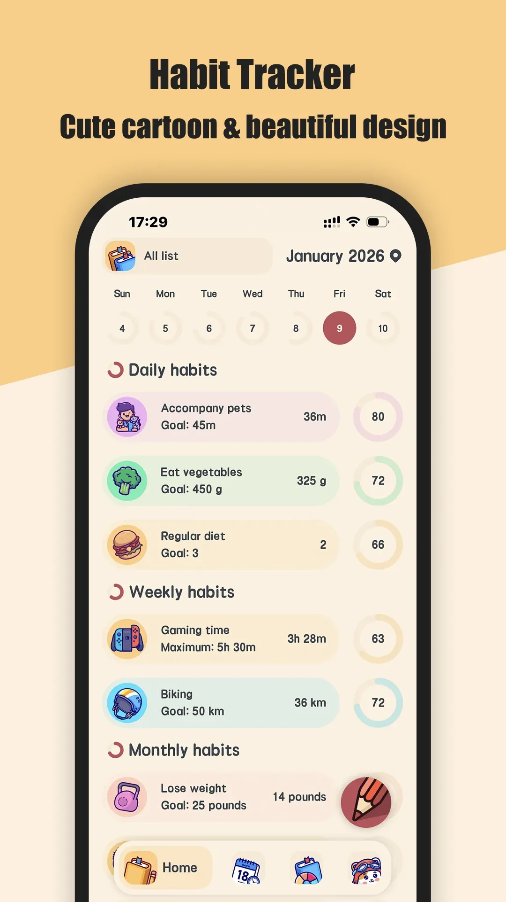{: width="180" .normal }
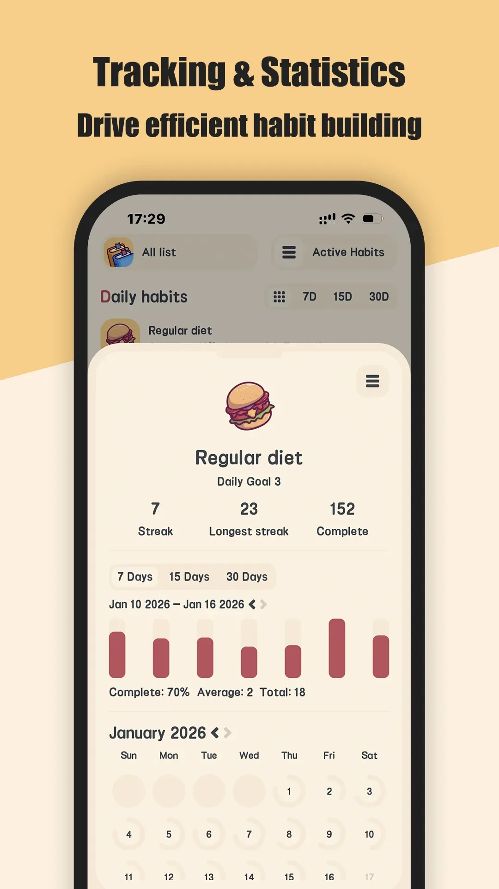{: width="180" .normal }
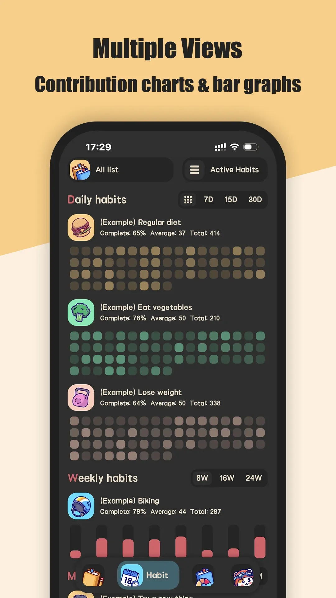{: width="180" .normal }

Meow Habits adalah aplikasi centang kebiasaan yang berangkat dari **catatan di perangkat dan tanpa akun**, dengan antarmuka berpusat pada kalender bulanan. Arah desainnya jelas: hitung dulu berapa dari kebiasaan ini yang selesai dalam periode ini, lalu tampilkan hasilnya lewat empat pintu — kalender, halaman detail, halaman tren dan widget.

#### Satu catatan: lima aksi centang

Mengetuk kebiasaan membuka panel centang berisi `+1`, `-1`, input angka langsung, tandai selesai sekali ketuk, dan tandai dilewati. Satu periode hanya menyimpan satu catatan kumulatif yang boleh diberi catatan teks; saat selesai ada umpan suara. Jadi 2 gelas air pagi dan 3 gelas sore tidak jadi dua aliran catatan, melainkan terkumpul jadi 5 gelas untuk hari itu, lalu dibandingkan dengan target 8 gelas.

#### Target dan periode: bentuk, berhenti dan satuan custom

Saat membuat kebiasaan Anda bisa mengatur ikon, daftar, bentuk atau berhenti, tanggal mulai, frekuensi (harian / mingguan / bulanan / hari tertentu), interval ulang, satuan (jumlah, waktu atau custom), target, catatan dan notifikasi. Daftar bawaan mencakup kesehatan, olahraga, belajar, produktivitas, hemat dan bahagia, plus sejumlah templat kebiasaan siap pakai bagi yang belum tahu harus mulai dari mana.

Yang perlu diperhatikan: **periode, target dan tanggal mulai tidak bisa diubah setelah dibuat**; yang masih bisa diubah adalah ikon, daftar, catatan dan pengingat. Jadi memutuskan tiga kali seminggu atau Senin/Rabu/Jumat sejak awal lebih hemat tenaga daripada memperbaikinya belakangan.

#### Streak dan tingkat penyelesaian: tiga angka plus heatmap

Bagian atas halaman detail menampilkan streak saat ini, streak terpanjang dan jumlah selesai; di bawahnya bisa berpindah antara 7 / 15 / 30 hari terakhir untuk melihat batang per hari serta tingkat penyelesaian / rata-rata / total, lalu heatmap kalender satu bulan penuh. Untuk kebiasaan membentuk, tingkat penyelesaian satu periode dihitung nilai selesai ÷ target dan dibatasi 100%; untuk berhenti, cukup apakah batasnya terjaga. Kalender beranda menampilkan kebiasaan wajib hari itu sebagai cincin progres, sehingga langsung terlihat mana yang belum mencapai target.

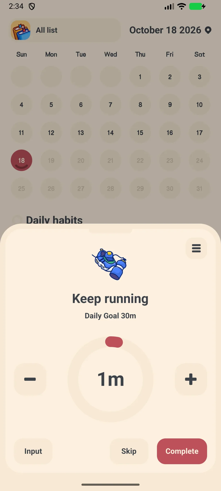{: width="180" .normal }
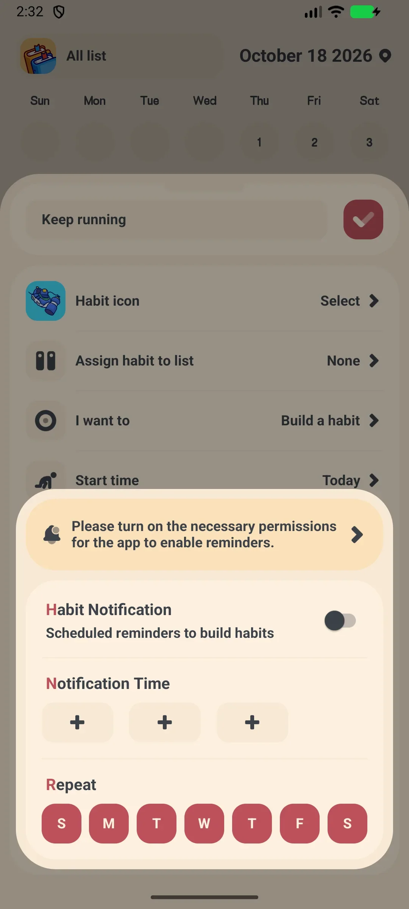{: width="180" .normal }

#### Pengingat, widget dan centang sekali sentuh

Tiap kebiasaan bisa punya beberapa jam pengingat dengan hari berlakunya; ada pula ringkasan sekali sehari yang mendaftar kebiasaan yang masih tertunda. Di tingkat sistem tersedia panduan izin notifikasi dan pengoptimalan baterai agar pengingat tidak diblokir. Di sisi layar utama tersedia beragam widget: daftar kebiasaan, satu kebiasaan, statistik minggu / bulan / tahun, diagram pai dan heatmap bulanan; widget satu kebiasaan bisa langsung mencatat tanpa membuka aplikasi.

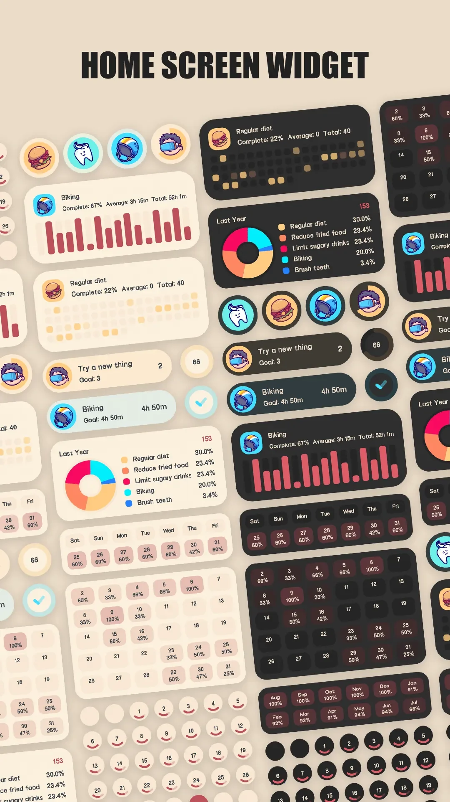{: width="180" .normal }

#### Data: penyimpanan lokal, ekspor CSV dan cadangan mandiri

Catatan tersimpan lokal di perangkat, tanpa akun maupun sinkron real-time lintas perangkat. Untuk pindah, Anda bisa mengekspor CSV berdasarkan rentang waktu dengan memilih sebagian atau semua kebiasaan; juga bisa mencadangkan seluruh database ke Google Drive, atau mengisi alamat WebDAV sendiri lalu memulihkan dengan menimpa data lama. Cadangan otomatis paling sering sekali sehari. Kombinasi ini cocok untuk yang tidak ingin menyerahkan data harian ke server, tapi takut kehilangan data saat ganti ponsel.

#### Kuota dan batas

Versi gratis membatasi jumlah kebiasaan dan daftar; kebiasaan tambahan serta tema gelap, kunci aplikasi dan ekspor CSV perlu membuka fitur berbayar. Ia **tidak melakukan** sinkron otomatis data kesehatan, papan peringkat sosial, saran AI, sinkron cloud berakun maupun impor CSV; warna custom, tanggal selesai, centang di masa depan dan sub-kebiasaan bertingkat juga di luar kemampuan. Ingin langkah terbaca otomatis dari gelang, atau adu streak dengan teman, berarti perlu alat lain.

| Cocok untuk | Tidak cocok untuk |
|---|---|
| Mencatat jangka panjang offline tanpa akun; butuh target angka dan satuan custom; mengandalkan widget sekali sentuh; ingin data bisa diekspor atau dicadangkan ke layanan sendiri | Butuh sinkron real-time lintas perangkat; ingin data kesehatan otomatis; mengandalkan sosial / papan peringkat; jumlah kebiasaan banyak dan tak mau terkena kuota gratis |

Selain beranda dan halaman detail, ada tiga tampilan yang layak dilihat terpisah: bagaimana daftar dan templat preset mengelompokkan kebiasaan, statistik pencapaian global, serta perlindungan privasi atas catatan lokal.

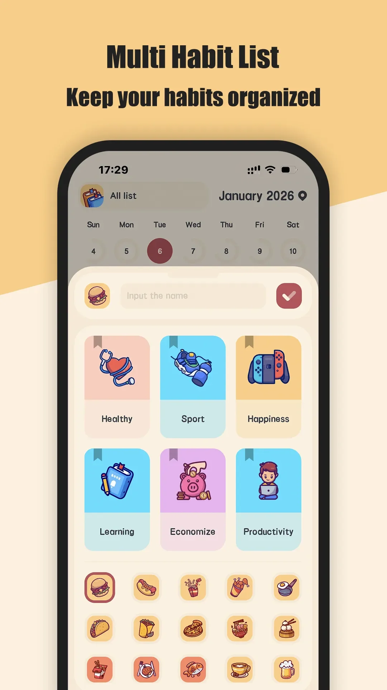{: width="180" .normal }
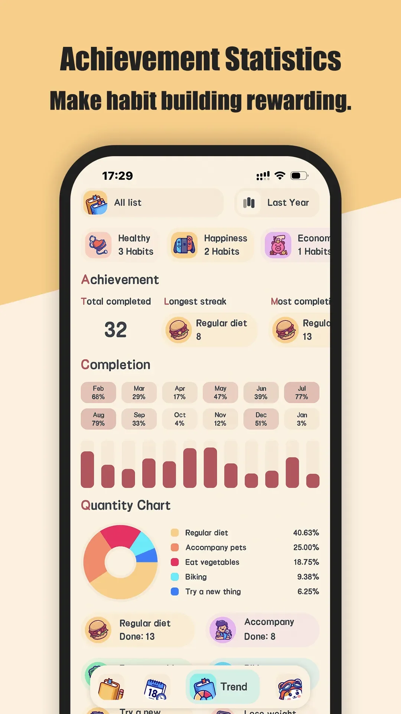{: width="180" .normal }
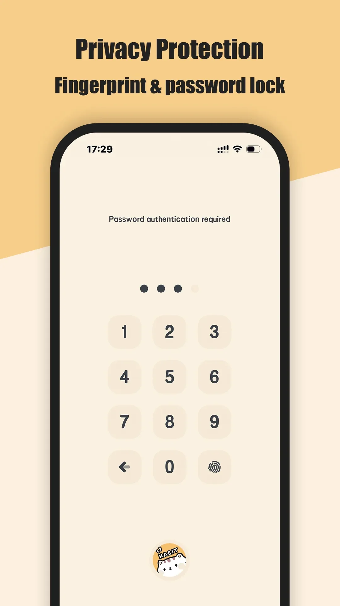{: width="180" .normal }

<!-- Belum ada tangkapan layar halaman setelan ekspor CSV / cadangan WebDAV di direktori gambar; kemampuan ini dijelaskan lewat teks di atas -->

### Streaks (ekosistem Apple)

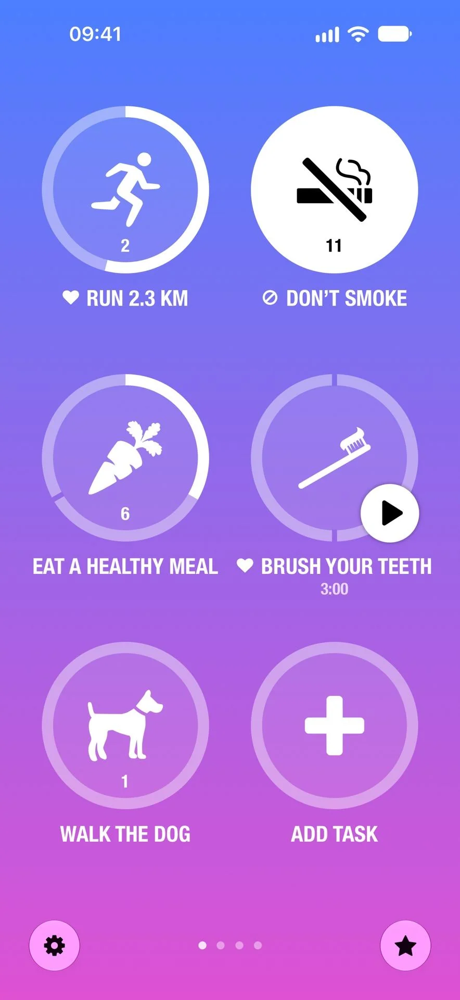{: width="180" .normal }
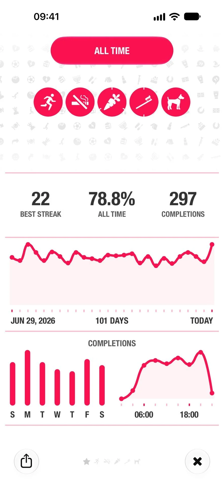{: width="180" .normal }

Streaks memasukkan jangan putus rantai ke dalam namanya. Situs resmi saat ini menyebut **maksimal 24 tugas** (sumber lama sering menyebut 12, itu perbedaan versi; gunakan aplikasi sebagai acuan); tugas bisa diatur setiap hari, hari tertentu atau sejumlah hari per minggu, dan hari istirahat bisa ditandai agar tidak memutus streak. Selain tugas sekali centang, ada tugas berwaktu (misal meditasi 10 menit) dan tugas negatif jangan lakukan.

Fokus mekanismenya ada pada **periode dan penyelesaian otomatis**: lewat Apple Health, langkah, menit mindfulness atau cincin Aktivitas bisa langsung jadi satu catatan selesai, sehingga mengurangi input manual. Sisi statistik memberi streak saat ini dan terbaik, tingkat penyelesaian, kalender serta tren; antarmukanya menyediakan banyak ikon dan tema warna, plus widget, Siri Shortcuts dan penghitung waktu di Layar Kunci.

Data tersinkron lewat iCloud antar iPhone, iPad, Apple Watch dan Mac, dan keterangan resminya menyebut tidak lewat server mereka sendiri; skemanya beli sekali, tanpa langganan dan tanpa iklan. Konsekuensinya juga langsung: hanya ekosistem Apple, pengguna Android tak bisa memakai; dan melewatkan satu hari wajib membuat streak mulai dari nol lagi — terasa bersih bagi yang suka aturan tegas, terasa menegangkan bagi yang mudah patah semangat karena rantai putus.

### Habitica

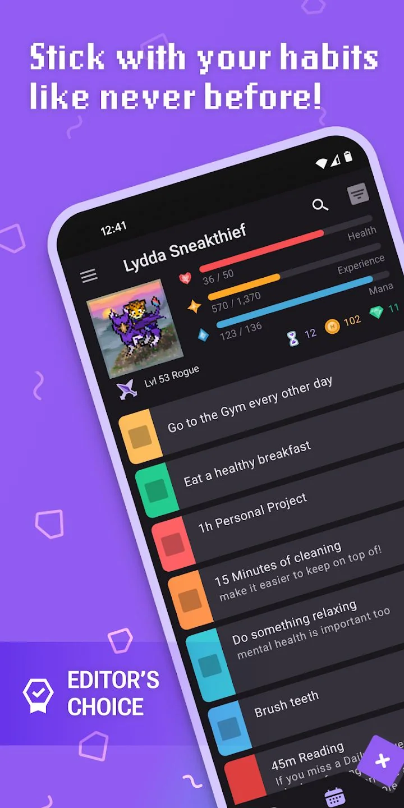{: width="180" .normal }
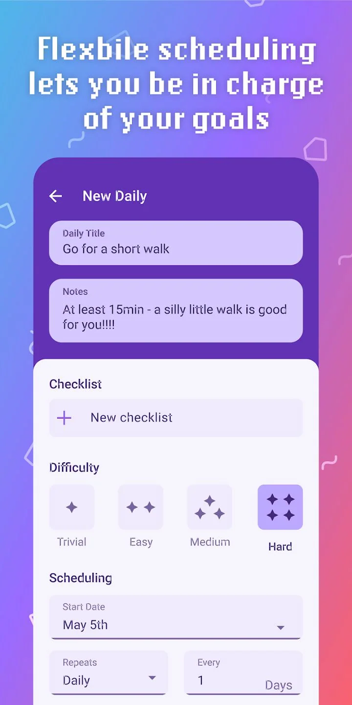{: width="180" .normal }

Habitica langsung menjadikan pelacakan kebiasaan sebuah permainan peran. Perilaku dibagi empat: **Habits** (ketuk `+` / `-` kapan saja, bisa positif, negatif atau dua arah), **Dailies** (ulang sesuai jadwal, lewat jatuh tempo memotong nyawa), **To-Dos** (sekali, boleh ada tenggat, telat tak memotong nyawa) dan **Rewards** (tukar koin untuk hadiah bagi diri sendiri). Habits positif memberi XP dan koin, negatif memotong nyawa; periode ulang Daily bisa setiap hari, tiga kali seminggu atau empat kali sebulan, dan makin sulit makin besar hadiahnya.

Desain ini mengubah hari terlewat jadi biaya yang jelas: saat nyawa habis, koin dikosongkan, karakter turun satu level, dan perlengkapan bisa hilang. Ia juga menyediakan tim, quest, kelas dan pertumbuhan atribut, mengubah konsistensi dari catatan pribadi jadi permainan bersama. Tugas, tim dan quest gratis; bagian berbayar terutama permata kosmetik dan langganan opsional (permata bulanan, bonus drop dan sebagainya); kliennya open source, ada pula versi web, menjangkau iOS, Android dan Web.

Kalau bilah pengalaman dan perlengkapan sama sekali tak menarik, semua konversi itu cuma menambah beban; tapi bagi yang tanpa umpan balik eksternal sulit bertahan, ini satu-satunya dari 7 produk yang menjadikan hadiah dan hukuman sebuah sistem penuh.

### Loop Habit Tracker

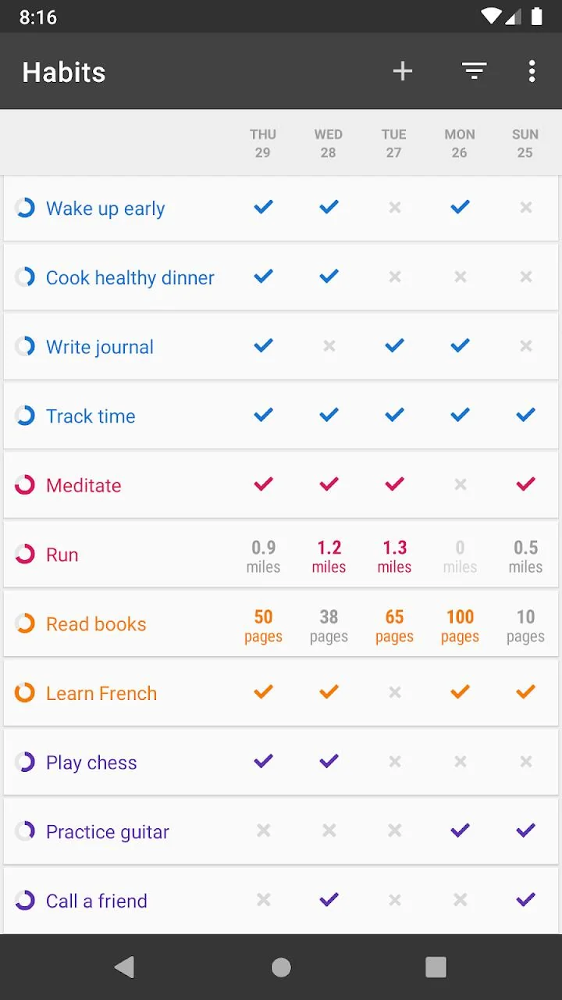{: width="180" .normal }
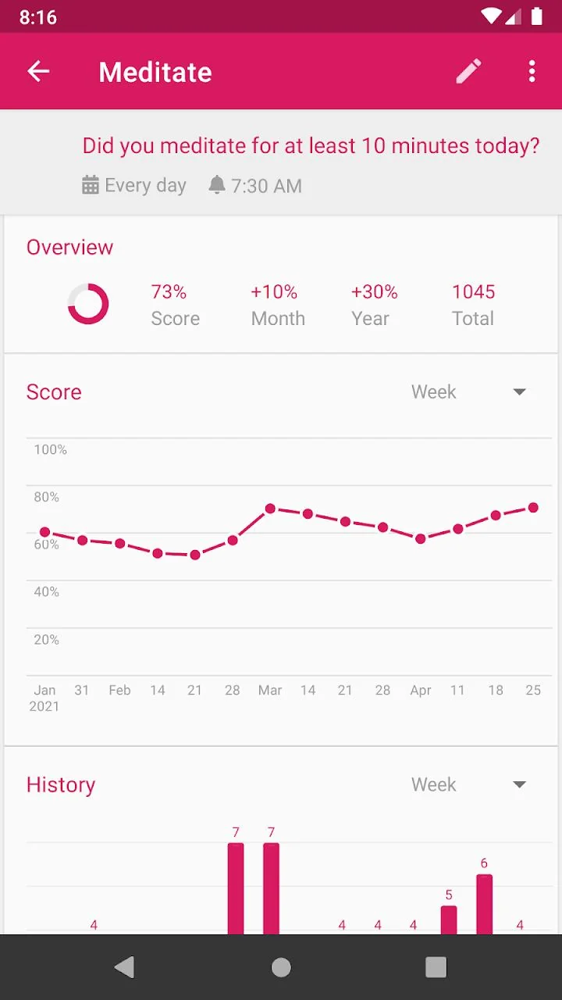{: width="180" .normal }

Yang paling layak dibahas dari Loop bukan antarmukanya, melainkan **penolakannya pada putus rantai lalu kembali nol**. Deskripsi toko resminya menulis terang-terangan: produk memakai rumus lanjutan untuk menghitung skor kebiasaan, tiap pengulangan membuat kebiasaan lebih kuat, tiap kelalaian membuatnya lebih lemah; setelah konsisten lama, beberapa hari terlewat tidak merusak seluruh progres. Ini menjawab langsung kecemasan putus rantai di atas — tren jangka panjang lebih dekat ke kurva nyata pembentukan kebiasaan daripada rantai yang tak boleh putus.

Soal periode, ia mendukung harian, 3 kali seminggu, sekali dua minggu, selang sehari dan jadwal fleksibel lain; matriks centangnya juga menampilkan kebiasaan numerik yang dicatat dalam mil atau halaman. Pengingat bisa diatur per kebiasaan, dan dari notifikasi bisa langsung selesai, abaikan atau tunda tanpa membuka aplikasi, termasuk di jam tangan. Sisi statistik punya grafik rinci serta riwayat lengkap.

Data sepenuhnya tinggal di perangkat, tanpa akun dan tanpa unggah jaringan, serta bisa diekspor jadi CSV atau file database; aplikasinya tanpa iklan dan open source. Ia adalah produk yang paling tuntas menempuh jalur murni lokal + portabel, tapi hanya tersedia di Android dan antarmukanya condong ke alat, bukan motivator.

### Habitify

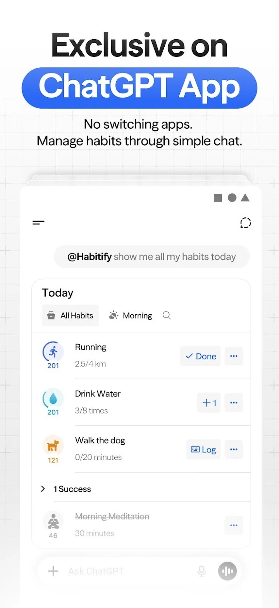{: width="180" .normal }
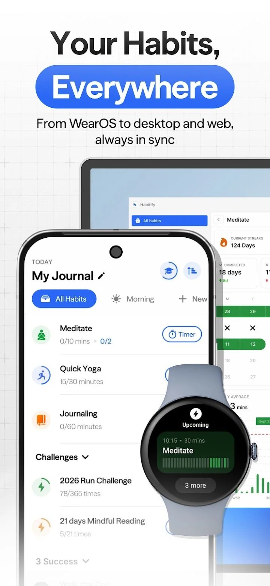{: width="180" .normal }
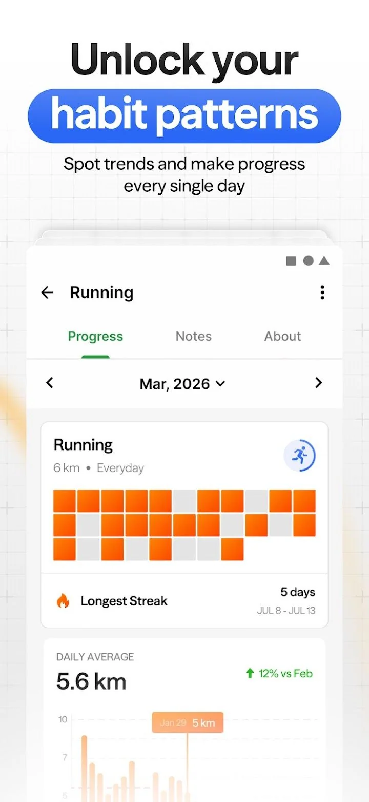{: width="180" .normal }

Gagasan Habitify adalah **menaruh kebiasaan pada garis waktu satu hari**: pagi, siang, malam masing-masing jadi satu kelompok, jadi membuka aplikasi langsung memperlihatkan apa yang perlu dilakukan saat itu. Situs resminya menekankan cakupan iPhone, Android, Mac, Web dan jam tangan dengan sinkron real-time; ada pula integrasi kalender, integrasi data kesehatan, API dan koneksi otomasi, catatan, pencatat suasana hati, penghitung waktu bawaan dan kunci privasi. Tampilan statistik menyusun catatan selesai jadi heatmap dan memberi angka kumulatif.

Posisinya berkebalikan dengan alat murni lokal: akun, sinkron dan pengalaman multiperangkat justru jadi daya tarik utama. Halaman harga resmi menyebut versi gratis boleh memakai 3 kebiasaan (termasuk sinkron lintas platform dan pengingat), sementara kebiasaan tanpa batas masuk paket berbayar; ada pula tantangan teman dan fitur komunitas. Kalau Anda cuma centang di satu ponsel Android dan tak mau daftar, sebagian besar kemampuan itu tak terpakai; tapi kalau berpindah antara ponsel, komputer dan web, ia menghemat repotnya catatan yang tersebar di beberapa perangkat.

### Productive

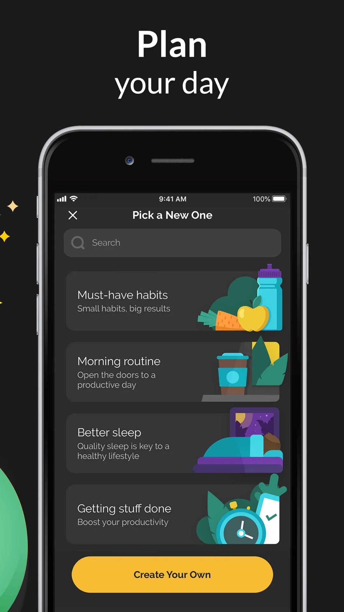{: width="180" .normal }
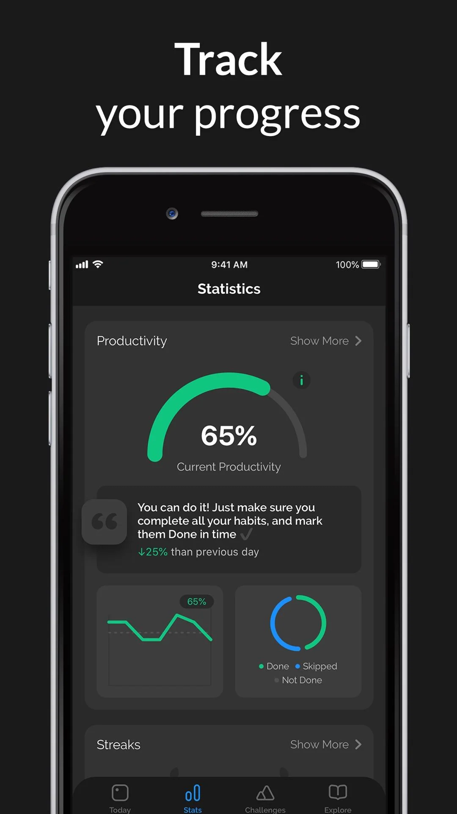{: width="180" .normal }
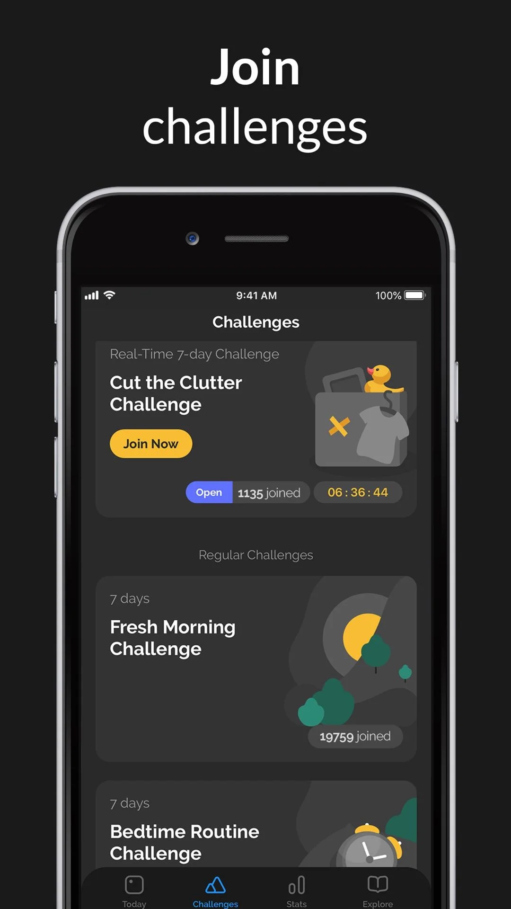{: width="180" .normal }

Productive memperlakukan kebiasaan sebagai **jadwal satu hari**: pilih kebiasaan dari pustaka templat, taruh di pagi, siang atau malam, atur hari ulang dan pengingat, lalu centang satu per satu di kalender. Situs resminya menyebut pustaka templat, statistik dan milestone, pengingat cerdas berbasis lokasi dan waktu, serta tantangan yang bisa diikuti bersama orang lain; halaman tantangan dijadikan kolom tersendiri, terpisah dari rencana harian.

Ia sejenis dengan Habitify di kelompok organisasi blok waktu + sinkron akun, tapi lebih menekankan rasa terencana dan sosial ringan: yang Anda lihat bukan satu kebiasaan terpisah, melainkan seluruh susunan hari ini. Untuk bayar, ia memakai langganan dengan uji coba gratis singkat yang otomatis berubah jadi langganan, jadi perhatikan saat mendaftar. Fitur condong ke bantu saya mengatur, bukan bantu saya menghitung data dengan tepat, karena itu tingkat penyelesaian dan milestone yang dominan, dan definisi streak tidak dibahas mendalam.

### Fabulous

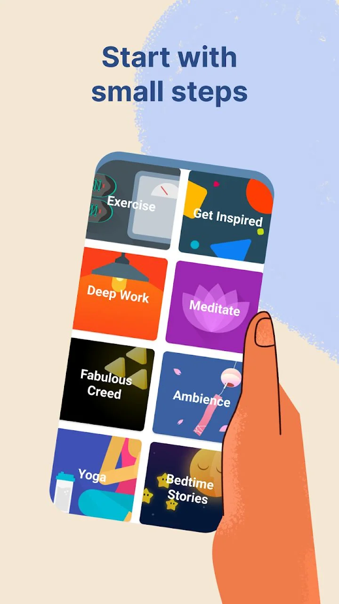{: width="180" .normal }
{: width="180" .normal }
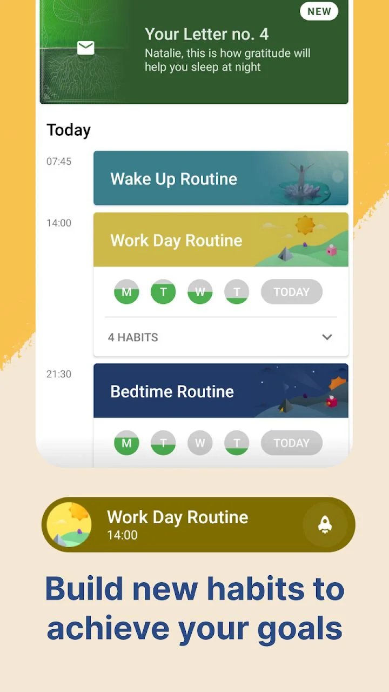{: width="180" .normal }

Fabulous lebih mirip **kursus perubahan perilaku bertahap** daripada alat centang. Ia berakar pada riset ekonomi perilaku di Center for Advanced Hindsight Universitas Duke dan menganjurkan memecah tujuan besar jadi perilaku sangat kecil, lalu merangkainya dengan habit stacking jadi rutinitas pagi, siang dan malam: stabilkan dulu minum segelas air, baru tambah langkah berikutnya, alih-alih langsung membuat sepuluh tugas sekaligus; layar rutinitas hari ini mendaftar langkah kecil untuk dicoret satu per satu.

Bentuk produknya berjalan sebagai journey, lengkap dengan materi pelatih, rutinitas, sesi kerja mendalam, komunitas dan pemesanan pelatih manusia; statistiknya tidak menonjolkan streak, melainkan kelengkapan tahap. Konsekuensinya adalah pustaka konten berlangganan dengan uji coba gratis yang otomatis berubah jadi langganan, dan yang terutama Anda beli adalah program serta konten, bukan sistem pencatatan yang bebas dikonfigurasi. Yang ingin menentukan sendiri periode, target dan ekspor data akan merasa terlalu dibatasi.

---

## Perbandingan mendalam pada dimensi kunci

### Semantik hari terlewat dan kelalaian

| Aplikasi | Satu hari terlewat | Dilewati sengaja | Isi riwayat mundur | Tanggal masa depan |
|---|---|---|---|---|
| Meow Habits | Streak dihitung mundur lewat periode valid | Didukung, penanda tidak memutus | Didukung lewat kalender bulanan | Tidak dibolehkan |
| Streaks | Streak kembali nol | Hari istirahat bisa diatur | Mengikuti kalender dalam aplikasi | Tidak berlaku |
| Habitica | Daily memotong nyawa, habis berarti turun level | Kerusakan bisa dijeda | Mengikuti riwayat tugas | Tidak berlaku |
| Loop | Skor kebiasaan meluruh, tidak kembali nol | Dihindari lewat jadwal fleksibel | Matriks centang bisa mundur | Tidak berlaku |
| Habitify / Productive | Kalender menampilkan belum selesai | Dihindari lewat aturan ulang | Mengikuti kalender dalam aplikasi | Tidak berlaku |
| Fabulous | Maju per tahap, streak tidak ditonjolkan | Tak ada mekanisme putus rantai | Tidak berlaku | Tidak berlaku |

### Periode, target dan aturan selesai

| Aplikasi | Ekspresi periode | Target numerik | Definisi tingkat penyelesaian |
|---|---|---|---|
| Meow Habits | Hari / minggu / bulan / hari tertentu / setiap N hari | Didukung, satuan bisa custom | Nilai selesai ÷ target, dibatasi 100%; berhenti dinilai dari batas |
| Streaks | Setiap hari / hari tertentu / sejumlah hari seminggu + hari istirahat | Tugas berwaktu mencakup durasi | Hari selesai dan tingkat penyelesaian |
| Habitica | Daily bisa harian / 3 kali seminggu / 4 kali sebulan | Bertumpu pada centang, angka lewat hadiah custom | Level / XP / koin, bukan persentase |
| Loop | Harian / 3 kali seminggu / selang sehari / selang seminggu | Didukung | Skor kebiasaan + tingkat penyelesaian |
| Habitify | Harian / hari tertentu, dikelompokkan per blok waktu | Bertumpu pada centang | Tingkat penyelesaian dan kalender |
| Productive | Hari ulang + blok waktu + beberapa kali sehari | Bertumpu pada centang | Tingkat penyelesaian dan milestone |
| Fabulous | Tahap journey + rutinitas | Tidak berlaku | Progres tahap |

### Pengingat, pintu masuk dan data

| Aplikasi | Pengingat | Centang sekali sentuh | Lokasi data | Ekspor / cadangan | Akun |
|---|---|---|---|---|---|
| Meow Habits | Beberapa jam per kebiasaan + hari tertentu + ringkasan harian | Widget layar utama | Di perangkat | Ekspor CSV, cadangan Google Drive / WebDAV | Tidak perlu |
| Streaks | Pengingat per tugas | Widget, Siri, selesai otomatis lewat Apple Health | iCloud (ekosistem Apple) | Bergantung pada sinkron ekosistem | Tidak perlu |
| Habitica | Pengingat Daily | Tambah / kurang dalam aplikasi | Cloud | Di dalam sistem akun | Perlu |
| Loop | Pengingat per kebiasaan, notifikasi bisa selesai / abaikan / tunda | Notifikasi, widget, jam tangan | Di perangkat | Ekspor CSV / database | Tidak perlu |
| Habitify | Pengingat lanjutan, pengingat blok waktu | Widget, multiperangkat | Sinkron cloud real-time | Cloud + integrasi kalender / kesehatan | Perlu |
| Productive | Pengingat cerdas berbasis waktu / lokasi | Centang dalam aplikasi | Cloud | Di dalam sistem akun | Perlu |
| Fabulous | Pengingat rutinitas | Centang langkah dalam aplikasi | Cloud | Di dalam sistem akun | Perlu |

### Platform dan skema bayar (per halaman resmi)

| Aplikasi | Platform utama | Skema bayar | Kemampuan umum yang jelas tidak ada |
|---|---|---|---|
| Meow Habits | Android (toko juga mencantumkan pintu masuk iOS) | Gratis dengan batas kebiasaan / daftar, sebagian fitur perlu dibuka | Sinkron otomatis data kesehatan, papan peringkat sosial, sinkron cloud berakun |
| Streaks | iPhone / iPad / Apple Watch / Mac / Vision Pro | Beli sekali, tanpa langganan dan iklan | Android / Windows; jumlah tugas dibatasi |
| Habitica | Web / iOS / Android | Tugas inti gratis, kosmetik dan langganan opsional berbayar | Bukan alat murni lokal, catatan butuh akun |
| Loop | Android | Gratis, open source, tanpa iklan | iOS; sinkron akun; motivasi gamifikasi |
| Habitify | iOS / Android / Mac / Web / Watch | Gratis 3 kebiasaan, tanpa batas berbayar | Pemakaian offline penuh |
| Productive | Utamanya iOS, ada pintu masuk web | Langganan + uji coba gratis singkat | Pakai offline tanpa akun, ekspor data bebas |
| Fabulous | iOS / Android | Pustaka konten langganan + uji coba gratis | Definisi periode custom, ekspor data terbuka |

---

## Mana yang sebaiknya Anda pilih

Terapkan kerangka enam poin pada situasi Anda sendiri, dan pilihannya jadi jauh lebih jelas:

- **Tanya dulu apakah catatannya perlu angka**. Untuk 8 gelas / 30 menit / 3 km, definisi Meow Habits dan Loop paling lengkap; kalau satu centang cukup, jalur Streaks, Habitify dan Productive lebih pendek.
- **Lalu tanya apakah jadwalnya rapi**. Hanya Senin/Rabu/Jumat, atau cukup tiga kali seminggu, berarti fokus ke hari tertentu dan jadwal fleksibel — Meow Habits, Streaks, Loop dan Habitica semuanya memberi pilihan tegas.
- **Lalu tanya apakah kembali nol setelah satu hari bisa diterima**. Yang mudah patah semangat karena nol, lihat skor meluruh Loop atau penanda dilewati Meow Habits; yang ingin aturan tegas, Streaks paling langsung; yang ingin hadiah-hukuman eksternal, Habitica paling kuat.
- **Lanjut tanya data ditaruh di mana**. Tak mau daftar tapi ingin cadangan sendiri, Meow Habits dan Loop jalur itu; sering berpindah perangkat, sinkron Habitify / Productive / Fabulous lebih praktis; semuanya Apple, Streaks lewat iCloud cukup.
- **Terakhir tanya Anda butuh alat atau program**. Ingin menentukan sendiri kebiasaan, periode dan grafik, pilih tipe pencatat; ingin proses perubahan yang dipandu, model kursus Fabulous lebih pas.

Masih ragu? Mulailah dengan mempersempit lewat [ringkasan aplikasi pelacak kebiasaan](/id/posts/pillar-habit-tracker-apps-android/), lalu baca [perbandingan poin per poin Meow Habits vs Streaks](/id/posts/vs-meow-habits-and-streaks/). Bagi pengguna Android di Indonesia yang mencari aplikasi kebiasaan harian tanpa akun, antarmuka berbahasa Indonesia, bisa dipakai offline dan mengandalkan widget, [aplikasi centang kebiasaan Android](/id/apps/meow-habits/) juga layak dilihat terpisah.

### Tautan unduhan resmi

| Aplikasi | Android | iOS / lainnya |
|---|---|---|
| Meow Habits | [Google Play](https://play.google.com/store/apps/details?id=com.glgjing.meow.habit.goal) | [App Store](https://apps.apple.com/app/id6758230559) |
| Streaks | — | [App Store](https://apps.apple.com/app/id963034692) · [Situs resmi](https://streaksapp.com/) |
| Habitica | [Google Play](https://play.google.com/store/apps/details?id=com.habitrpg.android.habitica) | [Situs resmi / web](https://habitica.com/) |
| Loop Habit Tracker | [Google Play](https://play.google.com/store/apps/details?id=org.isoron.uhabits) | [Situs resmi](https://loophabits.org/) |
| Habitify | [Google Play](https://play.google.com/store/apps/details?id=co.unstatic.habitify) | [Situs resmi](https://www.habitify.me/) |
| Productive | — | [Situs resmi](https://productiveapp.io/) |
| Fabulous | [Google Play](https://play.google.com/store/apps/details?id=co.thefabulous.app) | [Situs resmi](https://www.thefabulous.co/) |

---

## Pertanyaan yang sering diajukan (FAQ)

**Masalah apa yang sebenarnya diselesaikan aplikasi kebiasaan?**
{:.faq-q}

Mengubah niat yang kabur jadi catatan yang bisa dicek, dan mengecilkan gesekan antara teringat dan mencatat. Ia tidak membentuk kebiasaan menggantikan Anda, tapi membuat perilaku terlihat, memberi umpan balik progres dan memberi dasar evaluasi. Riset perilaku menunjukkan perilaku baru sering butuh minggu sampai bulan untuk jadi otomatis (Lally dkk. 2010 memperkirakan median sekitar 66 hari dengan variasi individu lebar), dan dalam rentang itu catatan adalah salah satu isyarat eksternal paling mudah dijaga.

**Streak putus satu hari, apakah semuanya sia-sia?**
{:.faq-q}

Tidak. Studi Lally dkk. menemukan melewatkan satu peluang tidak mengubah kurva pembentukan kebiasaan secara keseluruhan secara signifikan. Produk juga memberi perlakuan berbeda: Streaks kembali nol, Loop membiarkan skor kebiasaan meluruh pelan, Meow Habits membolehkan menandai satu periode dilewati, sedangkan Habitify / Productive / Fabulous tidak menjadikan streak inti. Memilih definisi yang cocok dengan pola pikir Anda lebih penting daripada mempertahankan rantai mati-matian.

**Apa bedanya tiga kali seminggu dan Senin/Rabu/Jumat?**
{:.faq-q}

Yang pertama cukup tiga hari apa pun dalam seminggu, cocok untuk jadwal tak menentu; yang kedua hanya menimbulkan tugas tertunda di hari yang ditentukan, hari lain bukan kelalaian. Loop secara resmi mendukung jadwal fleksibel seperti 3 kali seminggu, Daily Habitica juga bisa tiga kali seminggu, sedangkan Meow Habits memisahkan frekuensi, interval ulang dan hari tertentu. Pastikan dulu mana yang dipakai aplikasi sebelum membuat kebiasaan.

**Target angka atau centang sederhana, mana yang dipilih?**
{:.faq-q}

Lihat apakah perilakunya punya tingkatan. Minum air, membaca dan lari cocok memakai target angka: Anda bisa melihat hari ini selesai 60% atau 100%, jauh lebih banyak bahan evaluasi; tidur lebih awal atau tidak minum minuman manis lebih cocok dicentang. Meow Habits dan Loop sama-sama mendukung target angka bersatuan, dan panel centang Meow Habits sekaligus menyediakan tambah, kurang, input langsung, selesai sekali ketuk dan dilewati.

**Apakah dilewati sama dengan lupa mencatat?**
{:.faq-q}

Tidak. Lupa mencatat berarti wajib dikerjakan tapi tidak tercatat, dan biasanya memengaruhi streak; dilewati adalah pernyataan sengaja bahwa periode ini memang tidak dikerjakan, jadi tidak memutus streak dan tidak dihitung selesai. Menandai dinas luar kota atau hari sakit sebagai dilewati, lebih dulu atau belakangan, membuat kalender tidak salah membaca istirahat objektif sebagai kegagalan.

**Bisa dipakai tanpa akun? Bagaimana kalau ganti ponsel?**
{:.faq-q}

Meow Habits dan Loop tak butuh akun, data ada di perangkat; Streaks sinkron antarperangkat Apple lewat iCloud, juga tanpa daftar ke vendor. Sebelum ganti perangkat, ingat ekspor atau cadangan: Meow Habits bisa mengekspor CSV per rentang waktu, atau mencadangkan seluruh database ke Google Drive / WebDAV sendiri; Loop bisa mengekspor CSV atau file database. Habitify, Productive, Fabulous dan Habitica memakai sinkron akun, ganti perangkat lebih praktis, tapi catatan lewat server.

**Apakah aplikasi kebiasaan otomatis sinkron dengan gelang atau data kesehatan?**
{:.faq-q}

Tergantung produknya. Streaks bisa memakai Apple Health agar langkah atau menit mindfulness otomatis ditandai selesai; Habitify menyediakan integrasi kalender dan data kesehatan. Meow Habits **tidak menyediakan** sinkron otomatis data kesehatan, centangnya sebagian besar dilakukan manual — justru itulah yang menjaganya tetap murni lokal dan tanpa akun. Saat melihat promosi pencatatan otomatis, cek dulu platform mana yang benar-benar terhubung.

**Versi gratis biasanya membatasi apa?**
{:.faq-q}

Umumnya jumlah kebiasaan atau tingkatan fitur. Habitify secara resmi menyebut 3 kebiasaan untuk versi gratis; versi gratis Meow Habits membatasi jumlah kebiasaan dan daftar, dengan tema gelap, kunci aplikasi dan ekspor CSV sebagai fitur yang perlu dibuka; Loop gratis, open source dan tanpa iklan; Streaks beli sekali; Productive dan Fabulous memakai langganan plus uji coba singkat. Uji coba produk langganan otomatis berubah jadi langganan, jadi periksa tanggal pembatalan sebelum mendaftar.

---

## Istilah terkait

- [Apa itu pelacak kebiasaan (Habit Tracker)?](/id/glossary/what-is-a-habit-tracker/)
- [Apa itu streak kebiasaan (Habit Streak)?](/id/glossary/what-is-a-habit-streak/)
