Rabu sore pukul tiga, tiba-tiba Anda ingat: laporan kuartalan harus dikumpulkan Rabu depan. Menuliskannya di kertas tempel dan memasukkannya ke aplikasi daftar tugas bedanya bukan di tampilan yang lebih cantik, melainkan pada apa yang terjadi setelahnya: apakah ia muncul sendiri pada hari itu, apakah tenggat yang terlewat ditandai atau diam-diam tenggelam, dan apakah setelah selesai ia meninggalkan jejak atau malah jadi satu item lagi yang harus dibersihkan.

Berikan kalimat yang sama ke 7 aplikasi daftar tugas, Anda akan mendapat 7 jawaban. Ada yang memecahnya menjadi judul, tanggal, dan prioritas; ada yang menyimpan satu baris teks saja. Ada yang otomatis memunculkan tugas bulan depan begitu yang ini selesai; ada yang menyusun ulang hari Anda. Ada yang menyimpan data di perangkat sehingga ganti ponsel harus mencadangkan sendiri; ada yang mewajibkan akun sebelum bisa mulai. Daftar fiturnya tampak mirip, yang menentukan pengalaman justru aturan-aturan "setelah itu apa".

Jadi tulisan ini tidak membandingkan siapa yang punya daftar centang terpanjang. Kami mengikuti satu tugas melewati lima tahap — dicatat, ditempatkan, dikerjakan hari itu, dicentang, ditinjau lagi — sambil menjawab dua pertanyaan yang lebih mendasar: **apa sebenarnya aplikasi daftar tugas itu**, dan **masalah nyata apa yang diselesaikannya**. Untuk langsung membandingkan pilihan, baca [tinjauan aplikasi daftar tugas dan pengelola tugas Android](/id/posts/pillar-todo-list-task-manager-apps-android/) serta [perbedaan Meow Todo List dan Todoist](/id/posts/vs-meow-todo-and-todoist/).

> Dasar pengecekan: fitur, kuota, dan harga kompetitor berasal dari halaman resmi, pusat bantuan resmi, dan deskripsi toko aplikasi, dicek November 2026; aturan produk kami mengikuti setelan dan perilaku yang terlihat di aplikasi. Versi cepat berubah, jadi angka paket berbayar mengikuti halaman saat ini. Tulisan ini hanya membahas daftar tugas pribadi, bukan manajemen proyek tim.

## 1. Yang dijaga aplikasi daftar tugas adalah urusan "belum selesai"

### Kertas tempel dan sebuah sistem beda di tiga lapis

Daftar tugas di kertas cuma satu kalimat; tugas di aplikasi adalah **catatan yang punya tujuan**. Hampir semua produk tersusun dari tiga lapis:

- **Butir**: field yang dibawa satu tugas. Paling sederhana cukup judul; paling lengkap bisa memuat catatan, waktu rencana, prioritas, aturan berulang, label, daftar, subtugas, dan status selesai.
- **Wadah**: ke mana butir itu disimpan. Daftar, folder, proyek, area, dan label pada dasarnya memberi satu butir sebuah tempat tinggal agar bisa dipanggil lagi lewat dimensi tertentu.
- **Tampilan**: dengan sudut pandang apa kumpulan butir yang sama disusun ulang. Hari ini, besok, 7 hari ke depan, segera, selesai, kalender, dan papan bukan data baru, melainkan irisan berbeda dari data yang sama.

Tiga lapis ini menjelaskan mengapa aplikasi daftar tugas bukan sekadar kertas tempel digital: langkah tambahannya adalah memberi setiap urusan yang belum selesai aturan **kapan ia akan terlihat lagi**. Anda tidak perlu mengingatnya, cukup ditemukan pada waktunya.

### Ia, kalender, aplikasi kebiasaan, dan catatan masing-masing mengurus satu bagian

Kesalahan paling umum pemula adalah memasukkan semua hal yang perlu diingat ke satu alat. Padahal pembagian empat alat ini jelas:

| Alat | Satuan dasar | Makna waktu | Pertanyaan khas |
|---|---|---|---|
| Aplikasi daftar tugas | Satu tugas (selesai berarti berakhir) | Tuntas sebelum hari atau tenggat tertentu | Apa saja yang belum selesai |
| Kalender | Satu blok waktu | Punya awal dan akhir jelas, memakan waktu | Rabu sore pukul tiga saya sedang apa |
| Aplikasi kebiasaan | Satu kali selesai dalam satu periode | Berulang per periode, tanpa akhir | Berapa kali olahraga minggu ini |
| Catatan dan dokumen | Isi yang bisa diedit terus | Biasanya tanpa status selesai | Di mana saya menyimpan bahan itu |

Paduan yang lazim: tugas ditulis di aplikasi daftar tugas, yang benar-benar memakan dua jam dipindah ke kalender, kebiasaan jangka panjang diserahkan ke aplikasi kebiasaan, bahan referensi tinggal di catatan. Keunikan aplikasi daftar tugas adalah **menyediakan tempat yang jelas untuk tindakan menyelesaikan** — catatan maupun kalender tidak punya itu.

### Kamus kecil konsep inti

Istilah berikut berulang di perbandingan ini, jadi disepakati dulu di awal:

- **Kotak masuk (Inbox)**: tempat menampung catatan sebelum diklasifikasi. Nilainya ada pada memisahkan "terlintas" dan "memutuskan taruh di mana", agar Anda tidak membatalkan pencatatan hanya karena harus memilah.
- **Subtugas**: langkah yang bisa dicentang satu per satu di dalam satu tugas. Kebanyakan produk hanya mendukung satu tingkat dan subtugas tidak punya tanggal sendiri; lihat [apa itu subtugas](/id/glossary/what-is-a-subtask/).
- **Daftar, label, dan proyek**: daftar biasanya berarti kepemilikan (satu tugas masuk ke satu daftar), label berarti dimensi (satu tugas bisa punya beberapa), proyek kerap membawa tujuan dan tahapan. Bisa atau tidaknya ketiganya bertumpuk menentukan batas kemampuan mengatur.
- **Aturan berulang**: membuat tugas muncul lagi harian, mingguan, bulanan, tahunan, atau dengan jeda khusus, dan bisa dihentikan pada tanggal atau jumlah tertentu. Beda utamanya ada pada "setelah yang ini selesai, tugas berikutnya dibuat bagaimana".
- **Tampilan hari ini**: beberapa butir yang dipilih dari seluruh tugas untuk dihadapi hari ini. Ini bukan sekadar penyaringan berdasarkan tanggal hari ini, karena tiap produk memperlakukan tugas terlambat secara berbeda.
- **Terlambat (Overdue)**: lewat dari waktu rencana dan belum selesai. Ada produk yang otomatis memindahkannya ke hari ini, ada yang menandai merah dan membiarkannya di grup Terlambat, ada yang menggabungkannya ke tampilan hari ini.
- **Input bahasa alami**: menulis tenggat dan jam langsung di judul, lalu aplikasi memarsing tanggal dan pengingat. Ini memangkas biaya masuk pada tahap pertama.
- **Arsip dan status selesai**: ke mana butir pergi setelah dicentang. Ada yang menyimpan riwayat yang bisa dicari, ada yang merangkum jadi satu angka, ada yang langsung menghilangkannya dari daftar.

Konsepnya tampak remeh, tapi hampir semua yang membuat dua aplikasi terasa berbeda berasal dari aturan di balik istilah-istilah ini.

## 2. Mengikuti satu tugas melewati lima tahap

### Tahap 1 — Menangkap: satu kalimat dipecah jadi beberapa field

Biaya masuk menentukan apakah sebuah daftar benar-benar dipakai. Paling ringan hanya menyediakan kolom judul dan menunda tanggal, prioritas, pengulangan, serta label; paling praktis memasukkan semua field itu ke satu kalimat lalu memarsingnya.

Todoist dan TickTick menjadikan tambah cepat bahasa alami sebagai pintu masuk utama, dan halaman resmi keduanya mencantumkannya di kemampuan gratis: tulis laporan mingguan dengan jam Jumat, langsung dapat tanggal dan aturan berulang. Google Tasks melangkah lebih jauh, memungkinkan Anda mengubah sesuatu menjadi tugas di samping email Gmail atau di bilah sisi Google Kalender tanpa berpindah aplikasi. Meow Todo List mengambil jalan lain: judul berupa teks polos, sedangkan tanggal, prioritas, label, dan pengulangan dipilih di panel terpisah — beberapa ketukan lebih banyak, tetapi **tanpa ambiguitas parsifikasi**, apa yang ditulis itulah yang tersimpan.

Ada satu detail yang mudah terlewat di tahap ini: apakah pengingat merupakan field tersendiri. Meow Todo List tidak punya opsi "ingatkan 10 menit sebelum"; waktu pengingat sama dengan waktu rencana tugas, ditambah ringkasan harian tersendiri. Pengingat khusus di Todoist masuk paket berbayar. Yang ingin diingatkan lebih awal sebaiknya mengecek ini sebelum memilih.

Ada pula pertanyaan lebih awal: bagaimana jika ingin mencatat tetapi belum memutuskan taruh di mana. Things 3 punya kotak masuk tersendiri, TickTick menaruh kotak masuk di urutan pertama bilah sisi, Google Tasks menumbuhkan pintu masuk di sebelah email dan kalender; Meow Todo List tidak punya kotak masuk khusus, dan butir semacam ini ditampung daftar "Default" serta grup "Tanpa tanggal". Ada tidaknya langkah ini menentukan Anda "catat dulu, rapikan belakangan" atau "harus memilah saat itu juga" — yang belakangan sering berujung pada tidak mencatat sama sekali.

### Tahap 2 — Mengatur: daftar, label, subtugas, dan prioritas

Begitu tugas menumpuk, masalah bergeser dari "apa saya ingat" menjadi "apa saya bisa menemukannya". Pemisah paling mendasar di sini adalah **bisa atau tidaknya lapisan bertumpuk**.

Things 3 membangun struktur jangka panjang area, proyek, heading, lalu tugas, cocok untuk memisahkan pekerjaan, keluarga, dan tujuan pribadi dalam waktu lama; Todoist memakai proyek, subtugas bertingkat, label, dan filter; Microsoft To Do serta Google Tasks lebih sederhana, bertumpu pada beberapa daftar mendatar; Meow Todo List memakai **satu tingkat daftar, satu tingkat label, satu tingkat subtugas**, tanpa induk pada daftar maupun label dan tanpa bersarang lagi. Imbalannya kesederhanaan: membuat tugas tidak perlu dulu menjawab "masuk folder mana ini". Ongkosnya, proyek kompleks sulit dipecah bersih.

Pengurutan dan penyaringan juga masuk tahap ini. Meow Todo List menyediakan empat mode urut — tanggal, prioritas, daftar, atau tanpa urutan — dengan urut manual geser pada mode selain tanggal; pencarian dan ekspor bisa disaring berdasarkan daftar, label, prioritas, dan rentang tanggal. Versi gratis membatasi jumlah daftar (10), label (10), dan subtugas per tugas (10), **bukan jumlah total tugas** — dasar yang sangat berbeda dari "9 daftar, 99 tugas per daftar" pada TickTick, dan penting saat membandingkan kuota.

Prioritas juga bagian dari tahap ini, tapi skalanya berbeda: Meow Todo List punya empat tingkat (tanpa, rendah, sedang, tinggi), TickTick menyediakan matriks empat kuadran, Google Tasks sama sekali tidak punya prioritas. Empat tingkat cocok untuk mengurut cepat, matriks cocok untuk memilih mana yang didahulukan, dan tanpa prioritas bobot hanya bisa diungkapkan lewat "masuk daftar mana" serta "di urutan ke berapa". Begitu pula aturan urut — tanggal, prioritas, daftar, atau geser manual sepenuhnya adalah empat gagasan berbeda tentang keteraturan.

### Tahap 3 — Mengerjakan: makna tampilan hari ini dan keterlambatan

Produk baru menunjukkan karakternya ketika harinya tiba.

Apa saja yang termasuk "hari ini"? Jawaban Meow Todo List: tugas jatuh tempo hari ini ditambah **semua tugas yang terlambat tetapi belum selesai**, dikelompokkan dan ditandai di grup Terlambat; tugas terlambat tidak otomatis digeser dan tidak otomatis selesai. Saat diurut berdasarkan tanggal, seluruh tugas terbagi menjadi enam grup: Terlambat, Hari ini, Besok, 7 hari, Nanti, dan Tanpa tanggal. "My Day" di Microsoft To Do memakai logika lain: ia mulai kosong setiap hari, lalu Anda atau "Saran" memilih kembali yang akan dikerjakan, dan yang belum selesai ditawarkan lagi esoknya. Yang pertama buku besar, yang kedua daftar yang disusun ulang tiap hari; tak ada yang lebih baik, tergantung Anda lebih takut kehilangan atau lebih takut ditindih catatan lama.

Tugas berulang adalah bagian yang paling sering terlewat sekaligus paling jujur memperlihatkan asumsi desain. Ambil "bayar sewa tanggal 1 tiap bulan": saat Anda mencentang tugas saat ini, Meow Todo List membuat **tugas berikutnya yang benar-benar baru**, menyalin judul, catatan, daftar, label, prioritas, aturan berulang, dan seluruh subtugas, lalu mengulang subtugas ke belum selesai dan memindahkan waktu rencana ke siklus valid berikutnya; siklus yang sudah lewat tanpa sempat dikerjakan dilewati, langsung mendarat di hari ini atau masa depan, dan bisa dihentikan berdasarkan tanggal atau jumlah. Tugas lama berubah jadi selesai dan berhenti berulang. Jadi riwayatnya adalah kumpulan catatan yang benar-benar pernah diselesaikan, bukan satu tugas yang ditulis ulang terus-menerus. Bantuan resmi Google menyebut tugas berulang bisa diatur pada tanggal tertentu, tetapi subtugas hanya satu tingkat dan tidak punya tanggal sendiri — makna riwayat keduanya tidak sama.

Pengingat dan pintu masuk juga termasuk di sini. Meow Todo List membagi pengingat menjadi dua: notifikasi saat tugas jatuh tempo, dan ringkasan harian pada jam tetap yang bisa menyertakan tugas terlambat; widget layar utama menambah bentuk tambah cepat, daftar tugas, kalender, dan statistik. Namun mengetuk notifikasi membuka beranda aplikasi, **tanpa** aksi "Selesai" atau "Nanti" di dalam notifikasi, dan butir widget pun membuka detail. Produk yang menaruh aksi menyelesaikan langsung di notifikasi bisa memangkas satu lapis gesekan lagi, dengan ongkos bilah notifikasi yang lebih ramai.

### Tahap 4 — Menyelesaikan: ke mana data pergi setelah dicentang

Tindakannya begitu ringan sampai jarang ada yang menanyakan hasilnya, padahal ia menentukan apakah enam bulan kemudian Anda masih bisa menjawab "sebenarnya selesai tanggal berapa itu".

Meow Todo List memindahkan tugas selesai ke grup "Selesai", dengan sakelar di beranda, 10 entri terbaru sebagai bawaan, dan opsi "Tampilkan lebih banyak"; saat selesai dicatat waktunya dan bisa dibunyikan satu suara. Aplikasi ini **tidak punya tempat sampah maupun area arsip**: menghapus berarti menghapus permanen, dan "Bersihkan yang selesai" memberi peringatan tegas bahwa tidak bisa dibatalkan. Things 3 punya catatan penyelesaian bernama Logbook, Todoist menjadikan riwayat aktivitas visualisasi produktivitas yang bisa dicari (gratis 1 minggu, riwayat penuh di paket berbayar).

Bagi yang butuh jejak, evaluasi, atau bukti bahwa sesuatu pernah dikerjakan, perbedaan tahap ini jauh lebih penting daripada warna antarmuka; bagi yang hanya ingin daftar kosong sekali sehari, justru makin sederhana makin baik.

Satu jebakan yang mudah terinjak adalah "Bersihkan yang selesai". Ia membuat daftar langsung rapi, tetapi pada produk tanpa arsip dan tanpa tempat sampah langkah itu sekaligus menghapus jejaknya, dan antarmuka memang memperingatkan bahwa tidak bisa dibatalkan. Yang perlu evaluasi per kuartal sebaiknya ekspor dulu sebelum membersihkan; yang memakai daftar sekadar papan sementara justru sebaiknya rutin membersihkan agar tugas selesai tidak memenuhi beranda.

### Tahap 5 — Meninjau: kalender, statistik, dan jalan keluar data

Tahap terakhir menentukan apakah sistem ini bisa dipakai bertahun-tahun.

Meow Todo List punya empat tampilan utama — Tugas, Kalender, Statistik, dan Setelan — dengan mode kalender harian, mingguan, dan bulanan. Statistik bisa dilihat per hari, minggu, bulan, tahun, rentang khusus, atau seluruh waktu, mencakup grafik kontribusi tahunan, panas kalender bulanan, mingguan, dan tahunan, diagram pai serta peringkat per daftar dan per label, juga daftar tugas yang dikelompokkan per jam, minggu, atau tanggal. Di layar utama tersedia 10 jenis widget: tambah cepat, buku tugas, daftar tugas, statistik pai, kalender bulanan dan mingguan, serta statistik mingguan, bulanan, dan tahunan; sebagian langsung menampilkan ringkasan hari itu. Tidak ada lencana pencapaian atau sistem streak, statistik hanya menjawab "berapa banyak dan tersebar di mana", tanpa menciptakan angka lain yang harus dirawat.

Jalan keluar data layak dilihat tersendiri. Meow Todo List menyimpan data di perangkat, **tidak memerlukan akun**, dan tidak ada sinkronisasi langsung multiperangkat; ganti perangkat mengandalkan cadangan dan pemulihan seluruh basis data, dengan Google Drive atau alamat WebDAV milik sendiri, serta cadangan otomatis yang bisa diatur. Ekspor CSV setelah penyaringan berdasarkan daftar, label, prioritas, dan rentang tanggal adalah fitur premium, dengan kolom daftar, judul, deskripsi, label, tanggal, dan status selesai; **tidak ada impor yang sepadan**. Artinya ia cocok untuk orang yang tidak mau menyerahkan catatan harian ke server tetapi ingin sewaktu-waktu bisa membawanya pergi, bukan untuk orang yang menambah tugas di ponsel dan ingin langsung melihatnya di komputer.

## 3. Apa gunanya aplikasi daftar tugas sebenarnya

### Menyerahkan "mengingat" ke luar kepala

Pada dekade 1920-an Bluma Zeigarnik memperhatikan bahwa pelayan mengingat pesanan yang belum dibayar lebih jelas daripada yang sudah lunas, kelak dirangkum sebagai efek Zeigarnik: urusan yang belum selesai lebih mudah tertinggal di kepala. Yang lebih dekat dengan aplikasi daftar tugas adalah eksperimen Masicampo dan Baumeister tahun 2011 di *Journal of Personality and Social Psychology* (101(4), 667–683, doi:10.1037/a0024192): yang membuat tujuan belum tercapai terus menyusup ke pikiran sering kali bukan "belum selesai"-nya, melainkan **belum adanya rencana yang konkret**; begitu dituliskan kapan, di mana, dan bagaimana, gangguannya turun nyata.

Kesimpulan ini penting untuk memahami aplikasi daftar tugas: nilainya bukan hanya "membantu Anda menyelesaikan", melainkan **memindahkan satu urusan dari kepala ke tempat yang punya langkah berikutnya yang jelas**. Menuliskan dan mengaturnya saja sudah melepas sebagian beban. Ingat pula batas buktinya — ini penelitian tugas jangka pendek di laboratorium, bukan jaminan bahwa memasang aplikasi daftar tugas otomatis membuat Anda lebih produktif; yang tetap menentukan hasil adalah apakah tugasnya memang bisa dikerjakan.

Diterjemahkan ke praktik sehari-hari: **jangan hanya menulis kata benda, tulis tindakan berikutnya**. Butir laporan kuartalan yang samar hampir tidak memberi informasi yang bisa dikerjakan; baris yang menyebut Rabu pukul 9 di meja kerja dan tindakan pertama sekaligus memberi waktu, tempat, dan gerakan awal. Pola "jika X, lakukan Y" ini dalam ilmu perilaku disebut implementation intentions, dan salah satu nilai aplikasi daftar tugas adalah memberi pola itu tempat tetap.

### Empat nilai yang bisa dipakai sehari-hari

- **Memori eksternal**: serahkan "jangan lupa" ke sistem, sisakan kepala untuk pertimbangan. Apalagi untuk urusan tanpa pemicu tetap (reimburse, balas email, bayar tagihan), kertas tempel dan daya ingat sama-sama tidak bisa diandalkan.
- **Mengubah yang samar jadi bisa dikerjakan**: butir laporan kuartalan yang samar memicu penundaan; setelah dipecah jadi tarik data, pesan ruang rapat, dan tulis kerangka, biaya memulai langsung turun. Subtugas dan aturan berulang memang memikul langkah ini.
- **Memendekkan jarak dari terlintas ke tercatat**: widget, notifikasi, bilah sisi, dan tambah cepat semuanya berebut hal yang sama — bisa menulis pada detik gagasan muncul, bukan mengejar catatan pada malam hari.
- **Meninggalkan jejak yang bisa ditinjau**: waktu selesai, grafik kontribusi, dan sebaran per daftar mengubah "sebulan ini sibuk apa" menjadi fakta yang bisa dicek, bukan kesan.

### Daftar itu wadah, bukan metode

GTD, tinjauan mingguan, matriks empat kuadran, dan time blocking adalah metode, bukan fitur aplikasi tertentu. Alat hanya bisa menyediakan tiga hal: tempat bagi butir, cara agar ia muncul lagi pada waktunya, dan catatan bahwa ia selesai. Metode yang belum jelas tidak akan terselesaikan dengan ganti aplikasi; sebaliknya, alat yang cukup sederhana sampai Anda mau membukanya tiap hari biasanya lebih efektif daripada sistem lengkap yang sudah malas dirawat setelah tiga hari.

### Kapan daftar justru merepotkan

Mekanisme yang sama bisa berbalik. Daftar yang terus membengkak dan tak pernah dibersihkan berubah jadi beban yang hanya memproduksi kecemasan; dua puluh menit sehari untuk menyusun ulang prioritas sendiri menghabiskan waktu yang seharusnya dipakai bekerja; menganggap "merapikan daftar" sebagai "mendorong pekerjaan" adalah penipuan diri yang paling umum. Selain itu, untuk kebutuhan kolaborasi banyak orang, sinkronisasi langsung lintas perangkat, atau tugas yang sangat bergantung pada kondisi luar (menunggu balasan orang lain), daftar pribadi yang murni lokal bukan pilihan tepat — memang tidak dirancang untuk itu.

Satu kalimat: aplikasi daftar tugas bertugas **memberi tempat bagi urusan yang belum selesai**, bukan mengerjakannya untuk Anda.

## 4. Ke mana 7 produk mencurahkan tenaganya

### Meow Todo List (Android / iOS): lima tahap tetap lokal

Meow Todo List tersedia di Android maupun iOS, dan keduanya menempuh jalur "tanpa akun, data tinggal di perangkat"; rincian fungsi di bawah mengikuti antarmuka Android, jadi pada iOS ikuti tampilan yang sebenarnya di aplikasi. Di antara 7 produk ini, ia paling konsisten mengutamakan lokal: tanpa akun, tugas, daftar, dan label tersimpan di perangkat; organisasi satu tingkat daftar, satu tingkat label, satu tingkat subtugas; tampilan Tugas, Kalender, Statistik, dan Setelan; pengingat berupa pengingat tugas serta ringkasan harian; 10 jenis widget di layar utama. Pilihannya konsisten — menangkap, mengatur, dan meninjau semuanya dijadikan kemampuan lokal, dengan ongkos tidak ada sinkronisasi langsung lintas perangkat.

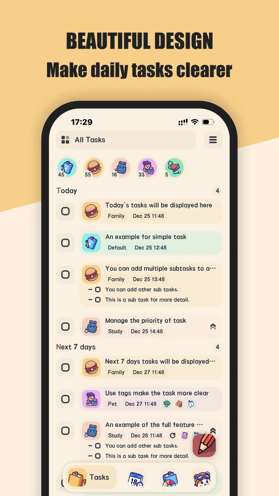{: width="180" .normal }
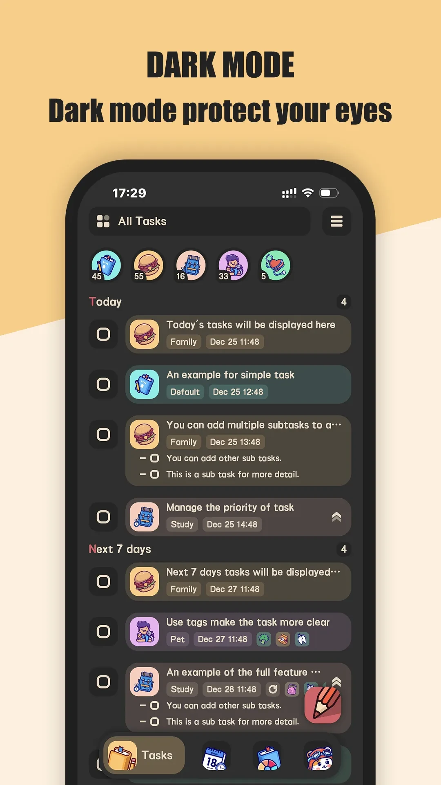{: width="180" .normal }
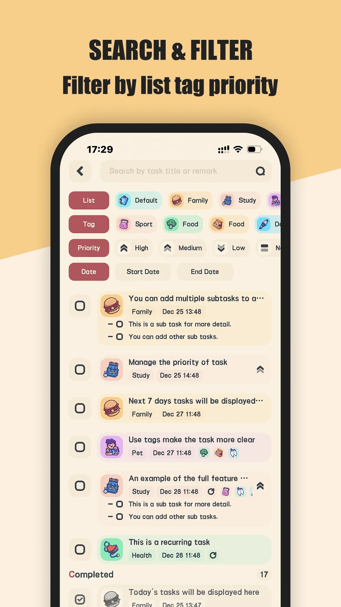{: width="180" .normal }

Penanganan tugas berulang paling layak disebut tersendiri: menyelesaikan tugas saat ini memunculkan tugas berikutnya yang benar-benar baru, subtugas ikut disalin dan diulang, siklus yang terlewat tidak diisi menjadi rentetan catatan yang tidak dikerjakan, dan bisa dihentikan berdasarkan tanggal atau jumlah. Tugas terlambat tidak otomatis digeser, melainkan dikelompokkan jelas di "Terlambat" dan ikut dibawa ke tampilan hari ini. Yang selesai masuk grup "Selesai" dengan waktu tercatat, tetapi tidak ada tempat sampah, tidak ada urung hapus, dan tidak ada impor.

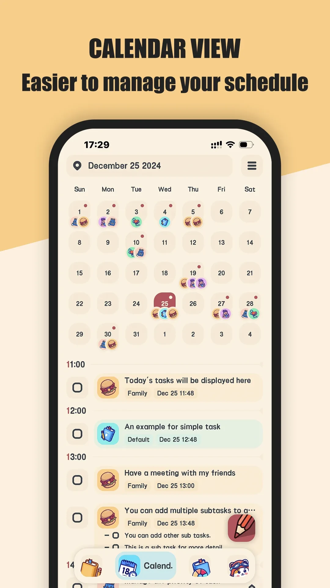{: width="180" .normal }
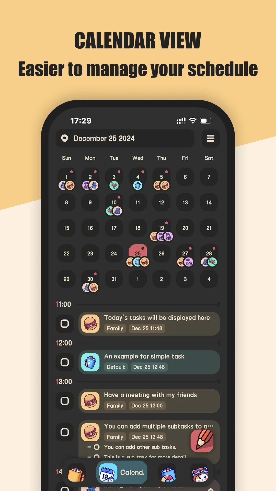{: width="180" .normal }
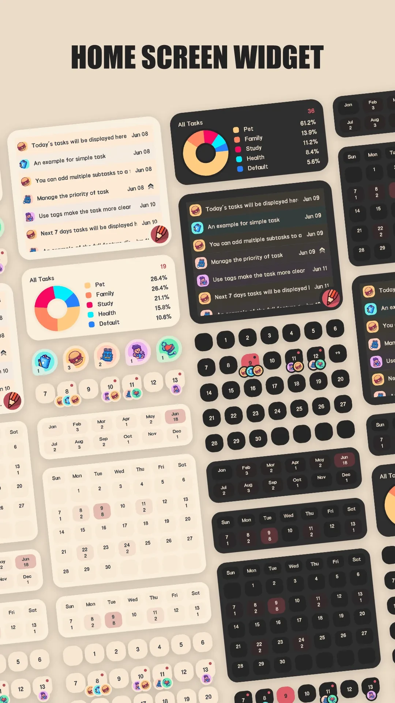{: width="180" .normal }

Versi gratis paling banyak 10 daftar, 10 label, dan 10 subtugas per tugas, sementara jumlah total tugas tidak dibatasi; tema gelap, kunci aplikasi, daftar, label, dan subtugas tanpa batas, serta ekspor CSV termasuk item yang dibuka, dan daftar pengguna non-premium menampilkan iklan. Tidak ada parsifikasi bahasa alami, tidak ada kolaborasi dan penugasan, tidak ada satu ketuk selesai di notifikasi, tidak ada lencana pencapaian, dan tidak ada jeda pengingat tersendiri. Semua "tidak ada" ini sejalan dengan posisinya yang murni lokal: memahami batasnya lebih mudah untuk menilai kecocokan daripada menghitung tambahan sakelar.

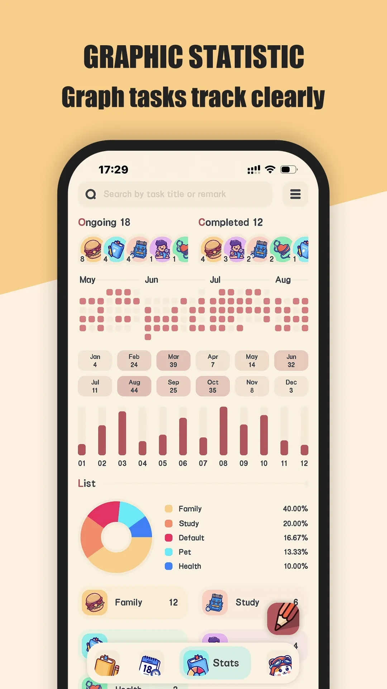{: width="180" .normal }
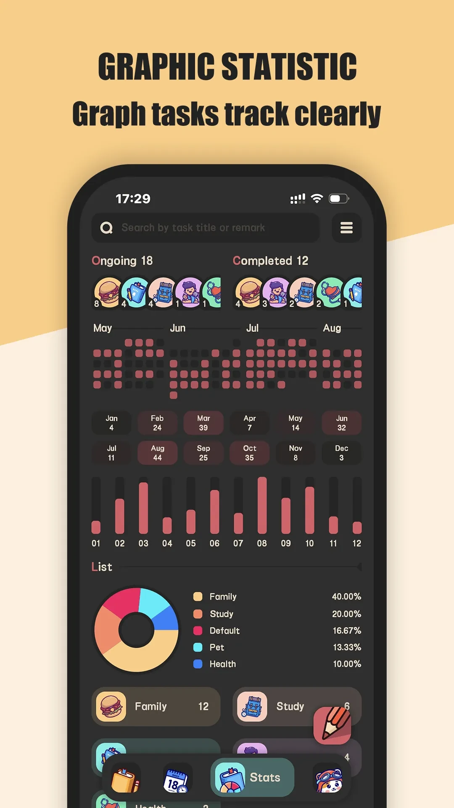{: width="180" .normal }
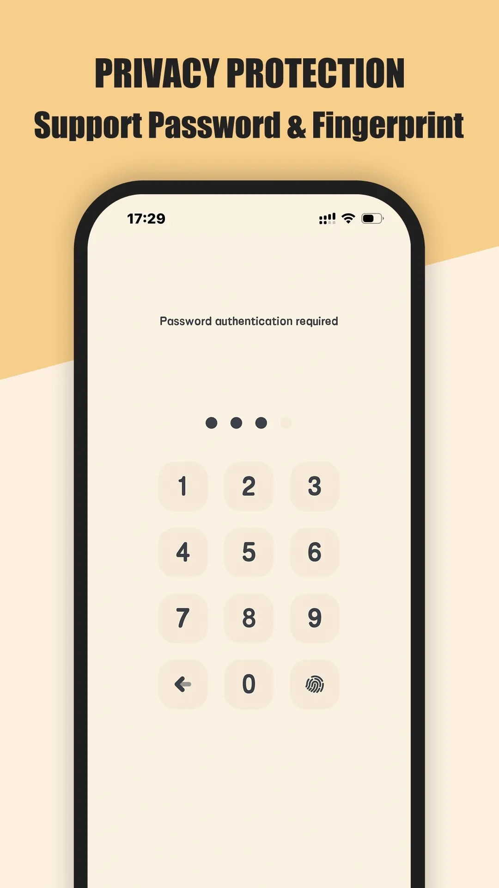{: width="180" .normal }

### Todoist: mempersingkat tahap pertama semaksimal mungkin

Kekuatan utama Todoist ada pada penangkapan: tambah cepat cerdas memampatkan tanggal, prioritas, proyek, dan label ke dalam satu kalimat, dan halaman harga resminya mencantumkan "tambah cepat cerdas" langsung di paket gratis. Untuk organisasi dipakai proyek, subtugas, label, dan filter; tampilan daftar dan papan tersedia, sedangkan tata letak kalender dan tabel masuk paket berbayar.

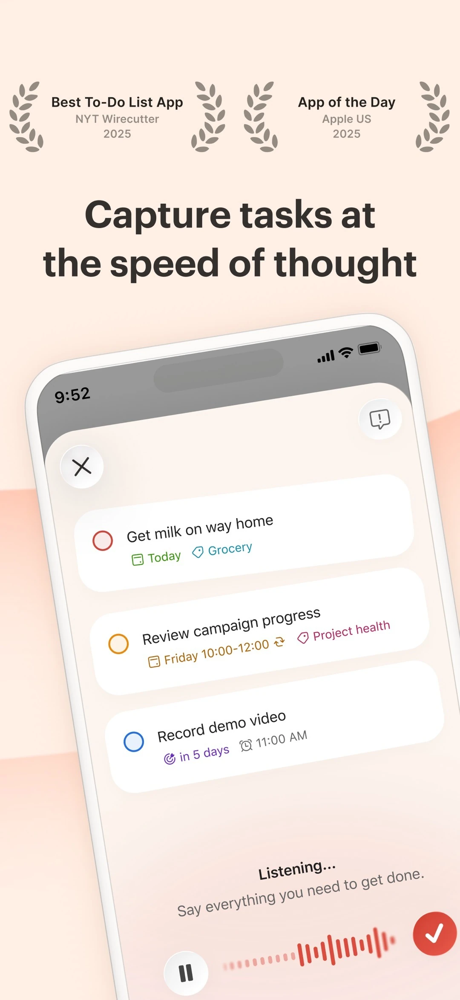{: width="180" .normal }
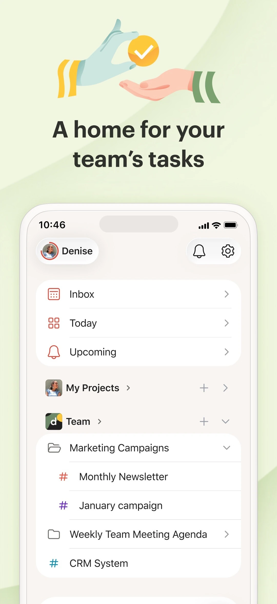{: width="180" .normal }
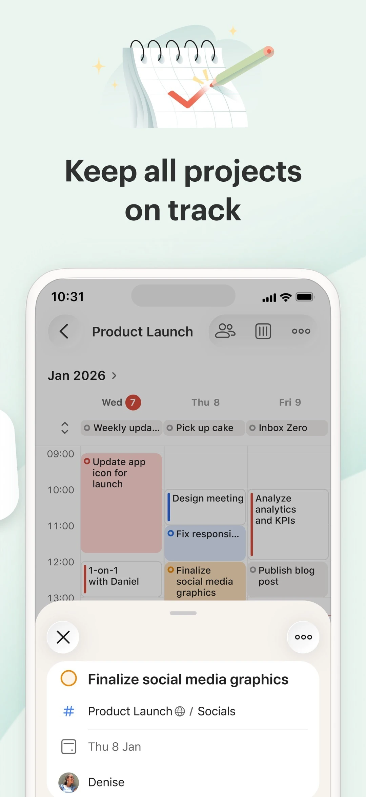{: width="180" .normal }

Halaman harga resminya tegas: paket gratis "Beginner" berisi 5 proyek pribadi, 3 tampilan filter, dan riwayat aktivitas 1 minggu, termasuk pengingat tugas, tanggal jatuh tempo berulang, dan label, tetapi **tidak termasuk** tata letak kalender, pengingat khusus, durasi tugas, dan cadangan otomatis; Pro lewat langganan tahunan US$5/bulan (US$60/tahun) atau bulanan US$7/bulan membuka 300 proyek pribadi, 150 filter, dan riwayat penuh. Kolaborasi, penugasan tugas, dan komentar juga tersedia di gratis, maksimal 5 orang per proyek pribadi. Singkatnya, "catat sekilas" dan "kolaborasi lintas perangkat" dibuat ringan, sementara tinjauan serta tampilan lanjutan ditempatkan di sisi berbayar.

### TickTick: menjadikan pengerjaan sebagai kalender, kebiasaan, dan fokus

TickTick memasukkan satu rangkaian alat pengerjaan di luar daftar ke dalam satu aplikasi: tampilan kalender, papan, matriks prioritas, pomodoro, pelacakan kebiasaan, hitung mundur, dan widget — tangkapan layar toko resminya nyaris berupa daftar fitur.

{: width="180" .normal }
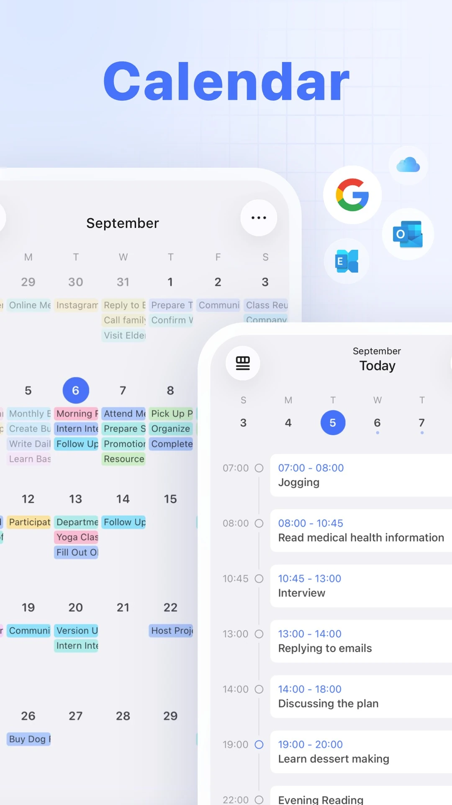{: width="180" .normal }
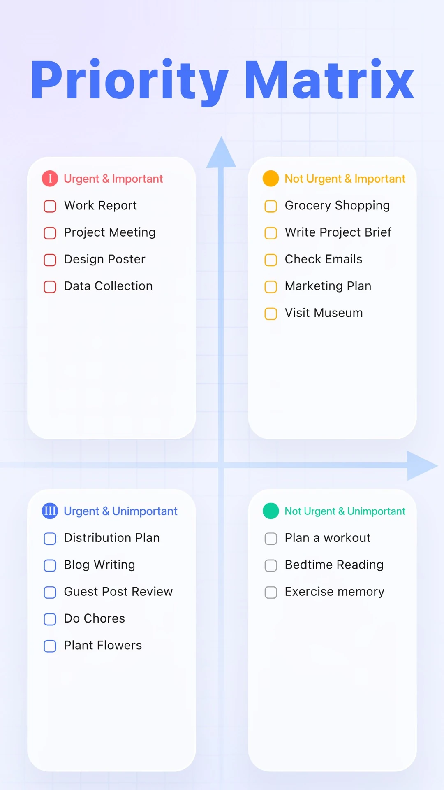{: width="180" .normal }

Kuota gratisnya jatuh pada "jumlah daftar": halaman peningkatan resmi menyebut 9 daftar, 99 tugas per daftar, tampilan daftar dan papan, pengingat tugas bahasa alami, serta sinkronisasi lintas platform; Premium US$49.99/tahun menaikkannya jadi 299 daftar dan 999 tugas per daftar, serta membuka banyak tampilan kalender, durasi tugas, pengingat email, dan tema. Kalau yang Anda inginkan bukan sekadar "mencatat", melainkan menjadikan pengaturan, fokus, dan kebiasaan berada di satu pintu, ini yang paling lebar cakupannya di kelompok ini; sebaliknya, kalau cuma ingin daftar yang tenang, modul-modul itu jadi antarmuka berlebih.

### Microsoft To Do: "My Day" adalah penyusunan ulang tiap hari

Microsoft To Do menumpukan bobotnya pada tahap ketiga. Menurut penjelasan resmi, "My Day" adalah daftar pribadi yang mulai kosong setiap hari, dengan "Saran" memilih kembali tugas; yang hari ini belum selesai akan disarankan lagi esoknya. Ia juga tersambung ke Outlook: email yang ditandai bisa jadi tugas, data tugas disinkronkan lewat Exchange, dan tugas bisa dipecah jadi langkah, diberi catatan, dilampiri berkas hingga 25 MB, serta diberi pengingat jatuh tempo sekali atau berulang.

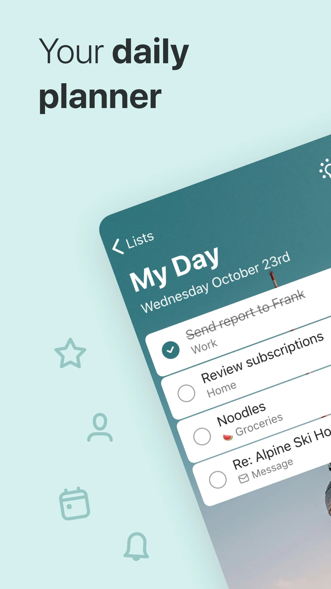{: width="180" .normal }
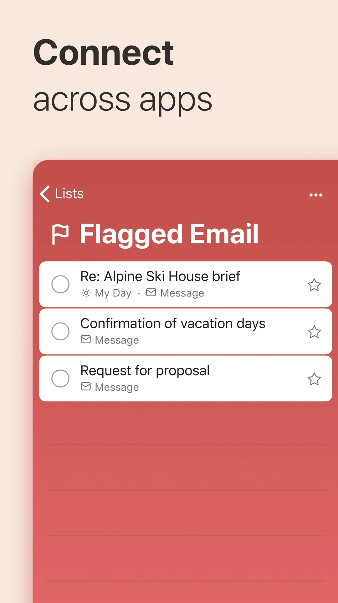{: width="180" .normal }

Ia sinkron gratis antara iPhone, Android, Windows, dan Web, tanpa paket berbayar tersendiri dan tanpa hierarki rumit. Cocok untuk orang yang sudah menjadikan kotak surat meja kerja; ongkosnya kemampuan mengatur yang dangkal, kurang nyaman untuk proyek panjang dan penyaringan kompleks.

### Things 3: menjadikan tahap kedua sebuah struktur

Things 3 satu-satunya di kelompok ini yang menjadikan "struktur organisasi" pemeran utama. Areas menampung bidang tanggung jawab jangka panjang, Projects menampung tujuan yang ada akhirnya, dan di dalam proyek bisa dikelompokkan lagi dengan Headings; Today, Upcoming, Anytime, Someday, dan Logbook membentuk kosakata tampilan yang jelas, dan tambah cepat bisa langsung memuat catatan, subtugas, serta pengingat.

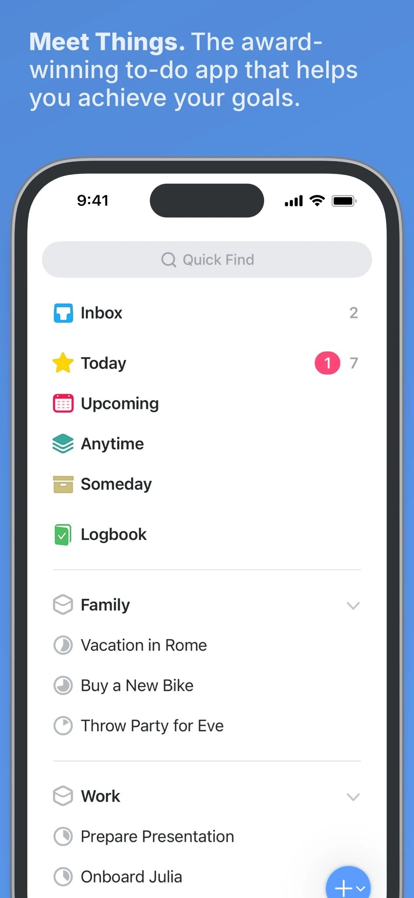{: width="180" .normal }
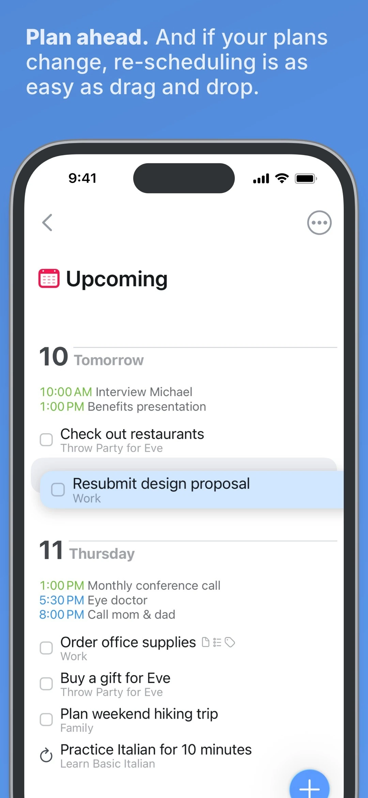{: width="180" .normal }
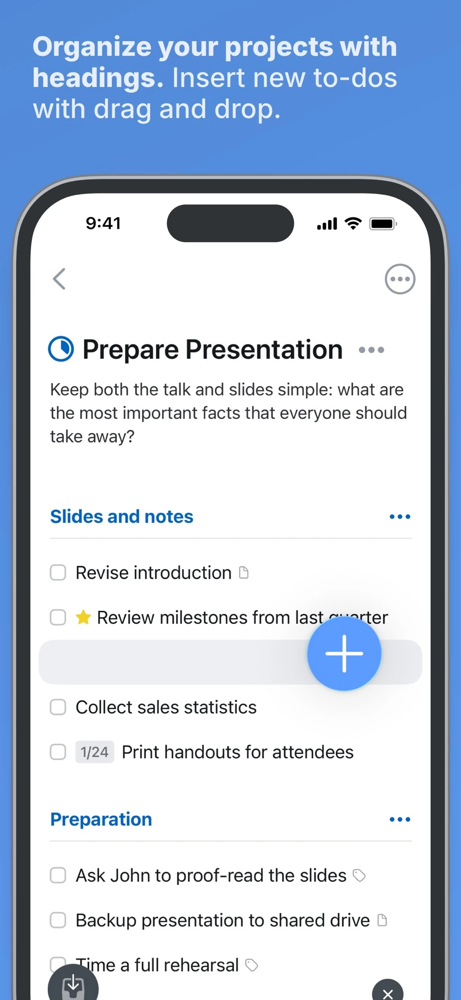{: width="180" .normal }

Ia dibeli sekali per platform, bukan langganan (iPhone dan Apple Watch US$9.99, iPad US$19.99, Mac US$49.99, harga mengikuti halaman resmi), sinkronisasi Things Cloud antarperangkat milik sendiri sudah termasuk pembelian tanpa langganan tambahan. Batasnya juga sangat jelas: hanya ekosistem Apple, tidak ada Android atau Windows, tidak ada versi web, dan tidak ada kolaborasi banyak orang. Penggemarnya kebanyakan bertahan karena struktur jangka panjang ini.

### Google Tasks: menempel di tempat yang sudah Anda pakai

Google Tasks hampir memusatkan seluruh biayanya pada pintu masuk. Menurut penjelasan resmi, tugas bisa dibuat langsung di bilah sisi Gmail, Google Kalender, Chat, dan Docs; setelah diberi tanggal dan jam ia otomatis muncul di kalender, dan tenggat, pengulangan pada tanggal tertentu, serta subtugas juga didukung.

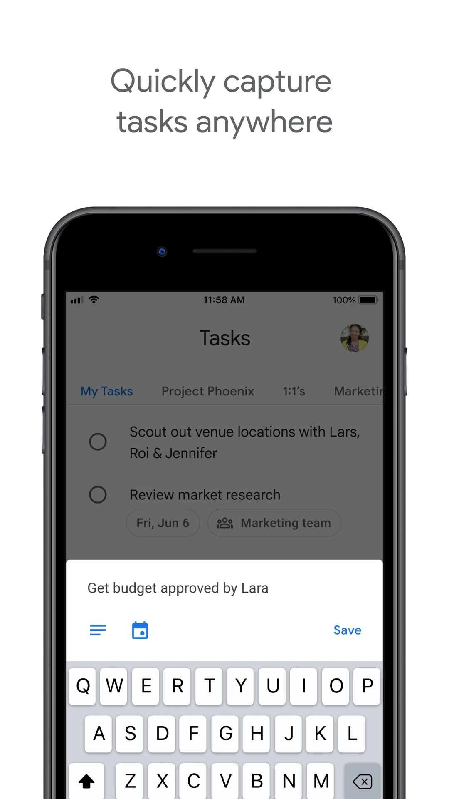{: width="180" .normal }
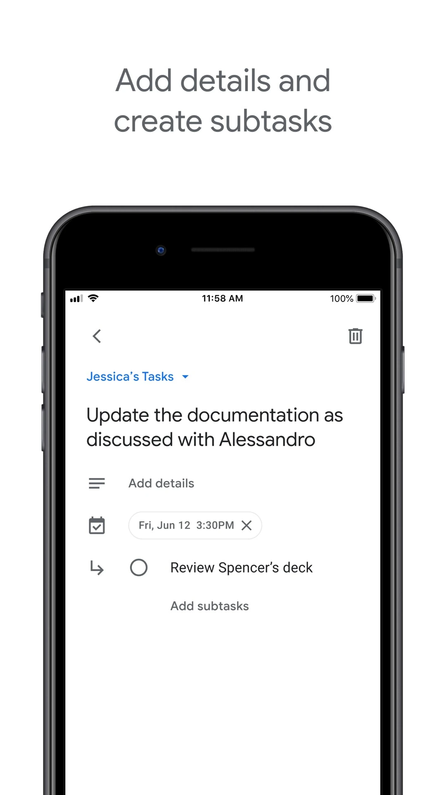{: width="180" .normal }

Pusat bantuan resmi memberi angka kuota: paling banyak 100.000 tugas untuk semua daftar digabung, dan 20.000 tugas belum selesai dalam satu daftar. Subtugasnya hanya satu tingkat, tidak punya tanggal sendiri, dan tidak ada prioritas, papan, atau statistik; saat subtugas ada, aturan berulang tidak bisa dipakai. Ia gratis bersama akun Google, tidak bicara soal data lokal maupun organisasi kompleks — posisinya memang "mencatat sekilas di sebelah email".

### Any.do: menaruh tugas ke dalam agenda hari itu

Any.do menempatkan daftar dan kalender dalam satu layar, menekankan "apa yang dikerjakan hari ini" ketimbang "berapa banyak tugas ada"; selain itu ada perencanaan harian, tugas bersama dan papan kolaborasi, sinkronisasi lintas perangkat, serta paket berbayar untuk tim kecil.

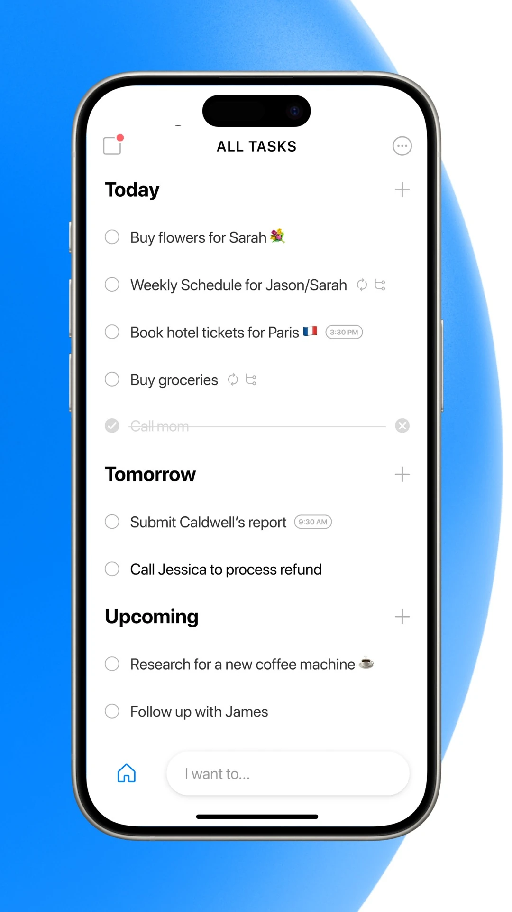{: width="180" .normal }
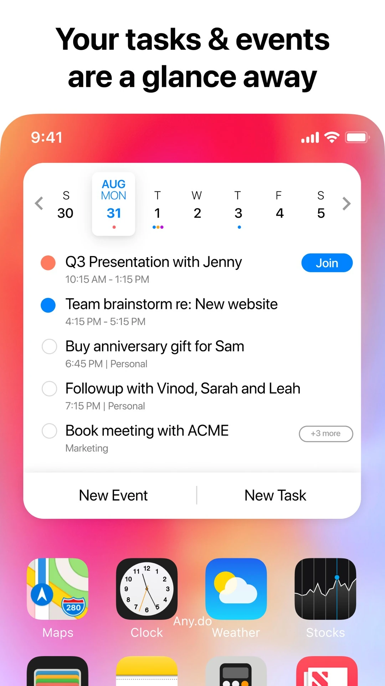{: width="180" .normal }

Seperti Microsoft To Do ia condong ke "penjadwalan", tetapi lebih menekankan kolaborasi dan nilai tambah langganan; versi gratis tersedia, dengan hak dan harga mengikuti halaman harga resmi saat ini. Kalau Anda kebanyakan bekerja sendiri dan tidak berniat memindahkan daftar ke dalam sistem langganan, pastikan dulu kemampuan mana yang masuk paket gratis.

## 5. Satu tugas berubah jadi apa di 7 aplikasi

Masukkan kalimat pembuka tentang laporan kuartalan yang jatuh tempo Rabu depan apa adanya ke masing-masing aplikasi, bedanya bisa dipadatkan jadi satu tabel:

| Produk | Yang terjadi saat input | Masuk wadah apa | Setelah Rabu depan | Setelah dicentang | Di mana datanya |
|---|---|---|---|---|---|
| Meow Todo List | Judul teks polos; tanggal, prioritas, label, pengulangan di panel terpisah | Satu tingkat daftar, label, dan subtugas | Masuk grup "Terlambat" dan ditandai, tidak digeser otomatis | Masuk "Selesai" dengan waktu selesai tercatat; tanpa tempat sampah | Di perangkat; cadangan penuh ke Google Drive atau WebDAV, ekspor CSV premium |
| Todoist | Tambah cepat cerdas memarsing tanggal dan proyek | Proyek, subtugas, label, dan filter | Tetap sebagai tugas belum selesai, tata letak kalender berbayar | Riwayat aktivitas (gratis 1 minggu), visualisasi produktivitas | Sinkronisasi awan dengan akun |
| TickTick | Input bahasa alami, bisa set pengingat dan pengulangan | Daftar, papan, dan matriks prioritas | Terlihat di tampilan kalender, bisa dipasangi fokus dan pomodoro | Catatan selesai ditambah statistik kebiasaan dan fokus | Sinkronisasi lintas platform dengan akun |
| Microsoft To Do | Ditambah manual atau dari email Outlook bertanda | Daftar mendatar dan langkah | Tugas belum selesai masuk "Saran" esok hari | Tetap di daftar, bisa ditandai selesai | Sinkronisasi Exchange dan akun Microsoft |
| Things 3 | Tambah cepat bisa membawa catatan, subtugas, pengingat | Area, Proyek, Heading | Tetap di linimasa Upcoming | Masuk catatan selesai Logbook | Hanya perangkat Apple, sinkronisasi Things Cloud |
| Google Tasks | Dicatat dari bilah sisi Gmail, Kalender, Chat, atau Docs | Daftar mendatar dan satu tingkat subtugas | Tugas bertanggal tampil di kalender | Tetap di daftar setelah ditandai selesai | Akun Google |
| Any.do | Ditambah manual, bisa masuk rencana hari itu | Daftar, tampilan kalender, dan papan bersama | Terlihat berdampingan dengan kalender | Status selesai ditambah tinjauan rencana harian | Sinkronisasi lintas perangkat dengan akun |

Tabel ini sengaja hanya membandingkan ke mana satu tugas pergi. Jumlah fitur, gaya antarmuka, dan banyak tidaknya templat tidak mengubah apakah tugas itu akan terlihat lagi saat dibutuhkan.

## 6. Platform, pembayaran, dan kepemilikan data

| Produk | Platform utama | Skema bayar (halaman resmi 2026-11) | Perlu akun | Data dan ekspor |
|---|---|---|---|---|
| Meow Todo List | Android / iOS | Gratis dibatasi 10 daftar, 10 label, 10 subtugas per tugas; tema gelap, kunci aplikasi, kuota tanpa batas, ekspor CSV item yang dibuka | Tidak | Di perangkat; cadangan penuh bisa diarahkan ke WebDAV sendiri; tanpa impor |
| Todoist | Web / iOS / Android / desktop | Gratis 5 proyek pribadi; Pro US$60/tahun atau US$7/bulan; Business per orang | Ya | Sinkronisasi awan; cadangan otomatis berbayar |
| TickTick | Semua platform (termasuk Web, jam tangan) | Gratis 9 daftar, 99 tugas per daftar; Premium US$49.99/tahun | Ya | Sinkronisasi lintas platform |
| Microsoft To Do | iPhone / Android / Windows / Web | Gratis, tanpa paket berbayar tersendiri | Ya (akun Microsoft) | Sinkronisasi Exchange, mengikuti ekosistem Microsoft 365 |
| Things 3 | Hanya iPhone / iPad / Mac / Apple Watch | Beli sekali per platform, tanpa langganan | Tidak | Sinkronisasi Things Cloud antarperangkat sendiri |
| Google Tasks | Gmail / Kalender / Chat / Docs ditambah aplikasi seluler | Gratis bersama akun Google | Ya | Akun Google; batas total 100.000 tugas |
| Any.do | iPhone / Android / Mac / Windows / Web | Paket gratis ditambah paket langganan (mengikuti halaman harga resmi) | Ya | Sinkronisasi lintas perangkat |

## 7. Temukan dulu tahap mana yang membuat Anda tersendat

Jangan mulai dari "mana yang terbaik", lihat dulu di tahap mana dari lima tahap ini Anda paling sering gagal:

- **Selalu lupa mencatat**: utamakan pintu masuk. Tambah cepat bahasa alami (Todoist, TickTick), bilah sisi Gmail (Google Tasks), dan widget tambah cepat di layar utama (Meow Todo List) semuanya memangkas biaya jadi beberapa detik.
- **Sudah catat tapi tidak ketemu**: masalahnya di tahap kedua. Proyek panjang pilih Things 3 atau Todoist; kalau cuma perlu pengelompokan sederhana, daftar mendatar atau satu tingkat daftar cukup, tidak usah membayar biaya belajar untuk hierarki yang tidak dipakai.
- **Sudah catat tapi tidak dikerjakan**: masalahnya di tahap ketiga. Menyusun ulang "My Day" tiap hari (Microsoft To Do), kalendar berdampingan (Any.do, TickTick), dan menandai keterlambatan dengan jelas (Meow Todo List) adalah tiga jalan keluar berbeda.
- **Selesai tapi jejaknya hilang**: lihat tahap keempat dan kelima. Butuh riwayat penuh pilih Todoist berbayar atau Logbook Things 3; Meow Todo List tidak punya tempat sampah, menghapus tidak bisa dibatalkan, ini perlu diketahui sejak awal.
- **Peduli kepemilikan data**: tidak mau daftar, ingin mencadangkan sendiri, Meow Todo List dan Things 3 (hanya Apple) adalah dua ujungnya; sering ganti perangkat dan butuh sinkronisasi langsung, produk bersinkronisasi akun lebih praktis.

Masih ragu, mulai dari [panduan pemula Meow Todo List](/id/posts/best-meow-todo-list-android/) dan [tutorial lengkap Meow Todo List](/id/posts/tutorial-meow-todo-list/); kalau lebih mementingkan penggunaan luring, data murni lokal, dan widget layar utama, [halaman aplikasi Meow Todo List](/id/apps/meow-todo-list/) memuat penjelasan fungsi yang lebih lengkap.

## 8. Enam kesalahpahaman yang sering muncul

1. **"Makin banyak fitur makin bisa konsisten"**: pomodoro, kebiasaan, papan, dan kolaborasi memang berguna, tapi setiap modul tambah berarti satu tempat lagi yang harus dirawat. Pakai satu dua minggu dulu untuk mencari tahap yang tersendat, baru putuskan perlu alat yang lebih berat atau tidak.
2. **"Menulis daftar berarti sudah maju"**: temuan Masicampo dan Baumeister adalah "rencana konkret" menurunkan pikiran yang menyusup, bukan "membuat daftar" sama dengan menyelesaikan tugas. Sebaiknya tiap butir memuat tindakan berikutnya, bukan cuma kata benda.
3. **"Tugas terlambat sebaiknya otomatis pindah ke hari ini"**: menggeser otomatis membuat "terlewat berapa hari" hilang dari statistik. Menandai keterlambatan dengan jelas cocok untuk yang perlu evaluasi; menyusun ulang tiap hari cocok untuk yang tidak mau ditindih catatan lama, jangan dicampur.
4. **"Versi gratis bebas membuat tugas sepuasnya"**: batasnya bisa jatuh pada jumlah daftar (Meow Todo List 10, TickTick 9), jumlah proyek (Todoist 5), jumlah tugas per daftar (TickTick 99), atau pada subtugas dan panjang riwayat. Lihat dulu apa yang dibatasi sebelum menilai cukup atau tidak.
5. **"Lokal berarti tidak aman, awan berarti lebih praktis"**: lokal tanpa sinkronisasi langsung, ganti perangkat mengandalkan berkas cadangan, tetapi catatan tidak lewat server; awan praktis, ongkosnya akun dan data dititipkan. Ini pilihan, bukan soal bagus atau buruk.

6. **"Tugas berulang sama dengan streak kebiasaan"**: di aplikasi kebiasaan, "baca tiap hari" adalah satu tujuan yang diselesaikan berulang dalam berbagai periode, dan terlewat sehari memutus streak; di aplikasi daftar tugas, "bayar sewa tanggal 1" setiap selesai memunculkan tugas baru yang berdiri sendiri. Mencampur keduanya membuat angka statistik kehilangan makna.

## 9. Tautan unduhan resmi

Di sini hanya dicantumkan halaman toko milik masing-masing produk, tanpa situs unduhan pihak ketiga. Tautan Google Play dibuka satu per satu untuk mencocokkan nama aplikasi, dan ID App Store dicek lewat Lookup API resmi Apple untuk nama aplikasi serta pengembangnya (dicek November 2026); bila aplikasi berganti nama atau wilayah edarnya berubah, ikuti hasil pencarian di toko.

- **Meow Todo List**: [Google Play](https://play.google.com/store/apps/details?id=com.glgjing.money.task.todo.list.meow) · [App Store](https://apps.apple.com/app/id6742345495)
- **Todoist**: [Google Play](https://play.google.com/store/apps/details?id=com.todoist) · [App Store](https://apps.apple.com/app/id572688855)
- **TickTick**: [Google Play](https://play.google.com/store/apps/details?id=com.ticktick.task) · [App Store](https://apps.apple.com/app/id626144601)
- **Microsoft To Do**: [Google Play](https://play.google.com/store/apps/details?id=com.microsoft.todos) · [App Store](https://apps.apple.com/app/id1212616790)
- **Things 3**: [App Store](https://apps.apple.com/app/id904237743) · [Situs resmi](https://culturedcode.com/things/); hanya ekosistem Apple, **tidak ada versi Android**
- **Google Tasks**: [Google Play](https://play.google.com/store/apps/details?id=com.google.android.apps.tasks) · [App Store](https://apps.apple.com/app/id1353634006)
- **Any.do**: [Google Play](https://play.google.com/store/apps/details?id=com.anydo) · [App Store](https://apps.apple.com/app/id497328576)

## 10. Pertanyaan yang sering diajukan (FAQ)

**Apakah aplikasi daftar tugas, to-do list, dan pengelola tugas itu jenis produk yang sama?**
{:.faq-q}

Secara garis besar iya, hanya sebutannya yang menekankan sisi berbeda: intinya selalu "satu tugas, status selesai, dan kapan akan terlihat lagi". Yang perlu dibedakan justru batasnya dengan tiga alat lain — kalender mengurus blok waktu dengan awal akhir jelas, aplikasi kebiasaan mengurus perilaku berulang per periode tanpa akhir, catatan menyimpan isi yang bisa diubah lama, sedangkan daftar tugas mengurus hal yang **berakhir setelah selesai**. Memasukkan keempatnya ke satu alat sering jadi langkah pertama menuju daftar yang tidak terkendali.

**Seberapa rinci satu tugas harus ditulis? Apakah semuanya perlu subtugas?**
{:.faq-q}

Ujinya sederhana: begitu terlihat, bisakah langsung dikerjakan. Butir laporan kuartalan biasanya perlu dipecah jadi beberapa tindakan, membalas email singkat tidak perlu. Di kebanyakan produk subtugas hanya satu tingkat dan tidak punya tanggal sendiri (begitu penjelasan resmi Google), jadi lebih pas dipakai sebagai daftar langkah ketimbang proyek bersarang; versi gratis Meow Todo List paling banyak 10 subtugas per tugas, lebih dari itu perlu dibuka. Daripada memecah semua tugas, pecah saja yang terus Anda tunda.

**Setelah tugas berulang selesai, dari mana tugas berikutnya berasal?**
{:.faq-q}

Ambil contoh Meow Todo List: saat tugas saat ini dicentang, dibuat **tugas berikutnya yang benar-benar baru**, dengan judul, catatan, daftar, label, prioritas, aturan berulang, dan subtugas ikut disalin, subtugas diulang ke belum selesai, waktu rencana melompat ke siklus valid berikutnya; siklus yang sudah lewat tanpa sempat dikerjakan dilewati sehingga mendarat di hari ini atau masa depan, dan bisa dihentikan berdasarkan tanggal atau jumlah. Tugas lama berubah jadi selesai dan tidak berulang lagi. Karena itu riwayatnya adalah rentetan catatan yang benar-benar pernah diselesaikan, bukan satu tugas yang ditulis ulang berkali-kali.

**Kalau tanggalnya lewat dan belum selesai, apakah tugas otomatis pindah ke hari ini?**
{:.faq-q}

Tidak selalu, dan justru di sinilah perbedaannya paling besar. Meow Todo List tidak menggeser otomatis: tugas terlambat dikelompokkan tersendiri di "Terlambat" dan ditandai, sekaligus ikut dibawa ke tampilan hari ini. "My Day" Microsoft To Do mulai kosong tiap hari, yang belum selesai hari ini masuk "Saran" esoknya. Yang pertama buku besar untuk yang suka evaluasi; yang kedua penyusunan ulang harian untuk yang tidak mau ditekan catatan lama. Putuskan dulu Anda lebih takut kehilangan atau lebih takut tertekan.

**Setelah ganti ponsel, apakah tugas lama masih ada?**
{:.faq-q}

Tergantung di mana datanya disimpan. Meow Todo List murni lokal dan tanpa akun, jadi ganti perangkat mengandalkan cadangan serta pemulihan seluruh basis data, dengan Google Drive atau alamat WebDAV milik sendiri, dan cadangan otomatis bisa diatur; ekspor CSV setelah penyaringan berdasarkan daftar, label, prioritas, dan rentang tanggal termasuk fitur premium, tanpa impor yang sepadan. Todoist, TickTick, Microsoft To Do, Google Tasks, dan Any.do memakai sinkronisasi awan berbasis akun sehingga ganti perangkat lebih mudah; Things 3 menyinkronkan antarperangkat Apple milik sendiri lewat Things Cloud. Apa pun pilihannya, sebelum ganti ponsel pastikan cadangan atau sinkronisasi benar-benar pernah berjalan.

**Apakah versi gratis cukup? Biasanya batasnya di mana?**
{:.faq-q}

Yang dibatasi berbeda-beda, jadi jangan hanya menghitung "berapa tugas bisa dibuat". Meow Todo List membatasi 10 daftar, 10 label, dan 10 subtugas per tugas, **jumlah total tugas tidak dibatasi**; TickTick menyebut resmi 9 daftar gratis dan 99 tugas per daftar; Todoist gratis memberi 5 proyek pribadi, 3 filter, dan riwayat aktivitas 1 minggu, dengan tata letak kalender serta cadangan otomatis di paket berbayar; angka resmi Google adalah 100.000 tugas untuk semua daftar digabung dan 20.000 belum selesai per daftar. Lihat dulu batas mana yang paling mudah Anda tabrak sebelum memutuskan berbayar.

**Bisakah menulis tanggal dan jam langsung di judul lalu biarkan aplikasi memarsingnya?**
{:.faq-q}

Tergantung produknya. Todoist dan TickTick sama-sama mencantumkan tambah cepat bahasa alami sebagai kemampuan gratis, satu kalimat bisa memunculkan tanggal dan aturan berulang; Meow Todo List tidak punya parsifikasi bahasa alami, judulnya teks polos, dan tanggal, prioritas, label, serta pengulangan dipilih di panel terpisah, keuntungannya tanpa ambiguitas parsifikasi dan apa yang ditulis itulah yang tersimpan. Selain itu waktu pengingatnya sama dengan waktu rencana tugas, tanpa setelan "ingatkan 10 menit sebelum" tersendiri, ditambah ringkasan harian pada jam tetap.

**Bisa dipakai luring dan tanpa akun?**
{:.faq-q}

Meow Todo List bisa: tugas, daftar, dan label tersimpan di perangkat serta dapat dipakai luring; ongkosnya tidak ada sinkronisasi langsung multiperangkat dan ganti perangkat harus lewat berkas cadangan. Things 3 juga tidak perlu akun, tetapi hanya di perangkat Apple. Produk lainnya berawal dari akun; saat luring biasanya masih bisa melihat atau menyunting sementara, tetapi fungsi penuh bergantung pada sinkronisasi setelah masuk. Untuk benar-benar lokal, pastikan juga ekspor dan cadangan tersedia — itu yang menentukan apakah beberapa tahun lagi datanya masih bisa dibawa pergi.

## 11. Bacaan lanjutan dan indeks istilah

- [Tinjauan aplikasi daftar tugas dan pengelola tugas Android (2026)](/id/posts/pillar-todo-list-task-manager-apps-android/)
- [Meow Todo List vs Todoist: di mana bedanya](/id/posts/vs-meow-todo-and-todoist/)
- [Panduan pemula Meow Todo List](/id/posts/best-meow-todo-list-android/)
- [Tutorial lengkap Meow Todo List](/id/posts/tutorial-meow-todo-list/)
- [Istilah: apa itu subtugas](/id/glossary/what-is-a-subtask/)
