Jika Anda ingin navigasi di skrin tanpa butang keras, [alternatif Assistive Touch](/ms/glossary/what-is-a-floating-window/) ini mulai dari bola terapung sederhana hingga overlay penuh dan kendali gerak isyarat. (Pengguna iPhone: **AssistiveTouch sudah tertanam di iOS** — Tetapan > Kebolehcapaian > Sentuhan > AssistiveTouch — jadi tidak perlu aplikasi.)

Di bawah ini kami membandingkan enam alat Android menurut harga, keupayaan, dan hal yang benar-benar penting, supaya Anda memilih yang tepat. Sebahagian besar pembaca datang dengan satu kendala — terlalu banyak iklan, ciri terhad, atau kebenaran terlalu luas — jadi setiap pilihan dibingkai menurut alasan itu.

## Mengapa melihat di luar aplikasi Assistive Touch dasar

- **Aplikasi percuma sarat iklan** yang mengganggu pengalaman overlay tenang.
- **Terhad pada butang virtual** — tanpa jam, tanpa monitor, tanpa ekstra.
- **Kebenaran kebolehcapaian luas** dengan praktik data tidak jelas di sebahagian klon.
- Anda mungkin menginginkan **gerak isyarat atau pemetaan ulang butang keras** alih-alih bola terapung.
- Alternatif baik menggabungkan **alat terapung berguna lebih banyak** dalam satu tempat.

## Alternatif Assistive Touch terbaik sekilas

{: width="180" .normal }
{: width="180" .normal }
{: width="180" .normal }
{: width="180" .normal }
{: width="180" .normal }

| App | Harga (2026) | Teras | Ekstra |
|---|---|---|---|
| **Floating Assistant** | Teras percuma + buka kunci | Assistive touch | Jam terapung + monitor terus |
| **Easy Touch** | Percuma (iklan) | Bola gaya iOS | Butang virtual, gerak isyarat |
| **Assistive Touch, Easy Tools** | Percuma (iklan) | Bar navigasi | Pengalih cepat, tangkapan skrin |
| **Button Mapper** | Percuma + Pro | Pemetaan ulang keras | Aksi butang tersuai |
| **All in One Gestures** | Percuma + Pro | Kendali gerak isyarat | Sembunyikan butang lunak |
| **Assistive Touch** | Percuma (iklan) | Sentuhan terapung | Butang virtual, tetapan cepat |

---

### 1. Floating Assistant — terbaik all-in-one

{: width="180" .normal }
{: width="180" .normal }
{: width="180" .normal }
{: width="180" .normal }
{: width="180" .normal }

Floating Assistant menghadirkan **assistive touch, jam terapung, dan monitor sistem terapung** ke skrin Android Anda, membiarkan Anda mengontrol telefon pintar dari satu overlay praktikal.

**Kelebihan**
- **Bola assistive touch** dengan butang virtual home, back, recent, dan volume, boost satu ketik, kunci skrin, tangkapan skrin, senter, dan akses aplikasi cepat.
- **Jam terapung dan hitung mundur** di atas aplikasi lain — praktikal saat skrin penuh.
- **Monitor terapung** memaparkan suhu CPU, penggunaan, RAM, dan bateri terus, dengan boost satu ketik — ideal saat gaming.
- **Hanya menggunakan perkhidmatan Kebolehcapaian untuk kontrol terdaftar** dan tidak mengumpulkan data peribadi atau sensitif.
- Melindungi butang fisik dan bekerja baik di telefon pintar skrin lebar.
- Teras percuma dengan buka kunci untuk pelarasan ekstra.

**Kelemahan**
- Hanya Android — tidak ada aplikasi iOS.
- Sebahagian tema dan ekstra monitor di sebalik buka kunci.
- Lapisan terapung memakan sedikit ruang skrin.

**Terbaik untuk:** pengguna yang ingin satu overlay berisi butang, jam, dan pemantauan.

**Muat turun Floating Assistant**
- [Google Play](https://play.google.com/store/apps/details?id=com.glgjing.floating.apps.assistive.touch.pro)

---

### 2. Easy Touch — terbaik bola gaya iOS

Easy Touch adalah **bola assistive gaya iOS** populer untuk Android, dengan navigasi virtual, pengalih cepat, gerak isyarat, dan tema yang meniru AssistiveTouch iPhone.

**Kelebihan**
- **Bola terapung** dengan kontrol home, back, recent, dan volume.
- **Pengalih cepat** untuk Wi-Fi, Bluetooth, senter, kecerahan skrin, dan mode suara.
- **Gerak isyarat** (ketik dua kali, tahan lama) untuk memicu aksi.
- **Tema** diperbarui rutin untuk mempersonalisasi bola.
- Percuma digunakan.

**Kelemahan**
- **Didukung iklan**, yang boleh mengganggu.
- Tanpa jam terapung atau monitor sistem.
- Pelarasan dalam lebih ringan dari Floating Assistant.

**Terbaik untuk:** pengguna yang khusus ingin bola terapung bergaya iPhone.

**Muat turun Easy Touch**
- [Google Play](https://play.google.com/store/apps/details?id=com.easytouch.assistivetouch)

---

### 3. Assistive Touch, Easy Tools — terbaik pengalih cepat

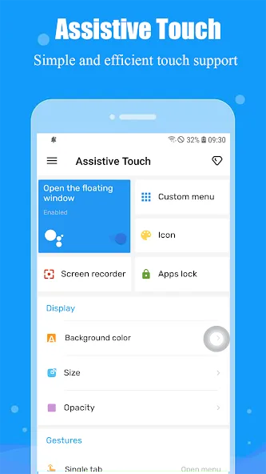{: width="180" .normal }
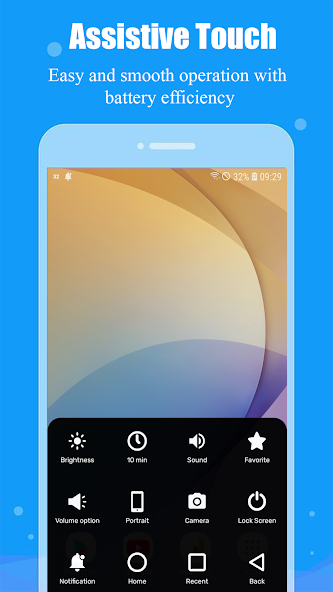{: width="180" .normal }
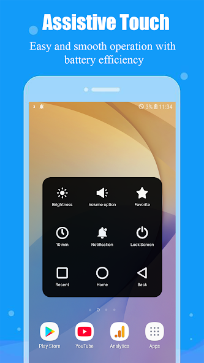{: width="180" .normal }
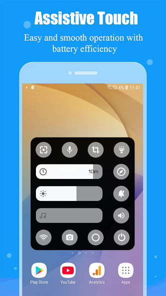{: width="180" .normal }

Assistive Touch, Easy Tools menambahkan **overlay bar navigasi** dengan recent/home/back plus rangkaian pengalih cepat, tangkapan skrin, dan perekaman skrin.

**Kelebihan**
- **Kontrol navigasi** (recent, home, back) tanpa butang keras.
- **Pengalih cepat** untuk Wi-Fi, Bluetooth, senter, daya, mode pesawat, lokasi.
- Pelarasan **kecerahan/volume** dan peluncur aplikasi kegemaran.
- Pintasan **tangkapan skrin dan perekaman skrin**.
- Percuma dengan iklan.

**Kelemahan**
- Tier percuma didukung iklan.
- Tanpa jam terapung atau monitor.
- Overlay boleh terasa padat dengan banyak pengalih.

**Terbaik untuk:** pengguna yang ingin tetapan cepat terbanyak dalam satu panel.

**Muat turun Assistive Touch, Easy Tools**
- [Google Play](https://play.google.com/store/apps/details?id=mtr.assistivetouch.easytools)

---

### 4. Button Mapper — terbaik pemetaan ulang butang keras

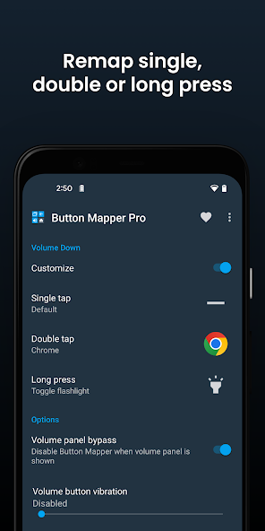{: width="180" .normal }
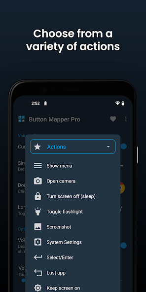{: width="180" .normal }
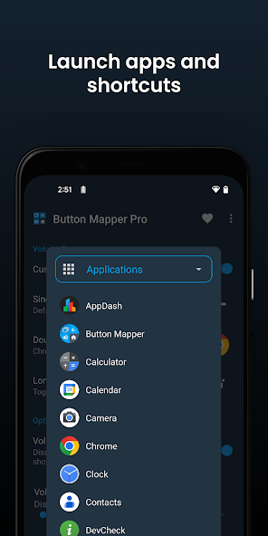{: width="180" .normal }
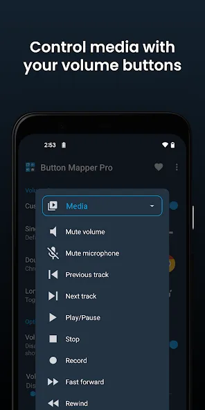{: width="180" .normal }
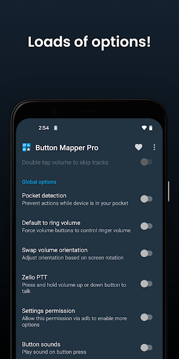{: width="180" .normal }

Button Mapper **memetakan ulang butang fisik Anda** (volume, Bixby, dan lain-lain) ke aksi tersuai — pendekatan berbeza untuk "kontrol kebolehcapaian" yang sama sekali tidak perlu bola terapung.

**Kelebihan**
- **Petakan ulang butang keras** untuk meluncurkan aplikasi, mengalihkan senter, tangkapan skrin, kontrol media, dan lain-lain.
- **Berfungsi tanpa overlay**, jadi tidak ada yang terapung di skrin Anda.
- Bagus untuk **butang rusak atau canggung** dan kebutuhan kebolehcapaian.
- Pengembang terpercaya (sama dengan DevCheck), percuma dengan upgrade Pro.
- Tanpa iklan di pengalaman teras.

**Kelemahan**
- Bukan bola assistive terapung — paradigma berbeza.
- Sebahagian butang dan aksi perlu versi Pro.
- Penyiapan lebih teknis dari sekadar bola sederhana.

**Terbaik untuk:** pengguna yang lebih suka memanfaatkan butang nyata daripada ikon terapung.

**Muat turun Button Mapper**
- [Google Play](https://play.google.com/store/apps/details?id=flar2.homebutton)

---

### 5. All in One Gestures — terbaik kendali gerak isyarat

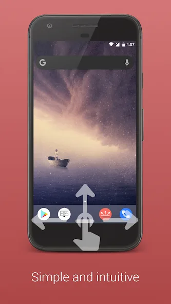{: width="180" .normal }
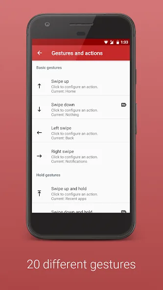{: width="180" .normal }
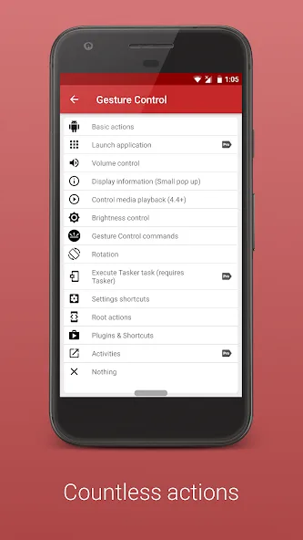{: width="180" .normal }
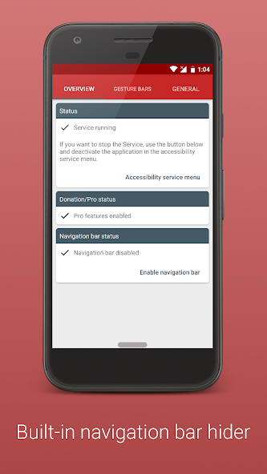{: width="180" .normal }
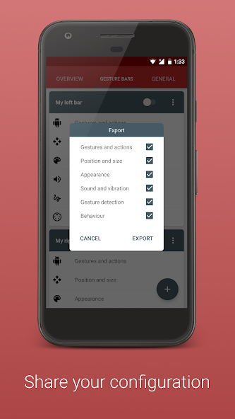{: width="180" .normal }

All in One Gestures membiarkan Anda **menyembunyikan butang lunak dan mengontrol peranti dengan gerak isyarat** — sapuan, cubit, dan lain-lain — untuk pengalaman bersih tanpa butang.

**Kelebihan**
- **Kendali gerak isyarat** (sapu, cubit, tahan lama) untuk memicu aksi.
- **Sembunyikan bar navigasi** untuk kesan skrin penuh, imersif.
- Pemetaan gestur-ke-aksi yang dapat disesuaikan.
- Ringan dan stabil.
- Percuma dengan upgrade Pro.

**Kelemahan**
- Lengkung belajar gerak isyarat bagi pengguna baru.
- Tanpa jam terapung atau monitor.
- Kurang "assistive" bagi yang ingin butang kelihatan.

**Terbaik untuk:** pengguna yang lebih suka gerak isyarat daripada bola terapung.

**Muat turun All in One Gestures**
- [Google Play](https://play.google.com/store/apps/details?id=com.conena.navigation.gesture.control)

---

### 6. Assistive Touch — terbaik sentuhan terapung sederhana

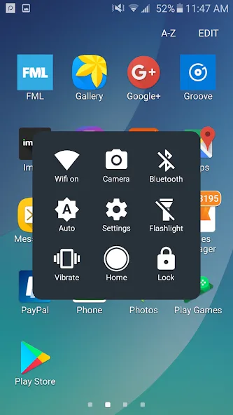{: width="180" .normal }
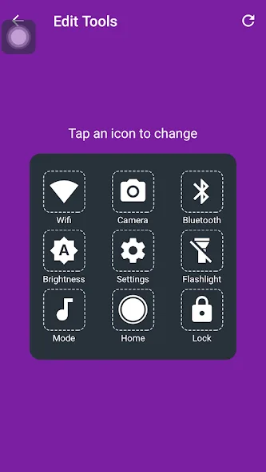{: width="180" .normal }
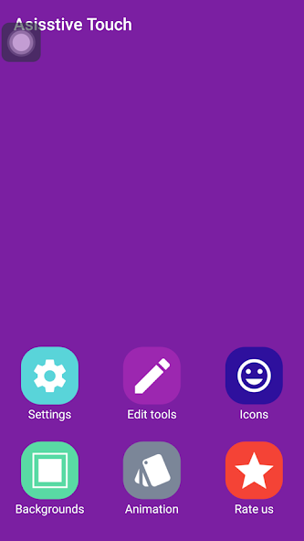{: width="180" .normal }

Assistive Touch (smarttool) adalah **aplikasi sentuhan terapung lugas** dengan butang virtual dan tetapan cepat, dekat dengan pengalaman AssistiveTouch klasik.

**Kelebihan**
- **Butang sentuhan terapung** dengan home/back/recent dan volume.
- Pintasan **tetapan cepat** untuk pengalih umum.
- Tata letak sederhana, familier.
- Percuma digunakan.
- Mudah diaktifkan dan disembunyikan.

**Kelemahan**
- Didukung iklan.
- Ekstra lebih sedikit (tanpa jam/monitor) daripada Floating Assistant.
- UI gaya klon dengan tema terhad.

**Terbaik untuk:** pengguna yang ingin perilaku sentuhan terapung klasik, tidak lebih.

**Muat turun Assistive Touch**
- [Google Play](https://play.google.com/store/apps/details?id=com.wanata.assistive.touch)

---

## Perbandingan keupayaan teras

| Keupayaan | Floating Assistant | Easy Touch | Assistive Touch, Easy Tools | Button Mapper | All in One Gestures | Assistive Touch |
|---|---|---|---|---|---|---|
| **Platform** | Android | Android | Android | Android | Android | Android |
| **Bola assistive terapung** | Ya | Ya | Ya (bar nav) | Tidak (keras) | Tidak (gerak isyarat) | Ya |
| **Virtual home/back/recent** | Ya | Ya | Ya | Via butang | Via gerak isyarat | Ya |
| **Volume / pengalih cepat** | Ya | Ya | Ya | Ya (dipetakan) | Ya (dipetakan) | Ya |
| **Boost satu ketik / cleaner** | Ya | Tidak | Tidak | Tidak | Tidak | Tidak |
| **Tangkapan skrin / senter** | Ya | Ya | Ya | Dapat dipetakan | Dapat dipetakan | Sebahagian |
| **Jam terapung** | Ya | Tidak | Tidak | Tidak | Tidak | Tidak |
| **Monitor sistem terapung** | Ya (CPU/RAM/bateri) | Tidak | Tidak | Tidak | Tidak | Tidak |
| **Gerak isyarat** | Sebahagian | Ya | Sebahagian | Tidak | Ya (kuat) | Sebahagian |
| **Pintasan/app tersuai** | Ya | Ya | Ya | Ya (butang) | Ya (gerak isyarat) | Ya |
| **Postur privasi** | Kuat (tanpa data) | Waspada (iklan) | Waspada (iklan) | Kuat | Kuat | Waspada (iklan) |
| **Iklan / IAP** | Teras percuma | Iklan | Iklan | Percuma + Pro (tanpa iklan) | Percuma + Pro | Iklan |
| **Tier percuma** | Murah hati | Ya | Ya | Ya | Ya | Ya |

---

## Cara memilih

- Ingin **butang + jam + monitor terus dalam satu overlay** → **Floating Assistant**
- Ingin **bola terapung bergaya iPhone** → **Easy Touch**
- Ingin **pengalih cepat terbanyak dalam panel** → **Assistive Touch, Easy Tools**
- Lebih suka **memanfaatkan butang nyata** → **Button Mapper**
- Lebih suka **gerak isyarat daripada bola** → **All in One Gestures**
- Ingin **sentuhan terapung klasik sederhana** → **Assistive Touch**

## Alternatif Assistive Touch mana yang sesuai untuk setiap jenis pengguna

Jadual perbandingan memeringkat keupayaan; bahagian ini mulai dari tetapan yang Anda tinggalkan.

| Jika Anda berasal dari... | Pilih | Mengapa sesuai |
|---|---|---|
| Bola terapung gaya iOS di telefon pintar jangkung | **Floating Assistant** | Bola terapung tepi tetap dalam jangkauan ibu jari, dan overlay sama menambah jam terapung serta bacaan CPU/RAM/bateri terus. |
| Pemetaan ulang butang keras | **Button Mapper** | Butang volume tetap bekerja nyata tanpa apa pun digambar di atas aplikasi Anda. |
| Navigasi gerak isyarat dan tanpa bola sama sekali | **All in One Gestures** | Sapuan tepi menggantikan bar navigasi, sehingga skrin tetap bersih. |
| Klon sarat iklan dengan kebenaran samar | **Floating Assistant** atau **Button Mapper** | Teras percuma tidak mengumpulkan data peribadi, dan perkhidmatan Kebolehcapaian hanya digunakan untuk aksi yang Anda aktifkan. |
| AssistiveTouch di iPhone | Tidak perlu pasang | AssistiveTouch sudah tertanam di iOS, jadi tidak ada yang perlu diganti di platform itu. |

Sebelum menetap di aplikasi butang terapung apa pun, periksa dua hal: aksi mana yang benar-benar perlu **perkhidmatan Kebolehcapaian**, dan apakah bola boleh diparkir dalam zona jangkauan ibu jari di skrin jangkung. Dua cek itu memisahkan satu-hand-helper yang usable dari overlay yang akhirnya Anda matikan.

## Cara migrasi ke alternatif Assistive Touch yang lebih baik

1. **Tentukan gaya Anda** — bola terapung, pemetaan keras, atau gerak isyarat — lalu pilih dari jadual.
2. **Pasang dan berikan kebenaran**: tampilkan-di-atass-aplikasi-lain untuk overlay, dan Kebolehcapaian untuk aksi butang/gerak isyarat.
3. **Pelarasan bola atau gerak isyarat** — tambahkan aplikasi, pengalih, dan tangkapan skrin yang paling sering digunakan.
4. **Aktifkan ekstra yang akan digunakan** — jam/monitor Floating Assistant, atau pintasan butang volume Button Mapper.
5. **Tinjau privasi**: utamakan aplikasi yang tidak mengumpulkan data (Floating Assistant, Button Mapper, All in One Gestures) daripada klon sarat iklan.

## FAQ

**Apakah Floating Assistant alternatif Assistive Touch terbaik?**
{:.faq-q}

Jika Anda ingin satu overlay berisi assistive touch + jam terapung + pemantauan CPU/RAM/bateri terus dengan boost satu ketik, ya — lima lain-lain adalah tugas-tunggal (bola, gerak isyarat, atau pemetaan keras) tanpa jam atau monitor.

**Alternatif Assistive Touch mana yang punya jam terapung dan monitor?**
{:.faq-q}

Hanya Floating Assistant. Easy Touch, Assistive Touch, dan lain-lain menawarkan butang virtual atau gerak isyarat tetapi tanpa jam dan tanpa bacaan sistem terus.

**Alternatif Assistive Touch mana yang menghindari iklan?**
{:.faq-q}

Floating Assistant (teras percuma, buka kunci pilihan), Button Mapper, dan All in One Gestures (percuma + Pro, tanpa iklan) adalah pilihan ramah-iklan; klon Easy Touch / Assistive Touch didukung iklan.

**Apakah ada Assistive Touch untuk iPhone?**
{:.faq-q}

Ya — AssistiveTouch sudah tertanam di iOS (Tetapan > Kebolehcapaian > Sentuhan > AssistiveTouch), jadi tidak perlu aplikasi di iPhone.

[Dapatkan Floating Assistant](/ms/apps/floating-assistant/) — tersedia di Android.

## Istilah berkaitan

- [Apakah Itu Assistive Touch?](/ms/glossary/what-is-assistive-touch/)
- [Apakah Itu Tetingkap Terapung?](/ms/glossary/what-is-a-floating-window/)
