CCleaner memang terkenal, tetapi di Android modern efeknya terhad dan sebahagian pengguna menginginkan **pembersihan lebih ringan atau pemantauan nyata**. [Alternatif CCleaner](/ms/glossary/what-is-a-system-monitor/) ini merangkumi keduanya — dan kami akan jujur tentang apa yang boleh dan tidak boleh dilakukan pembersih.

Di bawah ini kami membandingkan enam aplikasi tentang harga, platform, dan keupayaan yang benar-benar penting, supaya Anda memilih alat yang tepat bukan sekadar nama merek. Sebahagian besar pembaca datang dengan satu kendala — harga langganan, daftar penghapusan tidak jelas, atau tanpa bacaan terus — jadi setiap pilihan dibingkai menurut alasan itu.

## Mengapa melihat di luar CCleaner

- **Efek terhad di Android modern** — sistem sudah mengurus cache dan tugasan latar; "pembersihan" sering menghemat sedikit.
- **Aplikasi pernah ditarik dari beberapa kedai** dan tidak lagi wajib seperti dulu.
- **Iklan dan ajakan langganan** di versi seluler.
- **Kekhawatiran privasi** — sebahagian pembersih meminta kebenaran luas.
- Anda mungkin menginginkan **pemantauan nyata** (apa yang memakan CPU/bateri) bukan sekadar pembersihan.

> Realita: di Android modern, kemenangan storage terbesar adalah memadam file tidak terpakai dan media besar — bukan "mengosongkan RAM." Pilih alat untuk *manajemen storage selamat*, dan gunakan monitor untuk menemukan apa yang benar-benar menguras sumber daya.

## Alternatif CCleaner terbaik sekilas

| App | Harga (2026) | Platform | Terbaik untuk |
|---|---|---|---|
| **System Monitor** | Teras percuma + buka kunci | Android | Monitor + boost + pembersih ringan |
| **Files by Google** | Percuma | Android | Pembersihan storage selamat resmi |
| **SD Maid** | Percuma + Pro | Android | Pembersihan dalam & hati-hati |
| **CCleaner** | Percuma + sub | Android | Merek familier, bersih cepat |
| **Avast Cleanup** | Percuma + sub | Android | Bersih + bersih foto |
| **Norton Clean** | Percuma | Android | Pembersih junk/cache sederhana |

---

### 1. System Monitor — terbaik untuk monitor plus pembersihan

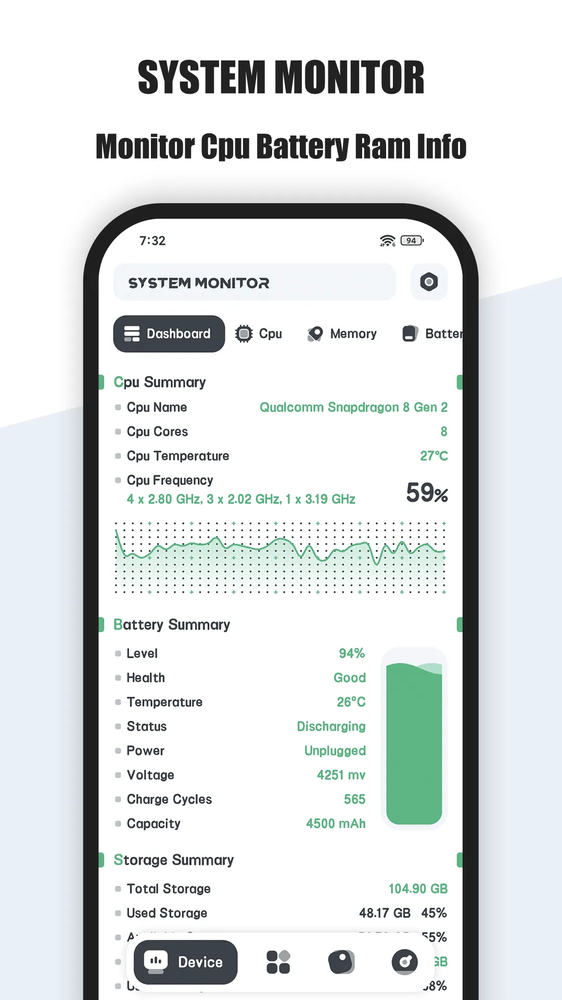{: width="180" .normal }
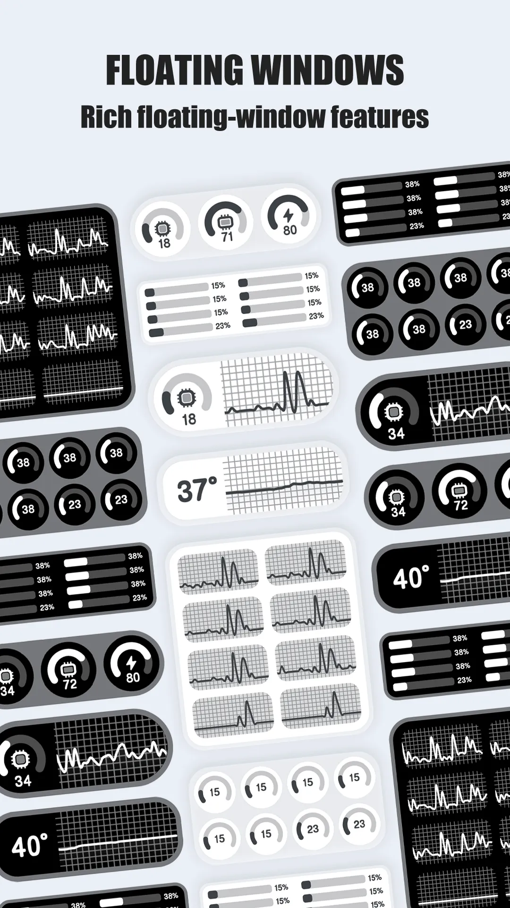{: width="180" .normal }
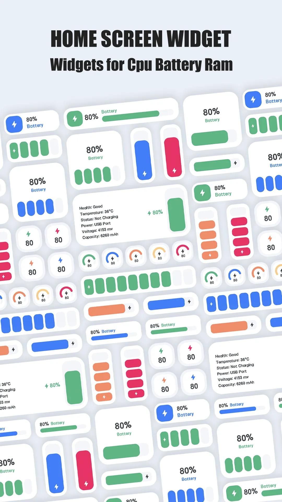{: width="180" .normal }
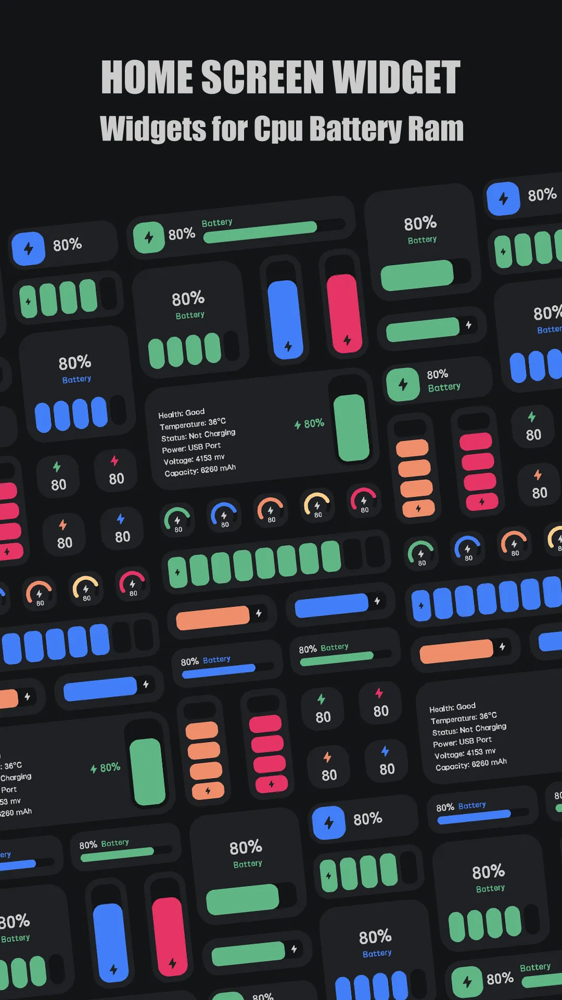{: width="180" .normal }
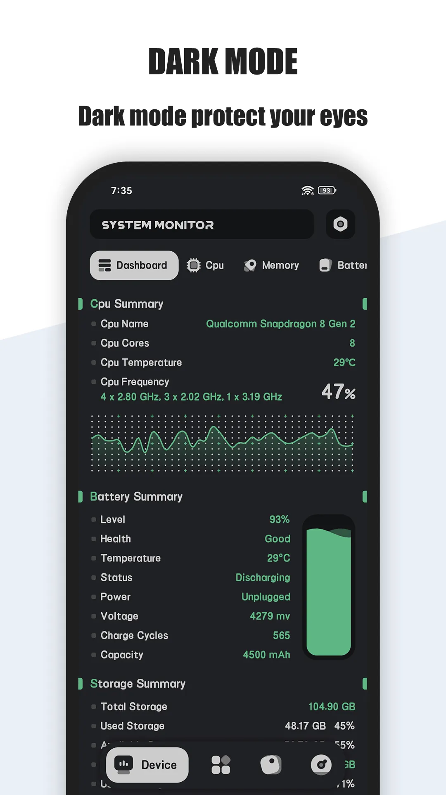{: width="180" .normal }

System Monitor adalah **alat Android all-in-one** dengan monitor CPU, pembersih storage, RAM booster, dan dokter bateri — sehingga Anda dapat wawasan *dan* pembersihan dalam satu tempat.

**Kelebihan**
- **Pemantauan CPU, RAM, dan bateri terus** dengan perlindungan overheat.
- **Pembersih storage** untuk junk dan cache, plus analisa RAM dengan boost satu ketik.
- **Dokter bateri** dengan lengkung kesihatan, tegangan, dan suhu.
- **Tetingkap terapung dan widget** untuk visibilitas berkelanjutan.
- Multi-tema dan teras percuma.

**Kelemahan**
- Hanya Android.
- Pembersihan lebih ringan dari pembersih khusus (kekuatannya adalah pemantauan).
- Sebahagian ciri di sebalik buka kunci Pro.

**Terbaik untuk:** pengguna yang ingin *melihat* apa yang salah lalu memperbaikinya, bukan sekadar menyapu cache.

**Muat turun System Monitor**
- [Google Play](https://play.google.com/store/apps/details?id=com.glgjing.marvel)

---

### 2. Files by Google — terbaik pembersih selamat

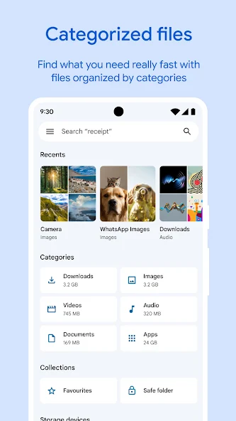{: width="180" .normal }
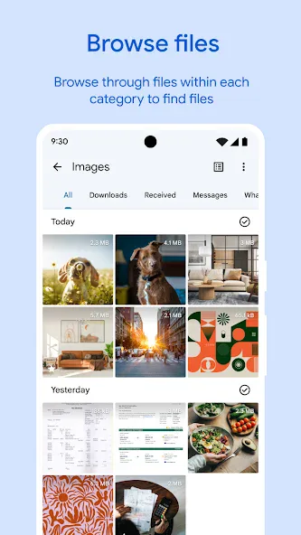{: width="180" .normal }
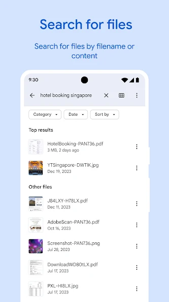{: width="180" .normal }
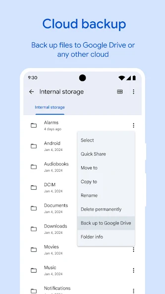{: width="180" .normal }
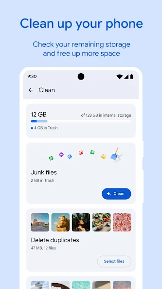{: width="180" .normal }

Files by Google adalah **pengurus storage resmi** Google — mengosongkan file tidak terpakai, menemukan duplikat, dan membantu menghemat ruang dengan reka bentuk ramah privasi tanpa tugasan latar agresif.

**Kelebihan**
- **Resmi dan selamat** — buatan Google, kebenaran minimum, tanpa perilaku meragukan.
- **Pembersihan storage cerdas**: file tidak terpakai, duplikat, media besar, dan cache aplikasi.
- **Penjelajahan dan berkongsi file** offline dengan rekan.
- **Tanpa iklan, tanpa langganan** — sepenuhnya percuma.
- UI jelas dan sederhana untuk siapa saja.

**Kelemahan**
- **Tanpa RAM boost atau pemantauan sistem** — hanya storage.
- Tanpa perburuan file "mayat" dalam seperti SD Maid.
- Hanya Android.

**Terbaik untuk:** pengguna yang ingin cara terpercaya dan tanpa ribet untuk mengambil kembali storage.

**Muat turun Files by Google**
- [Google Play](https://play.google.com/store/apps/details?id=com.google.android.apps.nbu.files)

---

### 3. SD Maid — terbaik pembersih dalam

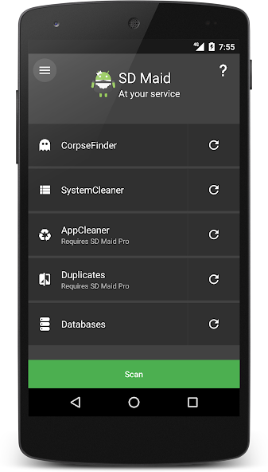{: width="180" .normal }
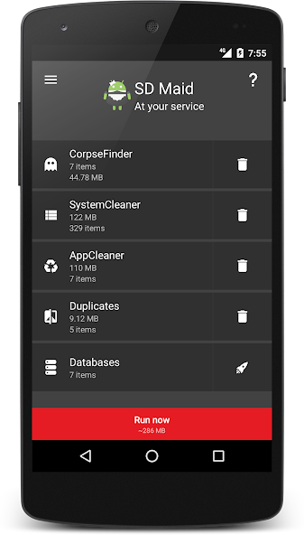{: width="180" .normal }
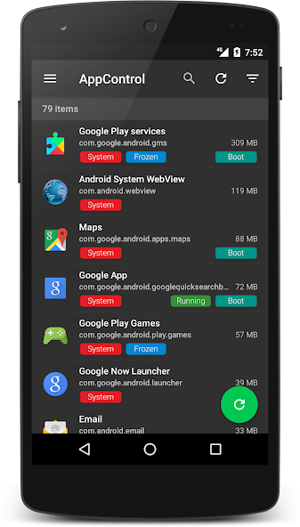{: width="180" .normal }
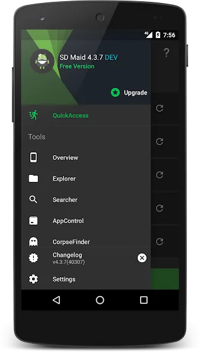{: width="180" .normal }
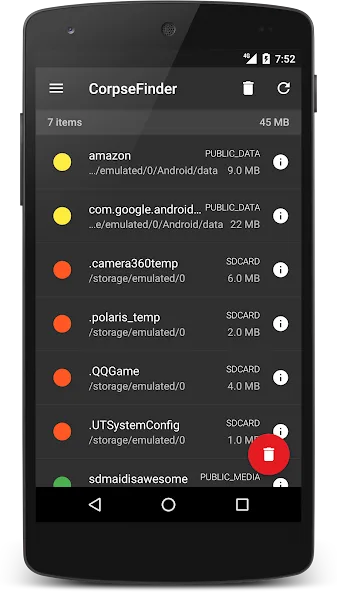{: width="180" .normal }

SD Maid adalah **pembersih dalam yang hati-hati** untuk Android: menemukan file sisa ("mayat") dari aplikasi yang dihapus, duplikat, database untuk optimasi, dan kontrol aplikasi.

**Kelebihan**
- **Pencari mayat** memadam sisa yang terlewat pembersih lain.
- **Carian duplikat dan file** di seluruh storage.
- **Kontrol / pembekuan aplikasi** dan pengoptimal database.
- **Penjadwal** untuk pemeliharaan automatik.
- Reputasi kuat di kalangan power user; tier percuma berguna.

**Kelemahan**
- Hanya Android.
- Ciri terbaik (pencari mayat, kontrol aplikasi, penjadwal) perlu SD Maid Pro.
- UI lebih padat — kurang ramah pengguna kasual.

**Terbaik untuk:** power user yang ingin pembersihan menyeluruh dan terkendali.

**Muat turun SD Maid**
- [Google Play](https://play.google.com/store/apps/details?id=eu.thedarken.sdm)

---

### 4. CCleaner — terbaik bersih cepat familier

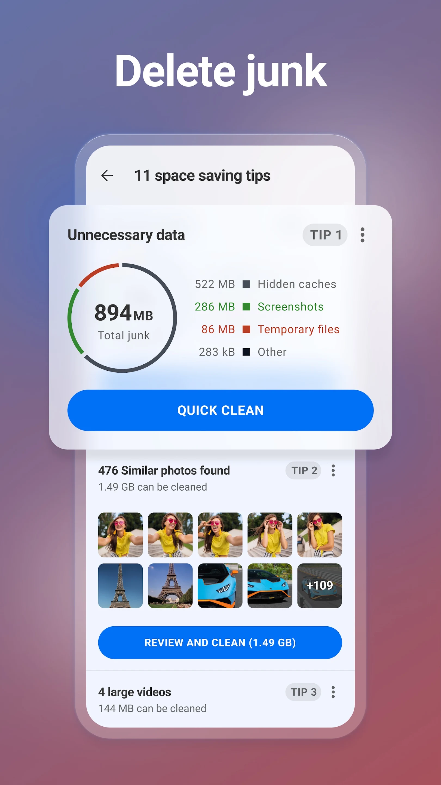{: width="180" .normal }
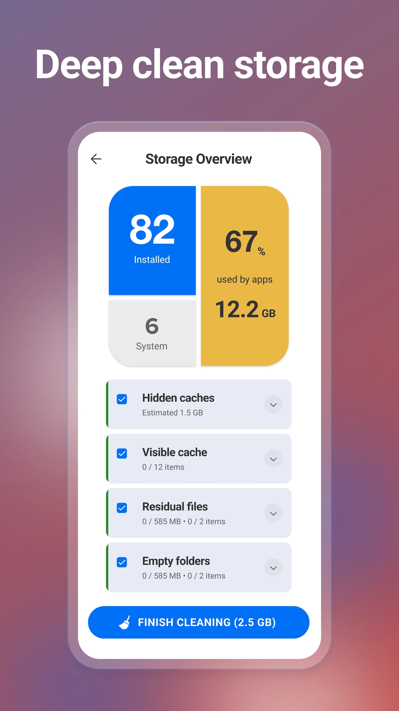{: width="180" .normal }
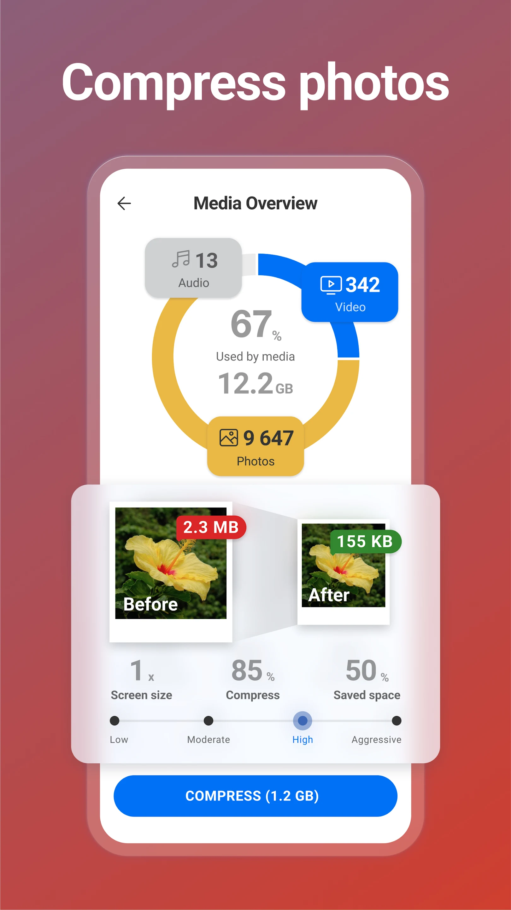{: width="180" .normal }
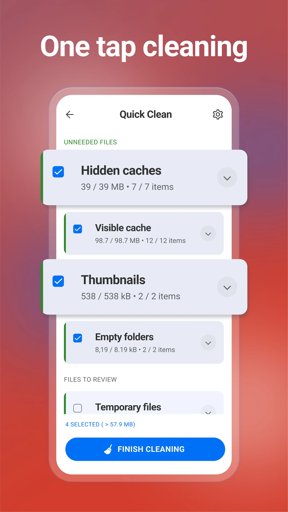{: width="180" .normal }
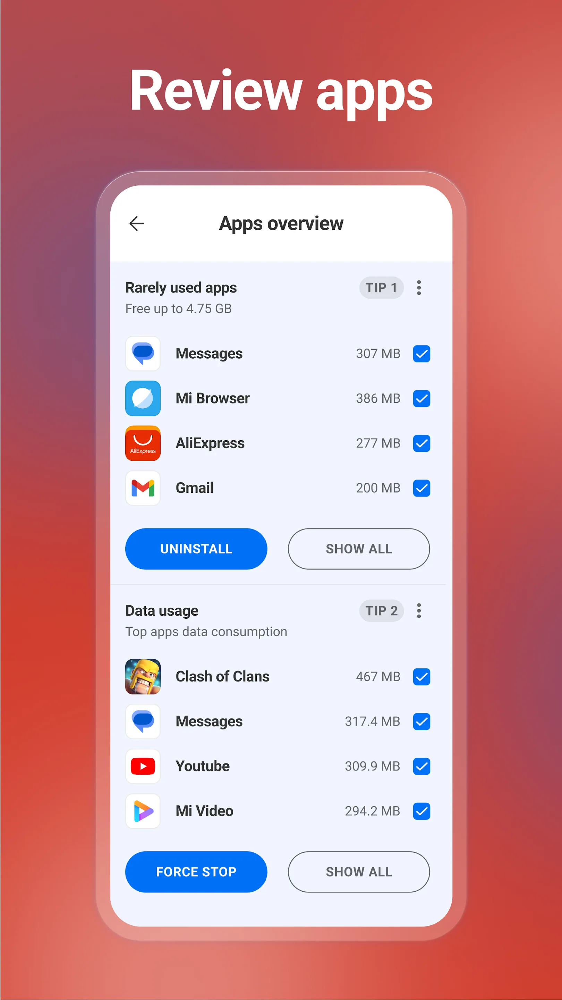{: width="180" .normal }

CCleaner seluler adalah **versi telefon pintar alat PC terkenal** — cara cepat mengosongkan cache, sejarah penjelajahan, dan file tidak terpakai, plus pembantu foto dan bateri dasar.

**Kelebihan**
- **Merek dan alur familier** bila Anda pakai CCleaner di desktop.
- **Pembersihan cache/sejarah cepat** dan ikhtisar storage sederhana.
- **Pembantu hibernasi bateri dan aplikasi** di tier premium.
- Pindai satu ketik mudah.
- Tier percuma tersedia.

**Kelemahan**
- **Dampak nyata terhad** pada manajemen cache Android modern.
- Iklan dan ajakan langganan di versi percuma.
- **Tidak lagi tersedia di iOS** — hanya Android kini.

**Terbaik untuk:** pengguna yang hanya ingin nama CCleaner dan pindai cepat.

**Muat turun CCleaner**
- [Google Play](https://play.google.com/store/apps/details?id=com.piriform.ccleaner)

---

### 5. Avast Cleanup — terbaik untuk bersih foto

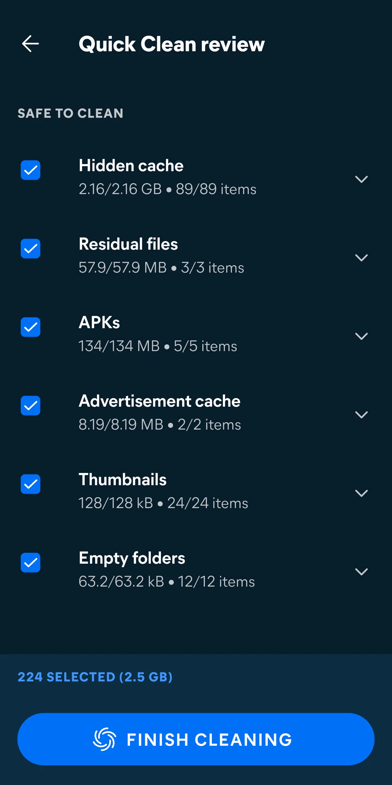{: width="180" .normal }
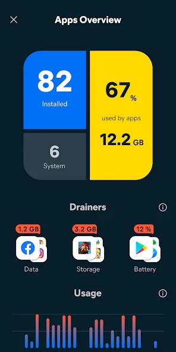{: width="180" .normal }
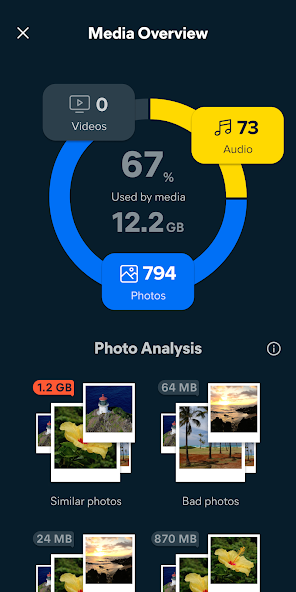{: width="180" .normal }
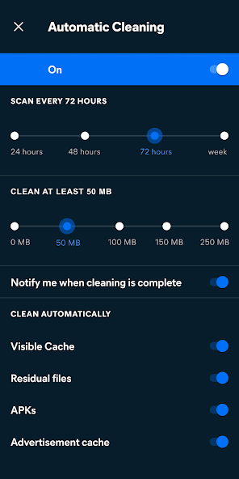{: width="180" .normal }

Avast Cleanup fokus pada **mengosongkan ruang dari foto dan file** — menemukan foto berkualitas rendah, serupa, dan duplikat, plus membersihkan junk dan cache aplikasi.

**Kelebihan**
- **Pembersihan foto** yang menandai foto buram, duplikat, dan serupa untuk dihapus.
- **Penghapusan junk dan cache** dengan ikhtisar storage jelas.
- **Hibernasi aplikasi** untuk mengurangi beban latar.
- Dukungan merek keselamatan terkemuka.
- Percuma dengan langganan premium.

**Kelemahan**
- Hanya Android.
- Ciri foto terbaik di sebalik langganan.
- Tanpa pemantauan sistem terus.

**Terbaik untuk:** pengguna yang storage-nya didominasi foto.

**Muat turun Avast Cleanup**
- [Google Play](https://play.google.com/store/apps/details?id=com.avast.android.cleaner)

---

### 6. Norton Clean — terbaik pembersih junk sederhana

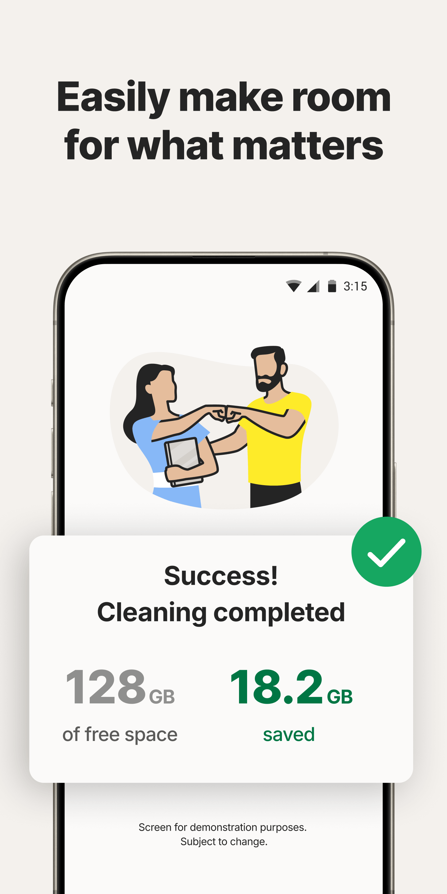{: width="180" .normal }
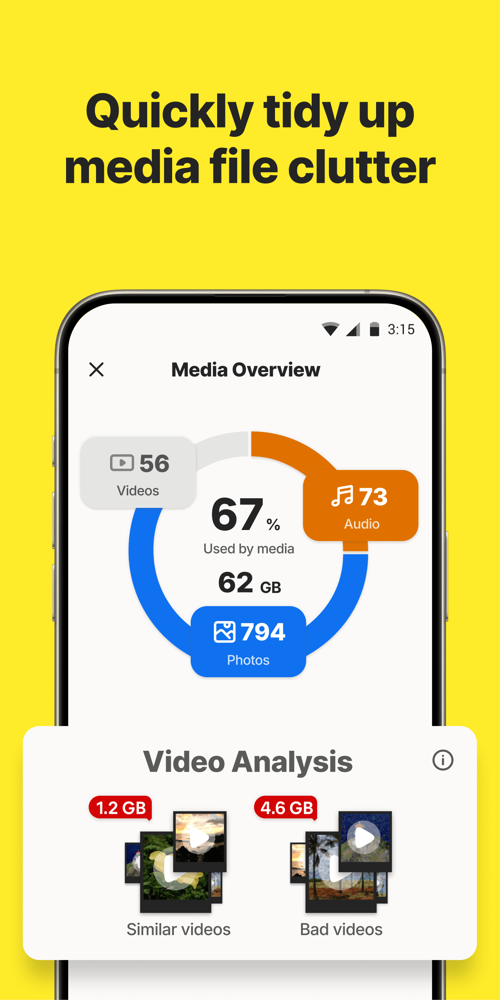{: width="180" .normal }
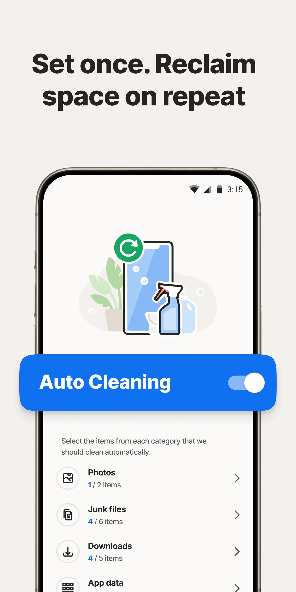{: width="180" .normal }
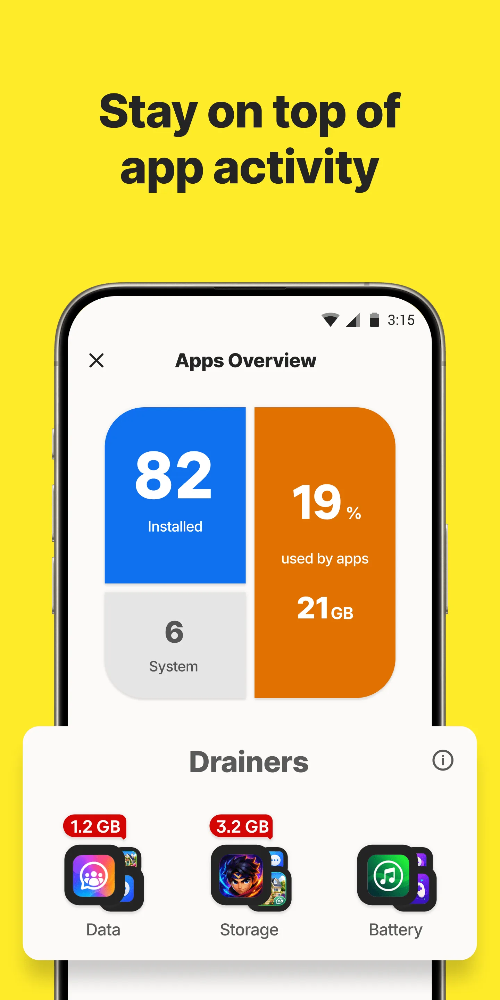{: width="180" .normal }

Norton Clean adalah **pembersih junk dan cache lugas** yang memadam file sementara, data sisa, dan sisa aplikasi dengan satu ketik sederhana.

**Kelebihan**
- **Penghapusan junk/cache sederhana** — mudah untuk siapa saja.
- **Pembersihan file sisa** setelah uninstall.
- Didukung merek keselamatan Norton.
- Percuma digunakan.
- Ringan dan tidak mengganggu.

**Kelemahan**
- Hanya Android.
- Sedikit ciri tambahan selain pembersihan dasar.
- Tanpa pemantauan, tanpa RAM boost, tanpa alat foto.

**Terbaik untuk:** pengguna yang ingin pembersih satu ketik minimum dan terpercaya.

**Muat turun Norton Clean**
- [Google Play](https://play.google.com/store/apps/details?id=com.symantec.cleaner)

---

## Perbandingan keupayaan teras

| Keupayaan | System Monitor | Files by Google | SD Maid | CCleaner | Avast Cleanup | Norton Clean |
|---|---|---|---|---|---|---|
| **Platform** | Android | Android | Android | Android | Android | Android |
| **Pembersihan junk / cache** | Ya (ringan) | Ya (selamat) | Ya (dalam) | Ya | Ya | Ya |
| **Analisis storage** | Ya | Ya | Ya (lanjut) | Dasar | Ya | Dasar |
| **Pencari duplikat / mayat** | Tidak | Duplikat | Ya (mayat) | Tidak | Foto | Tidak |
| **RAM boost** | Ya | Tidak | Sebahagian | Tidak | Hibernasi app | Tidak |
| **Penghemat bateri** | Ya (dokter) | Tidak | Tidak | Dasar | Dasar | Tidak |
| **Pemantauan waktu nyata** | Ya (CPU/RAM/bateri) | Tidak | Tidak | Tidak | Tidak | Tidak |
| **Selamat / resmi** | Ya | Ya (Google) | Ya (power-user) | Waspada | Ya (merek) | Ya (merek) |
| **Iklan / langganan** | Teras percuma | Tanpa iklan | Percuma + Pro | Iklan + sub | Percuma + sub | Percuma |
| **Perlu root** | Tidak | Tidak | Tidak (extra Pro pilihan) | Tidak | Tidak | Tidak |
| **Paling hebat di** | Monitor + boost | Storage selamat | Bersih dalam | Merek familier | Bersih foto | Bersih sederhana |

---

## Alternatif CCleaner mana yang sesuai untuk setiap jenis pengguna

Jadual memeringkat ciri; di sini keenam aplikasi dikelompokkan menurut *apa yang sebenarnya ingin Anda capai*.

- **Memahami slowdown** — sebuah **alternatif CCleaner** yang melaporkan CPU, RAM, bateri, dan suhu (System Monitor) menjawab pertanyaan berbeza dari yang memadam cache. Bila storage tidak kelihatan bermasalah, pembersihan tidak akan menjelaskan stutter.
- **Pembersihan storage selamat resmi** — carian **alternatif Files by Google** tentang meninjau file besar dan duplikat sebelum padam; Norton Clean adalah versi minimum dari kerja itu.
- **Pembersihan sisa berbasis aturan dalam** — **alternatif SD Maid** atau **alternatif AVG Cleaner** sesuai bagi yang ingin melihat tepat sisa mana yang dihapus. **Alternatif Clean Master** adalah versi "satu ketik" lebih tua dan luas dari ide sama.
- **Toolbox lengkap** — **alternatif 3C Toolbox** menggabungkan pemantauan, pelarasan, dan statistik bateri dalam satu instalasi, dengan perbelanjaan kerumitan.
- **Foto dan langganan** — Avast Cleanup menarget library foto, dan sebahagian besar aplikasi ini menaruh pindai lebih dalam di sebalik tier berbayar; periksa apa yang benar-benar dihapus teras percuma.

Apapun labelnya, ajukan dua pertanyaan sebelum migrasi: dapatkah Anda meninjau daftar penghapusan dulu, dan apakah aplikasi menjelaskan slowdown selain mengosongkan ruang?

## Cara memilih

- Ingin **pemantauan + boost + pembersihan ringan** → **System Monitor**
- Ingin **pembersihan storage selamat resmi tanpa ribet** → **Files by Google**
- Ingin **pembersihan dalam dan hati-hati** → **SD Maid**
- Ingin **nama CCleaner dan pindai cepat** → **CCleaner**
- Storage berisi **foto** → **Avast Cleanup**
- Ingin **pembersih terpercaya minimum** → **Norton Clean**

## Cara migrasi dari CCleaner

1. **Tentukan tujuan nyata Anda** — lebih banyak ruang kosong, atau telefon pintar lebih cepat? Dua perbaikan berbeza.
2. **Pasang alat storage** (Files by Google atau SD Maid) dan jalankan pembersihan sekali pakai duplikat dan file tidak terpakai.
3. **Tambahkan monitor** (System Monitor) untuk menemukan apa yang benar-benar menguras CPU/bateri alih-alih "boost" buta.
4. **Uninstall CCleaner** begitu alat baru merangkumi kebutuhan Anda — Android modern perlu pembersihan malar lebih sedikit.
5. **Tetap sederhana**: padam media besar dan aplikasi lama secara rutin; biarkan OS mengurus sisanya.

## FAQ

**Apakah System Monitor alternatif CCleaner terbaik?**
{:.faq-q}

Jika Anda ingin pemantauan plus pembersihan, ya. System Monitor adalah satu-satunya aplikasi di sini dengan pemantauan CPU/RAM/bateri terus, penggera overheat, dan boost satu ketik — yang lain adalah pembersih atau alat storage tanpa wawasan waktu nyata.

**Alternatif CCleaner mana yang paling selamat untuk storage?**
{:.faq-q}

Files by Google adalah pilihan paling selamat — resmi, tanpa iklan, tanpa tugasan latar agresif. SD Maid adalah pembersih paling dalam untuk power user.

**Alternatif CCleaner mana yang benar-benar mengosongkan RAM?**
{:.faq-q}

System Monitor adalah satu-satunya di sini dengan boost RAM satu ketik; sisanya mengurus storage dan cache tetapi tidak memantau atau mengosongkan memori terus.

**Apakah System Monitor percuma?**
{:.faq-q}

Ya. Monitor teras, widget, tetingkap terapung, dan penggera overheat percuma; buka kunci pilihan menambah tema dan sejarah lebih dalam.

[Halaman aplikasi System Monitor](/ms/apps/system-monitor/) — tersedia di Android.

## Istilah berkaitan

- [Apakah Itu Monitor Suhu CPU?](/ms/glossary/what-is-a-cpu-temperature-monitor/)
- [Apakah Itu System Monitor?](/ms/glossary/what-is-a-system-monitor/)
- [Apakah Itu RAM Booster?](/ms/glossary/what-is-a-ram-booster/)
