CPU-Z bagus untuk lembar spesifikasi cepat, tetapi di Android ia **tidak memaparkan [suhu terus](/ms/glossary/what-is-a-cpu-temperature-monitor/)**, tidak punya tetingkap terapung, dan tidak menyediakan widget atau penggera overheat. Jika Anda ingin pemantauan waktu nyata, kategori ini sudah punya pilihan matang.

Di bawah ini kami membandingkan enam **alternatif CPU-Z** — dari pemantau suhu terus hingga pelapor spesifikasi mendalam — across harga, platform, dan keupayaan yang benar-benar penting. Sebahagian besar pembaca datang dengan satu penghalang — tidak ada suhu terus, tidak ada tetingkap terapung, atau tidak ada widget — jadi setiap pilihan dibingkai menurut alasan itu.

## Mengapa melihat di luar CPU-Z

{: width="180" .normal }
{: width="180" .normal }
{: width="180" .normal }
{: width="180" .normal }
{: width="180" .normal }

- **Tidak ada suhu CPU terus** di banyak peranti Android — ia melaporkan spesifikasi, bukan panas.
- **Tidak ada tetingkap terapung atau widget** untuk pantau sekilas.
- **Sedikit sensor dan kesihatan bateri** dibanding alat khusus.
- **Versi seluler didukung iklan** dan kurang dalam dari versi PC klasik.
- Anda mungkin menginginkan **penggera overheat atau boost satu ketik**, yang tidak disediakannya.

## Alternatif CPU-Z terbaik sekilas

| App | Harga (2026) | Platform | Terbaik untuk |
|---|---|---|---|
| **CPU Monitor** | Teras percuma + buka kunci | Android | Suhu terus, frekuensi, tetingkap terapung |
| **DevCheck** | Percuma + Pro | Android, iOS | Hardware & sensor detail |
| **AIDA64** | Percuma | Android, iOS | Laporan spesifikasi mendalam |
| **Device Info HW** | Percuma + Pro | Android | Info hardware per komponen |
| **Droid Hardware Info** | Percuma | Android | Spesifikasi peranti cepat |
| **System Monitor** | Teras percuma + buka kunci | Android | Monitor + cleaner + booster |

---

### 1. CPU Monitor — terbaik untuk suhu terus

{: width="180" .normal }
{: width="180" .normal }
{: width="180" .normal }
{: width="180" .normal }
{: width="180" .normal }

CPU Monitor memaparkan **suhu dan frekuensi CPU waktu nyata**, RAM, bateri, dan penggunaan multicore, lengkap dengan tetingkap terapung, widget, boost satu ketik, dan penggera overheat.

**Kelebihan**
- **Suhu dan frekuensi CPU waktu nyata** dengan analisis sejarah.
- **Pemantauan CPU multicore** dan penggunaan per core.
- **Tetingkap terapung** (status bar + desktop) dan widget RAM/CPU/bateri.
- **Penggera overheat** yang memperingatkan Anda menutup aplikasi berat dan mendinginkan.
- **Boost satu ketik** untuk membebaskan RAM dengan cepat.
- Multi-tema, ringan, dan teras percuma.

**Kelemahan**
- Hanya Android — tidak ada aplikasi iOS.
- Sejarah/tema lanjutan berada di sebalik buka kunci.
- Akurasi suhu bergantung ketersediaan sensor peranti.

**Terbaik untuk:** pengguna yang ingin benar-benar mengawasi panas dan frekuensi saat gaming atau mengecas.

**Muat turun CPU Monitor**
- [Google Play](https://play.google.com/store/apps/details?id=com.glgjing.stark)

---

### 2. DevCheck — terbaik untuk sensor detail

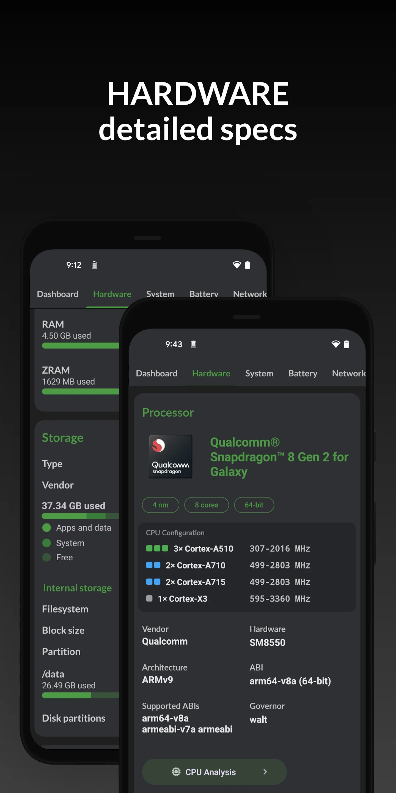{: width="180" .normal }
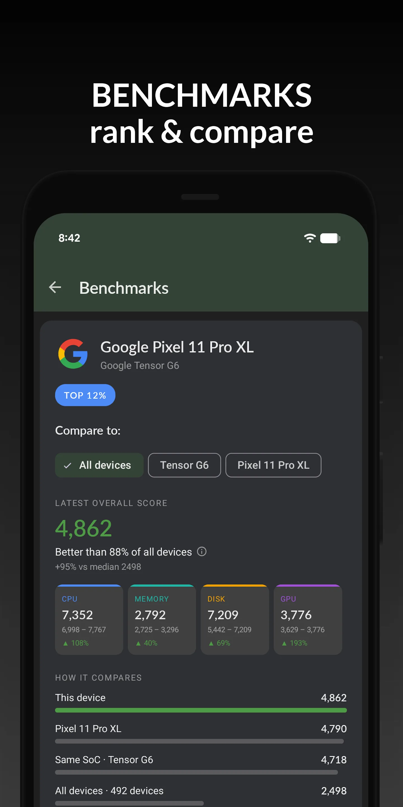{: width="180" .normal }
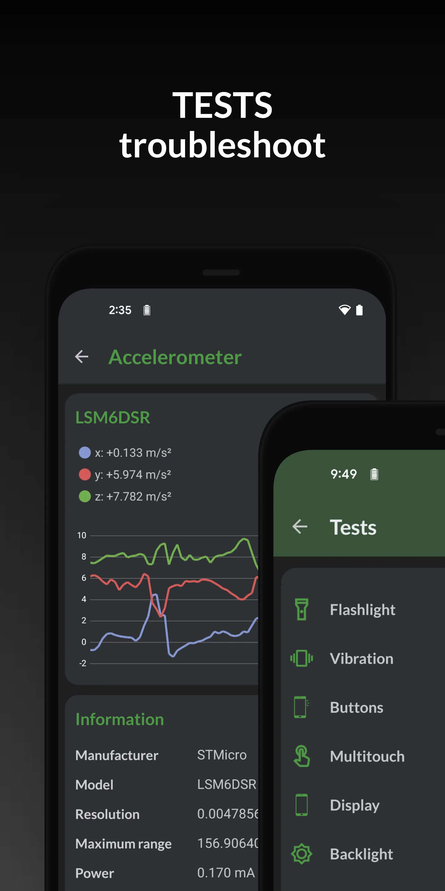{: width="180" .normal }
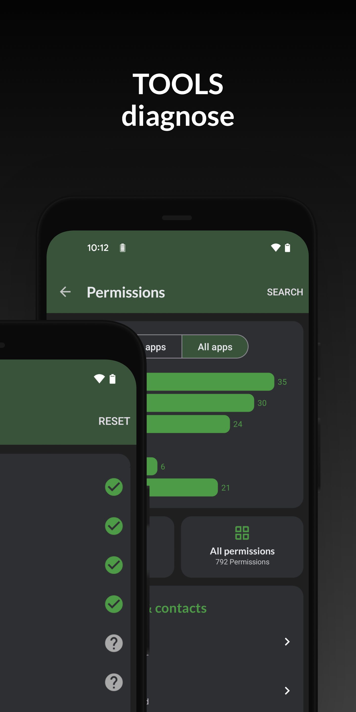{: width="180" .normal }
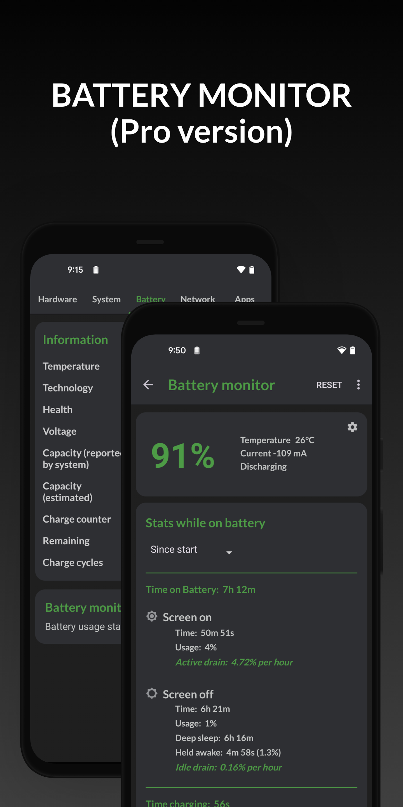{: width="180" .normal }

DevCheck adalah **pelapor hardware dan sensor komprehensif** dengan papan pemuka bersih: CPU, GPU, bateri, rangkaian, sensor, dan lain-lain, plus monitor sistem dan widget.

**Kelebihan**
- **Bacaan hardware mendalam** — SoC, GPU, memori, storan, kamera, sensor.
- **Papan pemuka terus** untuk CPU, bateri, dan info thermal.
- **Widget dan monitor sistem** untuk penjejakan berkelanjutan.
- Antara muka bersih, minim iklan.
- Percuma dengan upgrade Pro untuk papan pemuka ekstra.

**Kelemahan**
- Tidak ada overlay tetingkap terapung.
- Penggera overheat dan boost satu ketik bukan fokusnya.
- Kedalaman terbaik berada di sebalik DevCheck Pro.

**Terbaik untuk:** penghobi yang ingin inventaris hardware lengkap dan daftar sensor.

**Muat turun DevCheck**
- [Google Play](https://play.google.com/store/apps/details?id=flar2.devcheck)
- [App Store](https://apps.apple.com/us/app/devcheck/id1475762785)

---

### 3. AIDA64 — terbaik laporan spesifikasi mendalam

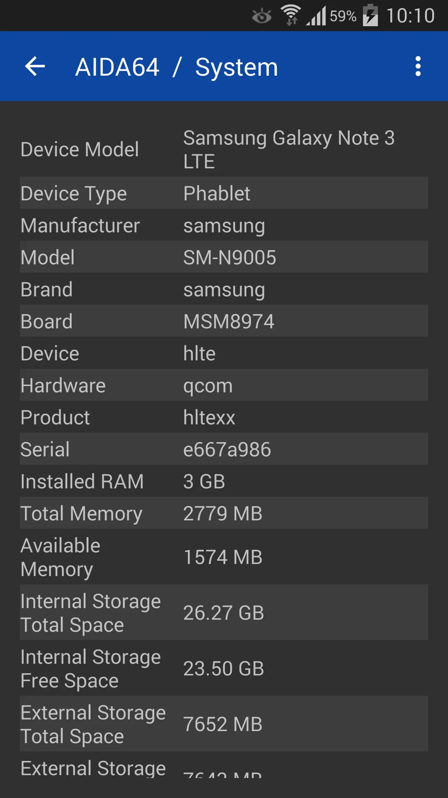{: width="180" .normal }
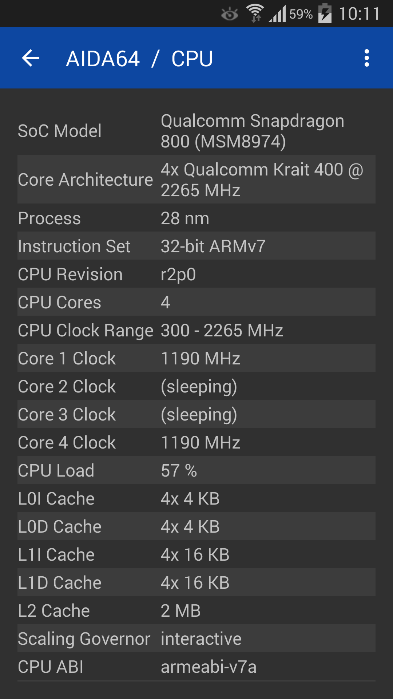{: width="180" .normal }
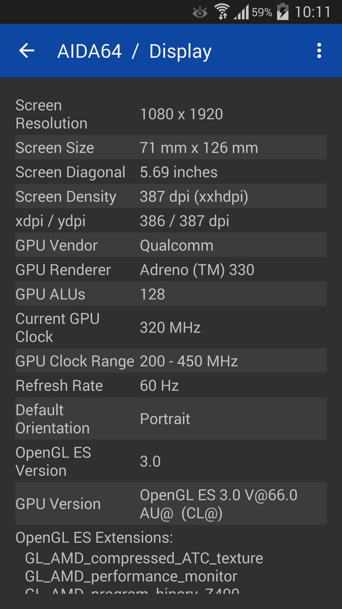{: width="180" .normal }
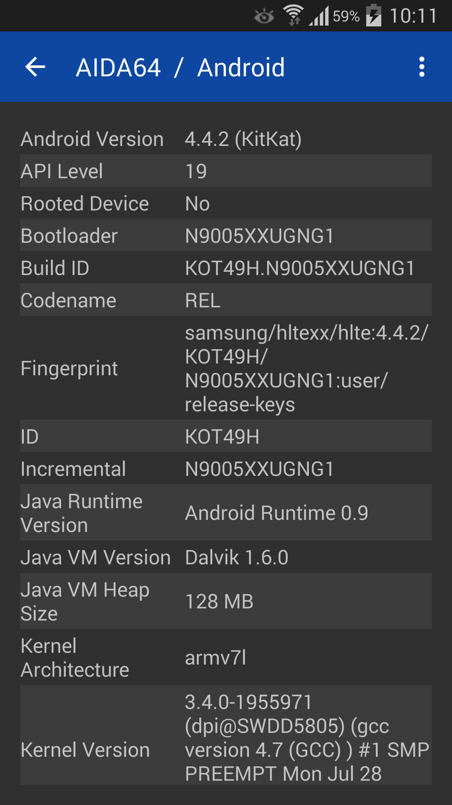{: width="180" .normal }
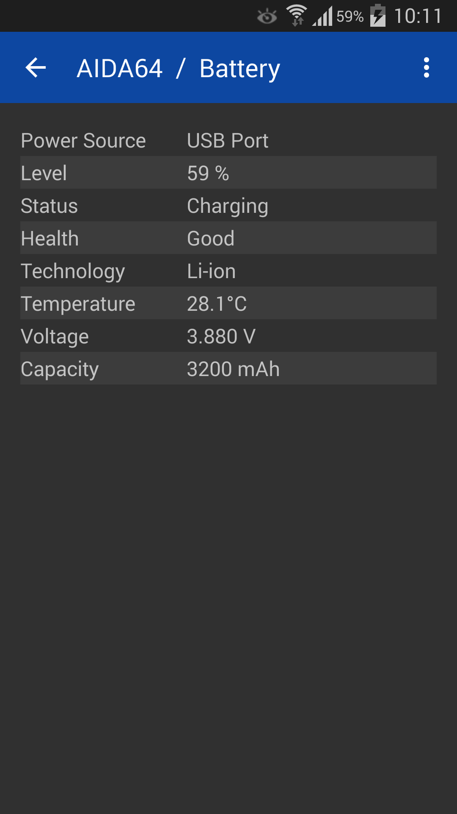{: width="180" .normal }

AIDA64 membawa merek diagnostik PC terkenal ke Android dan iOS, dengan **laporan spesifikasi peranti** mendalam dan bacaan sensor terus.

**Kelebihan**
- **Laporan spesifikasi terpercaya dan detail** merangkumi CPU, skrin, bateri, rangkaian, dan lain-lain.
- **Halaman sensor terus** untuk thermal, bateri, dan beban.
- Tersedia di **Android dan iOS**.
- Tanpa iklan di versi percuma.
- Tata letak familiar untuk pengguna AIDA64 desktop.

**Kelemahan**
- Tidak ada tetingkap terapung atau widget.
- Tidak fokus pada penggera overheat atau boost.
- Lebih sedikit "pemantauan waktu nyata" dibanding monitor khusus.

**Terbaik untuk:** pengguna yang ingin lembar spesifikasi mendalam dan terpercaya di telefon pintar atau tablet.

**Muat turun AIDA64**
- [Google Play](https://play.google.com/store/apps/details?id=com.finalwire.aida64)
- [App Store](https://apps.apple.com/us/app/aida64/id979579523)

---

### 4. Device Info HW — terbaik info per komponen

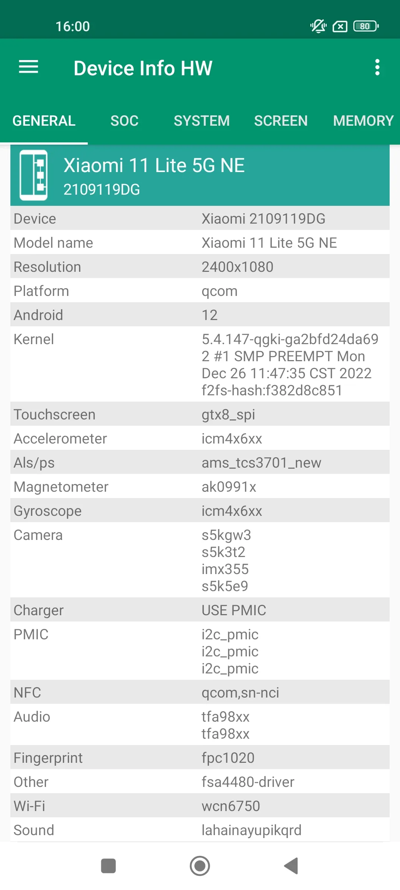{: width="180" .normal style="height:360px;object-fit:cover" }
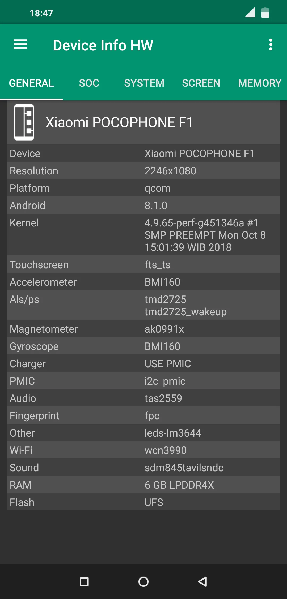{: width="180" .normal style="height:360px;object-fit:cover" }
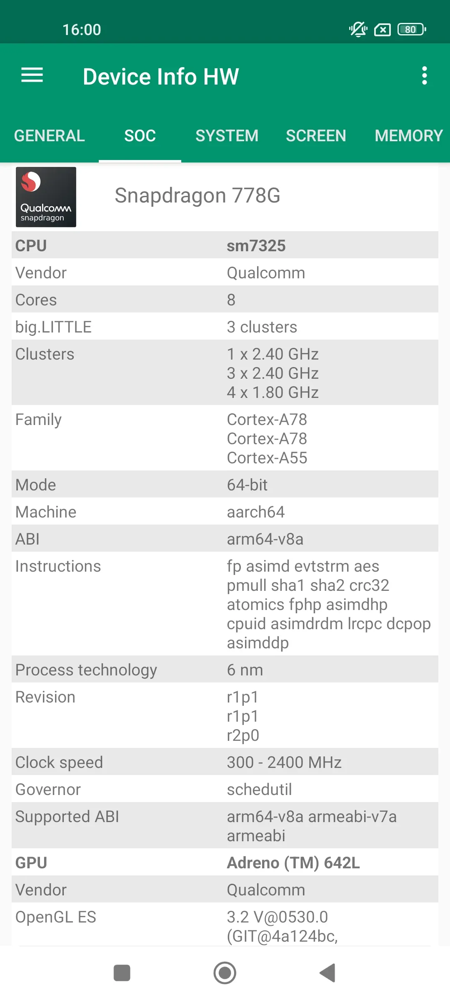{: width="180" .normal style="height:360px;object-fit:cover" }
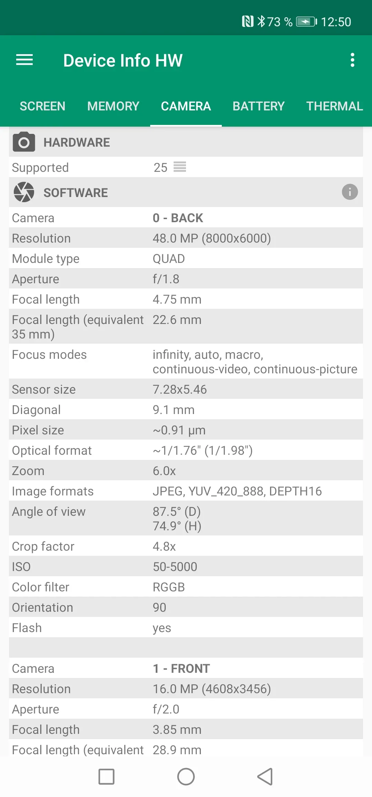{: width="180" .normal style="height:360px;object-fit:cover" }
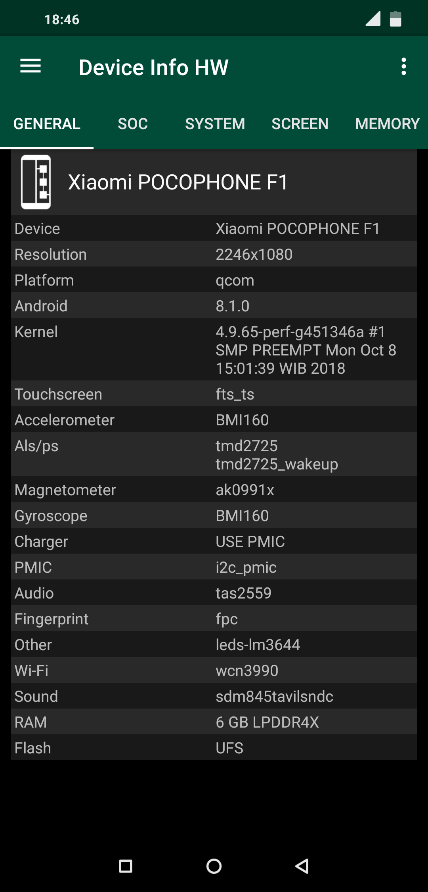{: width="180" .normal style="height:360px;object-fit:cover" }

Device Info HW adalah **aplikasi info hardware** yang memecah setiap komponen — CPU, GPU, bateri, kamera, sensor, storan — dengan paparan jelas di level komponen.

**Kelebihan**
- **Detail level komponen** (mis. sensor kamera persis, model GPU).
- **Info bateri** termasuk kesihatan dan detail pengisian.
- **Daftar sensor** dengan nilai terus.
- Pelaporan bersih dan tata letak ramah eksport.
- Percuma dengan upgrade Pro.

**Kelemahan**
- Hanya Android.
- Tidak ada tetingkap terapung terus atau penggera overheat.
- Bukan monitor prestasi/thermal secara reka bentuk.

**Terbaik untuk:** pengguna yang ingin tahu persis isi perangkatnya.

**Muat turun Device Info HW**
- [Google Play](https://play.google.com/store/apps/details?id=ru.andr7e.deviceinfohw)

---

### 5. Droid Hardware Info — terbaik spesifikasi cepat

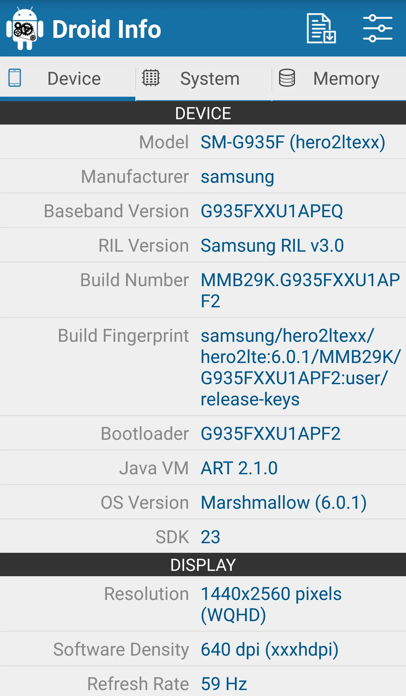{: width="180" .normal }
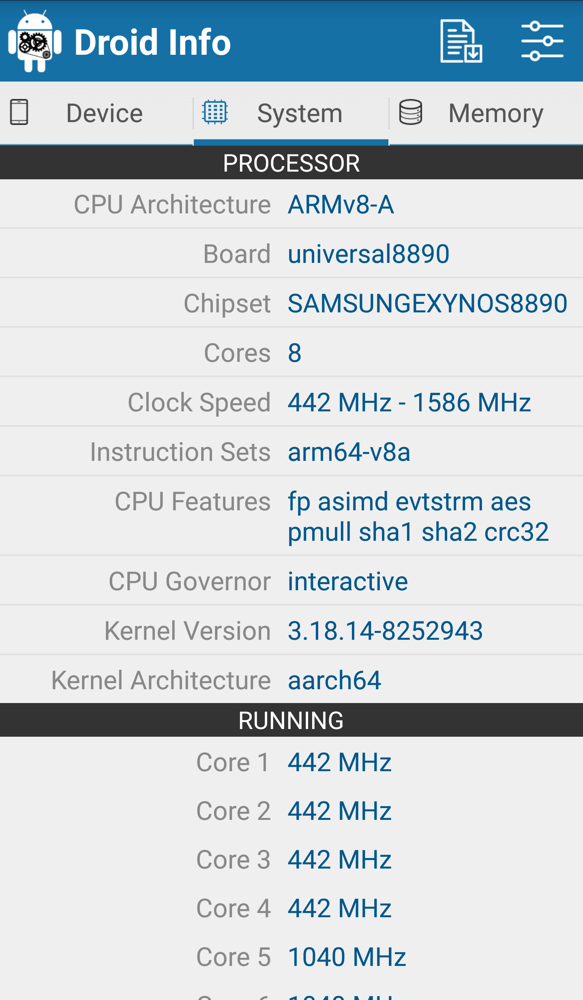{: width="180" .normal }
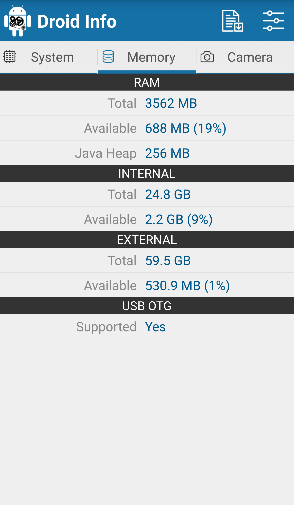{: width="180" .normal }
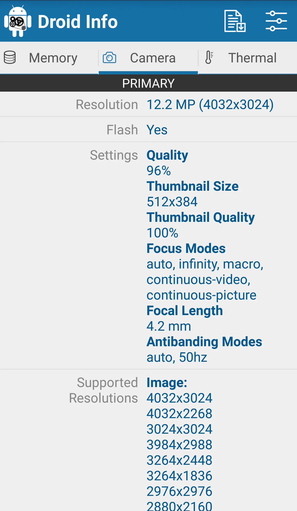{: width="180" .normal }

Droid Hardware Info adalah **penampil spesifikasi ringan** yang memaparkan sistem, CPU, GPU, memori, kamera, dan detail sensor dalam daftar sederhana.

**Kelebihan**
- **Daftar spesifikasi cepat & sederhana** — tanpa tetapan.
- Merangkumi CPU, GPU, RAM, storan, kamera, dan sensor.
- Sangat kecil dan percuma.
- Sesuai untuk cek cepat dan berkongsi spesifikasi.
- Tanpa akaun atau iklan yang mengganggu.

**Kelemahan**
- Hanya Android; tidak ada versi iOS.
- Tidak ada pemantauan terus, widget, atau tetingkap terapung.
- Kedalaman lebih rendah dari DevCheck atau AIDA64.

**Terbaik untuk:** sesiapa sahaja yang ingin bacaan spesifikasi peranti bersih dan cepat.

**Muat turun Droid Hardware Info**
- [Google Play](https://play.google.com/store/apps/details?id=com.inkwired.droidinfo)

---

### 6. System Monitor — terbaik alat all-in-one + cleaner

System Monitor adalah **alat Android all-in-one**: monitor CPU, cleaner storan, RAM booster, dan bateri dokter, menjaga telefon pintar tetap cepat, dingin, dan optimal.

**Kelebihan**
- **Suhu dan frekuensi CPU** dengan sejarah dan pemantauan multicore.
- **Cleaner storan** untuk junk/cache dan analisa RAM dengan boost satu ketik.
- **Monitor bateri** dengan kesihatan, tegangan, dan lengkung suhu.
- **Penggera dan perlindungan overheat** plus tetingkap terapung dan widget.
- Multi-tema dan teras percuma.

**Kelemahan**
- Hanya Android.
- Pembersihan lebih ringan dari cleaner khusus (fokusnya pemantauan).
- Beberapa ciri berada di sebalik upgrade Pro.

**Terbaik untuk:** pengguna yang ingin pemantauan plus pembersihan ringan dalam satu aplikasi.

**Muat turun System Monitor**
- [Google Play](https://play.google.com/store/apps/details?id=com.glgjing.marvel)

---

## Perbandingan keupayaan teras

| Keupayaan | CPU Monitor | DevCheck | AIDA64 | Device Info HW | Droid Hardware Info | System Monitor |
|---|---|---|---|---|---|---|
| **Platform** | Android | Android, iOS | Android, iOS | Android | Android | Android |
| **Suhu CPU terus** | Ya | Sebahagian | Sensor | Tidak | Tidak | Ya |
| **Frekuensi / multicore CPU** | Ya | Ya | Ya | Tidak | Tidak | Ya |
| **Pemantauan RAM** | Ya | Ya | Ya | Sebahagian | Sebahagian | Ya (boost) |
| **Kesihatan / suhu bateri** | Ya | Ya | Ya | Ya | Tidak | Ya |
| **Daftar sensor** | Sebahagian | Ya | Ya | Ya | Ya | Sebahagian |
| **Tetingkap terapung** | Ya | Tidak | Tidak | Tidak | Tidak | Ya |
| **Widget** | Ya | Ya | Tidak | Tidak | Tidak | Ya |
| **Penggera overheat** | Ya | Tidak | Tidak | Tidak | Tidak | Ya |
| **Boost / cleaner satu ketik** | Ya (boost) | Tidak | Tidak | Tidak | Tidak | Ya (boost + clean) |
| **Laporan spesifikasi mendalam** | Sebahagian | Kuat | Kuat | Kuat | Dasar | Sebahagian |
| **Tingkat percuma / iklan** | Teras percuma | Percuma + Pro | Percuma (tanpa iklan) | Percuma + Pro | Percuma | Teras percuma |
| **Perlu root** | Tidak | Tidak | Tidak | Tidak | Tidak | Tidak |

---

## Alternatif CPU-Z mana yang sesuai untuk setiap jenis pengguna

Jadual memeringkat ciri; di sini keenam aplikasi dikelompokkan menurut *apa yang sebenarnya Anda inginkan dari aplikasi hardware*.

- **Papan pemuka terus, bukan lembar spesifikasi** — daftar pendek **alternatif CPU-Z terbaik android** dimulai dari CPU Monitor: suhu waktu nyata, frekuensi per core, tetingkap terapung, dan penggera overheat.
- **Laporan hardware paling mendalam** — **alternatif DevCheck** atau **alternatif AIDA64** masih unggul tentang detail SoC, GPU, skrin, dan sensor. Device Info HW melangkah per komponen; Droid Hardware Info adalah bacaan percuma cepat.
- **Toolkit sistem lengkap** — **alternatif 3C Toolbox** adalah pilihan lebih berat dengan pemantauan, statistik bateri, dan pelarasan dalam satu instalasi.
- **Graf read-only bersih** — **alternatif Simple System Monitor** memberi lengkung CPU, RAM, dan rangkaian tanpa klaim prestasi.
- **Kesihatan bateri daripada suhu CPU** — **alternatif AccuBattery** adalah pasangan tepat jika suhu pengisian dan siklus charge jadi perhatian.

Dua carian lain mendarat di sini tetapi mengarah keluar dari enam aplikasi ini: **alternatif CPU Float** biasanya permintaan untuk bacaan CPU kecil selalu-di-atas, bukan papan pemuka penuh, dan **alternatif Cooler Master** tentang hardware PC atau aksesori pendingin, bukan aplikasi pemantauan Android. Tidak satu pun pengganti bacaan sensor thermal terus.

Apa pun labelnya, periksa dua hal sebelum pindah: apakah aplikasi membaca sensor thermal nyata tanpa root, dan apakah tingkat percuma tetap menyertakan tetingkap terapung atau widget yang benar-benar Anda pakai?

## Cara memilih

- Ingin **suhu terus + tetingkap terapung + penggera overheat** → **CPU Monitor**
- Ingin **laporan hardware & sensor paling detail** → **DevCheck** atau **AIDA64**
- Ingin **spesifikasi level komponen (kamera/GPU)** → **Device Info HW**
- Ingin **bacaan spesifikasi percuma cepat** → **Droid Hardware Info**
- Ingin **pemantauan + cleaner + booster dalam satu** → **System Monitor**

## Cara migrasi dari CPU-Z

1. **Tentukan apa yang benar-benar Anda cek** — spesifikasi sekali, atau suhu terus saat gaming.
2. **Pasang monitor** (CPU Monitor atau System Monitor) dan berikan kebenaran overlay untuk tetingkap terapung.
3. **Tambahkan widget** ke skrin utama untuk CPU/RAM/bateri sekilas.
4. **Aktifkan penggera overheat** jika Anda gaming atau mengecas berat, supaya diperingatkan sebelum throttling.
5. **Gunakan boost atau cleaner satu ketik** (boost CPU Monitor, cleaner System Monitor) untuk membebaskan memori saat telefon pintar terasa lemot.

## FAQ

**Apakah CPU Monitor alternatif CPU-Z terbaik?**
{:.faq-q}

Untuk pemantauan terus, ya. CPU Monitor adalah padanan terdekat jika Anda ingin suhu CPU/bateri waktu nyata, tetingkap terapung, widget, dan penggera overheat — hal-hal yang tidak dilakukan CPU-Z.

**Alternatif CPU-Z mana yang memaparkan suhu terus dari waktu ke waktu?**
{:.faq-q}

CPU Monitor dan System Monitor sama-sama memetakan suhu sebagai lengkung; DevCheck dan AIDA64 memaparkan nilai sensor terus tetapi tidak ada sejarah berkesinambungan.

**Alternatif CPU-Z mana yang punya laporan spesifikasi paling mendalam?**
{:.faq-q}

DevCheck dan AIDA64 adalah pelapor spesifikasi terkuat; Device Info HW menambah detail level komponen seperti model kamera/GPU persis.

**Apakah CPU Monitor percuma?**
{:.faq-q}

Ya. Monitor teras — suhu terus, tetingkap terapung, widget, dan penggera overheat — percuma; buka kunci pilihan membuka tema dan sejarah lebih dalam.

[Halaman aplikasi CPU Monitor](/ms/apps/cpu-monitor/) — tersedia di Android.

## Istilah berkaitan

- [Apakah Itu Monitor Suhu CPU?](/ms/glossary/what-is-a-cpu-temperature-monitor/)
- [Apakah Itu System Monitor?](/ms/glossary/what-is-a-system-monitor/)
