Crosshair Hero menambahkan bidik silang khusus di atas shooter Anda, tetapi **jangkauan gaya, kontrol waktu nyata, dan had gratisnya** membuat sebahagian pemain ingin lebih. Jika Anda ingin kendali lebih halus, lebih banyak pratetap, atau overlay lebih ringan, kategori ini punya pilihan matang.

Di bawah ini kami bandingkan enam **[alternatif Crosshair Hero](/ms/glossary/what-is-a-crosshair/)** — semua overlay selamat, tanpa root yang melukis bidik silang di atas game FPS apa pun — dari harga, pelarasan, hingga ciri yang benar-benar penting.

## Mengapa melihat melampaui Crosshair Hero

- **Jangkauan gaya dan warna terhad** dibanding aplikasi bidik silang khusus.
- **Sedikit kontrol waktu nyata** — menyesuaikan saat bermain boleh canggung.
- **Iklan atau paywall** pada gaya yang Anda inginkan.
- **Overlay lebih berat** boleh terasa mengganggu saat pertandingan cepat.
- Anda mungkin ingin **profil per game** atau import gambar yang tidak disediakan.

## Alternatif Crosshair Hero terbaik sekilas

| Aplikasi | Harga (2026) | Gaya | Pelarasan | Tetapan saat main |
|---|---|---|---|---|
| **Crosshair Aim** | Percuma + buka | 15+ | Ukuran/warna/scale/posisi | Ya |
| **Custom Crosshair** | Percuma + Pro | Banyak + animasi | Ukuran/warna/reka bentuk | Ya |
| **Custom Aim** | Percuma + Pro | Pratetap generator | Penuh (bentuk/warna/ukuran) | Ya |
| **Crosshair Pro** | Percuma + IAP | Dasar/Pro/Presisi | Warna, ukuran, posisi | Ya (waktu nyata) |
| **CrossAim** | Percuma + IAP | 24 gaya | Warna, ukuran | Ya |
| **Crosshair PRO** | Percuma + IAP | Set Pro | Overlay yang boleh dikustom | Ya |

---

### 1. Crosshair Aim — overlay paling boleh dikustom

{: width="180" .normal }
{: width="180" .normal }
{: width="180" .normal }
{: width="180" .normal }

Crosshair Aim adalah **aplikasi bidik silang untuk game FPS** dengan 80+ gaya, kendali penuh ukuran/warna/scale/posisi, overlay transparan (85% bawaan), dan tetapan terapung saat bermain.

**Kelebihan**
- **80+ gaya bidik silang** merangkumi titik, silang, lingkaran, dan lain-lain.
- **Pelarasan penuh** — ukuran, warna, scale, dan posisi skrin.
- **Tetapan terapung saat bermain** supaya boleh menyetel retikel tanpa keluar match.
- **Overlay transparan tanpa root** yang bekerja di hampir semua game penembakan.
- Boleh membuat bidik silang bahkan untuk senjata yang tidak memilikinya.
- Percuma untuk digunakan dengan gaya dasar; gaya lanjutan via Pro.

**Kelemahan**
- Hanya Android — tidak ada versi iOS.
- Nilai terbaik perlu buka Pro untuk gaya premium.
- Tidak ada import gambar untuk bentuk tersuai sepenuhnya.

**Terbaik untuk:** pemain yang ingin banyak gaya dan penyetelan terus saat bermain.

**Muat turun Crosshair Aim**
- [Google Play](https://play.google.com/store/apps/details?id=com.glgjing.crosshair.aim.fps.game)

---

### 2. Custom Crosshair — gaya animasi terbaik

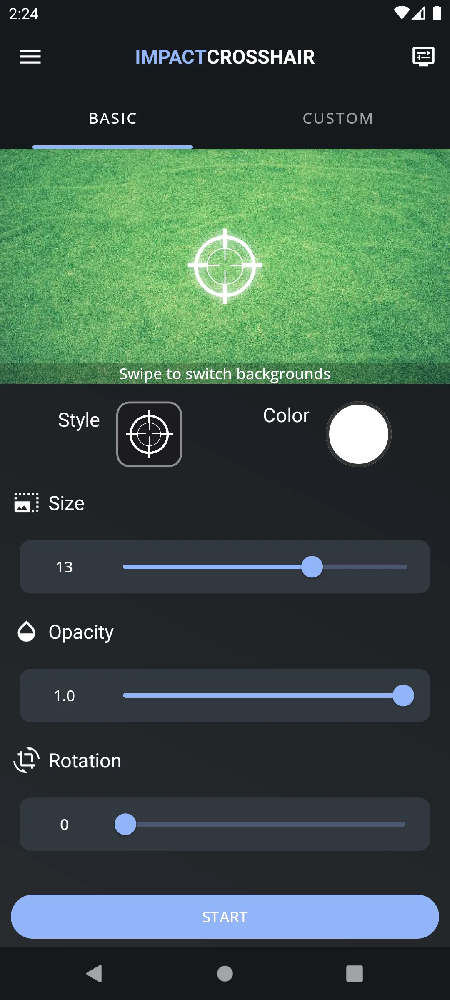{: width="180" .normal }
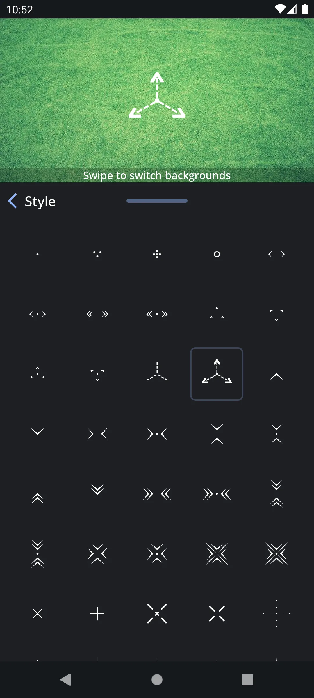{: width="180" .normal }
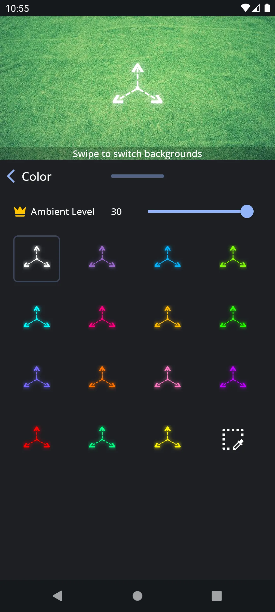{: width="180" .normal }
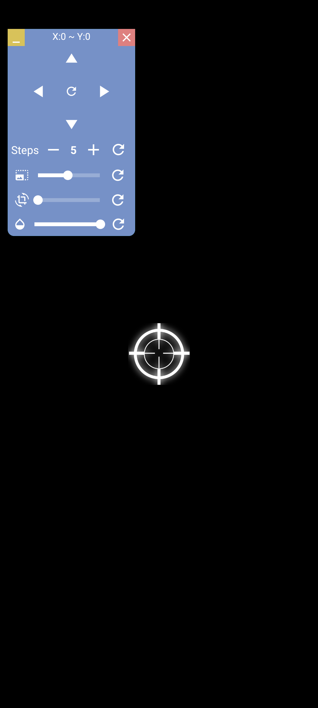{: width="180" .normal }

Custom Crosshair (Impact Crosshair) adalah **alat overlay** popular dengan 500.000+ instal, pembuat bidik silang, overlay waktu nyata, dan retikel animasi untuk game FPS dan TPS.

**Kelebihan**
- **Pembuat bidik silang** dengan ukuran, warna, dan reka bentuk yang boleh disesuaikan.
- **Overlay waktu nyata** tampil saat memainkan shooter yang didukung.
- **Animasi bidik silang** untuk paparan lebih dinamis.
- Basis pengguna besar dan pembaruan rutin.
- Percuma untuk bermula, dengan tier Pro untuk pilihan lanjutan.

**Kelemahan**
- Hanya Android.
- Sebahagian animasi dan pembuat lanjutan berada di sebalik Pro.
- UI boleh terasa ramai di samping aplikasi minimalis.

**Terbaik untuk:** pemain yang ingin retikel animasi, ekspresif, dan komunitas besar.

**Muat turun Custom Crosshair**
- [Google Play](https://play.google.com/store/apps/details?id=com.devayulabs.crosshair)

---

### 3. Custom Aim — generator bidik silang terbaik

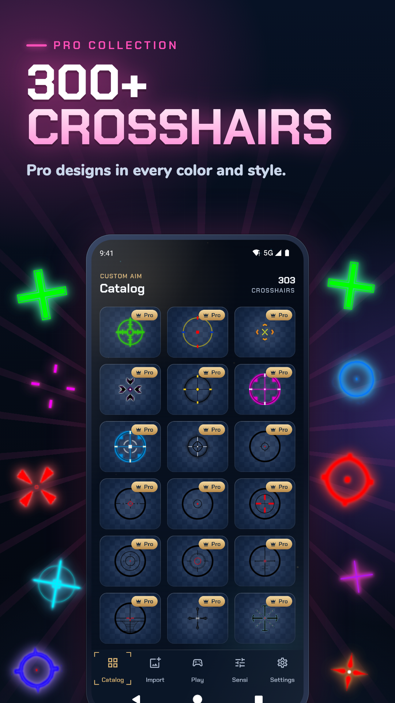{: width="180" .normal }
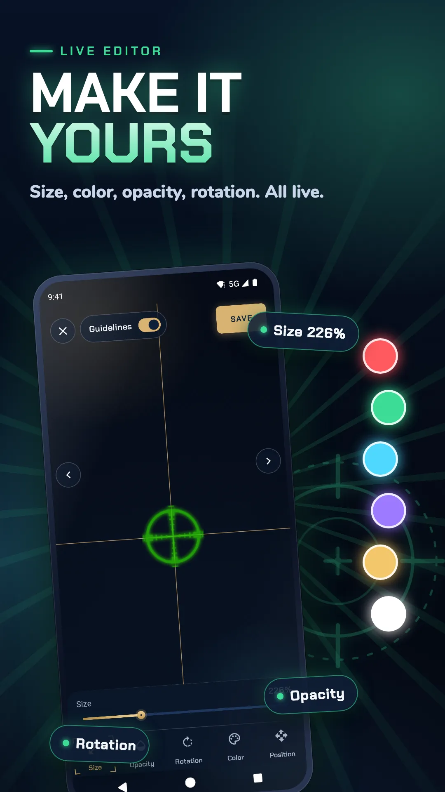{: width="180" .normal }
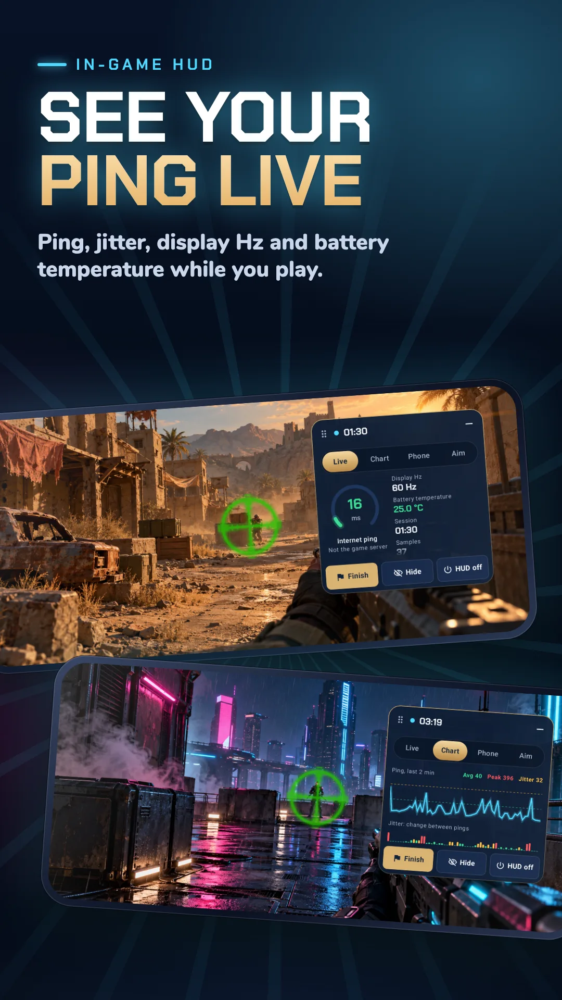{: width="180" .normal }
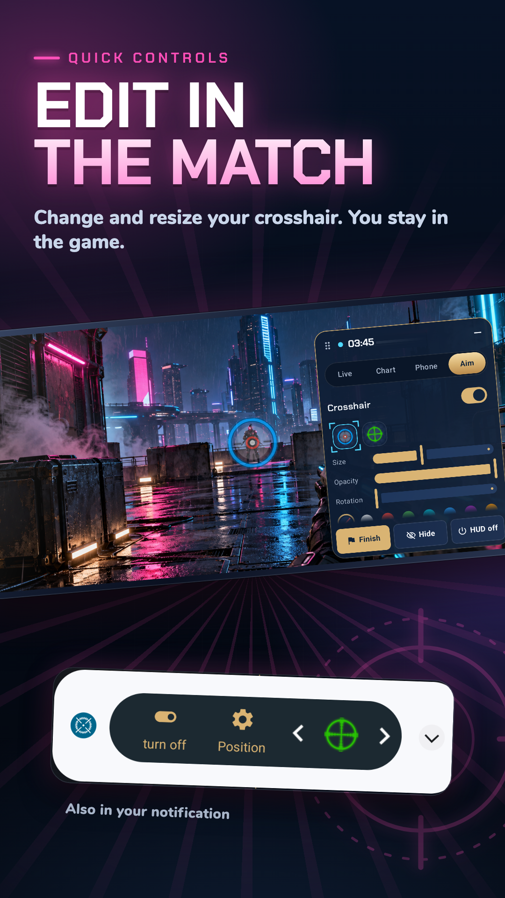{: width="180" .normal }

Custom Aim (Crosshair Generator Pro) memungkinkan Anda **membuat overlay bidik silang tersuai** di game FPS penembakan apa pun, dengan pratetap dan kendali bentuk/warna/ukuran mendalam.

**Kelebihan**
- **Pratetap bergaya generator** plus kendali manual penuh bentuk, warna, dan ukuran.
- **Overlay bekerja di FPS/TPS apa pun** tanpa mengubah game.
- Ringan dan mudah diaktifkan/nonaktifkan.
- Teras percuma dengan upgrade Pro untuk gaya ekstra.
- Tidak perlu root.

**Kelemahan**
- Hanya Android.
- Panduan lebih sedikit untuk pengguna pemula.
- Tidak ada penyegerakan profil per game lintas peranti (tanpa akaun).

**Terbaik untuk:** penggiat yang ingin merancang retikel sendiri dari nol.

**Muat turun Custom Aim**
- [Google Play](https://play.google.com/store/apps/details?id=com.itdeveapps.customaim)

---

### 4. Crosshair Pro — penempatan waktu nyata terbaik

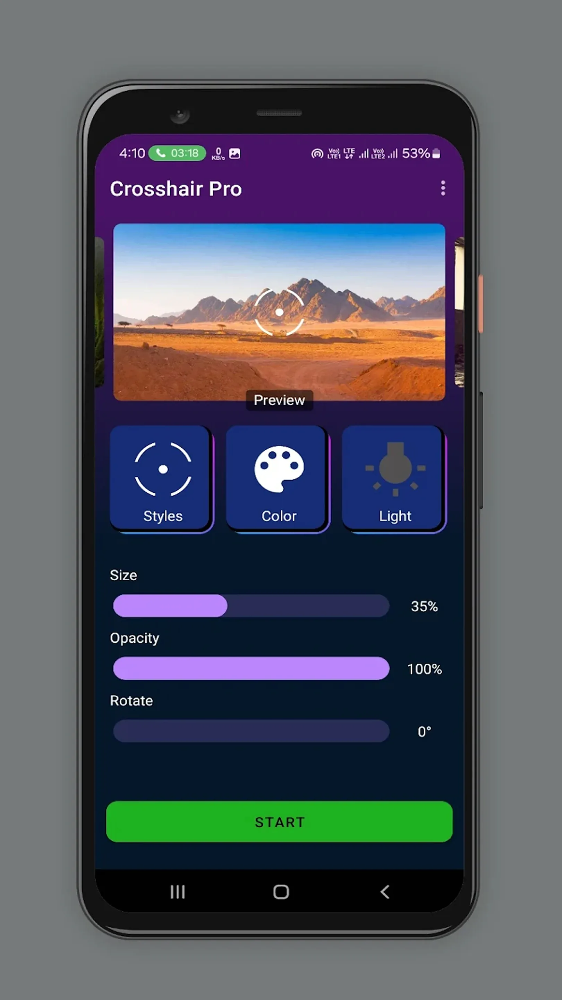{: width="180" .normal }
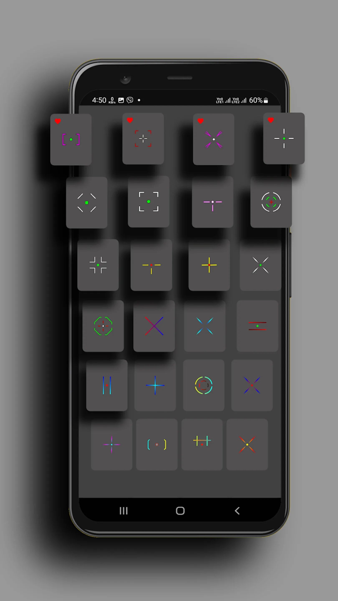{: width="180" .normal }
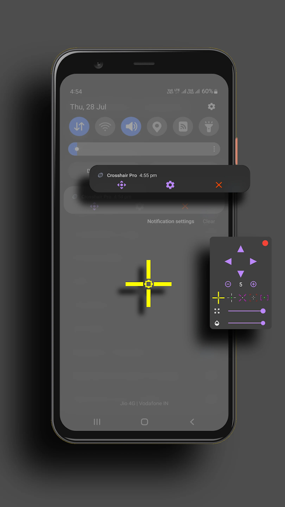{: width="180" .normal }
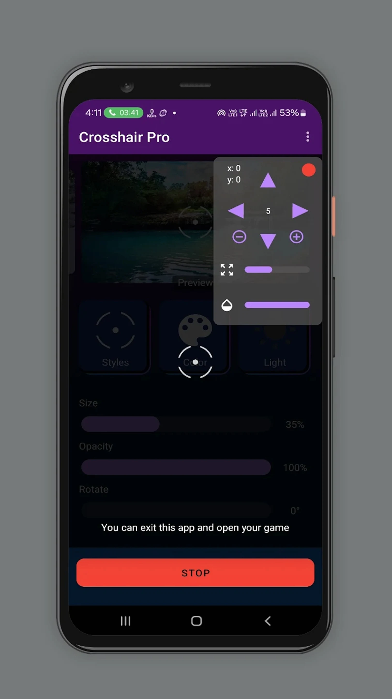{: width="180" .normal }

Crosshair Pro: Custom Scope adalah utilitas seluler yang menempatkan **overlay scope presisi** di mana sahaja di skrin, boleh disesuaikan waktu nyata saat bermain, dengan kompatibilitas FPS luas.

**Kelebihan**
- **Tempatkan bidik silang di mana sahaja** dan sesuaikan saat bermain secara waktu nyata.
- **Semua game FPS utama** didukung dengan kompatibilitas baik.
- Set klasik dan pro untuk mencocokkan gaya menembak Anda.
- UI sederhana dan fokus.
- Percuma dengan pembelian dalam aplikasi.

**Kelemahan**
- Hanya Android.
- Ragam gaya lebih sempit daripada aplikasi generator.
- Set ber-gate IAP boleh bertambah.

**Terbaik untuk:** pemain yang paling peduli penempatan presisi waktu nyata.

**Muat turun Crosshair Pro**
- [Google Play](https://play.google.com/store/apps/details?id=com.customscopecommunity.crosshairpro)

---

### 5. CrossAim — pakej gaya sederhana terbaik

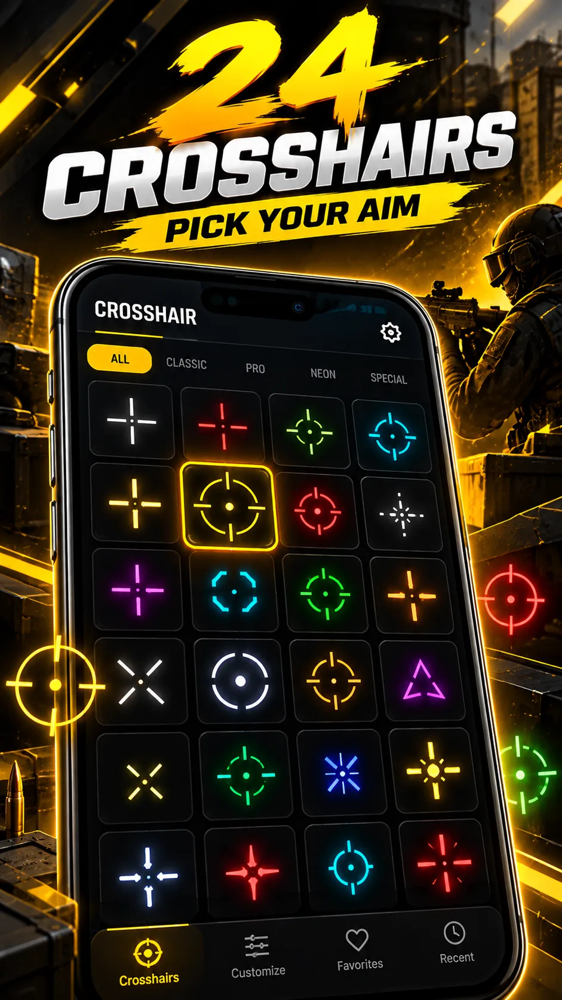{: width="180" .normal }
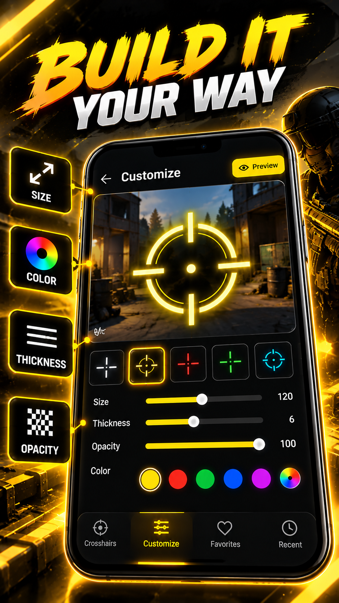{: width="180" .normal }
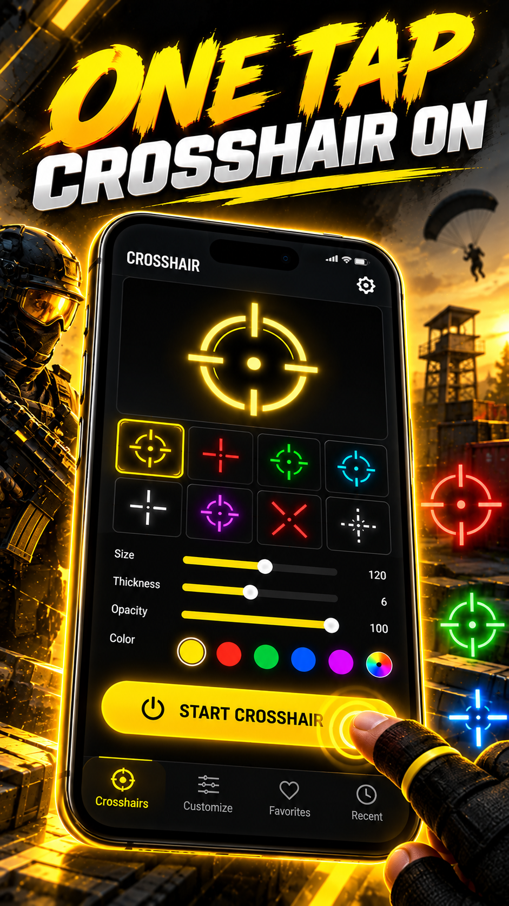{: width="180" .normal }
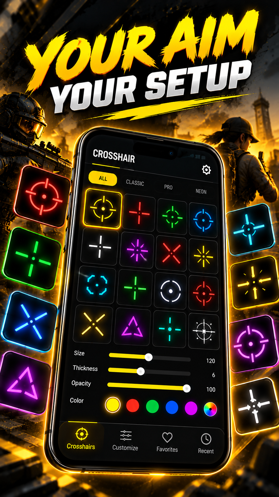{: width="180" .normal }
{: width="180" .normal }

CrossAim: Custom Crosshair menawarkan **24 gaya** dengan warna dan ukuran, alat overlay bersih untuk pergantian retikel cepat.

**Kelebihan**
- **24 gaya siap pakai** merangkumi paparan retikel umum.
- Pelarasan warna dan ukuran mudah.
- Overlay minimum dan cepat dengan overhead rendah.
- Percuma untuk cuba dengan IAP untuk ekstra.
- Tidak perlu root.

**Kelemahan**
- Hanya Android.
- Pilihan pelarasan mendalam lebih sedikit daripada aplikasi generator.
- Set ciri secara keseluruhan lebih kecil.

**Terbaik untuk:** pemain yang ingin retikel cepat dan bersih tanpa kerumitan.

**Muat turun CrossAim**
- [Google Play](https://play.google.com/store/apps/details?id=com.crosshair.customcrosshair.aimreticle)

---

### 6. Crosshair PRO — set overlay pro terbaik

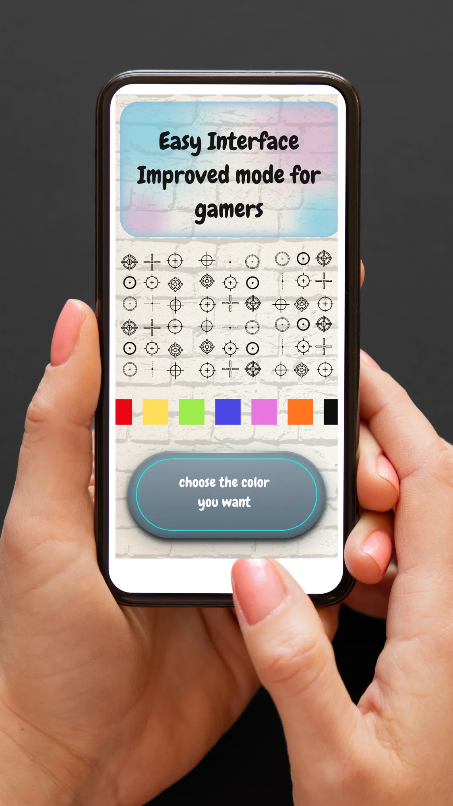{: width="180" .normal }
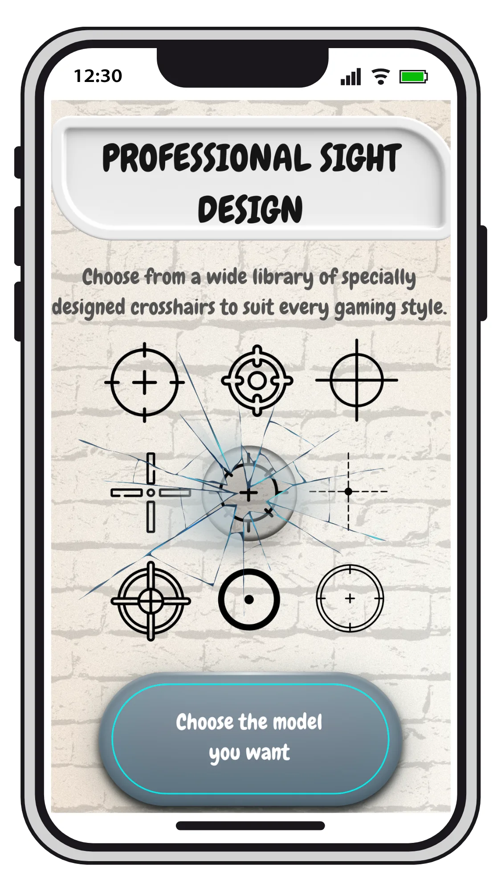{: width="180" .normal }
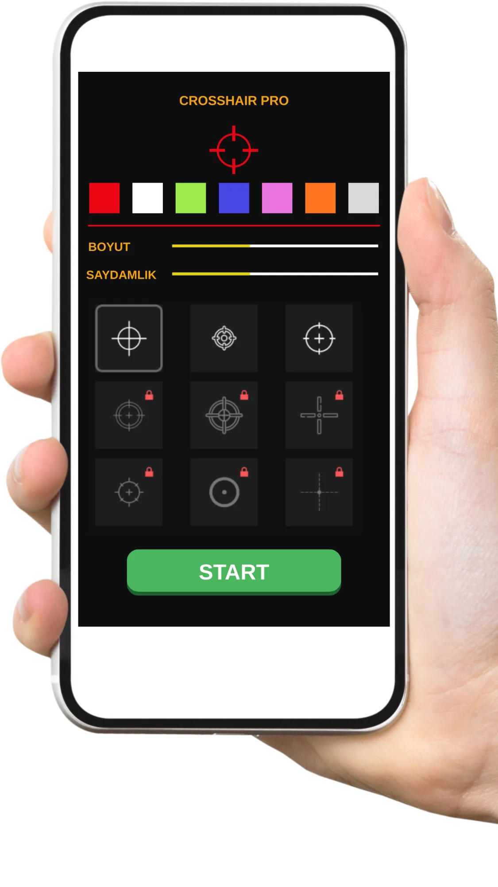{: width="180" .normal }
{: width="180" .normal }

Crosshair PRO (Custom Scope) adalah **alat overlay untuk penggemar FPS dan TPS**, dengan scope yang boleh dikustom dan jejak ringan.

**Kelebihan**
- **Overlay profesional** dirancang untuk meningkatkan aim.
- Gaya, warna, dan ukuran scope yang boleh dikustom.
- Ringan dan stabil saat bermain.
- Percuma dengan pembelian dalam aplikasi.
- Tidak perlu root.

**Kelemahan**
- Hanya Android.
- Tumpang tindih ciri dengan Crosshair Pro boleh membingungkan pilihan.
- Gaya terbaik di sebalik IAP.

**Terbaik untuk:** pemain yang ingin overlay scope bergaya pro dan fokus.

**Muat turun Crosshair PRO**
- [Google Play](https://play.google.com/store/apps/details?id=com.redcliff.customcrosshair)

---

## Perbandingan kapabilitas teras

| Kapabilitas | Crosshair Aim | Custom Crosshair | Custom Aim | Crosshair Pro | CrossAim | Crosshair PRO |
|---|---|---|---|---|---|---|
| **Platform** | Android | Android | Android | Android | Android | Android |
| **Overlay tanpa root** | Ya | Ya | Ya | Ya | Ya | Ya |
| **Jumlah gaya / pratetap** | 15+ | Banyak + animasi | Generator | Dasar/Pro/Presisi | 24 | Set Pro |
| **Pelarasan** | Ukuran/warna/scale/pos | Ukuran/warna/reka bentuk | Penuh (bentuk/warna/ukuran) | Warna, ukuran, posisi | Warna, ukuran | Boleh dikustom |
| **Tetapan saat main** | Ya | Ya | Ya | Ya (waktu nyata) | Ya | Ya |
| **Import gambar / bentuk tersuai** | Tidak | Tidak | Sebahagian | Tidak | Tidak | Tidak |
| **Profil per game** | Tidak | Tidak | Tidak | Tidak | Tidak | Tidak |
| **Animasi** | Tidak | Ya | Tidak | Tidak | Tidak | Tidak |
| **Iklan / IAP** | Buka | Percuma + Pro | Percuma + Pro | Percuma + IAP | Percuma + IAP | Percuma + IAP |
| **Prestasi (overhead rendah)** | Baik | Baik | Baik | Baik | Ringan | Ringan |
| **Tier percuma** | Murah hati | Ya | Ya | Ya | Ya | Ya |
| **Selamat game (tanpa akaun/root)** | Ya | Ya | Ya | Ya | Ya | Ya |

---

## Cara memilih

- Ingin **15+ gaya + penyetelan terus saat main** → **Crosshair Aim**
- Ingin **retikel animasi ekspresif** → **Custom Crosshair**
- Ingin **merancang sendiri dari nol** → **Custom Aim**
- Ingin **penempatan presisi waktu nyata** → **Crosshair Pro**
- Ingin **pakej 24 gaya cepat dan bersih** → **CrossAim**
- Ingin **overlay scope pro yang fokus** → **Crosshair PRO**

Melihat masing-masing sebagai **alternatif Crosshair Hero**: **alternatif Custom Crosshair** untuk penggemar retikel animasi, **alternatif Custom Aim** untuk pembangun dari nol, **alternatif CrossAim** untuk pakej 24 gaya cepat, **alternatif Crosshair Pro** untuk penempatan waktu nyata, dan **alternatif Crosshair PRO** untuk scope pro. Pengguna iOS mendapat **alternatif Crosshair X** sebagai satu-satunya pilihan merentas platform. Semua adalah overlay **custom crosshair Android** — tanpa root, selamat digunakan.

Jika Anda datang ke sini mencari pilihan **alternatif Crosshair Hero android terbaik**, mulai dari Crosshair Aim untuk kendali terus saat main, atau Custom Crosshair untuk retikel animasi.

## Cara bermigrasi dari Crosshair Hero

1. **Catat game** yang menggunakan bidik silang tersuai (mis. PUBG Mobile, Free Fire, CODM).
2. **Pilih pengganti** dari jadual berdasarkan seberapa banyak pelarasan yang Anda butuhkan.
3. **Beri kebenaran tampilkan-di-atas-aplikasi-lain** supaya overlay boleh melukis di atas game.
4. **Buat ulang retikel Anda** — atur gaya, warna, ukuran, dan posisi supaya sesuai dengan yang Anda punya.
5. **Uji dalam pertandingan** dan gunakan tetapan saat main untuk menyetel penempatan sebelum bermain kompetitif.

## FAQ

**Apakah Crosshair Aim alternatif Crosshair Hero terbaik?**
{:.faq-q}

Jika Anda ingin 80+ gaya plus tetapan terapung terus saat main (ukuran, warna, posisi, ketelusan) dan retikel untuk senjata yang tidak memilikinya, ya — Crosshair Aim memimpin dalam kendali. Custom Crosshair menang di retikel animasi, Custom Aim di reka bentuk dari nol.

**Alternatif mana yang punya bidik silang animasi?**
{:.faq-q}

Custom Crosshair (Impact Crosshair) adalah satu-satunya di sini dengan retikel animasi; Crosshair Aim dan lain-lain statik.

**Alternatif mana yang paling mirip Crosshair Hero?**
{:.faq-q}

Crosshair Hero (dibincangkan di panduan vs) dan CrossAim adalah pilihan pratetap terdekat; Crosshair Aim adalah pilihan lebih dalam dan lebih boleh dikustom.

**Apakah Crosshair Aim percuma?**
{:.faq-q}

Ya. Set gaya dasar percuma dan tanpa iklan; buka Pro membuka pustaka lengkap.

[Halaman aplikasi Crosshair Aim](/ms/apps/cross-hair/) — tersedia di Android.

## Istilah berkaitan

- [Apakah Itu Bidik Silang?](/ms/glossary/what-is-a-crosshair/)
