Day One adalah jurnal yang mumpuni, tetapi **langganan ~$35/tahun** dan model cloud-nya tidak sesuai untuk semua orang. Jika Anda menginginkan yang lebih peribadi, lebih berfokus pada mood, atau sekadar lebih murah, pilihan jurnal lain cukup kuat.

Di bawah ini kami bandingkan enam **alternatif Day One** — dari [buku harian mood](/ms/glossary/what-is-a-mood-tracker/) peribadi yang comel hingga jurnal merentas platform dan pencatat mood mikro — dari sisi harga, platform, dan keupayaan yang benar-benar menentukan. Kebanyakan pembaca datang dengan satu penghalang tertentu — langganan, akaun cloud, atau jurnal yang terlalu lama diisi — jadi setiap pilihan dibingkai menurut alasan itu.

## Mengapa mencari di luar Day One

{: width="180" .normal }
{: width="180" .normal }
{: width="180" .normal }
{: width="180" .normal }
{: width="180" .normal }

- **Langganan tahunan berbayar** (~$35/tahun di 2026) untuk ciri yang paling sering digunakan orang.
- **Segerak cloud secara bawaan** — sebahagian pengguna ingin storan setempat sahaja yang mereka kendalikan.
- **Mengutamakan prosa** — kurang pas bila Anda hanya ingin check-in mood cepat.
- **Condong ke iPhone** — aplikasi Android dan web tertinggal dari versi iOS.
- **Terkunci** — pindah berarti mengekspor, dan formatnya tidak selalu portabel.

## Alternatif Day One terbaik sekilas

| Aplikasi | Harga (2026) | Platform | Terbaik untuk |
|---|---|---|---|
| **Meow Mood Diary** | Teras percuma + VIP | Android, iOS | Buku harian mood peribadi, comel |
| **Journey** | Percuma + langganan Cloud | Android, iOS, web, Win, Mac | Jurnal merentas platform |
| **Diaro** | Percuma + Pro | Android, iOS, Win, Mac | Jurnal teks terorganisir |
| **Daylio** | Percuma + Premium | Android, iOS | Pencatat mood mikro |
| **Grid Diary** | Percuma + Premium | Android, iOS | Jurnal berpanduan pertanyaan |
| **Momento** | Percuma + Premium | iOS | Jurnal linimasa peribadi |

---

### 1. Meow Mood Diary — terbaik untuk buku harian mood peribadi yang comel

{: width="180" .normal }
{: width="180" .normal }
{: width="180" .normal }
{: width="180" .normal }
{: width="180" .normal }

Meow Mood Diary adalah **buku harian mood yang selamat dan peribadi** dengan antara muka bertema kucing yang menenangkan. Ciri paling menonjol adalah **desainnya**: visual kucing kartun yang comel dan beragam ikon mood membuat check-in harian terasa ringan, bukan klinis. Di luar paparan, ia tidak pernah mengunggah entri ke server dan hanya mencadangkan ke Google Drive milik Anda.

**Kelebihan**
- **Antara muka kucing kartun yang comel** dengan beragam ikon mood dan tema warna tersuai — pembeda paling jelas.
- **Privasi menyeluruh**: entri tidak pernah diunggah ke server kami; sandaran hanya ke Google Drive milik Anda.
- **Catatan mood cepat satu ketik** — rekam perasaan tanpa menulis entri panjang.
- **Sepenuhnya offline** — catat mood, lihat sejarah, dan edit entri tanpa Wi-Fi.
- **Peringatan, kunci cap jari/kode sandi**, serta paparan kalendar + graf trend emosi.
- Entri buku harian rinci dan peringatan harian yang boleh disesuaikan.

**Kelemahan**
- **Tanpa segerak akaun cloud** lintas peranti — sandaran memakai Google Drive sendiri, jadi lintas peranti lebih manual daripada Day One.
- Ekosistem lebih kecil dan integrasi pihak ketiga lebih sedikit daripada jurnal besar.
- Kurang sesuai untuk jurnal prosa panjang yang terstruktur.

**Paling sesuai untuk:** orang yang menginginkan buku harian mood peribadi dan bersahabat, yang tampil menenangkan dan bekerja sepenuhnya offline.

**Muat turun Meow Mood Diary**
- [Google Play](https://play.google.com/store/apps/details?id=com.glgjing.meow.mood.diary)
- [App Store](https://apps.apple.com/us/app/meow-mood-diary/id6767560237)

---

### 2. Journey — terbaik untuk jurnal merentas platform

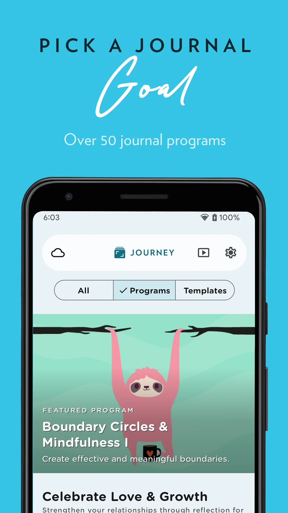{: width="180" .normal }
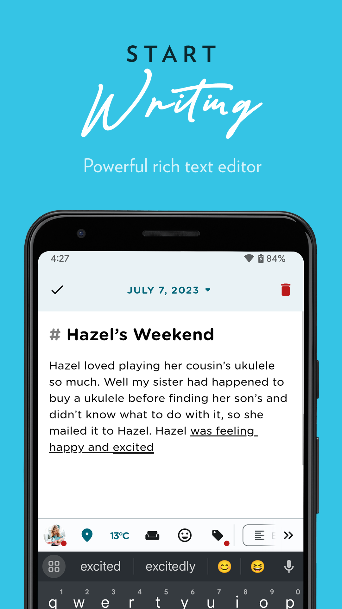{: width="180" .normal }
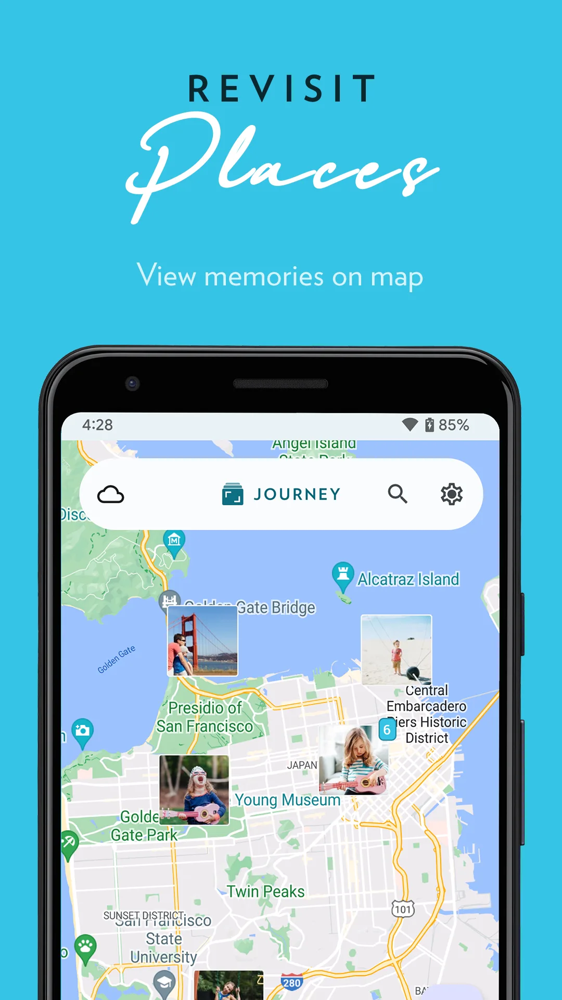{: width="180" .normal }
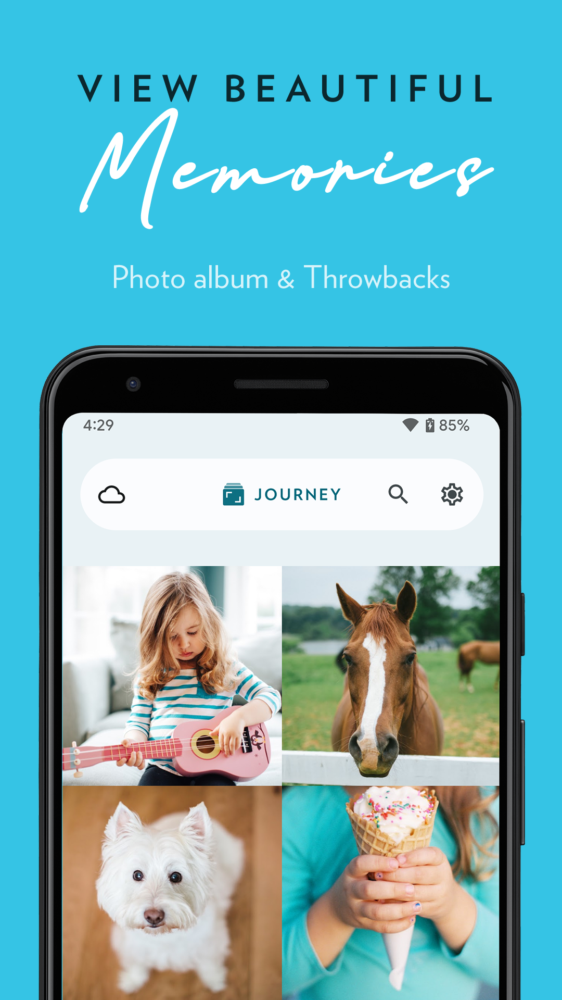{: width="180" .normal }
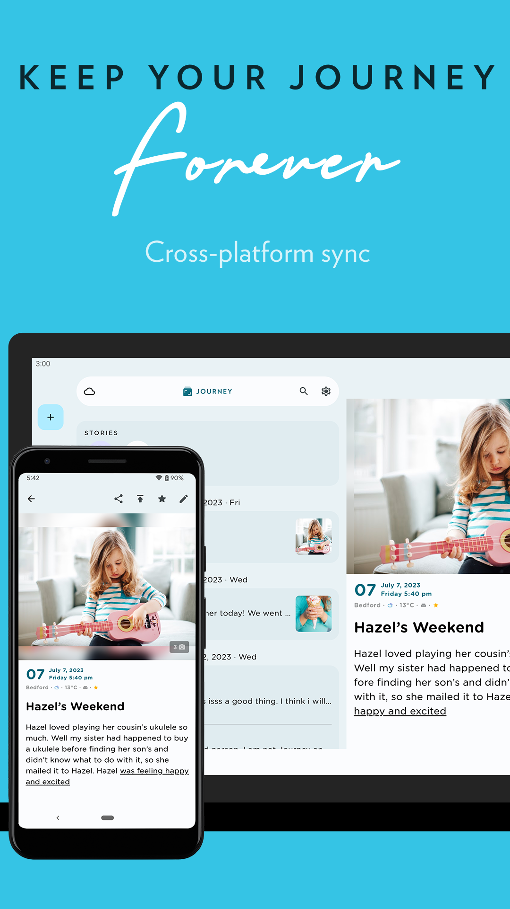{: width="180" .normal }

Journey adalah **jurnal merentas platform** untuk Android, iOS, web, Windows, dan Mac, dengan entri foto, penjejakan mood, serta penyegerakan Google Drive. Ia pesaing terus terdekat Day One bagi orang yang menulis di banyak peranti.

**Kelebihan**
- **Segerak merentas platform kuat** antar telefon pintar, tablet, web, dan desktop via Google Drive.
- **Entri kaya**: foto, lokasi, cuaca, dan mood.
- **Prompt terpandu dan statistik** untuk menjaga tabiat mencatat.
- Kunci kode sandi dan penulisan offline.
- Tingkat percuma yang lapang untuk jurnal dasar.

**Kelemahan**
- Ciri segerak dan lanjutan tertentu perlu Journey Cloud (berbayar).
- Antarmukanya fungsional, bukan indah — kurang nuansa "menyenangkan" seperti buku harian comel.
- Lebih berat daripada pencatat mood cepat.

**Paling sesuai untuk:** penulis yang menjurnal di telefon pintar, web, dan desktop serta menginginkan segerak yang boleh dipercayai.

**Muat turun Journey**
- [Google Play](https://play.google.com/store/apps/details?id=com.journey.app)
- [App Store](https://apps.apple.com/us/app/journey-diary-journal/id1300202543)

---

### 3. Diaro — terbaik untuk jurnal teks terorganisir

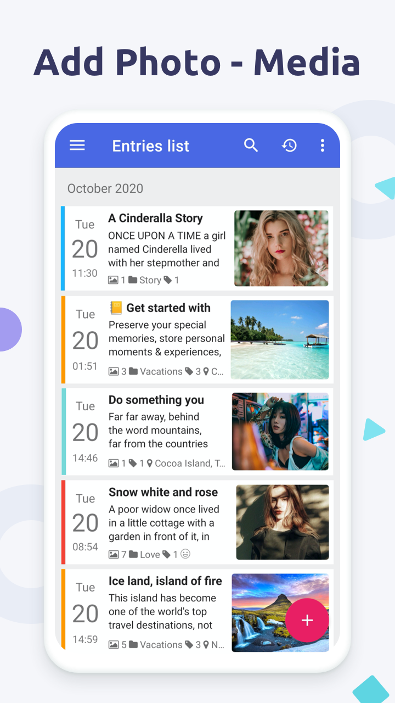{: width="180" .normal }
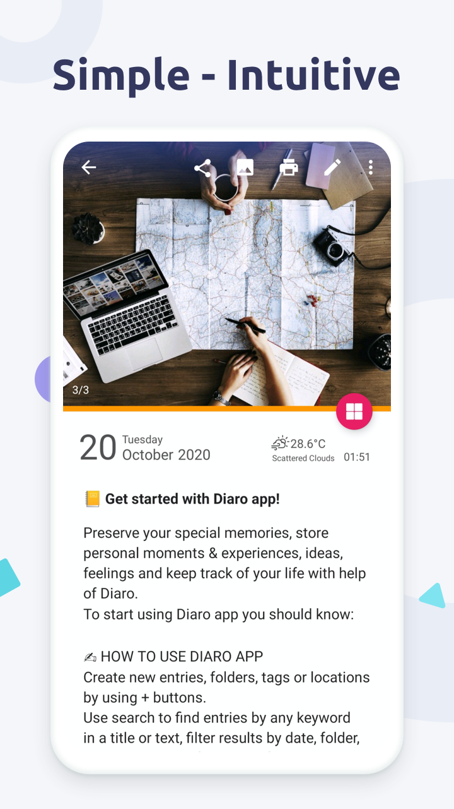{: width="180" .normal }
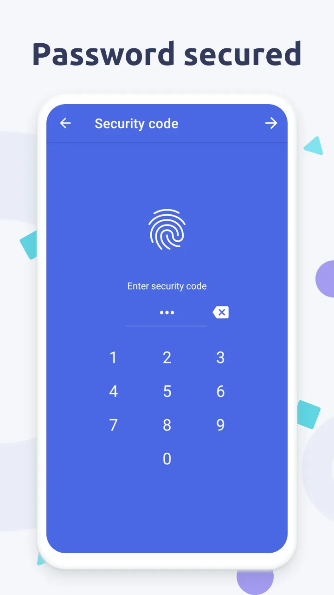{: width="180" .normal }
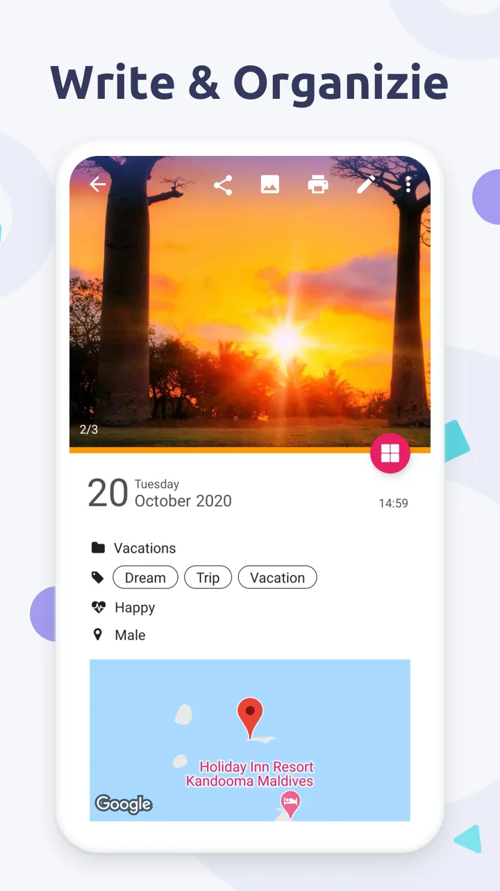{: width="180" .normal }
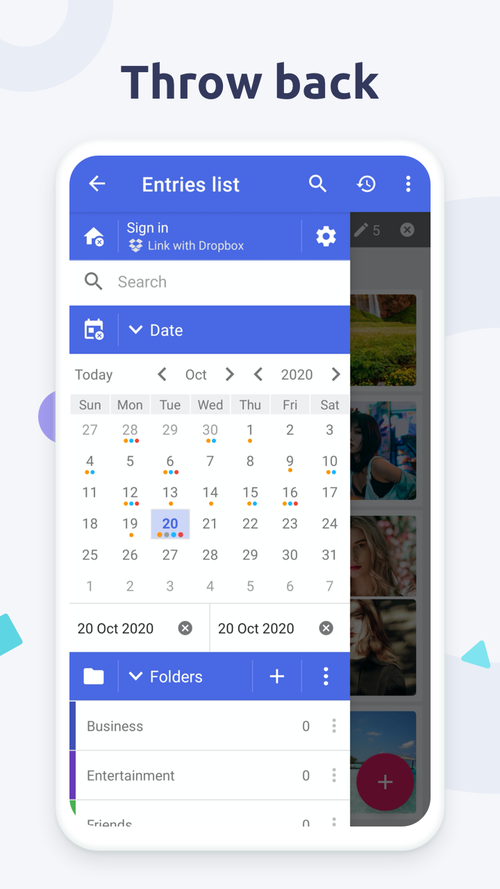{: width="180" .normal }

Diaro adalah **buku harian berbasis teks** dengan folder, tag, carian, dan papan pemuka bersih, tersedia di Android, iOS, Windows, dan Mac dengan sandaran cloud.

**Kelebihan**
- **Folder, tag, dan carian tangguh** memudahkan navigasi jurnal panjang.
- **Penjejakan mood dan graf** berdampingan dengan entri teks.
- **Multi-platform** dengan segerak cloud dan eksport ke PDF/XML/TXT.
- Lampiran foto dan peringatan.
- Tingkat percuma merangkumi jurnal harian.

**Kelemahan**
- Antarmukanya praktikal, bukan comel — tidak ada tema comel.
- Sebahagian ciri (segerak cloud, eksport tambahan) berada di sebalik Diaro Pro.
- Kurang menekankan check-in mood cepat.

**Paling sesuai untuk:** penulis terorganisir yang menginginkan folder, tag, dan carian lintas peranti.

**Muat turun Diaro**
- [Google Play](https://play.google.com/store/apps/details?id=com.pixelcrater.Diaro)
- [App Store](https://apps.apple.com/us/app/diary-journal-notes-diaro/id882519460)

---

### 4. Daylio — terbaik untuk pencatat mood mikro

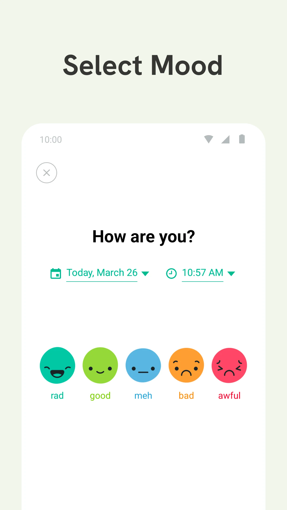{: width="180" .normal }
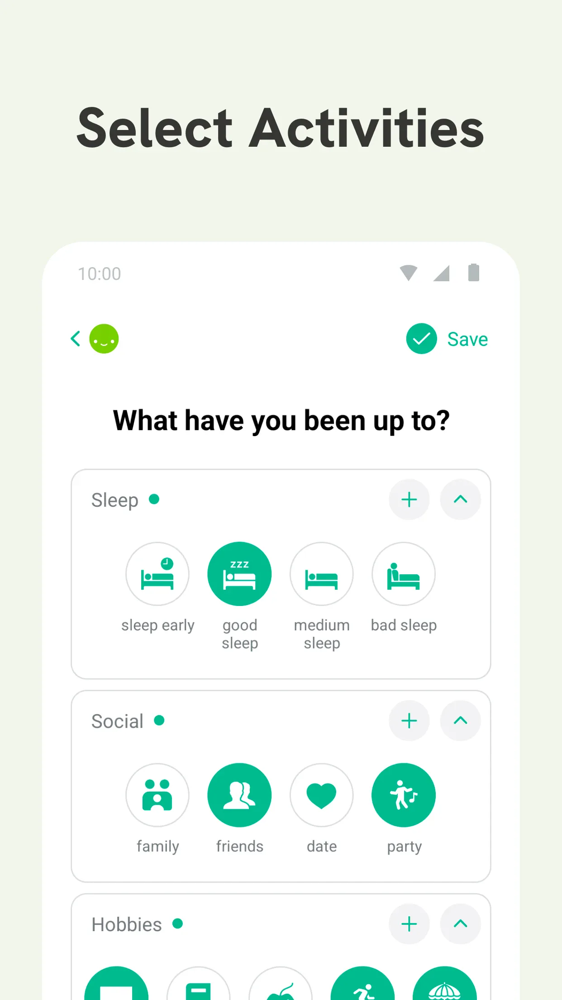{: width="180" .normal }
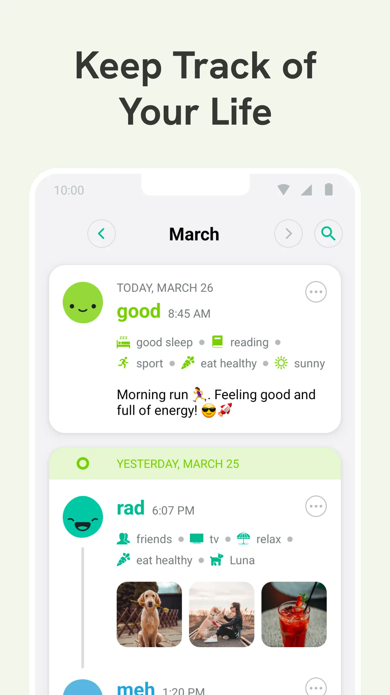{: width="180" .normal }
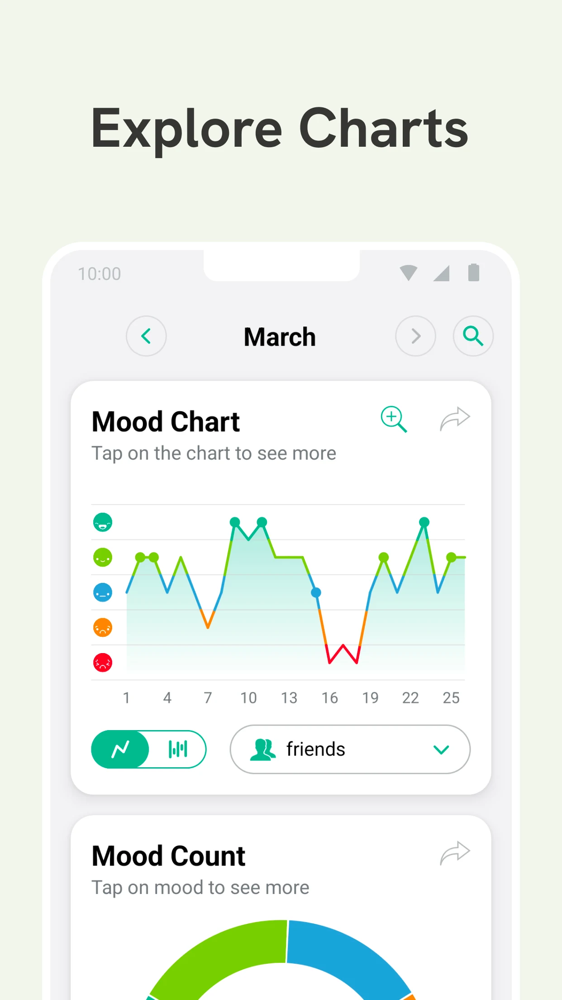{: width="180" .normal }
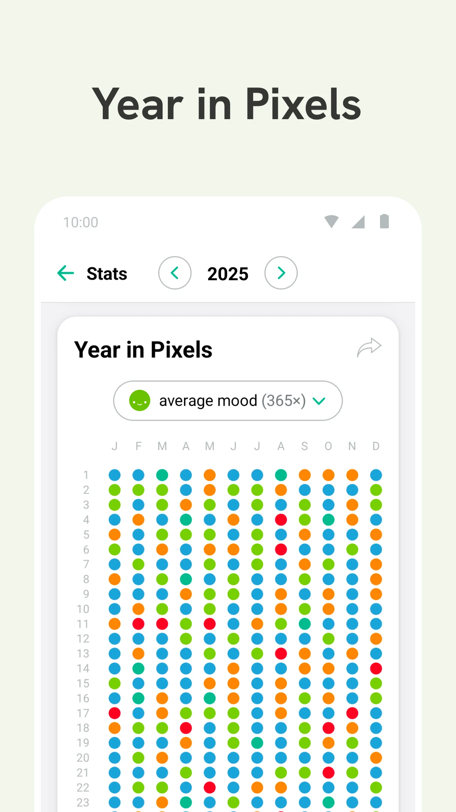{: width="180" .normal }

Daylio adalah **penjejak mood mikro** di mana Anda mengetuk perasaan dan menambah beberapa aktivitas — tanpa perlu menulis. Ia membangun kalendar dan graf berwarna dari pola emosi Anda.

**Kelebihan**
- **Mood + aktivitas satu ketik** — menjurnal dalam hitungan saat, tanpa prosa.
- **Kalendar dan graf berwarna** yang membongkar pola emosi dari waktu ke waktu.
- **Merentas platform** (Android + iOS) dengan sandaran cloud.
- Peringatan dan target untuk membangun tabiat.
- Tingkat percuma cukup lapang.

**Kelemahan**
- Tidak dibangun untuk tulisan panjang — ia mengutamakan mood.
- Statistik mendalam dan sejarah tidak terhad berada di sebalik Premium.
- Pelarasan aktivitas terhad pada versi percuma.

**Paling sesuai untuk:** orang yang ingin melacak mood cepat dan melihat pola, bukan menulis esai.

**Muat turun Daylio**
- [Google Play](https://play.google.com/store/apps/details?id=net.daylio)
- [App Store](https://apps.apple.com/us/app/daylio-journal-mood-tracker/id1194023242)

---

### 5. Grid Diary — terbaik untuk jurnal berpanduan pertanyaan

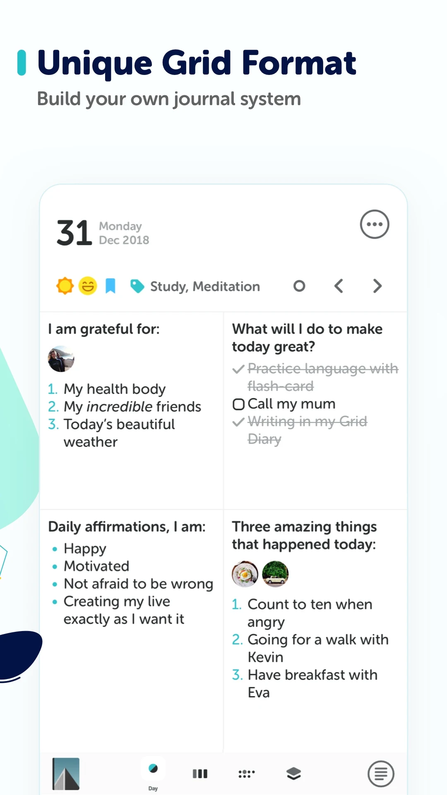{: width="180" .normal }
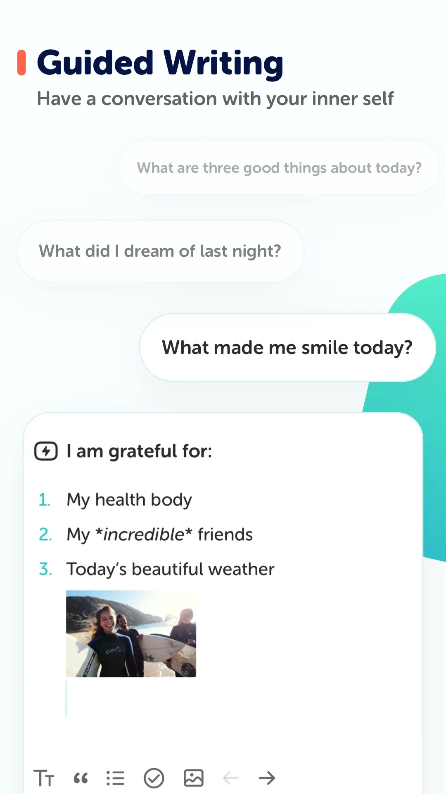{: width="180" .normal }
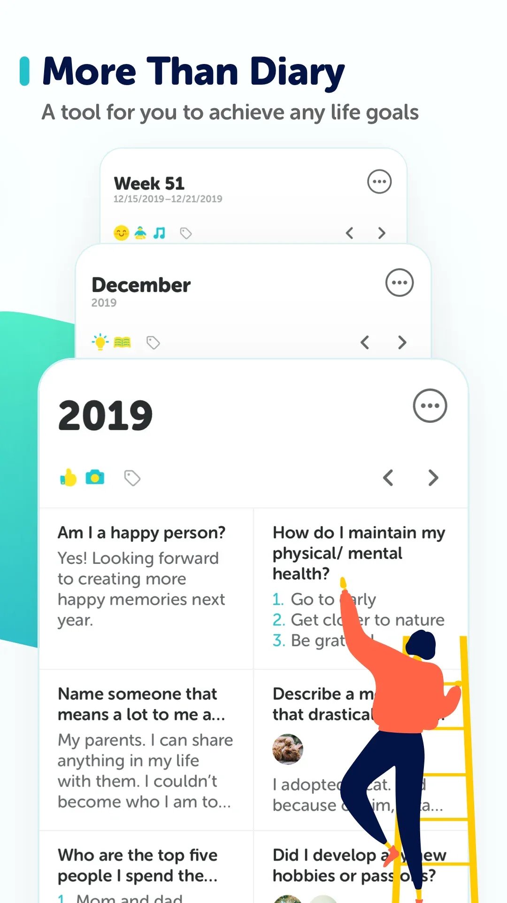{: width="180" .normal }
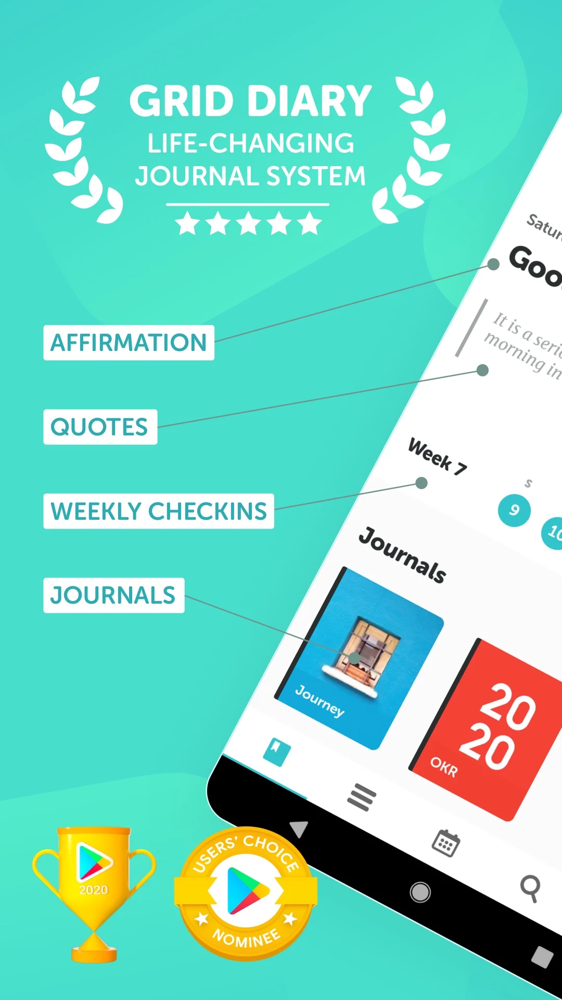{: width="180" .normal }
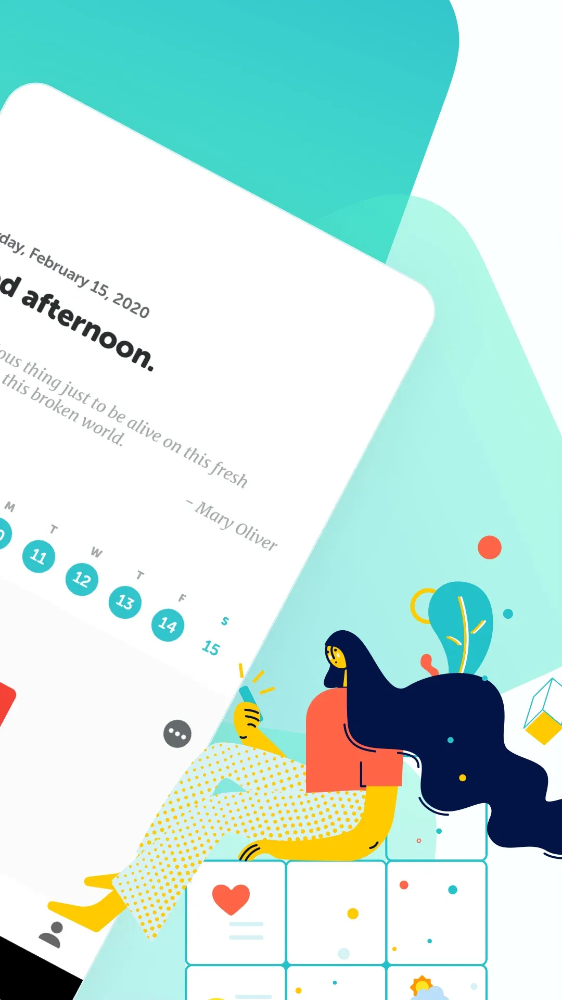{: width="180" .normal }

Grid Diary memakai **kisi berpanduan pertanyaan** untuk menyusun entri, membantu Anda merenung dengan template yang boleh digunakan ulang. Popular untuk jurnal rasa syukur, pertanyaan harian, dan gaya tabiat.

**Kelebihan**
- **Kisi berpanduan pertanyaan** mengubah halaman kosong jadi pertanyaan terarah.
- **Template yang boleh digunakan ulang** untuk syukur, tinjauan harian, target, dan lain-lain.
- **Merentas platform** (Android + iOS) dengan segerak cloud.
- Pengalaman menulis yang bersih dan fokus.
- Tingkat percuma merangkumi prompt teras.

**Kelemahan**
- Nilai terbaik perlu Grid Diary Premium (lebih banyak template, segerak).
- Kurang bebas — struktur kisi tidak sesuai untuk semua orang.
- Tidak ada estetika comel/kartun.

**Paling sesuai untuk:** orang yang menulis lebih baik bila dipandu dan menginginkan struktur.

**Muat turun Grid Diary**
- [Google Play](https://play.google.com/store/apps/details?id=io.sumi.griddiary2)
- [App Store](https://apps.apple.com/us/app/grid-diary-journal-planner/id1392523148)

---

### 6. Momento — terbaik untuk jurnal linimasa peribadi

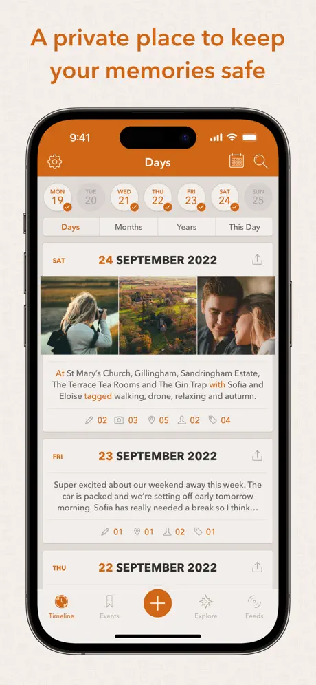{: width="180" .normal }
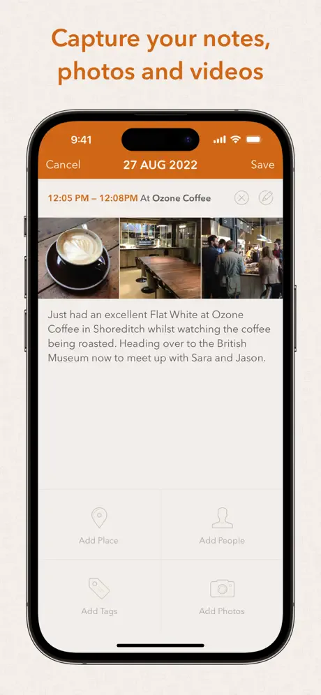{: width="180" .normal }
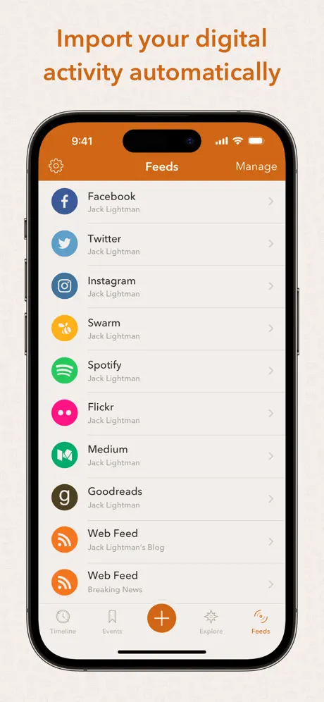{: width="180" .normal }
{: width="180" .normal }
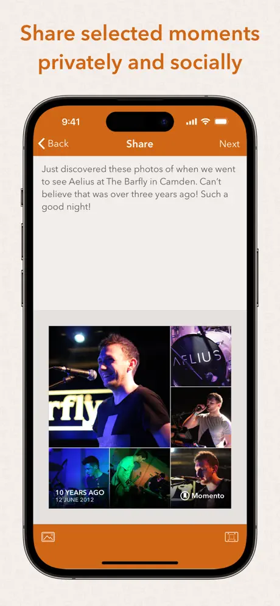{: width="180" .normal }

Momento adalah **jurnal iOS** yang membangun linimasa peribadi dari entri dan perkhidmatan bersambung Anda, berfokus pada ruang peribadi yang tenang untuk merenung.

**Kelebihan**
- **Linimasa peribadi** yang mengelompokkan entri per hari untuk merenung cepat.
- Reka bentuk iOS minimum yang bersih.
- Entri foto dan teks dengan peringatan.
- Postur privasi lokal-utama.
- Tersedia tingkat percuma.

**Kelemahan**
- **Hanya iOS** — tidak ada aplikasi Android atau web.
- Sebahagian ciri dan entri tidak terhad perlu langganan Premium.
- Integrasi lebih sedikit dan jangkauan merentas platform lebih sempit daripada Journey.

**Paling sesuai untuk:** pengguna iPhone yang menginginkan jurnal linimasa peribadi dan tenang.

**Muat turun Momento**
- [App Store](https://apps.apple.com/us/app/momento-private-journal-diary/id980592846)

---

## Perbandingan keupayaan teras

| Keupayaan | Meow Mood Diary | Journey | Diaro | Daylio | Grid Diary | Momento |
|---|---|---|---|---|---|---|
| **Platform** | Android, iOS | Android, iOS, web, Win, Mac | Android, iOS, Win, Mac | Android, iOS | Android, iOS | iOS |
| **Tingkat percuma** | Lapang | Ya | Ya | Ya | Ya | Ya |
| **Penjejakan mood** | Ya (ikon) | Ya | Ya | Ya (mikro) | Sebahagian | Ya |
| **Jurnal teks** | Ya | Kuat | Kuat | Ringan | Terpandu | Ya |
| **Prompt / struktur** | Tidak | Sebahagian | Folder/tag | Aktivitas | Kisi prompt | Linimasa |
| **Foto & lampiran** | Ya | Ya | Ya | Tidak | Ya | Ya |
| **Privasi / lokal-utama** | Kuat (tanpa muat naik) | Cloud (Drive) | Cloud | Cloud | Cloud | Lokal-utama |
| **Segerak cloud / lintas peranti** | Sandaran Drive | Ya (akaun) | Ya (akaun) | Ya (akaun) | Ya (akaun) | Terhad (iOS) |
| **Peringatan** | Ya | Ya | Ya | Ya | Ya | Ya |
| **Tema / pelarasan** | Tema kucing, warna | Dasar | Dasar | Berwarna | Template | Minimum |
| **Eksport** | Ya | Ya | PDF/XML/TXT | Ya | Ya | Terhad |
| **Offline** | Sepenuhnya offline | Ya | Ya | Ya | Ya | Ya |

---

## Alternatif Day One mana yang sesuai untuk setiap jenis pengguna

Jadual di atas meranking ciri; di sini keenam pilihan dikelompokkan menurut *apa yang sebenarnya Anda ganti*.

- **Menggantikan langganan** — Meow Mood Diary dan Diaro keduanya punya teras percuma yang boleh digunakan; **penjejak mood tanpa langganan** layak dicek cetak birunya (kunci aplikasi, eksport, kalendar) sebelum memindahkan entri bertahun-tahun.
- **Menggantikan ritual menulis** — **alternatif Journey** atau **alternatif Grid Diary** menjaga prompt, tag, dan penyuntingan merentas platform; bila Anda ingin logging satu ketik, **alternatif Daylio** adalah saluran lebih pendek, dan Meow Mood Diary menangani itu di peranti.
- **Menggantikan penjejakan diri terstruktur** — **alternatif MoodKit** atau **alternatif Bearable** untuk catatan pemikiran dan korelasi multi-faktor, yang tidak dapat diungkapkan skala mood lima tingkat.
- **Menggantikan cloud** — Meow Mood Diary adalah pilihan bila syaratnya adalah **penjejak mood peribadi tanpa akaun** dengan saluran eksport; Momento lebih dekat ke linimasa tetapi tetap iOS-utama.
- **Tetap hanya iPhone** — **alternatif Reflectly** sesuai untuk jurnal terpandu yang dipimpin reka bentuk, tetapi tidak menyelesaikan tentang Android atau akaun.

Apapun labelnya, ajukan dua pertanyaan sebelum migrasi: bolehkah Anda mengeluarkan sejarah sebagai fail, dan apakah aplikasi tetap bekerja tanpa isyarat?

## Cara memilih

- Ingin **buku harian mood peribadi yang comel dan bekerja offline** → **Meow Mood Diary**
- Ingin **segerak merentas platform sejati (telefon pintar/web/desktop)** → **Journey**
- Ingin **folder, tag, dan carian untuk jurnal panjang** → **Diaro**
- Ingin **catatan mood satu ketik dan pola** → **Daylio**
- Ingin **struktur berpanduan pertanyaan** → **Grid Diary**
- Ingin **linimasa iOS peribadi yang tenang** → **Momento**

## Cara migrasi dari Day One

1. **Eksport entri Day One** Anda ke format standar (PDF atau eksport bawaan) sebelum membatalkan.
2. **Pilih pengganti** dari jadual berdasarkan platform dan apakah Anda ingin penjejakan mood atau tulisan panjang.
3. **Import atau buat ulang entri** — Journey/Diaro/Grid Diary menerima import; untuk Meow Mood, mulai baru dengan catatan mood satu ketik dan tambahkan catatan.
4. **Atur peringatan harian** di aplikasi baru supaya tabiat bertahan saat pindah.
5. **Aktifkan sandaran** (Meow Mood: Google Drive sendiri; Journey/Diaro: segerak akaun) supaya Anda tidak pernah terkunci.

## FAQ

**Apakah Meow Mood Diary alternatif Day One percuma yang baik?**
{:.faq-q}

Ya. Percuma di terasnya, berjalan di Android dan iOS, tidak pernah mengunggah entri ke server, dan hanya mencadangkan ke Google Drive milik Anda — pilihan kuat bila Anda menginginkan privasi dan logging mood cepat di atas multimedia kaya.

**Apakah Meow Mood Diary bekerja offline?**
{:.faq-q}

Ya. Anda boleh mencatat, melihat, dan mengedit entri tanpa internet dan tanpa akaun; data tetap di peranti Anda.

**Alternatif Day One mana yang terbaik untuk privasi?**
{:.faq-q}

Meow Mood Diary — tanpa akaun, storan di peranti dengan kunci cap jari pilihan, dan sandaran hanya ke Google Drive milik Anda bila diaktifkan.

**Bolehkah saya memindahkan entri dari Day One?**
{:.faq-q}

Day One mengekspor PDF dan format lain; Meow Mood sendiri mengekspor PDF (CSV via VIP), sehingga data Anda tetap portabel.

[Halaman aplikasi Meow Mood Diary](/ms/apps/meow-mood-diary/) — tersedia di Android dan iOS.

## Istilah berkaitan

- [Apakah Itu Penjejak Suasana Hati?](/ms/glossary/what-is-a-mood-tracker/)
