Intuit **menutup Mint pada Mac 2024** dan menggabungkan fiturnya ke Credit Karma. Jika Anda mencari **alternatif Mint** atau **alternatif Money Manager**, Anda tidak sendirian — jutaan bekas pengguna menginginkan **aplikasi bajet** yang mencatat perbelanjaan dengan jelas, tanpa diarahkan ke produk kredit atau dipaksa memakai akaun cloud yang tidak dipercaya.

Panduan ini membandingkan **tujuh** aplikasi pada dimensi yang sama. Masing-masing dipilih kerana **bahagian pasaran yang besar** atau **kelebihan khas** yang membezakannya. Setiap aplikasi di bawah dibincangkan dengan kelebihan nyata, kelemahan jujur, dan kinerjanya pada keupayaan teras yang benar-benar dipedulikan pengguna — multi-akun, penyegerakan, tuntutan balik, bajet, statistik, aset/kekayaan bersih, dan multi mata wang. Pautan muat turun ada di akhir setiap bahagian. Bagi pembaca Malaysia, istilah **alternatif MoneyMama**, **alternatif Belanje**, **alternatif MAE by Maybank2u**, **alternatif Belanje**, **alternatif MoneyMama**, **alternatif Belanje**, **alternatif Spendee**, dan **alternatif Spendee** juga sering dicari; ketujuh aplikasi di bawah tetap menjadi ruang lingkup perbandingan ini.

## Apa yang hilang saat Mint ditutup

- **Import transaksi automatik** dari akaun bank dan kartu yang ditautkan.
- **Satu papan pemuka** untuk kekayaan bersih, bil, dan langganan.
- **Bajet kategori percuma dan sederhana**.

Konsekuensinya, Mint menghasilkan wang lewat rujukan dan akhirnya mengarahkan pengguna ke bisnis kredit Credit Karma. Pengganti di bawah mempertahankan bahagian yang baik dan membiarkan Anda menentukan sendiri seberapa banyak otomatisasi dan storan cloud yang diinginkan.

---

## YNAB (You Need A Bajet) — pemimpin metodologi

{: width="180" .normal }
{: width="180" .normal }
{: width="180" .normal }
{: width="180" .normal }
{: width="180" .normal }

YNAB adalah aplikasi **penganggaran zero-based** paling terkenal: setiap dolar "diberi tugasan" sebelum dibelanjakan, dibangun di atas empat aturan sederhana. Ia punya komunitas penganggaran khusus terbesar dan materi edukasi terbanyak (lokakarya, panduan, forum).

**Kelebihan**
- **Metode penganggaran terkuat** — alokasi zero-based mengalahkan sekadar penjejakan kategori untuk mengubah tabiat.
- **Segerak bank lewat Plaid** — transaksi diimpor automatik di web, iOS, dan Android.
- **Laporan dan penjejakan kekayaan bersih yang sangat baik**, plus perancangan target.
- Matang, dukungan baik, merentas platform.

**Kelemahan**
- **Tanpa pakej percuma** — hanya percubaan 34 hari, lalu $14,99/bulan atau $109/tahun.
- **Lengkung belajar curam** — Anda harus aktif menganggarkan; ini sistem, bukan pencatat pasif.
- **Tanpa alur tuntutan balik khusus**, dan **multi mata wang lemah** (berpusat pada USD).
- Laporan bagus tetapi kurang fleksibel daripada spreadsheet untuk analisis ad-hoc.

**Paling sesuai untuk:** pengguna yang ingin mengubah perilaku belanja dengan metode teruji dan bersedia meluangkan waktu penyiapan.

**Muat turun YNAB**
- [Google Play](https://play.google.com/store/apps/details?id=com.youneedabudget.evergreen.app)
- [App Store](https://apps.apple.com/app/ynab/id1010865877)

---

## Meow Money Manager — pencatat bertema kucing dengan antara muka menyenangkan

{: width="180" .normal }
{: width="180" .normal }
{: width="180" .normal }
{: width="180" .normal }
{: width="180" .normal }

Meow Money Manager adalah [aplikasi catatan kewangan](/ms/glossary/what-is-an-expense-tracker/) dan [aplikasi bajet](/ms/glossary/what-is-budget-management/) bertema kucing untuk **Android dan iOS**. Ciri paling khasnya adalah **antara muka**: reka bentuk kartun comel dengan **400+ ikon kategori** yang membuat pencatatan harian terasa ringan, bukan kerja pejabat. Di luar paparan, ia menutup dasar-dasar pembukuan praktikal, dan hadir dengan UI multi-bahasa — Cina, Inggeris, Malaysia, Thai, dan Portugis — yang ramah bagi pengguna Cina dan perantau.

**Kelebihan (dari deskripsi produk)**
- **UI kartun cantik dengan 400+ ikon tersuai** — ciri utama; mencatat terasa menyenangkan secara visual.
- **Multi buku kas** — pisahkan buku (peribadi, perjalanan, usaha) dan lihat satu atau semuanya sekaligus.
- **Penjejak bajet & bajet per kategori** — tempoh harian / bulanan / tahunan, dengan jumlah bajet dan bajet setiap kategori dipantau bersamaan.
- **Statistik graf instan** — laporan perbelanjaan harian, bulanan, dan tahunan.
- **Pengurusan tuntutan balik** — tandai perbelanjaan boleh diganti (contohnya perjalanan kerja) dan pantau statusnya bila-bila sahaja.
- **Pengurusan aset** — catat tunai, reksa dana, saham, kartu, hutang, dan kekayaan bersih.
- **Transaksi berulang** — automatik berulang harian / mingguan / bulanan / tahunan.
- **50+ simbol mata wang**, **mode gelap**, dan **kunci cap jari**.
- **Eksport CSV** (semua catatan atau julat tarikh) untuk Excel, plus **sandaran Google Drive, iCloud, atau WebDav**.
- **Tanpa pendaftaran akaun** — **data disimpan secara lokal pada peranti**.

**Kelemahan (objektif)**
- **Tanpa segerak bank automatik** — entri manual (atau berulang). Ini membantu privasi, tetapi kurang "atur dan lupakan" dibanding Mint.
- **Segerak cloud berupa Google Drive, iCloud, atau WebDav**, bukan akaun merentas platform khusus, jadi berpindah antara telefon pintar Android dan iPhone kurang mulus daripada aplikasi berbasis akaun.
- **Ciri lanjutan** (multi buku kas, eksport CSV) memerlukan pembelian sekali bayar; ciri teras percuma menutupi pencatatan sehari-hari.
- Ekosistem lebih kecil serta tanpa agregasi investasi atau kekayaan bersih bawaan.

**Senario umum:** saat perjalanan kerja, pakai **pengurusan tuntutan balik** untuk menandai perbelanjaan kendaraan dan makan sebagai boleh diganti, lalu eksport CSV dan cocokkan dengan pejabat dalam satu ketikan; sehari-hari, 400+ ikon mempercepat kategorisasi, dan buku kas terpisah menjaga perbelanjaan peribadi dan perjalanan tidak bercampur. Kerana **tidak perlu akaun dan menyimpan data hanya di peranti**, ia sesuai untuk pengguna yang menjaga privasi dan tidak ingin tagihannya diserahkan ke akaun cloud seperti Mint — perbedaan kunci dari kebanyakan pencatat yang mewajibkan login.

**Paling sesuai untuk:** orang yang ingin pencatatan jelas tanpa akaun cloud, menghargai antara muka ramah, dan tidak keberatan dengan entri manual ringan.

**Muat turun Meow Money Manager ([halaman aplikasi](/ms/apps/meow-money-manager/))**
- [Google Play](https://play.google.com/store/apps/details?id=com.glgjing.money.manager.bookkeeping.meow)
- [App Store](https://apps.apple.com/app/id1528852284)

---

## Monarch Money — penerus Mint paling mirip

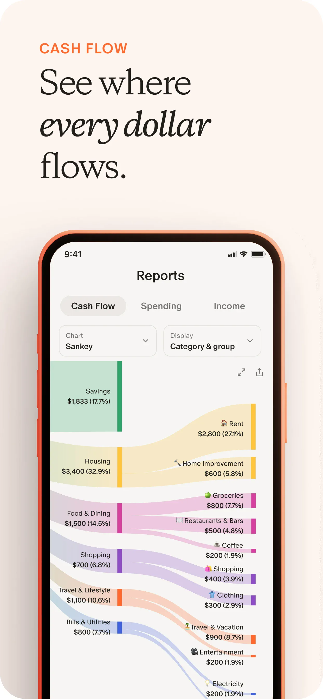{: width="180" .normal }
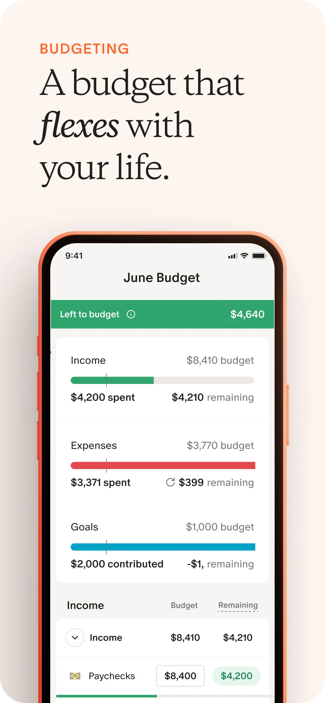{: width="180" .normal }
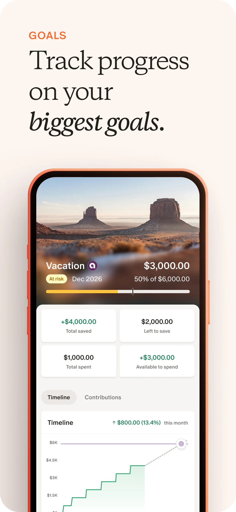{: width="180" .normal }
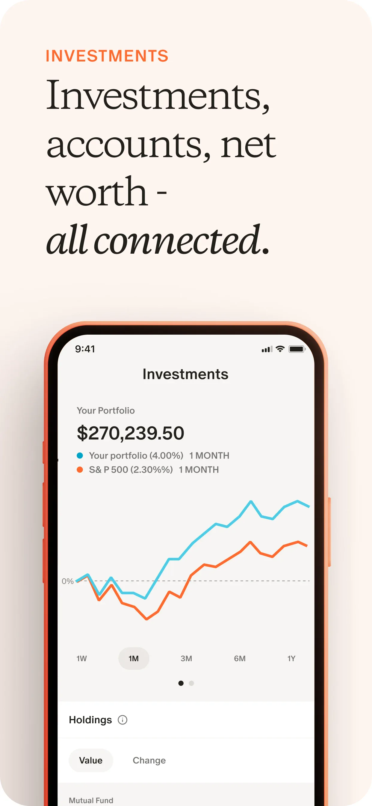{: width="180" .normal }

Monarch adalah aplikasi yang paling sering disebut **pengganti Mint terus**. Ia menggabungkan bank, kartu, pinjaman, investasi, bahkan kripto dan properti ke dalam satu papan pemuka, dengan berkongsi kolaboratif sehingga pasangan boleh mengedit bajet yang sama.

**Kelebihan**
- **Paling mirip papan pemuka Mint** — kekayaan bersih, arus kas, dan langganan dalam satu paparan.
- **Segerak automatik luas** termasuk investasi dan properti (lewat penilaian).
- **Kolaboratif** — bagikan dan edit bersama pasangan; keduanya melihat pembaruan terus.
- Pengalaman web + seluler yang rapi dan alat target/bajet yang baik.

**Kelemahan**
- **Tanpa pakej percuma** (hanya percubaan), sekitar **$99,99/tahun** (atau $14,99/bulan).
- **Relatif muda** (berdiri 2021) — komunitas lebih kecil dan panduan pihak ketiga lebih sedikit daripada YNAB.
- Seperti Mint, ia bergantung pada **keandalan agregasi**; sambungan yang putus berarti pembersihan manual.
- **Multi mata wang terhad** dan berorientasi pada pasar AS.

**Paling sesuai untuk:** bekas pengguna Mint yang ingin papan pemuka all-in-one serupa dan tidak keberatan langganan.

**Muat turun Monarch Money**
- [Google Play](https://play.google.com/store/apps/details?id=com.monarchmoney.mobile)
- [App Store](https://apps.apple.com/us/app/monarch-budget-track-money/id1459319842)

---

## Rocket Money — terbaik untuk menjinakkan langganan

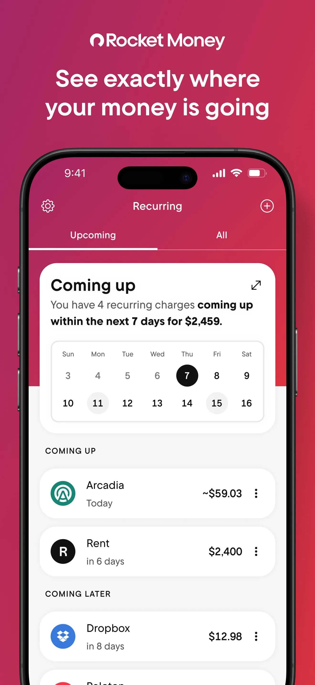{: width="180" .normal }
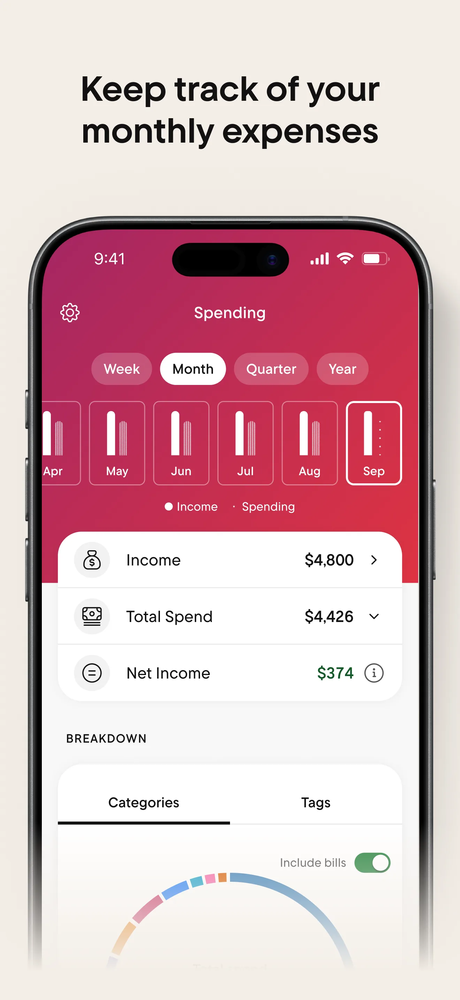{: width="180" .normal }
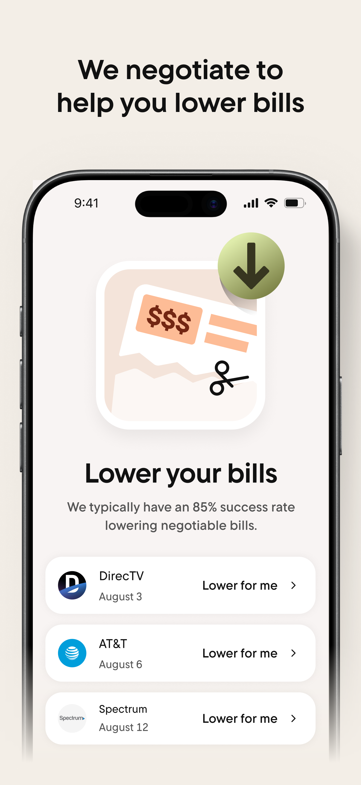{: width="180" .normal }
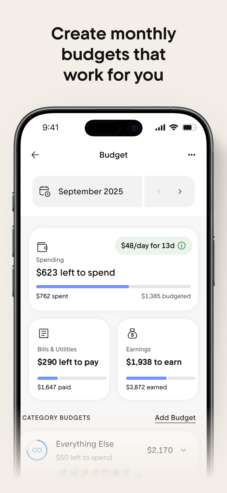{: width="180" .normal }
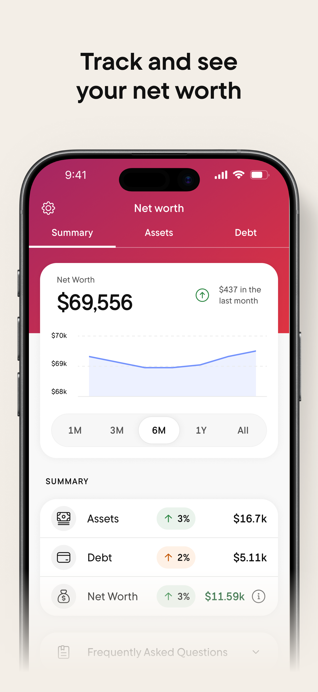{: width="180" .normal }

Rocket Money (dulu Truebill) dibangun untuk **menemukan dan membatalkan langganan yang tidak diinginkan**, menurunkan bil lewat negosiasi, dan memberi ringkasan perbelanjaan sederhana. Ia pilihan terkuat bila bil berulang menjadi masalah utama Anda.

**Kelebihan**
- **Manajemen langganan terbaik di kelasnya** — mendeteksi, melacak, dan membantu membatalkan langganan; boleh menegosiasikan bil lebih rendah.
- **Pakej percuma** tersedia; penjejakan akaun automatik dan bajet di atasnya.
- Pemantauan skor kredit dan amaran perlindungan baki minus (premium).
- Angka muat turun sangat popular, jadi dukungan dan stabilitas solid.

**Kelemahan**
- **Penganggaran dasar** — tanpa metode zero-based atau amplop; ia mencatat, bukan merencanakan.
- **Kategorisasi automatik cukup baik tetapi kurang dapat disesuaikan** daripada YNAB atau Monarch.
- Harga premium **bervariasi** (sering ~$6–12/bulan, ditagih tahunan; boleh terasa mahal untuk apa yang ditawarkan di luar pembatalan langganan).
- Tanpa alur tuntutan balik, ciri kekayaan bersih/investasi lemah.

**Paling sesuai untuk:** orang yang masalah utamanya adalah langganan dan bil yang membengkak, bukan penganggaran terus.

**Muat turun Rocket Money**
- [Google Play](https://play.google.com/store/apps/details?id=com.truebill)
- [App Store](https://apps.apple.com/us/app/rocket-money-bills-budgets/id1130616675)

---

## Empower (dulu Personal Capital) — paparan kekayaan bersih & investasi percuma terbaik

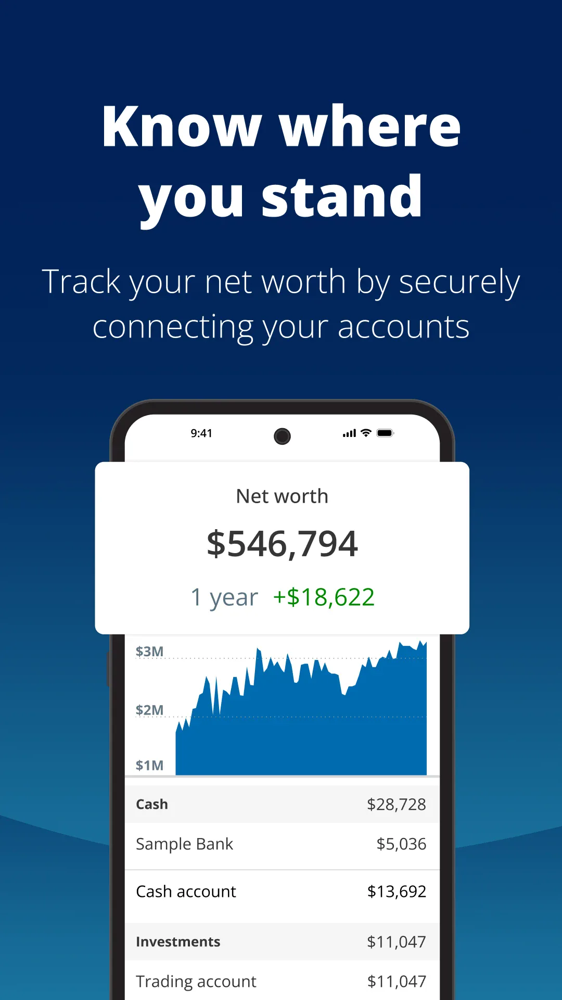{: width="180" .normal }
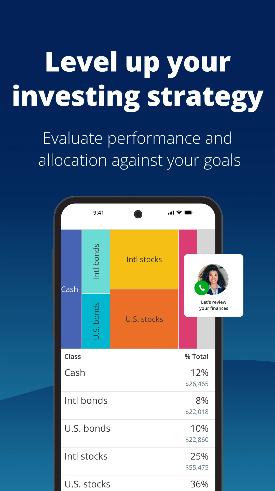{: width="180" .normal }
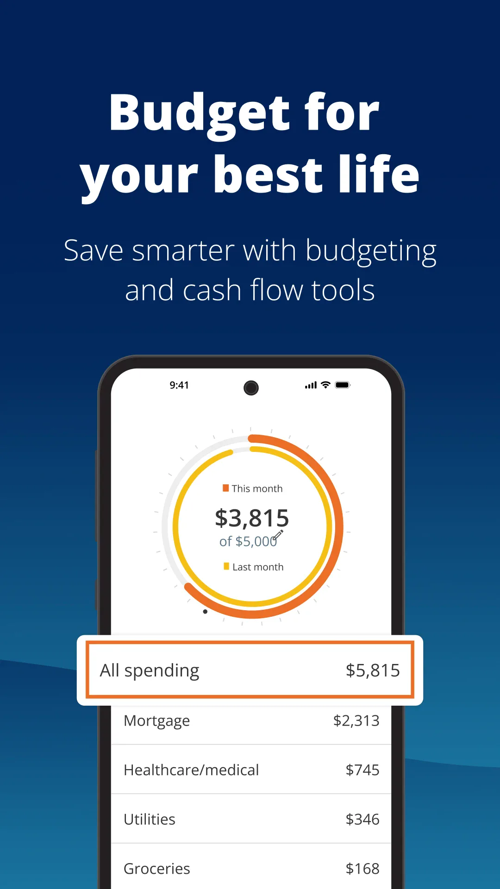{: width="180" .normal }
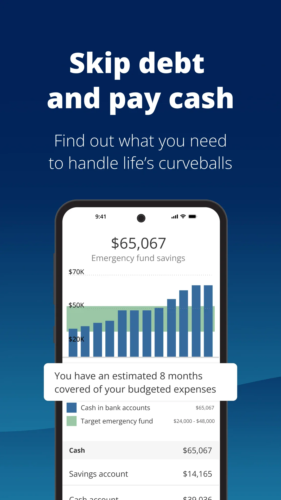{: width="180" .normal }
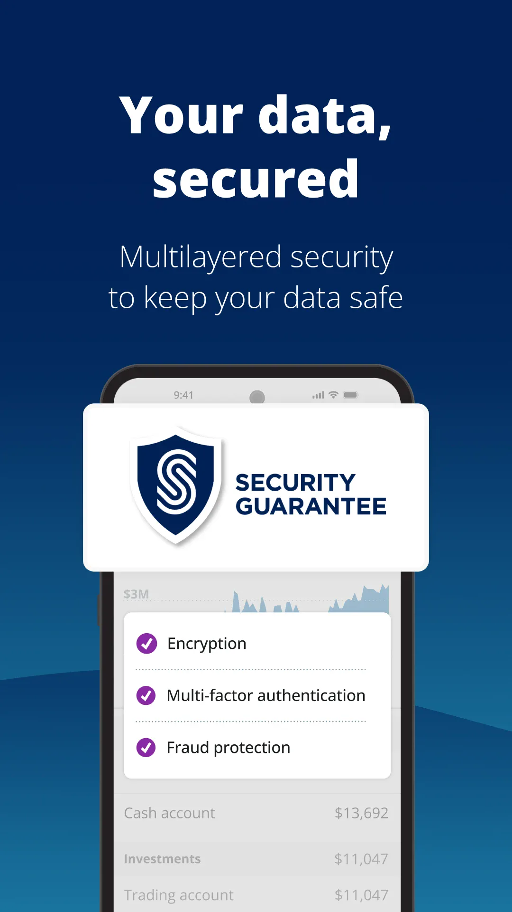{: width="180" .normal }

Empower **percuma** dan berfokus pada **penjejakan kekayaan bersih dan investasi**. Ia menggabungkan data bank, dana pensiun, sekuritas, kripto, bahkan hipotek/properti untuk memberi analisis portofolio, perancang pensiun, dan analisis perbelanjaan.

**Kelebihan**
- **Sepenuhnya percuma** untuk papan pemuka teras.
- **Analisis kekayaan bersih dan investasi terbaik di kelasnya** — alokasi aset, proyeksi pensiun, audit perbelanjaan.
- Belanjepan akaun sangat luas, termasuk investasi dan properti.
- Rekam jejak panjang (beroperasi lebih daripada satu dekade dengan nama Personal Capital).

**Kelemahan**
- **Bukan aplikasi penganggaran sejati** — alat arus kas/bajet dasar dibanding YNAB atau Monarch.
- **Berpusat pada AS**; penggunaan di luar AS terhad dan multi mata wang lemah.
- **Penawaran penasihat investasi** yang kuat untuk baki besar.
- Tanpa ciri amplop atau tuntutan balik.

**Paling sesuai untuk:** pengguna yang terutama ingin memantau kekayaan bersih dan investasi, tanpa perlu bajet harian terperinci.

**Muat turun Empower**
- [Google Play](https://play.google.com/store/apps/details?id=com.participantmobileapp)
- [App Store](https://apps.apple.com/us/app/empower/id1001257338)

---

## PocketGuard — terbaik untuk "safe to spend"

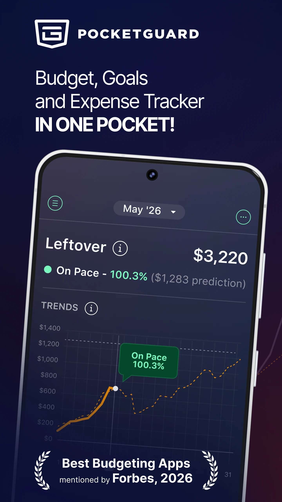{: width="180" .normal }
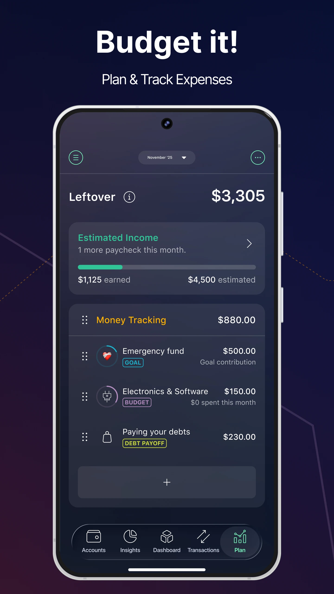{: width="180" .normal }
{: width="180" .normal }
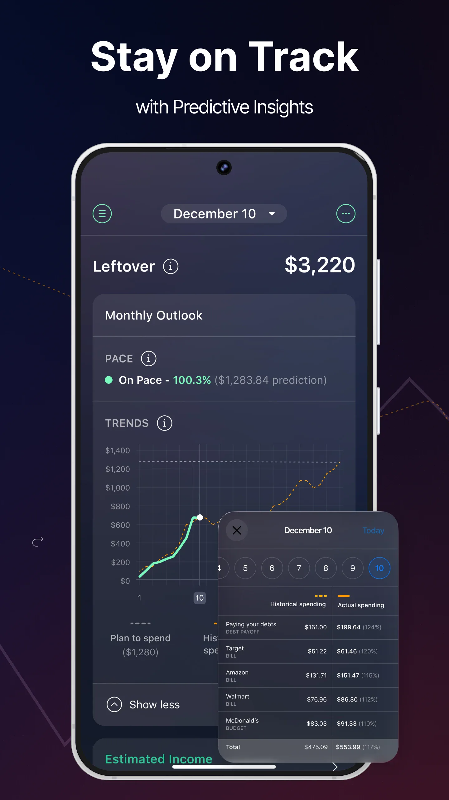{: width="180" .normal }
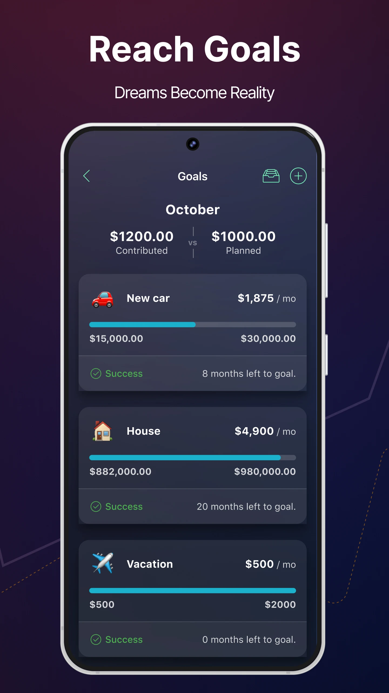{: width="180" .normal }

PocketGuard menjaganya tetap sederhana: ia menunjukkan **"In My Pocket"** — berapa banyak yang selamat dibelanjakan setelah bil, tabungan, dan target terpenuhi. Ini cara paling ringan menghindari perbelanjaan berlebih tanpa mempelajari metode.

**Kelebihan**
- **Angka "In My Pocket" yang selamat dibelanjakan** intuitif dan terus berguna.
- Mengkategorikan transaksi automatik, melacak langganan, dan menawarkan ciri penurunan bil.
- **Pakej percuma** plus PocketGuard Plus (~$12,99/bulan atau ~$74,99/tahun) untuk detail lebih banyak.

**Kelemahan**
- **Kedalaman bajet terhad** — tanpa pendekatan zero-based atau amplop; pelarasan tipis.
- **Mengutamakan seluler** dengan pengalaman web terhad.
- Tanpa tuntutan balik, tanpa penjejakan investasi/kekayaan bersih, multi mata wang lemah.
- Beberapa laporan berguna ada di sebalik Plus.

**Paling sesuai untuk:** orang yang ingin jawaban cepat "mampukah saya membeli ini?" tanpa mengurus bajet penuh.

**Muat turun PocketGuard**
- [Google Play](https://play.google.com/store/apps/details?id=com.pocketguard.android.app)
- [App Store](https://apps.apple.com/us/app/pocketguard-budget-app/id949414211)

---

## Goodbudget — penganggaran amplop terbaik tanpa langganan

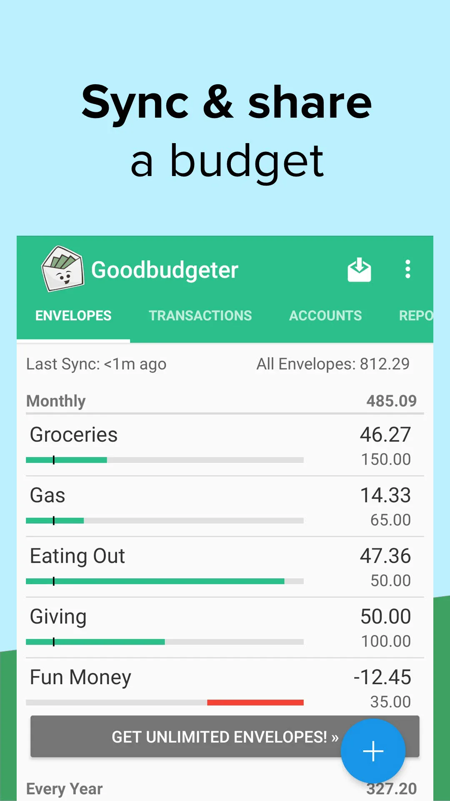{: width="180" .normal }
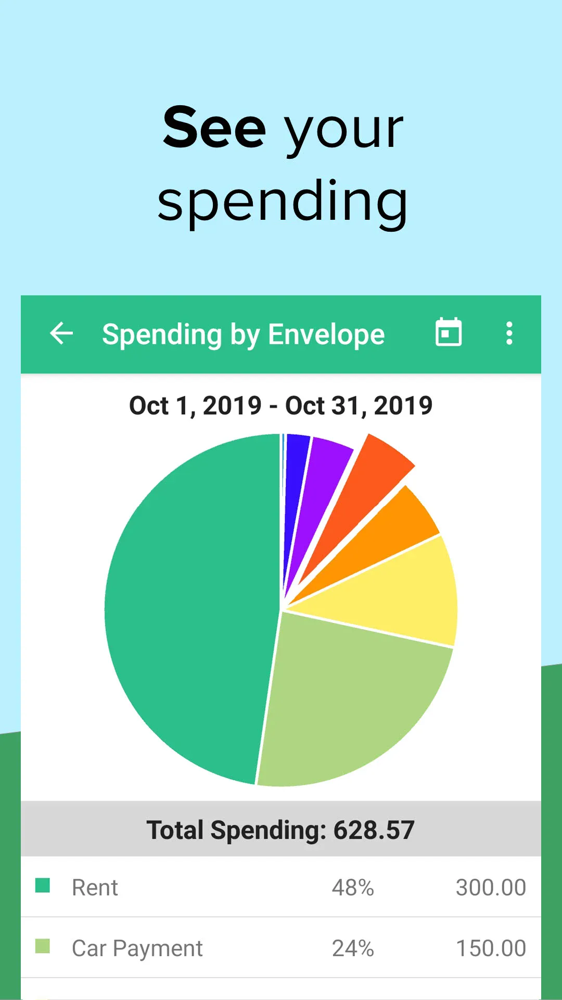{: width="180" .normal }
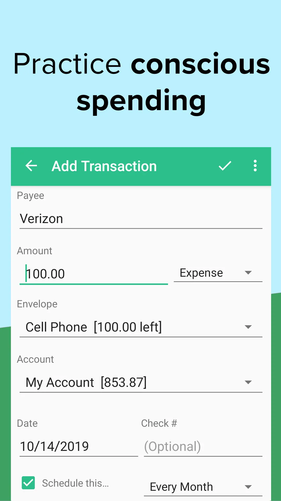{: width="180" .normal }
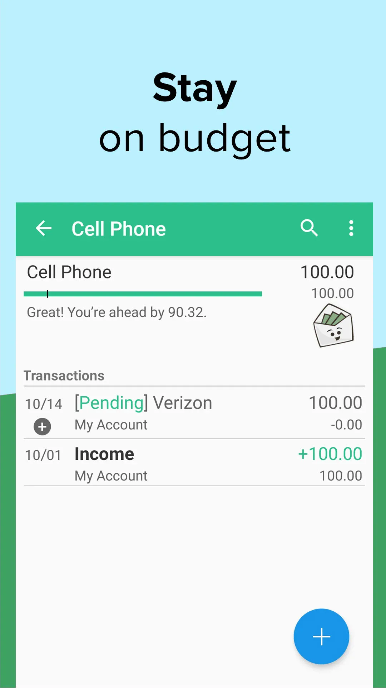{: width="180" .normal }
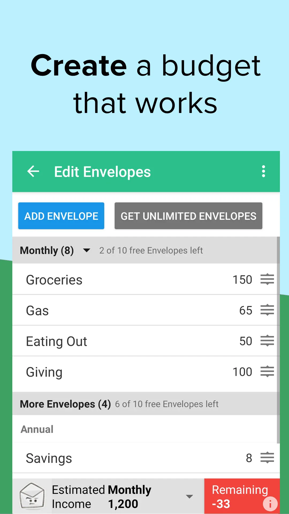{: width="180" .normal }

Goodbudget mendigitalkan **sistem amplop** klasik: Anda mengalokasikan wang ke amplop virtual dan membelanjakannya dari sana. Ia sengaja manual dan bersinar untuk pasangan serta keluarga yang berkongsi bajet.

**Kelebihan**
- **Metode amplop yang dijalankan dengan benar**, dengan segerak cloud antarperangkat supaya rumah tangga tetap selaras.
- **Pakej percuma** (20 amplop, 2 peranti, sejarah 1 tahun); Premium (~$8/bulan atau ~$70/tahun) membuka amplop tanpa had, lebih banyak peranti, sejarah 7 tahun, dan segerak bank.
- Fleksibel platform: iOS, Android, dan web.

**Kelemahan**
- **Sebahagian besar entri manual** — tanpa import bank automatik di pakej percuma, dan segerak bank berbayar pun terhad dibanding YNAB/Monarch.
- **Kategorisasi automatik minimum**; Anda yang memilah.
- Tanpa penjejakan investasi/kekayaan bersih, tanpa tuntutan balik, multi mata wang lemah.
- Graf dan laporan lebih polos daripada papan pemuka automatik.

**Paling sesuai untuk:** penggemar bajet amplop dan bajet rumah tangga bersama yang memilih kendali daripada otomatisasi.

**Muat turun Goodbudget**
- [Google Play](https://play.google.com/store/apps/details?id=com.dayspringtech.envelopes)
- [App Store](https://apps.apple.com/app/goodbudget/id471112395)

---

## Perbandingan keupayaan teras

Jadual di bawah menunjukkan, seobjektif mungkin, keupayaan yang didukung setiap aplikasi. "Sebahagian" berarti ciri ada tetapi dengan had (contohnya sandaran manual, bukan segerak bank).

| Keupayaan | YNAB | Meow Money | Monarch | Rocket Money | Empower | PocketGuard | Goodbudget |
|---|---|---|---|---|---|---|---|
| **Multi-akun / buku kas** | Ya | Ya (multi buku kas) | Ya (luas) | Ya | Ya (luas) | Ya | Ya (amplop) |
| **Segerak bank automatik** | Ya (Plaid) | Sebahagian (sandaran Google Drive/iCloud/WebDav, tanpa feed bank) | Ya | Ya | Ya | Ya | Sebahagian (manual; segerak bank berbayar) |
| **Penjejakan tuntutan balik** | Tidak | **Ya** | Tidak | Tidak | Tidak | Tidak | Tidak |
| **Kedalaman bajet** | **Zero-based (kuat)** | Bajet kategori + tempoh | Bajet tersuai | Dasar | Arus kas dasar | "Safe-to-spend" | **Amplop (kuat)** |
| **Statistik / laporan** | Laporan kuat | Graf harian/bulanan/tahunan | Graf kuat | Dasar | Kuat (investasi) | Dasar | Polos |
| **Aset / kekayaan bersih** | Ya | Ya (aset/hutang) | **Kuat** | Lemah | **Terkuat** | Lemah | Tidak |
| **Multi mata wang** | Lemah (berpusat USD) | **Ya (50+ simbol)** | Lemah | Lemah | Lemah (berpusat AS) | Lemah | Lemah |
| **Manajemen langganan** | Tidak | Tidak | Sebahagian | **Terkuat** | Tidak | Ya (penjejakan) | Tidak |
| **Pakej percuma** | Tidak (hanya percubaan) | Teras percuma, lanjutan berbayar | Tidak (hanya percubaan) | Ya | **Ya (penuh)** | Ya | Ya (terhad) |
| **Platform** | Web + iOS + Android | Android + iOS | Web + iOS + Android | iOS + Android | iOS + Android | iOS + Android | iOS + Android + Web |

---

## Cara memilih

- Ingin **metode zero-based teruji** dan bersedia mempelajarinya → **YNAB**.
- Ingin **percuma, peribadi, tanpa akaun, multi mata wang, dengan tuntutan balik** → **[Meow Money Manager](/ms/apps/meow-money-manager/)**.
- Ingin **papan pemuka paling mirip Mint** dengan investasi → **Monarch Money**.
- Ingin **menghentikan langganan dan menurunkan bil** → **Rocket Money**.
- Ingin **ringkasan kekayaan bersih / investasi percuma** → **Empower**.
- Ingin jawaban cepat **"bolehkah saya membelanjakan ini?"** → **PocketGuard**.
- Ingin **amplop dan bajet rumah tangga bersama** → **Goodbudget**.

## Bermigrasi dari Mint

1. **Eksport data Anda sekarang** bila masih boleh: transaksi (CSV), akaun, dan bajet disimpan.
2. **Pilih pengganti** dari jadual di atas berdasarkan privasi versus otomatisasi.
3. **Buat ulang kategori** — kebanyakan aplikasi memungkinkan menukar nama bawaan supaya sesuai dengan Mint.
4. **Tetapkan bajet dan item berulang** (sewa bilik, gaji, langganan) supaya pencatatan selanjutnya lancar.
5. **Tautkan bank atau tetap manual** — bila privasi penting, aplikasi manual menyimpan data di peranti Anda.

## FAQ

**Bolehkah saya masih mengekspor data setelah Mint ditutup?**
{:.faq-q}

Boleh. Mint tetap mengizinkan eksport transaksi (CSV), akaun, dan bajet disimpan sebelum penutupan. Eksport sekarang, lalu import ke alternatif mana pun di atas untuk melanjutkan pencatatan.

**Alternatif Mint mana yang percuma dan ramah privasi?**
{:.faq-q}

Jika Anda mengutamakan "data tetap di peranti, tanpa pendaftaran", **Meow Money Manager** termasuk sedikit pencatat yang teras percuma sekaligus setempat sahaja tanpa akaun cloud; sandaran masuk ke Google Drive, iCloud (iOS), atau WebDav, bukan login cloud paksa.

**Apakah Meow Money Manager mendukung beberapa mata wang?**
{:.faq-q}

Ya — ia menyediakan **50+ simbol mata wang** untuk belanja merentas negara atau valas, serta antara muka Cina, Inggeris, Malaysia, Thai, dan Portugis.

**Saya tidak ingin mempelajari metode penganggaran — cukup pencatatan sederhana. Mana yang dipilih?**
{:.faq-q}

Untuk jawaban instan "berapa sisa wang saya?", pilih **PocketGuard**; untuk antara muka comel yang membuat pencatatan harian mudah dijaga, pilih **Meow Money Manager**.

**Apa alternatif Mint terbaik 2026 bila saya juga ingin alternatif YNAB tanpa langganan?**
{:.faq-q}

Untuk pencatatan sekali bayar atau teras percuma, Meow Money Manager menyimpan buku kas di peranti tanpa sambungan bank; YNAB tetap pilihan bila Anda ingin penganggaran zero-based dengan segerak bank dan bersedia membayar tahunan.

**Adakah alternatif PocketGuard yang tidak mengunggah transaksi saya?**
{:.faq-q}

Ada. Aplikasi seperti Meow Money Manager dan Goodbudget menyimpan catatan di peranti atau fail yang Anda kendalikan. Paparan safe-to-spend PocketGuard membutuhkan akaun tertaut, sementara pencatat lokal memberi gambaran manual tetapi peribadi atas angka yang sama.

## Istilah berkaitan

- [Apakah Itu Aplikasi Catatan Kewangan?](/ms/glossary/what-is-an-expense-tracker/)
- [Apakah Itu Pengurusan Bajet?](/ms/glossary/what-is-budget-management/)
- [Apakah Itu Pengurusan Tuntutan balik?](/ms/glossary/what-is-reimbursement-management/)
