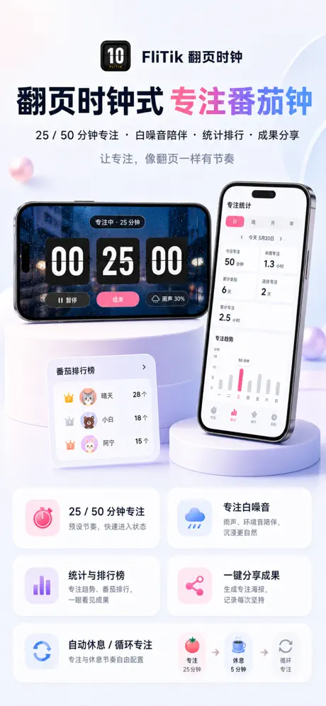
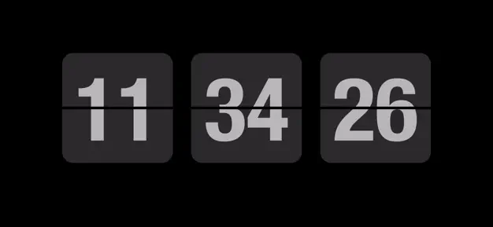
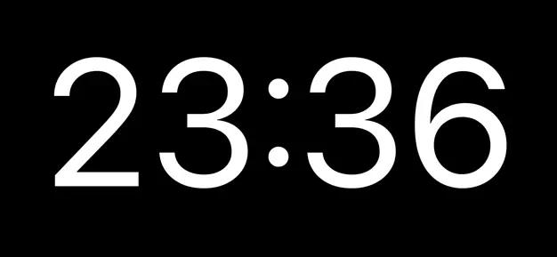
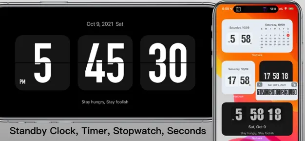
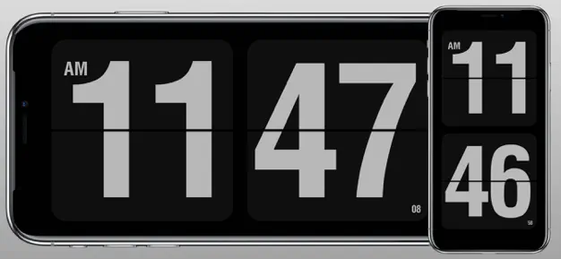
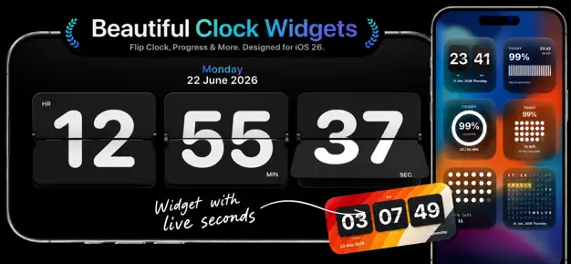
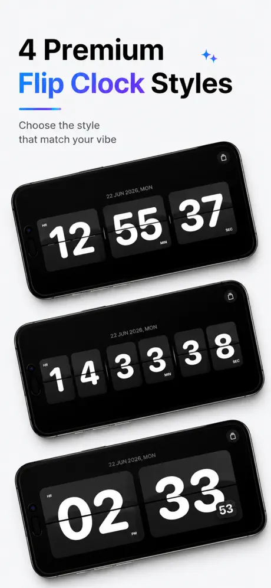
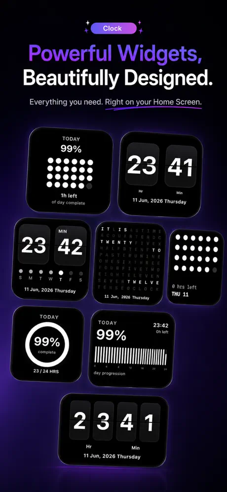
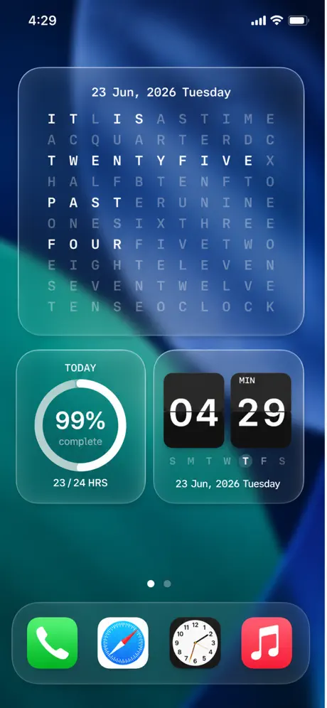
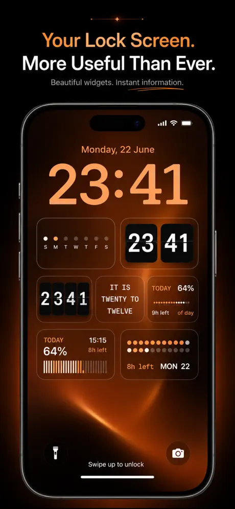

Retroflip adalah **[jam flip](/ms/glossary/what-is-a-flip-clock/)** retro percuma dan tampan untuk Android — tetapi sebahagian besar berhenti di wajah jam. Tidak ada **white noise untuk fokus atau tidur, tidak ada overlay jam terapung, tidak ada widget, dan tidak ada versi iPhone**. Jika Anda ingin jam flip yang juga memutar suara ambient, berada di atas aplikasi lain, atau berjalan di iOS, kategori ini sudah berkembang pesat.

Di bawah ini kami membandingkan enam **alternatif Retroflip** yang kuat — dari jam skrin penuh comel dan kaya ciri hingga jam flip ramah Pomodoro — across harga, platform, dan keupayaan sehari-hari yang benar-benar penting. Sebahagian besar pembaca datang dengan satu penghalang — iklan, widget yang hilang, atau tidak ada versi iOS — jadi setiap pilihan dibingkai menurut alasan itu.

## Mengapa melihat di luar Retroflip

- **Tanpa suara ambient** — tidak ada white noise, jadi tidak boleh membantu Anda fokus atau tertidur.
- **Tanpa jam terapung** — waktu hanya ada di dalam aplikasi, bukan di atas aplikasi lain.
- **Tanpa widget skrin utama** — Anda tidak boleh melihat waktu sekilas dari peluncur.
- **Hanya Android** — pengguna iPhone dan iPad tertinggal.
- **Tema terhad** — pelarasan lebih ringan daripada aplikasi jam flip khusus.

## Alternatif Retroflip terbaik sekilas

| App | Harga (2026) | Platform | Terbaik untuk |
|---|---|---|---|
| **Only Clock** | Teras percuma + buka kunci | Android, iOS | Tema, white noise, jam terapung, widget |
| **FliTik** | Percuma + IAP | iOS (dan desktop/Android) | Pomodoro, hitung mundur, jam flip ambient |
| **Flip Clock: World Clock** | Percuma + IAP | Android | Jam flip cuaca, widget, dan world-clock |
| **Fullscreen Clock** | Percuma + IAP | iOS | Fokus skrin penuh minimum |
| **Flip Clock: Digital Desk Widget** | Percuma + IAP | iOS | Widget meja + screensaver jam flip |
| **Flip Clock — Digital Clock** | Percuma + IAP | iOS | Jam flip bertema ringan |

---

### 1. Only Clock — jam flip serba ciri terbaik

{: width="180" .normal }
{: width="180" .normal }
{: width="180" .normal }
{: width="180" .normal }
{: width="180" .normal }

Only Clock adalah **jam flip skrin penuh** untuk Android dan iOS dengan animasi flip yang indah, banyak tema, white noise untuk fokus, jam terapung, dan widget. Ini peningkatan serba ada terdekat ke Retroflip dan memperbaiki hampir setiap celah di atas.

**Kelebihan**
- **Animasi flip skrin penuh** dengan banyak tema indah yang boleh Anda ganti bebas.
- **White noise bawaan** — hujan, hutan, perapian, dan lain-lain untuk membantu fokus atau tidur.
- **Jam terapung** overlay supaya Anda boleh melihat waktu di atas aplikasi lain.
- **Widget jam** untuk skrin utama, plus paparan 12/24-jam dan tarikh.
- **Berjalan di Android dan iOS**, dan bekerja hebat di telefon pintar sandaran atau iPad sebagai jam meja.
- Tanpa akaun diperlukan — buka sahaja, jam terus jalan.

**Kelemahan**
- Tema dan suara terkaya berada di sebalik buka kunci sekali bayar atau langganan kecil.
- Pelarasan widget lebih terhad di iOS daripada Android.
- Tanpa paparan jam dunia / multi-zona waktu.

**Terbaik untuk:** orang yang menginginkan satu jam flip yang juga memutar suara, terapung di atas aplikasi, dan bekerja di Android dan iPhone.

**Muat turun Only Clock**
- [Google Play](https://play.google.com/store/apps/details?id=com.glgjing.only.flip.clock)
- [App Store](https://apps.apple.com/us/app/only-clock-flip-clock/id1566706513)

---

### 2. FliTik — terbaik untuk Pomodoro dan hitung mundur

{: width="180" .normal }
{: width="180" .normal }
{: width="180" .normal }
{: width="180" .normal }

FliTik adalah **jam flip** merentas platform yang mengedepankan ritual: animasi flip memukau, tetapan Pomodoro, mode hitung-maju/hitung-mundur, dan suara ambient sehingga setiap saat terasa disengaja. Popular sebagai pendamping fokus belajar dan kerja.

**Kelebihan**
- **Tetapan Pomodoro** plus mode hitung-maju dan hitung-mundur untuk sprint belajar dan kerja.
- **Paparan flip indah dan atmosferik** yang tampak hebat sebagai jam meja atau samping tempat tidur.
- **Suara ambient** dicampur dengan jam untuk fokus dan relaksasi.
- **Merentas platform** (iOS, desktop, dan Android), sehingga setup Anda mengikuti.
- Angka besar yang jelas tetap terbaca dari seberang ruangan.

**Kelemahan**
- Beberapa tema dan ciri tetapan berada di sebalik pembelian dalam aplikasi.
- Lebih ringan dalam pelarasan mentah (warna/posisi) daripada aplikasi widget jam murni.
- Ketersediaan Android via sideload/cermin kedai, bukan satu daftar unggulan.

**Terbaik untuk:** pelajar dan pekerja fokus yang menginginkan jam flip yang juga menjalankan sesi Pomodoro dan hitung mundur.

**Muat turun FliTik**
- [App Store](https://apps.apple.com/us/app/flitik-flip-clock-pomodoro/id6448849784)

---

### 3. Flip Clock: World Clock — jam flip Android terbaik dengan cuaca

{: width="180" .normal }
{: width="180" .normal }
{: width="180" .normal }
{: width="180" .normal }
{: width="180" .normal }

Flip Clock: World Clock adalah **jam flip** Android percuma yang menambahkan cuaca, widget skrin utama, tetapan Pomodoro, dan jam terapung di atas wajah flip klasik.

**Kelebihan**
- **Jam flip dengan cuaca** untuk lokasi Anda, praktikal sebagai jam meja.
- **Widget skrin utama** supaya waktu tampil di peluncur.
- **Tetapan Pomodoro dan jam terapung** untuk sesi fokus.
- Percuma untuk bermula, dengan peningkatan dalam aplikasi pilihan.
- Ringan dan mudah disiapkan.

**Kelemahan**
- Didukung iklan di tingkat percuma, yang boleh mengganggu paparan tenang.
- Cuaca dan beberapa widget berada di sebalik IAP.
- Tidak ada versi iOS.

**Terbaik untuk:** pengguna Android yang menginginkan jam flip dengan cuaca dan widget tanpa bayar di muka.

**Muat turun Flip Clock: World Clock**
- [Google Play](https://play.google.com/store/apps/details?id=com.wssc.simpleclock)

---

### 4. Fullscreen Clock — fokus skrin penuh minimum terbaik

{: width="360" .normal }
{: width="360" .normal }

Fullscreen Clock: Flip & Focus mengubah iPhone atau iPad Anda menjadi **jam flip** bersih, selalu-menyala, dengan tiga belas wajah, peredupan malam, dukungan lanskap, dan Pomodoro bawaan.

**Kelebihan**
- **Tiga belas wajah jam** termasuk gaya flip dan fokus.
- **Skrin tetap terjaga** dan mendukung peredupan malam untuk penggunaan samping tempat tidur.
- **Pomodoro bawaan** untuk sesi kerja fokus.
- Dukungan lanskap dan potret; UI sangat bersih dan minimum.
- Tanpa akaun diperlukan.

**Kelemahan**
- Hanya iOS — tidak ada aplikasi Android.
- Sebahagian besar pakej wajah dan ciri berada di sebalik IAP.
- Tanpa suara ambient sendiri.

**Terbaik untuk:** pemilik iPhone/iPad yang menginginkan jam skrin penuh minimum indah dengan Pomodoro.

**Muat turun Fullscreen Clock**
- [App Store](https://apps.apple.com/us/app/fullscreen-clock-flip-focus/id1403700342)

---

### 5. Flip Clock: Digital Desk Widget — widget meja + screensaver terbaik

{: width="360" .normal }
{: width="360" .normal }

Flip Clock: Digital Desk Widget adalah aplikasi iOS yang berfokus pada **jam flip gaya desktop**, widget standby interaktif, dan mode seperti screensaver untuk meja dan samping tempat tidur.

**Kelebihan**
- **Widget StandBy dan interaktif** yang memaparkan jam flip terus.
- **Mode screensaver** untuk setup mengecas/meja.
- Memaparkan saat, tarikh, dan kalendar, dengan format 12/24-jam.
- Gaya hitam-putih dan bertema.
- Reka bentuk bersih ramah-Apple.

**Kelemahan**
- Hanya iOS.
- Ciri terbaik membutuhkan versi berbayar.
- Tanpa white noise atau overlay terapung.

**Terbaik untuk:** pengguna iPhone yang ingin jam flip yang boleh disematkan sebagai widget atau screensaver.

**Muat turun Flip Clock: Digital Desk Widget**
- [App Store](https://apps.apple.com/us/app/flip-clock-digital-desk-widget/id1181028777)

---

### 6. Flip Clock — Digital Clock — jam bertema ringan terbaik

{: width="180" .normal }
{: width="180" .normal }
{: width="180" .normal }
{: width="180" .normal }
{: width="180" .normal }

Flip Clock — Digital Clock adalah **jam flip** iOS sederhana dan elegan dengan tema, widget standby, paparan saat/tarikh, dan dukungan 12/24-jam — alternatif tanpa tambahan ke Retroflip.

**Kelebihan**
- **Animasi flip elegan** dengan beberapa tema melampaui hitam-putih.
- **Dukungan widget standby dan interaktif**.
- Memaparkan saat, tarikh, dan kalendar.
- Ringan dan cepat diluncurkan.
- Percuma dicuba dengan peningkatan pilihan.

**Kelemahan**
- Hanya iOS.
- Tanpa suara, jam terapung, atau Pomodoro.
- Tema adalah ekstra berbayar utama.

**Terbaik untuk:** pengguna iPhone yang menginginkan jam flip bertema bersih tanpa ciri ekstra.

**Muat turun Flip Clock — Digital Clock**
- [App Store](https://apps.apple.com/us/app/flip-clock-digital-clock/id1479450824)

---

## Perbandingan keupayaan teras

| Keupayaan | Only Clock | FliTik | Flip Clock: World Clock | Fullscreen Clock | Flip Clock: Digital Desk Widget | Flip Clock — Digital Clock |
|---|---|---|---|---|---|---|
| **Platform** | Android, iOS | iOS (+desktop/Android) | Android | iOS | iOS | iOS |
| **Animasi flip skrin penuh** | Ya | Ya | Ya | Ya (flip & lain-lain) | Ya | Ya |
| **Tema / pelarasan** | Banyak | Atmosferik | Dasar | 13 wajah | Bertema | Bertema |
| **White noise / suara fokus** | Ya | Ya | Tidak | Tidak | Tidak | Tidak |
| **Overlay jam terapung** | Ya | Tidak | Ya | Tidak | Tidak | Tidak |
| **Widget** | Ya | Tidak | Ya | Tidak | StandBy + interaktif | StandBy + interaktif |
| **Cuaca** | Tidak | Tidak | Ya | Tidak | Tidak | Tidak |
| **Pomodoro / tetapan** | Tidak | Ya | Ya | Ya | Tidak | Tidak |
| **Hitung mundur / hitung maju** | Tidak | Ya | Tidak | Tidak | Tidak | Tidak |
| **12/24j + tarikh** | Ya | Ya | Ya | Ya | Ya | Ya |
| **Tingkat percuma** | Murah hati | Percuma + IAP | Percuma + IAP | Percuma + IAP | Percuma + IAP | Percuma + IAP |
| **Iklan** | Tidak | Tidak | Ya (percuma) | Tidak | Tidak | Tidak |

---

## Alternatif Retroflip mana yang sesuai untuk setiap jenis pengguna

Jadual memeringkat ciri; di sini keenam aplikasi dikelompokkan menurut *apa yang Anda inginkan dari jam selain memaparkan waktu*.

- **Jam bertema yang juga memutar suara** — **alternatif Flip Clock (Soosu)** atau **alternatif Nightdream** biasanya tentang wajah tenang selalu-menyala; Only Clock menambahkan white noise, tetapan fokus, dan mode terapung ke ide itu.
- **Jam flip desktop atau browser** — **alternatif Fliqlo** sesuai untuk komputer; FliTik dan Flip Clock: Digital Desk Widget merangkumi paparan widget meja di telefon pintar.
- **Widget dan world clock** — **alternatif ClockLab** atau **alternatif Digital Clock Widget** menunjuk ke wajah skrin utama kecil; Flip Clock: World Clock adalah versi cuaca-dan-zona-waktu.
- **Menukar aplikasi penggera bawaan** — **alternatif Google Clock** adalah tugasan berbeza: penggera dan pemasa, bukan paparan skrin penuh dekoratif.
- **Tetap tanpa iklan semalam** — daftar pendek **alternatif Jam Retroflip** sebaiknya disaring dari iklan dan peredupan dulu, kerana telefon pintar tetap menyala berjam-jam.

Apa pun labelnya, ajukan dua pertanyaan sebelum migrasi: bolehkah paparan tetap redup tanpa membakar skrin OLED, dan apakah tingkat percuma masih menyertakan widget yang benar-benar Anda pakai?

## Cara memilih

- Ingin **tema + white noise + jam terapung + widget di kedua platform** → **Only Clock**
- Ingin **Pomodoro, hitung mundur, dan jam flip ambient** → **FliTik**
- Ingin **jam flip Android percuma dengan cuaca dan widget** → **Flip Clock: World Clock**
- Ingin **jam skrin penuh iOS minimum dengan Pomodoro** → **Fullscreen Clock**
- Ingin **widget meja / screensaver jam flip di iPhone** → **Flip Clock: Digital Desk Widget**
- Ingin **jam bertema iOS ringan** → **Flip Clock — Digital Clock**

## Cara migrasi dari Retroflip

1. **Pilih pengganti** menggunakan jadual di atas berdasarkan platform dan apakah Anda ingin suara, widget, atau jam terapung.
2. **Pasang dan berikan kebenaran yang diperlukan** (paparan di atas aplikasi lain untuk jam terapung, optimasi bateri mati untuk selalu-menyala).
3. **Atur paparan 12/24-jam dan tarikh** supaya sesuai dengan yang Anda pakai di Retroflip.
4. **Tambahkan widget** (Only Clock, Flip Clock: World Clock, atau aplikasi widget iOS) ke skrin utama atau skrin kunci untuk waktu sekilas.
5. **Jika Anda ingin bantuan fokus atau tidur**, aktifkan white noise (Only Clock, FliTik) atau tetapan Pomodoro (FliTik, Fullscreen Clock, Flip Clock: World Clock) supaya jam melakukan lebih daripada sekadar menunjukkan waktu.

## FAQ

**Apakah Only Clock alternatif Retroflip terbaik?**
{:.faq-q}

Untuk sebahagian besar orang, ya. Only Clock adalah peningkatan serba ada terdekat — ia menambahkan white noise, jam terapung, widget, dan dukungan iOS sambil mempertahankan paparan jam flip yang disukai pengguna Retroflip.

**Alternatif Retroflip mana yang punya white noise?**
{:.faq-q}

Only Clock dan FliTik keduanya menyertakan suara ambient; empat pilihan iOS lain-lain adalah jam sunyi.

**Alternatif Retroflip mana yang bekerja di Android dan iOS?**
{:.faq-q}

Only Clock berjalan di kedua platform; Flip Clock: World Clock hanya merangkumi Android, dan sisanya hanya iOS.

**Apakah Only Clock percuma?**
{:.faq-q}

Ya. Jam teras, tema, dan white noise berfungsi percuma; buka kunci sekali bayar atau langganan membuka tema dan suara terkaya.

[Halaman aplikasi Only Clock](/ms/apps/only-clock/) — tersedia di Android dan iOS.

## Istilah berkaitan

- [Apakah Itu Jam Flip?](/ms/glossary/what-is-a-flip-clock/)
- [Apakah Itu Jam Meja Samping Tempat Tidur?](/ms/glossary/what-is-a-nightstand-clock/)
