Streaks menjadikan penjejakan tabiat sebagai ritual harian bagi jutaan pengguna iPhone — aplikasi rapi peraih Apple Design Award yang terus mengingatkan Anda supaya rantai tetap hidup. Namun ada had nyata: **hanya tersedia di iPhone dan iPad, berbayar di awal tanpa pakej percuma, penyegerakan terkunci pada iCloud, dan kustomisasinya berada di dalam ekosistem Apple**. Jika Anda menginginkan dukungan Android, penyegerakan merentas platform, statistik lebih dalam, pilihan percuma, atau antara muka lebih menyenangkan, pilihan **alternatif Streaks** kini berkembang pesat.

Di bawah kami membandingkan enam **alternatif Streaks** yang tangguh — dari **aplikasi penjejak tabiat** comel yang mengutamakan privasi hingga sistem RPG bergamifikasi dan pembinaan berbasis sains — dari sisi harga, platform, ciri teras, dan keupayaan sehari-hari yang benar-benar berarti. Kebanyakan pembaca datang dengan satu hambatan konkret — tidak ada aplikasi Android, tidak ada pakej percuma, atau tidak ada cara mengekspor sejarah — sehingga setiap pilihan dirangkai berdasarkan alasan orang benar-benar berpindah.

## Mengapa mencari alternatif Streaks

{: width="180" .normal }
{: width="180" .normal }
{: width="180" .normal }
{: width="180" .normal }
{: width="180" .normal }

- **Hanya iPhone/iPad** — tidak ada aplikasi Android dan akses desktop terhad, sehingga rumah tangga dengan peranti campuran tidak terakomodasi.
- **Berbayar di awal (~$5.99)** tanpa pakej percuma untuk mencuba sebelum membeli.
- **Penyegerakan hanya iCloud** — tidak ada akaun mandiri, jadi pindah ke Android atau Windows merepotkan.
- **Analitik berfokus pada rantai** — statistiknya rapi tetapi lebih ringan dari aplikasi statistik khusus.
- **Lapisan sosial minimum** — akuntabilitas masih serba manual (berkongsi tugasan), tanpa komunitas atau pembinaan.

## Sekilas alternatif Streaks terbaik

| Aplikasi | Harga (2026) | Platform | Build + Break | Sesuai untuk |
|---|---|---|---|---|
| **Meow Habits** | Teras percuma + VIP (~$9.99/tahun) | Android, iOS | **Ya** | UI comel, 500+ ikon, peribadi, tanpa akaun |
| **Habitica** | Percuma + langganan (~$4.99/bulan) | Android, iOS, web | Ya | Akuntabilitas RPG bergamifikasi |
| **Loop Habit Tracker** | Percuma, open-source | Android | Ya | Statistik polos, privasi, tanpa akaun |
| **Fabulous** | Percuma + langganan (~$12/bulan) | Android, iOS | Rutinitas + pembinaan | Pembinaan berbasis sains |
| **Productive** | Percuma + Pro (~$2.50/bulan) | iOS | Ya | Widget iOS yang rapi |
| **Habitify** | Percuma + langganan | iOS, Android, web | Ya | Merentas platform, penjejakan berdasarkan waktu |

---

### 1. Meow Habits — terbaik untuk penjejak tabiat comel, peribadi, tanpa akaun

{: width="180" .normal }
{: width="180" .normal }
{: width="180" .normal }
{: width="180" .normal }
{: width="180" .normal }

Meow Habits adalah **[aplikasi habit tracker](/ms/glossary/what-is-a-habit-tracker/)** bertema kucing untuk Android dan iOS. Ciri paling menonjol adalah **antarmukanya**: reka bentuk kartun comel dengan **500+ ikon kategori kaya** yang membuat check-in harian terasa ringan, bukan seperti beban produktivitas. Di luar paparan, aplikasi ini merangkumi dasar-dasar praktikal tabiat — dan melakukannya tanpa memaksa Anda masuk ke akaun cloud.

**Kelebihan**
- **UI kartun yang indah dengan 500+ ikon custom** — pembeda paling jelas; mencatat tabiat terasa menyenangkan secara visual.
- **Mode build dan break** — lacak rutinitas positif atau berhenti dari tabiat buruk dalam satu aplikasi.
- **Daftar tabiat, streak harian, dan paparan kalendar / heatmap** (harian / mingguan / bulanan) sehingga momentum kelihatan sekilas.
- **Eksport CSV** (semua tabiat atau julat tarikh) untuk Excel, plus **sandaran Google Drive / WebDav** — data Anda hanya keluar dari kendali semasa Anda memilihnya.
- **Tanpa akaun** — tabiat tetap di peranti dengan kunci cap jari pilihan, yang jarang ditemui di aplikasi tabiat arus utama.
- Peringatan, mode gelap/terang, dan graf tabiat (persentase penyelesaian, graf kontribusi).

**Kekurangan**
- **Tanpa penyegerakan cloud merentas platform automatik** — penyegerakan memakai Google Drive (Android) atau WebDav, bukan akaun khusus, jadi berpindah antara telefon pintar Android dan iPhone kurang mulus dibanding aplikasi berbasis akaun.
- **Ciri lanjutan** (mis. graf lebih kaya / tabiat ekstra) berada di sebalik VIP murah (~$0.99/bulan atau $9.99/tahun); teras percuma sudah cukup untuk **catatan tabiat offline** sehari-hari.
- Tanpa gamifikasi atau lapisan sosial/komunitas, serta ekosistem lebih kecil dari pemain besar.

**Sesuai untuk:** orang yang ingin **aplikasi penjejak tabiat** yang jelas dan peribadi tanpa akaun cloud, menghargai antara muka bersahabat, dan tidak keberatan dengan tetapan manual ringan.

**Muat turun Meow Habits**
- [Google Play](https://play.google.com/store/apps/details?id=com.glgjing.meow.habit.goal)
- [App Store](https://apps.apple.com/us/app/meow-habits-habit-tracker/id6758230559)

---

### 2. Habitica — terbaik untuk akuntabilitas bergamifikasi

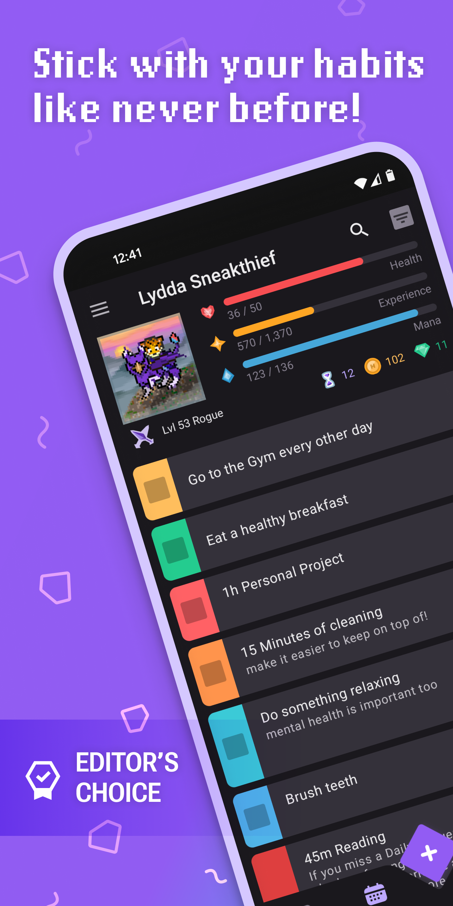{: width="180" .normal }
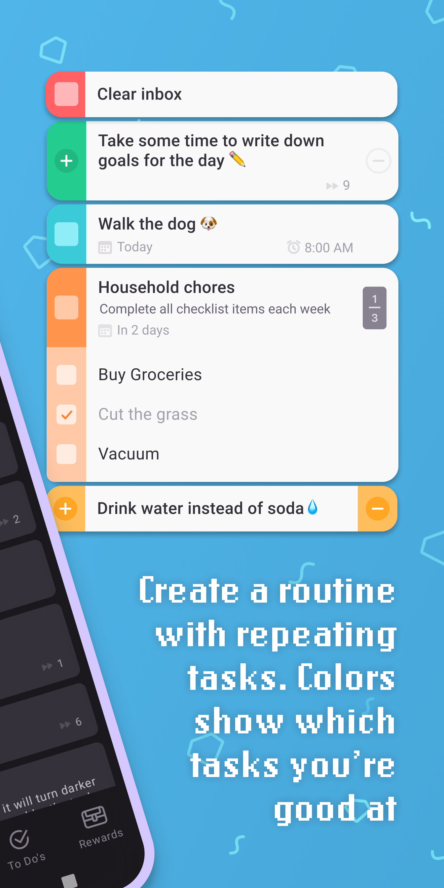{: width="180" .normal }
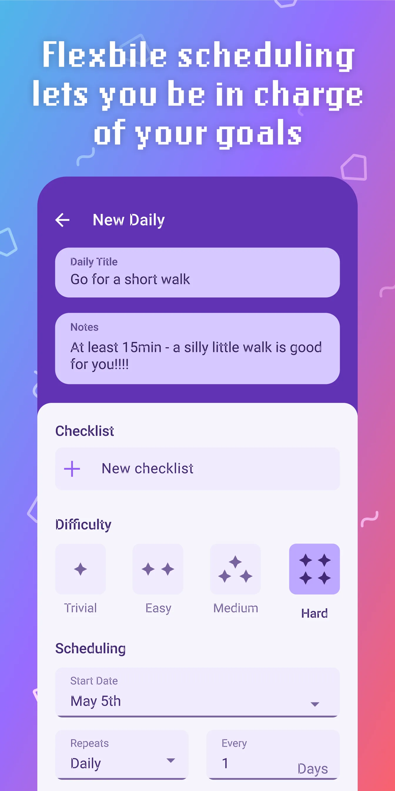{: width="180" .normal }
{: width="180" .normal }
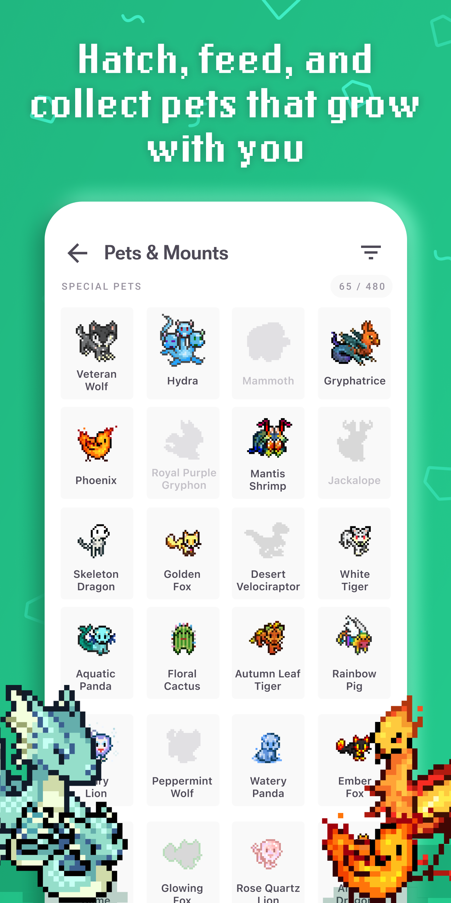{: width="180" .normal }

Habitica mengubah tabiat, tugasan harian, dan senarai tugasan Anda menjadi sebuah **RPG**. Anda membangun avatar, meraih XP dan emas saat menyelesaikan tugasan, serta kehilangan health saat terlewat. Aplikasi ini merentas platform dengan akaun, dan parties, guild, serta challenges menghadirkan lapisan sosial nyata yang tidak dimiliki Streaks.

**Kelebihan**
- **Sistem RPG bergamifikasi** (avatar, haiwan peliharaan, perlengkapan, quest) membuat konsistensi terasa seperti game, bukan beban.
- **Penyegerakan akaun merentas platform yang kuat** di Android, iOS, dan web.
- **Parties, guild, dan challenges** memberi akuntabilitas sosial nyata serta persaingan bersahabat.
- **Pakej percuma yang murah hati** dan sepenuhnya open-source.
- Integrasi dengan **Apple Health / Google Fit**; peringatan dan widget skrin utama.

**Kekurangan**
- **Mekanika game boleh terasa berantakan atau kekanak-kanakan** bagi pengguna yang hanya ingin produktivitas polos.
- Faedah terbesar hanya didapat bila Anda **terlibat dengan sistem RPG**; pengguna kasual mungkin merasa UI-nya ramai.
- **Analitik tabiat lebih ringan** dibanding aplikasi berfokus statistik seperti Loop — graf trend dan heatmap lebih dangkal.
- Sebahagian kosmetik dan ciri kenyamanan berada di sebalik langganan, walaupun aplikasi tetap sepenuhnya terpakai secara percuma.

**Sesuai untuk:** orang yang termotivasi oleh game, level, haiwan peliharaan, dan akuntabilitas party.

**Muat turun Habitica**
- [Google Play](https://play.google.com/store/apps/details?id=com.habitrpg.android.habitica)
- [App Store](https://apps.apple.com/us/app/habitica-gamified-taskmanager/id994882113)

---

### 3. Loop Habit Tracker — terbaik untuk statistik percuma, open-source, dan mengutamakan privasi

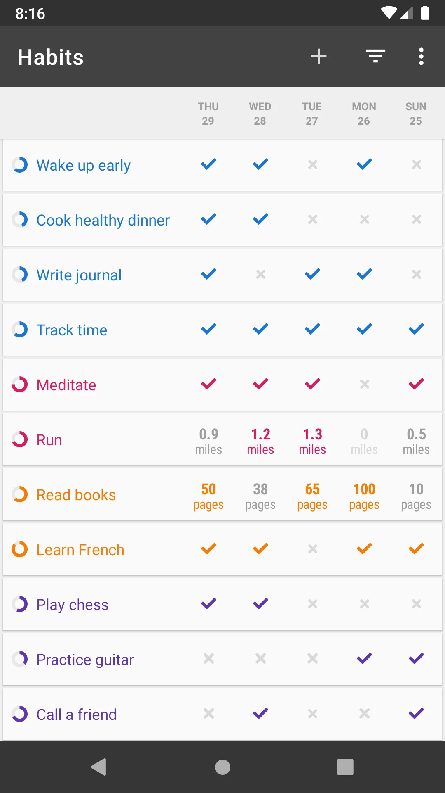{: width="180" .normal }
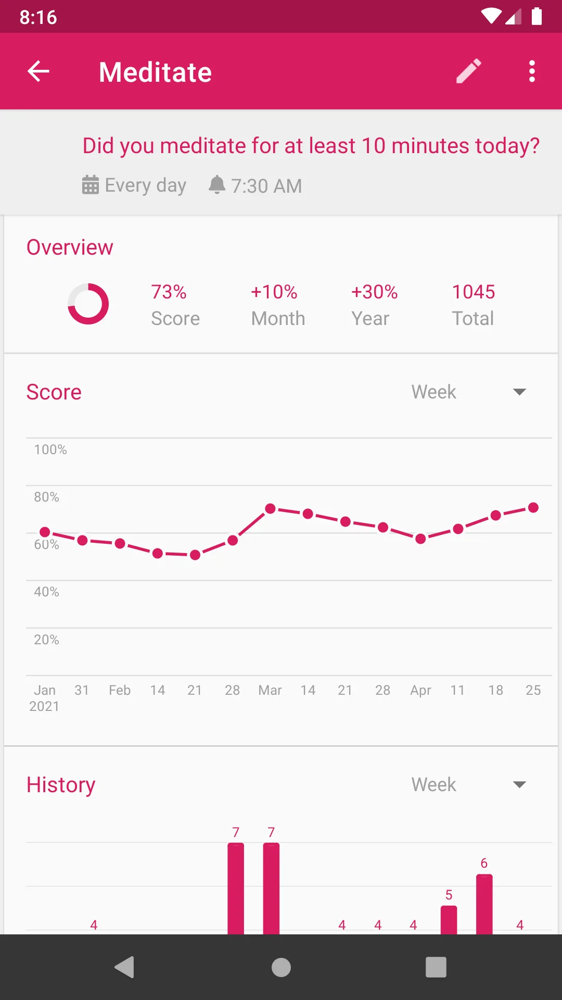{: width="180" .normal }
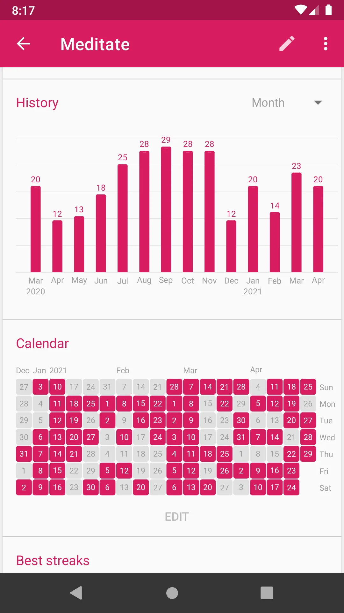{: width="180" .normal }
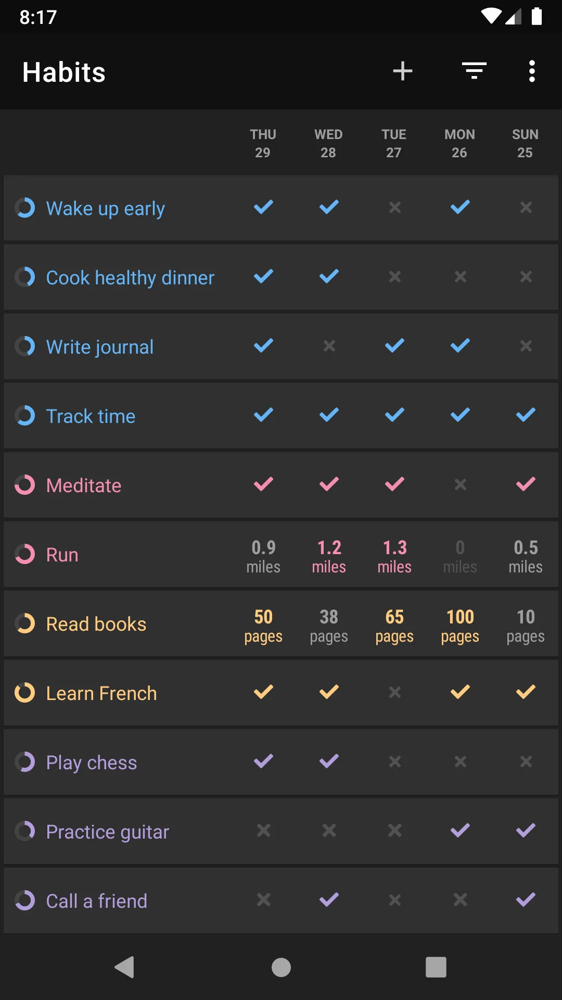{: width="180" .normal }
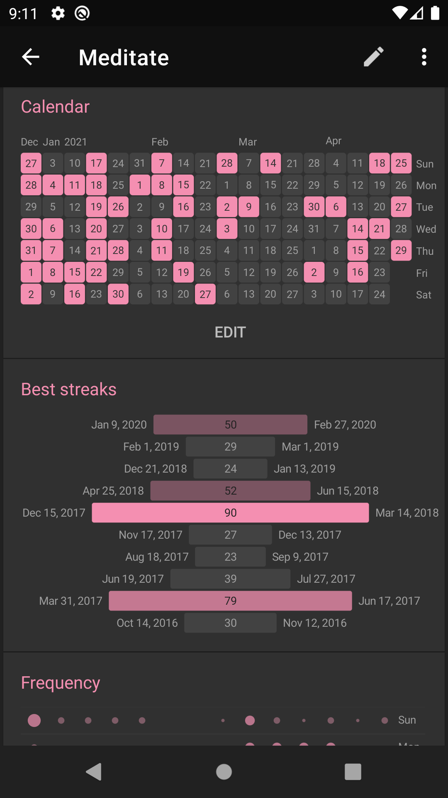{: width="180" .normal }

Loop adalah **aplikasi habit tracker** yang **percuma, open-source, dan bebas iklan** untuk Android. Ia memangkas semuanya sampai ke statistik yang solid — skor tabiat, streak harian, frekuensi — dan tidak pernah meminta Anda mendaftar. Tidak ada versi iOS, tetapi bagi puritan Android sukar mengalahkannya.

**Kelebihan**
- **Sepenuhnya percuma, open-source, tanpa iklan, dan tanpa akaun.**
- **Statistik terperinci**: skor tabiat, streak saat ini/terbaik, frekuensi, dan heatmap yang rapi.
- **Target dan peringatan**; mendukung tabiat build maupun break.
- **Menghormati privasi** serta sangat ringan dan cepat.
- Widget skrin utama untuk mengecek sekilas.

**Kekurangan**
- **Hanya Android** — tanpa iOS, web, atau klien desktop.
- **Tanpa penyegerakan cloud atau lintas peranti**; data disimpan lokal dengan eksport/import manual saja.
- **Tanpa gamifikasi, tanpa sosial, tanpa pembinaan** — murni penjejak tabiat.
- UI lebih polos dengan bimbingan lebih sedikit untuk pemula.

**Sesuai untuk:** pengguna Android yang ingin **aplikasi tabiat percuma** yang peribadi dan berfokus statistik tanpa syarat tambahan.

**Muat turun Loop Habit Tracker**
- [Google Play](https://play.google.com/store/apps/details?id=org.isoron.uhabits)

---

### 4. Fabulous — terbaik untuk pembinaan berbasis sains

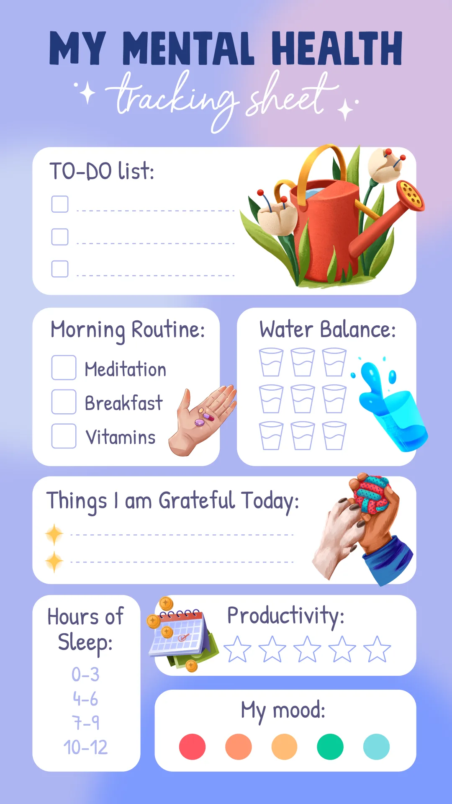{: width="180" .normal }
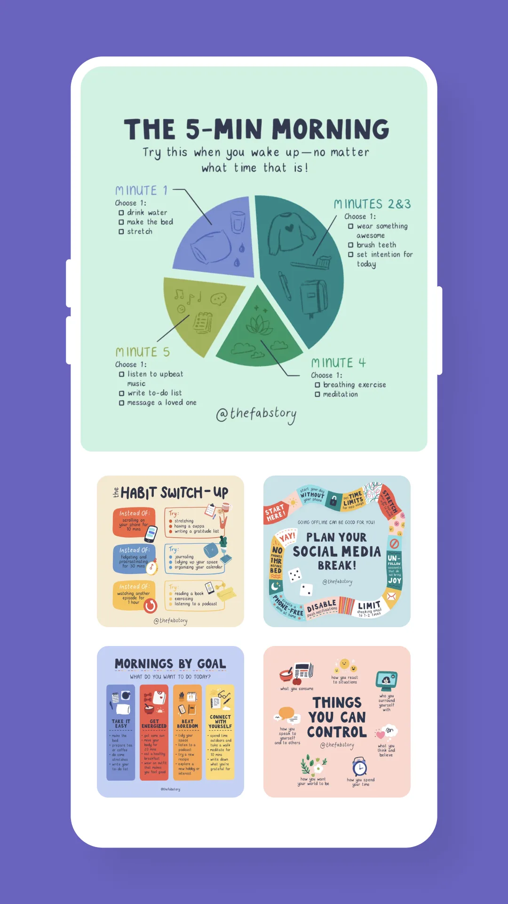{: width="180" .normal }
{: width="180" .normal }
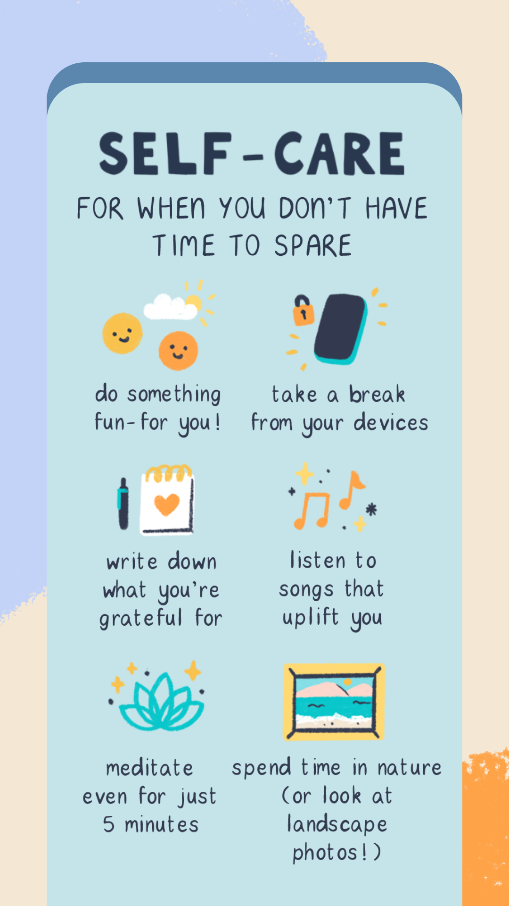{: width="180" .normal }
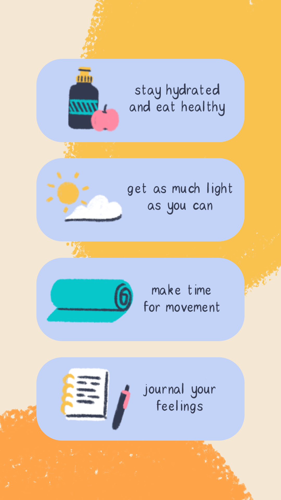{: width="180" .normal }

Fabulous berawal dari **projek riset ekonomi perilaku Duke University** dan memandang pembentukan tabiat sebagai perjalanan terbimbing — rutinitas pagi, meditasi, tidur, kebugaran, dan makan dengan kesadaran — dengan pembinaan, bukan sekadar kotak centang.

**Kelebihan**
- **Pembinaan berbasis sains dan perjalanan terstruktur**, bukan sekadar centang tugasan.
- **Rutinitas terbimbing** untuk pagi, fokus, tidur, kebugaran, dan nutrisi.
- **Merentas platform** (Android + iOS) dengan penyegerakan akaun.
- Reka bentuk rapi dan menenangkan yang makin personal seiring waktu.
- Terintegrasi dengan aplikasi Health untuk langkah dan tidur.

**Kekurangan**
- **Berat pada langganan** — sebahagian besar perjalanan berada di sebalik Fabulous Premium (boleh ~$12/bulan).
- Pendekatan pembinaan boleh terasa **berlebihan** bagi pengguna yang ingin penjejak sederhana.
- **Kurang tentang statistik tabiat mentah**; lebih tentang program dan streak di dalam satu perjalanan.
- Relatif mahal dibanding penjejak yang lebih sederhana, dan sebahagian pengguna merasa prompting-nya memaksa.

**Sesuai untuk:** orang yang ingin program dipandu coach untuk membangun rutinitas nyata, bukan sekadar checklist.

**Muat turun Fabulous**
- [Google Play](https://play.google.com/store/apps/details?id=co.thefabulous.app)
- [App Store](https://apps.apple.com/us/app/fabulous-daily-habit-tracker/id1203637303)

---

### 5. Productive — terbaik untuk pengalaman iOS yang rapi

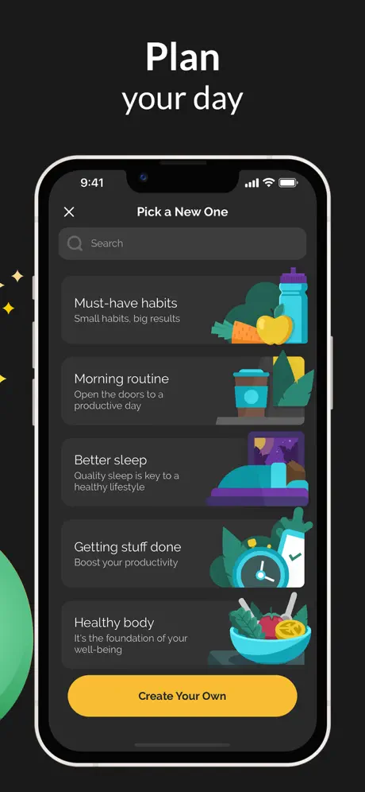{: width="180" .normal }
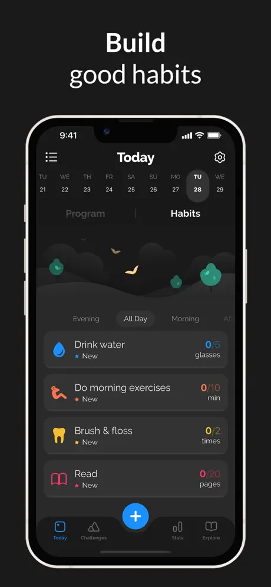{: width="180" .normal }
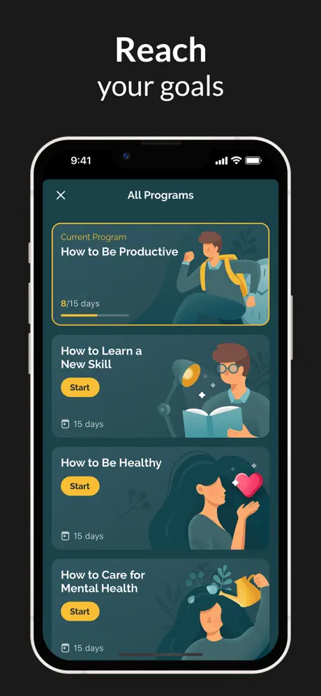{: width="180" .normal }
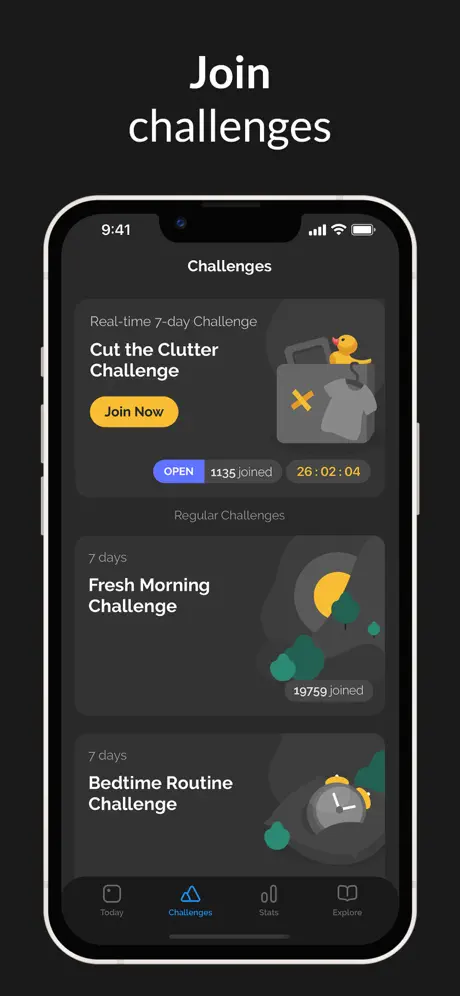{: width="180" .normal }
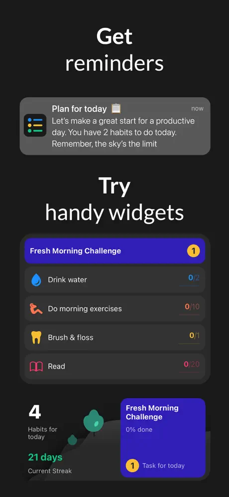{: width="180" .normal }

Productive adalah salah satu **aplikasi habit tracker iOS paling populer**, dikenal kerana antara muka bersih dan indah serta widget yang sangat baik. Aplikasi ini mengutamakan iPhone/iPad dan mengikuti bahasa reka bentuk Apple, sehingga menjadi saudara spiritual terdekat Streaks bagi pengguna Apple.

**Kelebihan**
- **UI iOS yang rapi dan indah** dengan widget skrin utama serta skrin kunci yang luar biasa.
- **Tabiat build dan break**, kategori, peringatan, dan tantangan.
- Alur perancang harian yang baik dan statistik yang bersih.
- Dukungan Apple Watch dan pintasan Siri.

**Kekurangan**
- **Berfokus pada iOS** — tidak ada aplikasi Android sungguhan, jadi bukan pilihan bagi pengguna Android.
- Banyak ciri berada di sebalik **Productive Pro** (langganan).
- **Kurang kuat untuk tabiat kompleks atau berdata berat**, dan tidak merentas platform dengan teman.

**Sesuai untuk:** pengguna iPhone yang ingin **aplikasi penjejak tabiat** paling mulus dan ramah widget.

**Muat turun Productive**
- [App Store](https://apps.apple.com/us/app/productive-habit-tracker/id983826477)

---

### 6. Habitify — terbaik untuk penjejakan merentas platform berbasis waktu

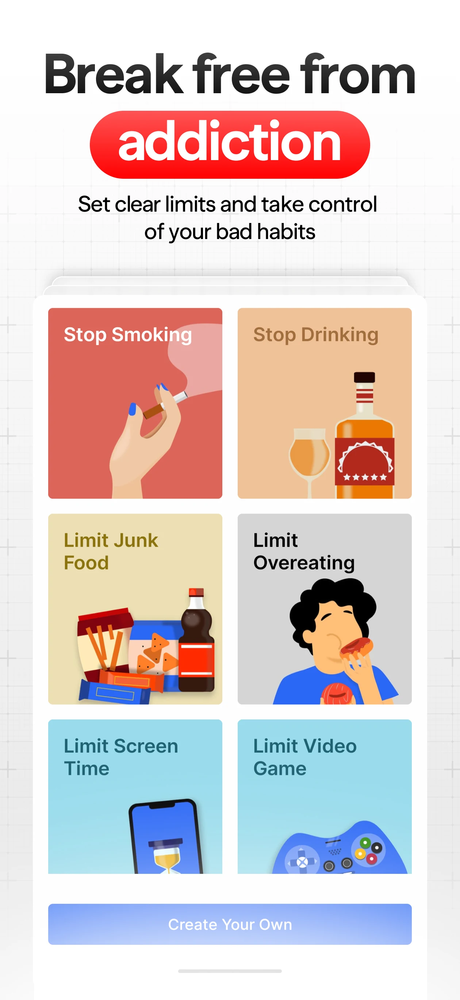{: width="180" .normal }
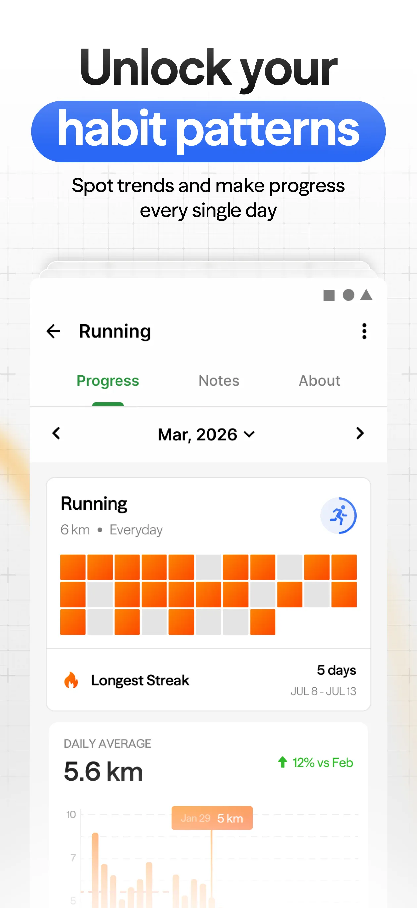{: width="180" .normal }
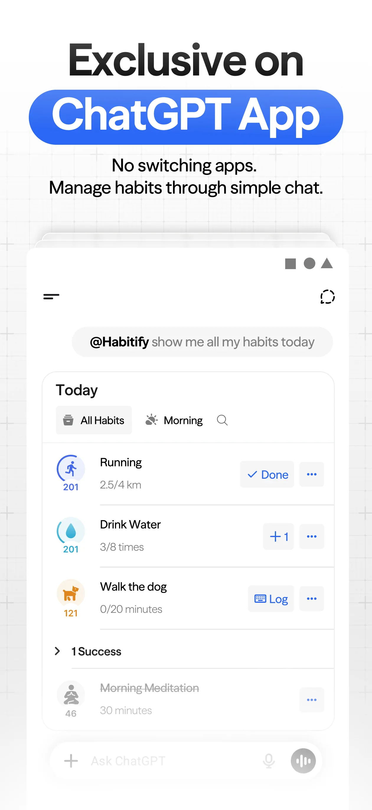{: width="180" .normal }
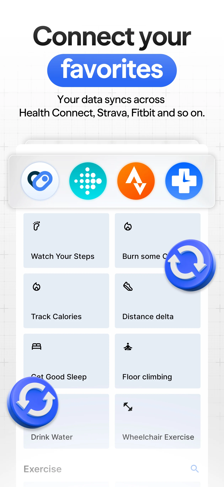{: width="180" .normal }

Habitify adalah **aplikasi habit tracker merentas platform** (iOS, Android, web, Wear OS) yang menyusun tabiat berdasarkan **waktu dalam sehari — pagi, siang, malam** — dan menyinkronkannya secara masa nyata. Pilihan kuat bila Anda hidup di beberapa peranti dan suka tabiat yang tersisip rapi ke dalam jadual.

**Kelebihan**
- **Benar-benar merentas platform** dengan penyegerakan masa nyata di Android, iOS, web, dan jam tangan.
- **Menyusun tabiat berdasarkan waktu sehari**, yang pas dengan rutinitas harian secara alami.
- Analitik bersih, peringatan, dan nuansa produktivitas yang fokus.
- Pernah jadi "App of the Day" pilihan Apple; 3M+ pengguna; tersedia pakej percuma.

**Kekurangan**
- Sebahagian ciri (tabiat tidak terhad, peringatan pintar, area custom) berada di sebalik **Habitify Plus / Pro**.
- Kurang jenaka dibanding Meow Habits; versi Android secara historis tertinggal dari pengalaman iOS.
- Tanpa lapisan RPG bergamifikasi seperti Habitica.

**Sesuai untuk:** orang yang hidup di banyak peranti dan ingin tabiat tersisip ke dalam hari mereka.

**Muat turun Habitify**
- [Google Play](https://play.google.com/store/apps/details?id=co.unstatic.habitify)
- [App Store](https://apps.apple.com/us/app/habitify-habit-tracker/id1111447047)

---

## Perbandingan keupayaan teras

| Keupayaan | Meow Habits | Habitica | Loop | Fabulous | Productive | Habitify |
|---|---|---|---|---|---|---|
| **Platform** | Android, iOS | Android, iOS, web | Hanya Android | Android, iOS | iOS | iOS, Android, web |
| **Tabiat build + break** | Ya | Ya | Ya | Rutinitas + tabiat | Ya | Ya |
| **Peringatan** | Ya | Ya | Ya | Ya (pintar) | Ya | Ya |
| **Streak harian dan statistik** | Ya (graf, heatmap) | Ringan (berbasis XP) | Kuat (skor, heatmap) | Berbasis program | Ya | Ya (analitik) |
| **Widget** | Ya | Ya | Ya | Terhad | Kuat | Ya |
| **Penyegerakan cloud / lintas peranti** | Sebahagian (Drive / WebDav) | Ya (akaun) | Tidak (lokal) | Ya (akaun) | iCloud | Ya (masa nyata) |
| **Gamifikasi / sosial** | Tidak | Kuat (RPG + parties) | Tidak | Pembinaan | Tantangan | Ringan |
| **Offline / privasi (tanpa akaun)** | Kuat (di peranti) | Berbasis akaun | Kuat (tanpa akaun) | Berbasis akaun | Akaun (iCloud) | Berbasis akaun |
| **Pakej percuma** | Teras lengkap | Lengkap | Penuh (percuma) | Terhad | Terhad | Lengkap |
| **Harga** | Percuma + VIP ~$9.99/tahun | Percuma + ~$4.99/bulan | Percuma (open-source) | Percuma + ~$12/bulan | Percuma + ~$2.50/bulan | Percuma + langganan |
| **Tema / ikon** | 500+ ikon kartun | Gaya RPG piksel | Minimum | Tema menenangkan | Tema rapi | Tema bersih |
| **Integrasi Health** | Sebahagian | Apple Health / Google Fit | Tidak | Ya (Health) | Apple Health | Sebahagian |

---

## Alternatif Streaks mana yang sesuai untuk setiap jenis pengguna

Jadual di atas memeringkat ciri; di sini keenam aplikasi yang sama dikelompokkan berdasarkan *apa yang sebenarnya Anda ganti*.

- **Pindah kerana platform** — Meow Habits satu-satunya pilihan yang menyatukan Android dan iOS dalam satu aplikasi habit tracker, dan terus berfungsi sebagai **aplikasi tabiat tanpa akaun** dengan catatan tabiat offline selepas instalasi. Dalam daftar **aplikasi tabiat percuma terbaik Android** ia juga menghindari jebakan **aplikasi habit tracker percuma tanpa langganan**: teras gratisnya tidak punya jam percubaan.
- **Pindah kerana rantai sudah tidak lagi memotivasi** — carian **alternatif Habitica** biasanya berarti hadiah dan akuntabilitas party harus menggantikan peran yang dulu dipegang streak harian.
- **Pindah kerana data Anda** — **alternatif Loop Habit Tracker** sesuai untuk statistik open-source di peranti tanpa pendaftaran; Meow Habits mempertahankan gagasan itu dan menambah eksport CSV plus sandaran WebDav.
- **Pindah kerana struktur** — **alternatif Habitify** pas untuk tabiat yang terikat pagi, siang, dan malam lintas peranti, sementara **alternatif Fabulous** pas untuk program pembinaan terbimbing. Keduanya perlu akaun, yang menjadi trade-off dibanding alat khusus lokal.
- **Masih khusus iPhone** — Productive paling mirip nuansanya dengan Streaks, tetapi mewarisi batasan iOS-only yang sama.

Jika pertanyaan sebenarnya adalah **aplikasi habit tracker** mana yang akan digunakan bertahun-tahun, mulailah dari dua hal yang tidak berubah mengikuti trend: bolehkah Anda mengekspor sejarah, dan bolehkah ia berjalan tanpa akaun?

## Cara memilih

- Ingin **penjejak tabiat comel, peribadi, tanpa akaun dengan 500+ ikon** → **Meow Habits**
- Ingin **game, level, dan akuntabilitas party** → **Habitica**
- Ingin **statistik Android percuma, open-source, tanpa akaun** → **Loop**
- Ingin **program dipandu coach** (tidur, fokus, kebugaran) → **Fabulous**
- Ingin **widget iOS paling mulus** → **Productive**
- Ingin **penyegerakan lintas peranti sejati yang tersisip berdasarkan waktu sehari** → **Habitify**

## Cara bermigrasi dari Streaks

1. **Catat tugasan Streaks Anda saat ini** beserta jadwalnya (harian, selang sehari, mingguan).
2. **Pilih pengganti** memakai jadual di atas berdasarkan platform Anda dan apakah Anda ingin mode build, break, atau keduanya.
3. **Buat ulang tabiat** — pilih mode build atau break bila didukung, dan salin frekuensi setiap tugasan.
4. **Atur peringatan** pada jam yang sama seperti di Streaks supaya rantai baru bertahan selepas perpindahan.
5. **Aktifkan sandaran** (Meow Habits: Google Drive / WebDav; Habitica / Habitify / Fabulous: penyegerakan akaun) supaya Anda tidak pernah terkunci.

## FAQ

**Apakah Meow Habits alternatif Streaks percuma yang bagus?**
{:.faq-q}

Ya. Ia berjalan di Android dan iOS (Streaks khusus iOS), percuma pada terasnya tanpa akaun, mendukung mode build *dan* break, serta menyimpan data di peranti di sebalik kunci cap jari.

**Apakah Meow Habits boleh digunakan di Android?**
{:.faq-q}

Ya — Android didukung penuh, dengan sandaran Google Drive dan widget skrin utama untuk check-in satu ketikan.

**Alternatif Streaks mana yang terbaik untuk privasi?**
{:.faq-q}

Meow Habits — tanpa akaun, storan di peranti dengan kunci cap jari pilihan, dan sandaran hanya ke Google Drive atau WebDav milik Anda sendiri semasa Anda mengaktifkannya.

**Bolehkah saya memindahkan tabiat keluar dari Streaks?**
{:.faq-q}

Streaks tidak punya eksport CSV, jadi Anda perlu membuat ulang tabiat secara manual; Meow Habits sendiri boleh mengekspor CSV, sehingga data Anda tetap mudah dipindahkan setelahnya.

[Halaman aplikasi Meow Habits](/ms/apps/meow-habits/) — muat turun untuk Android dan iOS.

## Istilah berkaitan

- [Apakah Itu Habit Tracker?](/ms/glossary/what-is-a-habit-tracker/)
