Jika Anda sedang mencari **alternatif Todoist**, besar kemungkinan Anda menginginkan perbelanjaan lebih rendah, privasi lebih baik, atau antara muka yang lebih sederhana. Berikut **[aplikasi to-do list terbaik](/ms/glossary/what-is-a-to-do-list/)** sebagai alternatif yang layak dilirik pada 2026 — tujuh aplikasi yang dipilih kerana bahagian pasaran besar atau kelebihan khas — lengkap dengan kelebihan dan kekurangan terperinci, perbandingan keupayaan teras, serta pautan muat turun terus.

## Mengapa banyak pengguna mencari alternatif Todoist

{: width="180" .normal }
{: width="180" .normal }
{: width="180" .normal }
{: width="180" .normal }
{: width="180" .normal }

- Pakej percuma **Beginner** membatasi Anda hingga ~5 projek aktif dengan peringatan terhad.
- **Integrasi kalendar** dan banyak otomatisasi hanya tersedia di pakej **Pro** (~$60/tahun).
- Sebahagian pengguna sekadar menginginkan antara muka lebih tenang dan tidak terlalu "digamifikasi", atau ingin data disimpan di luar cloud vendor.

## Sekilas alternatif Todoist terbaik

| Aplikasi | Harga | Pakej percuma | Sesuai untuk |
|---|---|---|---|
| **Microsoft To Do** | Percuma | Lengkap (akaun MS) | Pengguna Microsoft 365 / Outlook |
| **Meow Todo** | Teras percuma + VIP (~$9,99/tahun) | Teras cukup lengkap | Privasi, UI comel, eksport CSV |
| **TickTick** | Percuma + Premium $35,99/tahun | Daftar terhad | Serba boleh: kalendar + pomodoro |
| **Google Tasks** | Percuma | Lengkap (akaun Google) | Pengguna Gmail / Calendar |
| **Things 3** | Berbayar, per platform | Tidak ada | Aplikasi khusus Apple dengan reka bentuk terbaik |
| **Notion** | Percuma + pakej berbayar | Cukup lengkap | Ruang kerja all-in-one yang fleksibel |
| **Any.do** | Percuma + Premium ~$36/tahun | Terhad | Kalendar dan tugasan gabungan |

### 1. Microsoft To Do — terbaik untuk ekosistem Microsoft

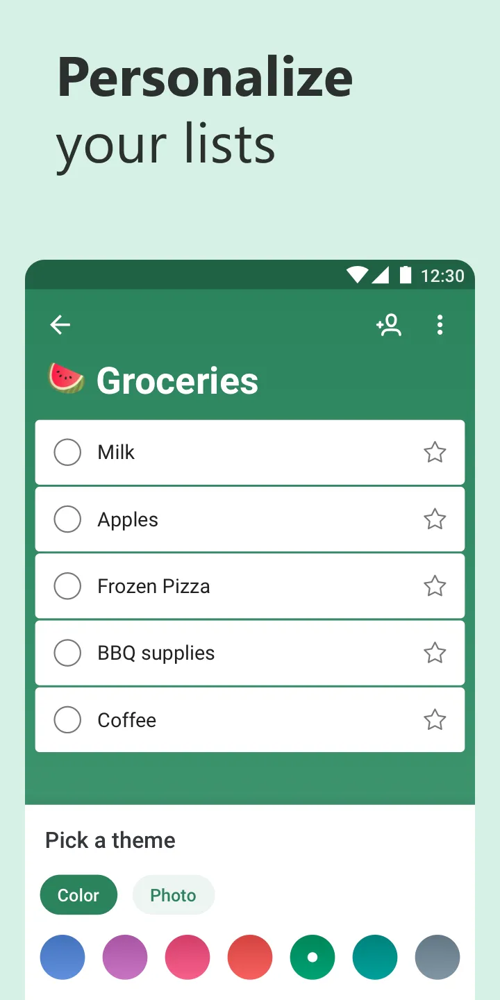{: width="180" .normal }
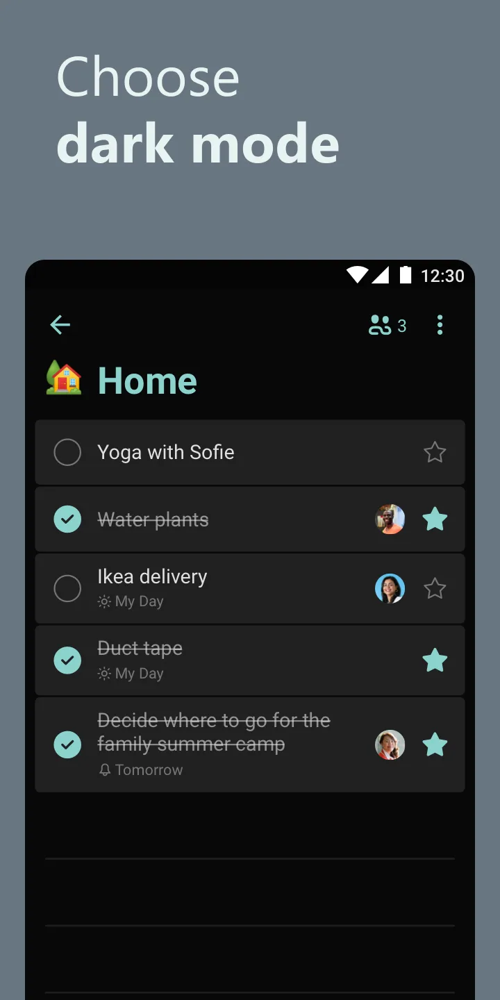{: width="180" .normal }
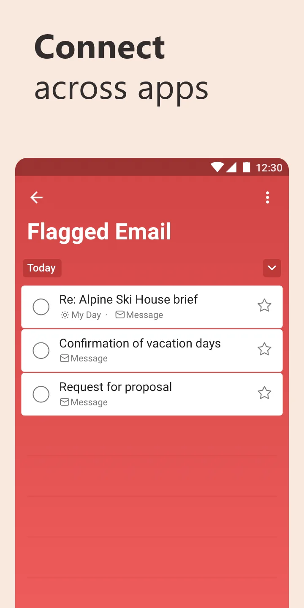{: width="180" .normal }
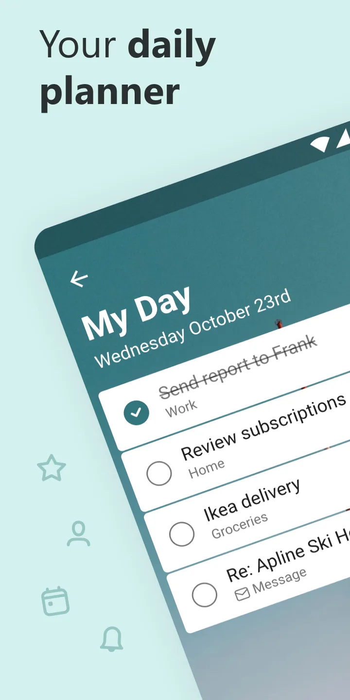{: width="180" .normal }
{: width="180" .normal }

Microsoft To Do (dibangun oleh bekas tim Wunderlist yang diakuisisi Microsoft pada 2015) **sepenuhnya percuma** dan terikat erat dengan Outlook serta Windows. Aplikasi ini paling bersinar bagi siapa pun yang sudah berada di ekosistem Microsoft 365.

**Kelebihan**
- **Sepenuhnya percuma** di iOS, Android, Windows, macOS, dan web, dengan dukungan 34 bahasa.
- **Integrasi mendalam Outlook / Microsoft 365** — email yang ditandai berubah menjadi tugasan, dan memakai mesin yang sama dengan tugasan Outlook.
- Perancangan **My Day** yang rapi, daftar bersama, subtugasan, lampiran fail, dan peringatan tarikh akhir.
- Didukung Microsoft, sehingga penyegerakan dan keandalannya solid.

**Kekurangan**
- **Ciri masih dasar** — tanpa paparan kalendar bawaan, tanpa pomodoro atau penjejak tabiat, dan input tarikh bahasa alami lebih terhad dibanding TickTick atau Things.
- Sangat terikat pada akaun Microsoft; kurang menarik jika Anda berada di luar ekosistem tersebut.
- Tidak ada kolaborasi selain daftar bersama, serta tanpa struktur projek atau GTD tingkat lanjut.

**Sesuai untuk:** pengguna Microsoft 365 / Outlook yang menginginkan senarai tugasan harian percuma dan boleh dipercayai tanpa harus mempelajari sistem baru.

**Muat turun Microsoft To Do**
- [Google Play](https://play.google.com/store/apps/details?id=com.microsoft.todos)
- [App Store](https://apps.apple.com/app/microsoft-to-do/id1212616790)

### 2. Meow Todo — terbaik untuk privasi, antara muka menyenangkan, dan teras percuma

{: width="180" .normal }
{: width="180" .normal }
{: width="180" .normal }
{: width="180" .normal }
{: width="180" .normal }

Meow Todo List adalah **[pengurus tugasan](/ms/glossary/what-is-a-to-do-list/)** bertema kucing untuk Android dan iOS. Ciri paling menonjol adalah **antarmukanya**: reka bentuk kartun comel dengan **400+ ikon kategori kaya** yang membuat perancangan harian terasa ringan, bukan seperti kerja pejabat. Di luar paparan, aplikasi ini merangkumi dasar-dasar praktikal senarai tugasan.

**Kelebihan**
- **UI kartun cantik dengan 400+ ikon khusus** — pembeda paling jelas; mencatat tugasan terasa menyenangkan secara visual.
- **Daftar, subtugasan, dan paparan kalendar** (harian / mingguan / bulanan) sehingga kerja mendatang kelihatan sekilas.
- **Eksport CSV** (semua tugasan atau julat tarikh) untuk Excel, plus **sandaran iCloud / WebDav** — data hanya keluar dari kendali Anda semasa Anda mengizinkannya.
- **Tanpa perlu akaun** — senarai tugasan tanpa akaun disimpan di peranti dengan kunci cap jari pilihan, hal yang langka di aplikasi to-do arus utama.
- Tugasan berulang, peringatan tarikh akhir, mode gelap/terang, dan graf tugasan (pie + graf kontribusi).

**Kekurangan**
- **Tanpa penyegerakan cloud automatik merentas platform** — penyegerakan memakai iCloud (Apple) atau WebDav, bukan akaun khusus, sehingga berpindah antara telefon pintar Android dan iPhone kurang mulus dibanding aplikasi berbasis akaun.
- **Ciri lanjutan** (contohnya daftar tanpa had / graf lebih kaya) ada di sebalik VIP murah (~$0,99/bulan atau $9,99/tahun); teras percuma sudah mencukupi pencatatan sehari-hari.
- Tanpa kolaborasi atau dukungan daftar bersama, serta ekosistem lebih kecil dibanding pemain besar.

**Sesuai untuk:** orang yang ingin pencatatan tugasan jelas dan peribadi tanpa akaun cloud, menghargai antara muka ramah, dan tidak keberatan dengan tetapan manual ringan.

**Muat turun Meow Todo List**
- [Google Play](https://play.google.com/store/apps/details?id=com.glgjing.money.task.todo.list.meow)
- [App Store](https://apps.apple.com/app/meow-todo-list-task/id6742345495)

### 3. TickTick — paling serba boleh

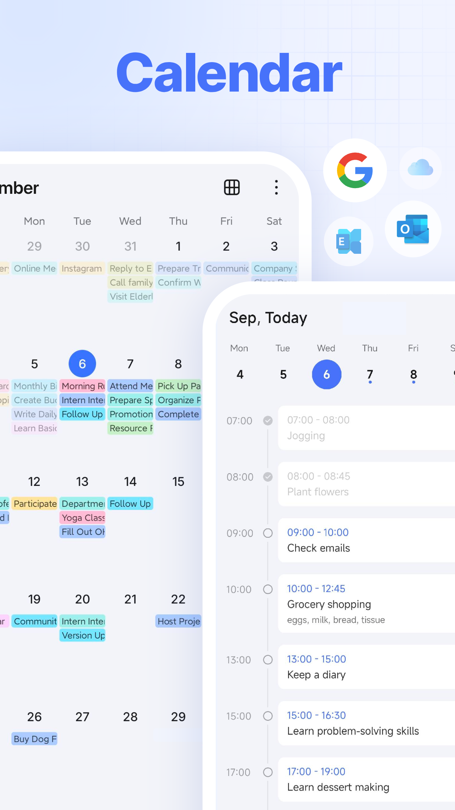{: width="180" .normal }
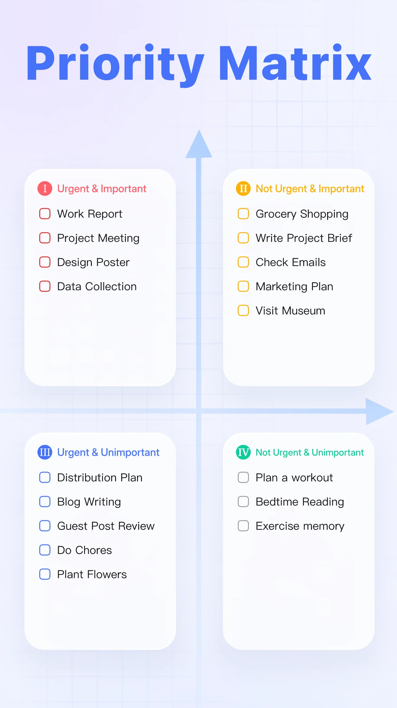{: width="180" .normal }
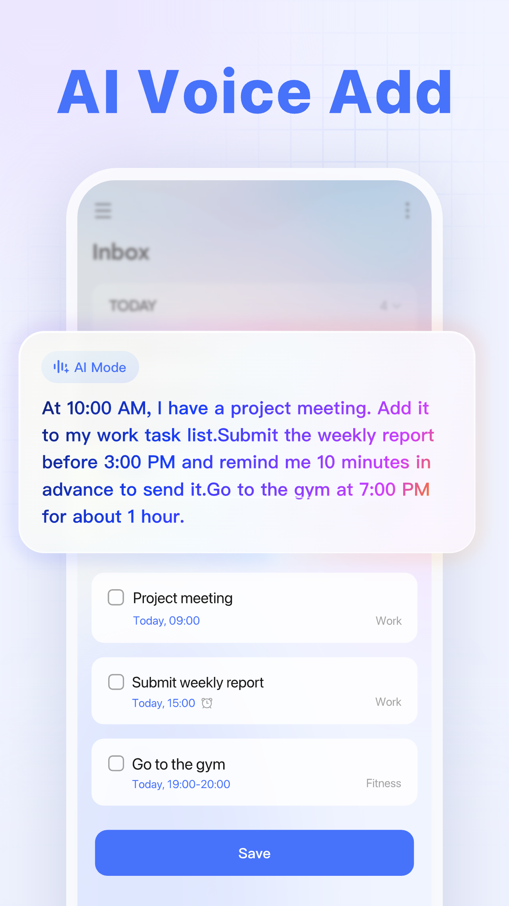{: width="180" .normal }
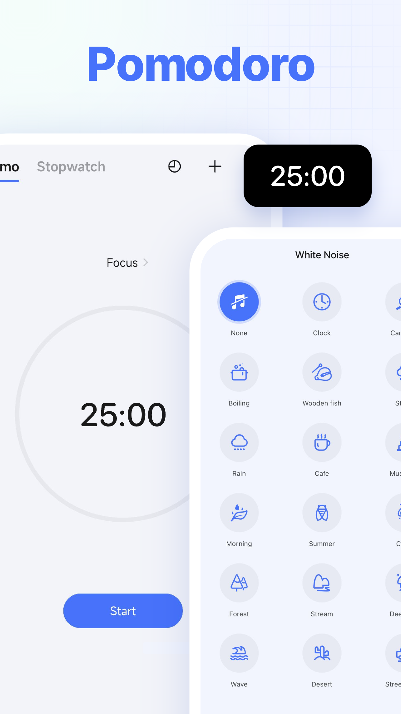{: width="180" .normal }
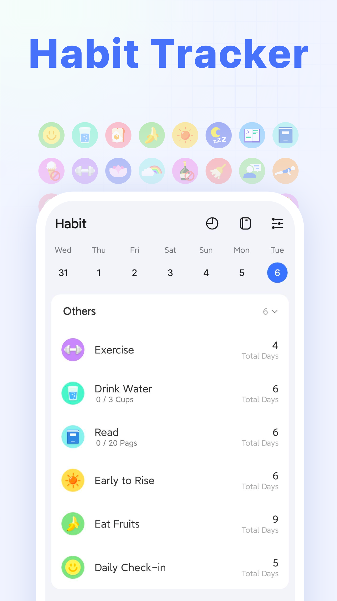{: width="180" .normal }

TickTick adalah **[pengurus tugasan](/ms/glossary/what-is-a-to-do-list/)** tangguh dengan kalendar bawaan, pemasa pomodoro, dan penjejak tabiat. Ia membawa lebih banyak ciri daripada kebanyakan alternatif dan harganya lebih murah dari Todoist Pro.

**Kelebihan**
- **Kalendar bawaan + pomodoro + penjejak tabiat** dalam satu aplikasi — tidak perlu menambah alat tambahan.
- **Pengenalan tarikh pintar** (bahasa alami "setiap sen 9 pagi") dan input suara membuat pencatatan cepat.
- Paparan kaya: daftar, grid kalendar, linimasa (premium), tag, prioritas, dan peringatan berbasis lokasi.
- **Premium lebih murah** ($35,99/tahun) dibanding Todoist Pro, dengan penyegerakan di web, iOS, Android, Windows, dan Mac.

**Kekurangan**
- **Pakej percuma terhad** — jumlah daftar/tugasan dihadkan dan hanya satu paparan kalendar; sejarah serta sebahagian peringatan membutuhkan Premium.
- Luasnya ciri boleh membuat UI terasa ramai bagi pengguna yang menginginkan sesuatu yang minimalis.
- Kolaborasi lebih ringan dari Notion; daftar bersama ada, tetapi tanpa alur kerja tim mendalam.

**Sesuai untuk:** pengguna yang ingin ciri kuat (kalendar + pomodoro + tabiat) tanpa membayar harga setara Todoist.

**Muat turun TickTick**
- [Google Play](https://play.google.com/store/apps/details?id=com.ticktick.task)
- [App Store](https://apps.apple.com/app/ticktick-to-do-list-calendar/id626144601)

### 4. Google Tasks — terbaik untuk pengguna Gmail dan Calendar

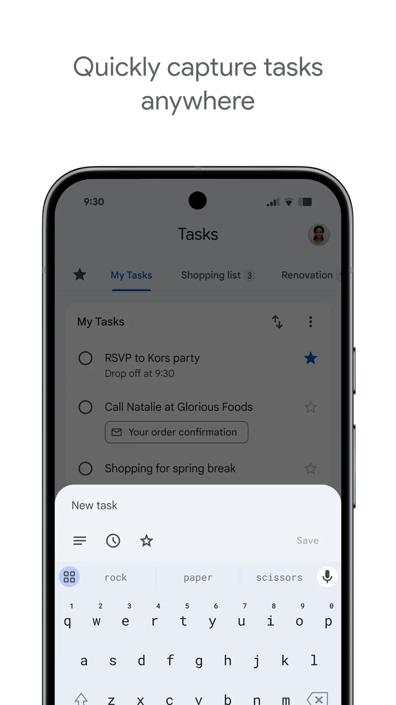{: width="180" .normal }
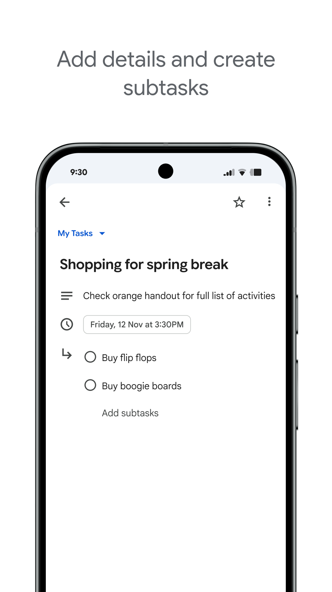{: width="180" .normal }
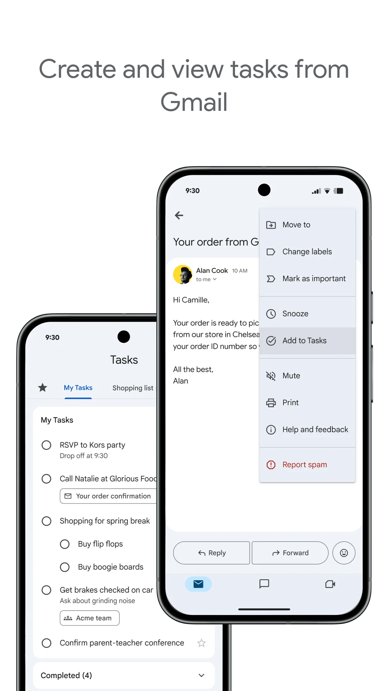{: width="180" .normal }
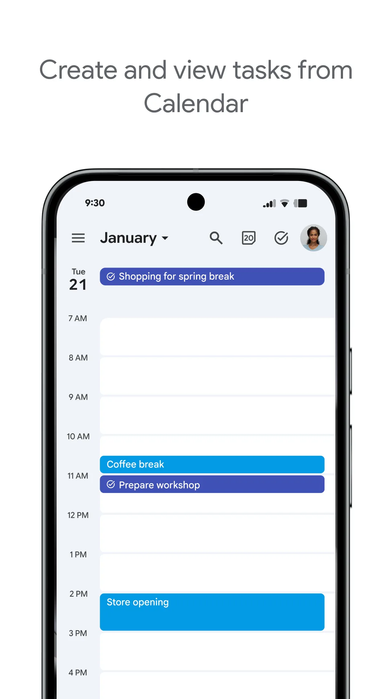{: width="180" .normal }
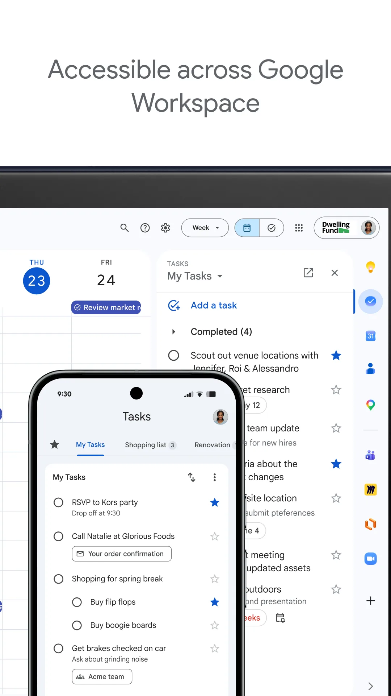{: width="180" .normal }

Google Tasks adalah alat tugasan ringan yang tertanam di Gmail dan Google Calendar. Sengaja dibuat minimalis dan percuma untuk akaun Google mana pun.

**Kelebihan**
- **Percuma dan terus tersedia** — sudah ada di Gmail, Calendar, Drive, dan aplikasi khusus (Android, iOS, web).
- **Penyegerakan erat dengan Google Calendar** — tugasan bertenggat muncul automatik di kalendar Anda.
- Pencatatan sederhana dan cepat; beberapa daftar; satu tingkat subtugasan; peringatan dasar.

**Kekurangan**
- **Sangat minimalis** — hanya satu tingkat subtugasan, tanpa paparan kaya, tanpa parsing bahasa alami, tanpa pomodoro atau tabiat.
- Peringatan masih dasar (berbasis tarikh akhir); tanpa peringatan berbasis lokasi atau perekaman suara.
- Tanpa mode offline-first sejati dan kolaborasi terhad (hanya daftar yang dibagikan lewat Google); lemah untuk projek kompleks.

**Sesuai untuk:** pengguna Gmail / Google Calendar yang menginginkan senarai tugasan tanpa hambatan dan tidak lebih.

**Muat turun Google Tasks**
- [Google Play](https://play.google.com/store/apps/details?id=com.google.android.apps.tasks)
- [App Store](https://apps.apple.com/app/google-tasks-get-things-done/id1353634006)

### 5. Things 3 — reka bentuk terbaik, khusus Apple

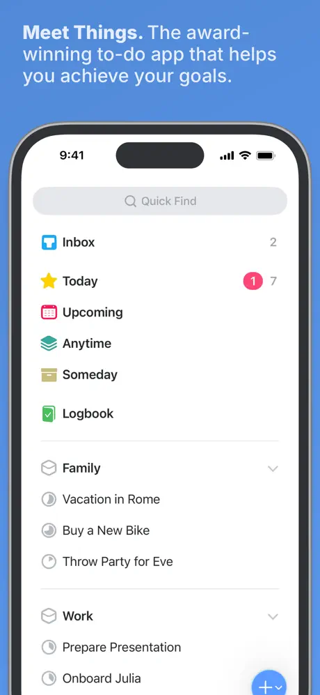{: width="180" .normal }
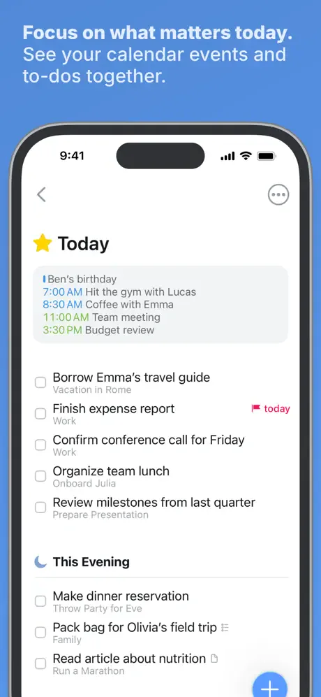{: width="180" .normal }
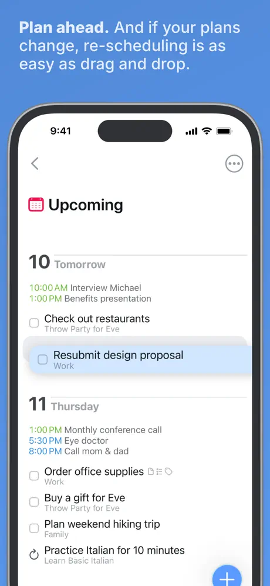{: width="180" .normal }
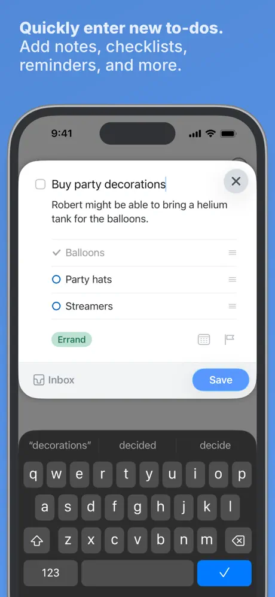{: width="180" .normal }
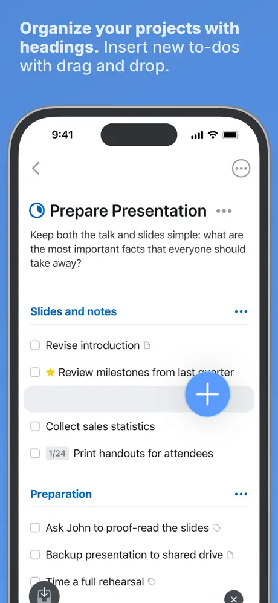{: width="180" .normal }

Things 3 (dari Cultured Code) luas dipuji sebagai **aplikasi to-do dengan paparan terbaik**, dengan model ramah GTD (Inbox, Today, Upcoming, Anytime, Someday, Projects, Areas, tag). Aplikasi ini hanya berjalan di peranti Apple.

**Kelebihan**
- **Reka bentuk dan UX kelas terbaik** — cepat, tenang, dan intuitif; entri cepat serta penjadwalan bahasa alami.
- **Struktur GTD tangguh** — projek, area, tugasan berulang (dengan selesai lebih awal dan penjadwalan ulang), tarikh akhir, serta pautan ke catatan/URL.
- **Pembelian sekali bayar, tanpa langganan**, dengan integrasi Apple mendalam (Siri, import Reminders, Handoff).
- Penyegerakan lewat iCloud di iPhone, iPad, dan Mac.

**Kekurangan**
- **Khusus Apple** — tanpa Android, tanpa klien web/Windows, sehingga tidak sesuai untuk rumah tangga dengan peranti campuran.
- **Tanpa kolaborasi atau daftar bersama**, serta tanpa pomodoro atau ciri tabiat bawaan.
- Berbayar di muka per platform (iPhone / iPad / Mac dijual terpisah), dan tanpa pakej percuma untuk mencuba sebelum membeli.

**Sesuai untuk:** pengguna khusus Apple yang menginginkan pengurus tugasan paling rapi dan bebas gangguan, serta memilih pembelian sekali bayar.

**Muat turun Things 3**
- [App Store](https://apps.apple.com/app/things-3/id904237743)

### 6. Notion — ruang kerja all-in-one paling fleksibel

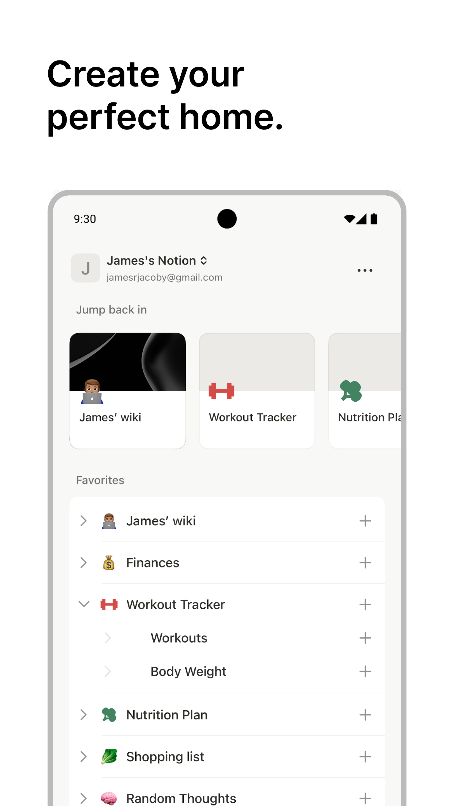{: width="180" .normal }
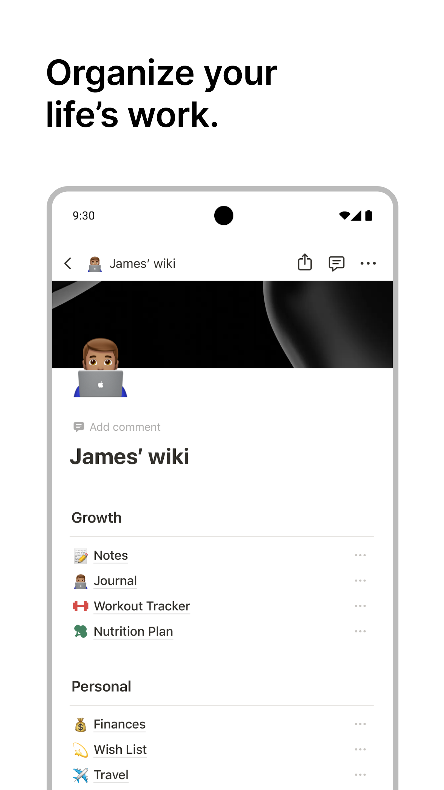{: width="180" .normal }
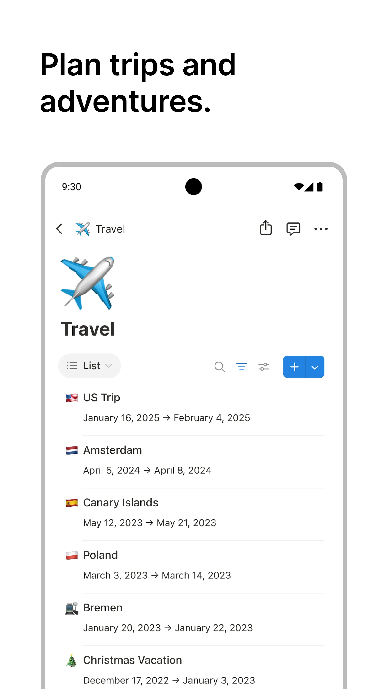{: width="180" .normal }
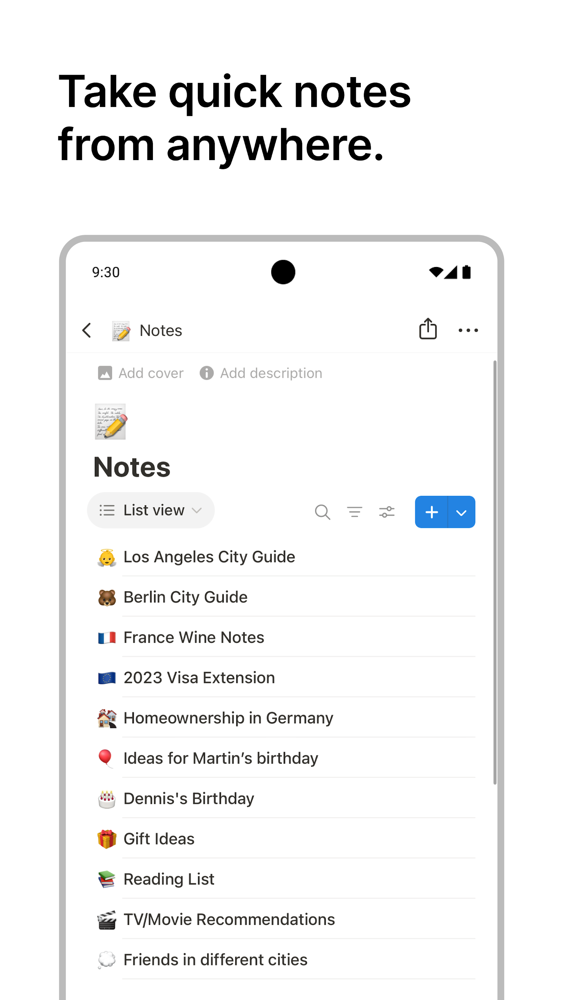{: width="180" .normal }
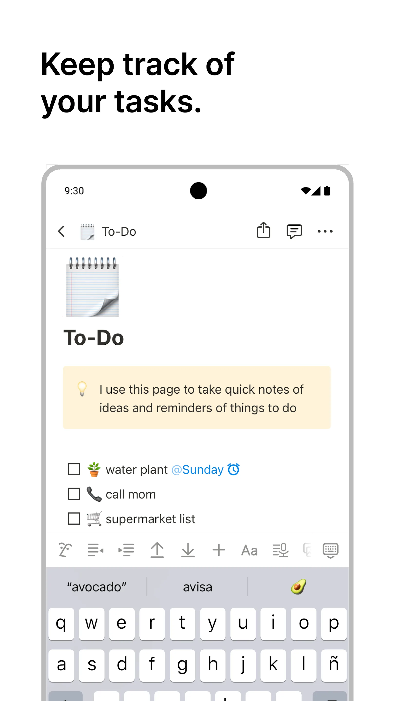{: width="180" .normal }

Notion adalah ruang kerja catatan/docs/database yang juga boleh menjalankan tugasan lewat database, paparan papan (Kanban) dan kalendar, serta peringatan. Ini pilihan paling fleksibel di sini — sekaligus paling berat.

**Kelebihan**
- **Sangat fleksibel** — tugasan hanyalah baris database yang boleh dilihat sebagai daftar, papan, kalendar, atau linimasa, dengan relasi, templat, dan dokumen kaya.
- **Kolaborasi kuat** — berkongsi masa nyata, komentar, dan alur kerja tim jauh melampaui aplikasi to-do khusus mana pun.
- Merentas platform (web, iOS, Android, Windows, Mac) dengan **pakej percuma yang cukup lengkap**.

**Kekurangan**
- **Berat untuk tugasan sederhana** — pencatatan cepat lebih lambat dari aplikasi khusus, dan ada lengkung pembelajaran yang nyata.
- **Peringatan dan tugasan berulang lebih lemah** — terikat pada tarikh item database, tanpa peringatan push native yang boleh dipercayai, lokasi, atau perekaman suara milik aplikasi yang dibangun khusus.
- Bergantung pada cloud; penggunaan offline terhad pada cache, sehingga kurang ideal jika Anda ingin data sepenuhnya di peranti.

**Sesuai untuk:** pengguna yang sudah hidup di Notion (atau ingin docs + tugasan + manajemen projek dalam satu tempat) dan boleh menerima alat yang lebih berat.

**Muat turun Notion**
- [Google Play](https://play.google.com/store/apps/details?id=notion.id)
- [App Store](https://apps.apple.com/app/notion-notes-tasks-ai/id1232780281)

### 7. Any.do — terbaik untuk kalendar dan tugasan gabungan

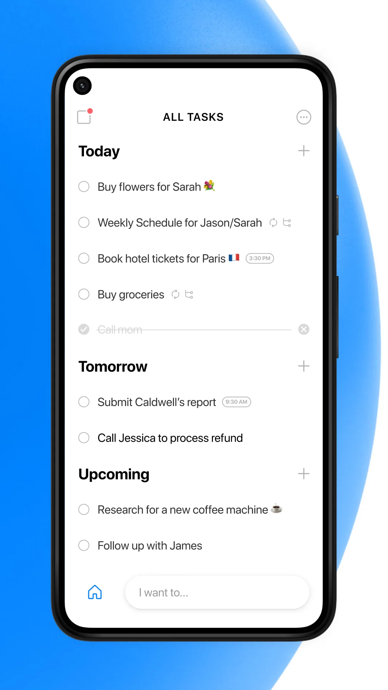{: width="180" .normal }
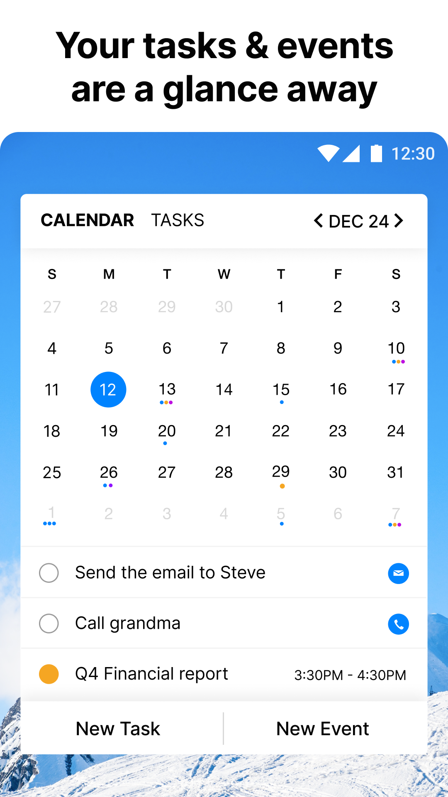{: width="180" .normal }
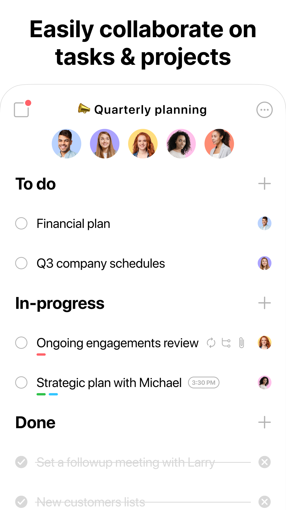{: width="180" .normal }
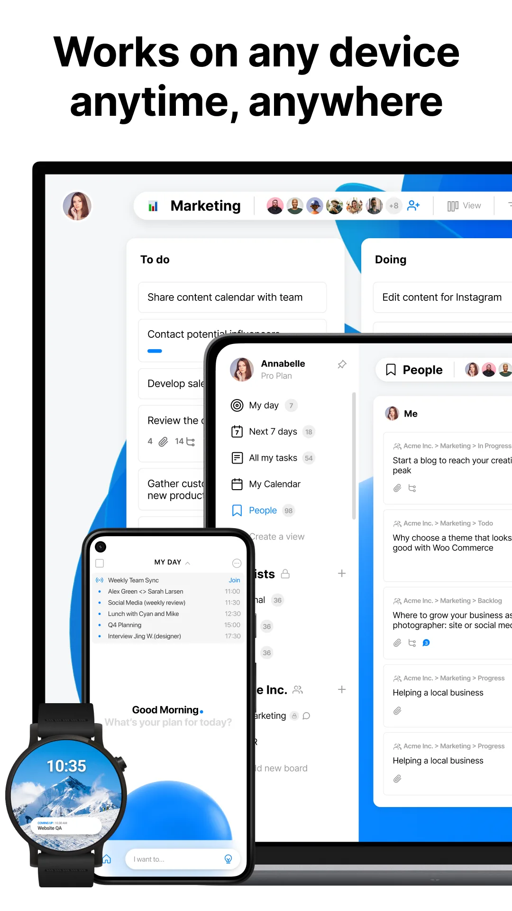{: width="180" .normal }

Any.do menggabungkan senarai tugasan, kalendar, dan perancang lengkap dengan peringatan, digunakan puluhan juta orang di seluler, desktop, dan web.

**Kelebihan**
- **Tugasan + kalendar dalam satu paparan**, dengan peringatan suara, WhatsApp, dan berbasis lokasi — pencatatan fleksibel.
- **Merentas platform** (seluler, desktop, web, tablet) dengan pakej percuma yang layak digunakan.
- Tugasan berulang, daftar bersama, dan integrasi kalendar dalam satu permukaan perancangan.

**Kekurangan**
- **Pakej percuma terhad** dan beberapa kemudahan (pengulangan lanjutan, sebahagian peringatan, tema premium) membutuhkan Premium ~$36/tahun.
- Paparan gabungan dan tawaran upgrade premium boleh terasa berantakan, serta keandalan peringatan kerap menjadi keluhan.
- Tidak dirancang untuk manajemen projek kompleks atau kolaborasi tim mendalam.

**Sesuai untuk:** pengguna yang ingin tugasan dan kalendar menyatu dengan peringatan fleksibel (suara/lokasi).

**Muat turun Any.do**
- [Google Play](https://play.google.com/store/apps/details?id=com.anydo)
- [App Store](https://apps.apple.com/app/any-do-to-do-list-planner/id497328576)

## Perbandingan keupayaan teras

Jadual berikut menunjukkan seobjektif mungkin keupayaan yang didukung setiap aplikasi. "Sebahagian" berarti ciri ada, tetapi dengan batasan.

| Keupayaan | Microsoft To Do | Meow Todo | TickTick | Google Tasks | Things 3 | Notion | Any.do |
|---|---|---|---|---|---|---|---|
| **Penyegerakan cloud / multi-perangkat** | Ya (akaun MS) | Sebahagian (iCloud / WebDav) | Ya | Ya (Google) | Ya (iCloud) | Ya (akaun) | Ya |
| **Peringatan tugasan** | Tarikh akhir + berulang | Tarikh akhir | Kaya (termasuk lokasi) | Tarikh akhir | Tarikh akhir + Siri | Sebahagian (berbasis tarikh) | Suara / lokasi / WhatsApp |
| **Paparan kalendar** | Sebahagian (Outlook) | Ya (hari/minggu/bulan) | Ya (bawaan) | Sebahagian (Google Cal) | Sebahagian (Today/Upcoming) | Sebahagian (kalendar DB) | Ya (gabungan) |
| **Subtugasan** | Ya (1 tingkat) | Ya (1 tingkat) | Bertingkat | Hanya 1 tingkat | Checklist | Blok bertingkat | Ya |
| **Tugasan berulang** | Ya | Ya | Ya | Ya | Ya (pengulangan pintar) | Sebahagian | Ya |
| **Input bahasa alami** | Sebahagian | Sebahagian | Kuat | Tidak | Ya (entri cepat) | Sebahagian | Ya (suara) |
| **Tabiat / Pomodoro** | Tidak | Tidak | Ya (keduanya) | Tidak | Tidak | Tidak | Tidak |
| **Kolaborasi / berkongsi** | Ya (daftar bersama) | Tidak | Ya (bersama) | Sebahagian (Google) | Tidak | Kuat (masa nyata) | Ya (bersama) |
| **Offline / privasi** | Berbasis akaun | Kuat (di peranti, tanpa akaun) | Berbasis akaun | Berbasis akaun | iCloud | Bergantung cloud | Berbasis akaun |
| **Platform** | Semua | Android + iOS | Semua | Android + iOS + web | Khusus Apple | Semua | Semua |
| **Pakej percuma** | Lengkap | Teras cukup lengkap | Terhad | Lengkap | Tidak ada (berbayar) | Cukup lengkap | Terhad |
| **Harga** | Percuma | Percuma + VIP ~$9,99/tahun | Percuma + $35,99/tahun | Percuma | Berbayar per platform | Percuma + pakej berbayar | Percuma + ~$36/tahun |

## Alternatif Todoist mana yang sesuai untuk Anda?

- Sudah memakai **Microsoft 365 / Outlook** → **Microsoft To Do**
- Ingin **percuma, peribadi, tanpa akaun, dengan eksport CSV dan UI comel** → **Meow Todo**
- Ingin **ciri kuat** (kalendar + pomodoro + tabiat) dengan harga murah → **TickTick**
- Sehari-hari di **Gmail / Google Calendar** → **Google Tasks**
- Hanya memakai **peranti Apple** dan ingin aplikasi paling rapi → **Things 3**
- Ingin **docs + tugasan + projek dalam satu ruang kerja fleksibel** → **Notion**
- Ingin **tugasan dan kalendar menyatu dengan peringatan suara/lokasi** → **Any.do**

## Alternatif Todoist untuk setiap jenis pengguna

Baca setiap pilihan sebagai **alternatif Todoist** dengan tugasan tertentu: **alternatif Microsoft To Do** adalah daftar percuma bawaan Outlook, **alternatif Google Tasks** adalah bar sisi Gmail paling ringan, dan **alternatif TickTick** memadukan **aplikasi kalendar tugasan** serta pemasa pomodoro dalam satu aplikasi. Things 3 dan Any.do mengandalkan reka bentuk yang rapi, Notion pada database, sementara Meow Todo adalah **aplikasi to-do list percuma terbaik** di sini untuk **aplikasi to-do offline** sederhana, **aplikasi peringatan tugasan**, sekaligus **aplikasi subtask percuma** dengan **senarai tugasan tanpa akaun** pada terasnya. Jika alasan utama Anda pindah adalah perbelanjaan, mulailah dari **aplikasi manajemen tugasan percuma** daripada menukar satu langganan dengan langganan lain.

## Cara bermigrasi dari Todoist

1. **Eksport** projek Anda dari Todoist (Settings → Backups, atau salin tugasan keluar selagi akses masih ada).
2. **Pilih pengganti** memakai jadual di atas berdasarkan ekosistem, privasi, dan kedalaman ciri.
3. **Bangun ulang struktur** — daftar (To Do, Meow) atau projek (Todoist) saling bersesuaian dengan rapi; di Notion, buat database tugasan.
4. **Tambahkan kembali tugasan berulang** dan tarikh akhir; atur peringatan harian serta, bila didukung, peringatan lokasi atau suara.
5. **Simpan sandaran CSV** (Meow Todo dan kebanyakan aplikasi boleh mengekspornya) supaya Anda tidak pernah terkunci lagi.

## FAQ

**Apakah Meow Todo List alternatif Todoist percuma yang bagus?**
{:.faq-q}

Ya — terasnya (daftar, subtugasan, paparan kalendar, peringatan, eksport CSV) percuma, tanpa akaun yang diwajibkan dan privasi di peranti lewat kunci cap jari pilihan; hanya beberapa ciri lanjutan tambahan yang berada di sebalik VIP sekali bayar.

**Apakah Meow Todo boleh digunakan offline?**
{:.faq-q}

Ya. Anda boleh menambah dan menandai tugasan selesai tanpa internet; data tetap di peranti dan hanya disinkronkan ke iCloud atau WebDav semasa Anda memilihnya.

**Alternatif Todoist mana yang terbaik untuk privasi?**
{:.faq-q}

Meow Todo — tidak memerlukan akaun, menyimpan tugasan di peranti di sebalik kunci cap jari, dan hanya mencadangkan ke iCloud atau WebDav semasa Anda mengaktifkannya, sehingga senarai tugasan Anda tidak pernah berada di cloud vendor secara lalai.

**Bolehkah saya memindahkan tugasan keluar dari Todoist?**
{:.faq-q}

Ya — eksport CSV dari Todoist, lalu bangun ulang daftar Anda; Meow Todo juga mengekspor CSV, sehingga data boleh dipindahkan ke Excel atau aplikasi lain bila-bila sahaja.

[Halaman aplikasi Meow Todo List](/ms/apps/meow-todo-list/) — muat turun untuk Android dan iOS.

## Istilah berkaitan

- [Apakah Itu Daftar Tugasan (To-Do List)?](/ms/glossary/what-is-a-to-do-list/)
- [Apakah Itu Subtugasan?](/ms/glossary/what-is-a-subtask/)
