WidgetSmith adalah **aplikasi widget iOS** yang paling dikenal, tetapi hanya untuk iPhone, dan bahkan di iOS sebahagian pengguna ingin gaya berbeza, data peranti terus (bateri, RAM), atau pustaka widget jadi yang lebih besar. Panduan ini membandingkan **enam** **[aplikasi widget](/ms/glossary/what-is-a-home-screen-widget/)** merentas platform terkemuka, masing-masing dipilih kerana kelebihan khas atau jangkauan pasar luas. Setiap aplikasi di bawah dibincangkan dengan kelebihan nyata, kelemahan nyata, dan kinerjanya pada keupayaan skrin utama teras yang benar-benar penting — pratetap jadi, editor tersuai, data sistem terus, cuaca, kesihatan, foto, interaktivitas, dan dukungan skrin kunci. Pautan muat turun ada di akhir setiap bahagian. Kebanyakan pembaca datang dengan satu penghalang — dukungan iPhone sahaja, langganan, atau pustaka yang terlalu kecil — jadi setiap pilihan dibingkai menurut alasan itu.

## Mengapa melihat di luar WidgetSmith

- **Tidak ada versi Android** — hanya iPhone, jadi pengguna Android harus memilih alat berbeza sepenuhnya.
- **Telemetri peranti terus terhad** — WidgetSmith berfokus pada foto, tarikh, cuaca, dan kalendar; tidak memaparkan statistik peranti mentah seperti persen bateri, RAM, atau storage seperti yang dilakukan beberapa widget Android.
- **Estetika spesifik** — Anda mungkin menginginkan paparan One UI, Material You, atau Nothing yang meniru bahasa reka bentuk merek lain, atau pakej tema comel/estetik.
- **Jadi vs buat sendiri** — WidgetSmith adalah builder; sebahagian orang hanya ingin pustaka besar untuk dipilih.
- **Sensitivitas harga** — premium WidgetSmith membuka beberapa gaya; alternatif berkisar dari pustaka pratetap percuma, Pro key sekali bayar, hingga langganan.

---

## Alternatif WidgetSmith terbaik sekilas

| App | Harga (2026) | Platform | Terbaik untuk |
|---|---|---|---|
| **One Widget** | Set One UI percuma + buka kunci gaya | Android | 500+ widget jadi lintas 4 bahasa reka bentuk |
| **KWGT** | Percuma + Pro key sekali bayar (~$4,99) | Android | Membangun widget dari nol |
| **Widgy** | Percuma + IAP (~$4,99) | iOS (iPhone/iPad/Watch) | Widget iOS tersuai mendalam, tanpa kode |
| **Color Widgets** | Percuma + Pro (~$2,50/bulan, ditagih tahunan) | iOS (iPhone/iPad/Mac) | Pratetap & tema estetik cepat |
| **Widgetable** | Percuma + langganan | iOS (juga Android) | Widget sosial & peliharaan untuk pasangan/sahabat |
| **WidgetClub** | Percuma + langganan | iOS + Android | Widget estetik comel bertema |

---

## 1. One Widget — terbaik untuk widget Android jadi multi-gaya

{: width="180" .normal }
{: width="180" .normal }
{: width="180" .normal }
{: width="180" .normal }
{: width="180" .normal }

One Widget adalah pakej widget Android yang dibangun di sekitar **empat bahasa reka bentuk lengkap** — **Galaxy One UI, Material You, iOS Glass, dan Nothing UI** — sehingga satu aplikasi boleh membuat telefon pintar Samsung, Pixel, bergaya iPhone, atau Nothing kelihatan kohesif. Ia menyediakan **500+ widget jadi** (jam, tarikh, bateri, RAM, storage, shortcut aplikasi, toggle seperti Wi-Fi/Bluetooth/senter, kalendar, penghitung langkah, muzik, dan cuaca) dan pengembang **aktif menambah komponen baru**, yang menjaga pustaka tetap segar.

**Kelebihan**
- **Empat sistem gaya berbeza dalam satu aplikasi** — langka; kebanyakan aplikasi widget komited pada satu paparan.
- **Komponen kaya siap-taruh**, termasuk telemetri peranti terus (bateri %, RAM, storage) yang umumnya tidak boleh dipaparkan widget iOS sekilas.
- **Toggle dan shortcut fungsional** (Wi-Fi, Bluetooth, senter, peluncuran aplikasi) menambah utilitas nyata, bukan sekadar dekorasi.
- **Tanpa keahlian reka bentuk** — pilih gaya, taruh widget, selesai.
- **Pembaruan rutin** dengan widget dan tipe komponen baru.

**Kelemahan**
- **Hanya Android** — tidak ada versi iOS.
- **Berbasis pratetap, bukan editor bebas** — Anda pelarasan dalam apa yang diekspos template; tidak boleh menyusun tata letak arbitrer atau menulis formula seperti di KWGT.
- **Beberapa gaya/komponen berada di sebalik buka kunci**, dan pengguna percuma mendapat set One UI.
- Kurang sesuai untuk pengguna yang menginginkan widget benar-benar unik daripada pratetap rapi.

**Terbaik untuk:** pengguna Android yang menginginkan pustaka widget besar dan cantik merangkumi banyak estetika telefon pintar tanpa mempelajari alat reka bentuk.

**Muat turun One Widget**
- [Google Play](https://play.google.com/store/apps/details?id=com.glgjing.galaxy.nothing.glass.material.widget)

---

## 2. KWGT Tersuai Widget Maker — terbaik untuk membangun widget dari nol

{: width="180" .normal }
{: width="180" .normal }
{: width="180" .normal }
{: width="180" .normal }
{: width="180" .normal }

KWGT (by Tersuai) adalah **editor widget paling powerful di Android**. Bukannya memilih pratetap, Anda menyusun widget dari teks, bentuk, gambar, bar progres, dan bahasa formula yang boleh menarik bateri, rangkaian, cuaca, kalendar, dan bahkan data **Health Connect** (langkah, tidur, kalori). Komunitas besar berkongsi pratetap dan pakej tema, sehingga Anda boleh mulai dari reka bentuk orang lain dan menyesuaikannya.

**Kelebihan**
- **Kendali tingkat piksel berbasis formula** — pada dasarnya widget apa pun yang boleh dibayangkan.
- **Ekosisistem bersama besar** berisi pratetap, pakej, dan tutorial.
- Dukungan **warna dinamis Material You** dan ikatan data terus mendalam.
- **Pro key sekali bayar** (tanpa langganan) membuka semua ciri.
- **Integrasi Health Connect** untuk langkah/tidur/kalori.

**Kelemahan**
- **Lengkung belajar curam** — bahasa formula powerful tetapi tidak ramah pengguna kasual.
- **Hanya Android**, tidak ada versi iOS.
- Membangun widget bagus **perlu waktu**; UI utilitarian daripada cantik terus jadi.
- Interaksi ketik terhad dibanding kontrol bawaan aplikasi asli.

**Terbaik untuk:** pengguna power Android yang ingin kendali penuh dan bersedia mempelajari editor.

**Muat turun KWGT Tersuai Widget Maker**
- [Google Play](https://play.google.com/store/apps/details?id=org.tersuai.widget)

---

## 3. Widgy — terbaik untuk widget iOS tersuai mendalam

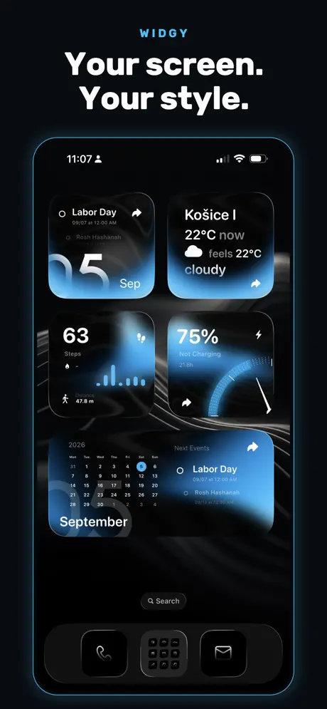{: width="180" .normal }
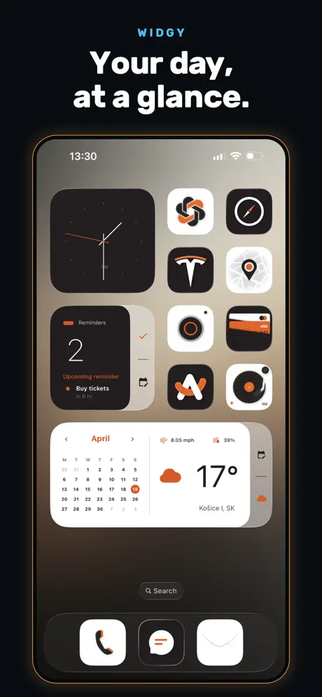{: width="180" .normal }
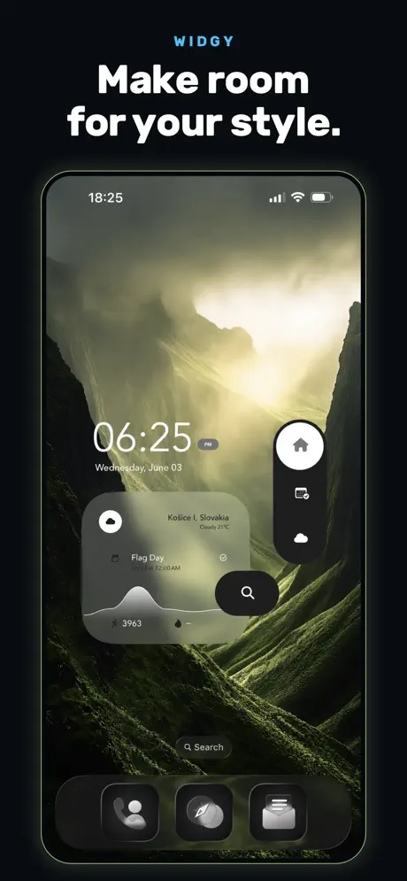{: width="180" .normal }
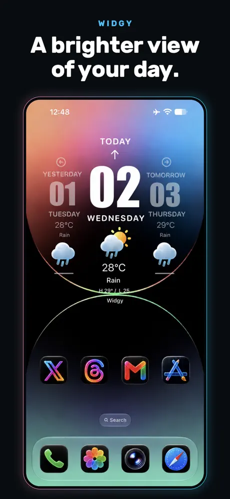{: width="180" .normal }
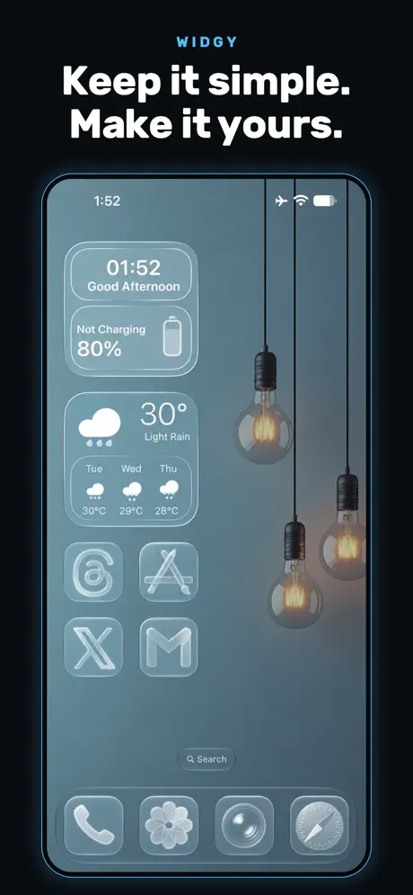{: width="180" .normal }

Widgy adalah setara iOS terdekat dengan KWGT: sebuah **builder visual berbasis layer** (tanpa kode) dengan template dan beragam sumber data — cuaca, Apple Health, kalendar, peringatan, dan lain-lain. Ia menargetkan iPhone, iPad, Apple Watch, Skrin Kunci, dan StandBy, serta mengikuti bahasa reka bentuk iOS baru (mis. Liquid Glass).

**Kelebihan**
- **Builder widget tersuai paling mumpuni di iOS**, dengan layer, sumber data, dan reka bentuk yang boleh diekspor.
- **Tanpa kode diperlukan** — pengeditan visual menurunkan had dibanding formula KWGT.
- **Data mendalam**, termasuk Apple Health, dan dukungan Skrin Kunci, StandBy, serta wajah jam.
- **Diperbarui aktif** untuk setiap rilis iOS baru.

**Kelemahan**
- **Hanya iOS**.
- Tetap ada **lengkung belajar** untuk menguasai layer dan ikatan data.
- **Beberapa slot/ciri widget berada di sebalik IAP** (~$4,99).
- Tunduk pada **had penyegaran widget iOS** — data boleh lambat beberapa minit.

**Terbaik untuk:** pengguna iPhone/iPad yang ingin widget buatan sendiri tetapi lebih suka editor visual daripada kode.

**Muat turun Widgy**
- [App Store](https://apps.apple.com/us/app/widgy-widgets-home-lock-watch/id1524540481)

---

## 4. Color Widgets — terbaik untuk pratetap iOS cepat & estetik

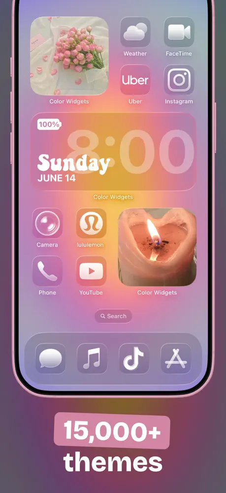{: width="180" .normal }
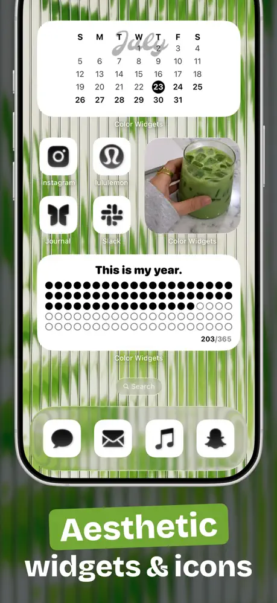{: width="180" .normal }
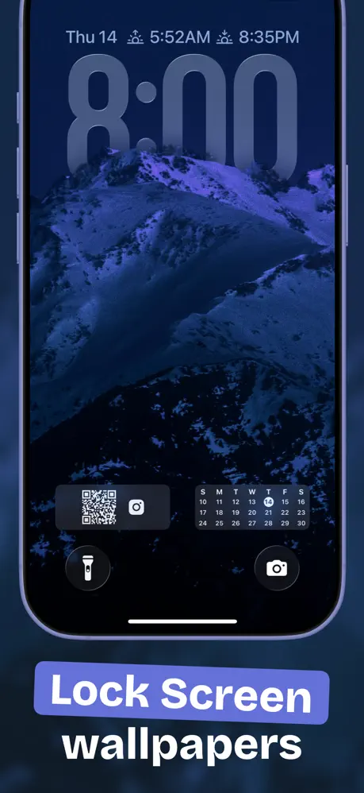{: width="180" .normal }
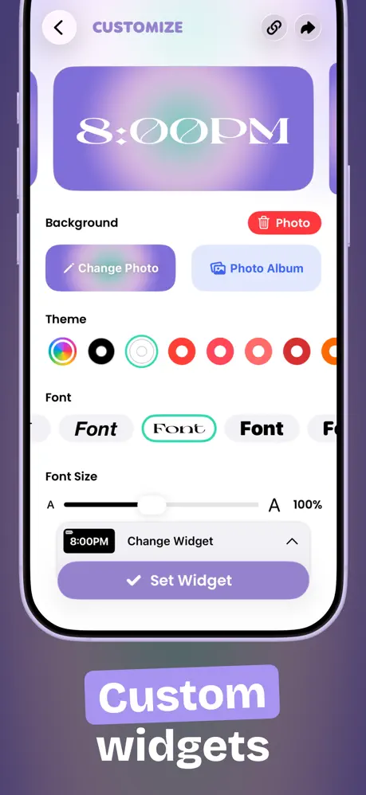{: width="180" .normal }
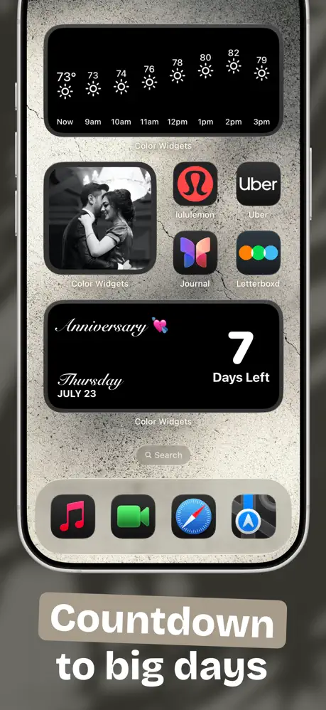{: width="180" .normal }

Color Widgets mengandalkan **ribuan widget yang sudah didesain plus pengustomisasi mudah**, dan memaketkan tema, pakej ikon, dan wallpaper sehingga seluruh Skrin Utama dan Kunci boleh di-skin ulang dalam beberapa ketikan. Ia merangkumi foto, waktu/tarikh, bateri, hitung mundur, cuaca, muzik (Apple/Spotify), kalendar, kutipan, dan widget aktivitas, dengan integrasi Apple Health untuk langkah.

**Kelebihan**
- **Jalan tercepat ke widget cantik** — pilih pratetap atau ubah warna/font, tanpa latar reka bentuk.
- **Tema semua-dalam-satu** (widget + ikon + wallpaper) untuk paparan kohesif.
- **Integrasi kesihatan** dan tipe widget luas.
- Posisi **privasi-pertama** dan dukungan Mac.

**Kelemahan**
- Lebih tentang **estetika daripada data mendalam**; kurang bebas bentuk daripada Widgy.
- Ciri terbaik berada di sebalik **Pro subscription** (~$2,50/bulan, ditagih tahunan).
- Boleh terasa **berat template**; orisinalitas bergantung pustaka bersama.
- Model langganan daripada buka kunci sekali bayar.

**Terbaik untuk:** pengguna iPhone yang ingin widget menarik dan tema serasi dengan cepat.

**Muat turun Color Widgets**
- [App Store](https://apps.apple.com/us/app/color-widgets/id1531594277)

---

## 5. Widgetable — terbaik untuk widget sosial & peliharaan

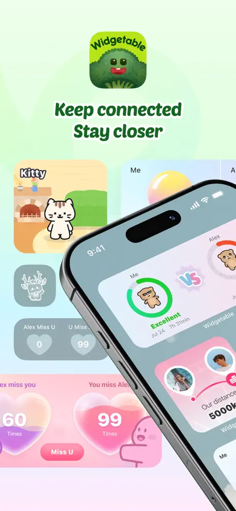{: width="180" .normal }
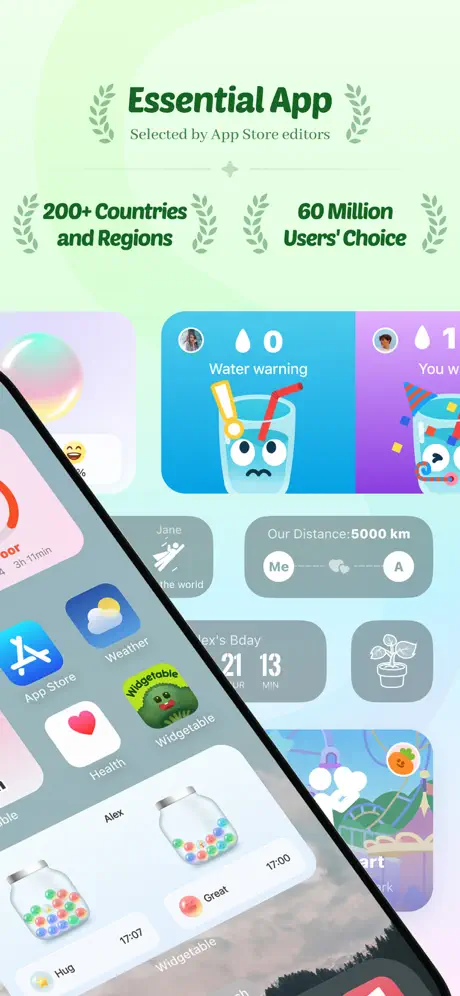{: width="180" .normal }
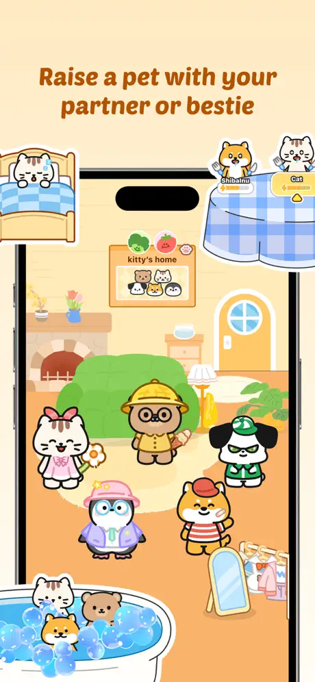{: width="180" .normal }
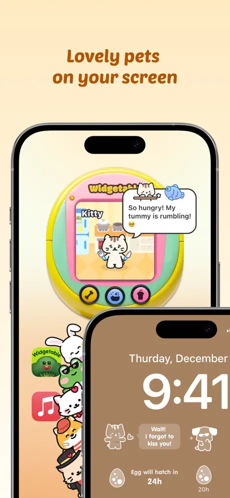{: width="180" .normal }
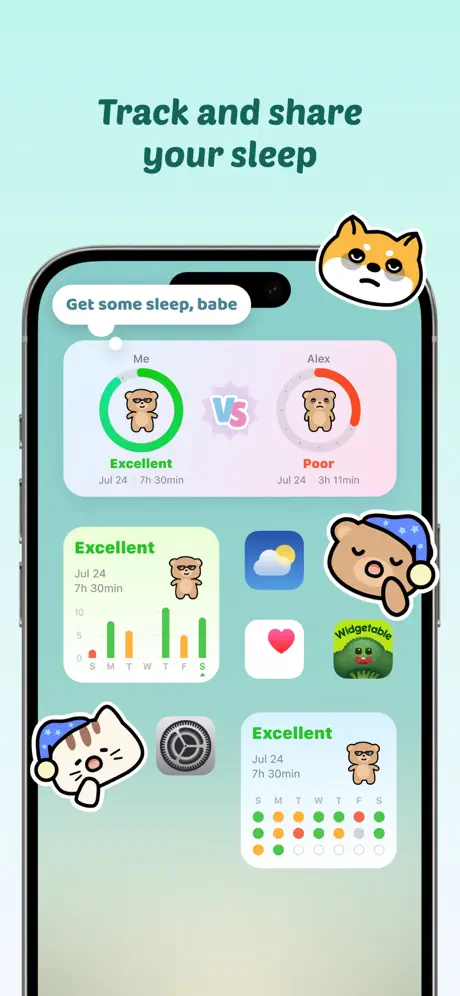{: width="180" .normal }

Widgetable mengambil sudut berbeza: **widget yang dibangun di sekitar relasi**. Anda mengadopsi haiwan peliharaan virtual yang Anda rawat bersama teman, berkongsi widget tidur, mengirim pembaruan mood, dan memaparkan jarak waktu nyata antara Anda dan sahabat — semua di Skrin Kunci atau Utama. Ini popular di kalangan pasangan dan sahabat dekat daripada sebagai toolkit produktivitas umum.

**Kelebihan**
- **Widget sosial/relasi unik** (peliharaan, tidur, mood, jarak, status teman) yang tidak ada di aplikasi widget umum.
- **Konten comel, menyenangkan, dan sering diperbarui**; peringkat sangat tinggi.
- Berfungsi lintas **iOS dan Android** untuk widget bersama dengan teman di platform mana pun.

**Kelemahan**
- **Niche** — bukan toolkit widget umum; sedikit gunanya jika Anda tidak ingin ciri sosial.
- **Ciri teras berada di sebalik langganan**.
- Berkongsi status peribadi (tidur, mood, jarak lokasi) menimbulkan **pertimbangan privasi**.
- Kurang berguna untuk widget produktivitas/data seperti bateri, RAM, atau kalendar.

**Terbaik untuk:** pasangan, sahabat, dan pencinta haiwan peliharaan yang ingin skrin kunci mereka terasa sosial.

**Muat turun Widgetable**
- [App Store](https://apps.apple.com/us/app/widgetable-besties-couples/id1641107226)

---

## 6. WidgetClub — terbaik untuk widget comel bertema

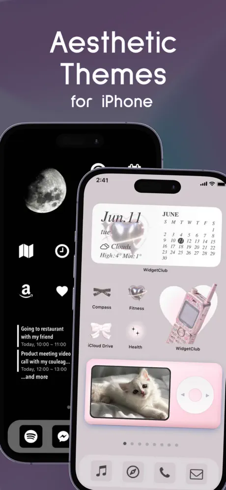{: width="180" .normal }
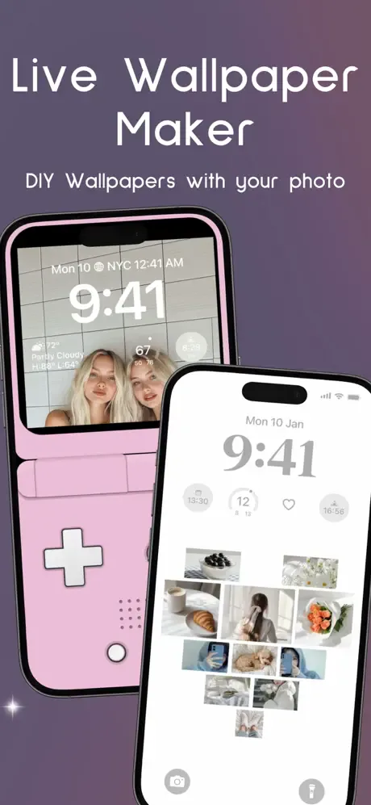{: width="180" .normal }
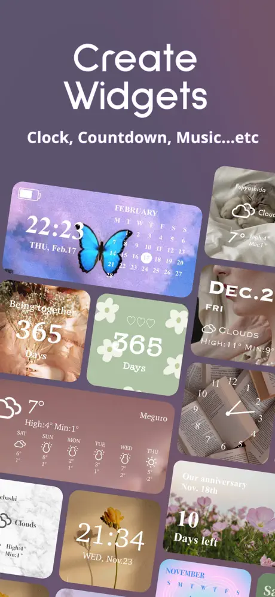{: width="180" .normal }
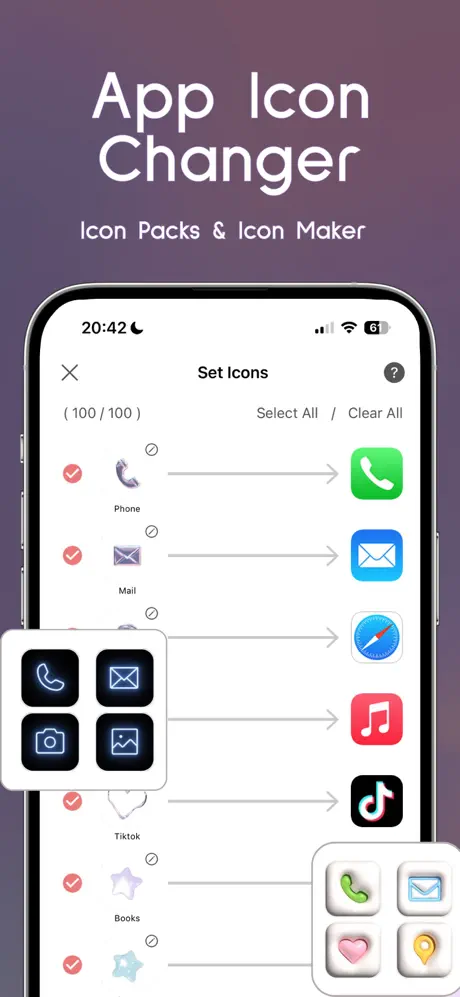{: width="180" .normal }
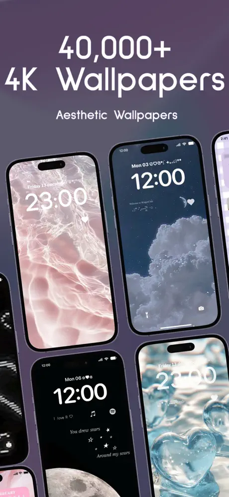{: width="180" .normal }

WidgetClub adalah aplikasi widget, wallpaper, dan ikon estetik dengan katalog besar (puluhan ribu tema) merangkumi cuaca, foto, kalendar, jam, hitung mundur, bateri, dan widget peringatan. Sebuah maker sederhana membiarkan Anda menaruh foto dan warna; ia berjalan di **iOS dan Android**.

**Kelebihan**
- **Sangat mudah** membuat widget estetik comel dan kohesif.
- **Pustaka tema besar** dan jangkauan merentas platform (iOS + Android).
- Baik untuk **widget foto dan peringatan** dengan upaya minimum.

**Kelemahan**
- **Estetika di atas kedalaman**; bukan editor dari nol seperti Widgy/KWGT.
- Pustaka lengkap membutuhkan **langganan**.
- **Dukungan Android kurang matang** daripada iOS.
- Widget bateri/peringatan dasar dibanding alat khusus.

**Terbaik untuk:** pengguna yang memprioritaskan skrin utama cantik bertema daripada pelarasan mendalam.

**Muat turun WidgetClub**
- [App Store](https://apps.apple.com/us/app/widgetclub-widget-theme-icon/id1580284904)

---

## Perbandingan keupayaan teras

Jadual di bawah menunjukkan, sedapat mungkin secara objektif, keupayaan apa yang didukung setiap aplikasi. "Sebahagian" berarti ciri ada tetapi terhad (mis. hanya pratetap, atau di sebalik paywall).

| Keupayaan | One Widget | KWGT | Widgy | Color Widgets | Widgetable | WidgetClub |
|---|---|---|---|---|---|---|
| **Platform** | Android | Android | iOS | iOS | iOS (+Android) | iOS + Android |
| **Pratetap jadi** | **Kuat (500+)** | Sebahagian (komunitas) | Ya (template) | **Kuat** | Ya (sosial) | **Kuat (tema)** |
| **Editor dari nol** | Tidak (berbasis pratetap) | **Ya (powerful)** | **Ya (visual)** | Sebahagian (pengustomisasi) | Tidak | Sebahagian (maker sederhana) |
| **Sistem gaya (One UI / Material You / Glass / Nothing)** | **4 bawaan** | Penuh (Anda tentukan) | Penuh (Anda tentukan) | Tema estetik | Hanya comel | Comel / tema |
| **Data sistem terus (bateri / RAM / storage)** | **Ya (bateri/RAM/storage)** | Ya (via formula) | Ya (bateri, dll.) | Ya (bateri) | Terhad (sosial) | Ya (bateri) |
| **Cuaca** | Ya | Ya | Ya | Ya | Tidak | Ya |
| **Kesihatan / aktivitas** | Sebahagian | **Ya (Health Connect)** | **Ya (Apple Health)** | Ya (langkah) | Tidur (sosial) | Sebahagian |
| **Widget foto** | Ya | Ya | Ya | **Ya (kuat)** | Terhad | Ya |
| **Kalendar / tarikh** | Ya | Ya | Ya | Ya | Terhad | Ya |
| **Interaktif (toggle / shortcut)** | **Ya (toggle, shortcut)** | Terhad (aksi ketik) | Terhad (ketik untuk buka) | Ketik untuk buka | Ketik untuk buka | Ketik untuk buka |
| **Dukungan skrin kunci** | Android 12+ | Widget kunci Android | Kunci iOS + StandBy | Kunci iOS | Kunci iOS | Kunci iOS |
| **Tingkat percuma** | Set One UI percuma (+buka kunci) | Percuma + Pro key | Percuma + IAP | Percuma + Pro sub | Percuma + sub | Percuma + sub |
| **Momentum pembaruan** | **Aktif menambah komponen** | Dipelihara aktif | Aktif (iOS baru) | Aktif | Aktif | Aktif |

---

## Alternatif WidgetSmith mana yang sesuai untuk setiap jenis pengguna

Jadual memeringkat ciri; di sini keenam aplikasi dikelompokkan menurut *apa yang ingin Anda taruh di skrin utama*.

- **Pratetap jadi di Android** — daftar pendek **alternatif KWGT** atau **alternatif KWGT terbaik Android** dimulai dari One Widget: 500+ widget jadi dalam gaya One UI, Nothing, Glass, dan Material You, ditaruh tanpa editor.
- **Widget yang Anda gambar sendiri** — **alternatif Tersuai Widget Maker** tetap berarti layer, formula, dan waktu tetapan. KWGT tetap acuannya; Widgy adalah setara iOS.
- **Jam, kalendar, dan berita dulu** — **alternatif Chronus** tentang tipografi dan kepadatan maklumat, bukan pakej tema.
- **Pustaka pratetap besar tanpa scripting** — **alternatif Widgetopia** atau **alternatif Zooper Widget** menunjuk ke aplikasi bergaya katalog; Color Widgets dan WidgetClub adalah versi bercita rasa iOS dari ide itu.
- **Widget comel atau sosial** — Widgetable dan WidgetClub merangkumi peliharaan, pasangan, dan tema, dengan perbelanjaan langganan untuk sebahagian besar pustaka.

Sebelum beralih, periksa dua hal yang tidak berubah mengikuti trend: apakah tingkat percuma membiarkan Anda menaruh dan mengubah ukuran widget, dan apakah widget masih memaparkan data terus setelah pembaruan peluncur?

## Cara memilih

- Ingin **Android + pustaka jadi raksasa dalam empat estetika telefon pintar** → **One Widget**.
- Ingin **merancang widget dari nol di Android** → **KWGT**.
- Ingin **widget iOS tersuai mendalam tanpa kode** → **Widgy**.
- Ingin **widget iOS cantik dan tema serasi cepat** → **Color Widgets**.
- Ingin **widget sosial/peliharaan dengan teman atau pasangan** → **Widgetable**.
- Ingin **widget comel bertema lintas iOS dan Android** → **WidgetClub**.

## FAQ

**Apakah One Widget alternatif WidgetSmith yang baik di Android?**
{:.faq-q}

Ya. Jika Anda menginginkan pustaka widget Android jadi besar merangkumi paparan One UI, Material You, Glass, dan Nothing — tanpa alat reka bentuk — One Widget adalah jawaban Android-asli terdekat dengan filosofi pratetap WidgetSmith.

**Apakah One Widget bekerja di iOS?**
{:.faq-q}

Tidak. One Widget hanya Android. Untuk iOS, Widgy atau Color Widgets (dalam panduan ini) adalah pilihan bergaya WidgetSmith.

**Alternatif WidgetSmith mana yang terbaik untuk pembangunan tersuai?**
{:.faq-q}

KWGT — editor Android dari-nol paling powerful. One Widget tetap berbasis pratetap, jadi pilih KWGT jika Anda ingin kendali penuh.

**Apakah One Widget percuma?**
{:.faq-q}

Set gaya One UI percuma; tiga gaya lain dibuka dengan pembelian sekali bayar (tanpa langganan).

[Halaman aplikasi One Widget](/ms/apps/one-widget/) — tersedia di Android.

## Istilah berkaitan

- [Apakah Itu Widget Skrin Utama?](/ms/glossary/what-is-a-home-screen-widget/)
- [Apakah Itu Material You?](/ms/glossary/what-is-material-you/)
- [Apakah Itu Nothing UI?](/ms/glossary/what-is-nothing-ui/)
- [Apakah Itu Galaxy One UI?](/ms/glossary/what-is-galaxy-one-ui/)
- [Apakah Itu iOS Glass?](/ms/glossary/what-is-ios-glass/)
