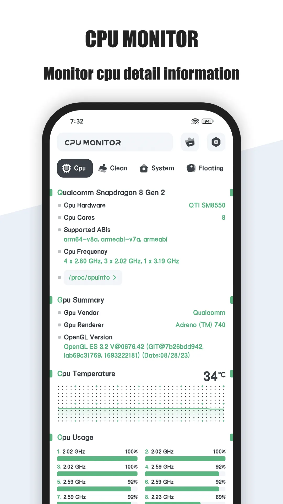
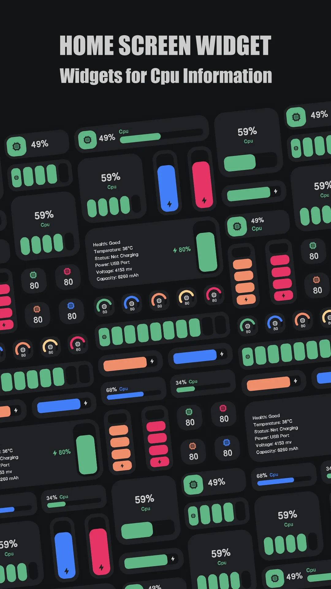

Panas bukan cuma tentang CPU — bateri, GPU, dan sensor lingkungan semua berkontribusi, dan bateri panas menua lebih cepat. Sebuah **[aplikasi suhu telefon pintar](/ms/glossary/what-is-a-cpu-temperature-monitor/)** harus membaca seluruh peranti, memperingatkan Anda, dan menyarankan perbaikan. **CPU Monitor** adalah **monitor suhu peranti untuk Android** lengkap dengan penggera dan syor. Di bawah ini kami membandingkannya dengan **CPU-Z** untuk mengurus panas peranti secara keseluruhan. Pembaca yang mencari **monitor suhu bateri** atau **aplikasi pendingin telefon pintar dengan suhu** sebenarnya menanyakan pertanyaan seluruh-perangkat yang sama.

## Apa yang dibutuhkan aplikasi suhu telefon pintar

Sebuah aplikasi suhu telefon pintar yang baik perlu membaca seluruh peranti, bukan sekadar CPU — bateri, GPU, dan sensor lingkungan semuanya menyumbang haba, dan bateri panas menua lebih cepat. CPU Monitor adalah monitor suhu peranti untuk Android dengan penggera overheat dan syor yang boleh ditindak, sementara CPU-Z menawarkan inventaris hardware lebih dalam tanpa penggera. Perbandingan di bawah menilai kedua-dua aplikasi ini bersama DevCheck pada empat keperluan asas: banyak sumber haba, amaran overheat, syor jelas, dan pemantauan ringan yang tidak menambah haba. Pembaca yang mencari monitor suhu bateri atau aplikasi pendingin dengan bacaan suhu sebenarnya menanyakan soalan seluruh peranti yang sama, jadi senarai ini memetakan terus keperluan itu kepada ciri yang boleh disemak.

- **Banyak sumber panas** — CPU plus bateri dan bacaan sensor.
- **Penggera overheat** — dorongan untuk meletakkan telefon pintar.
- **Syor jelas** — "tutup game, cabut, dinginkan."
- **Pemantauan ringan** — aplikasi sendiri tidak menambah panas.

## Apa yang harus dicakup pemantauan seluruh peranti

Empat detail membezakan pemantauan seluruh peranti daripada aplikasi satu angka, kerana suhu CPU sahaja terlewat keluhan panas yang paling biasa — bateri yang menjadi panas semasa mengecas. Monitor suhu bateri adalah bacaan berbeza daripada CPU dan merupakan angka yang penting untuk keausan jangka panjang. Susun atur widget CPU, RAM, dan bateri Android meletakkan suhu, memori, dan pengisian bersama supaya anda tidak perlu membuka aplikasi semasa gaming. Bacaan terapung kekal di atas game tanpa meninggalkannya, dan syor jujur hanya boleh mencadangkan menutup game atau mencabut charger — tiada monitor boleh menurunkan suhu dengan membunuh proses. CPU Monitor merangkumi sensor, widget, dan tetingkap terapung sebagai paparan read-only, manakala CPU-Z memberi inventaris lebih dalam tanpa penggera.

- **Monitor suhu bateri** — sensor bateri adalah bacaan berbeza dari CPU, dan itulah angka yang penting untuk keausan jangka panjang.
- **Sekilas di skrin utama** — tata letak **widget cpu ram bateri android** menaruh suhu, memori, dan pengisian bersama sehingga Anda tidak perlu membuka aplikasi saat gaming.
- **Bacaan terapung** — **cpu monitor dengan tetingkap terapung** (atau **cpu monitor dengan tetingkap terapung android**, seperti sering dicari) tetap di atas game tanpa meninggalkannya.
- **Syor jujur** — **aplikasi pendingin telefon pintar dengan suhu** boleh menyarankan menutup game atau mencabut charger; ia tidak boleh menurunkan suhu dengan membunuh proses, dan tidak ada monitor yang boleh mengklaim sebaliknya.

CPU Monitor merangkumi sensor, widget, dan tetingkap terapung sebagai paparan read-only. CPU-Z memberi inventaris hardware lebih dalam, tetapi tanpa penggera overheat.

## Para pesaing sekilas

Tiga pesaing dalam perbandingan ini — CPU Monitor, CPU-Z, dan DevCheck — mewakili tiga pendekatan berbeza terhadap haba peranti. CPU Monitor menggabungkan bacaan CPU dan bateri dengan penggera overheat serta syor penyejukan pada teras percuma dengan VIP pilihan. CPU-Z pula percuma dan mendalam pada spesifikasi serta suhu semasa, tetapi tanpa penggera atau syor. DevCheck menambah maklumat bateri dan peranti secara langsung pada tahap percuma dengan pembelian dalam aplikasi, namun kekal tanpa amaran proaktif. Jadual di bawah membedah perbezaan itu mengikut harga, sumber haba, penggera, syor, dan kegunaan utama. Ringkasan ini membantu anda memilih berdasarkan sama ada matlamat anda ialah merawat haba, membaca spesifikasi, atau sekadar menyemak angka.

| App | Harga (2026) | Sumber panas | Penggera | Syor | Terbaik untuk |
|---|---|---|---|---|---|
| **CPU Monitor** | Teras percuma + VIP | CPU + bateri/sensor | ✅ | ✅ | Perawatan panas peranti |
| **CPU-Z** | Percuma | CPU + sensor | ❌ | ❌ | Spesifikasi & suhu saat ini |
| **DevCheck** | Percuma + IAP | CPU + bateri | ❌ | ❌ | Info detail |

## CPU Monitor, lebih dalam

CPU Monitor adalah monitor suhu peranti untuk Android yang merangkumi haba CPU, bateri, dan sensor dengan penggera serta syor yang boleh ditindak. Terasnya menyediakan banyak sumber haba dalam satu paparan, amaran sebelum bateri rosak, cadangan langkah penyejukan, dan perbelanjaan latar yang rendah. Keterbatasannya jujur: log lebih dalam memerlukan VIP, dan kelengkapan bacaan bergantung pada sensor yang didedahkan peranti. Aplikasi ini paling sesuai untuk pengguna yang mahu melindungi keseluruhan telefon pintar daripada haba, bukan sekadar membaca satu angka. Gambar di bawah menunjukkan bacaan suhu bateri, tetapan amaran haba, info sensor, ringkasan hardware, dan butiran frekuensi core yang menjadi asas penilaian ini.

{: width="180" .normal }
{: width="180" .normal }
{: width="180" .normal }
{: width="180" .normal }
{: width="180" .normal }

CPU Monitor adalah **monitor suhu peranti** untuk Android yang merangkumi panas CPU, bateri, dan sensor, lengkap dengan penggera dan syor.

**Kelebihan untuk panas peranti**
- **Banyak sumber** — awasi suhu CPU dan bateri bersama.
- **Penggera overheat** — diperingatkan sebelum bateri rusak.
- **Syor boleh ditindak** — aplikasi menyarankan langkah pendinginan, bukan sekadar angka.
- **Ringan** — perbelanjaan latar rendah.

**Kelemahan untuk panas peranti**
- **VIP untuk log lebih dalam** — sejarah panjang di sebalik upgrade.
- **Ketergantungan sensor** — kelengkapan bervariasi per peranti.

**Terbaik untuk:** orang yang ingin melindungi seluruh telefon pintar dari panas, bukan sekadar membaca satu angka.

- [Google Play — CPU Monitor](https://play.google.com/store/apps/details?id=com.glgjing.stark)

## CPU-Z, lebih dalam

CPU-Z (pakej com.cpuid.cpu_z) melaporkan butiran hardware termasuk suhu semasa daripada sensor yang tersedia, dengan reputasi CPUID yang dipercayai untuk spesifikasi tepat. Kelebihannya ialah data SoC, bateri, dan sensor yang percuma serta terperinci dalam satu skrin. Kekurangannya untuk pengurusan haba jelas: tiada penggera, tiada syor, dan sensor mudah alih lebih terhad berbanding versi PC. CPU-Z sesuai untuk pengguna yang mahukan cuplikan percuma spesifikasi dan suhu semasa, bukan amaran awal. Gambar di bawah menunjukkan paparan monitor suhu dan frekuensi, butiran core, info sensor dan bateri, ringkasan hardware, serta tetapan amaran haba yang menjadi rujukan perbandingan ini.

{: width="180" .normal }
{: width="180" .normal }
{: width="180" .normal }
{: width="180" .normal }
{: width="180" .normal }

CPU-Z (pakej `com.cpuid.cpu_z`) melaporkan detail hardware termasuk suhu saat ini dari sensor yang tersedia.

**Kelebihan untuk panas peranti**
- **Percuma dan detail** — data SoC, bateri, dan sensor dalam satu skrin.
- **Akurasi terpercaya** — pelaporan spesifikasi CPUID solid.

**Kelemahan untuk panas peranti**
- **Tanpa penggera** — ia memaparkan suhu, tetapi tidak memperingatkan.
- **Tanpa syor** — angka mentah, tanpa "apa yang harus dilakukan."
- **Sensor seluler terhad** — build Android lebih ringan dari alat PC.

**Terbaik untuk:** pengguna yang ingin cuplikan percuma spesifikasi dan suhu saat ini.

- [Google Play — CPU-Z](https://play.google.com/store/apps/details?id=com.cpuid.cpu_z)

## Bagaimana yang lain membandingkan

DevCheck adalah satu-satunya pesaing tambahan yang disenaraikan di sini, menambah maklumat bateri dan peranti secara langsung dengan harga percuma dan pembelian dalam aplikasi. Ia kukuh untuk bacaan segera, tetapi tetap tidak mempunyai penggera proaktif seperti CPU Monitor. Bagi pembaca yang membandingkan tiga pilihan utama, perbezaan itu penting: CPU Monitor bertindak sebelum haba menjadi masalah, CPU-Z dan DevCheck hanya melaporkan keadaan semasa. Senarai pendek ini sengaja mengehadkan skop kepada aplikasi yang benar-benar boleh dipasang di Android tanpa root, supaya cadangan akhir kekal praktikal dan mudah diuji. Pilihan ini juga mengelakkan keperluan root yang sering menjadi halangan pada peranti Android biasa.

- **DevCheck** menambah bateri dan info peranti terus secara percuma; solid, tetapi tetap tanpa penggera proaktif.

## Mana yang harus dipilih?

Keputusan antara CPU Monitor dan CPU-Z bergantung pada satu soalan: adakah anda mahu pengurusan haba seluruh peranti dengan amaran, atau spesifikasi percuma dan bacaan suhu semasa? CPU Monitor adalah jawapan untuk haba seluruh peranti, penggera overheat, dan syor penyejukan, manakala CPU-Z memuaskan pembaca yang hanya mahu melihat spesifikasi dan angka semasa tanpa kos. Dua cadangan ini meringkaskan jadual perbandingan di atas menjadi pilihan yang terus boleh diambil. Jika matlamat anda ialah melindungi bateri daripada penuaan akibat haba berulang, pilih monitor dengan penggera; jika matlamatnya sekadar mengetahui spesifikasi peranti, aplikasi percuma itu sudah memadai.

- Ingin **panas seluruh peranti + penggera + syor** → **CPU Monitor**.
- Ingin **spesifikasi percuma dan suhu saat ini** → **CPU-Z**.

[Dapatkan CPU Monitor](/ms/apps/cpu-monitor/) — tersedia di Android.

## Senario khas

Empat senario khas menunjukkan nilai monitor haba seluruh peranti dalam penggunaan sebenar. Lindungi bateri daripada haba dengan mengawasi suhu dan menerima amaran sebelum penuaan akibat overheat berulang. Gunakan syor penyejukan di tempat apabila suhu naik — aplikasi mencadangkan menutup game atau mencabut charger, bukan sekadar memaparkan angka. Paparan seluruh peranti mengumpulkan suhu CPU, bateri, dan sensor di satu tempat tanpa memasang tiga aplikasi berbeza. Akhir sekali, pantau pengisian dengan membiarkan widget kelihatan supaya bateri panas dikesan lebih awal. Setiap senario bergantung pada bacaan sensor yang sama, jadi memilih aplikasi dengan penggera dan syor menentukan sama ada anda hanya melihat haba atau benar-benar mengurusnya.

- **Lindungi bateri dari panas** — CPU Monitor mengawasi suhu bateri dan memperingatkan sebelum menua akibat overheat berulang.
- **Syor pendinginan di tempat** — saat suhu naik, ia menyarankan menutup game atau mencabut, bukan sekadar angka.
- **Paparan seluruh peranti** — suhu CPU, bateri, dan sensor di satu tempat dan bukannya tiga aplikasi.
- **Pantau pengisian** — biarkan widget kelihatan saat mengecas supaya Anda menangkap bateri panas sejak awal.

## FAQ

**Apakah CPU Monitor percuma?**
{:.faq-q}

Ya. Pemantauan suhu peranti teras, penggera overheat, dan syor percuma; VIP membuka sejarah dan pilihan lebih dalam.

**CPU Monitor atau CPU-Z — mana yang harus saya pilih?**
{:.faq-q}

Ingin panas seluruh peranti, penggera, dan syor pendinginan → CPU Monitor; ingin spesifikasi percuma dan cuplikan suhu saat ini → CPU-Z.

**Apakah CPU Monitor juga memantau suhu bateri?**
{:.faq-q}

Ya. Ia membaca suhu CPU dan bateri (plus sensor bila tersedia) dan memperingatkan sebelum bateri rusak akibat panas.

[Dapatkan CPU Monitor](/ms/apps/cpu-monitor/) — tersedia di Android.

## Istilah berkaitan

- [Apakah Itu Monitor Suhu CPU?](/ms/glossary/what-is-a-cpu-temperature-monitor/)
- [Apakah Itu System Monitor?](/ms/glossary/what-is-a-system-monitor/)
