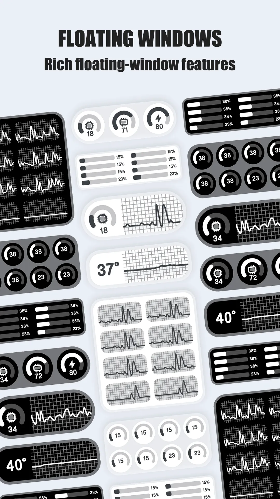
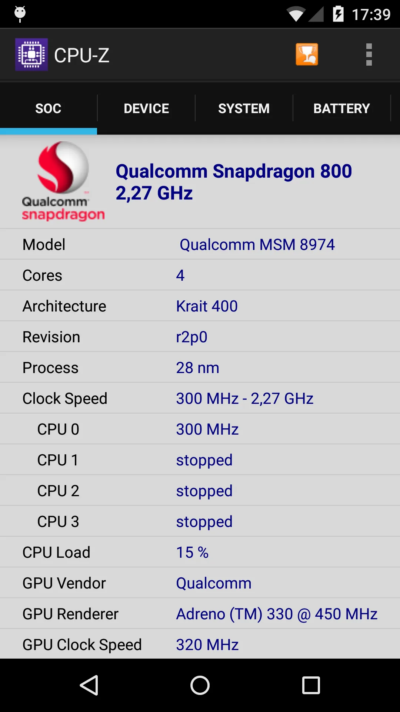

Saat telefon pintar panas, ia melambat — thermal throttling aktif dan frame drop. Sebuah **[monitor suhu CPU](/ms/glossary/what-is-a-cpu-temperature-monitor/)** membiarkan Anda melihat panas sebelum memakan prestasi. **CPU Monitor** adalah **aplikasi suhu CPU untuk Android** dengan suhu waktu nyata, beban per-core, dan penggera overheat. Di bawah ini kami membandingkannya dengan **CPU-Z**, alat info hardware klasik, untuk mendeteksi panas sejak awal. Inilah daftar pendek yang dimaksud dengan **aplikasi monitor suhu CPU terbaik android** dan **aplikasi penggera overheat CPU**.

## Apa yang dibutuhkan monitor suhu CPU

Monitor suhu CPU yang berguna perlu menunjukkan angka yang boleh dipercayai sebelum throttling merosakkan prestasi, bukan sekadar memaparkan spesifikasi. CPU Monitor adalah aplikasi suhu CPU untuk Android dengan suhu waktu nyata, beban setiap core, dan penggera overheat, sementara CPU-Z kekal sebagai alat info hardware klasik. Perbandingan ini menilai lima keperluan — suhu langsung, frekuensi dan beban per-core, penggera, penggunaan latar ringan, serta sejarah lengkung — supaya anda dapat mengesan haba lebih awal. Daftar pendek ini juga dikenali sebagai aplikasi monitor suhu CPU terbaik Android dan aplikasi penggera overheat CPU. Semak sama ada bacaan benar-benar datang daripada sensor thermal peranti, kerana tebakan daripada beban CPU tidak berguna semasa mengecas.

- **Suhu waktu nyata** — suhu CPU saat ini sekilas.
- **Frekuensi dan beban per-core** — lihat core mana yang paling bekerja.
- **Penggera overheat** — amaran sebelum throttling menyerang.
- **Penggunaan latar ringan** — pemantauan sebaiknya tidak memanaskan telefon pintar.
- **Sejarah** — lengkung yang menunjukkan kapan ia melonjak.

## Bagaimana kami memilih aplikasi monitor suhu CPU terbaik

Empat cek menentukan sama ada bacaan suhu benar-benar boleh dipercayai dan cukup murah untuk dibiarkan terbuka sepanjang sesi. Pertama, angka perlu datang daripada sensor thermal peranti, bukan dianggarkan daripada beban CPU — bacaan yang tidak pernah bergerak semasa mengecas adalah tebakan. Kedua, frekuensi setiap core dan monitor sejarah frekuensi membolehkan anda melihat lonjakan yang mendahului throttling. Ketiga, aplikasi penggera overheat CPU perlu membenarkan ambang ditetapkan dan memberi notifikasi lebih awal, bukan sekadar memaparkan angka merah setelahnya. Keempat, monitor CPU multicore Android yang polling terlalu agresif sebenarnya memanaskan telefon yang diukurnya; CPU Monitor membaca sensor tanpa root dan tidak mengubah tetapan sistem. CPU Monitor menang pada cek satu hingga tiga, sementara CPU-Z lebih kuat untuk inventaris hardware.

1. **Dari mana angka berasal** — sebuah aplikasi **monitor suhu CPU android** harus membaca sensor thermal peranti, bukan memperkirakan panas dari beban CPU. Jika angka tidak pernah bergerak saat mengecas, itu tebakan.
2. **Semua core, plus lengkung** — **monitor suhu dan frekuensi CPU android** berarti frekuensi per-core dan **monitor sejarah frekuensi CPU**, sehingga Anda boleh melihat lonjakan mana yang mendahului throttling.
3. **Amaran yang boleh ditindak** — sebuah **aplikasi penggera overheat CPU** harus membiarkan Anda menetapkan ambang dan memberi notifikasi sebelum telefon pintar throttling, dan bukannya hanya memaparkan angka merah setelahnya.
4. **Tetap ringan dan read-only** — sebuah **monitor CPU multicore android** yang polling terlalu agresif justru memanaskan telefon pintar yang diukurnya. CPU Monitor membaca sensor tanpa root dan tidak mengubah tetapan sistem.

CPU Monitor menang di cek 1–3 dengan bacaan waktu nyata, sejarah, dan penggera; CPU-Z lebih kuat bila Anda terutama ingin inventaris hardware.

## Para pesaing sekilas

Empat pesaing dalam jadual ini — CPU Monitor, CPU-Z, DevCheck, dan AIDA64 — meliputi dua falsafah yang berbeza: amaran awal berbanding pelaporan hardware. CPU Monitor menggabungkan suhu terus, beban setiap core, dan penggera pada teras percuma dengan VIP untuk sejarah. CPU-Z dan AIDA64 kukuh pada spesifikasi tetapi tiada penggera, manakala DevCheck berada di tengah dengan info terus dan pembelian dalam aplikasi. Jadual di bawah membedah harga, suhu terus, beban per-core, penggera, dan kegunaan utama supaya anda boleh menapis sebelum membaca ulasan. Ringkasan ini penting kerana sesi gaming atau pengecasan yang panas hanya memberi amaran jika aplikasi direka untuk bertindak, bukan sekadar memaparkan data.

| App | Harga (2026) | Suhu terus | Per-core | Penggera | Terbaik untuk |
|---|---|---|---|---|---|
| **CPU Monitor** | Teras percuma + VIP | ✅ | ✅ | ✅ | Amaran dini panas |
| **CPU-Z** | Percuma | ✅ (sensor) | ✅ | ❌ | Spesifikasi hardware |
| **DevCheck** | Percuma + IAP | ✅ | ✅ | ❌ | Info detail |
| **AIDA64** | Percuma | ✅ | ✅ | ❌ | Spesifikasi mendalam |

## CPU Monitor, lebih dalam

CPU Monitor adalah monitor suhu dan beban CPU untuk Android yang menyediakan suhu terus, frekuensi setiap core, dan beban pada teras percuma, dengan VIP untuk sejarah dan pilihan lebih dalam. Kelebihannya merangkumi angka yang boleh diawasi semasa gaming atau mengecas, pengenalpastian core yang menempel pada 100%, penggera sebelum throttling, perbelanjaan latar minimum, dan lengkung sejarah. Keterbatasannya ialah log jangka panjang memerlukan upgrade dan ketepatan bergantung pada sensor peranti. Aplikasi ini sesuai untuk pengguna yang mahu menangkap overheat sejak awal. Gambar di bawah menunjukkan bacaan thermal langsung, tetapan amaran haba, info sensor, ringkasan hardware, dan butiran frekuensi core.

{: width="180" .normal }
{: width="180" .normal }
{: width="180" .normal }
{: width="180" .normal }
{: width="180" .normal }

CPU Monitor adalah **monitor suhu dan beban CPU** untuk Android. Teras — suhu terus, frekuensi per-core, dan beban — percuma; VIP menambah sejarah dan pilihan lebih dalam.

**Kelebihan untuk mengawasi panas**
- **Suhu CPU terus** — angka jelas yang boleh diawasi saat gaming atau mengecas.
- **Frekuensi dan beban per-core** — temukan core yang menempel di 100%.
- **Penggera overheat** — diperingatkan sebelum throttling menurunkan prestasi.
- **Ringan** — perbelanjaan latar minimum, jadi pemantauan tidak menambah panas.
- **Lengkung sejarah** — lihat kapan suhu melonjak selama sesi.

**Kelemahan untuk mengawasi panas**
- **VIP untuk sejarah lebih dalam** — log jangka panjang di sebalik upgrade.
- **Akurasi sensor bervariasi** — bacaan bergantung pada yang diekspos peranti.

**Terbaik untuk:** orang yang ingin menangkap overheat sejak awal, bukan sekadar membaca spesifikasi.

- [Google Play — CPU Monitor](https://play.google.com/store/apps/details?id=com.glgjing.stark)

## CPU-Z, lebih dalam

CPU-Z (pakej com.cpuid.cpu_z) adalah port Android bagi alat CPUID terkenal yang memberi tumpuan kepada pelaporan hardware terperinci — nama SoC, arkitektur, frekuensi setiap core, sistem, bateri, dan sensor. Harganya percuma tanpa langganan dengan reputasi spesifikasi yang tepat. Namun ia hanya aplikasi info: suhu dipaparkan tanpa penggera atau syor, tiada lengkung trend, dan build mudah alih mendedahkan lebih sedikit sensor berbanding versi PC. CPU-Z sesuai untuk pembaca yang mahukan angka spesifikasi yang tepat, bukan amaran panas. Gambar di bawah menunjukkan monitor suhu dan frekuensi, butiran core, info sensor dan bateri, ringkasan hardware, serta tetapan amaran haba yang menjadi rujukan perbandingan.

{: width="180" .normal }
{: width="180" .normal }
{: width="180" .normal }
{: width="180" .normal }
{: width="180" .normal }

CPU-Z (pakej `com.cpuid.cpu_z`) adalah port Android dari alat CPUID terkenal, berfokus pada pelaporan detail hardware.

**Kelebihan untuk mengawasi panas**
- **Bacaan hardware mendalam** — nama SoC, arsitektur, frekuensi per-core, sistem, bateri, dan sensor.
- **Percuma** — tanpa perbelanjaan, tanpa langganan.
- **Sumber terpercaya** — reputasi CPUID untuk spesifikasi tepat.

**Kelemahan untuk mengawasi panas**
- **Hanya info** — ia memaparkan suhu tetapi tidak memberi penggera atau syor.
- **Tanpa lengkung trend** — cuplikan, bukan sejarah.
- **Sensor Android terhad** — build seluler mengekspos lebih sedikit dari versi PC.

**Terbaik untuk:** pengguna yang ingin membaca spesifikasi hardware dan suhu saat ini yang tepat.

- [Google Play — CPU-Z](https://play.google.com/store/apps/details?id=com.cpuid.cpu_z)

## Bagaimana yang lain membandingkan

Dua pesaing tambahan melengkapkan senarai ini. DevCheck memaparkan info peranti kaya dengan paparan langsung, percuma dengan pembelian dalam aplikasi, tetapi tanpa penggera overheat. AIDA64 adalah pembaca spesifikasi paling mendalam — hebat untuk butiran, bukan untuk amaran haba. Kedua-duanya mengesahkan pola yang sama: semakin dalam laporan hardware, semakin lemah tindakan proaktif terhadap panas. Bagi pembaca yang memilih antara empat aplikasi ini, perbezaan itu menentukan sama ada telefon anda memberi amaran sebelum throttling atau hanya merekodkannya selepas berlaku. Senarai ini sengaja mengehadkan skop kepada aplikasi Android yang boleh dipasang tanpa root, supaya amaran haba boleh diaktifkan pada telefon biasa tanpa mengubah sistem. Itu menjadikan perbandingan ini terus boleh dicuba oleh pembaca yang mahukan tindakan sebelum peranti mula throttling.

- **DevCheck** memaparkan info peranti kaya dengan paparan terus; percuma dengan IAP, tetapi tanpa penggera overheat.
- **AIDA64** adalah pembaca spesifikasi paling mendalam; hebat untuk detail, bukan untuk amaran panas.

## Mana yang harus dipilih?

Pilihan antara CPU Monitor dan CPU-Z bergantung pada satu keutamaan: amaran dini haba atau spesifikasi hardware yang mendalam. CPU Monitor menyediakan suhu terus, beban setiap core, dan penggera overheat, manakala CPU-Z menawarkan spesifikasi hardware percuma dan terperinci tanpa penggera. Dua cadangan ini meringkaskan jadual di atas menjadi keputusan yang boleh dibuat serta-merta. Jika anda gaming atau mengecas dengan kuat dan mahu diperingatkan sebelum prestasi merosot, monitor dengan penggera adalah keperluan; jika anda hanya mahu mengetahui nama SoC dan bacaan sensor yang tepat, aplikasi percuma itu mencukupi. Kedua-duanya tersedia di Android.

- Ingin **suhu terus + beban per-core + penggera overheat** → **CPU Monitor**.
- Ingin **spesifikasi hardware percuma dan detail** → **CPU-Z**.

## Senario khas

Empat senario khas menguji kegunaan monitor suhu CPU dalam amalan. Semasa gaming sebelum throttling, buka tetingkap terapung dan awasi suhu, lalu jeda perlawanan apabila menghampiri penggera supaya frame tidak drop. Semasa mengecas, biarkan widget skrin utama kelihatan supaya penggera overheat memberi tahu anda untuk mencabut atau memindahkan telefon. Gunakan lengkung sejarah untuk menemukan aplikasi atau detik yang menaikkan suhu, kemudian tutup puncanya. Akhir sekali, semak beban setiap core untuk melihat core yang menempel pada 100% dan memutuskan sama ada beban perlu dikurangkan. Setiap senario bergantung pada bacaan sensor yang tepat dan amaran awal, bukan sekadar angka suhu semasa.

- **Gaming sebelum throttling** — buka tetingkap terapung dan awasi suhu CPU; jeda pertandingan saat mendekati penggera supaya frame tidak drop.
- **Mengecas tanpa memasak** — biarkan widget skrin utama kelihatan; penggera overheat memberi tahu Anda mencabut atau memindahkan telefon pintar.
- **Temukan lonjakan** — gunakan lengkung sejarah untuk menemukan aplikasi atau momen yang menaikkan suhu, lalu tutup.
- **Cek per-core** — lihat core mana yang menempel di 100% dan putuskan apakah mengurangi beban.

## FAQ

**Apakah CPU Monitor percuma?**
{:.faq-q}

Ya. Suhu terus teras, beban per-core, dan penggera overheat percuma; VIP membuka sejarah dan pilihan lebih dalam.

**CPU Monitor atau CPU-Z — mana yang harus saya pilih?**
{:.faq-q}

Ingin suhu terus, beban per-core, dan penggera overheat → CPU Monitor; ingin spesifikasi hardware percuma dan detail tanpa penggera → CPU-Z.

**Apakah CPU Monitor memaparkan lengkung sejarah suhu?**
{:.faq-q}

Ya. Ia memetakan suhu CPU dan bateri dari waktu ke waktu sehingga Anda boleh melihat kapan lonjakan terjadi selama sesi.

[Dapatkan CPU Monitor](/ms/apps/cpu-monitor/) — tersedia di Android.

## Istilah berkaitan

- [Apakah Itu Monitor Suhu CPU?](/ms/glossary/what-is-a-cpu-temperature-monitor/)
- [Apakah Itu System Monitor?](/ms/glossary/what-is-a-system-monitor/)
