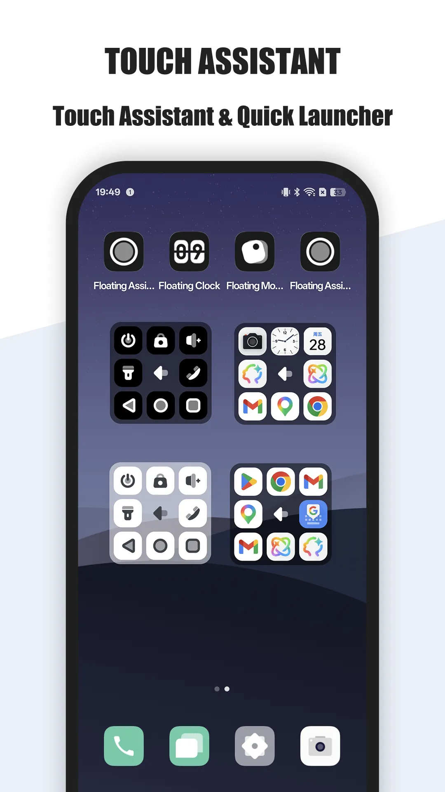

Sebuah [asisten terapung](/ms/glossary/what-is-a-floating-window/) menaruh butang kecil di tepi skrin yang memicu aksi yang sering Anda gunakan — back, home, recent, lock, tangkapan skrin — tanpa mencari butang fisik. **Floating Assistant** adalah **aplikasi Android bola tepi terapung** dengan pelarasan mendalam. Di bawah kami membandingkannya dengan **Assistive Touch**, kelas butang terapung popular, untuk multitasking sehari-hari. Ini daftar pendek yang dimaksud orang dengan **aplikasi asisten terapung android terbaik** atau **aplikasi assistive touch android terbaik 2026**.

## Apa yang dibutuhkan asisten terapung

Asisten terapung yang berguna meletakkan butang kecil di tepi skrin yang mencetuskan aksi harian — back, home, recent, lock, dan tangkapan skrin — tanpa mencari butang fizikal atau mengganggu kandungan. Floating Assistant adalah aplikasi Android bola tepi terapung dengan pelarasan mendalam, sementara Assistive Touch menawarkan butang maya yang lebih ringkas. Perbandingan ini menilai lima keperluan: bola terapung tepi, aksi cepat, butang dan gerak isyarat tersuai, prestasi ringan, serta operasi lokal tanpa akaun. Ia juga dikenali sebagai aplikasi asisten terapung Android terbaik atau aplikasi assistive touch Android terbaik 2026. Senarai ini memetakan terus keperluan itu kepada ciri yang boleh disemak supaya anda boleh memilih berdasarkan cara anda benar-benar memakai telefon.

- **Bola terapung tepi** — butang terjangkau ibu jari yang tidak mengganggu.
- **Aksi cepat** — back, home, recent, kunci skrin, tangkapan skrin, skrin terbelah.
- **Butang dan gerak isyarat tersuai** — petakan apa yang benar-benar Anda pakai.
- **Ringan** — tidak boleh membuat telefon pintar lag.
- **Lokal dan peribadi** — tanpa akaun, tanpa muat naik.

## Bagaimana kami memilih aplikasi asisten terapung terbaik

Empat cek menentukan kualiti bola terapung, kerana ia dinilai daripada sejauh mana ia membantu setiap hari, bukan daripada bilangan butangnya. Pertama, jangkauan pada skrin jangkung — butang perlu berada di bawah ibu jari dan tidak menutupi kandungan, keyboard, atau kawalan video, jika tidak ia akan dipindah atau dipadam. Kedua, pintasan yang benar-benar boleh diubah: aplikasi, kontak, dan toggle sistem, bukan sekadar cincin ikon tetap, dengan setiap slot boleh dipetakan semula. Ketiga, aksi bukan hiasan — back, home, recent, lock, dan tangkapan skrin perlu boleh dipercayai, dengan gerak isyarat sebagai bonus. Keempat, kebenaran jujur: overlay dan Kebolehcapaian perlu dijelaskan tanpa akaun dan tanpa root. Floating Assistant menang pada tiga cek pertama, manakala Assistive Touch menang apabila anda mahu menu terkecil.

1. **Jangkauan di skrin jangkung** — sebuah **aplikasi butang terapung satu tangan android** sebaiknya berada di mana ibu jari Anda berada, dan tidak menutupi konten di belakangnya. Bila menutupi keyboard atau kontrol video, ia akan dipindah atau dihapus.
2. **Pintasan yang benar-benar Anda ubah** — **bola terapung dengan pintasan tersuai** berarti aplikasi, kontak, dan toggle sistem, bukan sekadar cincin ikon tetap. Daftar pendek **aplikasi asisten terapung android terbaik** sebaiknya membiarkan setiap slot dipetakan ulang.
3. **Aksi, bukan hiasan** — back, home, recent, lock, dan tangkapan skrin harus boleh dipercayai; kumpulan **butang back home recent floating assistant** adalah minimum, dan gerak isyarat adalah bonus.
4. **Kebenaran jujur** — perkhidmatan overlay dan kebolehcapaian adalah pemberian kuat. **Aplikasi assistive touch android terbaik 2026** sebaiknya menjelaskan apa yang dibacanya, tidak perlu akaun, dan jalan tanpa root.

Floating Assistant menang di 1–3 dengan bola bertempel di tepi yang sepenuhnya boleh dipetakan ulang; Assistive Touch menang bila Anda ingin menu terkecil. Bila datang dari carian **alternatif assistive touch android**, cek 4 seksama seperti 1.

## Para pesaing sekilas

Tiga pilihan dalam jadual ini — Floating Assistant, Assistive Touch, dan alat tepi lain — mewakili tahap kawalan yang berbeza. Floating Assistant menggabungkan bola tepi dengan aksi mendalam seperti lock, tangkapan skrin, dan skrin terbelah serta butang dan gerak isyarat yang boleh disesuaikan sepenuhnya. Assistive Touch menawarkan bola terapung dengan butang maya dan pintasan pada harga percuma dengan pembelian dalam aplikasi, sementara alat tepi lain bersifat ceruk dengan aksi terhad. Jadual di bawah membedah harga, bola terapung, aksi, tahap penyesuaian, dan kegunaan utama. Ringkasan ini membantu anda memilih berdasarkan sama ada anda mahukan kawalan terapung yang fleksibel atau sekadar pengganti butang fizikal.

| App | Harga (2026) | Bola terapung | Aksi | Tersuai | Terbaik untuk |
|---|---|---|---|---|---|
| **Floating Assistant** | Teras percuma + VIP | ✅ | Back/home/recent/lock/tangkapan/split | ✅ butang + gerak isyarat | Pengguna kuat |
| **Assistive Touch** | Percuma + IAP | ✅ | Butang virtual + pintasan | ✅ | Butang virtual sederhana |
| **Alat tepi lain** | Bervariasi | ✅ | Terhad | ⚠️ | Ceruk |

## Floating Assistant, lebih dalam

Floating Assistant adalah aplikasi Android bola tepi terapung dengan kumpulan aksi mendalam dan pelarasan penuh. Kelebihannya merangkumi bola tepi yang terjangkau ibu jari pada skrin apa pun, aksi seperti back, home, recent, lock, tangkapan skrin, skrin terbelah, kelantangan, dan kecerahan, butang serta gerak isyarat yang boleh dipetakan semula, operasi ringan dan lokal tanpa akaun, serta sokongan skrin terbelah untuk multitasking sebenar. Keterbatasannya ialah aksi dan gerak isyarat tambahan memerlukan VIP dan kebenaran overlay diberikan sekali sahaja. Aplikasi ini sesuai untuk pengguna Android yang mahukan kawalan terapung yang fleksibel dan boleh disesuaikan. Gambar di bawah menunjukkan bola bertempel di tepi, aksi cepat, menu tersuai, pilihan kebolehcapaian, dan tetapan kebenaran.

{: width="180" .normal }
{: width="180" .normal }
{: width="180" .normal }
{: width="180" .normal }
{: width="180" .normal }

Floating Assistant adalah **aplikasi Android bola tepi terapung** dengan kumpulan aksi kaya dan pelarasan.

**Kelebihan untuk penggunaan sehari-hari**
- **Bola tepi** — butang terjangkau ibu jari di skrin apa pun.
- **Aksi mendalam** — back, home, recent, lock, tangkapan skrin, skrin terbelah, volume, kecerahan.
- **Butang dan gerak isyarat tersuai** — petakan ketik, sapu, dan tahan lama ke yang Anda pakai.
- **Ringan dan lokal** — berjalan di peranti, tanpa akaun.
- **Ramah multi-jendela** — skrin terbelah cepat untuk multitasking sungguh.

**Kelemahan untuk penggunaan sehari-hari**
- **VIP untuk lebih** — aksi dan gerak isyarat ekstra di sebalik peningkatan.
- **Kebenaran overlay** — Anda memberi akses sekali.

**Terbaik untuk:** pengguna Android yang ingin kendali terapung fleksibel dan boleh dikustomisasi.

- [Google Play — Floating Assistant](https://play.google.com/store/apps/details?id=com.glgjing.floating.apps.assistive.touch.pro)

## Assistive Touch, lebih dalam

Assistive Touch (pakej mtr.assistivetouch.easytools) adalah aplikasi butang terapung popular yang menawarkan butang maya dan pintasan. Kelebihannya termasuk bola terapung dengan butang back, home, recent, dan lock, pelancaran aplikasi kegemaran dari bola, kawalan kecerahan dan kelantangan tanpa butang fizikal, serta penggunaan percuma dengan pembelian dalam aplikasi untuk ekstra. Namun kumpulan aksinya adalah standard dan kurang mendalam berbanding gerak isyarat Floating Assistant, pelarasannya lebih ringan untuk alur kompleks, dan iklan serta pakej berbeza-beza. Assistive Touch sesuai untuk pengguna yang mahu butang maya sederhana menggantikan butang fizikal. Gambar di bawah menunjukkan bola terapung, aksi cepat, menu tersuai, pilihan kebolehcapaian, dan tetapan kebenaran.

{: width="180" .normal }
{: width="180" .normal }
{: width="180" .normal }
{: width="180" .normal }
{: width="180" .normal }

Assistive Touch (pakej `mtr.assistivetouch.easytools`) adalah aplikasi butang terapung popular yang menawarkan butang virtual dan pintasan.

**Kelebihan untuk penggunaan sehari-hari**
- **Bola terapung + butang virtual** — back, home, recent, lock, dan lain-lain sebagai butang di skrin.
- **Pintasan aplikasi cepat** — luncurkan kegemaran dari bola.
- **Kontrol kecerahan dan volume** — praktikal tanpa butang fisik.
- **Percuma untuk bermula** — pakai dasar dengan IAP untuk ekstra.

**Kelemahan untuk penggunaan sehari-hari**
- **Kumpulan aksi standar** — kurang mendalam dari gerak isyarat Floating Assistant.
- **Iklan dan IAP** — konten promosi dan pakej bervariasi.
- **Pelarasan lebih ringan** — lebih sedikit cara memetakan alur kompleks.

**Terbaik untuk:** pengguna yang ingin butang virtual sederhana menggantikan butang fisik.

- [Google Play — Assistive Touch](https://play.google.com/store/apps/details?id=mtr.assistivetouch.easytools)

## Mana yang harus dipilih?

Pilihan antara Floating Assistant dan Assistive Touch bergantung pada sejauh mana kawalan terapung anda perlukan. Floating Assistant sesuai untuk aksi mendalam, gerak isyarat, dan multitasking skrin terbelah, manakala Assistive Touch menyediakan butang maya sederhana secara percuma. Dua cadangan ini meringkaskan jadual di atas menjadi keputusan yang jelas. Jika anda memakai telefon pintar besar, mahu mengunci skrin tanpa butang daya, atau kerap membahagikan skrin untuk membalas mesej sambil membaca, pilih aplikasi dengan aksi mendalam; jika anda hanya mahu menggantikan butang fizikal dengan ketikan pada skrin, alternatif percuma itu memadai. Kedua-dua aplikasi ini tidak menggantikan tetapan kebolehcapaian sistem, sebaliknya melengkapkannya dengan pintasan yang lebih mudah dicapai.

- Ingin **aksi mendalam + gerak isyarat + multitasking** → **Floating Assistant**.
- Ingin **butang virtual sederhana, percuma** → **Assistive Touch**.

[Dapatkan Floating Assistant](/ms/apps/floating-assistant/) — tersedia di Android.

## Senario khas

Lima senario khas menunjukkan nilai asisten terapung dalam penggunaan harian. Satu tangan pada telefon pintar besar meletakkan back, home, recent, dan tangkapan skrin di bawah ibu jari tanpa mengubah genggaman. Kunci tanpa butang daya dilakukan dengan memetakan ketikan atau gerak isyarat ke kunci skrin, menjimatkan butang keras. Multitasking sebenar dicapai dengan mencetuskan skrin terbelah dari bola untuk membaca dan membalas berdampingan. Toggle cepat seperti Wi-Fi, kecerahan, atau kelantangan dicapai dalam satu ketikan berbanding dua sapuan. Akhir sekali, teras bebas iklan dengan buka kunci pilihan bermakna anda mengelakkan dinding iklan yang terdapat pada bola lain.

- **Satu tangan di telefon pintar besar** — simpan bola tepi di bawah; back, home, recent, dan tangkapan skrin mendarat di bawah ibu jari tanpa mengubah genggaman.
- **Kunci tanpa butang daya** — petakan ketik atau gerak isyarat ke kunci skrin, menghemat butang keras.
- **Multitasking sungguh** — picu skrin terbelah dari bola untuk baca dan balas berdampingan.
- **Jangkau toggle cepat** — satu ketik ke Wi-Fi, kecerahan, atau volume daripada dua sapuan.
- **Teras bebas iklan** — bola teras percuma dengan buka kunci pilihan, sehingga Anda hindari dinding iklan bola lain.

## FAQ

**Apakah Floating Assistant percuma?**
{:.faq-q}

Ya. Teras bola tepi terapung, aksi, dan gerak isyarat percuma; buka kunci VIP pilihan menambah tema dan pilihan lebih dalam.

**Floating Assistant atau Assistive Touch — mana yang harus saya pilih?**
{:.faq-q}

Ingin aksi mendalam, gerak isyarat, dan multitasking skrin terbelah → Floating Assistant; ingin butang virtual sederhana percuma → Assistive Touch.

**Apakah Floating Assistant perlu root?**
{:.faq-q}

Tidak. Berjalan sebagai perkhidmatan kebolehcapaian dan overlay, tanpa root.

**Apakah Floating Assistant boleh di iOS?**
{:.faq-q}

Tidak. Hanya Android; iOS punya AssistiveTouch bawaan di tetapan kebolehcapaian.

## Istilah berkaitan

- [Apakah Itu Assistive Touch?](/ms/glossary/what-is-assistive-touch/)
- [Apakah Itu Tetingkap Terapung?](/ms/glossary/what-is-a-floating-window/)
