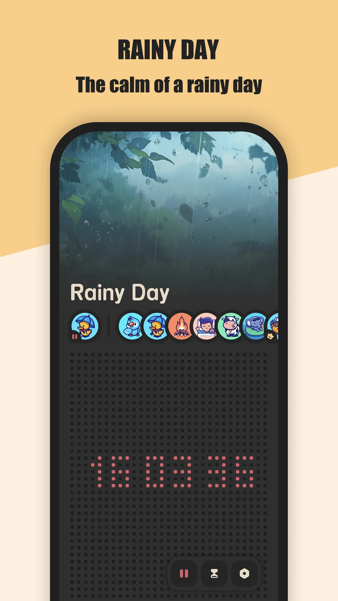

Pejabat ruang terbuka, kedai kopi yang ramai, atau teman sekamar yang sedang telepon — musuh fokus biasanya adalah **suara manusia mendadak**, bukan kebisingan secara keseluruhan. Aplikasi **[white noise](/ms/glossary/what-is-white-noise/) yang stabil** meratakan lonjakan itu menjadi hening malar sehingga otak Anda berhenti memantau ruangan. **Meow FM** adalah **pemutar white noise percuma** untuk Android dan iOS dengan soundscape untuk tidur dan konsentrasi. Berikut cara ia dibandingkan untuk kerja mendalam, dan apa yang benar-benar membantu Anda tetap fokus. Perbandingan di bawah menargetkan **suara fokus** daripada konten meditasi, itulah sebabnya pemutar noise tidak terputus yang percuma adalah dasarnya.

## Mengapa noise membantu fokus

White noise membantu fokus dengan menutup suara manusia yang mendadak — punca gangguan utama di pejabat ruang terbuka atau kafe — dan meratakannya menjadi dengungan malar supaya otak berhenti memantau bilik. Meow FM adalah pemutar white noise percuma untuk Android dan iOS dengan soundscape alami untuk tidur dan fokus, pemasa yang berhenti sendiri, dan main balik luar talian. Perbandingan ini menilai tiga sebab noise berkesan — menyembunyikan pertuturan, menandakan rutin kerja, dan mengurangkan perubahan persekitaran — sebelum membandingkan Meow FM dengan Calm, Noisli, Brain.fm, dan myNoise. Fokus di sini bermakna suara yang stabil dan tidak terputus, bukan kandungan meditasi, jadi pemutar noise percuma yang tidak terganggu menjadi asas senarai ini.

- **It masks speech** — a flat noise floor hides the words of nearby conversations that would otherwise hijack attention.
- **It anchors a routine** — the same loop signals "work mode" the way a song can.
- **It reduces environment churn** — construction, notifications, and footsteps blend into one bed instead of pinging your awareness.

## Yang dibutuhkan aplikasi suara fokus

Aplikasi suara fokus yang berguna perlu memainkan white, pink, atau brown noise yang stabil tanpa sambuan yang boleh didengar, dengan main balik panjang yang tidak reset setiap tiga minit. Meow FM menyediakan gelung alami seperti hujan, laut, dan perapian secara percuma, lengkap dengan pemasa yang menghentikan audio sendiri dan main balik luar talian. Senarai ini menilai enam keperluan — noise stabil, main balik lancar, pemasa, main balik luar talian, teras percuma, dan tiada gangguan iklan — supaya sesi kerja mendalam tidak terputus. Pembaca yang mencari suara fokus mahu aplikasi yang terus berfungsi dengan skrin terkunci dan tanpa langganan. Setiap keperluan ini boleh disemak terus pada jadual perbandingan di bawah.

- **Steady noise** — white, pink, or brown loops that don't audibly seam.
- **Long, seamless playback** — a loop shouldn't reset every three minutes.
- **A pemasa** — pair sound with a pomodoro block.
- **Offline playback** — works on a plane or a dead Wi-Fi cafe.
- **Free core** — focus shouldn't cost a subscription.
- **No interruptions** — no ads or pop-ups mid-session.

## Apa yang sebenarnya dibutuhkan fokus dari suara

Tiga detail menentukan sama ada white noise untuk fokus bertahan dalam blok kerja dua jam yang sebenar, kerana senarai semak di atas hanya mengukur ciri, bukan masa. Pertama, gelung tanpa sambuan — fail tiga minit yang bermula semula dengan jelas menarik semula perhatian setiap kali ia tamat, jadi white, pink, dan brown noise perlu berjalan berterusan dengan pilihan melapiskan hujan jika desisan rata terasa klinikal. Kedua, pemasa yang ditetapkan sekali: bunyi perlu berhenti sendiri selepas blok pomodoro supaya anda tidak memecahkan tumpuan untuk mematikkannya. Ketiga, main balik yang terus berjalan dengan skrin terkunci — senarai muzik fokus yang berhenti apabila telefon tidur lebih teruk daripada tiada bunyi langsung. Meow FM mengendalikan semuanya dengan fail suara lokal, jadi white noise luar talian berfungsi di kereta atau perpustakaan tanpa isyarat.

- **A loop with no seam** — a three-minute file that restarts audibly pulls attention back every time it ends. White, pink and brown noise need to run continuously, with the option to layer rain underneath if a flat hiss feels too clinical.
- **A pemasa you set once** — pairing sound with a pomodoro block means the app should stop on its own, so you are not breaking concentration to switch it off.
- **Playback that survives a locked screen** — a **focus music** playlist that pauses when the phone sleeps is worse than no sound at all; the noise has to keep running in the background with the screen off.

Meow FM menangani itu dengan fail suara lokal, sehingga **white noise offline** bekerja di kereta atau perpustakaan tanpa isyarat, dan daftar pendek **aplikasi white noise percuma terbaik** tidak seharusnya mewajibkan langganan sekadar untuk mempertahankan pemasa.

## Para pesaing sekilas

Lima aplikasi dalam jadual ini — Meow FM, Calm, Noisli, Brain.fm, dan myNoise — mewakili lima falsafah fokus yang berbeza. Meow FM menawarkan gelung alami percuma dengan pemasa berhenti sendiri dan main balik luar talian. Calm berharga kira-kira $69.99 setahun dengan muzik dan meditasi, Noisli dan myNoise membenarkan pencampuran serta pelarasan bunyi, sementara Brain.fm menjual muzik fungsional hasil AI secara langganan. Jadual di bawah membedah harga, main balik luar talian, pemasa, gaya bunyi, dan kegunaan utama. Ringkasan ini menonjolkan satu perkara penting untuk fokus: pemasa dan main balik luar talian tidak boleh disembunyikan di sebalik paywall.

| App | Price (2026) | Offline | Pemasa | Sound style | Best for |
|---|---|---|---|---|---|
| **Meow FM** | Free core + optional VIP | ✅ | ✅ | Nature loops (rain, sea, fireplace) | Free, simple focus |
| **Calm** | ~$69.99/yr (14-day trial) | ⚠️ partial | ❌ | Meditations + focus music | Meditation-style focus |
| **Noisli** | Free + subscription | ✅ | ✅ | White/pink noise + environments | Mix-your-own |
| **Brain.fm** | Subscription | ✅ | ✅ | Functional music (AI-composed) | Scientifically framed focus |
| **myNoise** | Free + IAP | ✅ | ✅ | Generative, tunable | Sound tinkerers |

## Meow FM, secara mendalam

Meow FM adalah pemutar white noise dan fokus bertema kucing untuk Android dan iOS dengan teras percuma. Ia menyediakan gelung alami seperti hujan, laut, dan perapian tanpa paywall untuk mendengar, pemasa yang menghentikan pemutaran sendiri selepas blok 25 minit, main balik luar talian sebenar dengan fail yang dimuat turun, antara muka ringkas tanpa akaun, dan pencampuran lapisan untuk menyesuaikan bunyi latar. Kekurangannya untuk fokus ialah ia bukan muzik fungsional seperti Brain.fm, pustakanya lebih kecil daripada Noisli atau myNoise, dan tiada analitik sesi. Meow FM sesuai untuk pengguna yang mahukan white noise percuma dengan pemasa nyata dan tanpa langganan. Gambar di bawah menunjukkan senarai stasiun, kegemaran, pemasa fokus, kualiti audio, dan tetapan akaun.

{: width="180" .normal }
{: width="180" .normal }
{: width="180" .normal }
{: width="180" .normal }
{: width="180" .normal }

Meow FM adalah **pemutar white noise dan fokus bertema kucing** untuk Android dan iOS. Terasnya percuma: loop alami seperti hujan, laut, dan perapian, plus pemasa yang menghentikan pemutaran supaya tidak jalan sepanjang hari.

**Kelebihan untuk fokus**
- **Free core soundscapes** — rain, sea, and fireplace loops with no paywall on listening.
- **Self-stopping pemasa** — run sound for a 25-minute block and it ends on its own.
- **True offline playback** — downloaded sounds work with no signal.
- **Simple, cute interface** — open, tap, work; no accounts or setup.
- **Layered mixing** — blend scenes for a bed that fits your space.

**Kelemahan untuk fokus**
- **Not functional music** — it's ambience, not Brain.fm-style focus tracks engineered for attention.
- **Smaller library** — fewer scenes than Noisli or myNoise.
- **No analytics** — it plays sound; it doesn't measure sessions.

**Paling sesuai untuk:** orang yang menginginkan **aplikasi white noise percuma** untuk fokus dengan pemasa nyata dan tanpa langganan.

- [Google Play — Meow FM](https://play.google.com/store/apps/details?id=com.glgjing.whitenoise.relax.night.sleep.meow)
- [App Store — Meow FM](https://apps.apple.com/app/id1606715188)

## Calm, secara mendalam

Calm adalah aplikasi meditasi dan tidur paling terkenal di Google Play dengan lebih 50 juta muat turun dan penarafan 4.3 bintang, menawarkan muzik fokus, pernapasan, dan sesi harian 10 minit. Kelebihannya termasuk senarai main fokus yang disusun, Daily Calm untuk menetapkan semula perhatian, dan kepercayaan jenama yang kukuh. Namun ia mengenakan langganan kira-kira $69.99 setahun selepas cubaan 14 hari dengan kandungan percuma yang terhad, bukan noise tulen kerana mengutamakan meditasi, dan sesetengah pengguna melaporkan aplikasi ranap pada pembukaan pertama setiap hari. Calm sesuai untuk pengguna yang fokus melalui meditasi dan muzik tenang serta bersedia melanggan. Gambar di bawah menunjukkan kursus, pernapasan, cerita tidur, dan statistik Calm.

{: width="180" .normal }
{: width="180" .normal }
{: width="180" .normal }
{: width="180" .normal }

Calm adalah **aplikasi meditasi dan tidur** paling terkenal di Google Play (50 juta+ muat turun, 4,3 bintang). Selain tidur, ia menawarkan muzik fokus, pernapasan, dan sesi harian 10 minit untuk konsentrasi.

**Kelebihan untuk fokus**
- **Focus playlists** — curated calm music for work and study.
- **Daily Calm** — a short daily session to reset attention.
- **Brand trust** — the most recognized name in the category.

**Kelemahan untuk fokus**
- **Paid subscription** — around $69.99/year after a 14-day trial; free content is limited.
- **Not pure noise** — it's meditation-first, so there's no simple "loop brown noise for 50 minutes."
- **Mixed reliability** — some users report the app crashing on first open each day.

**Paling sesuai untuk:** orang yang fokus lewat meditasi dan muzik tenang, serta bersedia langganan.

- [Google Play — Calm](https://play.google.com/store/apps/details?id=com.calm.android)

## Bagaimana yang lain dibandingkan

Tiga pesaing tambahan melengkapkan senarai ini. Noisli mencampur white dan pink noise dengan bunyi persekitaran seperti kedai kopi dan angin, percuma dengan langganan untuk lebih banyak pilihan — sesuai jika anda suka membina campuran sendiri. Brain.fm menjual muzik fungsional hasil kecerdasan buatan yang direka untuk fokus dan relaksasi; berkesan bagi sesetengah pengguna, tetapi ia langganan berbayar. myNoise menjana noise yang boleh dilaras mengikut bilik, percuma dengan tambahan melalui pembelian dalam aplikasi, dan merupakan alat paling mendalam untuk penggemar bunyi. Ketiga-tiganya mengesahkan bahawa Meow FM menang pada kesederhanaan, pemasa berhenti sendiri, dan main balik luar talian tanpa akaun.

- **Noisli** mixes white/pink noise with environmental sounds (coffee shop, wind) and is free with a subscription for more — good if you like building your own blend.
- **Brain.fm** sells AI-composed functional music framed around focus and relaxation; effective for some, but it's a paid subscription.
- **myNoise** generates noise you can tune to a room; free with extras via IAP, the deepest tool for sound nerds.

## Mana yang harus Anda pilih?

Pilihan dalam perbandingan ini bergantung pada satu soalan: adakah anda mahu bunyi yang percuma, luar talian, dan berhenti sendiri, atau kandungan meditasi dan muzik terpandu? Meow FM adalah jawapan untuk white noise percuma dengan pemasa sebenar dan main balik luar talian, Calm sesuai untuk muzik tenang dan meditasi jika anda menerima langganan, Noisli untuk campuran sendiri, dan Brain.fm untuk landasan fokus hasil racikan AI. Empat cadangan ini meringkaskan jadual di atas menjadi keputusan praktikal. Jika matlamat anda ialah menyekat perbualan pejabat tanpa akaun atau bayaran berulang, pemutar noise yang ringkas sudah memadai.

- Want **free + a real pemasa + offline** → **Meow FM**.
- Want **calm music and meditation** and accept a subscription → **Calm**.
- Want **a custom blend** → **Noisli**.
- Want **engineered focus tracks** → **Brain.fm**.

[Dapatkan Meow FM](/ms/apps/meow-fm/) — tersedia di Android dan iOS.

## Senario umum

Empat senario umum menunjukkan di mana white noise fokus memberi hasil. Di pejabat ruang terbuka, gelung hujan atau laut dengan pemasa 25 minit menukar lantai yang bising menjadi keheningan malar dan berhenti sendiri apabila blok tamat. Di kafe, perapian atau brown noise menyembunyikan bunyi cawan dan panggilan telefon, dengan main balik luar talian yang kekal walaupun Wi-Fi tidak stabil. Dalam penerbangan kerja mendalam, adegan yang dimuat turun dimainkan tanpa isyarat, menjadikan perjalanan jauh sebagai ruang kerja yang tenang. Akhir sekali, tanpa langganan dan akaun, anda hanya membuka aplikasi, mengetik adegan, dan terus bekerja — tiada apa-apa menghalang antara anda dan fokus.

- **Open-plan office** — rain or sea loops with a 25-minute pemasa turn a chatty floor into a steady hush; the sound stops on its own when the block ends.
- **Coffee-shop focus** — mask the clatter and nearby calls with fireplace or brown-noise; offline playback keeps it running on patchy cafe Wi-Fi.
- **Deep-work flight** — downloaded scenes play with no signal, so a long haul becomes a noise-free workspace.
- **No subscription, no account** — open the app, tap a scene, and work; nothing stands between you and focus.

## FAQ

**Apakah Meow FM percuma untuk fokus?**
{:.faq-q}

Ya. Soundscape fokus teras — hujan, laut, perapian, dan lain-lain — percuma tanpa paywall saat diputar; VIP sekali bayar membuka adegan ekstra, bukan pemasa atau putar offline.

**Apakah Meow FM bekerja offline?**
{:.faq-q}

Ya. Adegan terunduh diputar tanpa internet, sehingga Anda boleh fokus di pesawat, kereta bawah tanah, atau kafe ber-Wi-Fi mati.

**Apakah Meow FM punya pemasa untuk pomodoro?**
{:.faq-q}

Ya. Atur 15/30/60 minit atau durasi tersuai dan audio berhenti secara automatik, sesuai untuk blok pomodoro 25 minit.

**Meow FM atau Brain.fm untuk fokus?**
{:.faq-q}

Ingin noise ambient percuma, offline, tanpa akaun dengan pemasa nyata → Meow FM; ingin muzik fungsional racikan AI untuk atensi → Brain.fm (langganan).

## Istilah berkaitan

- [Apakah Itu White Noise?](/ms/glossary/what-is-white-noise/)
