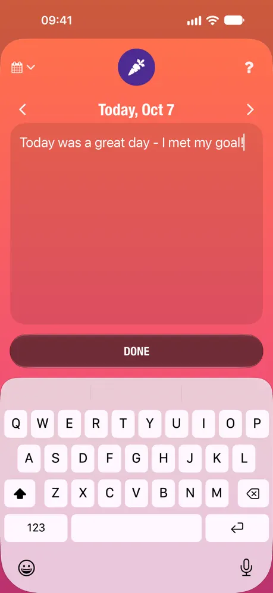
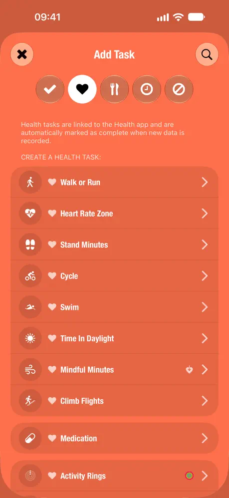

Membangun tabiat harian terutama tentang konsisten hadir setiap hari, dan aplikasi yang tepat membuatnya terasa memuaskan, bukan menegangkan. **Meow Habits** adalah **[aplikasi penjejak tabiat yang comel](/ms/glossary/what-is-a-habit-tracker/)** untuk Android dan iOS yang mengubah rutinitas menjadi streak, graf, dan kemenangan kecil setiap hari. Di bawah ini kami bandingkan aplikasi yang benar-benar dipasang orang — **Meow Habits, Streaks, Habitica dan Loop** — dari sisi mode build/break, platform, privasi, dan harga.

## Apa yang seharusnya dilakukan aplikasi penjejak tabiat

Aplikasi penjejak tabiat yang berguna perlu mengendalikan kedua-dua mod build dan break dalam satu tempat, menawarkan tempoh fleksibel harian hingga bulanan, dan menunjukkan progres melalui batang, pai, serta kalendar yang benar-benar boleh dirujuk. Meow Habits adalah aplikasi habit tracker bertema kucing untuk Android dan iOS yang menukar rutinitas menjadi streak, graf, dan kemenangan kecil harian. Senarai ini menilai enam keperluan — build dan break, tempoh fleksibel, progres yang kelihatan, sokongan merentas platform, privasi offline dengan kunci, dan eksport CSV. Kajian ini membandingkan empat aplikasi yang benar-benar dipasang orang — Meow Habits, Streaks, Habitica, dan Loop — dari sisi mod build/break, platform, privasi, dan harga supaya anda boleh memilih berdasarkan tabiat yang mahu dibina atau dihentikan.

- **Build dan break** — catat "minum air" dan "berhenti scroll" di satu tempat.
- **Tempoh fleksibel** — harian, mingguan, bulanan, atau jeda khusus.
- **Progres yang kelihatan** — batang, pie, dan kalendar yang benar-benar Anda lirik.
- **Merentas platform** — telefon pintar dan tablet, plus OS kedua bila anggota rumah memakai sistem berbeza.
- **Privasi** — mengutamakan offline dengan kunci, bukan cloud wajib.
- **Eksport** — CSV untuk ditinjau atau dibagikan ke pelatih.

## Bagaimana kami menilai aplikasi penjejak tabiat terbaik

Empat hal menentukan sama ada streak tabiat bertahan selepas enam bulan, bukan sekadar pada hari pertama. Pertama, aplikasi penjejak tabiat percuma tanpa langganan — ia membenarkan anda terus mencatat selepas tempoh percubaan tanpa paywall pada sejarah sendiri. Kedua, hambatan harian yang rendah — aplikasi penjejak tabiat dengan widget dan peringatan bermaksud satu ketikan dari skrin utama, bukan urusan pentadbiran setiap malam. Ketiga, sejarah yang jujur — kalendar dan eksport CSV membolehkan anda meninjau minggu yang sempurna serta menyimpan data jika kelak bertukar aplikasi. Keempat, data tetap milik anda — aplikasi habit tracker tanpa akaun yang berfungsi secara offline, dengan sandaran WebDav untuk salinan manual. Inilah yang membezakan pilihan aplikasi habit tracker percuma terbaik di Android daripada ledakan motivasi yang cepat padam.

- **Aplikasi penjejak tabiat percuma tanpa langganan** — **aplikasi habit tracker percuma tanpa langganan** memungkinkan Anda terus mencatat setelah masa percubaan, tanpa paywall pada sejarah sendiri.
- **Hambatan harian yang rendah** — **aplikasi penjejak tabiat dengan widget** dan **aplikasi habit tracker dengan peringatan** berarti satu ketikan dari skrin utama, bukan urusan administrasi setiap malam.
- **Sejarah yang jujur** — **aplikasi habit tracker dengan kalendar** dan **aplikasi penjejak tabiat dengan eksport CSV** memungkinkan Anda meninjau pekan sempurna dan menyimpan data jika kelak ganti aplikasi.
- **Data tetap milik Anda** — **aplikasi habit tracker tanpa akaun** yang juga berfungsi sebagai **aplikasi penjejak tabiat offline tanpa akaun**, dengan **aplikasi habit tracker dengan sandaran WebDav** untuk salinan manual.

Itulah yang membezakan pilihan **aplikasi habit tracker percuma terbaik di Android** dari ledakan motivasi yang cepat padam.

## Sekilas para kandidat

Empat aplikasi dalam jadual ini — Meow Habits, Streaks, Habitica, dan Loop — mewakili empat pendekatan penjejakan tabiat. Meow Habits menggabungkan teras percuma, mod build dan break, serta sokongan Android dan iOS dengan storan offline berkunci. Streaks berharga kira-kira $4.99 sekali bayar dan khusus iOS dengan integrasi Apple Health. Habitica percuma dengan langganan dan gamifikasi RPG, sementara Loop percuma dan open-source tetapi hanya Android. Jadual di bawah membedah harga, platform, mod build/break, privasi, dan kegunaan utama. Ringkasan ini menonjolkan satu fakta: Meow Habits dan Loop adalah dua pilihan tanpa akaun, tetapi hanya Meow Habits yang merentas platform.

| Aplikasi | Harga (2026) | Platform | Build/break | Privasi | Terbaik untuk |
|---|---|---|---|---|---|
| **Meow Habits** | Teras percuma + VIP pilihan | Android + iOS | ✅ keduanya | ✅ offline + kunci | Comel, merentas platform |
| **Streaks** | Sekali bayar (~$4.99) | **Hanya iOS** | ✅ keduanya | ✅ lokal + Health | Kesederhanaan khusus Apple |
| **Habitica** | Percuma + langganan | Android + iOS + Web | ✅ keduanya | ⚠️ akaun | RPG bergamifikasi |
| **Loop** | Percuma, open-source | **Hanya Android** | ✅ keduanya | ✅ lokal | Android minimalis |

## Meow Habits, secara mendalam

Meow Habits adalah aplikasi habit tracker bertema kucing untuk Android dan iOS dengan teras percuma — pencatatan, streak, dan graf — sementara VIP menambah eksport CSV dan pelarasan ekstra. Kelebihannya termasuk sokongan kedua-dua platform mudah alih utama yang tergolong langka, mod build dan break, tempoh fleksibel harian hingga bulanan dengan batang, pai, dan kalendar, operasi offline berkunci cap jari, sandaran Google Drive atau WebDav, serta template satu ketikan. Kekurangannya ialah eksport CSV khusus VIP dan pendampingan yang lebih ringan berbanding Habitica atau Fabulous. Meow Habits sesuai untuk pengguna yang mahukan aplikasi habit tracker percuma berjalan di dua sistem operasi dengan privasi terjaga. Gambar di bawah menunjukkan centang harian, butiran catatan, streak, graf statistik, dan tetapan peringatan.

{: width="180" .normal }
{: width="180" .normal }
{: width="180" .normal }
{: width="180" .normal }
{: width="180" .normal }

Meow Habits adalah **[aplikasi habit tracker bertema kucing](/ms/glossary/what-is-a-habit-tracker/)** untuk Android dan iOS. Terasnya — pencatatan, streak, dan graf — percuma; VIP menambah eksport CSV dan pelarasan ekstra.

**Kelebihan**
- **Merentas platform** — aplikasi yang sama di Android dan iOS, yang tergolong langka (Streaks hanya iOS, Loop hanya Android).
- **Mode build dan break** — catat rutinitas positif dan tabiat yang ingin dihentikan.
- **Tempoh fleksibel** — harian, mingguan, bulanan, atau khusus, dengan batang, pie, dan paparan kalendar.
- **Offline + kunci** — berjalan tanpa isyarat dan mengamankan data di sebalik cap jari.
- **Sandaran** — Google Drive atau WebDav, sesuai pilihan Anda.
- **Template** — mulai tabiat dengan satu ketikan.

**Kelemahan**
- **Eksport CSV khusus VIP** — pengguna percuma tidak boleh mengekspor sejarah.
- **Pendampingan lebih ringan** — tanpa RPG atau dorongan ilmu perilaku seperti Habitica atau Fabulous.

**Paling sesuai untuk:** orang yang menginginkan **aplikasi habit tracker percuma** yang berjalan di dua sistem operasi seluler utama dengan privasi terjaga.

- [Google Play — Meow Habits](https://play.google.com/store/apps/details?id=com.glgjing.meow.habit.goal)
- [App Store — Meow Habits](https://apps.apple.com/app/id6758230559)

## Streaks, secara mendalam

Streaks (dari Crunchy Bagel) adalah peraih Apple Design Award dan to-do tabiat paling rapi di iOS, terintegrasi dengan Apple Health untuk melengkapkan sasaran seperti langkah atau detak jantung secara automatik. Kelebihannya termasuk kesederhanaan — pilih tugasan, centang setiap hari, jangan putuskan rantai — integrasi Health, reka bentuk serta widget iOS kelas terbaik, dan harga sekali bayar tanpa langganan. Namun ia hanya untuk iOS, tanpa tingkat percuma, dihadkan kepada 24 tugasan, dan datanya kekal dalam ekosistem Apple. Streaks sesuai untuk pengguna khusus iPhone yang mahukan penjejak paling rapi bersambung Health. Gambar di bawah menunjukkan senarai tabiat, butiran centang, streak, graf kalendar, dan tetapan peringatan.

{: width="180" .normal }
{: width="180" .normal }
{: width="180" .normal }
{: width="180" .normal }
{: width="180" .normal }

Streaks (dari Crunchy Bagel) adalah **peraih Apple Design Award** dan to-do tabiat paling rapi di iOS. Ia terintegrasi dengan Apple Health untuk melengkapi target secara automatik seperti langkah atau detak jantung.

**Kelebihan**
- **Sangat sederhana** — pilih tugasan, centang setiap hari, jangan putuskan rantainya.
- **Integrasi Health** — mencatat automatik jalan kaki, air minum, dan lain-lain lewat Apple Health.
- **Rapi dan halus** — reka bentuk serta widget iOS kelas terbaik.
- **Harga sekali bayar** — tanpa langganan.

**Kelemahan**
- **Hanya iOS** — tidak ada aplikasi Android, jadi rumah tangga dengan OS campuran tidak boleh berkongsi.
- **Bayar di depan** — tanpa tier percuma; Anda membeli sebelum mencuba.
- **Dihadkan 24 tugasan** — cukup bagi kebanyakan orang, sempit untuk pengguna berat.
- **Tanpa penyegerakan Android** — data tetap di ekosistem Apple.

**Paling sesuai untuk:** pengguna khusus iPhone yang menginginkan penjejak tabiat paling rapi dan bersambung Health.

- [Apple App Store — Streaks](https://apps.apple.com/app/id963034692)

## Bagaimana yang lain dibandingkan

Dua pesaing tambahan melengkapkan senarai ini. Habitica mengubah tabiat menjadi RPG — selesaikan tugasan, kumpulkan XP, lawan monster — percuma dengan langganan untuk keuntungan kosmetik, bagus untuk motivasi tetapi lebih berat daripada penjejak sederhana. Loop adalah penjejak percuma, open-source, khusus Android, tanpa akaun, dan dengan privasi kukuh — pilihan para minimalis, tetapi pengguna iOS tidak terakomodasi. Kedua-duanya mengesahkan satu trade-off: motivasi tambahan atau platform yang terhad. Bagi pembaca yang mahu satu aplikasi di Android dan iOS tanpa akaun, Meow Habits kekal sebagai pilihan yang menggabungkan kedua-dua kelebihan itu. Pertimbangkan juga sama ada anda mahu data terus di peranti atau bersedia menyegerakkannya melalui storan cloud pilihan sendiri, kerana keputusan itu menentukan sejauh mana privasi boleh dikekalkan.

- **Habitica** mengubah tabiat menjadi RPG: selesaikan tugasan, kumpulkan XP, lawan monster. Percuma dengan langganan untuk keuntungan kosmetik dan kenyamanan; bagus untuk motivasi, lebih berat daripada penjejak sederhana.
- **Loop** adalah penjejak percuma, open-source, khusus Android, tanpa akaun dan dengan privasi kuat — pilihan para minimalis, tetapi pengguna iOS tidak terakomodasi.

## Mana yang sebaiknya Anda pilih?

Pilihan dalam perbandingan ini bergantung pada satu faktor: platform, privasi, atau motivasi. Meow Habits adalah cadangan untuk kombinasi percuma, comel, kedua-dua platform mudah alih, dan peribadi tanpa akaun. Streaks sesuai untuk penjejak khusus iOS paling halus dengan Apple Health, Habitica untuk motivasi ala game, dan Loop untuk open-source minimalis di Android. Empat cadangan ini meringkaskan jadual di atas menjadi keputusan praktikal. Jika rumah tangga anda memakai campuran Android dan iOS serta mengutamakan data di peranti, aplikasi yang merentas platform dan berkunci adalah pilihan yang paling sedikit menimbulkan kompromi. Semak pula sama ada kunci aplikasi dan eksport data tersedia pada peringkat percuma sebelum membuat keputusan akhir.

- Ingin **percuma + comel + kedua platform + peribadi** → **Meow Habits**.
- Ingin **penjejak khusus iOS paling halus dengan Health** → **Streaks**.
- Ingin **motivasi ala game** → **Habitica**.
- Ingin **open-source minimalis di Android** → **Loop**.

[Dapatkan Meow Habits](/ms/apps/meow-habits/) — tersedia di Android dan iOS.

## Senario umum

Empat senario umum menunjukkan nilai penjejak tabiat dalam kehidupan seharian. Untuk rutinitas pagi dan malam, sematkan "minum air", "regang badan", dan "tanpa telefon di katil" ke widget skrin utama lalu centang dari skrin kunci tanpa membuka aplikasi. Mod build dan break membolehkan anda mencatat tabiat baik seperti "baca 20 halaman" dan tabiat buruk seperti "berhenti scroll" dalam aplikasi yang sama, supaya kemahuan tidak terbahagi. Pada peranti bersama keluarga, rutinitas anda terkunci di sebalik cap jari tanpa akaun. Akhir sekali, di pesawat atau saluran kereta bawah tanah tanpa isyarat, pencatatan tetap berfungsi dan sandaran WebDav atau Google Drive menjaga sejarah tetap selamat merentas peranti.

- **Rutinitas pagi dan malam** — sematkan 'minum air', 'regang badan', dan 'tanpa HP di kasur' ke widget skrin utama lalu centang dari skrin kunci tanpa membuka aplikasi.
- **Build dan break sekaligus** — catat tabiat baik ('baca 20 halaman') dan yang buruk ('berhenti scroll') di aplikasi yang sama, supaya kemauan tidak terbagi ke banyak alat.
- **Peribadi di peranti bersama** — tanpa akaun; rutinitas Anda terkunci di sebalik cap jari, selamat di tablet keluarga.
- **Offline di mana sahaja** — catat di pesawat atau di saluran kereta tanpa isyarat; sandaran WebDav atau Google Drive menjaga sejarah tetap selamat lintas peranti.

## FAQ

**Apakah Meow Habits percuma?**
{:.faq-q}

Ya untuk terasnya — pencatatan, streak, graf, peringatan tabiat, dan mode build/break percuma; eksport CSV dan beberapa tambahan ada di sebalik VIP sekali bayar yang pilihan.

**Apakah Meow Habits boleh digunakan offline?**
{:.faq-q}

Ya. Anda boleh mencatat tabiat harian tanpa internet dan tanpa akaun; data tetap di peranti dan dicadangkan ke WebDav atau Google Drive semasa Anda memilihnya.

**Meow Habits atau Streaks — mana yang sebaiknya saya pilih?**
{:.faq-q}

Ingin penjejak tabiat comel, percuma, merentas platform (Android + iOS), dan offline → Meow Habits; ingin paparan khusus iOS paling rapi dengan Apple Health → Streaks.

**Bolehkah saya mencatat tabiat yang ingin dihentikan, bukan hanya yang dibangun?**
{:.faq-q}

Ya — Meow Habits punya mode build dan break, jadi Anda boleh mencatat 'berhenti scroll' berdampingan dengan 'minum air'.

## Istilah berkaitan

- [Apakah Itu Aplikasi Penjejak Tabiat (Habit Tracker)?](/ms/glossary/what-is-a-habit-tracker/)
