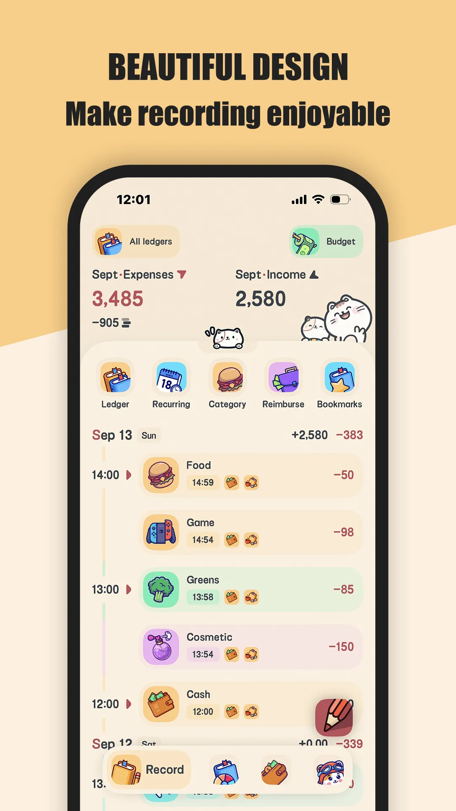
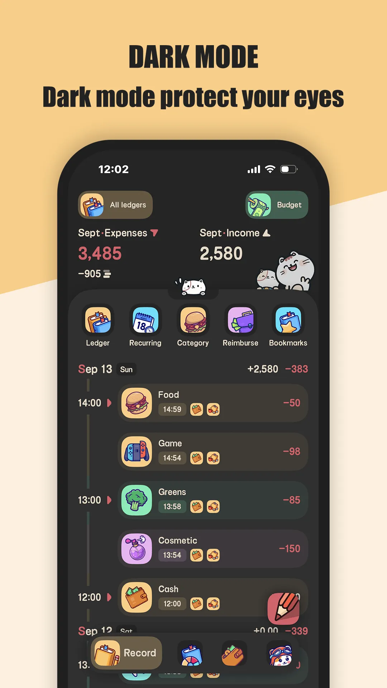
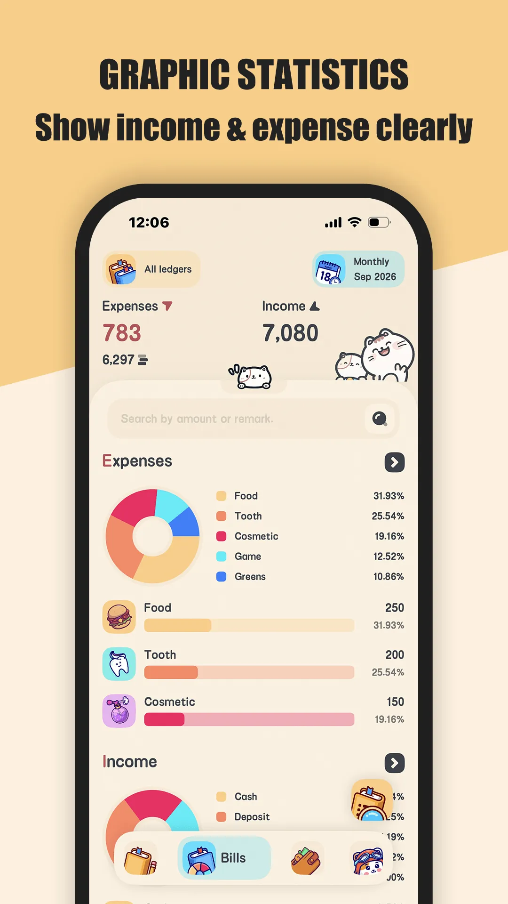
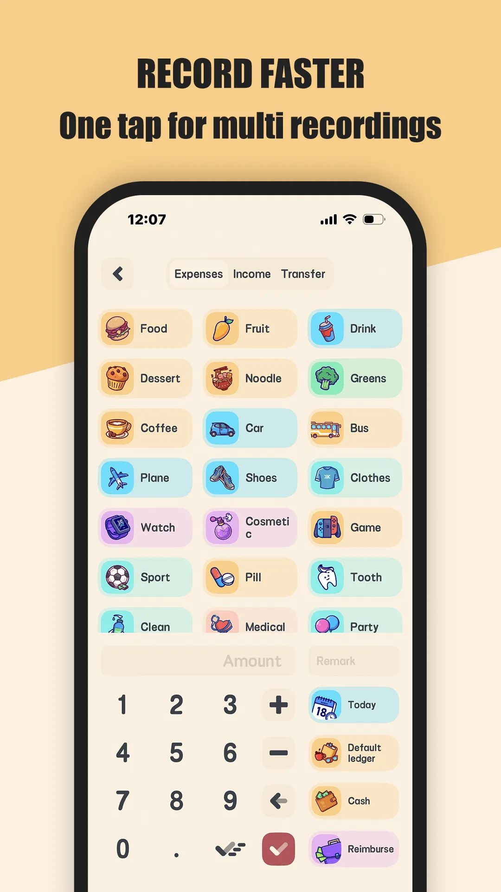
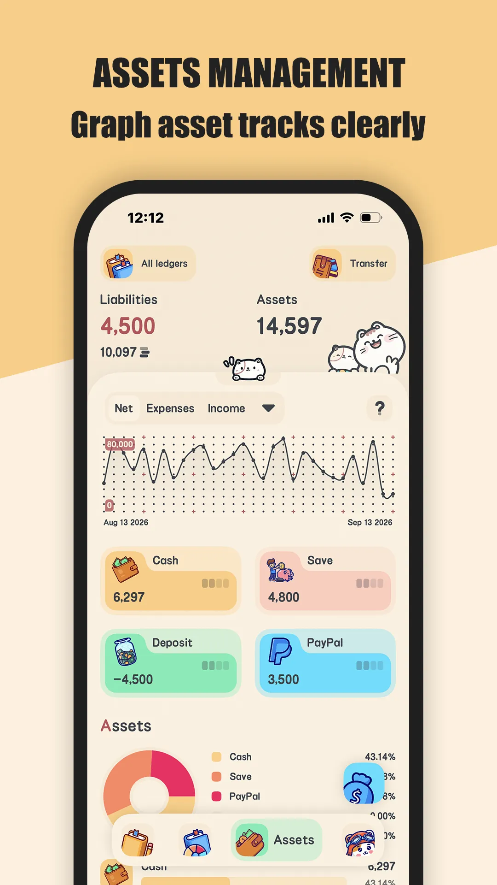
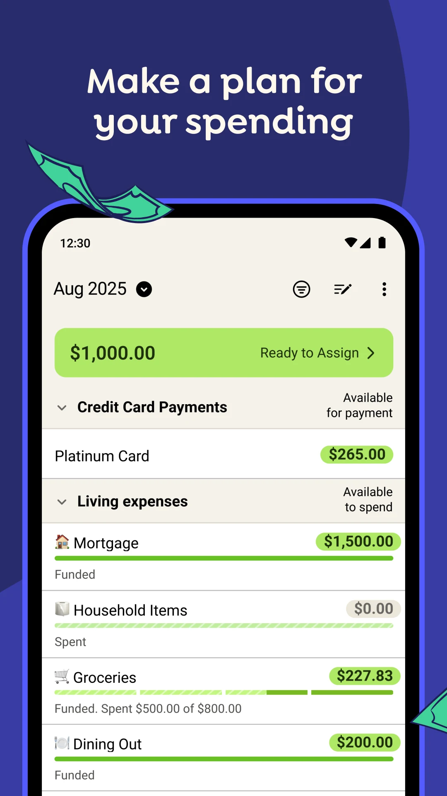
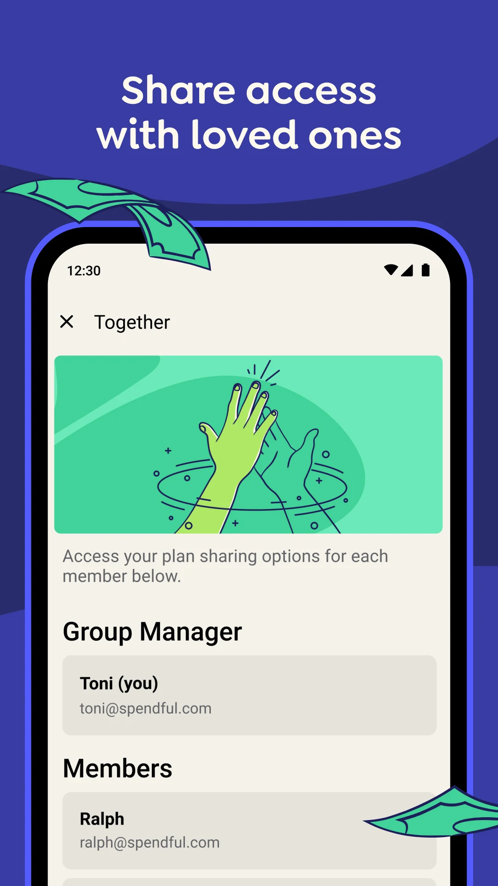

Hidup kampus sudah cukup mahal tanpa **[aplikasi bajet](/ms/glossary/what-is-an-expense-tracker/)** yang terasa seperti tugasan kuliah. **Aplikasi catatan kewangan mahasiswa** yang benar-benar digunakan biasanya yang paling mudah dibuka — di sela kuliah, di bus, sebelum belanja ke kedai mamak. Arus kas mahasiswa naik-turun: wang kiriman atau beasiswa masuk di awal semester, lalu perbelanjaan buku, sewa bilik, dan **wang makan** mengurasnya menjelang **hujung bulan**. Anda ingin yang percuma, peribadi, dan cepat.

Di bawah ini kami membandingkan aplikasi yang benar-benar dipasang mahasiswa — **Meow Money Manager, YNAB, Goodbudget, dan EveryDollar** — dari perspektif mahasiswa: pencatatan teras percuma, tanpa akaun wajib, mata wang saat kuliah di luar negeri, dan berapa yang harus dibayar untuk **kelola kewangan peribadi** sehari-hari.

## Mengapa mahasiswa membutuhkan aplikasi bajet yang berbeza

- **Arus kas naik-turun** — rata-rata bulanan menyembunyikan jurang antara minggu **hujung bulan** dan minggu **hari gaji** atau kiriman wang.
- **Langganan menumpuk** — Spotify, Netflix, Adobe, iCloud, gym; masing-masing kecil, semuanya berulang.
- **Akaun bank pertama** — banyak mahasiswa baru belajar mengurus wang untuk pertama kalinya.
- **Kuliah di luar negeri** — satu semester di luar negeri berarti mata wang kedua yang harus dicatat.
- **Tuntutan balik** — iuran organisasi, perjalanan konferensi, dan patungan perbelanjaan kumpulan perlu dicatat.

## Apa yang perlu dicari mahasiswa

- **Teras percuma** — Anda tidak perlu membayar untuk mencatat perbelanjaan; **aplikasi catatan kewangan percuma** tidak mematok perbelanjaan untuk ciri dasar.
- **Tanpa akaun wajib** — satu kata laluan lebih sedikit, dan data tetap milik Anda.
- **Entri cepat** — catat dalam sepuluh saat di sela kuliah.
- **Transaksi berulang** — sewa bilik, wang saku, dan langganan dibuat automatik.
- **Multi mata wang** — penting jika Anda kuliah atau melancong ke luar negeri.
- **Eksport** — CSV untuk tuntutan balik, cukai, atau sekadar pindah aplikasi kelak.
- **Paparan** — antara muka comel dan ramah lebih sering dibuka daripada spreadsheet yang akhirnya ditinggalkan.

## Sekilas para pesaing

| Aplikasi | Harga (2026) | Akaun | Multi mata wang | Paling sesuai untuk mahasiswa |
|---|---|---|---|---|
| **Meow Money Manager** | Teras percuma + VIP pilihan | **Tidak** (di peranti + cap jari) | ✅ 50+ mata wang | Percuma, peribadi, comel |
| **YNAB** | Percuma 1 tahun (mahasiswa), lalu $109/tahun | Ya (cloud) | Terhad (kebanyakan USD) | Metode + tahun pertama percuma |
| **Goodbudget** | Percuma (20 amplop) + Plus ~$70/tahun | Ya (untuk segerak) | Tidak | Penganggaran amplop |
| **EveryDollar** | Percuma (manual) + Premium ~$79,99/tahun | Pilihan | Tidak | Zero-based Ramsey |

## Meow Money Manager, secara mendalam

{: width="180" .normal }
{: width="180" .normal }
{: width="180" .normal }
{: width="180" .normal }
{: width="180" .normal }

Meow Money Manager adalah **[aplikasi catatan kewangan bertema kucing](/ms/glossary/what-is-an-expense-tracker/)** dan **[aplikasi bajet](/ms/glossary/what-is-budget-management/)** untuk Android dan iOS yang menyimpan semuanya **di peranti Anda** di sebalik kunci cap jari — **tanpa pendaftaran akaun**, tanpa login bank. Antarmukanya multi-bahasa: Cina, Inggeris, Malaysia, Thai, dan Portugis.

**Kelebihan untuk mahasiswa**
- **Percuma untuk pencatatan teras** — pencatatan harian, bajet, dan simbol multi mata wang tidak berbayar.
- **Tanpa akaun wajib** — buka aplikasi lalu mulai; tidak ada yang diunggah.
- **Transaksi berulang** — atur sewa bilik, langganan, dan wang kiriman sekali, lalu berulang automatik.
- **Simbol multi mata wang** — 50+ simbol; catat perbelanjaan dalam mata wang setempat saat kuliah di luar negeri, tetap dalam satu buku kas.
- **Penjejakan tuntutan balik** — tandai perbelanjaan organisasi atau perjalanan yang boleh diganti (penuh atau sebahagian).
- **Eksport CSV** plus sandaran Google Drive, iCloud, atau WebDav, serta **400+ ikon comel** dengan mode gelap.

**Kelemahan untuk mahasiswa**
- **Tanpa segerak bank automatik** — transaksi dimasukkan manual (untung tentang privasi, rugi tentang kepraktisan).
- **Had VIP** — buku kas tanpa had, eksport CSV, dan kunci aplikasi ada di sebalik peningkatan pilihan.

**Senario umum:** di awal semester, catat pencairan pinjaman atau wang kiriman orang tua sebagai "entri besar", lalu jadikan sewa bilik (dibayar lewat DuitNow QR, Touch 'n Go eWallet, GrabPay, atau Boost) dan langganan sebagai transaksi berulang; tandai iuran organisasi atau perjalanan konferensi sebagai tuntutan balik (penuh atau sebahagian) dan eksport CSV untuk bendahara organisasi atau jurusan di akhir semester; saat kuliah di luar negeri, catat perbelanjaan dalam mata wang setempat dan kelola belanja merentas negara dalam satu buku kas dengan 50+ simbol mata wang. Tanpa akaun dan dengan **data disimpan secara lokal pada peranti**, model ini sesuai dengan kebutuhan mahasiswa akan aplikasi yang percuma, peribadi, dan cepat.

**Paling sesuai untuk:** mahasiswa yang ingin **aplikasi bajet percuma** tanpa akaun, plus siapa pun yang kuliah di luar negeri atau patungan perbelanjaan kumpulan.

- [Google Play — Meow Money Manager](https://play.google.com/store/apps/details?id=com.glgjing.money.manager.bookkeeping.meow)
- [App Store — Meow Money Manager](https://apps.apple.com/app/id1528852284)

## YNAB, secara mendalam

{: width="180" .normal }
{: width="180" .normal }
{: width="180" .normal }
{: width="180" .normal }
{: width="180" .normal }

YNAB (You Need A Bajet) adalah aplikasi **penganggaran zero-based** terkenal yang memberi tugasan pada setiap dolar, dengan transaksi bank diimpor lewat Plaid.

**Kelebihan untuk mahasiswa**
- **Satu tahun percuma untuk mahasiswa** — mahasiswa terverifikasi mendapat YNAB percuma 12 bulan, keuntungan yang nyata.
- **Metodologi** — sistem empat aturan membangun tabiat yang bertahan setelah kuliah.
- **Segerak bank** — Plaid menarik transaksi automatik, jadi entri nyaris tanpa usaha.
- **Laporan kuat** — age of money, perbelanjaan per kategori, dan tujuan.

**Kelemahan untuk mahasiswa**
- **Berbayar setelah tahun pertama** — $14,99/bulan atau $109/tahun setelah penawaran mahasiswa berakhir; berat di kantong mahasiswa.
- **Akaun cloud wajib** — data kewangan Anda disimpan di server YNAB.
- **Lengkung belajar** — perlu berminggu-minggu sampai metodenya terasa pas.
- **Multi mata wang lebih lemah** — berpusat pada USD; mengurus beberapa mata wang terasa merepotkan.
- **Tanpa penjejakan tuntutan balik** — celah untuk perjalanan konferensi atau organisasi.

**Paling sesuai untuk:** mahasiswa disiplin yang menginginkan metode dan segerak bank serta boleh memanfaatkan tahun pertama percuma.

- [Google Play — YNAB](https://play.google.com/store/apps/details?id=com.youneedabudget.evergreen.app)
- [App Store — YNAB](https://apps.apple.com/app/id1010865877)

## Bagaimana aplikasi lain dibandingkan

- **Goodbudget** adalah penganggaran amplop tanpa kertas: pakej percuma memberi 20 amplop dan segerak manual; Plus (~$70/tahun) membuka segerak dan amplop tambahan. Sesuai bila metode amplop sesuai untuk Anda, tipis di multi mata wang.
- **EveryDollar** mengikuti metode zero-based Dave Ramsey. Percuma hanya entri manual; Premium (~$79,99/tahun) menambah segerak bank. Bersih, tetapi minim mata wang dan laporan.

## Mana yang sebaiknya dipilih mahasiswa?

- Ingin **percuma + peribadi + multi mata wang + tanpa akaun** → **Meow Money Manager**.
- Ingin **metode dan tahun pertama percuma** → **YNAB**.
- Ingin **penganggaran amplop** → **Goodbudget**.
- Ingin **rencana zero-based Ramsey** → **EveryDollar**.

[Dapatkan Meow Money Manager](/ms/apps/meow-money-manager/) — tersedia di Android dan iOS.

## FAQ

**Apakah Meow Money Manager berbayar untuk mahasiswa?**
{:.faq-q}

Pencatatan teras, bajet, dan simbol multi mata wang sepenuhnya percuma; eksport CSV, buku kas tanpa had, dan kunci aplikasi ada di sebalik VIP sekali bayar pilihan, jadi penggunaan harian mahasiswa nyaris tanpa perbelanjaan.

**Apakah tanpa akaun justru merepotkan?**
{:.faq-q}

Justru sebaliknya — buka lalu catat, satu kata laluan lebih sedikit dan satu kekhawatiran privasi lebih sedikit, dengan **data disimpan secara lokal pada peranti** sahaja.

**Bolehkah mencatat dua mata wang saat kuliah di luar negeri?**
{:.faq-q}

Boleh. Aplikasi ini menyediakan **50+ simbol mata wang**; catat perbelanjaan dalam mata wang setempat dan kelola belanja merentas negara dalam satu buku kas.

**Bagaimana memilih antara Meow Money Manager dan YNAB?**
{:.faq-q}

YNAB percuma pada tahun pertama lalu mewajibkan langganan dan menyimpan data di cloud; Meow Money Manager percuma di ciri teras, **tanpa pendaftaran akaun**, dan multi mata wang — lebih pas untuk mahasiswa yang hemat dan menjaga privasi.

**Apakah aplikasi bajet yang comel benar-benar berguna, atau sekadar hiasan?**
{:.faq-q}

Tema kucing pada **aplikasi catatan kewangan** bukan gimmick kalau membuat Anda membukanya setiap hari: 400+ ikon kategori di Meow Money Manager mengubah pencatatan menjadi tabiat dua ketikan, yang bagi mahasiswa lebih berarti daripada satu graf lagi.

**Bolehkah aplikasi bajet untuk pasangan menangani dua mata wang tanpa akaun bersama?**
{:.faq-q}

Boleh — simpan dua buku kas dalam satu aplikasi, masing-masing dengan simbol mata uangnya sendiri. Meow Money Manager mendukung 50+ simbol dan statistik terpisah per buku kas, sehingga dua orang boleh mencatat perbelanjaan tanpa menggabungkan akaun atau membayar langganan bersama.

## Istilah berkaitan

- [Apakah Itu Aplikasi Catatan Kewangan?](/ms/glossary/what-is-an-expense-tracker/)
- [Apakah Itu Pengurusan Bajet?](/ms/glossary/what-is-budget-management/)
- [Apakah Itu Pengurusan Tuntutan balik?](/ms/glossary/what-is-reimbursement-management/)
