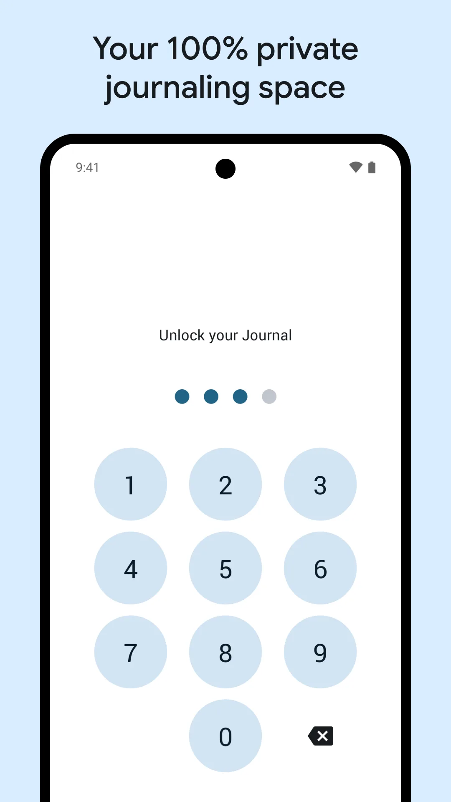
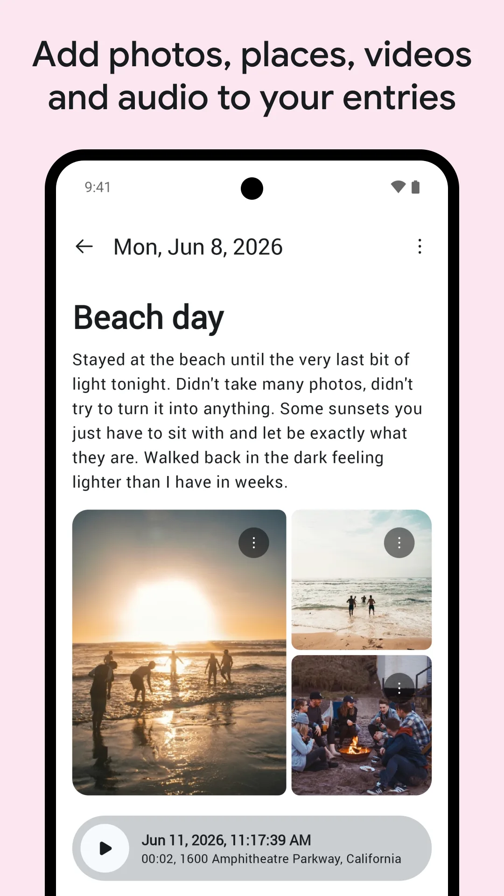
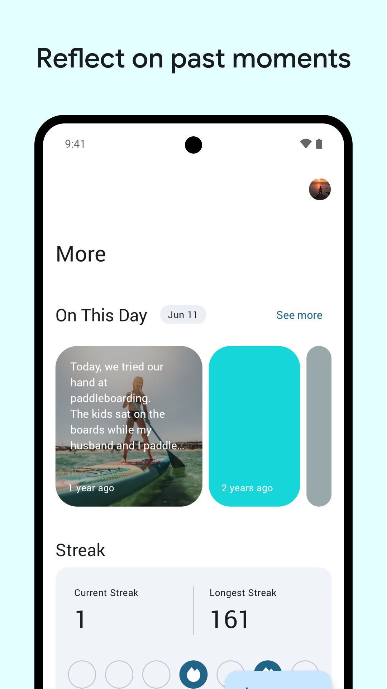
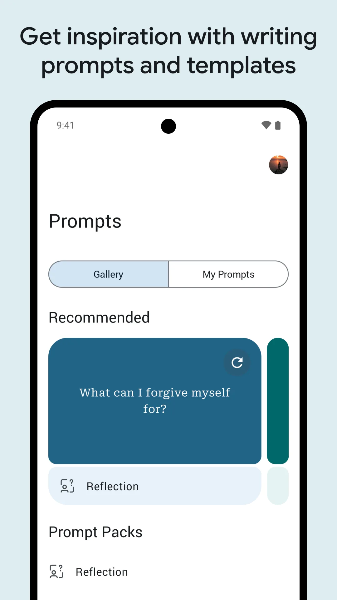
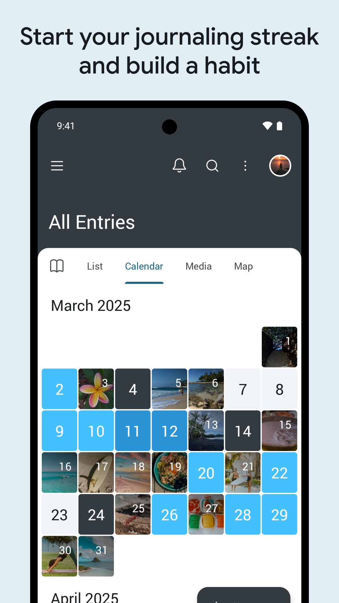

**[Buku harian mood](/ms/glossary/what-is-a-mood-tracker/)** membantu Anda melihat pola perasaan — bukan dengan menulis esai, melainkan mencatat perasaan dalam sepuluh saat dan membiarkan trend yang berbicara. **Meow Mood** adalah **aplikasi mood tracker peribadi** untuk Android dan iOS yang membuat pencatatan terasa ringan: ketik emosi, tambahkan konteks, lalu lihat grafiknya. Di bawah ini kami bandingkan aplikasi yang benar-benar dipasang orang — **Meow Mood, Day One, Journey, Daylio, dan Grid Diary** — dari sisi penjejakan mood, privasi, harga, dan platform. Daftar pendek yang sama sering dicari sebagai **penjejak mood percuma** atau **aplikasi jurnal mood**, jadi kami membandingkan check-in singkat maupun tulisan panjang.

## Apa yang seharusnya dilakukan buku harian mood

- **Pencatatan cepat** — pilih emosi satu ketik, bukan halaman kosong.
- **Tag konteks** — catat tidur, orang, atau cuaca tanpa paragraf.
- **Trend** — kalendar dan graf yang menunjukkan kapan hari buruk mengelompok.
- **Privasi** — mengutamakan offline, dengan data yang tetap milik Anda.
- **Eksport** — PDF atau teks untuk merenung atau dibagikan ke profesional.
- **Peringatan** — dorongan harian yang membangun tabiat.

## Bagaimana kami memilih aplikasi mood tracker terbaik

Menilai **aplikasi jurnal mood** lebih tentang apakah Anda masih mencatat di hari ke-30 daripada jumlah ciri. Kami memakai empat pemeriksaan untuk setiap aplikasi di jadual:

1. **Waktu mencatat** — satu ketik untuk emosi, dengan tag aktivitas pilihan. Jika satu entri perlu halaman kosong, itu jurnal, bukan **penjejak mood percuma** yang akan terus Anda pakai.
2. **Versi percuma yang bertahan** — **aplikasi mood tracker percuma terbaik** semestinya memungkinkan Anda terus mencatat dan meninjau trend tanpa hitung mundur percubaan atau paywall pada kalendar.
3. **Data yang boleh dibawa** — eksport dan bawaan lokal; akaun cloud saja jadi perbelanjaan nyata saat aplikasi mengubah harga.
4. **Graf yang menjawab pertanyaan** — peta panas kalendar dan butiran mood/aktivitas, bukan sekadar angka streak.

Dengan pemeriksaan itu, Meow Mood adalah pilihan **aplikasi mood tracker Android** terkuat untuk entri cepat dan peribadi, sementara Day One menang bila Anda ingin jurnal panjang berfoto dan tidak keberatan langganan.

## Sekilas para kandidat

| Aplikasi | Harga (2026) | Platform | Gaya mood | Privasi | Terbaik untuk |
|---|---|---|---|---|---|
| **Meow Mood** | Teras percuma + VIP pilihan | Android + iOS | Ketik ikon | ✅ lokal, tanpa unggahan | Ringan, peribadi |
| **Day One** | Langganan (Silver/Gold); percuma terhad | Android+iOS+Mac+Web | Entri manual | ⚠️ segerak cloud | Jurnal ciri lengkap |
| **Journey** | Langganan | Android+iOS+Web | Entri manual | ⚠️ cloud (Drive) | Jurnal perjalanan |
| **Daylio** | Percuma + langganan | Android + iOS | Berbasis ikon | ✅ mengutamakan lokal | Catatan mood mikro |
| **Grid Diary** | Percuma + langganan | Android + iOS | Pertanyaan pemandu | ✅ lokal | Prompt terstruktur |

## Meow Mood, secara mendalam

{: width="180" .normal }
{: width="180" .normal }
{: width="180" .normal }
{: width="180" .normal }
{: width="180" .normal }

Meow Mood adalah **aplikasi mood dan buku harian bertema kucing** untuk Android dan iOS. Mencatat cukup satu ketik: pilih emosi, tambahkan tag pilihan atau catatan pendek, selesai.

**Kelebihan untuk penjejakan mood**
- **Pencatatan satu ketik** — ikon emosi mengalahkan lajur teks kosong saat hari sedang buruk.
- **Sepenuhnya offline** — berjalan tanpa isyarat dan menyimpan entri di peranti.
- **Tanpa unggahan bawaan** — data tetap lokal; sandaran hanya ke Google Drive milik Anda bila diaktifkan.
- **Paparan trend** — kalendar dan graf memunculkan kapan mood rendah mengelompok.
- **Kunci** — cap jari atau kode sandi menjaga entri tetap milik Anda.
- **Eksport PDF** — untuk merenung atau dibagikan ke profesional.
- **Peringatan harian** — dorongan yang membuatnya jadi tabiat.

**Kelemahan untuk penjejakan mood**
- **Media kaya lebih ringan** — lebih sedikit foto/audio daripada Day One.
- **Eksport lanjutan (CSV) khusus VIP** — pengguna percuma mendapat PDF.

**Paling sesuai untuk:** orang yang menginginkan **buku harian mood percuma** yang cepat, comel, dan peribadi.

- [Google Play — Meow Mood Diary](https://play.google.com/store/apps/details?id=com.glgjing.meow.mood.diary)
- [App Store — Meow Mood Diary](https://apps.apple.com/app/id6767560237)

## Day One, secara mendalam

{: width="180" .normal }
{: width="180" .normal }
{: width="180" .normal }
{: width="180" .normal }
{: width="180" .normal }

Day One adalah jurnal digital paling awal dan paling banyak meraih penghargaan — dipuji *The New York Times* dan *Wired* sebagai "ruang digital yang sepenuhnya peribadi". Ia tersinkron lintas Android, iOS, Mac, dan web.

**Kelebihan untuk penjejakan mood**
- **Entri kaya** — teks, foto, video, audio, lokasi, dan cuaca dalam satu catatan.
- **Template dan prompt** — awalan terstruktur semasa Anda bingung menulis.
- **Penyegerakan terenkripsi** — entri mengikuti Anda di semua peranti.
- **Ekosistem matang** — satu dekade pembaruan, aplikasi jurnal paling rapi.

**Kelemahan untuk penjejakan mood**
- **Versi percuma terhad** — had peranti dan foto; penggunaan penuh perlu Silver atau Gold.
- **Cloud sejak awal** — entri hidup di server Day One; privasi bergantung pada kepercayaan ke vendor.
- **Lebih berat untuk bermula** — entri kaya yang kosong lebih banyak hambatan daripada mood satu ketik.

**Paling sesuai untuk:** orang yang menginginkan jurnal ciri lengkap dan menerima langganan plus penyegerakan cloud.

- [Google Play — Day One](https://play.google.com/store/apps/details?id=com.dayoneapp.dayone)
- [App Store — Day One](https://apps.apple.com/app/id1044867788)

## Bagaimana yang lain dibandingkan

- **Journey** adalah jurnal berbasis perjalanan dengan penyegerakan Drive; bagus untuk melancong, kurang fokus pada catatan mood cepat.
- **Daylio** mencatat mood lewat ikon plus catatan, percuma dengan langganan untuk sejarah — kerabat penjejakan mood murni terdekat Meow Mood.
- **Grid Diary** menyusun entri lewat pertanyaan harian; sesuai bila prompt membantu Anda menulis.

## Mana yang sebaiknya Anda pilih?

- Ingin **catatan mood cepat, peribadi, satu ketik** → **Meow Mood**.
- Ingin **jurnal hidup kaya dan tersinkron** serta menerima langganan → **Day One**.
- Ingin **catatan mikro berikon saja** → **Daylio**.
- Ingin **struktur berprompt** → **Grid Diary**.

[Dapatkan Meow Mood](/ms/apps/meow-mood-diary/) — tersedia di Android dan iOS.

## Senario umum

- **Catatan cepat saat hari buruk** — pada malam yang berat, ketik satu emosi dan beberapa tag; tanpa paragraf, sehingga buku harian tetap bertahan di hari yang biasanya Anda lewatkan.
- **Peribadi secara bawaan** — entri tetap di peranti di sebalik kunci cap jari; pada telefon pintar keluarga bersama, pikiran Anda tidak pernah tersinkron ke cloud vendor kecuali Anda memilih Google Drive.
- **Menemukan pola** — kalendar dan graf memunculkan 'rasa muram hari Minggu' atau lonjakan setelah kopi, mengubah perasaan samar jadi sesuatu yang boleh ditindaklanjuti.
- **Offline di mana saja** — catat di pesawat atau di area kereta bawah tanah tanpa isyarat; tidak ada yang perlu Wi-Fi untuk merekam momen.

## FAQ

**Apakah Meow Mood percuma?**
{:.faq-q}

Ciri teras — catatan mood cepat, sejarah, graf, dan penggunaan offline — percuma untuk digunakan; beberapa tambahan (seperti eksport CSV) ada di sebalik VIP sekali bayar pilihan.

**Apakah Meow Mood boleh digunakan offline?**
{:.faq-q}

Ya. Anda boleh mencatat, melihat, dan mengedit entri tanpa internet dan tanpa akaun; data tetap di peranti Anda.

**Apakah buku harian saya peribadi?**
{:.faq-q}

Ya — entri tidak pernah diunggah ke server kami; Anda hanya mencadangkan ke Google Drive milik sendiri, dan kunci cap jari atau kode sandi menjaga buku harian tetap untuk Anda sendiri.

**Meow Mood atau Day One — mana yang sebaiknya saya pilih?**
{:.faq-q}

Ingin buku harian mood percuma, peribadi, tanpa akaun, dan disimpan di peranti → Meow Mood; ingin jurnal foto kaya dengan penyegerakan dan menerima langganan → Day One.

## Istilah berkaitan

- [Apakah Itu Penjejak Suasana Hati?](/ms/glossary/what-is-a-mood-tracker/)
