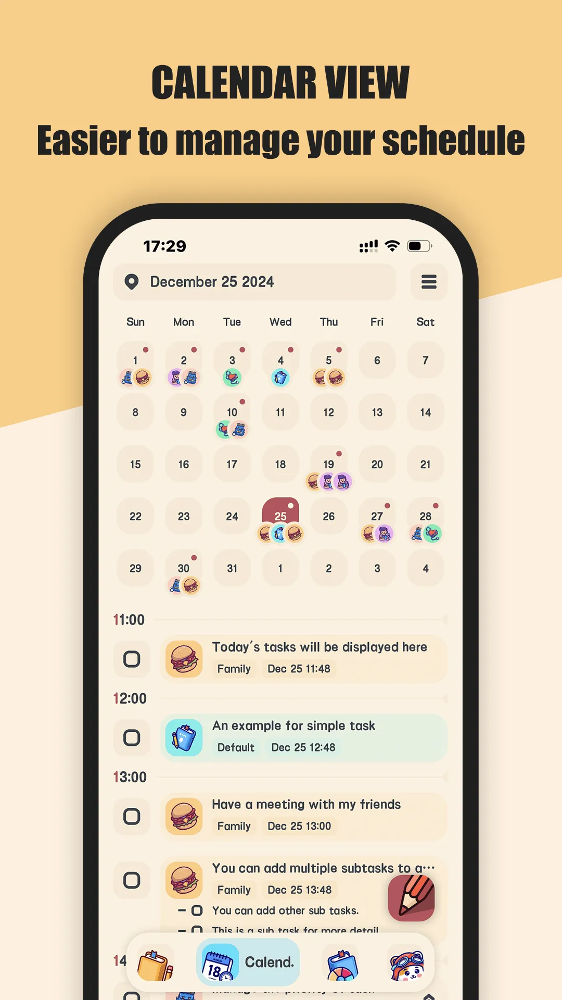
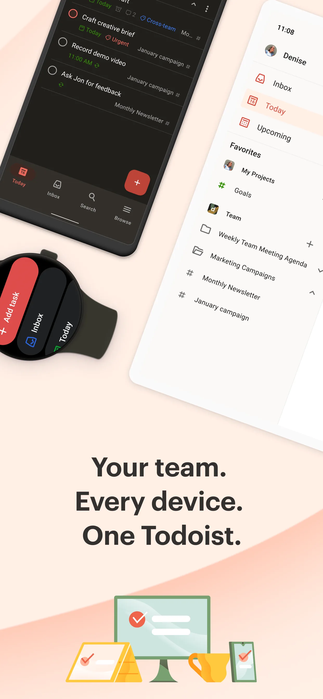

Di Android, **[aplikasi to-do list](/ms/glossary/what-is-a-to-do-list/)** dibuka puluhan kali sehari, jadi tempat **senarai tugasan** Anda disimpan itu penting. Sebahagian orang ingin segerak cloud lintas peranti; yang lain memilih menyimpan tugasan di telefon pintar di sebalik cap jari daripada di satu akaun lagi. **Meow Todo** adalah **[aplikasi tugasan harian](/ms/glossary/what-is-a-to-do-list/) percuma untuk Android dan iOS** yang menyimpan tugasan secara lokal dengan kunci. Di bawah kami membandingkan aplikasi yang benar-benar dipasang pengguna Android — **Meow Todo, Todoist, Microsoft To Do, dan Google Tasks** — dari sisi privasi, widget, penyegerakan, dan harga, sekaligus melihat kapan **alternatif Todoist** berbasis lokal lebih masuk akal.

## Apa yang harus boleh dilakukan aplikasi to-do Android

Enam perkara menentukan aplikasi to-do Android yang benar-benar berguna harian: pilihan local-first dengan kunci cap jari, widget skrin utama untuk mencentang dalam satu ketikan, peringatan yang pasti muncul, paparan kalendar satu minggu, subtugasan untuk memecah kerja, dan harga yang tidak mengunci pencatatan teras di sebalik paywall. Meow Todo adalah aplikasi tugasan harian percuma untuk Android dan iOS yang menyimpan tugasan secara lokal di sebalik kunci, dengan senarai, tugasan, peringatan, dan kalendar secara percuma. Perbandingan ini menilai enam keperluan itu merentas empat aplikasi — Meow Todo, Todoist, Microsoft To Do, dan Google Tasks — dari sisi privasi, widget, segerak, dan harga. Kebanyakan pengguna membuka senarai tugasan puluhan kali sehari, jadi geseran kecil seperti log masuk wajib atau data yang hanya tersimpan di cloud memberi kesan besar.

- **Pilihan local-first** — simpan tugasan di peranti dengan kunci, bukan cloud wajib.
- **Widget skrin utama** — centang tugasan tanpa membuka aplikasi.
- **Peringatan boleh dipercayai** — notifikasi yang benar-benar muncul.
- **Aplikasi kalendar tugasan** — paparan satu minggu secara sekilas.
- **Subtugasan** — pecah kerja menjadi langkah-langkah.
- **Harga wajar** — pencatatan teras tidak boleh terkunci di sebalik paywall.

## Cara kami memilih task manager Android terbaik

Meow Todo menilai task manager Android terbaik pada empat perkara yang baru terasa selepas seminggu penggunaan, bukan pada senarai ciri: tempat data tinggal, geseran harian, teras percuma, dan tiada akaun wajib. Aplikasi to-do sederhana mudah dicari, tetapi yang benar-benar boleh dipercayai jauh lebih sukar. Meow Todo menyimpan tugasan di telefon pintar di sebalik kunci cap jari dengan sandaran Google Drive manual, manakala Todoist, Microsoft To Do, dan Google Tasks semuanya bergantung pada cloud. Empat pemeriksaan ini mengukur perkara yang paling menentukan sama ada senarai tugasan terus dibuka atau ditinggalkan selepas minggu pertama — bukan bilangan ciri pada kotak pakej.

- **Tempat data tinggal** — **aplikasi to-do offline** yang boleh dipercaya menyimpan tugasan di telefon pintar dengan **kunci cap jari**, sembari tetap menawarkan **sandaran Google Drive** sebagai sandaran manual.
- **Geseran harian** — **aplikasi peringatan tugasan** dan subtugasan tidak boleh perlu tutorial, dan paparan kalendar harus menunjukkan satu minggu penuh sekilas.
- **Teras percuma** — **aplikasi to-do list percuma** bagi kebanyakan orang adalah daftar, tugasan, dan peringatan yang bekerja tanpa langganan; itulah arti **aplikasi manajemen tugasan percuma**.
- **Tanpa akaun wajib** — Anda harus boleh mulai di bus tanpa isyarat dan tanpa login.

## Sekilas para pesaing

Empat aplikasi dalam jadual ini — Meow Todo, Todoist, Microsoft To Do, dan Google Tasks — mewakili dua pendekatan senarai tugasan Android: storan lokal peribadi dan segerak cloud. Meow Todo menawarkan teras percuma dengan data di peranti di sebalik kunci dan sandaran manual Drive atau WebDav. Todoist percuma dengan Pro kira-kira $48 setahun untuk ciri penuh dan segerak terus, sementara Microsoft To Do serta Google Tasks kedua-duanya percuma dengan segerak dalam ekosistem masing-masing. Jadual di bawah membedah harga, storan, widget, segerak, dan kegunaan utama. Ringkasan ini menonjolkan satu perkara: hanya Meow Todo yang menyimpan tugasan di peranti tanpa akaun wajib.

| Aplikasi | Harga (2026) | Lokal/peribadi | Widget | Segerak | Paling sesuai untuk |
|---|---|---|---|---|---|
| **Meow Todo** | Teras percuma + VIP pilihan | ✅ di peranti + kunci | ✅ | Manual (Drive/WebDav) | Peribadi, lokal |
| **Todoist** | Percuma + Pro ~$48/tahun | ❌ cloud | ✅ | ✅ terus | Daya merentas platform |
| **Microsoft To Do** | Percuma | ❌ cloud (MS) | ✅ | ✅ | Ekosistem MS |
| **Google Tasks** | Percuma | ❌ cloud (Google) | ✅ | ✅ | Gmail ringan |

## Meow Todo, secara mendalam

Meow Todo adalah aplikasi senarai tugasan bertema kucing untuk Android dan iOS yang menyimpan setiap tugasan di peranti di sebalik kunci cap jari tanpa akaun wajib. Ciri teras — daftar, tugasan, peringatan, dan paparan kalendar — kekal percuma, manakala VIP pilihan sekali bayar menambah daftar tanpa had, tag, subtugasan, eksport CSV, dan kunci aplikasi. Kelebihannya untuk pengguna Android termasuk storan lokal, widget catat satu ketikan dari skrin utama, peringatan harian yang benar-benar muncul, dan sandaran Google Drive atau WebDav yang hanya berlaku apabila anda mengaktifkannya. Kekurangannya ialah tiada segerak berbilang peranti masa nyata dan sebahagian ciri lanjutan berada di sebalik peningkatan. Meow Todo sesuai untuk pengguna yang mahukan aplikasi tugasan percuma yang tetap berada di telefon mereka. Gambar di bawah menunjukkan tugasan hari ini, editor tugasan, senarai berkumpulan, paparan mingguan, dan tetapan sandaran.

{: width="180" .normal }
{: width="180" .normal }
{: width="180" .normal }
{: width="180" .normal }
{: width="180" .normal }

Meow Todo adalah **aplikasi senarai tugasan bertema kucing** untuk Android dan iOS. Ciri teras — daftar, tugasan, peringatan, dan paparan kalendar — percuma; VIP menambah daftar tanpa had, tag, subtugasan, eksport CSV, dan kunci aplikasi.

**Kelebihan untuk pengguna Android**
- **Storan di peranti** — tugasan tetap di telefon pintar di sebalik kunci cap jari.
- **Tanpa akaun wajib** — buka lalu mulai; tidak ada yang diunggah secara lalai.
- **Widget** — centang tugasan dari skrin utama dalam satu ketikan.
- **Subtugasan dan peringatan** — pecah dan jadwalkan kerja dengan notifikasi harian.
- **Sandaran yang Anda kendalikan** — Google Drive atau WebDav, hanya semasa Anda aktifkan.
- **Eksport CSV** — keluarkan data bila-bila sahaja.

**Kelemahan untuk pengguna Android**
- **VIP untuk ciri lanjutan** — daftar tanpa had, tag, dan eksport CSV ada di sebalik peningkatan.
- **Tanpa segerak multi-perangkat terus** — ini sandaran manual, bukan akaun masa nyata.

**Paling sesuai untuk:** pengguna Android yang ingin **aplikasi to-do percuma** yang tetap disimpan di peranti.

- [Google Play — Meow Todo List](https://play.google.com/store/apps/details?id=com.glgjing.money.task.todo.list.meow)
- [App Store — Meow Todo List](https://apps.apple.com/app/id6742345495)

## Todoist, secara mendalam

Todoist adalah pengurus tugasan paling banyak dipasang dengan entri bahasa alami dan segerak masa nyata merentas telefon pintar, tablet, dan desktop. Kelebihannya termasuk menaip "bayar sewa bilik tarikh 1" terus menetapkan tarikh, tugasan muncul serta-merta di semua peranti, organisasi melalui projek, subtugasan, label, prioriti, dan perkongsian, serta widget yang rapi dan tambah-cepat dari panel notifikasi. Namun ia mewajibkan cloud — tugasan disimpan di pelayan Todoist — pakej percuma dihadkan, Pro kira-kira $48 setahun membuka projek, komen, dan label tanpa had, dan langganan menjadi perbelanjaan berulang. Todoist sesuai untuk pengguna yang mengutamakan segerak merentas peranti dan ciri kuat berbanding privasi lokal. Gambar di bawah menunjukkan senarai hari ini, editor tugasan, kumpulan label, kalendar, dan tetapan segerak.

{: width="180" .normal }
{: width="180" .normal }
{: width="180" .normal }
{: width="180" .normal }
{: width="180" .normal }

Todoist adalah pengurus tugasan paling banyak dipasang, dengan entri bahasa alami dan segerak merentas platform yang mendalam.

**Kelebihan untuk pengguna Android**
- **Bahasa alami** — "bayar sewa bilik tarikh 1" terus mengatur tanggalnya.
- **Segerak terus** — tugasan muncul di semua peranti seketika.
- **Organisasi kaya** — projek, subtugasan, label, prioritas, dan berkongsi.
- **Aplikasi matang** — widget rapi dan tambah-cepat dari panel notifikasi.

**Kelemahan untuk pengguna Android**
- **Cloud wajib** — tugasan Anda disimpan di server Todoist.
- **Pakej percuma terhad** — Pro (~$48/tahun) untuk projek, komentar, dan label tanpa had.
- **Perbelanjaan langganan** — pembayaran berulang untuk penggunaan penuh.

**Paling sesuai untuk:** orang yang ingin segerak masa nyata lintas telefon pintar, tablet, dan desktop.

- [Google Play — Todoist](https://play.google.com/store/apps/details?id=com.todoist)
- [App Store — Todoist](https://apps.apple.com/app/id572688855)

## Bagaimana aplikasi lain dibandingkan

Dua pesaing tambahan melengkapkan senarai ini. Microsoft To Do percuma dalam Microsoft 365 dengan senarai bersama dan integrasi Outlook — pas jika anda sudah hidup dalam ekosistem Microsoft. Google Tasks adalah pilihan paling ringan, terikat akaun Google dan Gmail; memadai untuk senarai mudah tetapi nipis pada subtugasan dan eksport. Kedua-duanya mengesahkan satu pola: aplikasi percuma yang hebat selalunya datang bersama akaun cloud wajib. Bagi pembaca Android yang mahu tugasan tersimpan di peranti tanpa log masuk, Meow Todo mengisi celah yang ditinggalkan oleh kedua-dua alternatif ini. Pilihan akhir bergantung pada sama ada anda mahu log masuk sekali untuk kemudahan segerak, atau langsung tidak mahu akaun baharu dalam kehidupan harian.

- **Microsoft To Do** percuma di dalam Microsoft 365, dengan daftar bersama dan integrasi Outlook.
- **Google Tasks** adalah pilihan paling ringan, terikat akaun Google dan Gmail — cukup untuk daftar sederhana, tipis di subtugasan dan eksport.

## Mana yang sebaiknya dipilih pengguna Android?

Pilihan pengguna Android bergantung pada satu trade-off: data di peranti tanpa akaun, atau segerak cloud dengan ciri kukuh. Meow Todo adalah jawapan untuk tugasan lokal, peribadi, dan tanpa akaun dengan widget satu ketikan. Todoist sesuai jika anda mahu entri bahasa alami dan segerak masa nyata serta menerima Pro kira-kira $48 setahun, Microsoft To Do untuk kehidupan harian dalam Microsoft 365, dan Google Tasks untuk senarai ringkas terikat Gmail. Empat cadangan ini meringkaskan jadual di atas menjadi keputusan praktikal. Jika anda mengutamakan privasi dan mahu menambah tugasan di MRT tanpa isyarat, aplikasi local-first adalah pilihan yang paling konsisten.

- Ingin **lokal, peribadi, tanpa akaun** → **Meow Todo**.
- Ingin **segerak lintas peranti terus + ciri kuat** → **Todoist**.
- Sehari-hari di **Microsoft 365** → **Microsoft To Do**.
- Ingin **daftar terikat Gmail paling ringan** → **Google Tasks**.

[Dapatkan Meow Todo](/ms/apps/meow-todo-list/) — tersedia di Android dan iOS.

## Senario umum

Empat senario umum menunjukkan nilai aplikasi tugasan local-first dalam kehidupan seharian. Di MRT atau pesawat tanpa isyarat, tugasan ditambah seketika dan kekal di peranti di sebalik kunci cap jari, jadi tiada apa pun diunggah ke akaun cloud lain. Untuk memisahkan kerja dan hidup, tag dan lebih 400 ikon kategori comel memisahkan "Kerja", "Rumah", dan "Perjalanan" supaya sekilas hanya yang penting kelihatan. Perancangan semester mahasiswa menjadi terkawal apabila jadual kuliah dan tarikh akhir masuk ke satu senarai dengan peringatan harian. Akhir sekali, senarai semak perjalanan boleh dicentang tanpa internet dan disegerak ke Google Drive atau WebDav hanya selepas kembali online.

- **Mencatat tugasan secara peribadi** — di MRT atau pesawat tanpa isyarat, tambahkan tugasan seketika; semuanya tetap di peranti di sebalik kunci cap jari, jadi tidak ada yang diunggah ke akaun cloud lain.
- **Pemisahan kerja dan hidup** — pakai tag dan 400+ ikon kategori comel untuk memisahkan "Kerja", "Rumah", dan "Perjalanan", sehingga sekilas hanya yang penting saat ini yang kelihatan.
- **Perancangan semester mahasiswa** — masukkan jadual kuliah dan tarikh akhir tugasan ke satu daftar, biarkan peringatan harian mengingatkan sebelum setiap deadline; subtugasan membuat projek besar tidak terasa seperti dinding teks.
- **Perjalanan offline-first** — susun senarai semak perjalanan sebelum terbang; centang item tanpa internet dan segerak ke Google Drive atau WebDav hanya saat kembali online.

## FAQ

**Apakah Meow Todo List percuma?**
{:.faq-q}

Ya untuk penggunaan teras — daftar, tugasan, peringatan, dan paparan kalendar percuma; daftar tanpa had, tag, subtugasan, eksport CSV, dan kunci aplikasi ada di sebalik VIP sekali bayar pilihan.

**Apakah Meow Todo boleh digunakan offline?**
{:.faq-q}

Ya. Anda boleh menambah dan mencentang tugasan tanpa internet; **aplikasi to-do offline** ini menyimpan data di peranti dan hanya menyinkron ke Google Drive atau WebDav semasa Anda mengaktifkan sandaran.

**Apakah saya perlu akaun untuk memakai Meow Todo?**
{:.faq-q}

Tidak. Anda boleh terus mulai tanpa pendaftaran; **senarai tugasan tanpa akaun** ini tetap disimpan lokal di sebalik kunci cap jari.

**Meow Todo atau Todoist — mana yang sebaiknya dipilih?**
{:.faq-q}

Ingin **alternatif Todoist** yang percuma, peribadi, ramah offline, dan tanpa akaun → Meow Todo; ingin entri bahasa alami dan segerak masa nyata lintas peranti → Todoist (Pro berbayar).

## Istilah berkaitan

- [Apakah Itu Daftar Tugasan (To-Do List)?](/ms/glossary/what-is-a-to-do-list/)
- [Apakah Itu Subtugasan?](/ms/glossary/what-is-a-subtask/)
