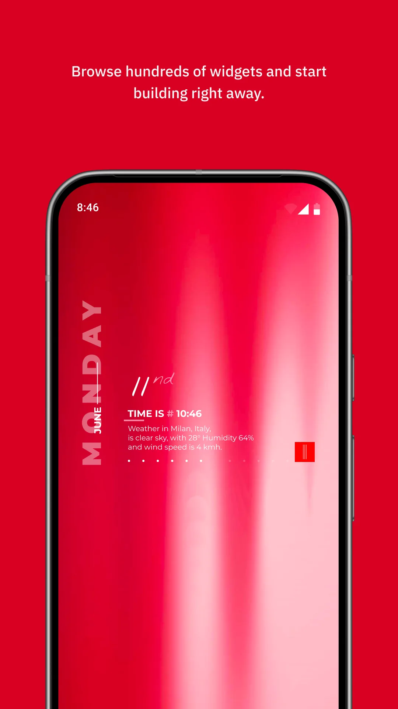

Sejak Android 12, **Material You** membiarkan sistem menarik palet warna dari wallpaper dan menyebarkannya ke seluruh UI. Sebuah **[widget Material You](/ms/glossary/what-is-material-you/)** sebaiknya terasa asli — membulat, sesuai warna, dan peka tema. **One Widget** menyediakan widget comel ramah tema yang mengikuti paparan sistem Anda. Di bawah ini kami membandingkannya dengan **KWGT** untuk gaya Material You. Kami juga melihat penggunaan **aplikasi widget jam Android** dan **aplikasi widget kalendar Android** serta gaya murni, kerana widget yang hanya sesuai warna mudah dihapus.

## Yang dibutuhkan widget Material You

Sebuah **[widget Material You](/ms/glossary/what-is-material-you/)** sejak Android 12 mengambil palet warna dari wallpaper dan menyebarkannya ke seluruh antara muka; **One Widget** mengikuti tema sistem dengan warna dinamik, sudut membulat, dan penempatan terus tanpa editor. Kualiti sebenar widget bertema diukur dengan empat perkara: rona yang diambil dari wallpaper, peralihan bersama mod terang dan gelap, sudut yang mengikut grid sistem, serta penempatan cepat yang tidak memerlukan editor. One Widget menyediakan kesemuanya sebagai pratetap yang terus boleh ditaruh.

- **Warna dinamis** — rona diambil dari wallpaper.
- **Ikut terang/gelap** — berpindah dengan tema sistem.
- **Sudut membulat peka bentuk** — sesuai dengan grid sistem.
- **Penempatan cepat** — tanpa editor.

## Di luar warna: apa yang sebenarnya dipaparkan widget bertema

**One Widget** menyediakan **empat kasus penggunaan** widget bertema yang menjawab sekilas, bukan sekadar warna yang sesuai dengan palet Android 12: jam dan kalendar yang kekal terbaca dalam tema terang dan gelap, pratetap kaca dan gaya iOS dengan latar yang boleh diredupkan, skin Nothing dan Galaxy sebagai gaya terbina, serta toggle sistem di sebelah jam. Warna dinamik hanyalah langkah pertama — widget yang anda pertahankan ialah yang memberi maklumat berguna sebaik dipandang. Empat kasus umum:

- **Jam dan kalendar** — **aplikasi widget jam Android** dan **aplikasi widget kalendar Android** adalah dua widget yang pertama kali ditaruh orang. Keduanya harus tetap terbaca di tema terang maupun gelap, dan mengikuti hari pertama dalam seminggu menurut sistem.
- **Paparan tembus pandang** — pratetap **widget gaya kaca Android** dan **widget gaya iOS Android** perlu latar yang boleh Anda redupkan, kalau tidak teks menghilang di atas wallpaper terang. One Widget membiarkan Anda mengatur warna latar dan radius sudut per widget.
- **Skin Nothing dan Galaxy** — **widget telefon pintar Nothing** menggunakan paparan dot-matrix monokrom; **widget Samsung One UI** mengikuti bentuk membulat bawaan. Keduanya disertakan sebagai gaya, bukan instalasi terpisah.
- **Shortcut sistem** — toggle Wi-Fi atau senter di sebelah jam sering lebih berguna daripada panel dekoratif keempat.

KWGT boleh mereproduksi semua ini, tetapi masing-masing adalah sebuah projek; di sini mereka adalah pratetap yang Anda ubah ukuran dan taruh.

## Para pesaing sekilas

Perbandingan tiga pilihan widget Material You pada 2026 menunjukkan tiga pendekatan: **One Widget** (teras percuma + VIP) mengambil palet wallpaper secara automatik, **KWGT** (percuma + Pro Key) memerlukan anda menulis Kode untuk warna dinamik, dan widget sistem yang asas tetapi terhad. Jadual di bawah membandingkan harga, warna dinamik, tahap tetapan, kepekaan tema, dan kegunaan terbaik supaya anda boleh memilih antara pratetap yang terus sesuai dengan pembinaan manual.

| App | Harga (2026) | Warna dinamis | Tetapan | Peka tema | Terbaik untuk |
|---|---|---|---|---|---|
| **One Widget** | Teras percuma + VIP | ✅ sesuai tema | Ketik & taruh | ✅ | Paparan asli, cepat |
| **KWGT** | Percuma + Pro Key | ⚠️ Kode manual | Reka bentuk | ⚠️ manual | Kendali penuh |
| **Widget sistem** | Percuma | ✅ | Ketik & taruh | ✅ | Dasar, terhad |

## One Widget, secara mendalam

**One Widget** adalah **pakej widget bergaya kucing** untuk Android dengan gaya yang mengikuti tema sistem sejak Android 12 — palet warna diturunkan dari wallpaper dan sudutnya membulat mengikut grid sistem. Widget jam atau cuaca terus pas tanpa editor, manakala warna latar dan radius sudut boleh dilaras per widget supaya teks tidak hilang di atas wallpaper terang. Teras percuma dengan VIP pilihan membuka gaya dan tipe widget ekstra; kesemuanya berjalan lokal di peranti tanpa akaun atau cloud.

{: width="180" .normal }
{: width="180" .normal }
{: width="180" .normal }
{: width="180" .normal }
{: width="180" .normal }

One Widget adalah **pakej widget bergaya kucing** untuk Android dengan gaya yang mengikuti tema sistem, termasuk warna Material You dan pembentukan sudut.

**Kelebihan untuk Material You**
- **Palet sesuai tema** — widget mengambil warna yang diturunkan dari wallpaper.
- **Membulat, peka bentuk** — sudut mengikuti grid sistem.
- **Jadi** — taruh widget jam atau cuaca dan ia sudah pas.
- **Gaya kucing comel** — ramah tanpa merusak paparan material.
- **Ringan dan lokal** — tanpa akaun, tanpa cloud.

**Kelemahan untuk Material You**
- **Kurang granular dari KWGT** — Anda mengadopsi tema, tidak menulisnya.
- **VIP untuk lebih** — widget ekstra dan gaya lebih dalam di sebalik upgrade.

**Terbaik untuk:** orang yang menginginkan **widget Material You** yang kelihatan asli dalam hitungan saat.

- [Google Play — One Widget](https://play.google.com/store/apps/details?id=com.glgjing.galaxy.nothing.glass.material.widget)

## KWGT, secara mendalam

**KWGT** (pakej `org.tersuai.widget`) boleh mereproduksi Material You secara persis — warna dinamik, bentuk tersuai, dan animasi — tetapi anda perlu menulis Kode untuk membaca palet sistem dan membentuknya sendiri. Pro Key adalah **pembelian sekali bayar**, tanpa langganan, jadi kos buka kunci dibayar satu kali. Berbanding **One Widget** yang terus mengikuti tema sistem dalam hitungan saat, KWGT menawarkan kendali peringkat piksel dengan harga lengkung belajar yang curam dan keperluan peluncur yang serasi. Ia sesuai hanya jika anda mahu membina logika warna dinamik sendiri.

{: width="180" .normal }
{: width="180" .normal }
{: width="180" .normal }
{: width="180" .normal }
{: width="180" .normal }

KWGT (Tersuai Widget Maker, pakej `org.tersuai.widget`) dapat mereproduksi Material You secara persis — jika Anda menulis Kode untuk membaca warna sistem dan membentuknya.

**Kelebihan untuk Material You**
- **Kendali tingkat piksel** — warna dinamis via formula, bentuk tersuai, animasi.
- **Pro Key sekali bayar** — tanpa langganan.

**Kelemahan untuk Material You**
- **Kerja manual** — Anda harus membangun logika warna dinamis sendiri.
- **Lengkung curam** — bukan pengalaman "taruh dan sesuai".
- **Bergantung peluncur** — perlu peluncur yang kompatibel.

**Terbaik untuk:** penggaya Android yang ingin kendali persis.

- [Google Play — KWGT](https://play.google.com/store/apps/details?id=org.tersuai.widget)

## Mana yang harus Anda pilih?

Pilihan antara **One Widget** dan **KWGT** bergantung pada berapa banyak kerja tetapan yang sanggup anda lakukan. Sejak **Android 12**, warna Material You boleh diambil terus dari wallpaper; One Widget melakukan itu secara automatik dalam pratetap jadi yang terus pas, manakala KWGT memerlukan anda menulis Kode untuk membaca palet sistem dan membentuk sudut sendiri. Pro Key KWGT dibayar sekali, tetapi lengkung belajarnya curam dan ia memerlukan peluncur yang serasi. Senarai berikut memetakan kedua-dua pilihan kepada situasi anda.

- Ingin **Material You yang terus sesuai** → **One Widget**.
- Ingin **warna dinamis buatan tangan** → **KWGT**.

[Dapatkan One Widget](/ms/apps/one-widget/) — tersedia di Android.

## Senario umum

Lima senario harian menunjukkan di mana **One Widget** memberi nilai paling jelas dengan widget bertema yang mengikuti palet **Android 12**: paparan asli dalam hitungan saat, ganti wallpaper dan tema bertukar serentak, mod terang dan gelap mengikuti sistem, gaya kucing yang tetap menghormati bahasa bentuk material, serta operasi lokal tanpa akaun. Dalam setiap kes, tiada Kode yang perlu ditulis — anda menaruh widget dan palet wallpaper melakukan selebihnya. KWGT pula sesuai jika anda mahu mengawal setiap warna secara manual.

- **Paparan asli dalam hitungan saat** — taruh widget jam atau cuaca dan ia sudah mengambil warna wallpaper serta sudut membulat Anda; tanpa editor.
- **Ganti wallpaper, ganti tema** — kerana palet diturunkan dari wallpaper, wallpaper baru menemakan ulang setiap widget sekaligus.
- **Terang/gelap mengikuti sistem** — widget berpindah dengan tema sistem, sehingga skrin utama tetap koheren siang dan malam.
- **Comel tanpa merusak material** — gaya bergaya kucing yang tetap menghormati bahasa bentuk dan warna.
- **Ringan dan lokal** — berjalan di peranti tanpa akaun; tidak ada yang diunggah.

## FAQ

**Apakah tema Material You One Widget percuma?**
{:.faq-q}

Widget teras cocok-Material You percuma untuk ditaruh; gaya lebih dalam dan tipe widget ekstra dibuka via VIP sekali bayar pilihan.

**Apakah One Widget mengikuti tema terang/gelap sistem?**
{:.faq-q}

Ya. Widget peka tema dan mengikuti mode terang/gelap sistem serta warna yang diturunkan dari wallpaper.

**One Widget atau KWGT untuk Material You?**
{:.faq-q}

Ingin widget cocok-wallpaper instan, tanpa editor → One Widget; ingin menulis warna dinamis buatan tangan dengan kendali piksel → KWGT (Pro Key).

[Halaman aplikasi One Widget](/ms/apps/one-widget/) — tersedia di Android.

## Istilah berkaitan

- [Apakah Itu Widget Skrin Utama?](/ms/glossary/what-is-a-home-screen-widget/)
- [Apakah Itu Material You?](/ms/glossary/what-is-material-you/)
- [Apakah Itu Nothing UI?](/ms/glossary/what-is-nothing-ui/)
- [Apakah Itu Galaxy One UI?](/ms/glossary/what-is-galaxy-one-ui/)
- [Apakah Itu iOS Glass?](/ms/glossary/what-is-ios-glass/)
